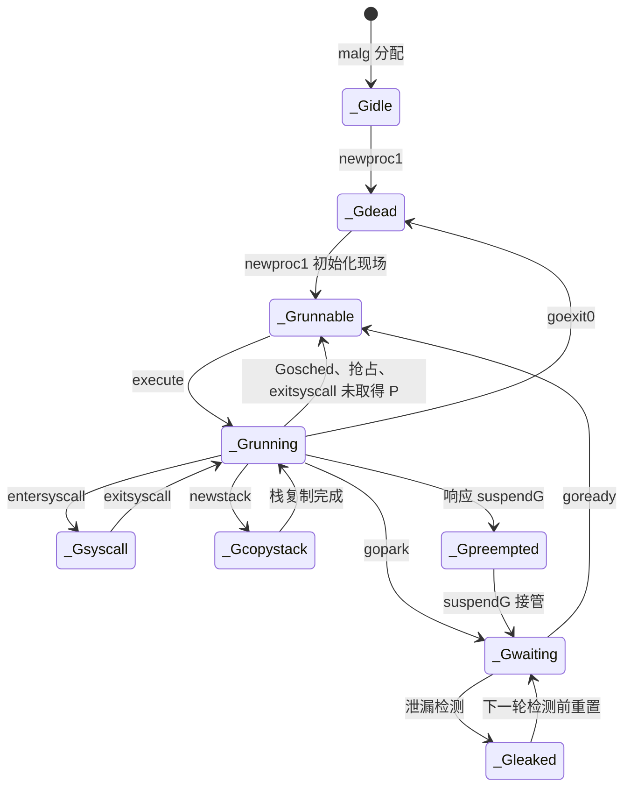

# 9.3 MPG 模型与并发调度单元

[9.1](./model.md) 从线程模型的角度介绍了 G、M、P 的分工，[9.2](./steal.md) 讨论了工作如何在 P 之间分摊。
本节转向这三种调度单元本身：goroutine 在协程的谱系中处于什么位置，G、M、P 在运行时中如何表示，
调度代码为何要在专门的 g0 栈上执行，goroutine 会经历哪些状态，以及空闲的工作线程如何暂止与复始。
文中的结构体都是裁剪后的示意，只保留与设计有关的字段，完整定义见 Go 1.26 的 `runtime/runtime2.go` 与
`runtime/proc.go` [[Go Authors, 2026a](#ref-go-authors-2026a)]。

## 9.3.1 goroutine 与协程

协程的概念出现于 1960 年代初，通常归功于 Conway 1963 年的论文：文中把协程描述为互以对方为主程序的子程序，
并用它组织 COBOL 编译器中词法分析器与语法分析器之间的协作 [[Conway, 1963](#ref-conway-1963)]。
此后数十年间，各种协程机制的差别很大，始终缺少统一的定义。Moura 与 Ierusalimschy 指出，
除了在两次调用之间保持局部状态这一共性之外，协程机制在三个问题上各有取舍
[[Moura and Ierusalimschy, 2009](#ref-moura-and-ierusalimschy-2009)]：

- **控制转移方式**：**对称协程**（symmetric coroutine）只提供一种转移操作，任何协程都可以把控制权交给任何
  其他协程；**非对称协程**（asymmetric coroutine）区分恢复（resume）与让出（yield），
  被恢复的协程只能把控制权交还给恢复它的一方。
- **是否为一等对象**：协程能否作为普通的值被创建、传递和保存，还是只能以受限的语法结构出现。
- **是否有栈**：**有栈协程**（stackful coroutine）可以在嵌套调用的任意深度挂起，恢复后从挂起点继续执行；
  无栈的机制只能在协程体的顶层挂起。

两人把兼具一等性与有栈性的协程称为**完全协程**（full coroutine），并证明完全协程的表达能力与**一次性续延**（one-shot
continuation）及一次性部分续延相当。对称与非对称两种形式的表达能力相同，
但非对称形式更易于使用。

按这一分类，goroutine 的实现是有栈的。每个 G 拥有独立的栈，挂起时只需把栈指针、程序计数器等少数寄存器保存
到 G 中（即 9.3.2 中的 `gobuf`），栈上的调用帧原样保留，恢复时再把这些寄存器装回。G
与调度器之间的关系则接近非对称协程：G 经 `mcall` 把控制权交给调度器（9.3.3），由调度器选出下一个 G
并恢复其执行。

然而 goroutine 并不是严格意义上的协程。协程提供的是没有并行的并发：同一时刻只有一个协程在运行，
控制权何时转移由程序显式决定。goroutine 则由调度器决定何时运行、在哪个线程上运行，它们可以真正并行，
也可能被抢占 [[Cox, 2023](#ref-cox-2023)]。两者的差别也体现在开销上。Cox 的原型测量表明，借助 channel
在两个 goroutine 之间模拟协程，每次切换约需 190 ns，而在运行时中直接实现的协程切换只需约 20 ns。
这一实现后来进入运行时（`runtime/coro.go`），成为 Go 1.23 中 `iter.Pull` 的基础：`coroswitch`
直接把当前线程从一个 goroutine 切换到另一个，既不经过运行队列，也不引入新的并行。

有栈的设计还影响了语言本身。在基于 `async`/`await` 的无栈协程中，一个函数若要在内部挂起，自身必须标记为
`async`，它的调用者往往也须如此，「能否挂起」于是成为沿调用链向上传播的函数属性。Nystrom
把这种属性称为函数的「颜色」，并指出 Go、Lua 与 Ruby 没有这个问题，因为它们都具备多条可以相互切换的独立调
用栈 [[Nystrom, 2015](#ref-nystrom-2015)]。在 Go 中，任何函数都可以在任意深度阻塞，调用方无须知晓，
标准库也不必为同步与异步各提供一套接口。

有栈的代价是每个 goroutine 都要占用一段栈内存。Go 的做法是让栈从很小开始、按需增长：新分配的 goroutine
栈为 2 KiB（`runtime/stack.go` 中的 `stackMin`），空间不足时由连续栈机制整体复制到更大的内存中
[[Randall, 2013](#ref-randall-2013)]，详见 [14.3](../../part4memory/ch14stack/grow.md)。自 Go 1.19 起，
运行时还在每轮 GC 中统计被扫描栈的平均大小，从空闲链表复用的 goroutine 以此作为初始栈大小
（`startingStackSize`），以减少早期的栈增长 [[Go Authors, 2022](#ref-go-authors-2022)]。

下表对照几种语言中并发执行体的表示，调度方式的比较见 [9.1.3](./model.md)：

| 执行体 | 有栈 | 挂起时状态的存放 | 初始开销 |
| --- | --- | --- | --- |
| Go goroutine | 是 | 独立的栈，寄存器现场保存在 `gobuf` 中 | 栈 2 KiB |
| Erlang 进程 | 是 | 进程私有的栈与堆 | 338 字（64 位平台约 2.6 KiB），其中堆 233 字 |
| Java 虚拟线程 | 是 | 栈以 stack chunk 对象存放于 GC 堆中 | 栈随运行增长与收缩 |
| Lua 协程 | 是 | 独立的 Lua 栈，以 `resume`/`yield` 非对称地转移控制 | |
| Kotlin 协程 | 否 | `suspend` 函数编译为状态机，状态存于续延对象 | 无独立的栈，只分配状态对象 |

Erlang 的数据取自其效率指南 [[Ericsson, n.d.](#ref-ericsson-nd)]，Java 虚拟线程的描述见 JEP 444
[[Pressler and Bateman, 2023](#ref-pressler-and-bateman-2023)]，Lua 协程即 Moura 与 Ierusalimschy
所讨论的完全非对称协程。Kotlin 是表中唯一的无栈实现：编译器以续延传递风格（CPS）把 `suspend`
函数改写为状态机，每个状态对应一个挂起点 [[Breslav and Elizarov, n.d.](#ref-breslav-and-elizarov-nd)]。
它不需要独立的栈，代价是 `suspend` 成为函数的颜色。

## 9.3.2 G、M、P 的表示

`proc.go` 开头的注释给出了三者的定义：G 是 goroutine；M 是工作线程（machine）；P 是处理器（processor），
即执行 Go 代码所需的资源。M 必须关联一个 P 才能执行 Go 代码，但可以在没有 P 的情况下阻塞或执行系统调用
[[Go Authors, 2026a](#ref-go-authors-2026a)]。把运行队列与内存缓存放在 P 而非 M 上的理由见
[9.1.4](./model.md)：线程数可能远多于 `GOMAXPROCS`，而按 P 分配的资源只与并行度成正比
[[Vyukov, 2012](#ref-vyukov-2012)]。

### G

```go
// g：goroutine（示意）
type g struct {
	stack        stack          // 栈区间 [stack.lo, stack.hi)
	stackguard0  uintptr        // 栈溢出检查的界限；设为 stackPreempt 时兼作抢占请求
	m            *m             // 正在执行此 G 的 M，未运行时为 nil
	sched        gobuf          // 挂起时保存的执行现场
	param        unsafe.Pointer // 唤醒方传给被唤醒者的参数
	atomicstatus atomic.Uint32  // 状态，见 9.3.4
	goid         uint64         // goroutine 编号
	schedlink    guintptr       // 串接运行队列、空闲链表等 G 链表
	waitreason   waitReason     // 处于 _Gwaiting 时阻塞的原因
	preempt      bool           // 抢占请求，与 stackguard0 = stackPreempt 同义
	waiting      *sudog         // 阻塞时所等待的 sudog 链表，见第 10 章
}

// gobuf：恢复执行所需的寄存器现场（示意）
type gobuf struct {
	sp   uintptr        // 栈指针
	pc   uintptr        // 恢复执行的指令地址
	g    guintptr       // 所属的 G
	ctxt unsafe.Pointer // 闭包上下文
	lr   uintptr        // 链接寄存器（arm64 等架构）
	bp   uintptr        // 帧指针
}
```

挂起一个 goroutine，就是把这几个寄存器存入 `g.sched`；恢复它，就是由汇编例程 `gogo` 把它们装回 CPU
并跳转到 `pc`。其余寄存器无须保存：Go 的内部调用约定没有被调用方保存的寄存器
[[Go Authors, 2026a](#ref-go-authors-2026a)]，在 `mcall` 这样的调用点上不存在需要保留的寄存器值。
异步抢占发生在任意指令处，那时由 `asyncPreempt` 先把全部寄存器压入 goroutine 自己的栈，见
[9.7](./preemption.md)。

创建 goroutine 的 `newproc1` 用同一套机制伪造了一个调用现场。它先从空闲链表取一个 G，取不到则新分配一个带
2 KiB 栈的 G；然后把 `sched.pc` 设为 `goexit` 函数内的地址，再由 `gostartcallfn` 把这个地址压入新栈作为返
回地址，并把 `sched.pc` 改为 goroutine 函数的入口。于是新 G 第一次被调度时从函数入口开始执行，
函数返回时则「返回」到 `goexit`，进入退出流程。goroutine 的退出因此不需要编译器为 `go`
语句生成任何特殊的收尾代码。

### M

```go
// m：工作线程（示意，原结构约 70 个字段）
type m struct {
	g0        *g                // 持有调度栈的 goroutine，见 9.3.3
	gsignal   *g                // 处理信号的 goroutine，见 9.6
	tls       [tlsSlots]uintptr // 线程局部存储
	curg      *g                // 当前执行的用户 goroutine
	p         puintptr          // 关联的 P；为 0 时不能执行 Go 代码
	nextp     puintptr          // 被唤醒后将要关联的 P
	oldp      puintptr          // 进入系统调用前关联的 P
	id        int64
	spinning  bool              // 是否处于自旋状态，见 9.3.5
	park      note              // 暂止时在此休眠
	alllink   *m                // 串入全局链表 allm
	schedlink muintptr          // 串入空闲 M 链表
	lockedg   guintptr          // 经 LockOSThread 锁定到本线程的 G
}
```

M 持有两个不执行用户代码的 goroutine：`g0` 承载调度与运行时代码，`gsignal` 承载信号处理；`curg`
才是当前的用户 goroutine。`p`、`nextp`、`oldp` 三个字段记录了 M 与 P 在不同阶段的关联：唤醒者把 P
预先写入 `nextp`，M 醒来后再正式关联；进入系统调用时 M 记下原先的 P，返回时优先尝试取回它
（[9.5](./thread.md)）。`lockedg` 对应 `runtime.LockOSThread`：被锁定的 G 只在这个 M 上运行，这个 M
也不再执行其他 G。

### P

```go
// p：执行 Go 代码所需的资源（示意）
type p struct {
	id     int32
	status uint32   // _Pidle、_Prunning、_Pgcstop、_Pdead
	link   puintptr // 串入空闲 P 链表
	m      muintptr // 关联的 M，空闲时为 0
	mcache *mcache  // 内存分配缓存，见 12.2

	goidcache, goidcacheend uint64 // 本地缓存的一批 goroutine 编号

	runqhead uint32
	runqtail uint32
	runq     [256]guintptr // 本地运行队列，环形缓冲区
	runnext  guintptr      // 下一个优先运行的 G

	gFree gList // 已退出、可复用的 G
}
```

P 的核心是本地运行队列。`runq` 是容量为 256 的环形缓冲区，持有该 P 的 M 从队尾放入、从队头取出，其他 P
窃取时也从队头取，各方以原子操作协调而无须加锁（[9.2.2](./steal.md)）。`runnext` 是一个单槽的优先位：被
`ready` 唤醒的 G（例如 channel 操作唤醒的接收方）与 `go` 语句新建的 G 都放入 `runnext`，原先占据该位置的
G 被挤到队尾。这样，刚建立通信关系的两个 goroutine 会在同一个 P 上紧接着运行，动机见 [9.2.2](./steal.md)。
下面的程序直接显示出这一规则：

```go {run=true native=true}
package main

import (
	"fmt"
	"runtime"
	"sync"
)

func main() {
	runtime.GOMAXPROCS(1) // 只保留一个 P，执行顺序完全由它的队列决定

	var wg sync.WaitGroup
	for i := range 10 {
		wg.Add(1)
		go func() { // 新 G 进入 runnext，原先的 runnext 被挤到队尾
			defer wg.Done()
			fmt.Print(i, " ")
		}()
	}
	wg.Wait() // main 阻塞后，P 开始执行队列中的 G
	fmt.Println()
}
```

```
9 0 1 2 3 4 5 6 7 8
```

只有一个 P 时，循环每创建一个 G，它就占据 `runnext`，前一个 G 被挤入本地队列尾部。main 在 `wg.Wait`
处阻塞后，调度器先取 `runnext` 中的 9，再按先进先出的顺序取出 0 至 8。这一顺序是实现细节而非语言保证，
程序不应依赖它。

`gFree` 缓存已退出的 G。G 退出后并不释放，而是连同栈一起放回 P 的 `gFree`；若栈已增长到非标准大小，
则先释放栈，只保留 G 本身。本地链表增至 64 个时，运行时把其中一批转移到全局链表 `sched.gFree`，
直到本地少于 32 个；本地链表为空时，再从全局链表取回一批，优先取带栈的 G。G 结构本身从不归还给堆：
所有创建过的 G 都记录在全局切片 `allgs` 中，它只增不减。除运行队列与 `gFree` 之外，P 还缓存 defer 记录、sudog、
内存页等资源，目的都是让快路径无须加锁。这与内存分配器的 mcache（[12.2](../../part4memory/ch12alloc/component.md)）
及 `sync.Pool` 的按 P 分片
（[11.6](../ch11sync/pool.md)）是同一种设计。

## 9.3.3 g0 与栈切换

调度代码同样需要一个栈来执行，但它不能在用户 goroutine 的栈上执行，原因有二。其一，
用户栈会在增长时整段复制到新地址，运行时代码若持有指向旧栈的指针，复制后便会失效。其二，
栈增长本身就是运行时操作：函数序言发现栈空间不足时调用 `morestack`，而扩容不可能在已经耗尽的栈上完成。
因此每个 M 都有一个专用的 `g0`，其栈大小固定、永不移动：在 Linux 等平台上由运行时分配 16 KiB，在 Darwin、Windows
等平台以及启用 cgo 时直接使用操作系统为线程分配的栈。g0 的栈不能增长，若在 g0 上触发 `morestack`，
运行时会直接终止程序（`badmorestackg0`）。在系统栈上执行的代码不可被抢占，GC 也不扫描系统栈
[[Go Authors, 2026a](#ref-go-authors-2026a)]。

从 G 切换到 g0 有两种方式，语义不同：

- `mcall(fn)`：把当前 G 的现场保存到 `g.sched`，切换到 g0 栈并调用 `fn(g)`。`fn` 不得返回，通常以调用
  `schedule` 结束；原 G 要等到被重新调度后才继续执行。`gopark`、`Gosched` 与 goroutine
  的退出都经由它进入调度器。`mcall` 只能在普通 goroutine 的栈上调用。
- `systemstack(fn)`：若当前已在 g0 或 gsignal 栈上，直接调用 `fn`；否则切换到 g0 栈执行 `fn`，
  完成后切回原 G 继续执行。它用于必须在系统栈上执行的运行时片段，例如 `newproc` 创建 G 的过程与 GC
  的标记工作。

一次典型的阻塞与恢复由此构成：G 在 channel 上阻塞时调用 `gopark`，后者经 `mcall(park_m)` 切换到 g0；`park_m`
把 G 置为 `_Gwaiting`，然后调用 `schedule`；调度器选出另一个 G，经 `execute` 与 `gogo`
恢复其现场。被阻塞的 G 日后由 `goready` 放回运行队列（[9.4](./schedule.md)）。此外，每个 M
还有一个处理信号的 `gsignal`，它在 Linux 上的栈为 32 KiB，详见 [9.6](./signal.md)。

## 9.3.4 goroutine 的状态

G 的状态保存在 `atomicstatus` 中。状态的实质是所有权：它规定了此刻谁可以访问 G 的栈，以及 G
是否在某个队列上。下表据 Go 1.26 `runtime2.go` 中的注释整理：

| 状态 | 值 | 含义 | 栈的所有者 |
| --- | --- | --- | --- |
| `_Gidle` | 0 | 刚分配，尚未初始化 | |
| `_Grunnable` | 1 | 在运行队列中，等待执行 | 无 |
| `_Grunning` | 2 | 可以执行用户代码；已分配 M，通常也持有 P | G 自身 |
| `_Gsyscall` | 3 | 正在执行系统调用；已分配 M | G 自身 |
| `_Gwaiting` | 4 | 阻塞在运行时中；不在运行队列，但记录在某处（如 channel 的等待队列）以便唤醒 | 无，但 channel 操作可在持锁时读写其中一部分 |
| `_Gdead` | 6 | 未被使用：刚退出、在空闲链表中或正在初始化 | 正在退出它或从空闲链表取得它的 M |
| `_Gcopystack` | 8 | 栈正在被移动 | 将其置于此状态的 G |
| `_Gpreempted` | 9 | 为响应 `suspendG` 而自行停止，尚无人负责唤醒它 | 同 `_Gwaiting` |
| `_Gleaked` | 10 | 被 GC 判定为泄漏的阻塞 G（Go 1.26） | 同 `_Gwaiting` |
| `_Gdeadextra` | 11 | 挂在 cgo 回调所用 extra M 上的 dead G（Go 1.26） | 同 `_Gdead` |

值 5 与 7 是废弃的状态 `_Gmoribund_unused` 与 `_Genqueue_unused`，前者因 gdb 脚本中硬编码了其数值而保留。
另有一个 `_Gscan` 位（`0x1000`）：GC 扫描某个 G 的栈时，把它与当前状态组合（如 `_Gscanwaiting`），
表示栈暂归扫描者所有，扫描结束后清除该位即恢复原状态，详见[第 13 章](../../part4memory/ch13gc)。`_Gscanrunning`
是例外，它只在 GC 通知一个运行中的 G 自行扫描栈时短暂阻止状态迁移。

状态迁移统一经 `casgstatus` 以比较并交换（CAS）完成。若目标 G 正处于 `_Gscan` 状态，`casgstatus`
会循环等待：起初以 `procyield` 忙等，约 5 µs 后改用 `osyield` 让出线程，直到扫描者清除该位。扫描者与 G
之间对栈的所有权交接，由此落实为对一个字的原子操作。

驱动这些迁移的运行时函数标注在下图的边上：



新建 goroutine 对应图中最初的几步：`newproc1` 先把新分配的 G 由 `_Gidle` 置为 `_Gdead` 并加入 `allgs`，使
GC 知道它的存在而不去扫描尚未初始化的栈；随后初始化栈与 `gobuf`，分配编号，再把它置为 `_Grunnable`
放入运行队列。从空闲链表复用的 G 本就处于 `_Gdead`，直接从第二步开始。只有栈增长经过 `_Gcopystack`。
栈收缩发生在 GC 扫描期间，或推迟到 goroutine 自身的下一个同步安全点进行，两种情况下执行收缩的一方都已拥有
该栈（前者借助 `_Gscan` 位，后者就是 G 自身），无须另设状态。图中还略去了一条捷径：`iter.Pull` 所用的
`coroswitch` 把当前 G 置为 `_Gwaiting`，把目标 G 由 `_Gwaiting` 直接置为 `_Grunning`，再经 `gogo` 跳转，
不经过运行队列（9.3.1）。

Go 1.26 去掉了 P 的 `_Psyscall` 状态，改为依据 G 的 `_Gsyscall` 状态来同步，从而省去了系统调用路径上的一次
原子写与一次 CAS [[Knyszek, 2025a](#ref-knyszek-2025a)]。此后 `exitsyscall` 总是先回到 `_Grunning`，
若取不到 P 再转为 `_Grunnable`，因此会出现 G 处于 `_Grunning` 却没有 P 的短暂窗口。同一组改动从 `_Gdead`
中分出了 `_Gdeadextra`：为 cgo 回调准备的 extra M 上的 G 可能仍挂着一个处于系统调用中的 P，需要能被加上
`_Gscan` 位，而 `_Gdead` 不允许这样的迁移 [[Knyszek, 2025b](#ref-knyszek-2025b)]。

用户可以从 goroutine 的栈回溯中观察这些状态：

```go {run=true native=true}
package main

import (
	"fmt"
	"runtime"
	"strings"
	"sync"
	"time"
)

func main() {
	var mu sync.Mutex
	mu.Lock()
	ch := make(chan int)

	go func() { <-ch }()                  // 阻塞于 channel 接收
	go func() { time.Sleep(time.Hour) }() // 阻塞于定时器
	go func() { mu.Lock() }()             // 阻塞于互斥锁
	go func() { select {} }()             // 永久阻塞
	go func() {                           // 持续计算
		for {
		}
	}()
	time.Sleep(100 * time.Millisecond) // 等待上述 goroutine 进入各自的状态

	buf := make([]byte, 1<<20)
	n := runtime.Stack(buf, true)
	for line := range strings.SplitSeq(string(buf[:n]), "\n") {
		if strings.HasPrefix(line, "goroutine ") {
			fmt.Println(line)
		}
	}
}
```

```
goroutine 1 [running]:
goroutine 7 [chan receive]:
goroutine 8 [sleep]:
goroutine 9 [sync.Mutex.Lock]:
goroutine 10 [select (no cases)]:
goroutine 11 [runnable]:
```

方括号中，处于 `_Gwaiting` 的 G 显示其 `waitreason`，其余 G 显示状态名。最后一个 goroutine 在执行死循环，
却显示为 `runnable`：`runtime.Stack(buf, true)` 先要停止一切（stop the world），才能遍历所有 G 的栈，
此时除调用者之外的 goroutine 都已被抢占并放回运行队列。goroutine 的编号不连续，多次运行时也可能不同，
因为各 P 以 16 个为一批从全局计数器领取编号。Go 1.26 还在 `runtime/metrics` 中加入了按状态统计的
goroutine 数量，即 `/sched/goroutines/` 下的 runnable、running、waiting 等指标
[[Go Authors, 2026b](#ref-go-authors-2026b)]。

Go 1.26 新增的 `_Gleaked` 是一个诊断状态，服务于基于 GC 的 goroutine 泄漏检测
[[Saioc and Chabbi, 2025](#ref-saioc-and-chabbi-2025)]。所谓**泄漏**，是指一个 goroutine 阻塞在 channel、`sync.Mutex`、`sync.Cond`
等同步原语上，而这个原语再也不可能被解除阻塞
[[Go Authors, 2026b](#ref-go-authors-2026b)]。检测利用了 GC 已有的可达性分析。在一次带检测的 GC 中，
运行时起初只把可能运行的 goroutine 的栈作为根。标记过程中，若某个阻塞 goroutine 所等待的 channel
或同步对象已被标记，它就有可能被唤醒，于是它的栈也加入根集合，标记继续进行，直到不再有新的 goroutine
加入。此时仍在根集合之外的阻塞 goroutine，所等待的原语对任何可能运行的 goroutine 都不可达，
便被判定为泄漏，经 `casgstatus(gp, _Gwaiting, _Gleaked)` 标记（`runtime/mgc.go` 中的
`findGoroutineLeaks`）。下一次检测开始前，这些 G 会先被重置为 `_Gwaiting`，再重新分析。被判定泄漏的
goroutine 不会被回收，运行时只报告它们。由于方法建立在可达性之上，若原语可经全局变量或可运行 goroutine
的局部变量到达，相应的泄漏就无法识别。这一方法的理论基础见 Saioc 等人的论文
[[Saioc et al., 2025](#ref-saioc-et-al-2025)]。

检测只在请求 `goroutineleak` 剖析时进行，平时没有额外开销。Go 1.26 中须以
`GOEXPERIMENT=goroutineleakprofile` 构建才能使用该剖析，Go 1.27 起它默认可用
[[Go Authors, 2026c](#ref-go-authors-2026c)]。下面的程序在 Go 1.27 中运行：

```go {run=true native=true}
package main

import (
	"fmt"
	"runtime/pprof"
	"strings"
	"time"
)

func leak() {
	ch := make(chan int) // ch 只被下面的 goroutine 引用
	go func() { ch <- 1 }()
}

func main() {
	leak()
	time.Sleep(100 * time.Millisecond)

	var b strings.Builder
	pprof.Lookup("goroutineleak").WriteTo(&b, 2) // 触发一次带泄漏检测的 GC
	for line := range strings.SplitSeq(b.String(), "\n") {
		if strings.HasPrefix(line, "goroutine ") {
			fmt.Println(line)
		}
	}
}
```

```
goroutine 1 [running]:
goroutine 35 [chan send (leaked)]:
```

`leak` 返回后，`ch` 只被阻塞在发送上的那个 goroutine 引用，再没有任何可能运行的 goroutine 能够接收，
因而被判定为泄漏。

## 9.3.5 工作线程的自旋、暂止与复始

最后回到 M。空闲的 M 应当暂止（park）以节省 CPU 与电能，有新工作时又要及时复始（unpark）
以利用硬件的并行度。`proc.go` 开头的注释指出，这一权衡之所以困难有两个原因：调度器的状态有意分散在各个 P
上，快路径上无法计算「全局是否还有空闲工作」这类全局谓词；而最优的线程管理需要预知未来，例如若马上会有新
G 就绪，就不该暂止当前线程 [[Go Authors, 2026a](#ref-go-authors-2026a)]。

同一段注释列出了三种被否决的方案。第一种是集中管理全部调度状态，这会限制可扩展性。第二种是直接移交：
每就绪一个 G 且有空闲 P 时，唤醒一个线程并把 G 交给它。这会导致线程状态颠簸（thrashing），因为就绪 G
的线程下一刻可能就无事可做而须暂止；它还破坏了相互依赖的 goroutine 留在同一线程上的局部性，
并引入额外的延迟。第三种是每就绪一个 G 且有空闲 P 时额外唤醒一个线程，但不移交。被唤醒的线程往往找不到工
作，立即再次暂止，造成大量无效的暂止与复始。

Go 采用的方案以**自旋**（spinning）状态为核心。一个 M 若本地没有工作，在全局队列与网络轮询器中也没有找到，
就进入自旋状态，继续在其他 P 的运行队列、定时器堆与 GC 工作中寻找；找到则退出自旋去执行，
找不到则退出自旋并暂止。自旋的 M 记录在 `m.spinning` 与计数器 `sched.nmspinning` 中。提交新工作（就绪一个
G、新增或提前一个定时器、空闲优先级的 GC 工作）时，`wakep` 只在同时满足以下两个条件时唤醒一个线程：

1. 存在空闲的 P；
2. 没有处于自旋状态的 M。

被唤醒的线程同样处于自旋状态，因为它并没有被直接交付工作。只要还有自旋的 M，提交工作时就不再唤醒新线程。
作为补偿，最后一个自旋的 M 找到工作而退出自旋时，必须再唤醒一个新的自旋线程，即 `resetspinning` 中对
`wakep` 的调用。这样既平滑了线程唤醒的突发，又保证最终能用满全部并行度。此外，自旋 M 的数量被限制在忙碌 P
数量的一半以内，见 [9.2.2](./steal.md)。

暂止与复始本身很直接。`stopm` 把 M 放入空闲链表 `sched.midle`，然后在 `m.park` 上休眠（Linux 上基于
futex）；`startm` 从空闲链表取出一个 M（没有则创建新线程），把要交给它的 P 写入 `m.nextp`，再将其唤醒。

真正的难点在于从自旋到非自旋的转换。这一转换与新工作的提交相互竞争：若双方都以为对方会唤醒线程，
工作就会留在队列中无人处理，造成持续的 CPU 利用不足。为此，两侧都遵循带屏障的固定顺序：

- 提交工作：先把工作放入运行队列、定时器堆或 GC 状态，再执行一道 StoreLoad 屏障，最后检查
  `sched.nmspinning`；
- 退出自旋：先递减 `nmspinning`，再执行一道 StoreLoad 屏障，最后重新检查所有 P 的工作队列与 GC 工作。

这是典型的「先写己方、再读对方」模式。若没有屏障，两侧的读都可能越过自己之前的写，双方同时看到旧值：
提交者以为仍有自旋的 M，退出自旋的 M 以为没有新工作。有了屏障，至少有一方能看到对方的写入。据 `proc.go`
的注释，全局运行队列不在这套协议之内，因为向全局队列提交工作时，运行时并不吝于唤醒线程。例如
`injectglist` 把一批 G 放入全局队列后，会为每个空闲的 P 直接启动一个 M，而不依赖自旋的 M 去发现它们。

这套协议的微妙之处在实践中屡次显现。自 Go 1.1 起，调度器在任何 M 暂止之前都执行上述复查，
无论它是否在自旋。然而非自旋的 M 不参与窃取，却会在复查中发现工作，于是反复回到起点、跳过窃取、再次复查，
形成无用的空转。Go 1.17 因此改为只让自旋的 M 复查 [[Pratt, 2021](#ref-pratt-2021)]。
这一改动又引入了新的竞争：非自旋的 M 正要放下 P 并暂止时，提交工作的线程恰好找不到空闲的 P，
便以为系统已满载而不唤醒任何线程，结果空闲的 P 与可运行的工作同时存在 [[Mills, 2021](#ref-mills-2021)]。Go
1.20 引入 `sched.needspinning` 标志加以弥补：提交者找不到空闲 P 时设置该标志，非自旋的 M 在放下 P
之前检查它，若已设置便放弃暂止，转而成为自旋的 M。修复提交指出，若不处理这一竞争，最坏情况下所有 P
同时进入空闲，程序将完全死锁 [[Pratt, 2022](#ref-pratt-2022)]。

至此，三种调度单元的表示与状态都已就位：G 是被调度的有栈执行体，M 是执行它的线程，P
是连接二者并携带本地资源的许可。它们在每一轮调度中如何协同运转，是 [9.4 调度循环](./schedule.md) 的主题。

## 延伸阅读

- <a id="ref-breslav-and-elizarov-nd"></a>[Breslav and Elizarov, n.d.] Andrey Breslav and Roman Elizarov.
  *Kotlin Coroutines*. KEEP design proposal.
  https://github.com/Kotlin/KEEP/blob/master/proposals/coroutines.md
  无栈协程：`suspend` 函数以续延传递风格编译为状态机。
- <a id="ref-conway-1963"></a>[Conway, 1963] Melvin E. Conway. Design of a Separable Transition-Diagram
  Compiler. *Communications of the ACM*, 6(7):396–408, 1963. https://doi.org/10.1145/366663.366704
  协程概念的出处。
- <a id="ref-cox-2023"></a>[Cox, 2023] Russ Cox. Coroutines for Go. 2023-07-17.
  https://research.swtch.com/coro
  协程与 goroutine 的区别，以及运行时协程切换的设计与测量，后者成为 `iter.Pull` 的基础。
- <a id="ref-ericsson-nd"></a>[Ericsson, n.d.] Ericsson AB. *Erlang System Documentation: Memory Usage*.
  Efficiency Guide. https://www.erlang.org/doc/system/memory.html
- <a id="ref-go-authors-2022"></a>[Go Authors, 2022] The Go Authors. Go 1.19 Release Notes.
  https://go.dev/doc/go1.19
  依据历史平均栈用量确定 goroutine 的初始栈大小。
- <a id="ref-go-authors-2026a"></a>[Go Authors, 2026a] The Go Authors. `runtime/runtime2.go`、`proc.go`、`stack.go`、`stubs.go`、`HACKING.md`
  与 `cmd/compile/abi-internal.md`.
  https://github.com/golang/go/tree/master/src/runtime
  `g`、`m`、`p`、`gobuf` 结构，`_G*` 状态常量与 `casgstatus`，线程的自旋、暂止与复始（本节对照 Go 1.26）。
- <a id="ref-go-authors-2026b"></a>[Go Authors, 2026b] The Go Authors. Go 1.26 Release Notes.
  https://go.dev/doc/go1.26
- <a id="ref-go-authors-2026c"></a>[Go Authors, 2026c] The Go Authors. Go 1.27 Release Notes.
  https://go.dev/doc/go1.27
- <a id="ref-knyszek-2025a"></a>[Knyszek, 2025a] Michael Knyszek. runtime: eliminate _Psyscall. Go commit
  7244e9221f, 2025. https://go.dev/cl/646198
- <a id="ref-knyszek-2025b"></a>[Knyszek, 2025b] Michael Knyszek. runtime: add _Gdeadextra status. Go
  commit df33c17091, 2025. https://go.dev/cl/646197
- <a id="ref-mills-2021"></a>[Mills, 2021] Bryan C. Mills. runtime: broken work conservation due to CL
  310850. Go issue #45867, 2021. https://go.dev/issue/45867
- <a id="ref-moura-and-ierusalimschy-2009"></a>[Moura and Ierusalimschy, 2009] Ana Lúcia de Moura and
  Roberto Ierusalimschy. Revisiting Coroutines. *ACM Transactions on Programming Languages and Systems*,
  31(2):1–31, 2009. https://doi.org/10.1145/1462166.1462167
  协程的分类（对称与非对称、一等性、有栈性）及完全协程与一次性续延的等价性，以 Lua 的协程为例。
- <a id="ref-nystrom-2015"></a>[Nystrom, 2015] Bob Nystrom. What Color is Your Function? 2015-02-01.
  https://journal.stuffwithstuff.com/2015/02/01/what-color-is-your-function/
  函数染色问题。
- <a id="ref-pratt-2021"></a>[Pratt, 2021] Michael Pratt. runtime: skip work recheck for non-spinning Ms.
  Go commit ecfce58965, 2021. https://go.dev/cl/310850
- <a id="ref-pratt-2022"></a>[Pratt, 2022] Michael Pratt. runtime: synchronize P wakeup and dropping Ps.
  Go commit 8cb350d69a, 2022. https://go.dev/cl/389014
- <a id="ref-pressler-and-bateman-2023"></a>[Pressler and Bateman, 2023] Ron Pressler and Alan Bateman.
  *JEP 444: Virtual Threads*. OpenJDK, 2023. https://openjdk.org/jeps/444
  Java 的有栈虚拟线程。
- <a id="ref-randall-2013"></a>[Randall, 2013] Keith Randall. *Contiguous Stacks*. Go design document,
  2013. https://docs.google.com/document/d/1wAaf1rYoM4S4gtnPh0zOlGzWtrZFQ5suE8qr2sD8uWQ
  连续栈：降低有栈设计固定开销的实现。
- <a id="ref-saioc-and-chabbi-2025"></a>[Saioc and Chabbi, 2025] Georgian-Vlad Saioc and Milind Chabbi.
  Proposal: Goroutine leak detection via garbage collection. Go design document, 2025-08-14.
  https://go.dev/design/74609-goroutine-leak-detection-gc
- <a id="ref-saioc-et-al-2025"></a>[Saioc et al., 2025] Georgian-Vlad Saioc, I-Ting Angelina Lee, Anders
  Møller, and Milind Chabbi. Dynamic Partial Deadlock Detection and Recovery via Garbage Collection. In
  *Proceedings of the 30th ACM International Conference on Architectural Support for Programming Languages
  and Operating Systems (ASPLOS '25), Volume 2*, 244–259, 2025. https://doi.org/10.1145/3676641.3715990
- <a id="ref-vyukov-2012"></a>[Vyukov, 2012] Dmitry Vyukov. *Scalable Go Scheduler Design Doc*. 2012.
  https://golang.org/s/go11sched
  自旋线程、`nmspinning` 与线程暂止、复始的设计原型。
