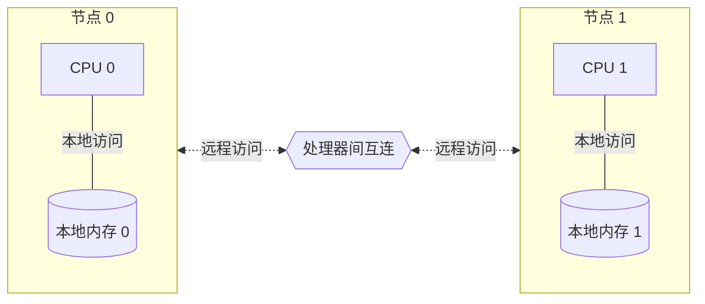

# 9.11 NUMA 感知与调度器的未来

前面各节描述的调度器隐含着一个假设：任何线程访问任何内存的代价都相同，把一个 goroutine 从一个 P
移到另一个 P，除了缓存变冷之外没有别的损失。在笔记本和单路服务器上，这个假设大体成立；
在多路服务器上则不然。本节讨论这一假设失效的原因、Go 运行时在这方面实际具有的局部性、Dmitry Vyukov 在
2014 年提出却没有实现的 NUMA 感知调度设计，以及在运行时之外可以采取的做法。

## 9.11.1 非均匀访存

早期的对称多处理（SMP）机器中，所有 CPU 经同一条总线访问同一组内存，访存延迟与发起访问的 CPU 无关。
核数增加之后，共享的总线与内存控制器成了瓶颈。**非均匀访存**（non-uniform memory access，NUMA）
的做法是把机器分成若干节点，每个节点有自己的 CPU 和直接相连的本地内存，节点之间用处理器间的互连相连。
访问本节点的内存路径最短；访问其他节点的内存要经过互连，延迟更高，带宽也更低
[[Lameter, 2013](#ref-lameter-2013)]。Vyukov 在设计文档的开头写道：「随着 Intel QPI 与 AMD HT 技术的出现，
即使是普通的 SMP 服务器也成了 NUMA。」[[Vyukov, 2014](#ref-vyukov-2014)]

差距的大小取决于平台和节点之间的距离。Ulrich Drepper 在 2007 年引用的 AMD 数据中，
隔一跳与隔两跳的读取分别比本地读取慢 9% 与 30%；Drepper 自己在隔一跳的远程内存上测量读取带宽，
结果始终比本地低 20% [[Drepper, 2007](#ref-drepper-2007)]。缓存能缓解这一问题：
远程的数据一旦进入本地缓存，再次访问就很快。所以 NUMA 的影响主要落在缓存装不下、
或者需要在节点之间反复传递的数据上。Linux 上可以用 `numactl --hardware` 列出系统中的节点
[[Linux man-pages, n.d.](#ref-linux-man-pages-nd)]。

可以用一个粗略的模型表达它对调度的意义。设一个 goroutine 一生中有 $n$ 次未命中缓存的访存，其中比例为 $r$
的访问落在远程节点，本地与远程的单次延迟分别为 $t_l$ 与 $t_r$，则访存的总代价约为

$$
T(r) = n\big[(1-r)\,t_l + r\,t_r\big] = n\,t_l\Big[1 + r\big(\tfrac{t_r}{t_l} - 1\big)\Big].
$$

把 goroutine 移到另一个节点的 CPU 上，会让它此前分配的数据都变成远程数据，$r$ 随之增大。对访存密集、$n$
很大的程序，这笔代价可观；对大部分时间在等待 I/O 的程序，$n$ 本来就小，影响有限。NUMA
优化的收益因程序而异，原因就在这里。

数据落在哪个节点，由操作系统决定。Linux 的系统默认策略是「本地分配」：物理页优先从发生分配的 CPU
所在的节点取得 [[Linux kernel, n.d.a](#ref-linux-kernel-nda)]。对匿名内存而言，
分配发生在线程第一次访问这一页时 [[Linux man-pages, n.d.](#ref-linux-man-pages-nd)]。Go 的堆就是匿名内存，
因此一页内存落在哪个节点，取决于哪个线程最先访问它，而不取决于哪个线程向内核申请了这段地址空间。

## 9.11.2 Go 运行时中的局部性

Go 运行时没有节点的概念。Go 1.26 的运行时源码中找不到任何与 NUMA 相关的代码：
工作窃取用一个与拓扑无关的伪随机顺序遍历所有 P（[9.2](./steal.md)），M 运行在哪个 CPU 上、属于哪个节点，
运行时都不记录 [[Go Authors, 2026a](#ref-go-authors-2026a)]。

尽管如此，运行时仍然保有一部分局部性，只是这些局部性来自其他设计，而不是为 NUMA 而做。Michael Pratt 在
2024 年的 issue 中列举了运行时维持亲和性的几处做法 [[Pratt, 2024](#ref-pratt-2024)]：

- goroutine 被换下时，通常放回本地 P 的运行队列，稍后在同一个 P 上继续运行，除非被其他 P 窃取；
- P 在停止之前一直留在同一个 M 上；
- M 本身不尝试维持 CPU 亲和性，但操作系统的调度器通常会这样做。

Pratt 也指出了这条亲和链与 NUMA 的联系。goroutine 从所在 P 的内存分配缓存 mcache（[9.3](./mpg.md)、
[12.2](../../part4memory/ch12alloc/component.md)）中分配对象；按照上一节的本地分配策略，
新取得的页落在最先写入它的线程所在的节点上。只要亲和链不断，goroutine 写入的新页就在它运行的节点上；
一旦它迁移到另一个节点的 CPU 上，访问这些对象就变成了远程访问。

这条链在几处会断开。Pratt 在同一个 issue 中指出：goroutine 偶尔会被放进全局运行队列，从而更可能换到另一个
P 上；停止一切（[9.4](./schedule.md)）会停下所有 P，恢复运行时各个 P 被分给任意的 M；GC
的标记工作者在停止一切期间启动，并以高优先级调度，往往占据原本运行着用户 goroutine 的 P，把那个 goroutine
挤到别的 P 上。此外，工作窃取不区分目标 P 在哪个节点，运行时的空闲内存也不按节点划分。Pratt 同时强调，
这些迁移对性能的影响从未被测量过：迁移的间隔通常在 10 毫秒以上，在这样的时间尺度上，
缓存变冷的代价是否显著并不清楚。

操作系统也会主动调整数据的位置。Linux 的自动 NUMA 平衡（`numa_balancing`）周期性地解除页的映射，
借随后的缺页来采样哪个线程在访问哪一页，再决定是否把这一页迁移到访问者所在的节点。内核文档提醒，
解除映射与处理缺页本身有开销，未必能被局部性的改善抵消；工作负载已经绑定在节点上时，应当关闭这一功能
[[Linux kernel, n.d.b](#ref-linux-kernel-ndb)]。

它与 Go 运行时之间曾经产生过意外的相互作用。2016 年，Rhys Hiltner 报告一个有大量 goroutine 的程序在 GC
标记终止阶段停顿很长，在含一百万个 goroutine 的复现程序中，停顿在 121 至 1010 毫秒之间。`perf`
显示这期间有大量缺页，内核在处理缺页时调用 `do_numa_page` 与 `migrate_misplaced_page` 迁移页面：GC
对内存的大量访问让内核以为这些页应当迁往 GC 工作者所在的节点，迁移恰好发生在标记终止期间时，停顿随之延长
[[Hiltner, 2016](#ref-hiltner-2016)]。把进程的内存策略设为 `MPOL_BIND` 可以避开这种迁移，
即使绑定的是全部节点也有效，因为在 `MPOL_BIND` 之下，已经位于允许节点上的页不会被移动。Austin Clements
在讨论中表示，正确的解决办法是让运行时对 NUMA 更友好，但那是长期的工作。问题最终从另一个方向得到解决：
Clements 的改动让标记终止只处理栈被改动过的 goroutine，不再逐一检查每个 goroutine
[[Clements, 2016](#ref-clements-2016)]。Hiltner 的实际应用（约 6 万个 goroutine）的标记终止停顿由
11 毫秒降到 1.3 毫秒，再加上 `MPOL_BIND` 是 1.0 毫秒。Clements 据此判断，迁移主要发生在对 goroutine
描述符这类元数据的访问上，随后关闭了这个 issue。这些改动随 Go 1.7 发布。

## 9.11.3 一份没有实现的设计

2014 年 9 月，Vyukov 写了一份 NUMA 感知调度器的设计文档 [[Vyukov, 2014](#ref-vyukov-2014)]。它以 MPG
模型（[9.3](./mpg.md)）为基础，在其上加入节点这一层；MPG 模型本身也出自 Vyukov 之手
[[Vyukov, 2012](#ref-vyukov-2012)]。文档开宗明义地给出了前提：

> 要获得最大的收益，必须在整个层次上保证亲和性：CPU 核与 M、M 与 P、P 与 G，以及内存。只要其中一层失效，
> 收益就会大打折扣。

围绕这一前提，设计做了以下安排：

- 全局资源按节点划分。堆、全局运行队列、空闲 M 的池都按节点分开；P 需要新的 span
  时优先从本节点的堆中取得，保证分配到的是本地内存。网络轮询器与计时器改为每个 P 一份。
- 线程绑定到节点，而不是绑定到核。文档的理由是：如果把线程绑定到具体的核，两个进程可能都选中同一个核，
  各自只以一半的速度运行而浑然不觉；只绑定到节点，可以给操作系统留出协调进程间竞争的余地。P
  严格分属各个节点，并记住上一次运行它的 M（`lastm`），以维持 P 与 M 之间的亲和性。
- 调度策略偏向本地。窃取的顺序是本节点的全局队列、本节点其他 P 的队列、远程节点的全局队列、远程节点 P
  的队列。本地队列由严格的先进先出改为大体上后进先出，以更好地利用缓存，同时每隔一段时间从另一端取出一个
  goroutine，保证公平。被窃取的 goroutine 借助它登记过的网络轮询器与计时器回到原来的 P。
- 垃圾回收与栈也按节点组织：每个节点有自己的 GC 工作者与待扫描对象队列；栈从本节点的缓存中分配，
  长期在远程节点上运行的 goroutine 可以把栈迁移过去。

文档也列出了风险，并承认即使是这样一个相对保守的亲和性方案，也可能让某些程序变慢。
几个进程可能都把线程安排到同一个节点上，使这个节点过载而其他节点空闲；一个被所有 goroutine
频繁访问的大型数据结构如果全部分配在一个节点上，这个节点的内存总线会成为瓶颈，
这时把内存交错分布在各个节点上反而更好。

这份设计没有实现。其中的个别想法后来以独立的形式出现，例如 Go 1.5 的 `runnext` 让被唤醒的 goroutine
紧接着唤醒者运行，它的数据因此很可能仍在缓存中（[9.2](./steal.md)）；Go 1.14 的计时器成了每个 P
一份的结构（[9.10](./timer.md)）。但节点这一层从未进入运行时，也没有留下采纳或否决的正式记录。
这与垃圾回收中的事务制导回收（ROC）不同：ROC 有原型与实测，因写屏障的开销而被放弃
（[13.9](../../part4memory/ch13gc/roc.md)）。从设计文档本身也能看出实现的难度：调度、内存分配、
垃圾回收与栈管理都要引入节点这一维度，而收益又因程序而异。

## 9.11.4 运行时之外的做法

运行时不处理 NUMA，需要更好局部性的程序只能在运行时之外解决。

- 把进程绑定到一个节点。`numactl --cpunodebind=0 --membind=0 ./server` 让进程只在节点 0 的 CPU 上运行，
  只从节点 0 分配内存。Linux 上 `GOMAXPROCS` 的默认值取自进程 CPU 亲和性掩码中的 CPU 数目，
  所以它会自动等于这个节点的 CPU 数 [[Go Authors, 2026a](#ref-go-authors-2026a)]；Go 1.25 起，
  运行时还会在可用的 CPU 数目变化时定期更新 `GOMAXPROCS` [[Go Authors, 2025](#ref-go-authors-2025)]。
  代价是只用了机器的一部分。
- 每个节点运行一个进程。在每个节点上各启动一个绑定到本节点的进程，在应用层按节点划分数据与请求。
  这相当于在进程层面实现了设计文档中的「按节点划分」，是既用满整台机器又保持局部性的常见做法。
- 交错分配。对于被所有线程共同访问的大型数据，`numactl --interleave=all` 让内存按页轮流分布在各个节点上，
  避免单个节点的内存总线成为瓶颈，这正是设计文档风险一节的建议。
- 关闭自动 NUMA 平衡。进程已经绑定到节点时，按内核文档的建议关闭 `numa_balancing`，省去采样与迁移的开销。

线程级的绑定在 Go 中并不方便。`runtime.LockOSThread` 只把 goroutine 固定在当前的线程上，
并不把线程固定在某个 CPU 上；运行时也没有提供把 M 绑定到 CPU 或节点的接口。

运行时对透明大页的使用同样与节点无关，并且已经收缩。在多数 Linux 发行版的默认设置下，
`madvise(MADV_HUGEPAGE)` 会让线程阻塞在内核对内存的回收与整理中，最坏可达数百毫秒乃至数秒；因此 Go 1.21.1
起，运行时不再把堆内存标记为 `MADV_HUGEPAGE`，目前只对堆索引、页分配器位图等少量元数据请求大页
[[Knyszek, 2023](#ref-knyszek-2023)]。

## 9.11.5 现状

2026 年 3 月，有用户报告 Go 程序在多 NUMA 节点的机器上性能下降，指出运行时的空闲内存与工作窃取都不区分
节点。Pratt 在回复中写道，提升多节点机器乃至一般的高核数机器上的性能，「肯定在我们今年的计划之中」；Pratt
还把 GC 在高核数下暴露出的几处争用列为自己的优先事项，并表示想要研究如何把内存分配与 GC
的工作分布到各个节点上 [[Pratt, 2026](#ref-pratt-2026)]。同一方向上已经落地的改动是 Green Tea
垃圾回收器（[13.11](../../part4memory/ch13gc/greentea.md)）：它在 Go 1.25 中作为实验加入，Go 1.26
起默认启用，借助更好的局部性与 CPU 可扩展性改善小对象的标记与扫描
[[Go Authors, 2026b](#ref-go-authors-2026b)]。

所以 NUMA 感知仍是一个开放的问题。从 Vyukov 的设计文档到今天，困难没有变：节点这一层要贯穿调度、
分配与回收才能见效，而它的收益只在访存密集、局部性清晰的程序上明显。调度器的骨架自 Go 1.1
以来没有根本的改变，此后的改进，从 `runnext`、每个 P 的计时器到容器感知的 `GOMAXPROCS`，都是在 MPG
的框架内逐步进行的。

## 延伸阅读

- [Clements, 2016] Austin Clements. runtime: make stack re-scan O(# dirty
  stacks). Go commit 2a889b9d93, 2016. https://go.dev/cl/20700
  随 Go 1.7 发布。
- [Drepper, 2007] Ulrich Drepper. *What Every Programmer Should Know About
  Memory.* Red Hat, 2007. https://www.akkadia.org/drepper/cpumemory.pdf
  （NUMA、缓存一致性与访存延迟的权威长文，第 5 节专讲 NUMA）
- [Go Authors, 2025] The Go Authors. Go 1.25 Release Notes, 2025.
  https://go.dev/doc/go1.25
  容器感知的 `GOMAXPROCS`。
- [Go Authors, 2026a] The Go Authors.
  *runtime/proc.go（`stealWork`、 `randomOrder`）、runtime/mem_linux.go（`MADV_HUGEPAGE`）.*
  https://github.com/golang/go/tree/master/src/runtime （拓扑无关的工作窃取与透明大页的实现现状）
  另含 `runtime/os_linux.go` 中由 `sched_getaffinity` 计算 CPU 数目的 `getCPUCount`（本节对照 Go 1.26）。
- [Go Authors, 2026b] The Go Authors. Go 1.26 Release Notes, 2026.
  https://go.dev/doc/go1.26
  Green Tea 垃圾回收器默认启用。
- [Hiltner, 2016] Rhys Hiltner. golang/go#14406. *runtime: GC's mark
  termination STW time extended by Linux NUMA migration.* 2016. https://github.com/golang/go/issues/14406
- [Knyszek, 2023] Michael Knyszek. runtime: avoid MADV_HUGEPAGE for heap
  memory. Go commit 9f9bb26880, 2023. https://go.dev/cl/516795
  修复 issue #61718，向后移植到 Go 1.21.1。
- [Lameter, 2013] Christoph Lameter. *NUMA (Non-Uniform Memory Access): An
  Overview.* ACM Queue 11(7): 40-51, 2013. https://queue.acm.org/detail.cfm?id=2513149
  （节点拓扑、距离矩阵与 Linux NUMA 接口）DOI: https://doi.org/10.1145/2508834.2513149
- [Linux kernel, n.d.a] The Linux Kernel. *NUMA Memory Policy.*
  https://www.kernel.org/doc/html/latest/admin-guide/mm/numa_memory_policy.html
- [Linux kernel, n.d.b] The Linux Kernel. *Documentation for
  /proc/sys/kernel/*（`numa_balancing`）.
  https://www.kernel.org/doc/html/latest/admin-guide/sysctl/kernel.html
- [Linux man-pages, n.d.] Linux man-pages project.
  *numactl(8)、numa(7)、set_mempolicy(2).* https://man7.org/linux/man-pages/man8/numactl.8.html
  （进程外做 NUMA 绑定的工具与系统调用）
- [Pratt, 2024] Michael Pratt. golang/go#65694. *runtime: stronger affinity
  between G ↔ P ↔ M ↔ CPU?* 2024. https://github.com/golang/go/issues/65694
- [Pratt, 2026] Michael Pratt. Comment on golang/go#78044, 2026.
  https://github.com/golang/go/issues/78044#issuecomment-4033364256
- [Vyukov, 2012] Dmitry Vyukov. *Scalable Go Scheduler Design Doc.* 2012.
  https://golang.org/s/go11sched （MPG 与工作窃取的原始设计，本节局部性讨论的起点）
- [Vyukov, 2014] Dmitry Vyukov. *NUMA-aware scheduler for Go.* Go design
  proposal, 2014. https://docs.google.com/document/u/0/d/1d3iI2QWURgDIsSR6G2275vMeQ_X7w-qxM2Vp7iGwwuM/pub
  （把 P 按节点分组、就近窃取、堆本地化的完整设计）
- 本书 [9.2 工作窃取式调度](./steal.md)、[9.3 MPG 模型与并发调度单元](./mpg.md)、
  [12.2 组件](../../part4memory/ch12alloc/component.md)、
  [13.9 请求假设与事务制导回收](../../part4memory/ch13gc/roc.md)、[9.10 计时器](./timer.md)、
  [13.11 Green Tea：面向局部性的标记](../../part4memory/ch13gc/greentea.md)。
