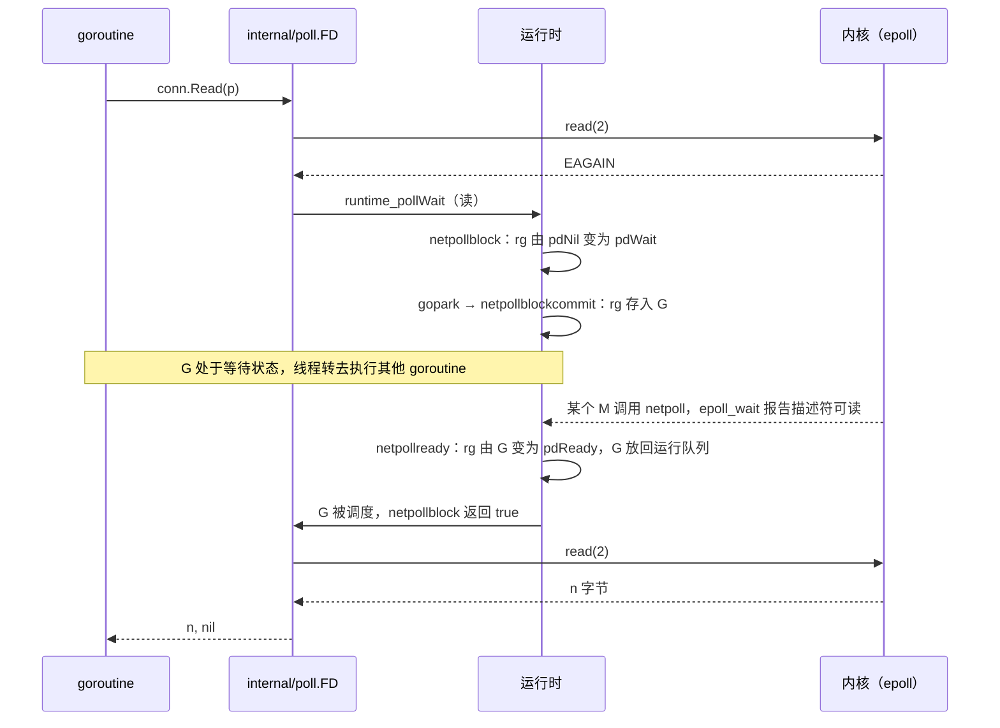
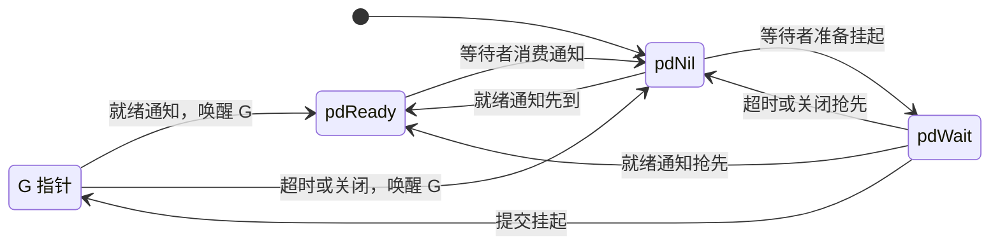

# 9.9 网络轮询器

Go 的网络代码以阻塞的方式书写：`conn.Read` 在数据到达之前不会返回。[9.5](./thread.md) 已经说明，goroutine
阻塞在系统调用中时，它所在的线程也随之阻塞，运行时只能另起线程来执行其他 goroutine。网络服务器
往往同时持有成千上万个连接，其中绝大多数在任一时刻都在等待数据；如果每一个等待都占用一个线程，M:N 模型
（[9.1](./model.md)）就失去了意义。运行时的**网络轮询器**（network poller，源码中简称 netpoll）解决的正是
这个问题：它把 goroutine 在网络上的阻塞转换为 goroutine 的挂起，由少数线程借助操作系统的事件通知机制照看
所有连接。

本节先回顾操作系统提供的两类 I/O 事件通知，再追溯 Go 的轮询器从 Go 1.0 至今的演变，
然后依次讨论一次读操作如何被转换为挂起、每个文件描述符上的状态机、各平台的实现，以及轮询器与调度器的衔接，
最后考察哪些 I/O 不经过轮询器，并与其他运行时作比较。

## 9.9.1 就绪通知与完成通知

1999 年前后，Dan Kegel 提出了后来被称为 C10K 的问题：一台服务器如何同时服务一万个客户端。Kegel 估算，
以当时的硬件为每个客户端提供所需的带宽与内存并不困难，「所以硬件不再是瓶颈」，问题在于软件如何组织 I/O
[[Kegel, 1999](#ref-kegel-1999)]。最直接的组织方式是每个连接一个线程，但线程的栈很大：Kegel 举例说，
若每个线程的栈为 2 MB，在用户可用虚拟地址空间为 1 GB 的 32 位机器上，只能容纳 512 个线程；减小栈虽然可行，
可大多数线程库不允许栈在创建之后增长。另一种方式是让一个线程同时照看许多文件描述符，
只在某个描述符可以读写时才对它执行 I/O，这就是 **I/O 多路复用**（I/O multiplexing）。

Unix 早期的多路复用接口是 `select` 与 `poll`。它们不在内核中保存任何状态：每次调用，调用方都要把关心的
全部描述符交给内核，内核逐一检查之后返回，调用方再逐一查找哪些已经就绪。设关心的描述符有 $n$ 个，其中
就绪的有 $k$ 个，每次调用的代价是 $O(n)$。对于大量空闲的长连接，$k$ 远小于 $n$，绝大部分开销都花在了检查
不会就绪的描述符上。

2001 年前后出现的两种接口把关心的集合保存在内核中。FreeBSD 的 kqueue 由 Jonathan Lemon 设计，用 `kevent`
一个系统调用统一了套接字、文件、信号、进程、计时器等多种事件源 [[Lemon, 2001](#ref-lemon-2001)]。Linux 的
epoll 由 Davide Libenzi 提出，初稿写于 2001 年 7 月，补丁于 2002 年 10 月并入内核
[[Libenzi, 2002](#ref-libenzi-2002)]，首次出现于 2.5.44 版内核。使用 epoll 时，`epoll_ctl`
把描述符登记一次，此后 `epoll_wait` 只返回已经就绪的描述符，每次调用的代价与 $k$ 而非 $n$ 成正比。
常说的「epoll 是 $O(1)$」并不确切：登记的代价由 `epoll_ctl` 一次付清，等待的代价取决于就绪的数目。

这类接口有两种通知方式。**水平触发**（level-triggered）是只要描述符处于就绪状态，每次等待都会报告它；**边
沿触发**（edge-triggered）只在描述符从未就绪变为就绪时报告一次。epoll(7) 手册用一个管道说明二者的
区别：写端写入 2 kB 数据，读端被唤醒后只读取 1 kB。在水平触发下，下一次 `epoll_wait` 立即返回，
因为管道中还有数据；在边沿触发下，由于没有新的数据到达，下一次 `epoll_wait` 可能无限期地阻塞。
手册因此建议，边沿触发应当这样使用：「（1）使用非阻塞的文件描述符；（2）仅在 read(2) 或 write(2) 返回
EAGAIN 之后才等待事件」[[Linux man-pages, n.d.a](#ref-linux-man-pages-nda)]。9.9.3 将看到，Go
的读循环正是这样写的。

以上接口告诉调用方「可以读写了」，读写本身仍由调用方完成，这是就绪模型。Windows 的 I/O 完成端口（IOCP）
走的是另一条路：调用方发起一个异步操作并交出缓冲区，内核完成整个操作之后再通知调用方「已经读写完了」，
这是完成模型。Douglas Schmidt 把基于就绪通知的事件分派总结为 Reactor 模式
[[Schmidt, 1995](#ref-schmidt-1995)]。两年后，Irfan Pyarali、Schmidt 等人把基于完成通知的事件分派总结为
Proactor 模式 [[Pyarali et al., 1997](#ref-pyarali-et-al-1997)]。Linux 直到 2019 年的 5.1
版内核才有了通用的完成模型接口 io_uring：用户态与内核共享一对环形队列，应用向提交队列放入请求，
从完成队列取回结果，多个操作可以一次提交、一次收取 [[Axboe, 2019](#ref-axboe-2019)]。

| | 就绪模型（Reactor） | 完成模型（Proactor） |
| --- | --- | --- |
| 内核通知的内容 | 描述符可以读写了 | 操作已经完成了 |
| 谁执行读写 | 调用方，在收到通知之后 | 内核，在收到请求之后 |
| 缓冲区 | 执行读写时才需要 | 从提交到完成一直由内核持有 |
| 代表 | `select`、`poll`、epoll、kqueue | IOCP、io_uring |

表中缓冲区一行对 Go 尤为重要，9.9.5 与 9.9.8 还会回到这一点。

## 9.9.2 由来

Go 1.0 已经以阻塞的方式呈现网络 I/O，在 Unix 上，底层也已经是非阻塞的描述符加上 epoll 或 kqueue，但事件
循环不在运行时中，而在 `net` 包的一个 goroutine 中。源码注释写道：「所有网络描述符共用一个
pollServer」[[Go Authors, 2012](#ref-go-authors-2012)]。读操作遇到 `EAGAIN` 时，goroutine 把描述符经
一个带缓冲的 channel 交给 pollServer，再向 pollServer 自己的管道写入一个字节，把阻塞在 `epoll_wait` 中的
pollServer 唤醒；pollServer 把描述符加入 epoll，等到它就绪，再经另一个 channel 唤醒等待的 goroutine。
描述符以 `EPOLLONESHOT` 登记，触发一次即失效，所以每次等待都要调用一次 `epoll_ctl` 重新装设。截止时间的
检查则逐一扫描全部等待者，注释中留着一条待办：「这需要更高效地处理，可能要用一个按唤醒时间索引的堆」。
一次等待因此要经过两次 channel 通信、一次管道写入和一次 `epoll_ctl`，还要在两个 goroutine 之间往返。

Go 1.1 中，Dmitry Vyukov 把轮询器移入了运行时 [[Vyukov, 2013](#ref-vyukov-2013)]。等待者不再经过 channel
与中间的 goroutine，而是直接挂起在描述符对应的运行时结构上，由调度器在适当的时候收取就绪事件、恢复等待者。
提交说明附有基准数据：与旧的调度器和旧的轮询方式相比，在一条持久连接上反复收发的基准从每次约 81.7 µs
降至约 7.8 µs，这一数字也包含了同一版本中调度器重写的收益。Go 1.1 的发布说明写道：「由于运行时与
网络库结合得更加紧密，网络操作所需的上下文切换更少了」[[Go Authors, 2013](#ref-go-authors-2013)]。
此后的主要变化如下：

| 版本 | 变化 | 出处 |
| --- | --- | --- |
| Go 1.1 | 轮询器并入运行时（Linux 与 Darwin） | [[Vyukov, 2013](#ref-vyukov-2013)] |
| Go 1.2 | Windows 实现，基于 IOCP | [[Brainman, 2013](#ref-brainman-2013)] |
| Go 1.3 | Solaris 实现，基于事件端口 | [[Hăvărneanu, 2014](#ref-havarneanu-2014)] |
| Go 1.9 | `os` 包的管道等描述符也交给轮询器 | [[Taylor, 2017](#ref-taylor-2017)] |
| Go 1.14 | 阻塞的 `netpoll` 兼作计时器等待；引入 `netpollBreak` | [[Taylor, 2019a](#ref-taylor-2019a)] |
| Go 1.23 | Linux 上改用 eventfd 唤醒阻塞的轮询器 | [[Pan, 2024a](#ref-pan-2024a)] |
| Go 1.25 | 同一时刻至多一个 P 以非阻塞方式轮询 | [[Taylor, 2024a](#ref-taylor-2024a)] |

## 9.9.3 把阻塞转换为挂起

`net` 与 `os` 包中的文件描述符都经由 `internal/poll.FD` 执行 I/O。以 Unix 上的读操作为例，`FD.Read` 的核心
是一个循环 [[Go Authors, 2026a](#ref-go-authors-2026a)]：

```go
// internal/poll/fd_unix.go（节选）
func (fd *FD) Read(p []byte) (int, error) {
	// ...加读锁，检查是否已经关闭或超时...
	for {
		n, err := ignoringEINTRIO(syscall.Read, fd.Sysfd, p)
		if err != nil {
			n = 0
			if err == syscall.EAGAIN && fd.pd.pollable() {
				if err = fd.pd.waitRead(fd.isFile); err == nil {
					continue
				}
			}
		}
		err = fd.eofError(n, err)
		return n, err
	}
}
```

描述符已被设为非阻塞，没有数据时 `read` 立即返回 `EAGAIN`。此时，若描述符已经登记到轮询器中
（`pollable`），`waitRead` 就让当前 goroutine 等待描述符变为可读，醒来后回到循环开头再读一次。这正是
epoll(7) 推荐的边沿触发用法：描述符是非阻塞的，并且只在 `EAGAIN` 之后才等待。这个循环的形状在 Go 1.0
中就已如此，Go 1.1 改变的只是 `waitRead` 背后的实现。

`waitRead` 经 `runtime_pollWait` 进入运行时，由 `netpollblock` 挂起 goroutine：

```go
// runtime/netpoll.go（节选）
func netpollblock(pd *pollDesc, mode int32, waitio bool) bool {
	gpp := &pd.rg
	if mode == 'w' {
		gpp = &pd.wg
	}
	for {
		if gpp.CompareAndSwap(pdReady, pdNil) {
			return true // 就绪通知已经到达，消费它，不必挂起
		}
		if gpp.CompareAndSwap(pdNil, pdWait) {
			break
		}
		// ...
	}
	// 置为 pdWait 之后，重新检查是否已经关闭或超时
	if waitio || netpollcheckerr(pd, mode) == pollNoError {
		gopark(netpollblockcommit, unsafe.Pointer(gpp), waitReasonIOWait, traceBlockNet, 5)
	}
	old := gpp.Swap(pdNil)
	return old == pdReady
}
```

`gopark` 把 goroutine 置为等待状态并切换到调度循环（[9.4](./schedule.md)），线程随即转去执行其他
goroutine。挂起在切换栈之后才真正生效：`gopark` 调用 `netpollblockcommit`，后者以 CAS 把 `pdWait`
换成当前 G 的指针，并把等待轮询器的 goroutine 计数加一；CAS 失败则放弃挂起，goroutine 立即继续运行。



描述符就绪时，平台相关的 `netpoll` 把内核报告的事件归为读、写两种模式，对每个就绪的描述符调用
`netpollready`；后者经 `netpollunblock` 取出等待的 goroutine，串成一个链表返回，由调用 `netpoll`
的一方放回运行队列（9.9.6）。等待网络的 goroutine 不占用线程，它的代价只是自己的栈，加上内核中 epoll
实例的一个表项。

## 9.9.4 pollDesc 的状态机

运行时为每个登记的描述符分配一个 `pollDesc`。以下是与本节有关的字段：

```go
// runtime/netpoll.go（节选）
type pollDesc struct {
	_     sys.NotInHeap
	link  *pollDesc      // pollcache 中的空闲链表
	fd    uintptr        // 在 pollDesc 的使用期内不变
	fdseq atomic.Uintptr // 防止使用过时的 pollDesc

	rg atomic.Uintptr // pdReady、pdWait、等待读的 G 或 pdNil
	wg atomic.Uintptr // pdReady、pdWait、等待写的 G 或 pdNil

	lock    mutex   // 保护以下字段
	closing bool
	rseq    uintptr // 防止过时的读计时器
	rt      timer   // 读截止计时器
	rd      int64   // 读截止时间（未来的某个 nanotime，已过期时为 -1）
	wseq    uintptr // 防止过时的写计时器
	wt      timer   // 写截止计时器
	wd      int64   // 写截止时间
	// ...
}
```

`rg` 与 `wg` 是两个二值信号量，分别供读者与写者挂起。源码注释列出了它们的四种状态：`pdReady` 表示有一个
尚未被消费的就绪通知；`pdWait` 表示一个 goroutine 准备挂起，但尚未挂起；G 指针表示该 goroutine 已经挂起；`pdNil`
表示以上都不是。参与状态转换的有四方：等待者自己、I/O 就绪通知、截止时间到期、描述符关闭。



这套设计的关键在于 `pdReady` 能把一次就绪通知保存下来。通知可能在三个时刻到达：等待者检查之前、等待者
置为 `pdWait` 之后但尚未挂起之时、等待者已经挂起之后。第一种情况下，通知把 `pdNil` 变为 `pdReady`，等待者
随后直接消费它；第二种情况下，通知把 `pdWait` 变为 `pdReady`，`netpollblockcommit` 的 CAS 因此失败，`gopark`
立即返回；第三种情况下，通知把 G 指针变为 `pdReady` 并唤醒 G。无论哪种情况，通知都不会丢失。
这一点对边沿触发至关重要：边沿触发的事件只报告一次，丢失一次就可能永远等下去。

超时与关闭则不同。`netpollunblock` 只在就绪时才写入 `pdReady`，超时或关闭不会留下任何记号，
因为等待者在挂起之前会自己调用 `netpollcheckerr` 检查。为了不错过与之并发的超时或关闭，`netpollblock`
在把状态置为 `pdWait` 之后才检查；源码注释指出，另一方的顺序恰好相反，先写 `closing`、`rd` 或 `wd`
并发布它们的原子摘要 `atomicInfo`，再读取 `rg`、`wg`。双方都是先写后读，至少有一方能看到另一方的写入：
要么等待者看到超时而不挂起，要么超时的一方看到 `pdWait` 或 G 指针，把它改为 `pdNil` 并唤醒等待者。

`pollDesc` 不在 GC 管理的堆上。`pollcache` 用 `persistentalloc` 成块地分配它们，关闭后放回空闲链表重用，
从不释放。源码注释给出的理由是，`pollDesc`「只会被 epoll/kqueue 的内部数据引用」，GC 看不到这些引用，
所以必须放在 GC 不管理的内存中。内核持有这些引用，还要求 `pollDesc` 是类型稳定的：描述符关闭、`pollDesc`
被重用之后，内核仍可能送来属于旧描述符的事件。运行时在登记时把 `fdseq` 与 `pollDesc`
的地址一起存入内核的事件数据（epoll 的 `data`、kqueue 的 `udata`），收到事件时比较二者，
不相等就丢弃这个过时的事件。

截止时间也由 `pollDesc` 承担。`SetReadDeadline` 最终调用 `poll_runtime_pollSetDeadline`，把 `rd`
设为绝对时间，并让计时器 `rt` 在到期时调用 `netpollReadDeadline`；读、写的截止时间相同时，只启用 `rt`
一个计时器，同时负责两个方向。到期时，回调把 `rd` 置为 -1，发布 `atomicInfo`，再调用 `netpollunblock`
唤醒等待者；等待者从 `netpollcheckerr` 得到 `pollErrTimeout`，`internal/poll` 把它转换为
`ErrDeadlineExceeded`，即 `os.ErrDeadlineExceeded`。修改或撤销已经装好的截止时间时，以及 `pollDesc`
被重用时，`rseq` 或 `wseq` 都会加一，已经在运行的旧计时器回调发现序号不符，就什么也不做。
计时器本身的实现见 [9.10](./timer.md)。

## 9.9.5 平台实现与边沿触发

`netpoll.go` 是与平台无关的部分，文件开头的注释规定了每个平台必须实现的函数（以下为译文）：

```go
// func netpollinit()
//     初始化轮询器。只调用一次。
// func netpollopen(fd uintptr, pd *pollDesc) int32
//     为 fd 装设边沿触发的通知。pd 参数在 fd 就绪时传回给 netpollready。
// func netpollclose(fd uintptr) int32
//     停止 fd 的通知。
// func netpoll(delta int64) (gList, int32)
//     轮询网络。delta < 0 时无限期阻塞，delta == 0 时不阻塞，delta > 0 时至多阻塞 delta 纳秒。
//     返回由 netpollready 收集的 goroutine 链表，
//     以及所有 goroutine 就绪后应加到 netpollWaiters 上的差值。
// func netpollBreak()
//     唤醒阻塞在 netpoll 中的轮询器。
// func netpollIsPollDescriptor(fd uintptr) bool
//     报告 fd 是否为轮询器自己使用的描述符。
```

Linux 的实现在 `netpoll_epoll.go` 中。`netpollopen` 在描述符的整个生命周期中只登记一次，同时关心读、写两个
方向，并采用边沿触发：

```go
// runtime/netpoll_epoll.go
func netpollopen(fd uintptr, pd *pollDesc) uintptr {
	var ev linux.EpollEvent
	ev.Events = linux.EPOLLIN | linux.EPOLLOUT | linux.EPOLLRDHUP | linux.EPOLLET
	netpollPackData(&ev, pd, pd.fdseq.Load())
	return linux.EpollCtl(epfd, linux.EPOLL_CTL_ADD, int32(fd), &ev)
}
```

`netpoll` 每次从 `epoll_wait` 至多取回 128 个事件，把带有 `EPOLLIN`、`EPOLLRDHUP`、`EPOLLHUP` 或
`EPOLLERR` 的事件归为可读，把带有 `EPOLLOUT`、`EPOLLHUP` 或 `EPOLLERR` 的事件归为可写。kqueue
的实现（`netpoll_kqueue.go`）以 `EV_CLEAR` 登记 `EVFILT_READ` 与 `EVFILT_WRITE` 两个过滤器，
注释写明二者「在 fd 的整个生命周期中以边沿触发方式（EV_CLEAR）装设」。

选择边沿触发的理由，与 Go 1.0 对比便能看清。Go 1.0 以 `EPOLLONESHOT` 登记，每次等待之前都要调用一次
`epoll_ctl` 重新装设。若改用水平触发并同时关心读写，问题出在写的方向：套接字的发送缓冲区通常有空间，`EPOLLOUT`
会出现在每一次 `epoll_wait` 的结果中，所以只能在有写者等待时才打开 `EPOLLOUT`，写完后再关掉，
每次开关都是一次系统调用。Netty 4.2 的 epoll 传输只使用水平触发，它正是这样做的：增删关心的事件之前先比较
新旧集合，源码注释写道「如果关心的事件没有变化，就可以省下一次系统调用」[[Netty, n.d.b](#ref-netty-ndb)]。
采用边沿触发，Go 只在登记和关闭时各调用一次 `epoll_ctl`，其间无论读写多少次都不必修改登记。

边沿触发的代价是事件只报告一次：应用必须读写到 `EAGAIN` 为止，并且不能错过任何一次通知。前者由 9.9.3
的读循环保证，goroutine 只在 `EAGAIN` 之后才等待；后者由 9.9.4 的 `pdReady` 保证，
没有等待者时到达的通知会被保存下来。

并非所有平台都使用边沿触发。`poll_runtime_pollWait` 中的注释写道：「目前只有 Solaris、illumos、AIX 和
wasip1 使用水平触发的 I/O」。在这些平台上，每次等待之前都要调用 `netpollarm` 重新装设，与 Go 1.0
的做法相同；`netpoll.go` 开头所说的「边沿触发」对它们并不成立。

Windows 使用完成模型。`netpollopen` 把句柄关联到进程唯一的 I/O 完成端口；`internal/poll`
发起重叠（overlapped）I/O，若操作返回 `ERROR_IO_PENDING`，就像 Unix 上一样调用 `runtime_pollWait` 挂起；`netpoll`
用 `GetQueuedCompletionStatusEx` 取回完成事件，再调用 `netpollready` 唤醒等待者
[[Go Authors, 2026d](#ref-go-authors-2026d)]。超时或关闭时，`internal/poll` 调用 `CancelIoEx`
取消尚未完成的操作。完成通知由此被包装成了就绪通知，上层看到的仍是同一套挂起与唤醒。
完成模型要求缓冲区在操作完成之前保持有效，并且地址不变，而 goroutine 的栈是可以移动的
（[14.4](../../part4memory/ch14stack/copy.md)）。Go 1.26 在发起重叠 I/O 之前用 `runtime.Pinner`
固定缓冲区，提交说明称这样做是「为了稳妥起见……以免栈上分配的切片在重叠 I/O 进行期间
被移动」[[Muntal, 2025](#ref-muntal-2025)]。

最后，阻塞在 `netpoll` 中的线程有时需要被提前唤醒，例如出现了一个更早到期的计时器。这由 `netpollBreak`
完成：Linux 上自 Go 1.23 起向一个 eventfd 写入 [[Pan, 2024a](#ref-pan-2024a)]，此前使用管道；Darwin、DragonFly
与 FreeBSD 触发一个 kqueue 的 `EVFILT_USER` 事件，NetBSD 与 OpenBSD 仍使用管道。这与 Go 1.0 的
pollServer 向自己的管道写入一个字节是同一个思路，即 [9.6](./signal.md) 介绍的自管道技巧。

## 9.9.6 与调度器的衔接

就绪的 goroutine 不会自己醒来，必须有线程调用 `netpoll` 把它们取出。运行时在以下几处调用它
[[Go Authors, 2026b](#ref-go-authors-2026b)]。

第一处是调度循环中的非阻塞轮询。`findRunnable`（[9.4](./schedule.md)）在本地与全局运行队列都为空之后、窃取
其他 P 的工作之前，调用一次 `netpoll(0)`：

```go
// runtime/proc.go，findRunnable（节选）
if netpollinited() && netpollAnyWaiters() && sched.lastpoll.Load() != 0 &&
	sched.pollingNet.Swap(1) == 0 {
	list, delta := netpoll(0)
	sched.pollingNet.Store(0)
	// ...取出第一个 G 直接运行，其余放入运行队列...
}
```

源码注释说明，这次轮询「只是诉诸窃取之前的一个优化」，前提有三：有 goroutine 在等待轮询器；没有线程阻塞在
`netpoll` 中（`lastpoll` 不为 0）；没有别的 P 正在做同样的事。最后一个条件是 Go 1.25 加入的。在 #65064
中，一个运行在 192 核机器上的程序持有两千五百多个套接字，同时就绪的超过一千个时，`epoll_wait` 占用了约
65% 的 CPU 时间 [[Pratt, 2024](#ref-pratt-2024)]：许多空闲的 P 同时进入 `findRunnable`，同时轮询同一个
epoll 实例，在内核中相互争抢。Ian Lance Taylor 为此让同一时刻只有一个 P 做这次轮询。
这一改动合入后曾因一个 CockroachDB 基准失败而被回退，问题查明后才重新合入
[[Taylor, 2024a](#ref-taylor-2024a)]。

第二处是阻塞轮询。窃取也失败、确实无事可做时，M 交出 P，准备休眠。在休眠之前，若有 goroutine
在等待轮询器，或者有计时器尚未到期，它会尝试以阻塞方式调用 `netpoll`：

```go
// runtime/proc.go，findRunnable（节选）
if netpollinited() && (netpollAnyWaiters() || pollUntil != 0) &&
	sched.lastpoll.Swap(0) != 0 {
	sched.pollUntil.Store(pollUntil)
	delay := int64(-1)
	if pollUntil != 0 {
		delay = pollUntil - now // 至多阻塞到最早的计时器到期
	}
	list, delta := netpoll(delay)
	// ...若能取得空闲的 P，就运行第一个就绪的 G，否则把它们全部放入全局队列...
} else if pollUntil != 0 && netpollinited() {
	// 已有线程阻塞在 netpoll 中：若它等待的时刻晚于新的计时器，就唤醒它
	pollerPollUntil := sched.pollUntil.Load()
	if pollerPollUntil == 0 || pollerPollUntil > pollUntil {
		netpollBreak()
	}
}
stopm()
```

`sched.lastpoll` 记录上一次轮询的时刻，值为 0 表示有线程正阻塞在 `netpoll` 中。`Swap(0)`
保证同一时刻至多一个 M 阻塞在 `epoll_wait` 上，其余无事可做的 M 直接休眠；也正因为只有一个等待者，epoll
的惊群问题不会出现在 Go 的轮询器上。阻塞的时长取决于最早到期的计时器：自 Go 1.14 起，`netpoll`
接受一个阻塞时长，这个 M 同时承担着等待网络与等待计时器两项任务 [[Taylor, 2019a](#ref-taylor-2019a)]；
出现了更早到期的计时器时，`netpollBreak` 把它唤醒，重新计算等待的时长。

条件中的 `netpollAnyWaiters` 有它的来历。Go 1.9 让 `os` 包的管道等描述符也使用轮询器之后，更多的程序会
初始化轮询器。如果没有等待者也照样阻塞在 `netpoll` 中，那么一个所有 goroutine 都已阻塞的程序就总有一个线程
看起来在等待网络，运行时再也无法判定它死锁了。提交说明写道，这一修改让运行时「只在有 goroutine 等待轮询器
时才阻塞等待轮询器……这保留了运行时现有的简单死锁检测」[[Taylor, 2017](#ref-taylor-2017)]。等待者的计数由
`netpollblockcommit` 加一，在等待者被 `netpollunblock` 取出后减去。

第三处是 sysmon。所有 P 都忙于计算时，没有 M 会走到上面两条路径；sysmon 发现超过 10 ms 无人轮询网络，
就代为调用 `netpoll(0)`，详见 [9.8](./sysmon.md)。此外，停止一切结束时，`startTheWorldWithSema`
也以非阻塞方式轮询一次；GC 的空闲标记工作者则通过 `pollWork` 检查是否有别的工作可做，
其中也包括就绪的网络事件，有就停止标记、让出 P。

## 9.9.7 不经过轮询器的 I/O

轮询器只能照看内核能够报告就绪状态的描述符。Linux 上的普通磁盘文件不能加入 epoll：`epoll_ctl(2)`
手册写明，目标是普通文件或目录时返回 `EPERM` [[Linux man-pages, n.d.b](#ref-linux-man-pages-ndb)]。
从就绪模型的角度看，这是自然的：磁盘文件总是「可以读」，读操作的等待发生在读的过程之中，而不是之前。

`os` 包打开文件时，`newFile` 对 `OpenFile` 得到的描述符、管道和套接字尝试使用轮询器
[[Go Authors, 2026c](#ref-go-authors-2026c)]。在 Linux 上，普通文件的登记会失败，源码注释写道：「对于不受
epoll/kqueue 支持的文件描述符，例如 Linux 系统上的磁盘文件，可能出现这种情况」；此时描述符恢复为阻塞模式，
读写走普通的阻塞系统调用。在 BSD 与 Darwin 上，`newFile` 根本不把普通文件和目录交给 kqueue，因为 FreeBSD
总是报告普通文件可写，DragonFly、NetBSD 与 OpenBSD 只发出一次就绪信号（#19093）；Darwin 上的 FIFO
也被排除，因为最后一个写者关闭时，kqueue 不会通知读者（#24164）。

Go 1.9 之前，`os` 包的所有 I/O 都是阻塞的系统调用。Go 1.9 的发布说明写道：「os 包现在对文件 I/O 使用运行时
内部的轮询器。这减少了管道读写所需的线程数，并消除了一个 goroutine 关闭文件、而另一个 goroutine 正在使用它
进行 I/O 时的竞争」[[Go Authors, 2017](#ref-go-authors-2017)]。

不经过轮询器的 I/O 仍然阻塞线程，由 [9.5](./thread.md) 所述的 P 的移交兜底。下面的程序在 `GOMAXPROCS` 为
2 时，让 500 个 goroutine 阻塞在 TCP 连接的读取上，另外 500 个阻塞在 `os.Pipe` 的读取上：

```go {run=true native=true}
package main

import (
	"fmt"
	"net"
	"os"
	"runtime"
	"runtime/metrics"
	"time"
)

// read 读取两个 Go 1.26 新增的调度器指标。
func read() (threads, waiting uint64) {
	s := []metrics.Sample{
		{Name: "/sched/threads/total:threads"},
		{Name: "/sched/goroutines/waiting:goroutines"},
	}
	metrics.Read(s)
	return s[0].Value.Uint64(), s[1].Value.Uint64()
}

func main() {
	runtime.GOMAXPROCS(2)
	t, w := read()
	fmt.Printf("启动时：线程 %d，等待中的 goroutine %d\n", t, w)

	// 500 个 goroutine 阻塞在 TCP 连接的读取上
	ln, err := net.Listen("tcp", "127.0.0.1:0")
	if err != nil {
		panic(err)
	}
	var conns []net.Conn
	for range 500 {
		c, err := net.Dial("tcp", ln.Addr().String())
		if err != nil {
			panic(err)
		}
		s, err := ln.Accept()
		if err != nil {
			panic(err)
		}
		conns = append(conns, c, s)
		go s.Read(make([]byte, 1)) // 对端不发送数据，读取一直等待
	}
	// 500 个 goroutine 阻塞在 os.Pipe 的读取上
	var pipes []*os.File
	for range 500 {
		r, w, err := os.Pipe()
		if err != nil {
			panic(err)
		}
		pipes = append(pipes, r, w)
		go r.Read(make([]byte, 1)) // 管道中没有数据，读取一直等待
	}
	time.Sleep(100 * time.Millisecond)
	t, w = read()
	fmt.Printf("之后：线程 %d，等待中的 goroutine %d\n", t, w)
}
```

```
启动时：线程 5，等待中的 goroutine 6
之后：线程 5，等待中的 goroutine 1006
```

一千个 goroutine 都在等待，线程数却没有变化，因为它们挂起在轮询器上，不占用线程。启动时等待的 6 个
goroutine 是运行时自己的后台 goroutine（强制 GC、清扫、scavenger、`GOMAXPROCS` 更新、终结器与清理）。
等待数是近似值，指标的说明也这样写，多次运行之间可能相差一两个；线程数也可能多出一个，但前后两次读数相同。
作为对照，[9.5](./thread.md) 中 10 个 goroutine 用 `syscall.Read` 读取一个阻塞模式的管道，线程数从 5 增至
13。两段程序读的都是管道，差别只在于描述符是否交给了轮询器。这两个指标是 Go 1.26 新增的
[[Go Authors, 2026e](#ref-go-authors-2026e)]；以上是 macOS 上的运行结果。程序共打开约 2000 个描述符，
超过了一些系统默认的软限制（例如 256）。Go 自 1.19 起在启动时把这一软限制提高到硬限制，
提交说明给出的理由与 9.9.1 有关：这类偏低的默认值是为了兼容使用 `select` 的程序，因为 `select`
能处理的描述符数受 `fd_set` 大小的限制，而「Go 不使用 select，所以不应受
这些限制」[[Cox, 2022](#ref-cox-2022)]。

## 9.9.8 与其他运行时的比较

Node.js 所用的 libuv 是一个单线程的事件循环，网络 I/O 交给 epoll、kqueue、IOCP 等平台机制。文件则不同，libuv
的文档写道：「与网络 I/O 不同，没有 libuv 可以依赖的平台相关的文件 I/O 原语，
所以目前的做法是在一个线程池中执行阻塞的文件 I/O 操作」[[libuv, n.d.](#ref-libuv-nd)]。线程池默认有
4 个线程，可以通过 `UV_THREADPOOL_SIZE` 调整，上限为 1024。这与 Go 的结构相同：套接字交给轮询器，
文件交给线程。区别在于 Go 没有这样一个固定大小的线程池，阻塞的文件操作各占一个 M，线程数随之增长，直至
[9.5](./thread.md) 所述的上限。

Java 的 Netty 在 4.1 中，原生 epoll 传输默认使用边沿触发 [[Netty, n.d.a](#ref-netty-nda)]；到了 4.2，
它只使用水平触发，设置触发方式的方法变为空操作，日志写道「不再支持更改
EpollMode」[[Netty, n.d.b](#ref-netty-ndb)]。前文已经提到，它为此在需要时才开关 `EPOLLOUT`。
两种触发方式都可以写对，取舍在于系统调用的次数与实现的难易。

Rust 的 tokio 建立在 mio 之上。mio 在 epoll 上使用 `EPOLLET`，在 kqueue 上使用 `EV_CLEAR`
[[mio, n.d.](#ref-mio-nd)]，与 Go 的选择相同。不同之处在于，就绪事件唤醒的是一个 `Future` 任务，可能挂起的
位置由 `async` 与 `await` 在源码中显式标出。

Erlang 的 BEAM 也把 I/O 轮询集成在运行时中，但 OTP 21 改变了由谁收取事件：「在 OTP 21 之前，
送达这些事件是 Erlang 调度器线程的工作。在 OTP 21 中，改由专门的线程
送达事件」[[Larsson, 2018](#ref-larsson-2018)]。Go 至今仍由运行时自己的线程收取事件，收取者是进入
`findRunnable` 的 M，或者 sysmon。

Java 的虚拟线程与 Go 的划分最为接近。JEP 444 说明，虚拟线程建立网络连接或从套接字读取时会释放
底层的平台线程；而由于操作系统层面的限制（例如许多文件系统操作），某些阻塞操作会同时占住载体线程与
底层的操作系统线程，JDK 以暂时扩大调度器的并行度作为补偿
[[Pressler and Bateman, 2023](#ref-pressler-and-bateman-2023)]。这与 Go 的套接字挂起、文件阻塞线程并
移交 P 如出一辙。

以上系统多数把事件循环暴露给用户，用户面对的是回调、`Future` 或 handler。Go 与 Java 虚拟线程把它藏在运行时
之下，用户写的是顺序的阻塞代码。

io_uring 出现之后，#31908 提议让 Go 的标准库透明地使用它
[[Brandhorst-Satzkorn, 2019](#ref-brandhorst-satzkorn-2019)]，这一议题至今没有关闭。Ian Lance Taylor
在讨论中指出了两个困难。其一，io_uring「似乎只能处理固定数目的并发 I/O 请求……在不知道 Go
程序打算做什么的情况下，我们无法恰当地分配环」[[Taylor, 2019b](#ref-taylor-2019b)]；Taylor
认为它更适合文件 I/O，因为环满时可以推迟请求，但那样它就不属于轮询器了。为每个 P 设一个环看似可行，但 P
空闲时必须有某个 M 睡在 io_uring 的等待中，还要能唤醒它，并处理 P 被交给另一个 M 的情形，「也许可行，
但看起来相当复杂」[[Taylor, 2019c](#ref-taylor-2019c)]。其二，Taylor 在 2024 年写道：
「我还看不出如何把标准库的操作映射到 io_uring 上，除了我们今天用 epoll
所做的这种轮询」[[Taylor, 2024b](#ref-taylor-2024b)]。Andy Pan 补充说，要在网络上发挥 io_uring 的优势，
需要把缓冲区的管理交给 io_uring，并把 I/O 请求攒起来批量提交，而这两点都不属于 Go 现有网络代码的模式
[[Pan, 2024b](#ref-pan-2024b)]。归根结底，这是 9.9.1 那张表中缓冲区一行的分歧：
完成模型要求在提交时交出缓冲区，而 Go 的 `Read(p)` 只在 goroutine 调用它时才给出缓冲区，并且一个
goroutine 一次只做一个操作。

## 9.9.9 小结

网络轮询器让 Go 的网络代码以阻塞的方式书写，以事件驱动的方式执行。描述符是非阻塞的，读写遇到 `EAGAIN` 时，goroutine
挂起在描述符的 `pollDesc` 上，线程转去执行其他 goroutine；内核报告就绪之后，由进入调度循环的 M
或 sysmon 收取事件，把 goroutine 放回运行队列。Linux 与 BSD 上的实现采用边沿触发，每个描述符只登记一次，`pdReady`
保证通知不会丢失；Windows 的完成端口被包装成同样的接口。轮询器从 Go 1.0 中 `net` 包的一个
goroutine 演变为运行时的一部分，与调度器、计时器和死锁检测紧密结合。磁盘文件等无法报告就绪状态的 I/O
不经过它，仍由线程承担。

## 延伸阅读

- <a id="ref-axboe-2019"></a>[Axboe, 2019] Jens Axboe. *Efficient IO with io_uring*. 2019.
  https://kernel.dk/io_uring.pdf
  io_uring 随 Linux 5.1 发布。
- <a id="ref-brainman-2013"></a>[Brainman, 2013] Alex Brainman. net: implement netpoll for windows. Go
  commit 6ea7bf253c, 2013. https://github.com/golang/go/commit/6ea7bf253c67ab85a4ba99bb1716112ca139de9f
- <a id="ref-brandhorst-satzkorn-2019"></a>[Brandhorst-Satzkorn, 2019] Johan Brandhorst-Satzkorn.
  golang/go#31908. *internal/poll: transparently support new linux io_uring interface.* 2019.
  https://github.com/golang/go/issues/31908
- <a id="ref-cox-2022"></a>[Cox, 2022] Russ Cox. os: raise open file rlimit at startup. Go commit
  8427429c59, 2022. https://go.dev/cl/393354
  修复 issue #46279，随 Go 1.19 发布。
- <a id="ref-go-authors-2012"></a>[Go Authors, 2012] The Go Authors. `net/fd.go`、`net/fd_linux.go` （Go
  1.0）. https://github.com/golang/go/blob/release-branch.go1/src/pkg/net/fd.go
  Go 1.0 的 `pollServer`：单个 goroutine、唤醒用的管道、`EPOLLONESHOT` 与线性扫描的截止时间。
- <a id="ref-go-authors-2013"></a>[Go Authors, 2013] The Go Authors. Go 1.1 Release Notes, 2013.
  https://go.dev/doc/go1.1
- <a id="ref-go-authors-2017"></a>[Go Authors, 2017] The Go Authors. Go 1.9 Release Notes, 2017.
  https://go.dev/doc/go1.9
- <a id="ref-go-authors-2026a"></a>[Go Authors, 2026a] The Go Authors.
  *runtime/netpoll.go、 netpoll_epoll.go、netpoll_kqueue.go、internal/poll/fd_unix.go.*
  https://github.com/golang/go/tree/master/src/runtime
  另含 `internal/poll/fd_poll_runtime.go`（本节对照 Go 1.26）。
- <a id="ref-go-authors-2026b"></a>[Go Authors, 2026b] The Go Authors. `runtime/proc.go`（`findRunnable`、`pollWork`、`startTheWorldWithSema`）.
  https://github.com/golang/go/blob/master/src/runtime/proc.go
- <a id="ref-go-authors-2026c"></a>[Go Authors, 2026c] The Go Authors. `os/file_unix.go`（`newFile`）.
  https://github.com/golang/go/blob/master/src/os/file_unix.go
- <a id="ref-go-authors-2026d"></a>[Go Authors, 2026d] The Go Authors. `runtime/netpoll_windows.go` 与
  `internal/poll/fd_windows.go`（`execIO`、`cancelIO`、`pin`）.
  https://github.com/golang/go/blob/master/src/internal/poll/fd_windows.go
- <a id="ref-go-authors-2026e"></a>[Go Authors, 2026e] The Go Authors. Go 1.26 Release Notes, 2026.
  https://go.dev/doc/go1.26
- <a id="ref-havarneanu-2014"></a>[Hăvărneanu, 2014] Aram Hăvărneanu. runtime, net: add support for
  GOOS=solaris. Go commit 50df136483, 2014.
  https://github.com/golang/go/commit/50df1364838445164d29c1e16b7077437b04b537
- <a id="ref-kegel-1999"></a>[Kegel, 1999] Dan Kegel. *The C10K problem.* 1999-2014.
  http://www.kegel.com/c10k.html
- <a id="ref-larsson-2018"></a>[Larsson, 2018] Lukas Larsson. *I/O Polling options in OTP 21*. Erlang/OTP
  blog, 2018. https://blog.erlang.org/IO-Polling/
- <a id="ref-lemon-2001"></a>[Lemon, 2001] Jonathan Lemon. "Kqueue: A Generic and Scalable Event
  Notification Facility." *USENIX ATC (FREENIX track) 2001*, pp. 141-153.
  https://people.freebsd.org/~jlemon/papers/kqueue.pdf
- <a id="ref-libenzi-2002"></a>[Libenzi, 2002] Davide Libenzi. *Improving (network) I/O performance ...
  (epoll).* 2002. http://www.xmailserver.org/linux-patches/nio-improve.html
- <a id="ref-libuv-nd"></a>[libuv, n.d.] libuv. *Design overview / Thread pool.*
  https://docs.libuv.org/en/v1.x/design.html
  线程池的大小与上限见 https://docs.libuv.org/en/v1.x/threadpool.html 。
- <a id="ref-linux-man-pages-nda"></a>[Linux man-pages, n.d.a] The Linux man-pages project. *epoll(7).*
  https://man7.org/linux/man-pages/man7/epoll.7.html
  边沿触发与水平触发、推荐的使用方式；epoll 首次出现于 Linux 2.5.44。
- <a id="ref-linux-man-pages-ndb"></a>[Linux man-pages, n.d.b] The Linux man-pages project.
  *epoll_ctl(2).* https://man7.org/linux/man-pages/man2/epoll_ctl.2.html
- <a id="ref-mio-nd"></a>[mio, n.d.] Tokio Contributors. mio：`src/sys/unix/selector/epoll.rs` 与
  `kqueue.rs`. https://github.com/tokio-rs/mio/tree/master/src/sys/unix/selector
- <a id="ref-muntal-2025"></a>[Muntal, 2025] Quim Muntal. internal/poll: remove buf field from operation.
  Go commit 690fc2fb05, 2025. https://go.dev/cl/704155
- <a id="ref-netty-nda"></a>[Netty, n.d.a] The Netty Project. `EpollChannelConfig.java`（4.1 分支）.
  https://github.com/netty/netty/blob/4.1/transport-classes-epoll/src/main/java/io/netty/channel/epoll/EpollChannelConfig.java
- <a id="ref-netty-ndb"></a>[Netty, n.d.b] The Netty Project. `EpollChannelConfig.java` 与
  `AbstractEpollChannel.java`（4.2 分支）.
  https://github.com/netty/netty/tree/4.2/transport-classes-epoll/src/main/java/io/netty/channel/epoll
- <a id="ref-pan-2024a"></a>[Pan, 2024a] Andy Pan. runtime: use eventfd as the event wait/notify mechanism
  for epoll. Go commit d068c2cb62, 2024. https://go.dev/cl/560615
  实现 issue #65443。
- <a id="ref-pan-2024b"></a>[Pan, 2024b] Andy Pan. Comment on golang/go#31908, 2024.
  https://github.com/golang/go/issues/31908#issuecomment-2289030063
- <a id="ref-pratt-2024"></a>[Pratt, 2024] Michael Pratt. golang/go#65064. *runtime: epoll scalability
  problem with 192 core machine and 1k+ ready sockets.* 2024. https://github.com/golang/go/issues/65064
- <a id="ref-pressler-and-bateman-2023"></a>[Pressler and Bateman, 2023] Ron Pressler and Alan Bateman.
  *JEP 444: Virtual Threads*. OpenJDK, 2023. https://openjdk.org/jeps/444
- <a id="ref-pyarali-et-al-1997"></a>[Pyarali et al., 1997] Irfan Pyarali, Tim Harrison, Douglas C.
  Schmidt, and Thomas D. Jordan. "Proactor: An Object Behavioral Pattern for Demultiplexing and
  Dispatching Handlers for Asynchronous Events." *4th Pattern Languages of Programming Conference (PLoP)*,
  1997. https://www.dre.vanderbilt.edu/~schmidt/PDF/Proactor.pdf
- <a id="ref-schmidt-1995"></a>[Schmidt, 1995] Douglas C. Schmidt. "Reactor: An Object Behavioral Pattern
  for Concurrent Event Demultiplexing and Event Handler Dispatching." *PLoPD vol. 1*, 1995.
  https://www.dre.vanderbilt.edu/~schmidt/PDF/Reactor.pdf
  该链接是修订版，标题为 "Reactor: An Object Behavioral Pattern for Demultiplexing and
  Dispatching Handles for Synchronous Events"。
- <a id="ref-taylor-2017"></a>[Taylor, 2017] Ian Lance Taylor. os: use poller for file I/O. Go commit
  c05b06a12d, 2017. https://go.dev/cl/36800
- <a id="ref-taylor-2019a"></a>[Taylor, 2019a] Ian Lance Taylor. runtime: change netpoll to take an amount
  of time to block. Go commit 831e3cfaa5, 2019. https://go.dev/cl/171821
  同一系列的 CL 171824 引入了 `netpollBreak`，均随 Go 1.14 发布。
- <a id="ref-taylor-2019b"></a>[Taylor, 2019b] Ian Lance Taylor. Comment on golang/go#31908, 2019.
  https://github.com/golang/go/issues/31908#issuecomment-490558164
- <a id="ref-taylor-2019c"></a>[Taylor, 2019c] Ian Lance Taylor. Comment on golang/go#31908, 2019.
  https://github.com/golang/go/issues/31908#issuecomment-491053700
- <a id="ref-taylor-2024a"></a>[Taylor, 2024a] Ian Lance Taylor. runtime: only poll network from one P at
  a time in findRunnable. Go CL 564197, 2024. https://go.dev/cl/564197
  2025 年 4 月合入（352dd2d932）后被回退，由 Carlos Amedee 重新合入（1e436ba668，CL 669235），
  随 Go 1.25 发布。
- <a id="ref-taylor-2024b"></a>[Taylor, 2024b] Ian Lance Taylor. Comment on golang/go#31908, 2024.
  https://github.com/golang/go/issues/31908#issuecomment-2287038308
- <a id="ref-vyukov-2013"></a>[Vyukov, 2013] Dmitry Vyukov. runtime: integrated network poller for linux.
  Go commit 49e0300854, 2013. https://github.com/golang/go/commit/49e0300854dabc8d3c2e91d26897a998345f2447
  同日的 0bee99ab3b 为 Darwin 实现了基于 kqueue 的版本。
- 本书 [9.5 线程管理](./thread.md)、[9.4 调度循环](./schedule.md)、[9.8 系统监控](./sysmon.md)、[9.10
  计时器](./timer.md)、[9.6 信号处理机制](./signal.md)、[14.4
  栈的拷贝与指针调整](../../part4memory/ch14stack/copy.md)。
