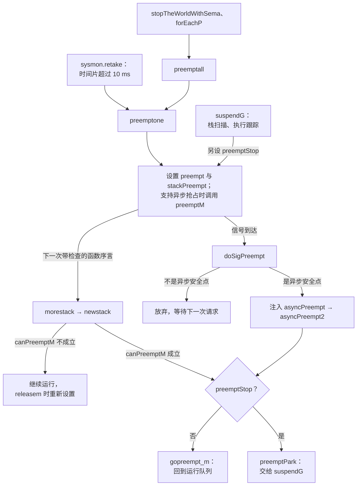

# 9.7 协作与抢占

[9.4](./schedule.md) 描述的调度循环只在 goroutine 离开 CPU 时重新取得控制权：goroutine 主动让出、阻塞、
进入系统调用或者退出。一个始终不做这些事的 goroutine 会一直占用它的 P。为此，运行时需要能在 goroutine
不配合的情况下暂停它，这种能力称为**抢占**（preemption）。对带有垃圾回收的运行时而言，困难不在于打断
执行，操作系统借助信号或线程挂起随时可以做到这一点；困难在于打断的位置：暂停之后，垃圾回收器必须能够
正确解读这个 goroutine 的栈，调度器也必须能够让它在原处继续执行。

本节先用一个程序展示 Go 的抢占能覆盖什么、不能覆盖什么，然后介绍安全点的概念与来历，再依次讨论 Go 1.2
引入的协作式抢占、在循环回边上插入检查的尝试、Go 1.14 引入的异步抢占，以及运行时在哪些情况下发出抢占
请求，最后与 HotSpot 和 .NET 的做法作比较。

## 9.7.1 不肯让出的循环

下面的程序以子进程的方式运行三种从不主动让出的循环：第一种反复调用一个非叶函数（自身还会调用其他
函数的函数），第二种反复调用一个**叶函数**（不再调用任何函数的函数），第三种不调用任何函数。子进程只有
一个 P，它启动执行循环的 goroutine 之后让 main 睡眠 1 ms，main 一旦回到 P 上，子进程就退出。每种循环
分别在默认设置和 `GODEBUG=asyncpreemptoff=1`（关闭异步抢占）下运行，父进程给每个子进程 1 秒的期限：

```go {run=true native=true}
package main

import (
	"context"
	"fmt"
	"os"
	"os/exec"
	"runtime"
	"time"
)

//go:noinline
func leaf(x int) int { return x*3 + 1 } // 帧很小的叶函数：编译器省去了栈检查

//go:noinline
func nonleaf(x int) int { return leaf(x) + 1 } // 非叶函数：序言中有栈检查

// 三种从不主动让出的循环。
var loops = map[string]func(){
	"循环调用非叶函数": func() {
		for x := 0; ; x = nonleaf(x) {
		}
	},
	"循环调用叶函数": func() {
		for x := 0; ; x = leaf(x) {
		}
	},
	"循环不调用函数": func() {
		for x := 0; ; x++ {
		}
	},
}

func main() {
	if len(os.Args) == 2 { // 子进程：在唯一的 P 上运行循环，再看 main 能否回到 P 上
		runtime.GOMAXPROCS(1)
		go loops[os.Args[1]]()
		time.Sleep(time.Millisecond)
		return
	}
	for _, godebug := range []string{"asyncpreemptoff=1", ""} {
		for _, name := range []string{"循环调用非叶函数", "循环调用叶函数", "循环不调用函数"} {
			ctx, cancel := context.WithTimeout(context.Background(), time.Second)
			cmd := exec.CommandContext(ctx, os.Args[0], name)
			cmd.Env = append(os.Environ(), "GODEBUG="+godebug)
			result := "main 回到了 P 上"
			if err := cmd.Run(); ctx.Err() != nil {
				result = "1 秒内未被抢占"
			} else if err != nil {
				result = err.Error()
			}
			cancel()
			fmt.Printf("GODEBUG=%q，%s：%s\n", godebug, name, result)
		}
	}
}
```

在 Go 1.26 上，笔者在 darwin/arm64 与 darwin/amd64（后者经 Rosetta 运行）上得到相同的输出：

```
GODEBUG="asyncpreemptoff=1"，循环调用非叶函数：main 回到了 P 上
GODEBUG="asyncpreemptoff=1"，循环调用叶函数：1 秒内未被抢占
GODEBUG="asyncpreemptoff=1"，循环不调用函数：1 秒内未被抢占
GODEBUG=""，循环调用非叶函数：main 回到了 P 上
GODEBUG=""，循环调用叶函数：main 回到了 P 上
GODEBUG=""，循环不调用函数：main 回到了 P 上
```

1 秒是示例自己设定的期限，并非运行时的常数：超时的子进程不是运行得慢，而是永远不会结束。程序因此需要
大约 2 秒才能运行完。抢占发生时 main 需要等待多久，见 [9.4.2](./schedule.md) 中的测量。

关闭异步抢占时，只有第一种循环能被抢占。Go 1.2 的发布说明写道：「调度器会在进入函数时不时地被调用。
这意味着任何包含（未内联的）函数调用的循环都可以被抢占」[[Go Authors, 2013](#ref-go-authors-2013)]。
第二行输出说明这一表述过于宽泛：调用叶函数的循环虽然包含未内联的函数调用，却同样无法被抢占。
默认设置下三种循环都能被抢占，这是 Go 1.14 引入异步抢占的结果；在此之前，后两种循环足以让只有一个 P
的程序停止响应。本节余下的部分解释这三行差别从何而来。

## 9.7.2 安全点

暂停一个 goroutine 之后，运行时通常还要扫描它的栈，或者把它换下 CPU、稍后让它在原处继续执行。Go
的垃圾回收是精确的（precise）：回收器必须知道每个栈槽和寄存器中存放的是指针还是普通数值，
不能把一个恰好像地址的整数当作指针（[13.7](../../part4memory/ch13gc/safe.md)）。
这份信息由编译器以栈映射（stack map）的形式生成，但不可能逐条指令生成：
栈帧中哪些槽存放指针随执行不断变化，逐条记录会使元数据极其庞大。Agesen 在 1998 年总结 Sun 的 Java 虚拟机
EVM 的实现时写道，为了降低存储开销，栈帧映射通常只为每个方法中若干所谓的 GC 点（GC point）保存，
因此只有当所有线程都处于 GC 点时才能进行垃圾回收 [[Agesen, 1998](#ref-agesen-1998)]。在此之前，Diwan、
Moss 与 Hudson 已经讨论过编译器为精确回收生成这类表格的方法及其空间开销
[[Diwan et al., 1992](#ref-diwan-et-al-1992)]。Go 的编译器在每个调用点记录栈映射
[[Clements, 2019b](#ref-clements-2019b)]。Agesen 还提到，Peyton Jones 与 Ramsey 把可以安全地暂停执行、
检查和修改变量并进行垃圾回收的程序点称为**安全点**（safe point），这是对 GC 点的推广。
本书统一使用「安全点」。

单线程程序中，GC 点不带来额外开销：触发回收的总是那个分配内存失败的线程，而分配点本身就是 GC 点。
多线程程序则不同。Agesen 指出，此时只有触发回收的线程处在 GC 点上，其他线程必须先前滚（roll
forward）到各自的下一个 GC 点，回收才能开始。所有线程都到达安全点所需的时间称为**到达安全点的时间**
（time to safepoint，TTSP）[[Wakart, 2015](#ref-wakart-2015)]。停止一切（STW）的时长因此由最慢的
那个线程决定：只要有一个线程长时间不经过安全点，其余已经停下的线程都要随它等待。Go 的非协作式抢占提案
把这一点列为抢占不及时造成的首要问题，其余几项是调度延迟、栈扫描延迟，以及极端情况下的程序停止响应
[[Clements, 2019a](#ref-clements-2019a)]。

Go 运行时在 `runtime/preempt.go` 开头的注释中把安全点分为三类
[[Go Authors, 2026](#ref-go-authors-2026)]：

1. 阻塞安全点：goroutine 被换下、阻塞在同步操作上或者处于系统调用中的整个期间。
2. 同步安全点：正在运行的 goroutine 检查是否有抢占请求的位置。
3. 异步安全点：用户代码中可以安全暂停 goroutine、并且保守地扫描栈与寄存器就能找到全部栈上根的任意
   指令。运行时借助操作系统的机制（例如信号）在这些位置停下 goroutine。

在前两类安全点上，goroutine 的 CPU 状态很少，回收器也掌握其整个栈的精确信息，因此换下它只需保存很少的
状态，栈扫描也是精确的。第三类由 Go 1.14 加入，它以最内层栈帧的精确性为代价，换来了几乎任意的暂停位置
（9.7.5）。

让线程到达安全点的办法分为两类。一类是**轮询**（polling）：编译器在若干位置插入检查代码，线程执行到
那里时查看是否有暂停请求。EVM 最初就是这样做的，它的编译器在每条回跳分支之前和方法序言中插入轮询代码。
轮询的代价是常驻的检查指令，盲区是长时间不经过检查点的代码。另一类由外部强制。EVM 后来改用代码修补
（code patching）：平时不做任何检查，需要回收时才把线程所在方法中的 GC 点改写为调用运行时的指令，再让
线程继续执行到那里。在 SPARC 上，修补比轮询平均少执行 4.7% 的指令，代价是代码体积增加 5.1% 至 8.5%，
实现也更困难 [[Agesen, 1998](#ref-agesen-1998)]。后文将看到，Go 先后采用了这两类办法，并且同时保留了
它们。

## 9.7.3 协作式抢占：借用栈检查

Go 1.2 之前，goroutine 只在主动让出、阻塞或进入系统调用时交出 P。2010 年 1 月，Russ Cox
报告了一个只有一行代码的问题：`go func() { for { } }()` 不应使程序的其余部分停滞，实际上却会
[[Cox, 2010](#ref-cox-2010)]。2013 年 5 月，Dmitry Vyukov 在抢占式调度器的设计文档中列出了两个问题：
一些程序因为缺少抢占而表现异常，单个 goroutine 始终运行而不切换到其他 goroutine，定时器也不触发；
垃圾回收需要 STW，没有抢占时这可能耗费任意长的时间，有用户报告长达数分钟
[[Vyukov, 2013](#ref-vyukov-2013)]。Vyukov 的方案是复用分段栈的检查：每个 goroutine
在每次函数调用时都检查栈空间是否充足，不足时调用运行时；只要能让这项检查在外部请求下失败，就得到了抢占。
文档把这一方案的优点概括为没有额外开销、实现相对简单、不使用信号、只需极少的同步。该方案在 Go 1.2 中实现。
它被称为**协作式抢占**（cooperative preemption），因为运行时只能提出请求，抢占要等 goroutine
自己执行到检查时才会发生。

对于栈帧较小的函数，序言中的栈检查（[14.3.1](../../part4memory/ch14stack/grow.md)）在 amd64
上只有两条指令。以 9.7.1 示例中的 `nonleaf` 为例，`go build -gcflags=-S` 输出的汇编经裁剪并改用标号后如
下：

```
TEXT main.nonleaf(SB), ABIInternal, $16-8
	CMPQ  SP, 16(R14)      // R14 存放当前 g，16(R14) 是 g.stackguard0
	JLS   slow             // SP 不高于 stackguard0：栈空间不足，或者有抢占请求
	...                    // 函数体
slow:
	MOVQ  AX, 8(SP)        // 把寄存器中的参数溢出到栈上
	CALL  runtime.morestack_noctxt(SB)
	MOVQ  8(SP), AX
	JMP   main.nonleaf(SB) // 回到入口重新检查
```

要发出抢占请求，运行时只需把目标 goroutine 的 `stackguard0` 设为一个比任何合法栈指针都大的值
`stackPreempt`。下一次函数调用的检查必然失败，执行流进入 `morestack`，切换到 g0 上调用 `newstack`。
`newstack` 首先判断这是否是一次抢占请求：

```go
// runtime.newstack（runtime/stack.go），只保留与抢占有关的部分
const stackPreempt = uintptrMask & -1314 // 64 位平台上为 0xfffffffffffffade

func newstack() {
	thisg := getg()
	gp := thisg.m.curg
	preempt := gp.stackguard0 == stackPreempt
	if preempt && !canPreemptM(thisg.m) {
		// 此刻不宜抢占：恢复正常的栈界，让 goroutine 继续运行。
		// gp.preempt 仍为真，M 释放运行时的锁时会重新设置 stackPreempt。
		gp.stackguard0 = gp.stack.lo + stackGuard
		gogo(&gp.sched)
	}
	// ……确认栈指针没有越界……
	if preempt {
		if gp.preemptShrink { // 推迟到同步安全点进行的栈收缩
			gp.preemptShrink = false
			shrinkstack(gp)
		}
		gp.syncSafePoint = true
		if gp.preemptStop {
			preemptPark(gp) // 为栈扫描而暂停，见 9.7.6
		}
		gopreempt_m(gp) // 效果等同于调用 runtime.Gosched
	}
	// 以下才是真正的栈增长
}
```

`canPreemptM` 决定此刻能否抢占：

```go
// runtime.canPreemptM（runtime/preempt.go）
func canPreemptM(mp *m) bool {
	return mp.locks == 0 && mp.mallocing == 0 && mp.preemptoff == "" &&
		mp.p.ptr().status == _Prunning && mp.curg != nil &&
		readgstatus(mp.curg)&^_Gscan != _Gsyscall
}
```

这些条件几乎逐条对应 Vyukov 设计文档中列出的不可抢占情形：持有运行时的锁、正在分配内存、goroutine
不处于运行状态（例如处于系统调用中）、M 没有 P 或者 P 不在运行状态。其中 `m.locks` 同时充当关闭抢占的
计数器：运行时进入临界区时通过 `acquirem` 将其加一；`releasem` 将其减到零时，如果 `gp.preempt` 仍为真，
就把 `stackguard0` 重新设为 `stackPreempt`，补上此前被推迟的请求。`gopreempt_m` 与 `runtime.Gosched`
共用 `goschedImpl`，把 goroutine 放回全局运行队列（[9.4.3](./schedule.md)）。

这一设计不增加任何指令：抢占检查就是原本就有的栈溢出检查。Agesen 记载过一个相近的想法：EVM 省去了
至多含一个调用点的方法序言中的轮询，理由是一个只在这类无循环方法中执行的线程，要么栈的深度随执行时间
增长而很快溢出，要么很快离开这些方法，而处理栈溢出的代码本身就提供了暂停的机会
[[Agesen, 1998](#ref-agesen-1998)]。Go 更进一步，让轮询与栈溢出检查合二为一。

代价是抢占只能发生在带栈检查的函数入口，而这比「每次函数调用」要少。amd64 与 arm64 的汇编器会把栈帧
小于 `StackSmall`（128 字节）的叶函数标记为 `NOSPLIT`，省去检查：栈界以下始终至少保留 `StackSmall`
字节，这样的函数不可能越过栈底（[14.3](../../part4memory/ch14stack/grow.md)）。被内联的调用也不再有
序言。9.7.1 中的 `leaf` 正是这样的函数，`-gcflags=-S` 的输出把它标为 `nosplit`，所以反复调用它的循环与
不含调用的循环一样，永远不会经过同步安全点。Clements 在非协作式抢占的设计文档中对 Go 1.10 及以前的
状况的概括是：安全点只在函数调用处，并且函数很小或者被内联时连调用处也没有
[[Clements, 2019a](#ref-clements-2019a)]。

## 9.7.4 回边上的轮询

Vyukov 的设计文档把是否在**回边**（back edge，控制流图中从循环体跳回循环头的边）上编译额外的抢占检查
留作后续工作，理由是函数入口的检查应当足以应付大多数实际情况 [[Vyukov, 2013](#ref-vyukov-2013)]。
在回边上插入检查是采用协作式抢占的运行时的标准做法，因为几乎没有代码能在不经过回边的情况下长时间运行；
EVM 与 HotSpot 都这样做（9.7.7）。函数入口的检查不够用的例子在 Go 中陆续出现，Austin Clements 在 2015 年
开设的 issue #10958「runtime: tight loops should be preemptible」汇集了这类问题
[[Clements, 2015](#ref-clements-2015)]。

David Chase 先后做了两次尝试。2016 年的提交 7f1ff65c39 为编译器增加了 `GOEXPERIMENT=preemptibleloops`：
开启后，编译器在每个可归约循环的每条回边上插入一次重新调度检查，检查方式与函数序言相同，比较栈指针与
`stackguard0` [[Chase, 2016](#ref-chase-2016)]。提交说明称，STW 的目标延迟已经降到 100 µs 左右，这个
实验选项用于研究和诊断 GC 及其他延迟问题。它至今仍然存在，在 Go 1.26 中默认关闭。

2017 年的 CL 43050 试图把检查压缩到极限。在 amd64 上，每条回边只增加一条
`TESTB AX, runtime.reschedulePage` 指令，即读取运行时预留的一个字节 [[Chase, 2017](#ref-chase-2017)]。
平时这次读取没有任何效果；按照设计，需要抢占时，运行时使这一页不可访问，读取便触发缺页异常，
交由信号处理函数接管，因此这种做法被称为基于缺页的抢占（fault-based preemption）。它不引入分支，
也不占用寄存器。用页面保护代替显式的标志检查是一项老技术：Agesen 记载，Steve Dever 曾为 EVM
提出写保护的「轮询页」，Mosberger、Druschel 与 Peterson 称之为「受控缺页」（controlled
faults）[[Agesen, 1998](#ref-agesen-1998)]；HotSpot 的安全点轮询至今仍采用这种方式（9.7.7）。

即便如此，在一个大型基准测试集上，几何平均的减速仍达 7.8%，并有若干明显更差的离群值；与 Go 1.9 相比，
由于其他改进的抵消，减速只有 1%，但多数基准仍有所变慢 [[Clements, 2019a](#ref-clements-2019a)]。设计
文档还列出了这一方案在实现上的几处缺陷。第一，它无法针对特定的线程或 goroutine，因而不适合栈扫描、
不规则屏障（ragged barrier，要求每个线程各自在某个时刻执行一项操作、而不必同时停下）或普通的调度抢占。
第二，它是「粘滞」的：在恢复所有循环之前无法恢复其中任何一个，因此遇到不安全的状态（例如持有运行时的
锁）时不能直接放行。第三，在非 x86 或非 UNIX 平台上需要更多指令。第四，它会干扰调试器，因为调试器通常
把非法的内存访问视为暂停程序的理由。为一件几乎从不发生的事，在每个热循环中付出常驻的开销，而且仍然
无法定向，这促使 Go 团队转向非协作式的方案。

## 9.7.5 异步抢占

2018 年 3 月，Austin Clements 开设 issue #24543，提议实现非协作式抢占（non-cooperative preemption）：
在不依赖被抢占代码中的显式检查或配合的情况下切换执行上下文 [[Clements, 2018a](#ref-clements-2018a)]。
用信号打断一个正在运行的 goroutine 并取得它的 CPU 状态并不困难，困难在于此时它几乎不可能恰好停在有栈
映射的指令上。设计文档为此给出了两个子提案。

第一个子提案是处处安全点（safe-points everywhere）：由编译器为每一条指令生成栈与寄存器的活跃性映射
[[Clements, 2018b](#ref-clements-2018b)]。Go 1.11 已经开始在二进制文件中记录寄存器映射，一方面为非协作式
抢占做准备，另一方面支持调试器向目标程序注入函数调用，二进制文件因此增大了约 5%
[[Clements, 2018c](#ref-clements-2018c)]。第二个子提案是保守的内层帧扫描（conservative inner-frame
scanning）：对被抢占的 goroutine，只把最内层栈帧与寄存器作为保守的根来扫描，凡是可能是合法堆指针的字都
当作指针，其余栈帧仍按调用点的栈映射精确扫描 [[Clements, 2019b](#ref-clements-2019b)]。

Go 最终采用了第二个子提案。设计文档给出的理由是：它的实现简单得多，长期遗留缺陷的可能性也小得多，还能
使二进制文件缩小约 5%。保守扫描通常的问题是使本应回收的对象存活更久，但这里的范围被严格限制在最内层的
一帧，而最内层帧变化很快，一个对象因此被错误保留的时间很少超过一个回收周期。Go 1.14 实现了这一方案，
称为**异步抢占**（asynchronous preemption）[[Clements, 2019c](#ref-clements-2019c)]；Go 1.15 删除了
寄存器映射，栈映射重新只在调用点生成 [[Clements, 2020a](#ref-clements-2020a)]。Go 1.14 的发布说明写道：
goroutine 现在可以被异步抢占，因此不含函数调用的循环不再可能使调度器死锁，或者显著推迟垃圾回收
[[Go Authors, 2020](#ref-go-authors-2020)]。

在使用信号的平台上，一次异步抢占经过以下几步：

1. 发起方调用 `preemptM`，向目标 M 所在的线程发送 `SIGURG`（信号的选择见 [9.6.6](./signal.md)）。如果该
   M 已有一个尚未处理的抢占信号，就不再重复发送。
2. 信号处理函数调用 `doSigPreempt`（分发路径见 [9.6.3](./signal.md)）。它确认 goroutine 仍然需要被抢占，
   并且被打断处是一个异步安全点，然后修改信号上下文，使线程看上去像是在被打断处调用了 `asyncPreempt`。
3. 信号处理函数返回后，线程从 `asyncPreempt` 开始执行。这段由 `mkpreempt.go` 生成的汇编把全部通用
   寄存器和标志位保存到 goroutine 的栈上，然后调用 `asyncPreempt2`。
4. `asyncPreempt2` 切换到 g0，与同步抢占一样转入 `preemptPark` 或 `gopreempt_m`。goroutine 再次被调度
   时，`asyncPreempt2` 返回，`asyncPreempt` 恢复全部寄存器，再返回被打断的指令。

第 2 步与第 4 步的代码如下：

```go
// runtime.doSigPreempt（runtime/signal_unix.go），省去 Darwin 的特殊处理
func doSigPreempt(gp *g, ctxt *sigctxt) {
	if wantAsyncPreempt(gp) {
		if ok, newpc := isAsyncSafePoint(gp, ctxt.sigpc(), ctxt.sigsp(), ctxt.siglr()); ok {
			// 以 newpc 为返回地址压栈，并把 PC 改为 asyncPreempt
			ctxt.pushCall(abi.FuncPCABI0(asyncPreempt), newpc)
		}
	}
	gp.m.preemptGen.Add(1) // 告知发起方：这一次请求已经处理
	gp.m.signalPending.Store(0)
}

// runtime.asyncPreempt2（runtime/preempt.go）
func asyncPreempt2() {
	mcall(func(gp *g) {
		gp.asyncSafePoint = true // 栈顶两帧没有精确的指针信息
		xRegSave(gp)             // 把扩展寄存器状态从 P 移到 G
		if gp.preemptStop {
			preemptPark(gp)
		} else {
			gopreempt_m(gp)
		}
	})
	gp := getg() // goroutine 被重新调度后从这里继续
	xRegRestore(gp)
	gp.asyncSafePoint = false
}
```

`preempt.go` 开头的注释还解释了为什么不直接在信号处理函数中完成抢占。那样做的好处是由操作系统保存和恢复
寄存器，运行时只需从信号上下文中取出可能含有指针的寄存器；但每个被抢占的 goroutine 都会占住一个 M，而且
调度器本身并非为在信号处理函数中运行而设计，它在抢占路径上往往要分配内存、启动线程。

信号可能在任意一条指令处到达，`isAsyncSafePoint` 决定能否在这里暂停。以下情形一律拒绝，等待下一次请求：

- 被打断的不是该 M 当前运行的用户 goroutine，例如 M 正在调度器中处理这个 goroutine；或者 `canPreemptM`
  不成立。
- 栈上剩余空间不足以注入 `asyncPreempt` 调用。所需的空间 `asyncPreemptStack` 在启动时由相关函数的最大
  栈帧算出，并且不得超过 `nosplit` 函数可用的栈空间。
- 不是 Go 代码，或者是汇编函数。
- 编译器标记的不安全点，例如写屏障之类的原子指令序列，以及 `nosplit` 函数中调用处以外的位置。
- 最内层函数（考虑内联）属于 `runtime`、`internal/runtime` 或 `reflect` 包。调度器中「此处与彼处之间
  不可抢占」的区段、`defer` 实现在栈上存放的无类型数据、批量写屏障等都在这些包中。
- 在 Go 1.26 的实验特性 `GOEXPERIMENT=runtimesecret` 下，goroutine 正在进行机密计算：保守扫描可能把栈上
  的机密数据带进回收器的工作缓冲区，保存寄存器也会留下机密数据的副本。

还有一种位置可以暂停，但不能从原处恢复。arm64、loong64 等平台的汇编器加载较大的常量或偏移量时会生成
多条指令，中间结果存放在临时寄存器 `REGTMP` 中，而 `asyncPreempt` 返回时要用这个寄存器装载返回地址，
不保留它的值。汇编器把这样的指令序列标记为可重启序列；Go 1.18 起，`isAsyncSafePoint` 接受这些位置，
但把恢复地址退回序列的开头，恢复后重新计算 `REGTMP` [[Mui, 2021](#ref-mui-2021)]。

暂停在异步安全点上的 goroutine，栈顶有两帧没有精确的指针信息：保存了寄存器的 `asyncPreempt` 帧，以及
被打断的函数的帧。栈扫描遇到 `asyncPreempt` 帧时，对它和它的父帧做保守扫描，包括父帧中为传出参数预留的
区域，因为被打断时它可能正在准备一次调用（[13.7](../../part4memory/ch13gc/safe.md)）。保守扫描并非把每个
看起来像地址的字都当作指针：只有指向堆中已分配对象的字才会使该对象被标记，而标记阶段新分配的对象本来
就是黑色的，会被跳过；指向本 goroutine 栈内的字则使相应的栈对象也被保守地扫描
[[Go Authors, 2026](#ref-go-authors-2026)]。由于这两帧的指针信息不精确，运行时此时也不能移动栈：
`isShrinkStackSafe` 在 `gp.asyncSafePoint` 为真时拒绝收缩，回收器只设置 `preemptShrink`，把收缩推迟到
下一个同步安全点，也就是 9.7.3 中 `newstack` 的那段代码（[14.5](../../part4memory/ch14stack/shrink.md)）。

寄存器保存在哪里同样需要考虑。通用寄存器可能含有指针，必须保存在 goroutine 的栈上，供保守扫描找到。在 Go
1.26 之前，所有寄存器都保存在栈上，amd64 的 `asyncPreempt` 为此需要 368 字节的栈空间，其中大部分用于 XMM
寄存器；而 AVX-512 的寄存器状态有 2.5 KiB，超过了 `nosplit` 的上限。Go 1.26 因此在 amd64、arm64 与
loong64 上把向量寄存器等非通用寄存器保存到栈外：`asyncPreempt` 先把它们写入当前 P 的暂存区，
`asyncPreempt2` 再在 g0 上把它们移入按需分配给该 G 的扩展寄存器状态
[[Clements, 2025](#ref-clements-2025)]。在 amd64 上，AVX2 与 AVX-512 的状态目前只在 `GOEXPERIMENT=simd`
下保存，默认构建只保存 XMM 寄存器。Go 1.26 假定这部分状态只含标量数据，并不扫描它。这一假定并不总是成立：
编译器可能用向量寄存器完成小块内存的复制，复制中途被抢占时，某个指针可能只存在于向量寄存器中。Go 1.27
因此开始保守地扫描这部分状态 [[Musman, 2026](#ref-musman-2026)]。

并非所有平台都使用信号。Windows 没有 POSIX 信号，`preemptM` 用 `SuspendThread` 挂起目标线程，用
`GetThreadContext` 读取它的寄存器，确认它处于异步安全点后，改写上下文并通过 `SetThreadContext` 写回，再
恢复线程，这与 9.7.7 中 .NET 的做法相同。Plan 9 与 js/wasm 不支持异步抢占（`preemptMSupported` 为假），
只能依靠协作式抢占。调试时如果怀疑问题与异步抢占有关，可以用 `GODEBUG=asyncpreemptoff=1` 关闭它，9.7.1
的示例正是借助这一开关展示了协作式抢占的盲区。

## 9.7.6 抢占请求的来源

发出抢占请求的入口是 `preemptone`。它同时设下两道触发条件：设置 `stackPreempt`，等待 goroutine 的下一次
序言检查；在支持异步抢占的平台上，再向 M 发送抢占信号。goroutine 先满足哪一个，就从哪一条路径进入调度器：

```go
// runtime.preemptone（runtime/proc.go），省去开头的有效性检查
func preemptone(pp *p) bool {
	mp := pp.m.ptr()
	gp := mp.curg
	// ……跳过没有 M、当前 M 自身、g0，以及处于系统调用中的 goroutine……
	gp.preempt = true
	gp.stackguard0 = stackPreempt // 同步：下一次序言检查必然失败
	if preemptMSupported && debug.asyncpreemptoff == 0 {
		pp.preempt = true
		preemptM(mp) // 异步：向 M 发送抢占信号
	}
	return true
}
```

调用 `preemptone` 的有两处。一是系统监控 sysmon 中的 `retake`：如果一个 P 的调度计数在 10 ms
（`forcePreemptNS`）内没有变化，说明同一个时间片已经运行得过久，sysmon 就请求抢占该 P 上的 goroutine
（判定规则见 [9.4.2](./schedule.md)，sysmon 本身见 [9.8](./sysmon.md)）。二是 `preemptall`，它对每个
正在运行的 P 调用 `preemptone`。执行 STW 的 `stopTheWorldWithSema` 先调用一次 `preemptall`，此后
每隔 100 µs 再调用一次，直到所有 P 都停下；`forEachP` 也借助它促使每个 P 尽快执行指定的操作。这两类
请求都不设置 `preemptStop`，被抢占的 goroutine 经 `gopreempt_m` 回到运行队列，稍后可以在任何一个 P 上
继续执行。

第三个来源是 `suspendG`。回收器扫描 goroutine 的栈（`markroot` 中的栈根任务）以及执行跟踪器需要读取
goroutine 的栈时，并不停止一切，而是逐个暂停 goroutine。对于正在运行的 goroutine，`suspendG` 设置
`preemptStop`、`preempt` 与 `stackPreempt`，以至多每 5 µs 一次的频率调用 `preemptM`，然后自旋等待。
goroutine 在同步或异步安全点上进入 `preemptPark`，状态变为 `_Gpreempted`；`suspendG` 把它改为
`_Gwaiting` 并持有扫描位，交给调用方使用，扫描结束后由 `resumeG` 让它重新就绪。已经处于阻塞安全点的
goroutine（`_Grunnable`、`_Gwaiting`、`_Gsyscall`）无需抢占，`suspendG` 只需取得它的扫描位。

设计文档对这几类请求作过区分：STW 抢占有严格的时间要求，但不扫描栈，因此可以立即使用异步抢占；栈扫描
与调度抢占没有严格的时间要求，运行时可以先等待协作式抢占，从而减少保守扫描
[[Clements, 2019b](#ref-clements-2019b)]。Go 1.26 的 `suspendG` 实际上同时发出两种请求。逐个暂停
goroutine 的能力，使回收器能够在并发标记阶段逐一扫描各个 goroutine 的栈；Go 1.8 引入混合写屏障之后，
标记终止阶段也不必在 STW 中重新扫描栈 [[Clements and Hudson, 2016](#ref-clements-and-hudson-2016)]。
HotSpot 直到 JDK 10 才具备只暂停单个线程的能力，ZGC 则在 JDK 16 中才把线程栈的处理移出安全点（9.7.7）。

下图汇总了请求的来源与两条抢占路径：



## 9.7.7 其他运行时的做法

HotSpot JVM 采用轮询。Wakart 总结了 OpenJDK 放置安全点轮询的位置：解释执行时实际上在任意两条字节码之间；
在 C1 与 C2 编译的代码中，在非计数循环的回边上以及方法返回处。阻塞在锁、监视器或 I/O 上的线程，以及正在
执行 JNI 本地代码的线程，本身就处于安全点 [[Wakart, 2015](#ref-wakart-2015)]。轮询本身是一条读取
轮询页（polling page）的 `test` 指令，在 x86-64 上借助相对 RIP 的寻址只占 6 个字节，平时没有任何效果；
需要进入安全点时，虚拟机使这一页不可读，轮询便触发 `SIGSEGV`，由 JVM 的信号处理函数接管
[[Shipilëv, 2019](#ref-shipilev-2019)]。这正是 CL 43050 所用的技术。计数循环（循环变量为 `int`、边界
已知的循环）曾经不含轮询，Wakart 用例子展示了这类循环如何使 TTSP 失控，乃至让所有其他线程在下一次安全点
无限期地等待。JDK 10 引入了循环条带化（loop strip mining）：把计数循环拆成内外两层，内层至多执行
`LoopStripMiningIter` 次迭代且不含轮询，外层带有轮询 [[Westrelin, 2017](#ref-westrelin-2017)]。使用 G1
与 ZGC 时，该优化默认开启，每段 1000 次迭代。同在 JDK 10 中，JEP 312 引入了线程局部握手
（thread-local handshakes）：每个线程通过线程局部的指针读取轮询页，虚拟机只需让某个线程的指针指向不可读
的那一页，就能单独暂停这个线程，而不必暂停所有线程 [[Ehn, 2018](#ref-ehn-2018)]。Shipilëv 测得，这只
多出一次命中 L1 缓存的读取，约半个时钟周期。此后，ZGC 在 JDK 16 中借助栈水位线屏障（stack watermark
barrier）把线程栈的扫描移到并发阶段，目标是每次 GC 安全点的停顿少于 1 ms
[[Österlund, 2020](#ref-osterlund-2020)]。

.NET 的 CoreCLR 让即时编译器为每个方法在两种代码之间选择 [[Microsoft, n.d.](#ref-microsoft-nd)]。
部分可中断（partially interruptible）的代码只在调用点和显式插入的 GC 轮询处是安全点，GC
信息也只为这些位置生成；完全可中断（fully interruptible）的代码中每条指令都是安全点，编译器为每条指令生成
GC 信息，不再插入轮询。即时编译器依据启发式规则，在代码质量、GC 信息的体积和暂停延迟之间取舍。
需要暂停线程时，运行时用 `SuspendThread` 挂起它，用 `GetThreadContext` 读取它的上下文：
若线程停在完全可中断的代码中，就改写指令指针，把它引向一段保存完整上下文、等待 GC 结束的桩代码；
若停在部分可中断的代码中，就改写栈顶帧的返回地址，使方法返回时落入同样的桩代码，这称为线程劫持（thread
hijacking）。

| 运行时 | 安全点的位置 | 如何让线程到达安全点 | 栈扫描 |
| --- | --- | --- | --- |
| Go 1.2 至 1.13 | 带栈检查的函数序言 | 轮询，复用栈溢出检查 | 精确 |
| Go 1.14 起 | 同上，另加用户代码中的大部分指令 | 轮询；信号或挂起线程后注入调用 | 栈顶两帧保守，其余精确 |
| HotSpot（C1、C2） | 方法返回、非计数循环的回边、条带化后计数循环的外层 | 读取轮询页，需要时使其不可读 | 精确 |
| .NET CoreCLR | 部分可中断：调用点与 GC 轮询；完全可中断：每条指令 | 挂起线程后改写指令指针或返回地址 | 精确 |

比较之下，Go 的异步安全点在覆盖范围上接近 .NET 的完全可中断代码，却没有为每条指令生成 GC 信息，那正是
Go 放弃的「处处安全点」方案；Go 接受的是范围受限的不精确，即栈顶两帧的保守扫描。HotSpot 则把力气花在
使轮询尽可能便宜上，并用条带化弥补计数循环的盲区；Go 在 CL 43050 中走过同样的路，最终因开销和无法定向
而放弃。

## 9.7.8 小结

抢占的约束来自精确回收：goroutine 只能停在回收器读得懂其栈的位置。Go 1.2 把抢占检查合并进函数序言的栈
溢出检查，不增加任何指令，却留下了叶函数、内联调用和不含调用的循环这些盲区。在回边上轮询可以覆盖循环，
但即使压缩到一条指令仍有可观的开销，而且无法定向。Go 1.14 改用信号（Windows 上为挂起线程）打断
goroutine，以保守扫描栈顶两帧代替逐指令的栈映射。两种机制并存：sysmon、STW 与栈扫描发出的每一次请求，
都同时设下同步与异步两道触发条件。

异步抢占仍有覆盖不到的地方，即运行时自身的代码、汇编函数和编译器标记的不安全点。例如，`clear`、`append`
等操作中对大块内存的清零在运行时内部完成，执行期间不可抢占 [[Hiltner, 2024](#ref-hiltner-2024)]；
issue #36365 跟踪着异步抢占的其余遗留问题 [[Clements, 2020b](#ref-clements-2020b)]。

## 延伸阅读

- <a id="ref-agesen-1998"></a>[Agesen, 1998] Ole Agesen. GC Points in a Threaded Environment. Sun
  Microsystems Laboratories Technical Report SMLI TR-98-70, 1998.
  https://www.cs.tufts.edu/~nr/cs257/archive/ole-agesen/gc-points.pdf
  多线程环境下让线程到达 GC 点的经典论述，比较了轮询与代码修补。
- <a id="ref-chase-2016"></a>[Chase, 2016] David Chase. cmd/compile: insert scheduling checks on loop
  backedges. Go commit 7f1ff65c39, 2016. https://go.dev/cl/33910
  `GOEXPERIMENT=preemptibleloops` 的由来。
- <a id="ref-chase-2017"></a>[Chase, 2017] David Chase. cmd/compile: loop preemption with "fault branch"
  on amd64. Go CL 43050, 2017（未合入）. https://golang.org/cl/43050
  基于缺页的回边抢占：每条回边一条 `TESTB` 指令。
- <a id="ref-clements-2015"></a>[Clements, 2015] Austin Clements. runtime: tight loops should be
  preemptible. Go issue #10958, 2015. https://github.com/golang/go/issues/10958
  序言抢占盲区的汇总报告。
- <a id="ref-clements-2018a"></a>[Clements, 2018a] Austin Clements. runtime: non-cooperative goroutine
  preemption. Go issue #24543, 2018. https://github.com/golang/go/issues/24543
  异步抢占的提案讨论。
- <a id="ref-clements-2018b"></a>[Clements, 2018b] Austin Clements. Proposal: Safe-points everywhere for
  non-cooperative goroutine preemption. Go design document, 2018.
  https://go.googlesource.com/proposal/+/master/design/24543/safe-points-everywhere.md
  未被采用的子提案：为每条指令生成活跃性映射。
- <a id="ref-clements-2018c"></a>[Clements, 2018c] Austin Clements. cmd/compile, cmd/internal/obj: record
  register maps in binary. Go commit 9f95c9db23, 2018. https://go.dev/cl/109353
- <a id="ref-clements-2019a"></a>[Clements, 2019a] Austin Clements. Proposal: Non-cooperative goroutine
  preemption. Go design document, 2019.
  https://github.com/golang/proposal/blob/master/design/24543-non-cooperative-preemption.md
  抢占不及时造成的问题、回边抢占的尝试及其 7.8% 的开销，以及信号方案的总体设计。
- <a id="ref-clements-2019b"></a>[Clements, 2019b] Austin Clements. Proposal: Conservative inner-frame
  scanning for non-cooperative goroutine preemption. Go design document, 2019.
  https://go.googlesource.com/proposal/+/master/design/24543/conservative-inner-frame.md
  最终采用的子提案：保守扫描最内层帧。
- <a id="ref-clements-2019c"></a>[Clements, 2019c] Austin Clements. runtime: implement async scheduler
  preemption. Go commit 177a36a5dc, 2019. https://go.dev/cl/201762
- <a id="ref-clements-2020a"></a>[Clements, 2020a] Austin Clements. cmd/compile,runtime: stack maps only
  at calls, remove register maps. Go commit 9d812cfa5c, 2020. https://go.dev/cl/230544
- <a id="ref-clements-2020b"></a>[Clements, 2020b] Austin Clements. runtime: clean up async preemption
  loose ends. Go issue #36365, 2020. https://go.dev/issue/36365
- <a id="ref-clements-2025"></a>[Clements, 2025] Austin Clements. runtime: save scalar registers off stack
  in amd64 async preemption. Go commit af0c4fe2ca, 2025. https://go.dev/cl/669195
- <a id="ref-clements-and-hudson-2016"></a>[Clements and Hudson, 2016] Austin Clements and Rick Hudson.
  Proposal: Eliminate STW stack re-scanning. Go design document, 2016.
  https://go.googlesource.com/proposal/+/master/design/17503-eliminate-rescan.md
  混合写屏障，使栈扫描不再需要 STW。
- <a id="ref-cox-2010"></a>[Cox, 2010] Russ Cox. runtime: preemptive scheduling. Go issue #543, 2010.
  https://go.dev/issue/543
  一个空循环使整个程序停滞的最初报告。
- <a id="ref-diwan-et-al-1992"></a>[Diwan et al., 1992] Amer Diwan, Eliot Moss, and Richard Hudson.
  Compiler support for garbage collection in a statically typed language. In *Proceedings of PLDI '92*,
  273–282, 1992. https://doi.org/10.1145/143095.143140
  编译器为精确回收生成栈映射表；Agesen（1998）引用了它对这类表格空间开销的讨论。
- <a id="ref-ehn-2018"></a>[Ehn, 2018] Robbin Ehn. JEP 312: Thread-Local Handshakes. OpenJDK, 2018.
  https://openjdk.org/jeps/312
  从全局安全点到逐线程握手。
- <a id="ref-go-authors-2013"></a>[Go Authors, 2013] The Go Authors. Go 1.2 Release Notes, 2013.
  https://go.dev/doc/go1.2
  「Pre-emption in the scheduler」一节。
- <a id="ref-go-authors-2020"></a>[Go Authors, 2020] The Go Authors. Go 1.14 Release Notes, 2020.
  https://go.dev/doc/go1.14#runtime
  异步抢占正式可用，以及 `asyncpreemptoff`。
- <a id="ref-go-authors-2026"></a>[Go Authors, 2026] The Go Authors. `runtime/preempt.go`、
  `runtime/signal_unix.go`、`runtime/proc.go`、`runtime/mgcmark.go`.
  https://github.com/golang/go/tree/master/src/runtime
  安全点的分类、`suspendG`、`isAsyncSafePoint`、`preemptone`/`retake`，以及栈的保守扫描（本节对照
  Go 1.26）。
- <a id="ref-hiltner-2024"></a>[Hiltner, 2024] Rhys Hiltner. runtime: non-preemptible zeroing in clear,
  append, bytes.growSlice, etc. Go issue #69327, 2024. https://go.dev/issue/69327
- <a id="ref-microsoft-nd"></a>[Microsoft, n.d.] Microsoft. Book of the Runtime: CLR Threading Overview.
  https://github.com/dotnet/runtime/blob/main/docs/design/coreclr/botr/threading.md
  部分可中断与完全可中断的代码，以及线程劫持。
- <a id="ref-mui-2021"></a>[Mui, 2021] Cherry Mui. runtime: accept restartable sequence pcdata values in
  isAsyncSafePoint. Go commit 8ff16c1990, 2021. https://go.dev/cl/340011
- <a id="ref-musman-2026"></a>[Musman, 2026] Alexander Musman. runtime: conservatively scan extended
  register state. Go commit 683aa8893a, 2026. https://go.dev/cl/740681
- <a id="ref-osterlund-2020"></a>[Österlund, 2020] Erik Österlund. JEP 376: ZGC: Concurrent Thread-Stack
  Processing. OpenJDK, 2020. https://openjdk.org/jeps/376
  把线程栈的处理移出安全点。
- <a id="ref-shipilev-2019"></a>[Shipilëv, 2019] Aleksey Shipilëv. JVM Anatomy Quark #22: Safepoint Polls.
  2019. https://shipilev.net/jvm/anatomy-quarks/22-safepoint-polls/
  轮询页的实现与线程局部握手的开销。
- <a id="ref-vyukov-2013"></a>[Vyukov, 2013] Dmitry Vyukov. Go Preemptive Scheduler Design Doc. 2013.
  https://docs.google.com/document/d/1ETuA2IOmnaQ4j81AtTGT40Y4_Jr6_IDASEKg0t0dBR8/edit
  借用分段栈检查实现抢占的设计，Go 1.2 协作式抢占的来源。
- <a id="ref-wakart-2015"></a>[Wakart, 2015] Nitsan Wakart. Safepoints: Meaning, Side Effects and
  Overheads. 2015. https://psy-lob-saw.blogspot.com/2015/12/safepoints.html
  HotSpot 安全点与 TTSP 的系统讨论。
- <a id="ref-westrelin-2017"></a>[Westrelin, 2017] Roland Westrelin. 8186027: C2: loop strip mining.
  OpenJDK commit 386e258e20, 2017. https://bugs.openjdk.org/browse/JDK-8186027
- 本书 [9.4 调度循环](./schedule.md)、[9.6 信号处理机制](./signal.md)、[9.8 系统监控](./sysmon.md)、
  [第 14 章 执行栈管理](../../part4memory/ch14stack/readme.md)、
  [13.4 扫描标记与标记辅助](../../part4memory/ch13gc/mark.md)、
  [13.7 安全点分析](../../part4memory/ch13gc/safe.md)。
