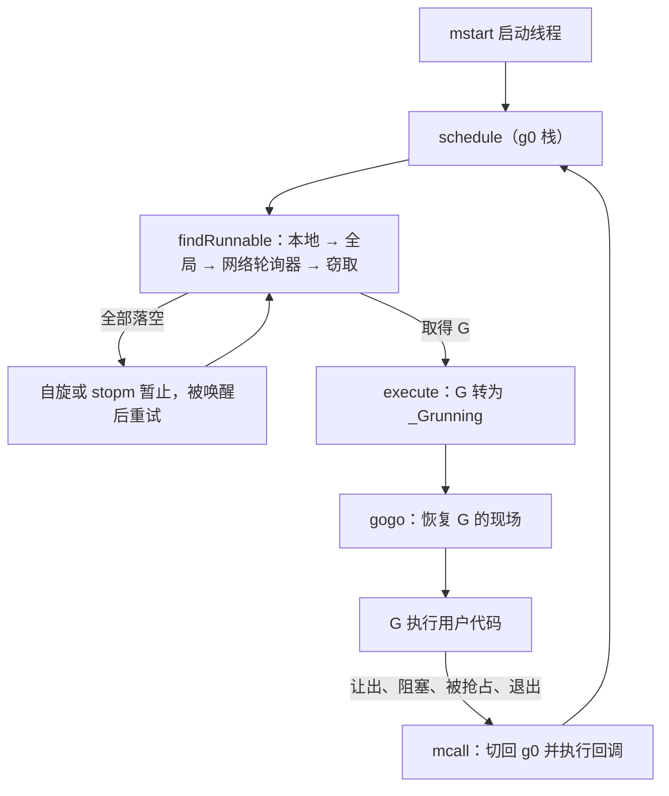

# 9.4 调度循环

[9.3](./mpg.md) 介绍了 G、M、P 的表示以及 G 与 g0 之间的栈切换，[9.2](./steal.md) 给出了 M 寻找可运行 G
的完整顺序。本节把这些部件连成一个整体：每个 M 如何在调度循环中周而复始地选出并执行 goroutine，Go
在没有定时器中断的情况下如何界定时间片，goroutine 经由哪些路径回到调度器，以及调度器如何在局部性与公平之间
取舍。下文的代码是裁剪后的示意，略去了 GC、追踪与剖析等旁支，完整实现见 Go 1.26 的 `runtime/proc.go`
[[Go Authors, 2026a](#ref-go-authors-2026a)]。

## 9.4.1 永不返回的 schedule

每个 M 启动后最终都进入 `schedule`，此后在其中循环，直到线程退出。去掉旁支后，`schedule` 的结构如下：

```go
// schedule：执行一轮调度，找到一个可运行的 G 并执行它，永不返回（示意）
func schedule() {
	mp := getg().m
	if mp.lockedg != 0 { // 本 M 被某个 G 锁定，只能执行这个 G
		stoplockedm()
		execute(mp.lockedg.ptr(), false)
	}

top:
	gp, inheritTime, tryWakeP := findRunnable() // 找不到工作时在内部阻塞
	if mp.spinning {
		resetspinning() // 退出自旋，必要时唤醒新的自旋 M（9.3.5）
	}
	if tryWakeP {
		wakep() // 选中的是 GC 工作者等特殊 G，另唤醒一个 P 处理普通 G
	}
	if gp.lockedm != 0 { // gp 锁定在另一个 M 上：把 P 交给那个 M，自己等待新的 P
		startlockedm(gp)
		goto top
	}
	execute(gp, inheritTime) // 切换到 gp，不返回
}
```

`findRunnable` 按 [9.2.2](./steal.md) 所述的顺序依次检查本地队列、全局队列、网络轮询器与其他 P，
全部落空时让 M 自旋或暂止，直到被唤醒后重试，因此它总能返回一个 G，`schedule` 无须处理「无事可做」的情形。
`execute` 也不返回：它经汇编例程 `gogo` 跳转到 G 保存的现场，`schedule` 所在的栈帧从此被放弃。
控制权要回到调度器，只能由 G 切回 g0，再从头调用一次 `schedule`，这通常经由 `mcall` 完成（9.4.3）。
一个永不返回、却被反复调用的函数，为何不会耗尽 g0 的栈？原因在于每次切换都从 g0 栈的同一位置重新开始。
线程启动时，`mstart1` 把自己调用者的栈指针记入 `g0.sched.sp`，注释指出此后不会再回到 `mstart1`，
其栈帧可以被复用；`mcall` 切换到 g0 时，总是把栈指针重置为 `g0.sched.sp`，再调用回调函数
[[Go Authors, 2026b](#ref-go-authors-2026b)]。于是每一轮调度都从 g0 栈的同一位置开始，
前一轮遗留的栈帧被直接覆盖。`lockedg` 与 `lockedm` 两个分支对应 `runtime.LockOSThread`。被锁定的 G
只能在它的 M 上运行，这个 M 也不能执行其他 G：若 `findRunnable` 选中了一个锁定在别处的 G，当前 M
就把自己的 P 交给那个 M，然后暂止，等待新的 P；被锁定的 M 每次进入 `schedule` 时也只等待并执行它的 G。
这种移交涉及线程间的唤醒与暂止，代价远高于普通的 G 切换，因此 `LockOSThread` 只宜用于 cgo
或操作系统要求线程亲和的场合。



## 9.4.2 execute 与时间片

`execute` 把选中的 G 与当前 M 关联起来，然后交出控制权：

```go
// execute：在当前 M 上执行 gp（示意）
func execute(gp *g, inheritTime bool) {
	mp := getg().m
	mp.curg = gp // M 与 G 互相引用
	gp.m = mp
	casgstatus(gp, _Grunnable, _Grunning)
	gp.preempt = false
	gp.stackguard0 = gp.stack.lo + stackGuard // 清除可能残留的抢占请求
	if !inheritTime {
		mp.p.ptr().schedtick++ // 开始一个新的时间片
	}
	gogo(&gp.sched) // 恢复 gp 的现场，不返回
}
```

与操作系统内核不同，Go 运行时并不为每个 goroutine 设置定时器中断，时间片由一个计数器与一个后台线程共同界
定。`p.schedtick` 是 P 的时间片编号，每开始一个新的时间片就加一。系统监控线程 sysmon（[9.8](./sysmon.md)）
周期性地记录每个 P 的 `schedtick`：若发现某个 P 的编号与上次相同，且自记录时起已过去
10 ms（`forcePreemptNS`），就向该 P 上正在运行的 G 发出抢占请求
[[Go Authors, 2026a](#ref-go-authors-2026a)]。被抢占的 G 回到全局运行队列，P 转而执行其他 G。

`inheritTime` 参数决定新 G 是开始新的时间片，还是继承当前时间片的剩余部分。从 `runnext` 取出的 G
继承时间片，其余情况下开始新的时间片。下面的程序在只有一个 P 时测量 `time.Sleep(1ms)` 的实际耗时：

```go {run=true native=true}
package main

import (
	"fmt"
	"runtime"
	"slices"
	"time"
)

// latency 测量 time.Sleep(1ms) 的实际耗时，取 20 次的中位数。
func latency() time.Duration {
	var d []time.Duration
	for range 20 {
		start := time.Now()
		time.Sleep(time.Millisecond)
		d = append(d, time.Since(start))
	}
	slices.Sort(d)
	return d[len(d)/2]
}

func main() {
	runtime.GOMAXPROCS(1)
	fmt.Println("空闲时：", latency().Round(time.Millisecond))

	go func() { // 一个从不主动让出的计算
		for {
		}
	}()
	fmt.Println("有计算型 goroutine 时：", latency().Round(time.Millisecond))
}
```

在笔者的 macOS（arm64）机器上，一次运行的输出如下：

```
空闲时： 1ms
有计算型 goroutine 时： 23ms
```

计算型 goroutine 出现后，main 的定时器虽在 1 ms 后到期，却要等那个 goroutine 被抢占才能运行。实际延迟超过
10 ms，是因为 sysmon 在没有其他事务时每 10 ms 才醒来一次，而一个时间片须在两次采样中都被观察到，
才会被判定为超时。因此，在只有一个 P 时，一个从不让出的 goroutine 会使其他 goroutine 的响应延迟达到 10 ms
至 20 ms 以上，具体数值取决于平台的睡眠精度。

## 9.4.3 回到调度器的路径

goroutine 离开 CPU 的方式有五种。除系统调用另有路径之外，其余四种都切回 g0 执行相应的回调，
其中同步抢占经由 `morestack`，其余经由 `mcall`：

| 路径 | 入口 | g0 上的回调 | G 的去向 |
| --- | --- | --- | --- |
| 主动让出 | `runtime.Gosched` | `gosched_m` | `_Grunnable`，放入全局队列 |
| 阻塞 | `gopark` | `park_m` | `_Gwaiting`，记录在等待队列中 |
| 抢占 | 函数序言或异步信号 | `gopreempt_m` | `_Grunnable`，放入全局队列 |
| 系统调用 | `entersyscall` | | `_Gsyscall`，见 [9.5](./thread.md) |
| 退出 | `goexit` | `goexit0` | `_Gdead`，放回 `gFree` |

主动让出与抢占共用 `goschedImpl`：它把 G 置为 `_Grunnable`，放入**全局**队列而非本地队列，再调用 `wakep`
与 `schedule`。让出的 G 因此要等到某个 P 的本地队列为空，或者遇到每 61 个时间片一次的全局队列检查
（9.4.4），才会再次运行，这正是让出的本意。唯一的例外是为停止一切（STW）而发起的抢占：此时 G
留在本地的 `runnext` 中，以便恢复后立即继续执行。抢占的两种触发方式（函数序言中的检查与基于信号的异步抢
占）见 [9.7](./preemption.md)。

阻塞路径最为常用，channel、互斥锁、定时器与网络 I/O 的等待都经由它实现。`gopark` 接受一个回调 `unlockf`
与一把锁：`park_m` 先把 G 置为 `_Gwaiting` 并解除它与 M 的关联，然后才在 g0 上调用 `unlockf`。以 channel
为例，接收方在持有 channel 锁时把自己登记到等待队列，再调用 `gopark`，由 `unlockf` 在 G
完全停下之后释放锁。若先释放锁再停下，发送方可能在这个间隙中找到接收方并尝试唤醒一个尚未停下的 G。若
`unlockf` 返回 `false`，表示等待的条件已经满足，`park_m` 便把 G 改回 `_Grunnable` 并立即以
`execute(gp, true)` 恢复执行。

被阻塞的 G 由 `goready` 唤醒。它调用 `ready`，把 G 置为 `_Grunnable`，放入当前 P 的 `runnext`，并调用
`wakep` 唤醒可能空闲的 P（9.3.5）。由于被唤醒的 G 位于 `runnext` 且继承时间片，唤醒者阻塞之后，
被唤醒者会在同一个 P 上立即运行。

## 9.4.4 公平

只按「本地优先」的原则调度，会产生两种饥饿，调度器为每一种都设置了相应的机制。此外，
为了暴露依赖调度顺序的程序错误，竞态检测模式还会随机化调度顺序。**全局队列的饥饿。** 只要本地队列不空，P
就不会去看全局队列。若两个 goroutine 不断地相互创建对方，本地队列永远不空，全局队列中的 G
就永远得不到执行。为此，`findRunnable` 在检查本地队列之前，每隔 61 个时间片先从全局队列取一个 G：

```go
// findRunnable 中的公平检查（示意）
// 每隔一段时间检查一次全局队列，以保证公平；
// 否则两个 goroutine 可以通过不断地相互创建而占满本地队列。
if pp.schedtick%61 == 0 && !sched.runq.empty() {
	lock(&sched.lock)
	gp := globrunqget()
	unlock(&sched.lock)
	if gp != nil {
		return gp, false, false
	}
}
```

这一检查由 Vyukov 于 2013 年加入，修复了 issue #5639 中的饥饿问题，随 Go 1.2 发布
[[Vyukov, 2013](#ref-vyukov-2013)]。最初的 C 实现用两次乘法代替一次除法来计算 `tick%61`，
注释称这样在现代处理器上更快。提交与源码都没有解释为何取 61；常见的说法是质数可以避免与程序自身的周期发生
共振，但这只是推测。计数器用的是 `schedtick`，它只在开始新的时间片时递增，因此「61」度量的是时间片的个数，
而非 G 切换的次数。

**`runnext` 带来的饥饿。** `runnext` 与时间片继承由 Clements 于 2015 年引入
[[Clements, 2015](#ref-clements-2015)]。提交说明举了一个例子：一个 P 上有三个 G，一个是从不主动让出的计算
型 G，另外两个通过无缓冲 channel 交替通信。此前，被唤醒的 G 排在队尾，通信的两个 G 几乎得不到 CPU 时间；
引入 `runnext` 后，两者作为一个整体与计算型 G 各分得一半的 CPU 时间，相应基准的耗时下降了 99.88%。
但这又带来新的风险：两个 G 若通过 `runnext` 反复唤醒对方，就可能永远占据 P，使队列中的其他 G 饥饿。
时间片继承正是对此的约束。这对 G 共用同一个 `schedtick`，sysmon 看到的是一个运行超过 10 ms 的时间片，
会把正在运行的那个 G 抢占并放入全局队列。sysmon 的注释明确写道，长时间运行的可以是单个 goroutine，
也可以是经由 `runnext` 运行、共享同一时间片的一串 goroutine。

这套约束依赖 sysmon。在 wasm 平台上没有线程，也就没有 sysmon，Bryan C. Mills 报告了由此导致的饥饿
[[Mills, 2024](#ref-mills-2024)]。Go 1.23 起，运行时在没有 sysmon 的平台上完全禁用 `runnext`，被唤醒的 G
一律放到队尾 [[Pratt, 2024](#ref-pratt-2024)]：

```go
// runqput 的开头（示意）
if !haveSysmon && next {
	// runnext 上的 G 与当前 G 共用同一个时间片。为防止一对相互唤醒的 G
	// 使其他 G 饥饿，运行时依赖 sysmon 抢占长时间运行的 goroutine，
	// 即任何共用同一时间片的一组 goroutine。没有 sysmon 时，必须完全
	// 避免使用 runnext，否则有饥饿的风险。
	next = false
}
```

修复提交同时指出，这并未解决单个不让出的 goroutine 的问题：没有 sysmon 抢占，它将无限期地占据运行队列。
可见公平并非来自某一个机制，而是多个机制相互约束的结果：`runnext` 换来局部性，时间片继承把它的代价限定在一
个时间片之内，而时间片又依赖 sysmon 的抢占来执行。

**随机化。** `runnext` 在 Go 1.5 改变了调度顺序，许多依赖特定执行顺序的测试因此失败。Cox
随后在竞态检测模式下引入了随机化：启用 `-race` 时，`runqput` 有一半的概率不使用 `runnext`，被唤醒或新建的
G 改为放到队尾 [[Cox, 2015](#ref-cox-2015)]。源码注释写道，只要测试在 `-race` 下能稳定通过，
它们就不应隐含对调度顺序的假设。以 `go run -race` 运行 [9.3.2](./mpg.md) 中的 `runnext` 示例，
每次得到的顺序都不同，例如：

```
8 0 1 3 4 2 6 5 7 9
9 0 2 1 3 4 5 6 7 8
9 1 2 0 4 5 6 3 7 8
```

## 9.4.5 演进

调度循环的基本结构自 Go 1.1 起没有改变，此后的修改大多针对上述公平与延迟问题：

| 版本 | 变化 | 动机 |
| --- | --- | --- |
| Go 1.1 | 每 P 本地队列、工作窃取、自旋 M（[9.1.4](./model.md)） | 单一全局队列与全局锁的扩展性瓶颈 [[Vyukov, 2012](#ref-vyukov-2012)] |
| Go 1.2 | 每 61 个时间片检查一次全局队列 | 相互创建的 goroutine 使全局队列饥饿 [[Vyukov, 2013](#ref-vyukov-2013)] |
| Go 1.2 | 在函数入口处检查抢占请求，sysmon 抢占运行超过 10 ms 的 G | 死循环使同一线程上的其他 goroutine 饥饿 [[Go Authors, 2013](#ref-go-authors-2013)] |
| Go 1.5 | `runnext` 与时间片继承 | 被唤醒的 G 排在长队列之后，通信延迟过大 [[Clements, 2015](#ref-clements-2015)] |
| Go 1.5 | `-race` 模式下随机化调度顺序 | 测试隐含对调度顺序的假设 [[Cox, 2015](#ref-cox-2015)] |
| Go 1.14 | 基于信号的异步抢占（[9.7](./preemption.md)） | 不含函数调用的循环无法被抢占，会推迟 STW [[Clements, 2019](#ref-clements-2019)] |
| Go 1.23 | 没有 sysmon 的平台上禁用 `runnext` | wasm 上的 `runnext` 饥饿 [[Pratt, 2024](#ref-pratt-2024)] |

调度循环本身的开销也一直受到关注。Hofer 在 2016 年报告，在一个以网络 I/O 为主的服务中，`findrunnable`
及其调用的函数占了 CPU 采样的 35%，主要的被调用者是 `stopm`、`injectglist` 与 `runqsteal`
[[Hofer, 2016](#ref-hofer-2016)]。这个 issue 至今仍未关闭，它说明 9.3.5 所述的自旋与唤醒策略在高频唤醒的负
载下仍有可观的代价。

## 9.4.6 调度理论的视角

在单个 P 上，调度循环接近带时间量的**轮转调度**（round-robin）：本地队列先进先出，每个时间片约 10 ms，
超时的 G 被抢占并移到全局队列。与经典轮转不同的是，Go 的时间片只是上限，绝大多数 goroutine
远未用完时间片就因阻塞或让出而离开 CPU。因此调度器的主要工作不是在计算任务之间分配 CPU 时间，而是在
goroutine 阻塞与唤醒的间隙迅速选出下一个 G。

`runnext` 对应操作系统中的**移交调度**（handoff scheduling）。Black 在 Mach 中描述了这一技术：
当前线程直接把处理器交给指定的线程，绕过调度器的内部机制，Mach 的消息传递子系统用它让消息的接收者立即运行
[[Black, 1990](#ref-black-1990)]。Black 同时指出，单向消息从移交中获益不多，因为没有移交时发送方可以连续发
送多条消息，而在多处理器上收发双方可以完全并行，因此 Mach 只在没有空闲处理器时才对 RPC 使用移交。Go
的做法与此相近：被唤醒的 G 并不立即抢占唤醒者，而是在唤醒者阻塞之后才运行；与此同时，`ready` 仍会调用
`wakep`，让空闲的 P 有机会通过窃取并行地执行其他工作。

在协作与抢占之间，Go 处于中间位置。纯协作式调度的切换廉价，但一个不让出的任务就能使其他任务饥饿；
纯时间片抢占不依赖任务的配合，但切换点不受控制，不利于局部性。Go 的绝大多数切换发生在 goroutine
阻塞或让出时，抢占只用于兜底：sysmon 发现超时的时间片后发出请求，由函数序言中的检查或异步信号执行。
Erlang/BEAM 则以归约计数为预算，每个进程在耗尽预算后被换下
（[9.1.3](./model.md)）[[Stenman, n.d.](#ref-stenman-nd)]。两者的差别在于抢占点的位置：BEAM
的计数与时间无关，公平的粒度更均匀；Go 按真实时间触发抢占，并把抢占请求寄存在栈溢出检查的界限
`stackguard0` 中，函数序言本来就要检查栈空间，同步抢占因此不需要额外的计数。跨 P 的负载均衡则由工作窃取完
成，其理论保证见 [9.2.4](./steal.md) [[Blumofe and Leiserson, 1999](#ref-blumofe-and-leiserson-1999)]。

## 延伸阅读

- <a id="ref-black-1990"></a>[Black, 1990] David L. Black. Scheduling Support for Concurrency and
  Parallelism in the Mach Operating System. *Computer*, 23(5):35–43, 1990. https://doi.org/10.1109/2.53353
  Mach 中的移交调度。
- <a id="ref-blumofe-and-leiserson-1999"></a>[Blumofe and Leiserson, 1999] Robert D. Blumofe and Charles
  E. Leiserson. Scheduling Multithreaded Computations by Work Stealing. *Journal of the ACM*,
  46(5):720–748, 1999. https://doi.org/10.1145/324133.324234
  工作窃取的理论奠基。
- <a id="ref-clements-2015"></a>[Clements, 2015] Austin Clements. runtime: yield time slice to most
  recently readied G. Go commit e870f06c3f, 2015. https://go.dev/cl/9289
- <a id="ref-clements-2019"></a>[Clements, 2019] Austin Clements. Proposal: Non-cooperative goroutine
  preemption. Go design document, 2019-01-18.
  https://github.com/golang/proposal/blob/master/design/24543-non-cooperative-preemption.md
  异步抢占的设计。
- <a id="ref-cox-2015"></a>[Cox, 2015] Russ Cox. runtime: randomize scheduling in -race mode. Go commit
  2028077899, 2015. https://go.dev/cl/11795
- <a id="ref-go-authors-2013"></a>[Go Authors, 2013] The Go Authors. Go 1.2 Release Notes.
  https://go.dev/doc/go1.2
- <a id="ref-go-authors-2026a"></a>[Go Authors, 2026a] The Go Authors. `runtime/proc.go`.
  https://github.com/golang/go/blob/master/src/runtime/proc.go
  `schedule`、`findRunnable`、`execute`、`mcall`、`goschedImpl`、`park_m`、`runqput` 与 `retake`
  的实现（本节对照 Go 1.26）。
- <a id="ref-go-authors-2026b"></a>[Go Authors, 2026b] The Go Authors. `runtime/asm_amd64.s`.
  https://github.com/golang/go/blob/master/src/runtime/asm_amd64.s
  `gogo` 与 `mcall` 的汇编实现。
- <a id="ref-hofer-2016"></a>[Hofer, 2016] Phil Hofer. runtime: scheduler is slow when goroutines are
  frequently woken. Go issue #18237, 2016. https://github.com/golang/go/issues/18237
- <a id="ref-mills-2024"></a>[Mills, 2024] Bryan C. Mills. runtime: scheduler sometimes starves a runnable
  goroutine on wasm platforms. Go issue #65178, 2024. https://go.dev/issue/65178
- <a id="ref-pratt-2024"></a>[Pratt, 2024] Michael Pratt. runtime: disable use of runnext on wasm. Go
  commit a6a5c30d2b, 2024. https://go.dev/cl/559798
- <a id="ref-stenman-nd"></a>[Stenman, n.d.] Erik Stenman. *The BEAM Book: Understanding the Erlang
  Runtime System*. Scheduling. https://blog.stenmans.org/theBeamBook/#CH-Scheduling
  归约计数抢占。
- <a id="ref-vyukov-2012"></a>[Vyukov, 2012] Dmitry Vyukov. *Scalable Go Scheduler Design Doc*. 2012.
  https://go.dev/s/go11sched
  工作窃取与自旋 M 的设计源头。
- <a id="ref-vyukov-2013"></a>[Vyukov, 2013] Dmitry Vyukov. runtime: improve scheduler fairness. Go commit
  4bb491b12e, 2013. https://golang.org/cl/10042044
- 本书 [9.2 工作窃取式调度](./steal.md)、[9.3 MPG 模型与并发调度单元](./mpg.md)、
  [9.7 协作与抢占](./preemption.md)、[9.8 系统监控](./sysmon.md)。
