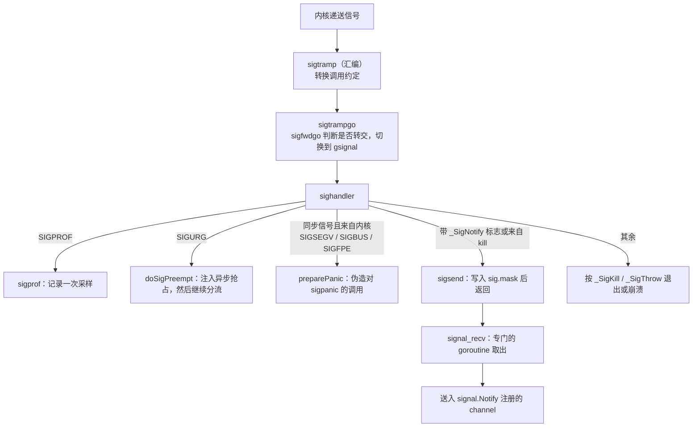

# 9.6 信号处理机制

信号是内核向进程发送异步通知的机制。对 Go 运行时而言，信号承担着三种不同的角色：一是用户关心的外部事件，
例如终端上按下 Ctrl-C 产生的 `SIGINT`，程序通过 `os/signal` 包以 channel 的形式接收；二是程序自身的错误，
例如解引用空指针引发的 `SIGSEGV`，运行时把它转换为可以 `recover` 的 panic；三是运行时自己使用的工具，例如
CPU 性能剖析依赖的 `SIGPROF`，以及异步抢占（[9.7](./preemption.md)）依赖的 `SIGURG`。

这三种用途共用同一套处理流程，而这套流程的设计受一个约束支配：信号处理函数（signal handler）
运行在一个被打断的上下文中，能做的事情极为有限。本节先说明这一约束，再依次讨论信号处理所用的栈、
处理函数的分流、信号如何送达用户的 channel，以及运行时如何与进程中的非 Go 代码共用信号。

## 9.6.1 异步信号安全

信号可能在任意两条指令之间到达。内核选中一个线程，暂停它正在执行的代码，转而执行信号处理函数，
处理函数返回后再恢复原来的执行。被打断的代码可能正持有某把锁，或者正处在修改某个数据结构的中途。
如果处理函数再去获取同一把锁，线程就会与自己死锁；如果它读取那个数据结构，看到的就是不一致的中间状态。

POSIX 因此只允许信号处理函数调用一小部分函数，称为**异步信号安全**（async-signal-safe）函数。
这份名单不长：`write`、`_exit`、`sigaction` 等系统调用在列，`malloc` 不在列，stdio 中的函数则全部不安全，
因为它们维护着静态分配的缓冲区与相应的计数器 [[Linux man-pages, n.d.a](#ref-linux-man-pages-nda)]。
信号与可重入函数的一般原理，《UNIX 环境高级编程》中有系统的论述
[[Stevens and Rago, 2013](#ref-stevens-and-rago-2013)]。

由此形成的通行做法是：处理函数只做最少的必要工作，把真正的处理推迟到正常的上下文中完成。
经典的例子是**自管道技巧**（self-pipe trick）。它针对的问题是，`select` 或 `poll` 无法与 `SIGCHLD`
等信号安全地混用：信号可能恰好在 `select` 开始时到达，打断它为时过早，修改它的超时又为时已晚。
解法是进程维护一个管道，在 `select` 中同时监听管道的读端，信号处理函数只向管道的写端写入一个字节。这样，
信号就变成了一次普通的「管道可读」事件，后续处理回到了不受限制的事件循环中。

这一技巧由 Bernstein 在 1990 年前后提出，1991 年在新闻组中公开描述，数年后才得名。Bernstein
在介绍这一技巧时，引用的正是 Stevens 在 1992 年出版的《UNIX 环境高级编程》初版对上述问题的论述
[[Bernstein, n.d.](#ref-bernstein-nd)]。Linux 2.6.22 引入的 `signalfd(2)` 则把这一思路纳入内核，
使信号可以直接作为文件描述符被 `poll` 或 `epoll` 读取
[[Linux man-pages, n.d.a](#ref-linux-man-pages-nda)]。

Go 运行时遵循同样的原则。`runtime/sigqueue.go` 开头的注释写道，信号处理函数中不能阻塞、不能分配内存，
也不能使用锁，因此它通过一个名为 `sig` 的结构与一个专门处理信号的 goroutine 通信
[[Go Authors, 2026a](#ref-go-authors-2026a)]。运行时还会主动检查这些限制。Go 的信号处理函数本身也是 Go
代码，它们以 `//go:nowritebarrierrec` 标注，编译器会检查其调用图中不出现写屏障；内存分配器则在入口处检查当
前 goroutine 是否为信号处理所用的 `gsignal`（9.6.2），若是，就以 `malloc during signal` 终止程序。

## 9.6.2 备用信号栈

处理函数在哪个栈上执行，是第一个需要解决的问题。默认情况下，内核在被打断线程的当前栈上执行处理函数，而
goroutine 的栈很小（初始为 2 KiB），并且按需增长（[第 14 章](../../part4memory/ch14stack)）。
处理函数既不能假定栈上还有足够的空间，也不能触发栈增长，因为栈增长需要分配内存。POSIX 的 `sigaltstack(2)`
为此提供了**备用信号栈**：线程预先登记一段内存，安装处理函数时指定 `SA_ONSTACK` 标志，
内核在递送信号时就会切换到这段栈上执行处理函数。

Go 为每个 M 准备了一个名为 `gsignal` 的特殊 goroutine，它的栈就是这个线程的备用信号栈
（[9.3.3](./mpg.md)）。`gsignal` 由 `mcommoninit` 调用 `mpreinit` 创建，不参与调度，也不执行用户代码：

```go
// runtime/os_linux.go
func mpreinit(mp *m) {
	mp.gsignal = malg(32 * 1024) // Linux wants >= 2K
	mp.gsignal.m = mp
}
```

macOS 上的注释则是「OS X wants >= 8K」。线程启动后，`minit` 调用 `minitSignalStack`，通过 `sigaltstack`
把 `gsignal` 的栈登记为本线程的备用信号栈。唯一的例外出现在使用 cgo 的程序中：若一个由 C
创建的线程已经设置了自己的备用信号栈，再回调 Go 代码，运行时不会覆盖它，而是让 `gsignal`
借用这段已有的栈，并在 `unminit` 中恢复原状。自 Go 1.14 起，不使用 cgo 的程序总是使用 Go 分配的信号栈
[[Zhang, 2019](#ref-zhang-2019)]。

备用信号栈也给运行时带来过意外的麻烦。Linux 5.2 引入的一个内核缺陷，会在信号栈所在的页尚未调入内存时，
于信号返回后破坏向量寄存器。Go 1.14 为此在受影响的内核上用 `mlock` 锁定每个信号栈的顶页
[[Clements, 2019b](#ref-clements-2019b)]，这一规避措施在 Go 1.16 中撤销。

## 9.6.3 处理函数的入口与分流

运行时在启动时调用 `initsig`，为它关心的每个信号安装处理函数。在 Linux 上，安装时使用的标志为
`SA_SIGINFO | SA_ONSTACK | SA_RESTORER | SA_RESTART`；安装之前，原有的处理函数被记入数组 `fwdSig`，
以便日后转发（9.6.5）。

内核按照 C 的调用约定调用处理函数，并不了解 Go 的 G、M、P。因此内核实际调用的是一段汇编代码 `sigtramp`，
它按 Go 的约定整理参数后调用 `sigtrampgo`。`sigtrampgo` 先调用 `sigfwdgo` 判断这个信号是否应当转交给非 Go
的处理函数；然后取得被打断的 goroutine。若被打断的线程上没有 G，或者它是一个正在执行 C 代码的 extra M，
就交给 `badsignal` 处理，后者借用一个 extra M 来运行 Go 代码（[9.5.5](./thread.md)）。通常情况下，
`sigtrampgo` 把当前 G 切换为本线程的 `gsignal`，再调用 `sighandler`：

```go
// sigtrampgo：信号处理的 Go 入口（示意）
func sigtrampgo(sig uint32, info *siginfo, ctx unsafe.Pointer) {
	if sigfwdgo(sig, info, ctx) {
		return // 转交给 Go 之前安装的处理函数
	}
	c := &sigctxt{info, ctx}
	gp := sigFetchG(c) // 被打断的 goroutine
	setg(gp)
	if gp == nil || (gp.m != nil && gp.m.isExtraInC) {
		badsignal(uintptr(sig), c) // 非 Go 线程：借用 extra M 处理（略去细节）
		return
	}
	setg(gp.m.gsignal)                  // 切换到 gsignal
	// 若非 Go 代码修改过信号栈，由 adjustSignalStack 校正 gsignal 的栈边界（略）
	sighandler(sig, info, ctx, gp)
	setg(gp)
}
```

`sighandler` 根据信号的种类与来源分流。每个信号的默认处理方式记录在表 `sigtable` 中，以标志位表示：

```go
// runtime/runtime2.go
const (
	_SigNotify   = 1 << iota // let signal.Notify have signal, even if from kernel
	_SigKill                 // if signal.Notify doesn't take it, exit quietly
	_SigThrow                // if signal.Notify doesn't take it, exit loudly
	_SigPanic                // if the signal is from the kernel, panic
	_SigDefault              // if the signal isn't explicitly requested, don't monitor it
	_SigGoExit               // cause all runtime procs to exit (only used on Plan 9).
	_SigSetStack             // Don't explicitly install handler, but add SA_ONSTACK to existing libc handler
	_SigUnblock              // always unblock; see blockableSig
	_SigIgn                  // _SIG_DFL action is to ignore the signal
)
```

例如在 Linux 上，`SIGINT`、`SIGTERM` 与 `SIGHUP` 标记为 `_SigNotify + _SigKill`，`SIGQUIT` 标记为
`_SigNotify + _SigThrow`，`SIGSEGV` 标记为 `_SigPanic + _SigUnblock`，`SIGURG` 标记为
`_SigNotify + _SigIgn`。`os/signal` 的文档据此总结了默认行为：同步信号转换为 panic；`SIGHUP`、`SIGINT`、
`SIGTERM` 使程序退出；`SIGQUIT` 等信号使程序打印栈回溯后退出，因此在终端上按 Ctrl-\ 可以看到所有
goroutine 的栈 [[Go Authors, 2026b](#ref-go-authors-2026b)]。分流的整体情况如下：



下面分别说明。

**同步信号。** `SIGSEGV`、`SIGBUS` 与 `SIGFPE` 由线程自己执行的指令直接引发，与被打断的代码之间有确定的因
果关系。只要信号确实来自内核而非 `kill`，并且被打断的是一个正在执行用户代码的 goroutine，`sighandler`
就把信号信息记入 G，然后调用 `preparePanic` 改写被打断的上下文：把出错位置的 PC 压栈，再把 PC 设为
`sigpanic`，使得看起来像是出错的指令调用了 `sigpanic`。处理函数返回后，线程就从 `sigpanic` 开始执行，
后者在普通的 goroutine 上下文中发起 panic。若信号发生在运行时内部或 C 代码中（被打断的不是 `m.curg`），
或发生在禁止栈增长的区域，panic 无法安全进行，运行时只能直接崩溃。把除零与空指针解引用转换为 panic
的做法始于 Cox 在 2010 年的修改，此前这类错误会直接使程序崩溃 [[Cox, 2010](#ref-cox-2010)]。

`sigpanic` 并不把所有的非法访存都转换为 panic。对于 `SIGSEGV` 与 `SIGBUS`，只有出错地址小于 0x1000
时才视为空指针解引用，调用 `panicmem`；其他地址则打印「unexpected fault address」后终止程序，
除非程序调用过 Go 1.3 引入的 `debug.SetPanicOnFault`。0x1000 这条界线与编译器的约定一致：
编译器假定所有平台上低于 4096 的地址都不可访问（`minZeroPage`），因此对于偏移量足够小的内存访问，
它省去显式的空指针检查，而依靠硬件触发的 `SIGSEGV` 来发现空指针。下面的程序展示了这一转换：

```go {run=true}
package main

import (
	"fmt"
	"runtime"
)

func main() {
	defer func() {
		err := recover().(runtime.Error) // 由 SIGSEGV 转换而来的运行时错误
		fmt.Println("recover:", err)
	}()
	var p *int
	fmt.Println(*p) // 访问零页，内核发出 SIGSEGV
}
```

```
recover: runtime error: invalid memory address or nil pointer dereference
```

**运行时自用的信号。** `SIGPROF` 由 CPU 性能剖析的定时器周期性地发出，处理函数在被打断处记录一次栈采样后立
即返回，采样数据随后由 `runtime/pprof` 汇总（[16.5](../../part5toolchain/ch16tools/perf.md)）。`SIGURG`
是异步抢占的载体：`doSigPreempt` 检查被打断的 G 是否需要被抢占，以及当前位置是否为异步安全点，
满足条件时调用 `pushCall` 注入一次对 `asyncPreempt` 的调用。这与 `preparePanic` 使用的是同一种手法：
处理函数本身不做任何复杂的工作，只改写被打断的上下文，使被打断的代码在恢复执行时「调用」一个函数，
真正的工作在那个函数中、在普通的上下文里完成。由于一个 `SIGURG` 可能与应用程序自己发出的 `SIGURG`
合并到达，`doSigPreempt` 之后分流还会继续。在不使用 cgo 的 Linux 程序中，运行时还借用 glibc 内部使用的
`SIGSETXID`（`_SIGRTMIN + 1`），在所有线程上执行同一个系统调用，以实现 `syscall.AllThreadsSyscall`。

**交给用户的信号。** 带有 `_SigNotify` 标志的信号，以及经 `kill` 等系统调用发出的任何信号，都先交给
`sigsend`。若程序已通过 `signal.Notify` 登记了这个信号，`sigsend` 只在 `sig` 结构中置一个位，
然后立即返回，在处理函数中不涉及 channel、锁或内存分配，真正的递送由下一小节所述的 goroutine 完成。
没有人登记的信号，则按 `sigtable` 中的 `_SigKill` 或 `_SigThrow` 使程序退出或崩溃。

## 9.6.4 从 sigsend 到 channel

`sigsend` 与 `signal_recv` 是这一路径的两端：前者在信号处理函数中执行，后者在一个普通的 goroutine 中执行。
二者之间的 `sig` 结构是一组固定大小的位图，每个信号占一位：

```go
// runtime/sigqueue.go
var sig struct {
	note       note
	mask       [(_NSIG + 31) / 32]uint32 // 已到达、尚未被取走的信号
	wanted     [(_NSIG + 31) / 32]uint32 // 经 Notify 登记的信号
	ignored    [(_NSIG + 31) / 32]uint32 // 经 Ignore 忽略的信号
	recv       [(_NSIG + 31) / 32]uint32 // 接收方的本地副本
	state      atomic.Uint32             // sigIdle、sigReceiving 或 sigSending
	delivering atomic.Uint32             // 正在执行 sigsend 的处理函数个数
	inuse      bool
}
```

位图的大小固定，置位通过 CAS 完成，因此 `sigsend` 不需要分配内存，也不需要加锁。另一个问题是如何唤醒正在休
眠的接收方，同时避免不必要的唤醒。`sigqueue.go` 的注释说明，这依靠 `state` 的三个状态完成：`sigReceiving`
表示接收方正在 `sig.note` 上休眠，且没有新的信号；`sigSending` 表示 `sig.mask` 中**可能**有新的信号，
此时接收方不会休眠；`sigIdle` 表示没有新的信号，接收方也没有休眠。状态之间的迁移全部通过 CAS 完成。并发的
`sigsend` 与 `signal_recv` 可能导致对 `sig.mask` 的多余检查，但不会丢失信号，也不会死锁
[[Go Authors, 2026a](#ref-go-authors-2026a)]。

```go
// sigsend：在信号处理函数中把信号放入队列（示意）
func sigsend(s uint32) bool {
	bit := uint32(1) << (s & 31)
	if atomic.Load(&sig.wanted[s/32])&bit == 0 {
		return false // 没有人登记这个信号
	}
	for { // 把信号对应的位置入 sig.mask
		mask := sig.mask[s/32]
		if mask&bit != 0 {
			return true // 同一信号尚未被取走，合并为一次
		}
		if atomic.Cas(&sig.mask[s/32], mask, mask|bit) {
			break
		}
	}
	for { // 通知接收方
		switch sig.state.Load() {
		case sigIdle:
			if sig.state.CompareAndSwap(sigIdle, sigSending) {
				return true // 接收方未休眠，它会在休眠前看到新的信号
			}
		case sigSending:
			return true // 已有一次通知尚未处理
		case sigReceiving:
			if sig.state.CompareAndSwap(sigReceiving, sigIdle) {
				notewakeup(&sig.note) // 唤醒休眠的接收方
				return true
			}
		}
	}
}
```

`signal_recv` 先从本地副本 `recv` 中逐个交出信号；本地副本为空时，把状态从 `sigIdle` 改为 `sigReceiving`
并在 `sig.note` 上休眠，或者发现状态为 `sigSending` 而直接把它改回 `sigIdle`；之后用原子交换把 `sig.mask`
整体取入本地副本，开始下一轮：

```go
// signal_recv：在专门的 goroutine 中取出信号（示意）
func signal_recv() uint32 {
	for {
		for i := uint32(0); i < _NSIG; i++ { // 先交出本地副本中的信号
			if sig.recv[i/32]&(1<<(i&31)) != 0 {
				sig.recv[i/32] &^= 1 << (i & 31)
				return i
			}
		}
	Receive:
		for { // 等待 sigsend 的通知
			switch sig.state.Load() {
			case sigIdle:
				if sig.state.CompareAndSwap(sigIdle, sigReceiving) {
					notetsleepg(&sig.note, -1) // 在用户 goroutine 上休眠，期间交出 P
					noteclear(&sig.note)
					break Receive
				}
			case sigSending:
				if sig.state.CompareAndSwap(sigSending, sigIdle) {
					break Receive
				}
			}
		}
		for i := range sig.mask { // 取走所有新到达的信号
			sig.recv[i] = atomic.Xchg(&sig.mask[i], 0)
		}
	}
}
```

这里的唤醒本身也必须是异步信号安全的。在 Linux 上，`notewakeup` 最终是一次 futex 系统调用，
可以在处理函数中使用。macOS 上的 `note` 却基于 pthread 的互斥锁与条件变量实现，而 `pthread_mutex_lock` 与
`pthread_cond_signal` 都不是异步信号安全的。Taylor 在 Go 1.13 中为此单独给 `sig.note`
实现了一个基于管道的版本：`sigsend` 向管道写入一个字节，`signal_recv` 阻塞在管道的读端
[[Taylor, 2019](#ref-taylor-2019)]。也就是说，Go 在 macOS 上使用的正是 9.6.1 介绍的自管道技巧。

最后一段由 `os/signal` 包完成。程序第一次调用 `Notify` 时，`os/signal` 启动一个 goroutine 循环调用
`signal_recv`，再由 `process` 把信号分发给所有登记了它的 channel：

```go
// os/signal/signal_unix.go
func loop() {
	for {
		process(syscall.Signal(signal_recv()))
	}
}

// os/signal/signal.go 中的 process（示意）
func process(sig os.Signal) {
	n := signum(sig)
	handlers.Lock()
	defer handlers.Unlock()
	for c, h := range handlers.m {
		if h.want(n) {
			select { // 发送，但不阻塞
			case c <- sig:
			default:
			}
		}
	}
}
```

发送是非阻塞的：channel 已满时，这次信号对该 channel 而言就被丢弃，以免一个处理迟缓的接收者拖住整个分发循
环。`Notify` 的文档因此要求调用者保证 channel 有足够的缓冲来跟上预期的信号速率，并指出只用于接收一种信号
时，容量为 1 的缓冲就已足够 [[Go Authors, 2026b](#ref-go-authors-2026b)]。

信号在到达 channel 之前也可能合并。内核中的标准信号本就不排队，只有实时信号可以排队
[[Linux man-pages, n.d.b](#ref-linux-man-pages-ndb)]；运行时内部的 `sig.mask` 同样只为每个信号保留一位，
在 `signal_recv` 取走之前到达的同种信号会合并为一次。下面的程序向自身连续发送 5 次 `SIGUSR1`：

```go {run=true native=true}
package main

import (
	"fmt"
	"os"
	"os/signal"
	"syscall"
	"time"
)

func main() {
	c := make(chan os.Signal, 10)
	signal.Notify(c, syscall.SIGUSR1)
	syscall.Kill(os.Getpid(), syscall.SIGUSR1) // 向自身发送信号
	fmt.Printf("收到：%v\n", <-c)

	for range 5 {
		syscall.Kill(os.Getpid(), syscall.SIGUSR1)
	}
	time.Sleep(100 * time.Millisecond)
	fmt.Println("连续发送 5 次，收到", len(c), "次")
}
```

```
收到：user defined signal 1
连续发送 5 次，收到 1 次
```

以上是 macOS 上的运行结果。收到的次数取决于平台以及接收 goroutine 何时运行，但由于上述两层合并，
它不能反映发送的次数。信号适合传达「发生了某种事件」，而不适合计数。

`os/signal` 的接口本身也经历过演变。Symonds 在 2009 年加入的最初版本只提供 `Incoming`：
进程收到的所有信号都发往同一个 channel [[Symonds, 2009](#ref-symonds-2009)]。Go 1 发布前，Cox 以 `Notify`
取代了它：调用者可以只请求特定的信号，信号也会递送给每一个请求者，而不只是其中一个
[[Cox, 2012](#ref-cox-2012)]。此后又陆续加入了 `Stop`、`Ignore`、`Reset`、`Ignored`（Go 1.11）与
`NotifyContext`（Go 1.16）等函数。运行时一侧的 `sigqueue` 则在 Go 1.4 中从 C 改写为 Go。

## 9.6.5 与非 Go 代码共用信号

一个进程中，每个信号只能有一个处理函数。当 Go 代码与 C 代码共处一个进程时，例如 Go 程序通过 cgo 调用 C
库，或者 Go 代码以 `-buildmode=c-shared` 编译后被其他程序加载，双方都可能需要同一个信号，
这就需要约定由谁处理。

基本规则由 Go 1.5 的信号转发确立。Go 安装处理函数时记下原有的处理函数；实现者 Petrovic 在提交说明中写道，
按照 Taylor 的建议，信号在同时满足以下条件时转交给原来的处理函数：Go 之前已存在一个非默认的处理函数；
信号是同步信号；信号发生在非 Go 线程上，或发生在 Go 线程执行 C 代码期间
[[Petrovic, 2015](#ref-petrovic-2015)]。今天的 `sigfwdgo` 仍遵循这一思路：Go 没有接管的信号一律转交；Go
接管的信号中，只有发生在 Go 代码之外的同步信号与 `SIGPIPE` 才转交。macOS 是一个例外：它把 `SIGPIPE`
递送给主线程而非写入管道的线程，运行时无法判断信号的来源，只能忽略它。

反过来，非 Go 代码也需要遵守约定。`os/signal` 的文档要求：非 Go 代码安装的处理函数必须带有 `SA_ONSTACK`
标志，否则 Go 线程在有限的栈上收到信号时很可能崩溃；若它为同步信号安装处理函数，应当记下 Go 的处理函数，
并在信号发生于 Go 代码中时调用它，否则一些运行时 panic 将不会如预期发生
[[Go Authors, 2026b](#ref-go-authors-2026b)]。以 `-buildmode=c-archive` 或 `c-shared` 编译的 Go
代码默认只为同步信号与 `SIGPIPE` 安装处理函数，自 Go 1.18 起还包括抢占所用的 `SIGURG`；其余信号只有在调用
`Notify` 之后才会接管。

Java 虚拟机面对的是同样的问题。HotSpot 使用 `SIGSEGV`、`SIGBUS`、`SIGFPE` 等信号实现隐式空指针检查等功能，
并以 `SIGQUIT` 打印 Java 线程的栈回溯，这两点都与 Go 相同 [[Oracle, n.d.b](#ref-oracle-ndb)]。
它的**信号链**（signal chaining）机制在虚拟机创建时保存已有的处理函数，遇到不属于虚拟机的信号时调用它们；
对于虚拟机创建之后才安装的处理函数，则需要预先加载 `libjsig.so`，由它拦截 `signal`、`sigaction` 等调用，
把新的处理函数排在虚拟机的处理函数之后。嵌入虚拟机的程序若需要自己处理 `SIGINT`、`SIGTERM` 等信号，
可以使用 `-Xrs` 选项减少虚拟机对信号的使用 [[Oracle, n.d.a](#ref-oracle-nda)]。

## 9.6.6 抢占信号的选择与 EINTR

信号是进程中稀缺的共享资源，因此 Go 1.14 为异步抢占选择信号时颇为谨慎。`signal_unix.go` 中 `sigPreempt`
的注释列出了四条启发式规则 [[Go Authors, 2026a](#ref-go-authors-2026a)]：

1. 调试器默认应当放行这个信号。在 Linux 上，这样的信号有 `SIGALRM`、`SIGURG`、`SIGCHLD`、`SIGIO`、
   `SIGVTALRM`、`SIGPROF`、`SIGWINCH`，以及若干 glibc 内部信号。
2. 在 Go 与 C 混合的程序中，它不应被 libc 内部使用，例如 `SIGCANCEL` 与 `SIGSETXID`。
3. 它应当可以虚假地到达而不造成后果。`SIGALRM` 不合适，因为处理函数无法分辨它是否由真正的定时器引起；
   `SIGUSR1` 与 `SIGUSR2` 也不合适，因为应用程序常赋予它们实际的含义。
4. 它不能是实时信号，因为 macOS 等平台没有实时信号。

`SIGURG` 满足全部条件。它原本用于报告套接字上的带外数据，而带外数据几乎无人使用，`SIGURG`
甚至不说明是哪个套接字，本身就近乎无用；即便有应用程序使用它，也必须能够容忍虚假的 `SIGURG`。注释还提到，
`SIGIO` 也不失为一个选择，只是更可能被实际使用。抢占机制的设计动机与实现见 [9.7](./preemption.md)
及其设计文档 [[Clements, 2019a](#ref-clements-2019a)]。

这一选择带来了一个用户可见的后果。信号会打断阻塞中的慢速系统调用，使其以 `EINTR` 失败。Go 1.14
的发布说明指出，由于抢占的实现，Unix 系统上的 Go 程序将比以往收到更多的信号，使用 `syscall` 或
`golang.org/x/sys/unix` 的程序会看到更多以 `EINTR` 失败的慢速系统调用，这些程序必须处理这类错误，
最常见的做法是重试 [[Go Authors, 2020](#ref-go-authors-2020)]。Go 安装处理函数时虽然带有 `SA_RESTART`
标志，但它只能使部分系统调用自动重启：按照 `signal(7)` 的说明，`poll`、`select`、`epoll_wait`、
`nanosleep`，以及设置了超时的套接字操作，无论是否设置 `SA_RESTART`，被信号处理函数打断后都会以 `EINTR`
失败 [[Linux man-pages, n.d.b](#ref-linux-man-pages-ndb)]。标准库在 `os` 与 `internal/poll` 中以
`ignoringEINTR` 等辅助函数重试这类系统调用，直接调用 `syscall` 的代码则需要自己处理。
若需要排查与抢占信号有关的问题，可以设置 `GODEBUG=asyncpreemptoff=1` 关闭异步抢占。

## 9.6.7 小结

异步信号安全这一约束决定了 Go 信号处理的结构：处理函数运行在每个线程专用的 `gsignal` 栈上，
只做最少的工作。对同步信号与抢占信号，它改写被打断的上下文，把真正的工作交给 `sigpanic` 与
`asyncPreempt`；对用户信号，它在位图中置一个位，把递送交给一个普通的 goroutine，最终以 channel
的形式呈现给用户。与非 Go 代码共用信号时，运行时通过保存与转发原有的处理函数，与 C 库及其他运行时共存。

## 延伸阅读

- <a id="ref-bernstein-nd"></a>[Bernstein, n.d.] D. J. Bernstein. The self-pipe trick.
  https://cr.yp.to/docs/selfpipe.html
  自管道技巧的提出者对其来历的说明。
- <a id="ref-clements-2019a"></a>[Clements, 2019a] Austin Clements. Proposal: Non-cooperative goroutine
  preemption. Go design document #24543, 2019.
  https://go.googlesource.com/proposal/+/master/design/24543-non-cooperative-preemption.md
  `SIGURG` 与异步抢占的设计动机。
- <a id="ref-clements-2019b"></a>[Clements, 2019b] Austin Clements. runtime: mlock top of signal stack on
  Linux 5.2–5.4.1. Go commit 8174f7fb2b, 2019. https://go.dev/cl/209899
- <a id="ref-cox-2010"></a>[Cox, 2010] Russ Cox. runtime: turn divide by zero, nil dereference into
  panics. Go commit 5963dbac08, 2010. https://golang.org/cl/906041
- <a id="ref-cox-2012"></a>[Cox, 2012] Russ Cox. os/signal: selective signal handling. Go commit
  35586f718c, 2012. https://golang.org/cl/3749041
- <a id="ref-go-authors-2020"></a>[Go Authors, 2020] The Go Authors. Go 1.14 Release Notes, 2020.
  https://go.dev/doc/go1.14
- <a id="ref-go-authors-2026a"></a>[Go Authors, 2026a] The Go Authors. `runtime/signal_unix.go`、
  `runtime/sigqueue.go`. https://github.com/golang/go/blob/master/src/runtime/signal_unix.go
  `sighandler`、`sigtramp`/`sigtrampgo`、`sigsend`/`signal_recv`，以及 `sigPreempt = _SIGURG`
  的选型注释（本节对照 Go 1.26）。
- <a id="ref-go-authors-2026b"></a>[Go Authors, 2026b] The Go Authors. `os/signal` 包文档与
  `src/os/signal/signal_unix.go`. https://pkg.go.dev/os/signal
  `Notify`、`loop`、`process`，以及默认行为与 cgo 程序中的信号约定。
- <a id="ref-linux-man-pages-nda"></a>[Linux man-pages, n.d.a] The Linux man-pages project.
  *signal-safety(7)*; *sigaltstack(2)*; *signalfd(2)*.
  https://man7.org/linux/man-pages/man7/signal-safety.7.html
  异步信号安全函数的名单。
- <a id="ref-linux-man-pages-ndb"></a>[Linux man-pages, n.d.b] The Linux man-pages project. *signal(7)*.
  https://man7.org/linux/man-pages/man7/signal.7.html
  标准信号与实时信号的排队语义，以及系统调用被信号打断后的重启规则。
- <a id="ref-oracle-nda"></a>[Oracle, n.d.a] Oracle. *The java Command*（Java SE 21 工具规范）.
  https://docs.oracle.com/en/java/javase/21/docs/specs/man/java.html
  `-Xrs` 等与信号有关的选项：托管运行时与本地库共享信号的工业实践。
- <a id="ref-oracle-ndb"></a>[Oracle, n.d.b] Oracle. *Java Platform, Standard Edition Troubleshooting
  Guide*（Java SE 8），第 7 章 Handle Signals and Exceptions.
  https://docs.oracle.com/javase/8/docs/technotes/guides/troubleshoot/signals003.html
  信号链与 `libjsig`，以及 HotSpot 使用的信号。
- <a id="ref-petrovic-2015"></a>[Petrovic, 2015] Srdjan Petrovic. runtime: signal forwarding. Go commit
  5c8fbc6f1e, 2015. https://go.dev/cl/8712
- <a id="ref-stevens-and-rago-2013"></a>[Stevens and Rago, 2013] W. Richard Stevens and Stephen A. Rago.
  *Advanced Programming in the UNIX Environment*, 3rd ed. Addison-Wesley, 2013.
  信号处理与异步信号安全的经典论述。Bernstein 在介绍自管道技巧时，引用了该书初版对 `select`
  与信号无法安全混用的论述。
- <a id="ref-symonds-2009"></a>[Symonds, 2009] David Symonds. os/signal: new package. Go commit
  b5866494ea, 2009. https://golang.org/cl/162056
- <a id="ref-taylor-2019"></a>[Taylor, 2019] Ian Lance Taylor. runtime: use a pipe to wake up signal_recv
  on Darwin. Go commit c485e8b559, 2019. https://go.dev/cl/184169
- <a id="ref-zhang-2019"></a>[Zhang, 2019] Cherry Zhang. runtime: always use Go signal stack in non-cgo
  program. Go commit 73d20f8186, 2019. https://go.dev/cl/207445
- 本书 [9.3 MPG 模型与并发调度单元](./mpg.md)、[9.7 协作与抢占](./preemption.md)、
  [第 14 章 执行栈管理](../../part4memory/ch14stack)。
