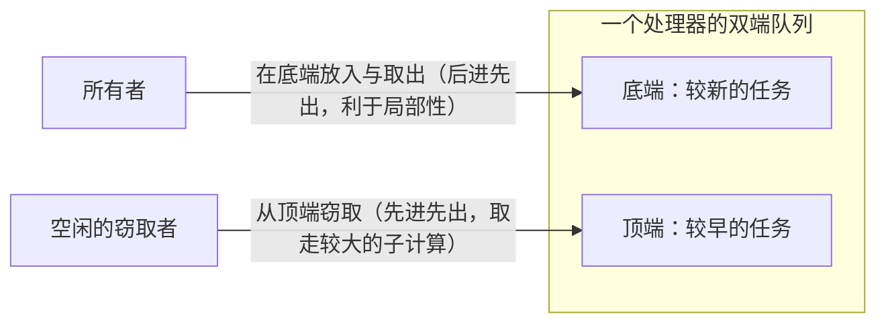

# 9.2 工作窃取式调度

[9.1](./model.md) 中的每个 P 各有一条本地运行队列，负载因此难免分布不均：有的 P 积压了大量 G，有的 P
无事可做。如何在不引入中心瓶颈的前提下平衡负载，是并发调度的核心问题。Go 采用的是**工作窃取**（work
stealing），一种有着数十年理论积累、在工业界反复出现的设计。本节先讨论 Go 的具体做法，
再介绍其背后的调度理论，然后对照它在 Cilk、Java、Rust 等系统中的不同形态，最后讨论仍未解决的问题。

## 9.2.1 工作共享与工作窃取

在处理器之间迁移任务，有两种基本范式。在**工作共享**（work sharing）中，处理器每产生新的任务，
调度器就尝试把其中一部分迁移到负载较轻的处理器上。在**工作窃取**中，主动权在空闲的处理器一方：
它到其他处理器那里窃取任务。Blumofe 与 Leiserson 指出了二者的直观差别：当所有处理器都有工作可做时，
工作窃取调度器不迁移任何任务，而工作共享调度器总在迁移
[[Blumofe and Leiserson, 1999](#ref-blumofe-leiserson-1999)]。负载越重，工作窃取的迁移反而越少，
这是它相对工作共享的根本优势，后文的通信量界限为此提供了严格的依据。

工作窃取的思想至少可以追溯到 Burton 与 Sleep 在 1981 年对函数式程序并行执行的研究
[[Burton and Sleep, 1981](#ref-burton-sleep-1981)]，以及 Halstead 在 1984 年对 Multilisp 的实现
[[Halstead, 1984](#ref-halstead-1984)]。他们已经注意到这一策略在空间与通信上的好处，但为它建立严格保证的，
是十年后 MIT 的 Cilk 项目。

## 9.2.2 Go 如何寻找可运行的 G

M 执行完当前的 G 之后，并不立即去窃取，而是按照由近及远、由廉价到昂贵的顺序寻找下一个可运行的 G。这一过程
由运行时的 `findRunnable` 完成 [[Go Authors, 2026](#ref-go-authors-2026)]：

```go
// Go 1.26 runtime.findRunnable 的主干（有删节，注释为笔者所加）
top:
	// ……若 GC 正在等待则先暂停；运行本 P 上到期的计时器；必要时调度 GC 标记工作者
	if pp.schedtick%61 == 0 && !sched.runq.empty() { // 每 61 次调度检查一次全局队列，保证公平
		lock(&sched.lock)
		gp := globrunqget()
		unlock(&sched.lock)
		if gp != nil {
			return gp, false, false
		}
	}
	if gp, inheritTime := runqget(pp); gp != nil { // 本地运行队列，含 runnext
		return gp, inheritTime, false
	}
	if !sched.runq.empty() { // 全局运行队列：取出一批，转入本地队列
		lock(&sched.lock)
		gp, q := globrunqgetbatch(int32(len(pp.runq)) / 2)
		unlock(&sched.lock)
		// ……
	}
	if netpollinited() && netpollAnyWaiters() && sched.lastpoll.Load() != 0 && sched.pollingNet.Swap(1) == 0 {
		list, delta := netpoll(0) // 非阻塞地检查网络轮询器
		// ……
	}
	// 自旋的 M 不超过忙碌 P 数量的一半
	if mp.spinning || 2*sched.nmspinning.Load() < gomaxprocs-sched.npidle.Load() {
		if !mp.spinning {
			mp.becomeSpinning()
		}
		gp, inheritTime, tnow, w, newWork := stealWork(now) // 从其他 P 窃取
		// ……
	}
	// ……仍无工作：交出 P，再检查一次全局队列与各个 P，阻塞地等待网络事件，最终休眠（stopm）
```

这一过程有以下几个要点。

**本地运行队列。** 每个 P 的本地队列是一个容量为 256 的环形缓冲区，只有所属的 P 向其中放入 G，而所属的 P
与窃取者都可以从中取出 G，因此可以用无锁的方式实现。队列已满时，`runqputslow` 把其中一半（128 个）
连同新的 G 一起转移到全局队列。反过来，从全局队列取 G 时一次取出一批，数量不超过 128，
也不超过全局队列长度除以 `GOMAXPROCS` 再加一，使全局队列中的 G 大致均匀地分给各个 P。

**runnext。** 本地队列之外，每个 P 还有一个 `runnext` 槽，存放下一个优先运行的 G。它由 Clements 在 Go 1.5
中引入，所针对的问题是：一个 G 唤醒另一个 G 后，被唤醒者排在本地队列的末尾，如果队列中还有计算密集的 G，
它要等待很久才能运行。改为把被唤醒者放入 `runnext`，并让它继承唤醒者剩余的时间片之后，通过无缓冲 channel
来回通信的一对 G 便像一个整体那样获得 CPU 时间；在为此编写的基准测试中，耗时降低了 99.88%
[[Clements, 2015](#ref-clements-2015)]。`runnext` 中的 G 刚刚由当前 P 唤醒，其数据很可能仍在缓存中，
这同时也改善了局部性。

**窃取的方式。** `stealWork` 最多遍历全部 P 四轮，每次从目标 P 的本地队列中取走一半（向上取整）的 G。
遍历的顺序是一个伪随机排列：以随机位置为起点，以一个与 P 的总数**互质**的随机数为步长。
互质保证每一轮恰好访问每个 P 一次，随机化则避免所有窃取者涌向同一个目标。这一做法由 Vyukov 在 Go 1.7
中引入，此前的实现随机挑选 4×`GOMAXPROCS` 次目标，由于伪随机数发生器的质量不高，常常有 P
一次也没有被检查到 [[Vyukov, 2016](#ref-vyukov-2016)]。最后一轮还会运行其他 P 上到期的计时器，并窃取其他
P 的 `runnext`；为了不与目标 P 争抢它刚刚唤醒、马上就要运行的 G，窃取 `runnext` 之前会先等待约 3 微秒。

**自旋线程。** 找不到工作的 M 并不立即休眠，而是进入**自旋**状态继续寻找，使新就绪的 G 能被迅速接手，
也避免线程频繁地休眠与唤醒。自旋要消耗 CPU，因此其数量受到限制。Vyukov 的设计文档规定自旋的 M 至多为
`GOMAXPROCS` 个 [[Vyukov, 2012](#ref-vyukov-2012)]；而 2013 年的实现采用了更严格的条件，即自旋的 M
不超过忙碌 P 数量的一半，以免在 `GOMAXPROCS` 很大而程序的并行度很低时浪费 CPU
[[Vyukov, 2013](#ref-vyukov-2013)]，这一条件沿用至今。

## 9.2.3 计算模型

要讨论工作窃取有多好，需要先有一个衡量的标准。把一段并行计算抽象为一张有向无环图，每个结点是一条单位时间
的指令，边表示依赖关系。刻画这张图的有两个量：

- **工作量** $T_1$：结点的总数，即在单个处理器上执行所需的时间；
- **关键路径长度**（span）$T_\infty$：最长依赖链的长度，即在无穷多个处理器上执行所需的时间。

二者之比 $T_1/T_\infty$ 称为**并行度**，它是可能获得的加速比的上限。由于 $P$ 个处理器每一步至多执行 $P$ 条
指令，且关键路径上的指令只能依次执行，任何调度在 $P$ 个处理器上的执行时间 $T_P$ 都满足
$T_P \ge \max(T_1/P,\ T_\infty)$。好的调度器应当使 $T_P$ 尽量接近这一下界。

## 9.2.4 理论保证

**贪心调度。** Brent [[Brent, 1974](#ref-brent-1974)]与 Graham [[Graham, 1969](#ref-graham-1969)]
关于有向无环图调度的早期工作表明，存在执行时间不超过 $T_1/P + T_\infty$ 的调度。这一上界是两个下界之和，
因此与最优调度至多相差一倍。所谓**贪心调度**，是指每一步若有至少 $P$ 条指令就绪则执行其中 $P$ 条，
否则执行全部就绪的指令；Blumofe 与 Leiserson 以及 Eager 等人 [[Eager et al., 1989](#ref-eager-et-al-1989)]
证明，任何贪心调度都能达到这一上界，Blumofe 与 Leiserson 称之为**贪心调度定理**
[[Blumofe and Leiserson, 1999](#ref-blumofe-leiserson-1999)]：

$$T_P \le \frac{T_1}{P} + T_\infty.$$

**随机化工作窃取。** 贪心调度定理只说明不让处理器空闲就不会太差，并没有说明如何以分布式的方式做到这一点。
Blumofe 与 Leiserson 证明，对于**完全严格**（fully strict）的计算，即每条同步边都从子线程指向其父线程的
fork-join 式计算，随机化工作窃取的期望执行时间为

$$\mathbb{E}[T_P] = \frac{T_1}{P} + O(T_\infty),$$

所需空间不超过 $S_1 P$，其中 $S_1$ 为串行执行所需的空间；期望的总通信量不超过

$$O\big(P\,T_\infty\,(1 + n_d)\,S_{\max}\big),$$

其中 $S_{\max}$ 是最大的活动记录，$n_d$ 是任一线程与其父线程同步的最多次数。
三个界限都在常数因子内达到最优；通信量界限也印证了工作窃取比工作共享更节省通信这一经验之谈
[[Blumofe and Leiserson, 1999](#ref-blumofe-leiserson-1999)]。时间界限的证明采用了一种记账方法：
每个处理器在每一步要么执行一条指令，要么尝试一次窃取，相应地向「工作」或「窃取」两个桶之一放入一元；
执行结束时工作桶中恰有 $T_1$ 元，执行时间则等于两桶总额除以 $P$。难点在于界定窃取桶，为此需要「延迟序列」
论证：若窃取尝试的次数很多，就可以在图中找到一条指令序列，使每次窃取尝试发起时，序列中都有某条指令处于「关
键」状态；而一条关键指令经过若干次窃取尝试后仍保持关键的概率很小，因此这样的序列不太可能出现，
窃取尝试的期望次数为 $O(P\,T_\infty)$。两桶之和除以 $P$，即得上面的时间界限。由此可知，
只要计算的并行度足够高，即 $T_\infty \ll T_1/P$，工作窃取就能逼近线性加速，而空间与通信的代价也都有上界。

**窃取用的双端队列。** 理论界限的落地依赖于一种精心设计的数据结构。经典的做法是每个处理器维护一个
**双端队列**：所有者在底端放入与取出任务，即后进先出，刚产生的子任务最可能仍在缓存中，局部性好；
窃取者从顶端取走任务，即先进先出，取走的是较早产生、通常也较大的子计算，一次窃取便能获得足够多的工作。



Arora、Blumofe 与 Plaxton 给出了这种双端队列的无锁（non-blocking）实现，并把分析推广到多道程序环境：
操作系统内核被视为对手，未必持续提供 $P$ 个处理器；他们的分析采用基于结点权重的势函数
[[Arora et al., 1998](#ref-arora-et-al-1998)]。Chase 与 Lev 进一步给出了以可增长的循环数组实现的版本
[[Chase and Lev, 2005](#ref-chase-lev-2005)]，是今天实践中最常用的设计。需要澄清的是，
常与工作窃取一并提及的 **THE 协议**与**工作优先原则**（work-first principle）出自 Cilk-5
[[Frigo et al., 1998](#ref-frigo-et-al-1998)]，而不是 Arora 等人的工作。

Go 的本地队列并不是这种经典的双端队列。它是一个先进先出的环形缓冲区，另以后进先出的 `runnext`
槽照顾新唤醒的 G 的局部性（[9.3](./mpg.md)），窃取时也不是只取一个任务，而是取走一半。
这是工程实现对理论模型的一次改造。

## 9.2.5 其他系统中的工作窃取

工作窃取几乎已成为并行运行时的标准组件，但各个系统的取舍不尽相同：

- **Cilk-5**：fork-join 并行的代表，确立了工作优先原则与 THE 协议，并以「两个克隆」
  的编译方式降低创建任务的开销 [[Frigo et al., 1998](#ref-frigo-et-al-1998)]；
- **Java 的 Fork/Join 框架**：Lea 在论文中说明，其总体设计是 Cilk 工作窃取框架的一个变体
  [[Lea, 2000](#ref-lea-2000)]；
- **.NET 任务并行库**：同样以工作窃取调度任务 [[Leijen et al., 2009](#ref-leijen-et-al-2009)]；
- **Tokio**：Rust 的多线程异步运行时。Lerche 在重写调度器时仔细阅读了 Go 的源码，采用了相同的设计：
  每个处理器一条定长的本地队列，溢出时转入由互斥锁保护的全局队列，另有一个优先检查的「下一个任务」槽，
  窃取时取走一半 [[Lerche, 2019](#ref-lerche-2019)]。

Go 与 Cilk 这一脉系统有一处根本的不同：Cilk 调度的是 fork-join 式的任务图，Go 调度的是通用的 goroutine。
goroutine 可以因 channel、系统调用或网络 I/O 而阻塞，也可以被异步抢占（[9.7](./preemption.md)），
它们一般并不构成完全严格的计算。因此，9.2.4 中 $T_1/P + O(T_\infty)$ 的保证对 Go 并不成立。Go
的工作窃取是借鉴了这套理论的负载均衡策略，而不是可以证明其性能界限的调度器。认清这一点，
才不会把理论结论错误地套用到 goroutine 上。

## 9.2.6 演进与开放问题

Go 的工作窃取本身也在演进：Go 1.1 随 GMP 模型引入工作窃取 [[Vyukov, 2013](#ref-vyukov-2013)]，Go 1.5 加入
`runnext` [[Clements, 2015](#ref-clements-2015)]，Go 1.7 改用互质步长遍历全部 P
[[Vyukov, 2016](#ref-vyukov-2016)]。

这套机制仍有不少开放问题。其一是**NUMA 感知**：随机窃取不考虑内存的局部性，把任务窃取到另一个 NUMA
节点上会带来远程访存的代价（[9.11](./numa.md)）；如何在保留负载均衡能力的同时偏向局部性，仍是活跃的课题。
其二是**延迟与吞吐的张力**：后进先出的本地执行有利于吞吐与缓存，却可能使延迟敏感的任务长时间得不到运行，
各个系统只能以公平计数、时间片继承与抢占等手段加以弥补，Go 每 61 次调度检查一次全局队列便是一例。
其三是**高核数下的可扩展性**：核数很高时，每个空闲的 M 都要扫描全部 P，窃取的开销随之增大，这一问题自
2018 年起就有讨论，至今尚未解决 [[Hines, 2018](#ref-hines-2018)]。其四是**理论与实践的差距**：简洁的
$T_1/P + O(T_\infty)$ 只对完全严格的计算成立，如何为会阻塞、有 I/O、可被抢占的通用调度给出可证明的界限，
基本上仍是开放的问题。

## 延伸阅读

- <a id="ref-graham-1969"></a>[Graham, 1969] R. L. Graham. "Bounds on Multiprocessing Timing Anomalies."
  *SIAM Journal on Applied Mathematics* 17(2): 416–429, 1969. https://doi.org/10.1137/0117039
  列表调度的近似界限。
- <a id="ref-brent-1974"></a>[Brent, 1974] Richard P. Brent. "The Parallel Evaluation of General
  Arithmetic Expressions." *Journal of the ACM* 21(2): 201–206, 1974.
  https://doi.org/10.1145/321812.321815
- <a id="ref-blumofe-leiserson-1999"></a>[Blumofe and Leiserson, 1999] Robert D. Blumofe, Charles E.
  Leiserson. "Scheduling Multithreaded Computations by Work Stealing." *Journal of the ACM* 46(5):
  720–748, 1999（会议版本见 FOCS 1994）. https://doi.org/10.1145/324133.324234
  时间、空间与通信三个界限，以及贪心调度定理。
- <a id="ref-arora-et-al-1998"></a>[Arora et al., 1998] Nimar S. Arora, Robert D. Blumofe, C. Greg
  Plaxton. "Thread Scheduling for Multiprogrammed Multiprocessors." *SPAA 1998*, 119–129.
  https://doi.org/10.1145/277651.277678
  无锁的窃取双端队列，以及多道程序环境下的分析。
- <a id="ref-chase-lev-2005"></a>[Chase and Lev, 2005] David Chase, Yossi Lev. "Dynamic Circular
  Work-Stealing Deque." *SPAA 2005*, 21–28. https://doi.org/10.1145/1073970.1073974
- <a id="ref-frigo-et-al-1998"></a>[Frigo et al., 1998] Matteo Frigo, Charles E. Leiserson, Keith H.
  Randall. "The Implementation of the Cilk-5 Multithreaded Language." *PLDI 1998*, 212–223.
  https://doi.org/10.1145/277650.277725
  工作优先原则、THE 协议与两个克隆的编译方式。
- <a id="ref-lea-2000"></a>[Lea, 2000] Doug Lea. "A Java Fork/Join Framework." *ACM Java Grande 2000*,
  36–43. https://doi.org/10.1145/337449.337465
- <a id="ref-leijen-et-al-2009"></a>[Leijen et al., 2009] Daan Leijen, Wolfram Schulte, Sebastian
  Burckhardt. "The Design of a Task Parallel Library." *OOPSLA 2009*, 227–242.
  https://doi.org/10.1145/1640089.1640106
- <a id="ref-burton-sleep-1981"></a>[Burton and Sleep, 1981] F. Warren Burton, M. Ronan Sleep. "Executing
  Functional Programs on a Virtual Tree of Processors." *FPCA 1981*, 187–194.
  https://doi.org/10.1145/800223.806778
  工作窃取思想的早期源头。
- <a id="ref-lerche-2019"></a>[Lerche, 2019] Carl Lerche. "Making the Tokio scheduler 10x faster." Tokio
  Blog, 2019-10-13. https://tokio.rs/blog/2019-10-scheduler
  Tokio 借鉴 Go 的本地队列算法。
- <a id="ref-vyukov-2012"></a>[Vyukov, 2012] Dmitry Vyukov. *Scalable Go Scheduler Design Doc*. 2012.
  https://go.dev/s/go11sched
- <a id="ref-hines-2018"></a>[Hines, 2018] Chris Hines. "runtime: scheduler work stealing slow for high
  GOMAXPROCS." golang/go#28808, 2018-11-15. https://github.com/golang/go/issues/28808
  高并行度下窃取扫描的开销。
- <a id="ref-halstead-1984"></a>[Halstead, 1984] Robert H. Halstead. "Implementation of Multilisp: Lisp on
  a Multiprocessor." *Proceedings of the 1984 ACM Symposium on LISP and Functional Programming*, 9–17.
  https://doi.org/10.1145/800055.802017
- <a id="ref-go-authors-2026"></a>[Go Authors, 2026] The Go Authors. `runtime/proc.go`.
  https://github.com/golang/go/blob/master/src/runtime/proc.go
  `findRunnable`、`stealWork`、`runqputslow` 与 `randomOrder` 的实现。
- <a id="ref-clements-2015"></a>[Clements, 2015] Austin Clements. "runtime: yield time slice to most
  recently readied G." Go commit e870f06c3f, 2015-04-22（Go 1.5）.
  https://github.com/golang/go/commit/e870f06c3f
- <a id="ref-vyukov-2013"></a>[Vyukov, 2013] Dmitry Vyukov. "runtime: improved scheduler." Go commit
  779c45a507, 2013-03-01. https://github.com/golang/go/commit/779c45a50700bda0f6ec98429720802e6c1624e8
- <a id="ref-vyukov-2016"></a>[Vyukov, 2016] Dmitry Vyukov. "runtime: improve randomized stealing logic."
  Go commit ea0386f85f, 2016-03-18（Go 1.7）. https://github.com/golang/go/commit/ea0386f85f
- <a id="ref-eager-et-al-1989"></a>[Eager et al., 1989] Derek L. Eager, John Zahorjan, Edward D. Lazowska.
  "Speedup versus Efficiency in Parallel Systems." *IEEE Transactions on Computers* 38(3): 408–423, 1989.
  https://doi.org/10.1109/12.21127
