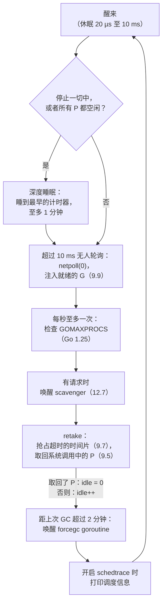

# 9.8 系统监控

调度器是被动的：只有当 goroutine 把控制权交还给运行时，调度器才有机会执行，例如主动让出、阻塞、
进入系统调用，或者在函数序言中发现抢占请求。没有 goroutine 交还控制权，调度器便无从察觉有调度的需要。
以下四种情形都属于这一类：一个从不让出的 goroutine 独占着 P（[9.7](./preemption.md)）；
一个线程陷在阻塞的系统调用中，它持有的 P 上还有等待运行的 goroutine（[9.5](./thread.md)）；所有 P
都在计算，没有 M 去收取已经就绪的网络事件（[9.9](./poller.md)）；程序几乎不再分配内存，堆不再增长，
垃圾回收也就不再被触发。这些情形需要一个不依赖调度器、按时间而非按事件行事的观察者。

Go 运行时的做法是在 `runtime.main` 中启动一个专门的 M 来运行 `sysmon` 函数
[[Go Authors, 2026a](#ref-go-authors-2026a)]：

```go
func main() {
	// ...
	if haveSysmon {
		systemstack(func() {
			newm(sysmon, nil, -1) // 不关联 P 的 M
		})
	}
	// ...
}
```

这就是**系统监控**（system monitor），源码中简称 sysmon。`haveSysmon` 在 wasm 上为假，源码注释给出的
理由是 wasm 上还没有线程。本节先说明一个没有 P 的线程能做什么、不能做什么，再追溯 sysmon 的由来，然后
依次讨论它的休眠策略与每一轮的职责，并借助 `schedtrace` 观察它的工作，最后与其他系统中承担类似角色的线程
作比较。

## 9.8.1 没有 P 的线程

sysmon 所在的 M 从不关联 P，这决定了它的能力边界。

首先，它不能执行带有写屏障的代码。`sysmon` 带有 `//go:nowritebarrierrec` 标注，源码注释写道：「总是在
没有 P 的情况下运行，因此不允许写屏障。」运行时的开发文档解释说，写屏障要求当前有一个活跃的 P，而调度器的
代码经常在没有 P 的情况下运行；`go:nowritebarrierrec` 让编译器检查被标注的函数及其递归调用的所有函数，
一旦其中出现写屏障便报错 [[Go Authors, 2026c](#ref-go-authors-2026c)]。其次，内存分配器的线程缓存 mcache
挂在 P 上（[12.2](../../part4memory/ch12alloc/component.md)），没有 P，堆分配也无从进行。

因此，sysmon 自己从不做重活。它的每一项职责都只是读取一些状态、做出判断，然后修改少量标志，或者把某个
goroutine 放入运行队列。真正的工作交给在普通 P 上运行的 goroutine：强制 GC 由 `forcegc` goroutine 发起，
向操作系统归还内存由后台的 scavenger goroutine 完成，Go 1.25 起调整 `GOMAXPROCS` 所需的停止一切也由一个
专门的辅助 goroutine 执行。sysmon 把它们放入运行队列时使用的 `injectglist` 正适合没有 P 的调用者：当前
没有 P 时，被注入的 G 进入全局队列，运行时再按空闲 P 的数量启动 M 来运行它们。

没有 P 同样意味着 sysmon 不受调度状况的影响。它通过 `usleep` 与 `notetsleep` 休眠，二者都直接建立在
操作系统的原语之上（`note` 见 [9.5](./thread.md)），不需要等待任何 P 空闲下来。即使所有 P 都被占住，sysmon
仍会按时醒来。监视者必须独立于被监视的系统，这是看门狗（watchdog）类机制的共同原则。

sysmon 的这种身份也体现在死锁检测中。`checkdead` 在 M 转入空闲（`mput`）、被锁定的 M 转入空闲
（`incidlelocked`）、M 退出（`mexit`）时，以及模板线程与 sysmon 启动时被调用。它以 M 的总数减去空闲的 M、
空闲的锁定 M 与 `sched.nmsys`，得到正在运行的 M 的数目；这个数目为零时，若也没有等待到期的计时器，便报告
`all goroutines are asleep - deadlock!`。`sched.nmsys` 统计的是「不计入死锁判定的系统 M」，即 sysmon 与
模板线程（[9.5](./thread.md)）：sysmon 一启动便执行 `sched.nmsys++` 并调用一次 `checkdead`。否则，一个
永远在巡视的线程会使运行中的 M 始终不为零，死锁也就永远无法被检测出来。死锁检测的完整讨论见
[16.1](../../part5toolchain/ch16tools/deadlock.md)。

## 9.8.2 由来

sysmon 随 Go 1.1 的调度器重写一同出现。要理解它为何存在，需要先看 Go 1.0 怎样处理系统调用。

Go 1.0 的调度器用一个原子变量 `sched.atomic` 记录正在执行 Go 代码的 M 的数目 `mcpu` 及其上限
`mcpumax`（即 `GOMAXPROCS`）。每次进入系统调用，`entersyscall` 都把 `mcpu` 减一；若此时有 goroutine
在等待运行，它便加锁调用 `matchmg`，立即为等待者安排另一个 M。也就是说，每一次系统调用都在进入时预先让出执
行 Go 代码的名额，无论这次调用持续 100 纳秒还是 10 秒。Vyukov 在 2012 年的调度器设计文档中把「激进的线程阻
塞与唤醒」列为当时调度器的四个问题之一：在有系统调用的情况下，工作线程频繁地阻塞与唤醒，带来大量开销。
不过，文档对系统调用的要求仍与 Go 1.0 相同：「M 进入系统调用时，必须确保有另一个 M 来执行 Go
代码」[[Vyukov, 2012](#ref-vyukov-2012)]。

Go 1.1 的实现换了一条路，提交说明称之为「更快的非阻塞系统调用进入与退
出」[[Vyukov, 2013a](#ref-vyukov-2013a)]。`entersyscall` 不再让出任何东西，只把 P 的状态改为 `Psyscall`，P
仍留在原来的 M 上；系统调用很快返回时，M 直接继续执行。对于迟迟不返回的调用，由新增的 sysmon
在事后发现，并把 P 取走交给其他 M。Go 1.1 的 sysmon 只有两项职责：取回陷在系统调用中的 P，
以及在长时间无人轮询时代为轮询网络。

这是一种乐观的设计：假定系统调用都很短，进入时什么都不做，猜错了再由后台线程纠正。每次系统调用的固定
开销由此换成了一段有界的延迟：P 上有等待运行的 goroutine 时，阻塞的系统调用让 P 闲置大约一到两个
sysmon 周期（判定规则见 [9.5](./thread.md)）。Go 1.26 删除 `_Psyscall` 状态之后，双方同步的方式变了，
这一分工没有变。

此后，sysmon 的职责逐渐增多：

| 版本 | 变化 | 出处 |
| --- | --- | --- |
| Go 1.1 | sysmon 出现：取回系统调用中的 P，代为轮询网络 | [[Vyukov, 2013a](#ref-vyukov-2013a)] |
| Go 1.2 | 抢占运行超过 10 ms 的 goroutine | [[Vyukov, 2013c](#ref-vyukov-2013c)] |
| Go 1.4 | 原先专门的 scavenger 并入 sysmon：强制 GC 与周期性的内存归还 | [[Vyukov, 2014](#ref-vyukov-2014)] |
| Go 1.13 | 周期性的内存归还被移除，改由后台 scavenger goroutine 完成 | [[Knyszek, 2018b](#ref-knyszek-2018b)] |
| Go 1.15 | sysmon 代为唤醒 scavenger | [[Knyszek, 2019](#ref-knyszek-2019)] |
| Go 1.25 | 每秒检查一次是否需要更新 `GOMAXPROCS` | [[Pratt, 2025](#ref-pratt-2025)] |

Go 1.4 的那次合并值得一提。早在 Go 1.0 中，运行时就有一个后台 goroutine `MHeap_Scavenger`
[[Paolacci, 2012](#ref-paolacci-2012)]：两分钟内没有发生 GC 就强制执行一次，并把五分钟未被使用的 span
归还给操作系统。它在休眠时进入系统调用状态，等于长期占用一个线程。Vyukov 在 Go 1.4 中删除了它，提交说明
写道：「为一个反正总在睡眠的后台 scavenger 占用一整个线程，代价太高。我们已经有 sysmon 线程，它可以完成
这项工作」[[Vyukov, 2014](#ref-vyukov-2014)]。强制 GC 由此成为 sysmon 的职责；又因为 sysmon 自己不能
执行 GC，同一提交引入了 `forcegc` 辅助 goroutine。

## 9.8.3 自适应的休眠

sysmon 是一个永不退出的循环，每一轮先睡一段时间，再巡视一遍各项职责。睡得太久，抢占与取回 P 就不及时；
睡得太频繁，又会在程序空闲时白白消耗 CPU。sysmon 用一套自适应的退避来调和二者：

```go
func sysmon() {
	lock(&sched.lock)
	sched.nmsys++ // 不计入死锁判定
	checkdead()
	unlock(&sched.lock)

	idle := 0 // 连续多少轮没有从系统调用中取回 P
	delay := uint32(0)
	for {
		if idle == 0 { // 从 20 µs 开始
			delay = 20
		} else if idle > 50 { // 约 1 ms 之后开始翻倍
			delay *= 2
		}
		if delay > 10*1000 { // 上限 10 ms
			delay = 10 * 1000
		}
		usleep(delay)

		now := nanotime()
		if debug.schedtrace <= 0 && (sched.gcwaiting.Load() || sched.npidle.Load() == gomaxprocs) {
			// 加锁并复查条件（略）
			syscallWake := false
			next := timeSleepUntil() // 最早的计时器
			if next > now {
				sched.sysmonwait.Store(true)
				sleep := forcegcperiod / 2 // 至多 1 分钟
				if next-now < sleep {
					sleep = next - now
				}
				syscallWake = notetsleep(&sched.sysmonnote, sleep) // 深度睡眠
				sched.sysmonwait.Store(false)
			}
			if syscallWake { // 被显式唤醒，而非超时
				idle = 0
				delay = 20
			}
		}
		// 本轮的各项职责，见 9.8.4
	}
}
```

退避的输入是 `idle`。源码注释称它记录「连续多少轮没有唤醒任何人」；从代码看，它只取决于 `retake`
的返回值，而返回值只统计从系统调用中取走的 P（9.8.4）。抢占请求与网络轮询注入的 G 都不使 `idle` 归零。

按这一规则，sysmon 先以 20 µs 的间隔睡 51 轮（约 1 ms），然后每轮翻倍，依次睡 40、80、……、5120 µs，
共 8 轮（合计约 10 ms），之后保持在 10 ms 的上限。也就是说，只要大约 11 ms 内没有从系统调用中取回 P，sysmon
就降为每 10 ms 巡视一次。这带来两个直接的后果。一个纯计算的程序很少阻塞在系统调用中，sysmon
很快稳定在 10 ms 的周期上，而一个时间片必须在两次采样中都被观察到才会被判定超时，所以一个从不让出的
goroutine 实际要运行 10 ms 至 20 ms 以上才被抢占（见 [9.4.2](./schedule.md) 的测量）。反过来，频繁
阻塞在系统调用中的程序使 sysmon 保持在 20 µs 的间隔上，P 能够被及时取回。

退避之上还有一层深度睡眠。若正在停止一切（`gcwaiting`），或者所有 P 都空闲，sysmon 便没有需要监视的
对象，于是用 `notetsleep` 睡到最早的计时器到期为止，但最长不超过 `forcegcperiod` 的一半，即 1 分钟。这个
上限连同它的注释「让唤醒周期足够短，以保证采样正确」，都原样来自 Go 1.0 的 `MHeap_Scavenger`
[[Paolacci, 2012](#ref-paolacci-2012)]：强制 GC 的判据是距上次 GC 超过 2 分钟，每分钟检查一次，强制 GC
就不会比期限晚 1 分钟以上。

深度睡眠可以被提前打断。进入系统调用时（`reentersyscall`）、从系统调用返回并取得空闲 P 时（`exitsyscall`
的两条慢路径），以及停止一切结束时（`startTheWorldWithSema`），运行时若发现 `sysmonwait` 被置位，就调用
`notewakeup` 唤醒 sysmon。被显式唤醒时，sysmon 把 `idle` 与 `delay` 复位到最灵敏的状态；源码注释称这是
一种押注：既然此前曾从系统调用中取回过 P，程序重新开始工作之后，很可能不久就需要再次这样做。因计时器
到期而醒来时则不复位，注释的解释是，避免给大部分时间都在睡眠的程序增加系统负载。

另有两处细节。开启 `GODEBUG=schedtrace` 时，sysmon 不进入深度睡眠，以便按时打印调度信息（9.8.5）。
在 Windows 上，如果系统不支持高精度计时器，sysmon 在较长的深度睡眠期间会调用 `osRelax` 放宽系统的
计时器精度，以免所有 P 都空闲时仍为驱动高精度计时器而耗电。

## 9.8.4 每一轮的职责

醒来之后，sysmon 按固定的顺序完成各项职责：

```go
	for {
		// 休眠，见 9.8.3
		lock(&sched.sysmonlock) // ReadMemStats 等操作借此暂时挡住 sysmon
		now = nanotime()
		// （省略：cgo 的 libc 拦截钩子）

		// 超过 10 ms 无人轮询网络，就代为轮询一次
		lastpoll := sched.lastpoll.Load()
		if netpollinited() && lastpoll != 0 && lastpoll+10*1000*1000 < now {
			sched.lastpoll.CompareAndSwap(lastpoll, now)
			list, delta := netpoll(0) // 非阻塞
			if !list.empty() {
				incidlelocked(-1) // 假装多一个运行中的 M，以免误报死锁
				injectglist(&list)
				incidlelocked(1)
				netpollAdjustWaiters(delta)
			}
		}
		// 每秒至多一次，检查是否需要更新 GOMAXPROCS
		if debug.updatemaxprocs != 0 && lastgomaxprocs+1e9 <= now {
			sysmonUpdateGOMAXPROCS()
			lastgomaxprocs = now
		}
		// 有请求时唤醒 scavenger
		if scavenger.sysmonWake.Load() != 0 {
			scavenger.wake()
		}
		// 抢占超时的时间片，取回系统调用中的 P
		if retake(now) != 0 {
			idle = 0
		} else {
			idle++
		}
		// 距上次 GC 超过 2 分钟，唤醒 forcegc goroutine
		if t := (gcTrigger{kind: gcTriggerTime, now: now}); t.test() && forcegc.idle.Load() {
			lock(&forcegc.lock)
			forcegc.idle.Store(false)
			var list gList
			list.push(forcegc.g)
			injectglist(&list)
			unlock(&forcegc.lock)
		}
		if debug.schedtrace > 0 && lasttrace+int64(debug.schedtrace)*1000000 <= now {
			lasttrace = now
			schedtrace(debug.scheddetail > 0)
		}
		unlock(&sched.sysmonlock)
	}
```

第一项职责是代为轮询网络。正常情况下，网络事件由寻找工作的 M 在调度循环中顺带收取（[9.9](./poller.md)）。
若所有 P 都忙于计算，就没有 M 去轮询，已经就绪的 goroutine 只能等待。sysmon 在距上次轮询超过 10 ms
时代为轮询一次，并通过 CAS 把 `lastpoll` 推进到当前时刻。`lastpoll` 为零表示某个 M 正阻塞在网络轮询中，
事件会由它直接收取，sysmon 便不必插手。注入就绪的 G 之前要先调用 `incidlelocked(-1)`，
源码注释描述了不这样做的后果：`injectglist` 取走所有 P 之后、还没来得及为它们启动 M 时，另一个 M
从系统调用返回，执行完它的 G，发现既无工作可做、也没有其他运行中的 M，便会误报死锁。

这项职责的条件在 Go 1.1 中写错了两处。Vyukov 先在 2013 年 7 月报告，一旦 10 ms 内无人轮询网络，sysmon
便会在之后的每一轮（每 20 µs）都轮询一次，直到另一个线程阻塞在网络轮询中为止；修正是让 sysmon
每次轮询后用 CAS 更新 `lastpoll` [[Vyukov, 2013b](#ref-vyukov-2013b)]。三个月后，Vyukov 再次报告 sysmon
过度轮询网络，并指出条件中的比较方向写反了：Go 1.1 写的是 `lastpoll + 10ms > now`，
即恰恰在刚刚轮询过的时候再去轮询；Ian Lance Taylor 随即提交了修正 [[Taylor, 2013](#ref-taylor-2013)]。
两处修正都随 Go 1.2 发布。

第二项职责是更新 `GOMAXPROCS`。Go 1.25 起，`GOMAXPROCS` 的默认值会考虑 Linux cgroup 的 CPU 带宽限制，
并在可用的逻辑 CPU 数或 cgroup 限制变化时自动更新；若用户通过环境变量或 `runtime.GOMAXPROCS` 手动设置过，
两项行为都自动关闭 [[Go Authors, 2025](#ref-go-authors-2025)]。周期性的检查由 sysmon 每秒至多执行一次：`sysmonUpdateGOMAXPROCS`
重新计算默认值，与当前值不同时才需要更新。更新必须停止一切，源码注释直言：
「sysmon 无法直接停止一切。运行辅助 goroutine 代为执行。」于是 sysmon 把 `updateMaxProcsG` 放入运行队列，
由它在普通 P 上完成停止一切与调整 [[Pratt, 2025](#ref-pratt-2025)]。

第三项职责是唤醒 scavenger。Go 1.13 起，向操作系统归还内存由后台 scavenger goroutine 按自己的节奏完成
[[Knyszek, 2018a](#ref-knyszek-2018a)]（[12.7](../../part4memory/ch12alloc/pagealloc.md)），sysmon
不再自己归还。Go 1.15 起，清扫完成时需要唤醒 scavenger，但清扫器不能直接唤醒它：唤醒需要修改计时器、让
goroutine 就绪，后者可能引发内存分配，而清扫可能正发生在内存分配的过程中。于是清扫器只设置一个标志
`sysmonWake`，由 sysmon 在下一轮发现并执行唤醒 [[Knyszek, 2019](#ref-knyszek-2019)]。`scavenger.wake`
同样借助 `injectglist` 放入 G，注释特别说明它可以在没有 P 时运行，并且不会把 scavenger 放入当前 P 的
`runnext`，以免干扰用户 goroutine 的调度 [[Go Authors, 2026b](#ref-go-authors-2026b)]。

第四项职责由 `retake` 完成。它遍历所有处于 `_Prunning` 的 P，处理两类情形：

```go
func retake(now int64) uint32 {
	n := 0
	for i := 0; i < len(allp); i++ {
		pp := allp[i]
		if pp == nil || atomic.Load(&pp.status) != _Prunning {
			continue
		}
		pd := &pp.sysmontick
		sysretake := false
		if schedt := int64(pp.schedtick); int64(pd.schedtick) != schedt {
			pd.schedtick = uint32(schedt) // 新的时间片：记下首次观察到的时刻
			pd.schedwhen = now
		} else if pd.schedwhen+forcePreemptNS <= now {
			preemptone(pp) // 同一时间片已超过 10 ms：请求抢占
			sysretake = true
		}
		// 仅当 P 处于系统调用中且满足 9.5 所述的条件时，才执行以下三行（略）
		thread.takeP()
		n++ // 只有取走 P 才计数
		handoffp(pp)
	}
	return uint32(n)
}
```

第一类是运行过久的时间片。`schedtick` 在 10 ms（`forcePreemptNS`）内没有变化，说明同一个时间片运行得太久，sysmon
便调用 `preemptone` 请求抢占；请求经由函数序言中的检查或异步抢占信号得到响应
[[Clements, 2019](#ref-clements-2019)]，见 [9.4.2](./schedule.md) 与 [9.7](./preemption.md)。
第二类是陷在系统调用中的 P，sysmon 在条件满足时把它取走并经 `handoffp` 交给其他 M，规则与同步细节见
[9.5](./thread.md)。若同一时间片超时的 P 恰好处于系统调用中，抢占请求无人响应，`sysretake` 使 sysmon
不必等待第二次观察就取走 P。返回值 `n` 只统计取走的 P，这正是 9.8.3 中 `idle` 的来源。

第五项职责是强制 GC。按堆的增长触发 GC 的调步算法（[13.3](../../part4memory/ch13gc/pacing.md)）
有一个盲区：程序若几乎不再分配，堆就到不了下一个目标，上一轮 GC 之后产生的垃圾便会一直留在堆中。`gcTriggerTime`
的判据是：`GOGC` 不为 `off`，至少已经发生过一次 GC，并且距上次 GC 已超过
`forcegcperiod`（2 分钟）。满足时，sysmon 把常驻的 `forcegc` goroutine 放入运行队列，由它调用 `gcStart`
发起一轮并发的 GC；开启 `GODEBUG=gctrace=1` 时，这样的 GC 之前会打印一行 `GC forced`。sysmon
自己只是一个定时的闹钟。

最后一项职责是打印调度信息。设置 `GODEBUG=schedtrace=N` 后，sysmon 每 N 毫秒调用一次 `schedtrace`，
把调度器的状态打印到标准错误，`scheddetail=1` 则使输出包含每个 P、M、G 的细节。

整个循环可以概括为下图：



## 9.8.5 观察 sysmon

`schedtrace` 的输出由 sysmon 打印，是从外部观察它最直接的途径。下面的程序以子进程的方式运行：子进程
有两个 P，三个从不让出的 goroutine 运行 0.3 秒后结束，随后程序再空闲 0.2 秒。父进程为子进程设置
`GODEBUG=schedtrace=100`，并只保留输出中与本节有关的字段：

```go {run=true native=true}
package main

import (
	"bufio"
	"bytes"
	"fmt"
	"os"
	"os/exec"
	"slices"
	"strings"
	"time"
)

func main() {
	if len(os.Args) == 2 { // 子进程：三个从不让出的 goroutine 运行 0.3 秒，随后空闲 0.2 秒
		stop := time.Now().Add(300 * time.Millisecond)
		for range 3 {
			go func() {
				for time.Now().Before(stop) {
				}
			}()
		}
		time.Sleep(500 * time.Millisecond)
		return
	}
	var stderr bytes.Buffer
	cmd := exec.Command(os.Args[0], "child")
	cmd.Env = append(os.Environ(), "GOMAXPROCS=2", "GODEBUG=schedtrace=100")
	cmd.Stderr = &stderr
	if err := cmd.Run(); err != nil {
		fmt.Println(err)
		return
	}
	// 只保留与本节有关的字段。
	omit := []string{"gomaxprocs=", "spinningthreads=", "needspinning=", "idlethreads="}
	sc := bufio.NewScanner(&stderr)
	for sc.Scan() {
		fields := strings.Fields(sc.Text())
		if len(fields) == 0 || fields[0] != "SCHED" {
			continue
		}
		fields = slices.DeleteFunc(fields, func(f string) bool {
			return slices.ContainsFunc(omit, func(p string) bool { return strings.HasPrefix(f, p) })
		})
		fmt.Println(strings.Join(fields, " "))
	}
}
```

在笔者的 macOS（arm64）机器上，Go 1.26 的一次输出如下：

```
SCHED 0ms: idleprocs=0 threads=4 runqueue=0 [ 0 0 ] schedticks=[ 0 2 ]
SCHED 108ms: idleprocs=0 threads=4 runqueue=0 [ 1 0 ] schedticks=[ 8 8 ]
SCHED 210ms: idleprocs=0 threads=4 runqueue=0 [ 0 1 ] schedticks=[ 13 13 ]
SCHED 310ms: idleprocs=2 threads=4 runqueue=0 [ 0 0 ] schedticks=[ 18 16 ]
SCHED 413ms: idleprocs=2 threads=4 runqueue=0 [ 0 0 ] schedticks=[ 18 16 ]
SCHED 515ms: idleprocs=2 threads=4 runqueue=0 [ 0 0 ] schedticks=[ 18 16 ]
```

`runqueue` 是全局队列的长度，方括号中依次是每个 P 本地队列的长度，`schedticks` 是每个 P
的时间片编号（[9.4.2](./schedule.md)），这一字段由 Go 1.25 加入非详细模式的输出
[[Hillegeer, 2024](#ref-hillegeer-2024)]。输出中能看出三件事。

第一，打印的时刻并不恰好是 100 ms 的整数倍。sysmon 只在每轮醒来时检查是否到了打印的时间，打印因此总是
落在期限之后的第一轮；计算持续进行时 sysmon 每 10 ms 左右醒来一次，偏差便在这一量级。`threads=4` 中也包括
sysmon 自己所在的线程，它不持有 P。

第二，忙碌阶段的 0.3 秒里，三个 goroutine 从不让出，每个 P 的 `schedticks` 却在持续增加。除最初几次是三个
goroutine 各自开始运行之外，这一阶段的每一次增加都意味着前一个时间片被 sysmon 判定超时并被抢占：被抢占的
goroutine 进入队列，等待中的 goroutine 开始一个新的时间片。笔者多次运行时，每 100 ms 每个 P 通常增加 3 至
5 次，偶尔更少，即一个时间片大约持续 20 ms 至 30 ms。这与 9.4.2 在同一台机器上测得的延迟相符：
一个时间片要在 sysmon 的两次采样中都被观察到，才会被判定超时。具体数值随运行与平台而变。

第三，计算结束后 `idleprocs` 变为 2，`schedticks` 不再变化。此时所有 P 都空闲，sysmon 本应进入深度睡眠，
而由于开启了 `schedtrace`，它仍每轮醒来并按时打印，这正是 9.8.3 所述的例外。

这个示例只能在本地运行：wasm 上既没有 `os/exec` 所需的子进程，也没有 sysmon。后者的影响远不止
`schedtrace` 失效：没有时间片抢占，没有代为轮询网络，没有强制 GC，也没有 `GOMAXPROCS` 的自动更新；[9.4](./schedule.md)
还讨论过，正因为没有 sysmon 抢占，Go 1.23 起运行时在这类平台上完全禁用了 `runnext`。

## 9.8.6 与其他系统的比较

在被监视的系统之外另设一个周期性运行的监视者，是系统软件中常见的做法。各种实现的差别主要在于发现
异常之后做什么。

Linux 内核有两类看门狗。soft lockup 检测由每个 CPU 上的高精度计时器驱动：计时器周期性地调度一个作业，
作业每次运行都更新一个时间戳，若时间戳超过 `2*watchdog_thresh`（默认 20 秒）没有更新，说明这个 CPU
一直在内核态循环，没有给其他任务运行的机会
[[Linux Kernel Documentation, n.d.a](#ref-linux-kernel-documentation-nda)]。hung task 检测由内核线程
`khungtaskd` 执行 [[Linux Kernel, n.d.](#ref-linux-kernel-nd)]，它报告处于不可中断睡眠（D 状态）超过
`hung_task_timeout_secs`（默认 120 秒）而未被调度的任务
[[Linux Kernel Documentation, n.d.b](#ref-linux-kernel-documentation-ndb)]。两者发现问题后都只打印诊断信
息，默认让系统保持原状，只有显式配置时才 panic。它们诊断问题，但不修复问题。

HotSpot JVM 的 WatcherThread 在源码中被描述为「用于模拟计时器中断」的唯一线程，它负责运行各种周期性任务
（`PeriodicTask`），任务的间隔在 10 ms 至 10 s 之间，粒度为 10 ms [[OpenJDK, n.d.](#ref-openjdk-nd)]。
例如，启用诊断选项 `AbortVMOnVMOperationTimeout` 时，有一个任务监视 VMThread 上执行的 VM 操作，
某个操作耗时超过阈值便终止虚拟机。WatcherThread 还负责为致命错误的报告过程计时，因为错误处理程序本身
也可能死锁。源码注释解释说，这段逻辑放在 WatcherThread 中，是因为它本来就周期性地醒来，并且比其他线程
更不容易崩溃；检查超时的循环使用最原始的睡眠，以免依赖此时可能已经损坏的虚拟机设施。这与 sysmon 通过
操作系统原语休眠、不依赖调度器的考虑如出一辙。

与 sysmon 最接近的是 .NET 线程池中的 gate thread [[Microsoft, n.d.](#ref-microsoft-nd)]。它每 500 ms
执行一次周期性检查：若有工作在排队，而线程池已有一段时间没有从队列中取出工作（CPU 利用率低时为 500 ms，
否则为线程数目标乘以 1 s），就判定发生了饥饿，把线程数目标加一并启动一个新的工作线程。连续两轮没有待处理的
请求之后，gate thread 停下来等待，直到工作线程再次需要它，这与 sysmon 的深度睡眠相仿。二者的区别在于
信息的多少。除了 `Task.Wait` 这类会主动通知线程池的阻塞（源码称之为协作式阻塞），.NET 线程池无从得知
一个工作线程是阻塞在同步 I/O 上还是在计算，只能从队列长时间没有进展来推断；Go
的运行时在 `entersyscall` 中已经把 G 标记为 `_Gsyscall`，sysmon 能准确地知道哪一个 P 陷在系统调用中，
因而可以在一到两个周期内作出反应，并且移交的是 P 而不是增加线程。

| 机制 | 检查周期 | 发现异常之后 |
| --- | --- | --- |
| Linux soft lockup | 4 s（默认） | 打印诊断信息，可配置为 panic |
| Linux hung task | 120 s（默认） | 报告警告，可配置为 panic |
| .NET 线程池 gate thread | 500 ms | 增加一个工作线程 |
| Go sysmon | 20 µs 至 10 ms | 请求抢占、移交 P、注入 G |

## 9.8.7 小结

sysmon 是一个不关联 P、不受调度器支配的线程。它的存在源于 Go 1.1 的一个选择：系统调用的进入与退出走
快路径，什么都不让出，阻塞过久的情形由后台线程在事后纠正。在此之上，它逐渐承担起其他需要按时间而非按事件
处理的工作：抢占超时的时间片、代为轮询网络、触发强制 GC、唤醒 scavenger、更新 `GOMAXPROCS`。由于没有 P，
它只负责发现问题与发出请求，需要 P 才能完成的工作都交给辅助 goroutine。自适应的休眠使它在程序忙碌时足够
灵敏，在空闲时几乎不消耗资源；10 ms 的周期上限也决定了时间片抢占的实际粒度。

## 延伸阅读

- <a id="ref-clements-2019"></a>[Clements, 2019] Austin Clements. *Proposal: Non-cooperative goroutine
  preemption*（proposal #24543，sysmon 抢占与信号抢占的协作）.
  https://go.googlesource.com/proposal/+/master/design/24543-non-cooperative-preemption.md
- <a id="ref-go-authors-2025"></a>[Go Authors, 2025] The Go Authors. Go 1.25 Release Notes, 2025.
  https://go.dev/doc/go1.25
  容器感知的 `GOMAXPROCS` 默认值与周期性更新，以及关闭它们的 `GODEBUG` 设置。
- <a id="ref-go-authors-2026a"></a>[Go Authors, 2026a] The Go Authors. `runtime/proc.go`（`sysmon`、`retake`、`handoffp`、`preemptone`、`checkdead`、`forcePreemptNS`、`forcegcperiod`）.
  https://github.com/golang/go/blob/master/src/runtime/proc.go
  另含 `forcegchelper`、`sysmonUpdateGOMAXPROCS`、`schedtrace`（本节对照 Go 1.26）。
- <a id="ref-go-authors-2026b"></a>[Go Authors, 2026b] The Go Authors. `runtime/mgcscavenge.go`（`bgscavenge`、`scavenger.wake`、`sysmonWake`，
  归还空闲内存的专职 goroutine）.
  https://github.com/golang/go/blob/master/src/runtime/mgcscavenge.go
- <a id="ref-go-authors-2026c"></a>[Go Authors, 2026c] The Go Authors. `runtime/HACKING.md`.
  https://github.com/golang/go/blob/master/src/runtime/HACKING.md
  `go:nowritebarrierrec` 与 `go:yeswritebarrierrec`：写屏障为何要求活跃的 P。
- <a id="ref-hillegeer-2024"></a>[Hillegeer, 2024] Nicolas Hillegeer. runtime: print pp.schedtick in
  scheddetail even when !detailed. Go commit 5295722238, 2024. https://go.dev/cl/635636
- <a id="ref-knyszek-2018a"></a>[Knyszek, 2018a] Michael Knyszek. runtime: add background scavenger. Go
  commit fe67ea32bf, 2018. https://go.dev/cl/142960
- <a id="ref-knyszek-2018b"></a>[Knyszek, 2018b] Michael Knyszek. runtime: remove periodic scavenging. Go
  commit eaa1c87b00, 2018. https://go.dev/cl/143157
  属于 issue #30333 的系列修改，随 Go 1.13 发布。
- <a id="ref-knyszek-2019"></a>[Knyszek, 2019] Michael Knyszek. runtime: wake scavenger and update address
  on sweep done. Go commit 2491c5fd24, 2019. https://go.dev/cl/207998
  引入 `sysmonWake`，与 issue #35788（runtime: scavenger not as effective as in previous releases）相关。
- <a id="ref-linux-kernel-nd"></a>[Linux Kernel, n.d.] The Linux Kernel. `kernel/hung_task.c`.
  https://github.com/torvalds/linux/blob/master/kernel/hung_task.c
  hung task 检测线程 `khungtaskd` 的实现。
- <a id="ref-linux-kernel-documentation-nda"></a>[Linux Kernel Documentation, n.d.a] The Linux Kernel.
  *Softlockup detector and hardlockup detector (aka nmi_watchdog)*（soft lockup 与 hard lockup 看门狗）.
  https://www.kernel.org/doc/html/latest/admin-guide/lockup-watchdogs.html
- <a id="ref-linux-kernel-documentation-ndb"></a>[Linux Kernel Documentation, n.d.b] The Linux Kernel.
  *Documentation for /proc/sys/kernel/*（`hung_task_timeout_secs`、`hung_task_panic` 等 hung task
  检测的参数）. https://www.kernel.org/doc/html/latest/admin-guide/sysctl/kernel.html
- <a id="ref-microsoft-nd"></a>[Microsoft, n.d.] Microsoft. `PortableThreadPool.GateThread.cs`.
  https://github.com/dotnet/runtime/blob/main/src/libraries/System.Private.CoreLib/src/System/Threading/PortableThreadPool.GateThread.cs
  .NET 线程池的 gate thread：饥饿检测与线程注入。
- <a id="ref-openjdk-nd"></a>[OpenJDK, n.d.] OpenJDK / HotSpot. WatcherThread 与 VMThread
  源码（`src/hotspot/share/runtime/`：`nonJavaThread.hpp`/`nonJavaThread.cpp` 中的
  WatcherThread，`task.hpp` 中的 `PeriodicTask`，`vmThread.hpp`/`vmThread.cpp`）.
  https://github.com/openjdk/jdk/tree/master/src/hotspot/share/runtime
- <a id="ref-paolacci-2012"></a>[Paolacci, 2012] Sébastien Paolacci. runtime: release unused memory to the
  OS. Go commit 5c598d3c9f, 2012.
  https://github.com/golang/go/commit/5c598d3c9f0b9d78f92ffe1ab5a2365fe900c631
  Go 1.0 的 `MHeap_Scavenger`：两分钟强制 GC，五分钟未用的 span 归还操作系统。
- <a id="ref-pratt-2025"></a>[Pratt, 2025] Michael Pratt. runtime: use cgroup CPU limit to set GOMAXPROCS.
  Go commit e6dacf91ff, 2025. https://go.dev/cl/670497
  实现 issue #73193（runtime: CPU limit-aware GOMAXPROCS default）。
- <a id="ref-taylor-2013"></a>[Taylor, 2013] Ian Lance Taylor. runtime: correct test for when to poll
  network. Go commit 88c448ba40, 2013.
  https://github.com/golang/go/commit/88c448ba40a29ac96563e9945d2af17fba779d23
  修复 issue #6610（Dmitry Vyukov, runtime: sysmon polls network excessively）。
- <a id="ref-vyukov-2012"></a>[Vyukov, 2012] Dmitry Vyukov. *Scalable Go Scheduler Design Doc*. 2012.
  https://go.dev/s/go11sched
- <a id="ref-vyukov-2013a"></a>[Vyukov, 2013a] Dmitry Vyukov. runtime: improved scheduler. Go commit
  779c45a507, 2013. https://github.com/golang/go/commit/779c45a50700bda0f6ec98429720802e6c1624e8
  Go 1.1 的调度器重写，sysmon 由此出现。
- <a id="ref-vyukov-2013b"></a>[Vyukov, 2013b] Dmitry Vyukov. runtime: prevent sysmon from polling network
  excessivly. Go commit 6857264457, 2013.
  https://github.com/golang/go/commit/68572644576be5f1f7121428755e7d8af5b7044c
  修复 issue #5922。
- <a id="ref-vyukov-2013c"></a>[Vyukov, 2013c] Dmitry Vyukov. runtime: preempt long-running goroutines. Go
  commit bc31bcccd3, 2013. https://github.com/golang/go/commit/bc31bcccd3b94ec8dd324e523c4c7ae9180b937f
  sysmon 开始抢占运行超过 10 ms 的 goroutine，关联 issue #543（runtime: preemptive scheduling）。
- <a id="ref-vyukov-2014"></a>[Vyukov, 2014] Dmitry Vyukov. runtime: remove dedicated scavenger thread. Go
  commit b83d8bd0b8, 2014. https://github.com/golang/go/commit/b83d8bd0b85ff8b60a113bac841bfaf4cce52e3c
  强制 GC 与周期性的内存归还并入 sysmon，同时引入 `forcegc` 辅助 goroutine。
- 本书 [9.7 协作与抢占](./preemption.md)、[9.5 线程管理](./thread.md)、[9.9 网络轮询器](./poller.md)、[16.1
  运行时死锁检查](../../part5toolchain/ch16tools/deadlock.md)、[9.4 调度循环](./schedule.md)、[12.7
  页分配器](../../part4memory/ch12alloc/pagealloc.md)。
