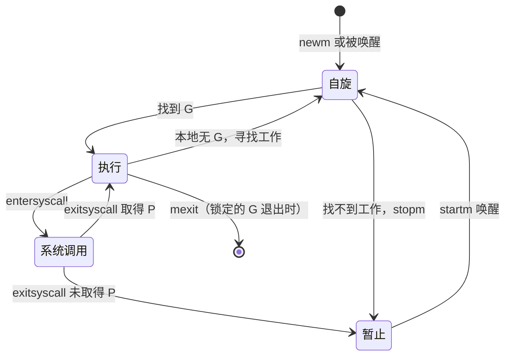
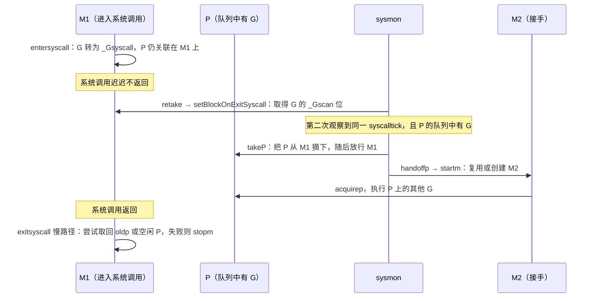

# 9.5 线程管理

前几节讨论的主要是 G 与 P，本节转向 M，即运行时向操作系统申请的线程。需要回答的问题有：线程如何创建，
空闲线程如何复用，为何线程数常常多于 `GOMAXPROCS`，一个阻塞在系统调用中的 goroutine 为何不会拖累同一 P
上的其他 goroutine，以及把 goroutine 锁定在某个线程上（`LockOSThread`）需要付出什么代价。

贯穿全节的前提是：线程是昂贵的资源。创建线程需要陷入内核、分配栈并设置信号掩码，线程的数量还受操作系统的限
制。运行时的许多设计，从复用空闲的 M、在系统调用期间移交 P，到为线程总数设置上限，都服务于「少创建、
多复用」这一目标。

## 9.5.1 M 与操作系统线程

每个 M 对应一个操作系统线程。进程启动时的主线程被包装为 `m0`，它是一个全局变量，不经堆分配
（[3.5](../../part1overview/ch03life/boot.md)）；此后的每个 M 都对应一个由运行时显式创建的线程（9.5.5 的
extra M 除外）。与线程管理有关的字段如下：

```go
// m：与线程管理有关的字段（示意）
type m struct {
	g0    *g       // 持有系统栈的 goroutine，执行调度与运行时代码
	curg  *g       // 当前执行的用户 goroutine
	p     puintptr // 关联的 P
	nextp puintptr // 被唤醒后将要关联的 P
	oldp  puintptr // 进入系统调用前关联的 P

	park      note     // 暂止时在此休眠
	schedlink muintptr // 串入空闲 M 链表或 newmHandoff 链表

	lockedg   guintptr // 与之锁定的 G，见 9.5.6
	lockedExt uint32   // 用户调用 LockOSThread 的嵌套计数
	lockedInt uint32   // 运行时内部锁定的嵌套计数
	incgo     bool     // 是否正在执行 cgo 调用
	isextra   bool     // 是否为服务 cgo 回调的 extra M，见 9.5.5
}
```

新线程经 `newm` → `newm1` → `newosproc` 创建。在 Linux 上，`newosproc` 最终执行一次 `clone(2)` 系统调用，
所用的标志位体现了线程与进程的区别 [[Go Authors, 2026b](#ref-go-authors-2026b)]：

```go
// runtime/os_linux.go 中创建线程所用的 clone 标志
cloneFlags = _CLONE_VM | // 共享地址空间
	_CLONE_FS | // 共享文件系统信息（当前目录等）
	_CLONE_FILES | // 共享文件描述符表
	_CLONE_SIGHAND | // 共享信号处理函数表
	_CLONE_SYSVSEM | // 共享 System V 信号量的撤销列表
	_CLONE_THREAD // 加入同一线程组，共享进程号
```

地址空间、文件描述符与信号处理函数都是共享的，各线程独有的只是寄存器与栈
[[Linux man-pages, n.d.](#ref-linux-man-pages-nd)]。在 Darwin 等平台上，运行时改为调用 `pthread_create`。
即便只是创建线程，开销也不小：`newosproc` 在 `clone` 前后以 `sigprocmask` 屏蔽并恢复全部信号，
使新线程以屏蔽信号的状态启动，待它在 `minit` 中完成初始化后再开放；新线程还需要一个系统栈作为 g0
的栈（[9.3.3](./mpg.md)）。若 `clone` 返回 `EAGAIN`，运行时会重试，仍失败则以「may need to increase max
user processes (ulimit -u)」的提示终止程序，这说明线程是受操作系统配额限制的资源。

## 9.5.2 空闲 M 的复用

运行时不会在 M 无事可做时销毁它，而是让它暂止，等待下一次使用。暂止与复始由 `stopm` 与 `startm` 完成：

```go
// stopm：暂止当前 M，直到有 P 交给它（示意）
func stopm() {
	gp := getg()
	// 前提：M 不持有锁，不持有 P，也不处于自旋状态
	lock(&sched.lock)
	mput(gp.m) // 放入空闲 M 链表 sched.midle
	unlock(&sched.lock)
	mPark()                    // 在 m.park 上休眠
	acquirep(gp.m.nextp.ptr()) // 唤醒者已把要交给它的 P 写入 nextp
	gp.m.nextp = 0
}
```

`mPark` 的核心是 `notesleep(&gp.m.park)`。`note` 是运行时内部的一次性事件：在 Linux、FreeBSD 等平台上基于
futex 实现，在 Darwin、Windows 等平台上基于每个 M 各自的睡眠原语 `semasleep` 与 `semawakeup` 实现，Darwin
用的是 pthread 的互斥锁与条件变量，Windows 用的是事件对象。暂止的 M 在内核中休眠，不占用 CPU，直到被
`notewakeup` 唤醒。futex 的语义及其使用中的陷阱，可参阅 Drepper 的论述
[[Drepper, 2011](#ref-drepper-2011)]。`note` 不应与 `runtime/sema.go` 中的信号量混淆：后者供 `sync`
等包在 Go 代码中使用，其设计参照了 Plan 9 的信号量
[[Mullender and Cox, 2008](#ref-mullender-and-cox-2008)]，见 [11.2](../ch11sync/mutex.md)。

当某个 P 需要一个线程来执行时（有新 G 就绪、系统调用期间移交 P 等），`startm` 先用 `mget`
从空闲链表取一个 M，把 P 写入它的 `nextp`，再唤醒它；只有空闲链表为空时，才调用 `newm` 创建新线程。
先复用、后创建的顺序，把线程创建留在了冷路径上。

M 本身没有显式的状态字段，但可以按它在做什么归纳出几种状态：



在通常的执行路径上，M 从不退出。运行时自 Go 1.10 起才具备让自己创建的线程退出的能力，
目前它只用于锁定线程的 G 未解锁就退出的情形（9.5.6）[[Clements, 2017b](#ref-clements-2017b)]。
让空闲线程自动退出的提议（issue #14592）至今仍未实现 [[Lopez, 2016](#ref-lopez-2016)]，
因此一个程序在高峰期创建的线程，此后会一直保留。

## 9.5.3 GOMAXPROCS 限制的是 P

`GOMAXPROCS` 限制的是 P 的数量，即同时执行 Go 代码的并行度上限，而不是线程数。线程由运行时按需创建，除
9.5.6 所述的情形外只增不减（9.5.2），其数量完全可能超过 `GOMAXPROCS`。最常见的原因是系统调用：一个 M
阻塞在系统调用中时，它的 P 会被移交给另一个 M（9.5.4），于是阻塞的 M 与接手的 M 同时存在。`LockOSThread`
与 cgo 回调使用的 extra M 也会使 M 的数量多于 P。下面的程序在 `GOMAXPROCS` 为 2 时，让 10 个 goroutine
阻塞在读取空管道的系统调用上：

```go {run=true native=true}
package main

import (
	"fmt"
	"runtime"
	"runtime/metrics"
	"syscall"
	"time"
)

// read 读取若干个 Go 1.26 新增的调度器指标。
func read() (threads, inSyscall uint64) {
	s := []metrics.Sample{
		{Name: "/sched/threads/total:threads"},           // 运行时拥有的线程数
		{Name: "/sched/goroutines/not-in-go:goroutines"}, // 处于系统调用或 cgo 调用中的 goroutine 数（近似值）
	}
	metrics.Read(s)
	return s[0].Value.Uint64(), s[1].Value.Uint64()
}

func main() {
	runtime.GOMAXPROCS(2)
	t, n := read()
	fmt.Printf("启动时：线程 %d，系统调用中的 goroutine %d\n", t, n)

	var fds [2]int
	if err := syscall.Pipe(fds[:]); err != nil { // 阻塞模式的管道，不经过网络轮询器
		panic(err)
	}
	for range 10 {
		go func() {
			buf := make([]byte, 1)
			syscall.Read(fds[0], buf) // 管道中没有数据，线程阻塞在内核中
		}()
	}
	time.Sleep(100 * time.Millisecond)
	t, n = read()
	fmt.Printf("之后：线程 %d，系统调用中的 goroutine %d\n", t, n)
}
```

```
启动时：线程 5，系统调用中的 goroutine 0
之后：线程 13，系统调用中的 goroutine 10
```

10 个 goroutine 各自占据一个阻塞在内核中的线程，线程总数因此远超 `GOMAXPROCS`，而 main 仍能继续执行。
这两个指标均为 Go 1.26 新增 [[Go Authors, 2026c](#ref-go-authors-2026c)]；以上是 macOS 上的运行结果，
具体的线程数因平台与运行时版本而异。

线程数若不设上限，大量阻塞在系统调用上的 goroutine 就可能使运行时无节制地创建线程。运行时为此设置了上限
`sched.maxmcount`，默认为 10000。`checkmcount` 的注释说明，这一上限的目的是防止数以百万计阻塞在系统调用上
的 goroutine 意外地造成「fork 炸弹」[[Go Authors, 2026a](#ref-go-authors-2026a)]：

```go
// checkmcount：检查 M 的总数是否超过上限（示意）
func checkmcount() {
	// 不计入 extra M：它们服务于由 C 创建的线程回调
	count := mcount() - int32(extraMInUse.Load()) - int32(extraMLength.Load())
	if count > sched.maxmcount {
		print("runtime: program exceeds ", sched.maxmcount, "-thread limit\n")
		throw("thread exhaustion")
	}
}
```

超过上限时，程序以 `thread exhaustion` 终止。这一上限不是为正常程序设置的，而是一道防止失控程序拖垮整台机
器的防线，可以通过 `debug.SetMaxThreads` 调整。extra M 不计入上限，因为它们的数量取决于有多少个由 C
创建的线程回调进 Go，与 Go 程序自身创建了多少线程无关。这一排除是在 Go 1.21 的开发期间加入的：当时把
extra M 与 C 线程绑定的改动（9.5.5）使 extra M 直到 C 线程退出才归还，一万个不同的 C 线程只要各回调 Go
一次，就会触发 `thread exhaustion` [[Pratt, 2023b](#ref-pratt-2023b)]。

## 9.5.4 系统调用与 P 的移交

[9.1](./model.md) 提到，M:N 模型必须解决的一个问题是：一个 goroutine 阻塞在系统调用中时，不能使同一 P
上的其他 goroutine 一同等待。Go 的解决办法是在系统调用期间把 P 移交给另一个 M。基本的权衡在于，
系统调用多数很快就会返回，为每次调用都移交 P 代价太高；而对真正长时间阻塞的调用，又必须及时让 P
去执行其他 G。运行时因此把系统调用分为快、慢两条路径处理。

进入系统调用时，`entersyscall`（实际工作由 `reentersyscall` 完成）把 G 置为 `_Gsyscall`，
保存栈指针与程序计数器以供 GC 与栈回溯使用，并把当前 P 记入 `m.oldp`，同时记下 P 的 `syscalltick`，
以便事后判断 P 是否被取走过。关键在于，`entersyscall` 既不释放 P，也不改变 P 的状态：`m.p` 仍指向原来的
P，P 仍处于 `_Prunning`，改变的只有 G 的状态。

```go
// reentersyscall：进入系统调用（示意）
func reentersyscall(pc, sp, bp uintptr) {
	gp := getg()
	gp.m.locks++                  // 禁止抢占：此间 g.sched 可能不一致，不能让 GC 观察到
	gp.stackguard0 = stackPreempt // 使任何栈检查都失败
	gp.throwsplit = true          // 并告知 newstack：此时栈增长是致命错误
	gp.m.syscalltick = gp.m.p.ptr().syscalltick
	gp.m.oldp.set(gp.m.p.ptr()) // 只记下 P；m.p 不清除，P 的状态也不改变
	save(pc, sp, bp)            // 为 GC 与栈回溯保存现场
	casgstatus(gp, _Grunning, _Gsyscall) // 此后不得再访问 P
	if sched.sysmonwait.Load() {
		systemstack(entersyscallWakeSysmon) // sysmon 处于深度睡眠时唤醒它
	}
	gp.m.locks--
}
```

返回时，`exitsyscall` 先把 G 切回 `_Grunning`，再检查 P 是否还在：

- **快路径**：`m.p` 仍不为空，说明系统调用很快返回，P 未被取走。G 直接继续执行，无须加锁，也无须重新关联
  P。
- **慢路径**：P 已被取走，`exitsyscallTryGetP` 先尝试取回原来的 `oldp`，失败则尝试取一个空闲的 P；
  仍取不到，就把 G 放入全局队列，M 经 `stopm` 暂止。

取走 P 的是系统监控线程 sysmon（[9.8](./sysmon.md)）。它在 `retake` 中逐个检查 P，对处于系统调用中的 G，
先调用 `setBlockOnExitSyscall` 获取该 G 的 `_Gscan` 位。持有这一位期间，G 无法离开 `_Gsyscall`，
线程即便从内核返回，也只能在 `exitsyscall` 中等待，不会与 sysmon 争夺 P。在这一保护下，sysmon
按以下规则决定是否取走 P，不取走时立即放行线程：

- sysmon 第一次观察到某次系统调用时，只记下 `syscalltick` 与时间，不取走 P。因此 P
  至少要在系统调用中停留一个 sysmon 周期（至少 20 µs）。
- 此后，若该 P 的本地队列为空、系统中已有自旋或空闲的 P，且自首次观察起不足 10 ms，sysmon 仍不取走它：
  此时取走 P 并不能让更多工作得到执行。但 P 最终仍要被取走，否则它会妨碍 sysmon 进入深度睡眠。
- 例外是 P 的 `schedtick` 已有 10 ms 未变，即同一时间片持续过久（9.4.2）的情形。向系统调用中的 G
  发出的抢占请求无法得到响应，只能由 sysmon 取走 P，因此它不必等到第二次观察。

决定取走时，`takeP` 把 P 从该 M 上摘下，`handoffp` 再把 P 交出去
[[Go Authors, 2026a](#ref-go-authors-2026a)]。

```go
// handoffp：为一个 P 安排后续（示意）
func handoffp(pp *p) {
	// 本地或全局队列中有 G，立即启动一个 M 接手
	if !runqempty(pp) || !sched.runq.empty() {
		startm(pp, false, false)
		return
	}
	// 有 GC 或追踪工作时同样立即启动 M（略）
	// 没有自旋或空闲的 P 时，启动一个自旋的 M 来寻找工作
	if sched.nmspinning.Load()+sched.npidle.Load() == 0 &&
		sched.nmspinning.CompareAndSwap(0, 1) {
		startm(pp, true, false)
		return
	}
	// 其余情况（略）下，把 P 放回空闲链表
	pidleput(pp, 0)
}
```

整个过程如下图所示：



若系统调用很快返回，sysmon 的步骤都不会发生，`exitsyscall` 发现 P 仍在，便沿快路径继续执行。
快路径使常见情形几乎没有额外开销，慢路径则保证罕见的长时间阻塞不会降低并行度。

对于事先已知会阻塞的调用，例如运行时在用户 goroutine 上休眠的 `notetsleepg`，运行时使用
`entersyscallblock`。它在进入系统调用之前就调用 `handoffp(releasep())` 交出 P，不必等待 sysmon。

系统调用路径在 Go 1.26 中经历了一次简化。此前，P 在系统调用期间处于专门的 `_Psyscall` 状态，返回的 M 与
sysmon 通过对 P 的状态做 CAS 争夺 P 的归属。Go 1.26 删除了 `_Psyscall`（源码中保留为
`_Psyscall_unused`），改为以 G 的 `_Gsyscall` 状态来同步，从而在每次系统调用中省去一次原子写与一次 CAS
[[Knyszek, 2025](#ref-knyszek-2025)]。代价是出现了 G 处于 `_Grunning` 却没有 P 的短暂窗口，见
[9.3.4](./mpg.md)。

需要区分的是，网络 I/O 与定时器并不走这条路径，而是交给网络轮询器（[9.9](./poller.md)）：G 被挂起，M 与 P
立即去执行其他 G，I/O 就绪后再由轮询器把 G 重新置为可运行。真正会占住 M 的是无法异步化的系统调用，
例如普通文件 I/O、`fork`/`exec`，以及 cgo 调用。

Java 虚拟线程面对同样的问题。JEP 444 指出，某些阻塞操作受操作系统（如许多文件系统操作）或 JDK（如
`Object.wait()`）的限制，无法把虚拟线程从载体线程上卸下；这些操作的实现通过临时扩大调度器的并行度来弥补被
占用的线程 [[Pressler and Bateman, 2023](#ref-pressler-and-bateman-2023)]。这与 Go 在系统调用期间把 P
交给新的 M 是同一种思路。

## 9.5.5 cgo 回调与 extra M

前面的 M 都由运行时自己创建。另一种情形是 C 代码在一个**并非由 Go 创建**的线程上回调 Go 函数：
这个线程没有 g0，也没有 M，运行时对它一无所知，却要在其上执行 Go 代码。

运行时的做法是预先准备若干 **extra M**。它们由 `oneNewExtraM` 分配，挂在专门的链表上；每个 extra M
带有一个处于 `_Gdeadextra` 状态的 G（[9.3.4](./mpg.md)），二者通过 `lockedg` 与 `lockedm` 相互锁定。
外部线程回调 Go 时，`needm` 从链表中借出一个 extra M，使当前线程获得执行 Go 代码所需的 g0 与上下文；
回调结束时，`dropm` 把它归还。启用 cgo 时，`mstartm0` 在运行时启动早期就调用 `newextram` 准备好第一个
extra M。

```go
// oneNewExtraM：为 cgo 回调准备一个 extra M（示意）
func oneNewExtraM() {
	mp := allocm(nil, nil, -1) // 分配一个不关联 P 的 M
	gp := malg(4096)           // 带一个小栈的 G
	casgstatus(gp, _Gidle, _Gdeadextra)
	gp.m = mp
	mp.curg = gp
	mp.isextra = true
	mp.lockedInt++ // extra M 与它的 G 相互锁定
	mp.lockedg.set(gp)
	gp.lockedm.set(mp)
	allgadd(gp)
	sched.ngsys.Add(1) // 计为系统 goroutine
	addExtraM(mp)      // 挂入 extra M 链表
}
```

若同一个 C 线程反复回调 Go，每次都借还 extra M 的开销相当可观。自 Go 1.21 起，在支持 pthread
的平台上（Windows 与 Plan 9 除外），运行时借助 pthread 的线程特定数据把 extra M 与该 C
线程绑定（`cgoBindM`），直到线程退出时才由 pthread 的析构函数归还，从而省去了每次回调的借还
[[Pratt, 2023a](#ref-pratt-2023a)]。extra M 也是线程数超过 `GOMAXPROCS` 的来源之一。

## 9.5.6 LockOSThread

到目前为止，M 都是可以互换的：哪个 M 执行哪个 G 无关紧要。但有些场合要求一个 goroutine
始终在**同一个**线程上执行，`runtime.LockOSThread` 即为此而设。其文档写道，goroutine
在调用依赖线程状态的操作系统服务或非 Go 库函数之前，应当先调用 `LockOSThread`
[[Go Authors, 2026d](#ref-go-authors-2026d)]。典型的需求有两类：一是某些 C 库（如 OpenGL 等图形库）
把状态保存在线程局部存储中，必须在固定的线程上调用；二是程序通过系统调用修改了线程的内核状态，例如以
`unshare(CLONE_NEWNS)` 把线程放入独立的 Linux 命名空间，此后这个线程不应再被其他 goroutine 使用。
文档还指出，所有 init 函数都在启动线程上执行，在 init 函数中调用 `LockOSThread` 会使 main
函数也在这个线程上执行；必须在主线程上调用的库可以借此满足要求。

锁定本身的实现很简单：把计数加一，再让 G 与 M 相互引用。

```go
// LockOSThread：把调用者锁定在当前线程上（示意）
func LockOSThread() {
	if newmHandoff.haveTemplateThread == 0 && GOOS != "plan9" {
		startTemplateThread() // 在线程状态尚属正常时启动模板线程，见下文
	}
	getg().m.lockedExt++ // 运行时内部使用的 lockOSThread 递增的是 lockedInt
	dolockOSThread()
}

func dolockOSThread() {
	gp := getg()
	gp.m.lockedg.set(gp) // M 记住锁定它的 G
	gp.lockedm.set(gp.m) // G 记住它锁定的 M
}
```

`UnlockOSThread` 把计数减一，只有 `lockedExt` 与 `lockedInt` 都归零时才清除这两个字段。

锁定之所以生效，在于调度循环：[9.4.1](./schedule.md) 所示的 `schedule` 一开始就检查 `m.lockedg`，被锁定的
M 只等待并执行它的 G；若 `findRunnable` 选中了一个锁定在别处的 G，当前 M 就把 P 交给那个 M。锁定的 G
阻塞时，`stoplockedm` 经 `handoffp` 交出 P，然后暂止，直到这个 G 重新可运行时才被唤醒并取回一个 P。
由此可见锁定的代价：这个 M 被一个 G 独占；G 每次阻塞与唤醒，P 都要在线程之间移交，
原本在同一线程上完成的切换变成了线程之间的唤醒与暂止。由此导致的显著性能下降见 issue #18023
[[Taylor, 2016](#ref-taylor-2016)]；报告同类问题的 issue #21827 [[Smelkov, 2017](#ref-smelkov-2017)]
至今仍未关闭。

现在的语义是在 Go 1.10 中确立的。用 Clements 的话说，此前需要修改线程内核状态的程序在 Go
中「如履薄冰」[[Clements, 2017c](#ref-clements-2017c)]：锁定只能阻止其他 goroutine 在这个线程上执行，
却不能阻止运行时把被修改的状态扩散到线程池中。Clements 为此做了三处修改：

- **可嵌套**：此前锁定只有一个标志位，两次 `LockOSThread` 之后一次 `UnlockOSThread` 就会解除锁定。issue
  #20458 表明这几乎从不是使用者的本意；修改后，只有 `UnlockOSThread` 的调用次数与 `LockOSThread`
  相同时才解除锁定 [[Clements, 2017a](#ref-clements-2017a)]。
- **退出即终止线程**：此前 goroutine 退出会隐式解除锁定，线程随即回到线程池。修改后，若 goroutine
  退出时仍锁定着线程，运行时就终止这个线程（`mexit`），不让一个状态可能已被修改的线程被其他 goroutine
  复用 [[Clements, 2017d](#ref-clements-2017d)]。为此需要先让运行时能够退出自己创建的线程，难点在于回收
  g0 栈：线程不能释放自己正在使用的栈，因此退出的 M 先被移入 `sched.freem` 链表，等线程确实不再使用这个栈
  后，再由之后的 `allocm` 回收 [[Clements, 2017b](#ref-clements-2017b)]。
- **模板线程**：`clone` 会把调用线程的部分内核状态带给新线程，从被锁定的线程创建新线程，
  就可能把被修改的状态复制进线程池。为此，运行时在首次调用 `LockOSThread` 时（使用 cgo 的程序则在启动时）
  启动一个**模板线程**（template thread），它始终处于已知良好的状态，不执行任何 G。`newm`
  若发现当前线程被用户锁定（`lockedExt` 不为零），或正在执行 cgo 调用、因而可能是由 C 创建的线程，
  就不自行创建线程，而是把请求挂到 `newmHandoff` 链表上，交由模板线程代为创建
  [[Clements, 2017c](#ref-clements-2017c)]。

后两项机制在 Plan 9 上都被禁用：锁定的 goroutine 退出时，Plan 9 上的线程会被清除锁定后复用
[[du Colombier, 2017](#ref-du-colombier-2017)]。

正因为这些副作用，`LockOSThread` 很难称为一项理想的特性：它给调度器带来了相当的管理负担，
存在的理由主要是支持那些依赖线程局部状态的 C 库与操作系统接口。

## 9.5.7 小结

线程模型的谱系（1:1、N:1 与 M:N）及各语言运行时的选择已在 [9.1](./model.md) 中讨论。本节展示了 Go 为 M:N
模型付出的工程代价：空闲线程的暂止与复始，系统调用期间 P 的移交与 sysmon 的巡视，线程总数的上限，以及
extra M 与模板线程等特殊情形。正是这些机制使用户几乎感知不到线程的存在：可以创建成千上万个 goroutine，
而不必关心它们运行在哪个线程上，也不必担心一次阻塞的系统调用会让其他 goroutine 停下。

## 延伸阅读

- <a id="ref-clements-2017a"></a>[Clements, 2017a] Austin Clements. runtime: make
  LockOSThread/UnlockOSThread nested. Go commit c85b12b579, 2017. https://go.dev/cl/45752
  修复 issue #20458（Bryan C. Mills, proposal: runtime: pair LockOSThread, UnlockOSThread calls）。
- <a id="ref-clements-2017b"></a>[Clements, 2017b] Austin Clements. runtime: make it possible to exit
  Go-created threads. Go commit eff2b2620d, 2017. https://go.dev/cl/46037
  线程退出机制与 g0 栈的回收（`sched.freem`）。
- <a id="ref-clements-2017c"></a>[Clements, 2017c] Austin Clements. runtime: don't start new threads from
  locked threads. Go commit 2595fe7fb6, 2017. https://go.dev/cl/46033
  引入模板线程，修复 issue #20676（runtime: don't spawn threads from locked Ms）。
- <a id="ref-clements-2017d"></a>[Clements, 2017d] Austin Clements. runtime: terminate locked OS thread if
  its goroutine exits. Go commit 4f34a52913, 2017. https://go.dev/cl/46038
  修复 issue #20395。
- <a id="ref-drepper-2011"></a>[Drepper, 2011] Ulrich Drepper. *Futexes Are Tricky*. Red Hat, 2011.
  https://www.akkadia.org/drepper/futex.pdf
  M 暂止与复始所依赖的 futex 语义与陷阱。
- <a id="ref-du-colombier-2017"></a>[du Colombier, 2017] David du Colombier. runtime: crash on Plan 9
  since CL 46033. Go issue #22227, 2017. https://go.dev/issue/22227
- <a id="ref-go-authors-2026a"></a>[Go Authors, 2026a] The Go Authors. `runtime/proc.go`.
  https://github.com/golang/go/blob/master/src/runtime/proc.go
  `newm`/`newm1`/`mstart`、`stopm`/`startm`/`mPark`、`entersyscall`/`exitsyscall`/`reentersyscall`、
  `handoffp`/`retake`、`acquirep`/`releasep`、`checkmcount`，以及 extra M 相关的
  `newextram`/`oneNewExtraM`/`needm`/`dropm`（本节对照 Go 1.26）。
- <a id="ref-go-authors-2026b"></a>[Go Authors, 2026b] The Go Authors. `runtime/os_linux.go`.
  https://github.com/golang/go/blob/master/src/runtime/os_linux.go
  `newosproc` 与 `cloneFlags`：线程的创建最终落到 `clone`。
- <a id="ref-go-authors-2026c"></a>[Go Authors, 2026c] The Go Authors. Go 1.26 Release Notes, 2026.
  https://go.dev/doc/go1.26
- <a id="ref-go-authors-2026d"></a>[Go Authors, 2026d] The Go Authors. `runtime.LockOSThread` 与
  `runtime.UnlockOSThread` 的文档. https://pkg.go.dev/runtime#LockOSThread
- <a id="ref-knyszek-2025"></a>[Knyszek, 2025] Michael Knyszek. runtime: eliminate _Psyscall. Go commit
  7244e9221f, 2025. https://go.dev/cl/646198
- <a id="ref-linux-man-pages-nd"></a>[Linux man-pages, n.d.] The Linux man-pages project. *clone(2)*.
  https://man7.org/linux/man-pages/man2/clone.2.html
  `CLONE_VM`、`CLONE_THREAD` 等标志位的语义，线程与进程的分野。
- <a id="ref-lopez-2016"></a>[Lopez, 2016] Brian Lopez. runtime: let idle OS threads exit. Go issue
  #14592, 2016. https://go.dev/issue/14592
- <a id="ref-mullender-and-cox-2008"></a>[Mullender and Cox, 2008] Sape Mullender and Russ Cox.
  *Semaphores in Plan 9*. 2008. https://swtch.com/semaphore.pdf
  Go 运行时信号量（`runtime/sema.go`）的设计渊源。
- <a id="ref-pratt-2023a"></a>[Pratt, 2023a] Michael Pratt. runtime/cgo: store M for C-created thread in
  pthread key. Go commit c426c87012, 2023. https://go.dev/cl/495855
  重新提交 CL 485500；绑定 extra M 与 C 线程的最初实现来自 doujiang24 的 CL 481061。
- <a id="ref-pratt-2023b"></a>[Pratt, 2023b] Michael Pratt. runtime: crash when >10k C threads call Go
  after CL 485500. Go issue #60004, 2023. https://go.dev/issue/60004
- <a id="ref-pressler-and-bateman-2023"></a>[Pressler and Bateman, 2023] Ron Pressler and Alan Bateman.
  *JEP 444: Virtual Threads*. OpenJDK, 2023. https://openjdk.org/jeps/444
  Project Loom：Java 向 M:N 模型的收敛。
- <a id="ref-smelkov-2017"></a>[Smelkov, 2017] Kirill Smelkov. runtime: big performance penalty with
  runtime.LockOSThread. Go issue #21827, 2017. https://go.dev/issue/21827
- <a id="ref-taylor-2016"></a>[Taylor, 2016] Ian Lance Taylor. runtime: unexpectedly large slowdown with
  runtime.LockOSThread. Go issue #18023, 2016. https://go.dev/issue/18023
- Go issue 跟踪：#20458（`LockOSThread` 与 `UnlockOSThread` 的配对）、#20395（goroutine
  退出时终止其锁定的线程）、#21827（`LockOSThread` 带来的显著性能损失）、#22227（Plan 9 上禁用
  `newmHandoff`）、#18023（`LockOSThread` 引发的异常放缓）、#14592（让空闲的操作系统线程退出）。
  https://github.com/golang/go/issues
- 本书 [9.1 调度问题与 GMP 模型](./model.md)、[9.4 调度循环](./schedule.md)、[9.8 系统监控](./sysmon.md)、
  [9.9 网络轮询器](./poller.md)。
