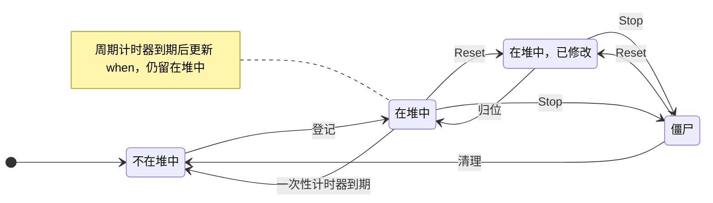

# 9.10 计时器

`time.Sleep`、`time.After`、`time.Timer`、`time.Ticker`、`context.WithTimeout`，以及网络连接的
`SetDeadline`，背后都是同一套**计时器**（timer）机制。它要回答两个问题。其一，同时存在成千上万个计时器时，
怎样以较低的代价登记、取消计时器，并随时知道最早到期的是哪一个；这是一个数据结构问题。其二，
计时器到期时由谁来执行它的动作；这是一个调度问题。Go 对第二个问题的回答几经改写：最初由一个专门的
goroutine 负责，后来交给了每个 P 与调度循环，不再为计时器保留专门的线程。这一节先介绍经典的计时器算法，
再沿着 Go 的演进展开当前的实现。

## 9.10.1 计时器算法

Varghese 与 Lauck 把一个计时器模块抽象为四个例程
[[Varghese and Lauck, 1987](#ref-varghese-and-lauck-1987)]：

- `START_TIMER`：登记一个在给定间隔之后到期的计时器；
- `STOP_TIMER`：在到期之前取消一个计时器；
- `PER_TICK_BOOKKEEPING`：每个时钟滴答（tick）检查是否有计时器到期；
- `EXPIRY_PROCESSING`：执行到期计时器的动作。

前两个例程由使用者调用，后两个由时钟驱动。这篇论文着眼于网络协议。重传、
超时一类的计时器用来发现「某个预期的动作没有在规定时间内发生」，故障不多时，它们很少真正到期，
大多在到期之前就被取消了。因此取消与登记一样频繁，每个滴答的检查则无论有无计时器到期都要进行，
三者都需要便宜。论文比较的几种方案如下：

| 方案 | `START_TIMER` | `STOP_TIMER` | `PER_TICK_BOOKKEEPING` |
| --- | --- | --- | --- |
| 1：每个计时器一个计数器 | $O(1)$ | $O(1)$ | $O(n)$ |
| 2：有序链表 | $O(n)$ | $O(1)$ | $O(1)$ |
| 3：树或堆 | $O(\log n)$ | $O(1)$ 或 $O(\log n)$ | $O(1)$ |
| 4：简单时间轮 | $O(1)$ | $O(1)$ | $O(1)$ |

方案 1 在每个滴答把所有计时器的计数减一；方案 2 让链表保持有序，每个滴答只看表头，
代价转移到了插入时的查找上；方案 3 用树或堆这样的优先队列把插入降到 $O(\log n)$，
最早到期的计时器始终位于根部。

方案 4 是论文的主角**时间轮**（timing wheel）。它是一个有 $N$ 个槽的环形数组，每个槽代表一个滴答，
每个槽挂一个链表，另有一个指针指向当前时刻。登记一个 $j$ 个滴答之后到期的计时器，就把它挂到指针之后第 $j$
个槽上；每个滴答，指针前进一格，该槽上的计时器全部到期。取消只需从链表中摘除。三个操作都是 $O(1)$，
代价是间隔不能超过 $N$ 个滴答。论文随后给出三种扩展：方案 5 与方案 6 把任意长的间隔散列到一个较小的轮上，
槽内的链表分别保持有序与无序，平均代价仍为 $O(1)$；方案 7 是分层时间轮，像钟表的时针、分针与秒针，
长间隔的计时器先登记在粒度较粗的轮上，随着时间推进逐级迁移到较细的轮上。这种迁移称为级联（cascade）。

时间轮还有一个容易被忽略的前提：它由周期性的滴答驱动，即使没有计时器到期，指针也要一格一格地前进。内核里，
滴答来自时钟中断；用户态的运行时没有现成的滴答，若要维持，就得让一个线程周期性地醒来，这既占用资源，
又妨碍空闲的程序真正睡眠。要让时间轮在空闲时跳过一连串空槽，还需要额外的结构，9.10.7 中 Linux
的位图就是一例。堆则没有这个问题：根部就是最早的到期时间，运行时可以一直睡到那一刻。这是理解 Go
的选择的一个关键，9.10.8 将回到这一点。

## 9.10.2 由来

Go 1.0 的计时器是一个由一把全局锁保护的二叉最小堆，按到期时间排序
[[Go Authors, 2012](#ref-go-authors-2012)]。一个专门的 goroutine `timerproc` 负责到期处理：取出堆顶，
若已到期就执行它的回调，否则睡到堆顶到期为止。它睡眠的方式值得注意：先调用 `entersyscall`，再在一个 note
上调用 `notetsleep`，即像系统调用一样阻塞住所在的线程。换言之，等待计时器要占用一个线程，
每次到期都要先唤醒这个线程，再由它唤醒等待的 goroutine。停止计时器时，`deltimer`
借助计时器中记录的堆下标，立即把它从堆中删除，代价为 $O(\log n)$。

此后的演进可以分为三个阶段。

第一阶段是减少争用。Go 1.2 把二叉堆改为四叉堆 [[Sokolov, 2013](#ref-sokolov-2013)]，
提交说明只说它「在计时器很多时略微提升性能」。Dmitry Vyukov 在 2013 年提出 issue「让计时器更快」，
指出全局锁与 `timerproc` 是瓶颈 [[Vyukov, 2013](#ref-vyukov-2013)]。Go 1.10 采纳了 Aliaksandr Valialkin
的改动，把一个堆拆成 64 个，每个有自己的锁和自己的 `timerproc`，计时器按所在 P 的编号对 64 取模选择堆
[[Valialkin, 2017](#ref-valialkin-2017)]。提交说明举出的场景是：大量并发连接都设置了读写截止时间的
`net/http` 服务器，以及经由 `context.WithTimeout` 隐式创建的大量计时器。源码注释说明了为什么是 64：

> 理想情况下，它应当等于 GOMAXPROCS，但那需要动态地重新分配。当前的取值是内存用量与性能之间的折中，
> 应当能覆盖实际使用中的大多数 GOMAXPROCS 取值。

第二阶段是并入调度器。Ian Lance Taylor 在 2019 年完成的一系列改动把计时器堆移进了 P，
到期处理由调度循环完成，`timerproc` 不复存在；等待最早到期计时器的工作，
交给阻塞在网络轮询器中的线程（[9.9](./poller.md)）。切换到新实现的提交在 GOMAXPROCS 为 12 时测得
`AfterFunc` 基准测试的耗时下降 95.42%，`Ticker` 下降 99.43%，`Sleep` 下降 31.67%
[[Taylor, 2019b](#ref-taylor-2019b)]。提交关联了两个 issue：一个是 Vyukov 在 2013 年提出的 #6239；
另一个是 2018 年报告的 #27707，一个周期为 1 毫秒的 `Ticker` 占用了 20% 至 25% 的 CPU
[[lni, 2018](#ref-lni-2018)]，至今仍未关闭。Go 1.14 的发布说明 [[Go Authors, 2020](#ref-go-authors-2020)]
写道，`time.After`、`time.Tick`、`net.Conn.SetDeadline` 等使用的内部计时器「更加高效，锁争用更少，
上下文切换也更少」。这一版用一个十种取值的状态字段，靠原子的比较并交换协调并发的修改，一直沿用到 Go 1.22。

每个 P 自己负责自己的计时器，随即带来了延迟问题。一个 P 运行着 CPU 密集的 goroutine 时，
没有机会检查自己的计时器，而其他 P 也不替它执行；最终兜底的是 sysmon，它可能每 10 毫秒才醒来一次。Chris
Hines 报告了这个问题 [[Hines, 2020a](#ref-hines-2020a)]。Go 1.15 允许正在寻找工作的 P 窃取正在运行的 P
的计时器 [[Taylor, 2020b](#ref-taylor-2020b)]；Go 1.16 进一步在创建计时器时视需要唤醒一个空闲的 P，
让它阻塞在网络轮询器中等待新计时器到期，并去掉了 sysmon 的兜底作用 [[Hines, 2020b](#ref-hines-2020b)]。
提交中的基准测试 `ParallelTimerLatency` 测量计时器平均迟到的时长：Go 1.14 为 17.3 毫秒，Go 1.15 为
7.9 毫秒，这一改动之后为 0.2 毫秒。

第三阶段是语义的修正。Russ Cox 在 Go 1.23 中重写了计时器的内部结构：每个 P 的计时器状态收进一个独立的
`timers` 类型 [[Cox, 2024a](#ref-cox-2024a)]；十种取值的状态经过一系列合并，
最终简化为每个计时器一把真正的锁加三个状态位 [[Cox, 2024e](#ref-cox-2024e)]。同一系列的改动还修正了
`time.Timer` 与 `time.Ticker` 的两个长期问题：未停止的计时器不能被垃圾回收，以及 `Stop`、`Reset`
返回之后仍可能收到过时的值。9.10.6 专门讨论这两点。

| 版本 | 数据结构 | 到期处理 | 文献 |
| --- | --- | --- | --- |
| Go 1.0 | 一个二叉堆，一把全局锁 | 专门的 goroutine，睡眠时占用一个线程 | [[Go Authors, 2012](#ref-go-authors-2012)] |
| Go 1.2 | 一个四叉堆 | 同上 | [[Sokolov, 2013](#ref-sokolov-2013)] |
| Go 1.10 | 64 个四叉堆，各有一把锁 | 每个堆一个专门的 goroutine | [[Valialkin, 2017](#ref-valialkin-2017)] |
| Go 1.14 | 每个 P 一个四叉堆；停止只打标记，延后清理 | 调度循环与网络轮询器 | [[Taylor, 2019b](#ref-taylor-2019b)] |
| Go 1.15 | 同上 | 可以窃取正在运行的 P 的计时器 | [[Taylor, 2020b](#ref-taylor-2020b)] |
| Go 1.16 | 同上 | 创建计时器时唤醒空闲的 P，sysmon 不再兜底 | [[Hines, 2020b](#ref-hines-2020b)] |
| Go 1.23 | 一把锁加三个状态位；channel 计时器按需入堆 | 同上 | [[Cox, 2024e](#ref-cox-2024e)] |

## 9.10.3 每个 P 的四叉堆

每个 P 的计时器收在 `pp.timers` 中，它的类型是 `timers` [[Go Authors, 2026a](#ref-go-authors-2026a)]。
略去锁与竞态检测的细节，与设计相关的字段如下：

```go
// 每个 P 一份的计时器集合（速写）
type timers struct {
	heap []timerWhen // 按到期时间排序的四叉最小堆

	len     atomic.Uint32 // len(heap) 的原子副本，供其他 P 无锁判空
	zombies atomic.Int32  // 已停止但尚未移出堆的计时器数目

	// wakeTime 由这两个下界算出最早的到期时间，无须加锁
	minWhenHeap     atomic.Int64 // 堆顶的到期时间
	minWhenModified atomic.Int64 // 已修改、尚未在堆中归位的计时器的到期时间下界
}

type timerWhen struct {
	timer *timer
	when  int64 // 冗余保存的到期时间
}
```

`timerWhen` 在指针旁边冗余地保存了到期时间，堆在上浮与下沉时比较的是这个副本，不必解引用每个计时器；这是
Go 1.23 的一项改动，提交说明称它「省去了一次间接访问」[[Cox, 2024d](#ref-cox-2024d)]。单个计时器则是一个
`timer`：

```go
// 单个计时器（速写）
type timer struct {
	mu     mutex       // 保护以下字段
	astate atomic.Uint8 // 最近一次解锁时 state 的原子快照，供快速路径无锁判断
	state  uint8        // 状态位：timerHeaped、timerModified、timerZombie
	isChan bool         // 是否为 time.Timer、time.Ticker 的 channel 计时器

	blocked uint32 // 阻塞在该计时器 channel 上的 goroutine 数目

	when   int64 // 到期时间（单调时钟的纳秒数）
	period int64 // 大于 0 时为周期计时器，每隔 period 触发一次
	f      func(arg any, seq uintptr, delay int64) // 到期时调用，不得阻塞
	arg    any
	seq    uintptr

	ts *timers // 所在的堆；不在任何堆中时为 nil
}
```

`f`、`arg` 与 `seq` 的含义由使用者决定。`time.Sleep` 中 `f` 唤醒睡眠的 goroutine；`time.Timer` 中 `f` 向
channel 发送当前时间；`time.AfterFunc` 中 `f` 启动一个新的 goroutine 执行用户的函数；网络轮询器中 `f`
唤醒等待截止时间的 goroutine，`seq` 用来识别过时的触发（[9.9.4](./poller.md)）。

堆的元素存放在一个数组中，下标为 $i$ 的节点的父节点在 $\lfloor (i-1)/4 \rfloor$，子节点在 $4i+1$ 至
$4i+4$。四叉堆的好处来自堆本身的性质，而不是那次提交的论证。$n$ 个元素的四叉堆高度为 $\log_4 n$，
是二叉堆的一半。插入只需沿着到根的路径上浮，每层比较一次，比较次数因此减半。删除堆顶时元素要下沉，
每层要在四个子节点中找出最小者，比较次数约为 $4\log_4 n = 2\log_2 n$，与二叉堆持平，但层数减半，
要搬移的元素也减半，并且四个子节点在数组中相邻，访问的是一段连续的内存。因此无论插入还是删除，
四叉堆都不比二叉堆差。

登记由 `maybeAdd` 完成。需要入堆时，它把计时器加入当前 P 的堆，而不是别的 P 的堆，为此先用 `acquirem` 把
goroutine 固定在当前的 M 上，以免取得堆的指针之后被调度到别的 P。加入之前，它顺手清理堆的首尾（见
9.10.4）；加入之后，若新计时器早于这个堆原有的最早到期时间，就调用 `wakeNetPoller`：

```go
func wakeNetPoller(when int64) {
	if sched.lastpoll.Load() == 0 {
		// 已有线程阻塞在网络轮询器中：若它等待到的时刻晚于 when，就唤醒它
		pollerPollUntil := sched.pollUntil.Load()
		if pollerPollUntil == 0 || pollerPollUntil > when {
			netpollBreak()
		}
	} else {
		// 没有线程在网络轮询器中，设法唤醒一个空闲的 P 与 M
		wakep()
	}
}
```

被唤醒的线程会重新计算该阻塞多久（[9.9.6](./poller.md)）。此外，运行时维护一个位图 `timerpMask`，记录哪些
P 的堆中可能有计时器：P 进入空闲时若堆为空，就清除它的位；P 被取用时，重新置位。其他 P
据此跳过不可能有计时器的 P。

## 9.10.4 停止、修改与惰性删除

计时器由使用它的 goroutine 停止或修改，而它所在的堆属于登记它的那个 P，两者未必相同。立即从堆中删除，
就要锁住别的 P 的堆，与那个 P 的调度循环争用；还要付出 $O(\log n)$ 的下沉代价。Go 1.0 只有一把全局锁，
立即删除并不额外增加争用；堆分散到各个 P 之后，这笔代价就变得显眼了。

Go 的做法是**惰性删除**（lazy deletion）：停止与修改只改动计时器本身，把堆的整理留给堆的主人。`stop`
给计时器打上 `timerZombie` 标记，并把所在堆的 `zombies` 计数加一；`modify`（`Reset` 经由它实现）修改
`when` 并打上 `timerModified` 标记，若新的时间早于 `minWhenModified`，就更新这个下界并调用
`wakeNetPoller`。对已在堆中的计时器，两者都只锁住计时器自己，不锁堆，也不移动堆中的元素；
不在堆中的计时器被 `Reset` 时，才由 `maybeAdd` 加入当前 P 的堆。三个状态位的含义是：

- `timerHeaped`：计时器位于某个 P 的堆中；
- `timerModified`：`when` 已经改变，但堆中的位置与 `timerWhen` 副本尚未更新；
- `timerZombie`：计时器已经停止，但仍留在堆中（channel 计时器无人等待时也会被这样标记，见 9.10.6）。

后两个位只在 `timerHeaped` 置位时才有意义，并且可以同时置位，表示修改之后又被停止。



被标记的计时器在以下几处得到处理，每一处都持有堆的锁：

- `cleanHead`：登记新计时器之前调用。它先从数组尾部删除僵尸，这不需要调整堆；再检查堆顶，
  若堆顶是僵尸或已修改，就把它移出或下沉到正确的位置，直到堆顶是一个正常的计时器。
- `run`：执行到期计时器时，若堆顶是僵尸或已修改，同样先移出或下沉，再看新的堆顶。
- `adjust`：扫描整个数组，删除所有僵尸，把已修改计时器的新时间写入 `timerWhen` 副本，然后以 $O(n)$
  的代价重建整个堆。只有当最早的已修改计时器已经到期，或者被要求强制执行时，它才会扫描。
- `take`：调小 GOMAXPROCS 时，`procresize` 在停止一切的状态下销毁多余的 P，并把它们的计时器逐个加入当前 P
  的堆，僵尸直接丢弃 [[Taylor, 2019a](#ref-taylor-2019a)]。

强制整理的条件是：当前 P 自己的堆中僵尸超过四分之一。这条规则来自 Go 1.14 发布前的一个改动，
提交的标题是「不要让 P 的计时器堆被已删除的计时器堵塞」[[Taylor, 2020a](#ref-taylor-2020a)]。限于本地 P，
是为了不去争用其他 P 的锁。频繁创建又取消计时器的程序，例如每个请求都调用 `context.WithTimeout`
而请求大多在超时之前完成的服务器，正是靠这条规则让僵尸在堆中所占的比例保持在四分之一左右。

`adjust` 还要处理一个微妙的并发问题。其他 P 会不加锁地调用 `wakeTime`，它返回 `minWhenHeap` 与
`minWhenModified` 中较早的一个，决定网络轮询器最多阻塞多久。`adjust` 扫描之后，`minWhenModified`
应当清零；可是扫描之前清零，扫描期间 `wakeTime` 可能报告一个太晚的时间；扫描之后清零，
又会丢失扫描期间其他 goroutine 对计时器的修改。源码注释给出的解法分四步：

1. 令 `minWhenHeap` 取两个下界中较早的一个，先把正确的 `wakeTime` 固定下来；
2. 把 `minWhenModified` 清零，此后其他 goroutine 的修改会重新更新它；
3. 扫描并处理所有计时器；
4. 把 `minWhenHeap` 改为新的堆顶时间。

`wakeTime` 先读 `minWhenModified`，后读 `minWhenHeap`，与上面的写入顺序配合：读到清零后的
`minWhenModified`，就一定能读到第 1 步写入的 `minWhenHeap`。为了不必在第 3 步锁住每个计时器，`modify`
先把 `timerModified` 写入原子快照 `astate`，再更新 `minWhenModified`，扫描时只需读快照，
就不会漏掉在前两步进行期间发生的修改。

## 9.10.5 到期检查

当前的实现没有专门执行计时器的线程，到期检查分散在调度器已有的路径上。核心是 `timers.check`：

```go
// 执行 ts 中所有已到期的计时器（速写）
func (ts *timers) check(now int64) (rnow, pollUntil int64, ran bool) {
	next := ts.wakeTime() // 无锁读取最早的到期时间
	if next == 0 {
		return now, 0, false // 没有计时器
	}
	if now == 0 {
		now = nanotime()
	}
	// 本地 P 的僵尸超过四分之一时，强制整理
	force := ts == &getg().m.p.ptr().timers && int(ts.zombies.Load()) > int(ts.len.Load())/4
	if now < next && !force {
		return now, next, false // 快速路径：尚未到期，也无须整理
	}

	ts.lock()
	ts.adjust(now, false)
	for len(ts.heap) > 0 {
		if tw := ts.run(now); tw != 0 { // 执行堆顶；未到期时返回它的到期时间
			if tw > 0 {
				pollUntil = tw
			}
			break
		}
		ran = true
	}
	// 执行完计时器之后，重新判断是否需要强制整理
	if ts == &getg().m.p.ptr().timers && int(ts.zombies.Load()) > int(ts.len.Load())/4 {
		ts.adjust(now, true)
	}
	ts.unlock()
	return now, pollUntil, ran
}
```

绝大多数调用走快速路径，只做几次原子读取与比较，不加锁。源码注释提到，把强制整理推迟到执行计时器之后，
在争用激烈时明显更快，「尽管我们并不完全明白原因」。

`run` 在系统栈上执行堆顶的计时器。对周期计时器，它把下一次到期时间设为 `when + period*(1+delay/period)`，
其中 `delay` 是实际执行时刻与 `when` 之差。若执行已经迟到了不止一个周期，中间错过的那些周期被直接跳过，
而不是逐个补上。随后 `run` 释放计时器与堆的锁，调用 `f(arg, seq, delay)`，返回后再重新锁住堆。`f`
运行时既不持有锁，也不在普通的 goroutine 上，所以源码注释要求它「必须是一个行为良好的函数，不得阻塞」。

调度器与计时器的衔接点都在 `runtime/proc.go` 中 [[Go Authors, 2026b](#ref-go-authors-2026b)]，前两处调用
`check`，后两处只读取 `wakeTime`：

- `findRunnable` 一开始就检查当前 P 的计时器。到期的计时器唤醒的 goroutine 被放进本地运行队列，
  随后就能被调度。
- `stealWork` 在工作窃取的最后一轮，对 `timerpMask` 中标记的每个其他 P 调用 `check`，
  替它们执行已到期的计时器。这包括正在运行 CPU 密集代码的 P，正是 Go 1.15 的改动。
- M 在没有 P 的情况下准备阻塞时，`checkTimersNoP` 读取所有 P 的 `wakeTime`，作为阻塞在网络轮询器中的时限。
  到时被唤醒后，M 取得一个 P，再在下一轮 `findRunnable` 中执行计时器。
- P 交还为空闲时，`handoffp` 读取它的 `wakeTime` 并调用 `wakeNetPoller`，确保总有线程会在这个 P
  最早的计时器到期时醒来。

sysmon（[9.8](./sysmon.md)）不执行计时器。它只通过 `timeSleepUntil` 读取最早的到期时间，
用来限制自己深度睡眠的时长。

`time.Sleep` 是最常见的计时器使用者，它的实现有一个值得一提的细节：

```go
func timeSleep(ns int64) {
	if ns <= 0 {
		return
	}
	gp := getg()
	t := gp.timer
	if t == nil { // 每个 goroutine 复用同一个计时器
		t = new(timer)
		t.init(goroutineReady, gp)
		gp.timer = t
	}
	gp.sleepWhen = nanotime() + ns
	gopark(resetForSleep, nil, waitReasonSleep, traceBlockSleep, 1)
}

// 在 goroutine 挂起之后才调用，这时才登记计时器
func resetForSleep(gp *g, _ unsafe.Pointer) bool {
	gp.timer.reset(gp.sleepWhen, 0)
	return true
}
```

计时器不是在 `timeSleep` 中登记的，而是作为 `gopark` 的回调，在 goroutine 已经挂起之后才登记。
源码注释解释了原因：如果睡眠很短而 goroutine 很多，P 可能在这个 goroutine 挂起之前就执行了计时器的回调
`goroutineReady`，去唤醒一个尚未挂起的 goroutine。

## 9.10.6 计时器 channel

`time.NewTimer` 与 `time.NewTicker` 返回的 channel 由计时器的回调 `sendTime` 以非阻塞的方式写入。Go 1.23
之前，这个 channel 是一个容量为 1 的普通缓冲 channel，计时器登记之后就一直留在堆中，直到到期或被停止。
这带来两个问题。

第一，垃圾回收。堆引用着计时器，计时器引用着 channel，所以一个没有停止的计时器在到期之前不能被回收，
没有停止的 `Ticker` 永远不能被回收。在循环中写 `select { case <-time.After(time.Minute): ... }`，
每一轮都会留下一个要一分钟后才能回收的计时器。文档因此建议改用 `NewTimer` 并在用完后调用 `Stop`，
许多代码也养成了 `defer t.Stop()` 的习惯 [[Cox, 2024b](#ref-cox-2024b)]。Vyukov 早在
2014 年就提出过另一种思路：让计时器的 channel 自己记录下一次触发的时间，由接收操作来计算是否已经到期，
而不必把计时器放在堆中 [[Vyukov, 2014](#ref-vyukov-2014)]。

第二，过时的值。计时器可能恰好在 `Stop` 或 `Reset` 之前到期，把一个值放进缓冲区，调用者在 `Stop` 或
`Reset` 返回之后仍可能收到这个属于旧设置的值。正确的用法要求先检查 `Stop` 的返回值，
必要时把缓冲区中的值读掉，这很容易写错。Bryan C. Mills 在 2020 年提议，保证 `Stop`、`Reset`
返回之后不会再收到旧的值 [[Mills, 2020](#ref-mills-2020)]。

Go 1.23 解决了这两个问题。对于第一个问题，channel 计时器只在有 goroutine 阻塞在它的 channel 上时才进入堆，
判断条件在 `needsAdd` 中：

```go
need := t.state&timerHeaped == 0 && t.when > 0 && (!t.isChan || t.blocked > 0)
```

channel 的接收与 `select` 在决定阻塞时调用 `blockTimerChan`，把 `blocked` 加一并在需要时把计时器加入堆；
不再阻塞时调用 `unblockTimerChan`，最后一个等待者离开后，把计时器标记为僵尸，等待清理。没有 goroutine
等待时，计时器不在任何堆中，只被用户的变量引用，变量不可达，计时器就能被回收。若有 goroutine
在计时器到期之后才来接收，接收操作调用 `maybeRunChan`，发现已经到期就当场执行回调。
这时回调晚执行了一段时间，`sendTime` 把这段延迟从发送的时间值中减去。源码注释说，在此期间没有人看过这个
channel，否则发送不会这么晚才发生，所以没有人能分辨出其中的差别。

对于第二个问题，`Stop` 与 `Reset` 的语义改为与无缓冲 channel 一致。Cox 在提交说明中给出了语义模型
[[Cox, 2024c](#ref-cox-2024c)]：

> 表现得如同 channel 是无缓冲的，并由一个与 `Stop`、`Reset` 协调的 goroutine 来供给。

实现上并没有这个额外的 goroutine。channel 仍然带有一个元素的缓冲区，但 `len` 与 `cap` 对计时器 channel
特别处理，总是返回 0，用户除了接收之外无法看到缓冲区中的内容。`Stop` 与 `Reset` 在 `sendLock` 的保护下把
`seq` 加一，正在进行的发送发现序号不符就放弃；随后它们用 `timerchandrain` 清空缓冲区。字段 `isSending`
让它们知道是否拦下了一次正在进行的发送，从而正确地返回 `true`。

下面的程序让计时器在无人接收的情况下到期，再调用 `Reset`：

```go {run=true}
package main

import (
	"fmt"
	"time"
)

func main() {
	t := time.NewTimer(20 * time.Millisecond)
	time.Sleep(50 * time.Millisecond) // 计时器早已到期，但没有人接收

	fmt.Println("len, cap:", len(t.C), cap(t.C))
	fmt.Println("Reset 返回:", t.Reset(20*time.Millisecond))
	select {
	case <-t.C:
		fmt.Println("收到一个陈旧的值")
	default:
		fmt.Println("没有陈旧的值")
	}
	<-t.C
	fmt.Println("收到重置之后的那一次触发")
}
```

在 Go 1.23 及之后的版本中，它的输出是：

```
len, cap: 0 0
Reset 返回: true
没有陈旧的值
收到重置之后的那一次触发
```

计时器在 `Sleep` 期间到期，但没有 goroutine 在等待它，它不在堆中，回调没有执行，channel 中没有值。`Reset`
因此认为自己拦下了这次触发，返回 `true`。在 Go 1.22 及之前的版本中，同一个程序输出 `len, cap: 1 1`、
`Reset 返回: false` 与「收到一个陈旧的值」：值在 `Sleep` 期间就进入了缓冲区，`Reset`
返回之后依然可以收到。这正是 Cox 在提交说明中用来说明行为变化的例子，它最初来自 2015 年的 issue #11513。
Cox 同时指出，检查 `Reset` 返回值的正确写法在两种语义下都能工作。

周期计时器还体现了 9.10.5 中跳过错过周期的规则：

```go {run=true}
package main

import (
	"fmt"
	"time"
)

func main() {
	start := time.Now()
	tk := time.NewTicker(100 * time.Millisecond)

	time.Sleep(350 * time.Millisecond) // 错过了 100、200、300 毫秒三次滴答
	for range 2 {
		v := <-tk.C
		fmt.Printf("收到时刻 %3d ms，值的时刻 %3d ms\n",
			time.Since(start).Round(50*time.Millisecond).Milliseconds(),
			v.Sub(start).Round(50*time.Millisecond).Milliseconds())
	}
}
```

```
收到时刻 350 ms，值的时刻 100 ms
收到时刻 400 ms，值的时刻 400 ms
```

第一次接收发生在 350 毫秒，`maybeRunChan` 当场执行了本应在 100 毫秒触发的回调，`sendTime` 减去
250 毫秒的延迟，所以收到的值是 100 毫秒那一刻的时间。下一次触发时间按整数除法计算为
`100 + 100×(1 + 250/100) = 100 + 100×3`，即 400 毫秒，200 与 300 毫秒的两次滴答被丢弃。`time.NewTicker`
的文档对此的描述是：它会调整时间间隔或丢弃滴答，以适应慢的接收者。Go 1.22 及之前的版本输出相同，
原因却不同：100 毫秒的值早已放进缓冲区，200 与 300 毫秒的发送因缓冲区已满而被丢弃。

新语义只对 `go.mod` 中声明 Go 1.23 及以上版本的主模块生效，旧模块的程序默认得到
`GODEBUG=asynctimerchan=1`，即旧的行为 [[Go Authors, 2024](#ref-go-authors-2024)]。Go 1.27
删除了这个设置，所有程序都使用新语义；此后若仍把它设为旧值，程序会在启动时报错退出
[[Griesemer, 2026](#ref-griesemer-2026)]。

## 9.10.7 与其他系统的比较

Linux 内核同时使用时间轮与树。用于超时的普通计时器挂在时间轮上。Thomas Gleixner 在 Linux 4.8 中重写了它
[[Gleixner, 2016](#ref-gleixner-2016)]，理由与 Varghese 和 Lauck 的观察一脉相承：
时间轮上的绝大多数计时器在到期之前就被取消或重新设置，「它们是超时的保险，
不是用来计量时间的真正的计时器」。新的时间轮分为若干层，每层的粒度是上一层的 8 倍；
计时器一直留在登记时所在的槽中，不再级联到更细的轮，代价是最坏约 12.5% 的误差。
每个槽是否为空记录在一个位图中，找出下一个到期的计时器因此是 $O(1)$ 的
[[Corbet, 2015](#ref-corbet-2015)]。这对无滴答（NOHZ）模式很重要：CPU 长时间空闲之后，
内核不必逐个滴答地追赶时间。要求精确的计时器则使用高精度计时器 hrtimer，它们按到期时间存放在红黑树中
[[Linux kernel, n.d.](#ref-linux-kernel-nd)]。

Netty 的 `HashedWheelTimer` 是散列时间轮的直接实现，文档引用了 Varghese 与 Lauck 的论文，
并说明它为「近似的 I/O 超时调度」而优化：默认每 100 毫秒一个滴答，每轮 512 个槽，每个实例占用一个线程
[[Netty, n.d.](#ref-netty-nd)]。Erlang/OTP 的运行时也使用时间轮，并且与 Go 一样按调度器分片：
「每个调度器线程维护自己的时间轮」，近处的轮有 $2^{14}$ 个槽，每槽一个时钟滴答，覆盖 16 秒多一点的范围，
更远的计时器放在另一个轮上 [[Erlang/OTP, n.d.](#ref-erlang-otp-nd)]。

使用堆或树的系统也不少。libevent 用二叉最小堆 [[libevent, n.d.](#ref-libevent-nd)]，nginx 用红黑树
[[nginx, n.d.](#ref-nginx-nd)]。Java 的 `ScheduledThreadPoolExecutor` 用数组实现的二叉堆，
每个任务记录自己在堆中的下标，以便更快地取消，这与 Go 1.0 的做法相同。它的文档同时提醒，
默认情况下被取消的任务要等到延迟到期才从队列中移除，可能导致被取消的任务无限制地滞留，可以用
`setRemoveOnCancelPolicy` 改为立即移除 [[OpenJDK, n.d.](#ref-openjdk-nd)]。
这正是惰性删除需要一条清理规则的原因，Go 的四分之一规则起的就是这个作用。

总的来看，以超时为主、计时器大多会被取消、能够接受精度损失的场景偏爱时间轮；要求按确切时间排序、
间隔范围不定的场景偏爱堆或树。

## 9.10.8 小结

Go 选择每个 P 一个四叉堆，可以从前面几节归纳出理由。堆不需要周期性的滴答，
运行时可以把最早的到期时间直接作为网络轮询器的阻塞时限，空闲的程序真正处于睡眠状态。堆按
64 位的绝对时间排序，从微秒级的 `Sleep` 到以小时计的截止时间一视同仁，没有轮长与级联的限制。按 P
分片消除了全局锁；惰性删除让停止与修改只需锁住计时器本身，弥补了堆在取消操作上相对于时间轮的劣势。
到期处理并入调度循环之后，不再需要专门的线程，计时器唤醒的 goroutine 直接进入执行该计时器的 P 的运行队列。

这样的设计也有代价。计时器依靠网络轮询器的超时唤醒线程，而 Linux 的 `epoll_wait` 以毫秒为超时单位，不足
1 毫秒的等待会被向上取整为 1 毫秒。`time` 包的文档也写明，Unix 上计时器的精度约为 1 毫秒。Go 1.16 去掉
sysmon 的兜底作用之后，Michael Pratt 测得 `time.Sleep(50 * time.Microsecond)` 的耗时从 86.9 微秒变为
609.8 微秒 [[Pratt, 2021](#ref-pratt-2021)]。Pratt 的分析指出，在此之前，这类短睡眠的到期大多由 sysmon
发现，之后只能等待网络轮询器的超时。Windows 上的同类问题在 Go 1.23 中得到改善：运行时改用高精度计时器唤醒
I/O 完成端口，`Sleep` 等的精度由 15.6 毫秒提高到 0.5 毫秒 [[Go Authors, 2024](#ref-go-authors-2024)]。
高频的 `Ticker` 仍然昂贵，每个滴答都可能要唤醒一个线程，#27707 至今没有关闭。从 Go 1.0 的一个 goroutine
到每个 P 的堆，计时器的每一次改写都在锁争用、唤醒延迟、内存回收与语义清晰之间重新取舍，
而这些取舍最终都落在调度器上。

## 延伸阅读

- <a id="ref-corbet-2015"></a>[Corbet, 2015] Jonathan Corbet. *Reinventing the timer wheel.* LWN.net,
  2015-06-03. https://lwn.net/Articles/646950/
- <a id="ref-cox-2024a"></a>[Cox, 2024a] Russ Cox. runtime: move per-P timers state into its own struct.
  Go commit adc575e64c, 2024. https://go.dev/cl/564132
- <a id="ref-cox-2024b"></a>[Cox, 2024b] Russ Cox. time: garbage collect unstopped Tickers and Timers. Go
  commit 508bb17edd, 2024. https://go.dev/cl/512355
  修复 issue #8898 与 #61542，随 Go 1.23 发布。
- <a id="ref-cox-2024c"></a>[Cox, 2024c] Russ Cox. time: avoid stale receives after Timer/Ticker
  Stop/Reset return. Go commit 966609ad9e, 2024. https://go.dev/cl/568341
  修复 issue #37196，随 Go 1.23 发布。
- <a id="ref-cox-2024d"></a>[Cox, 2024d] Russ Cox. runtime: move whenHeap into heap slice. Go commit
  bb7a29991c, 2024. https://go.dev/cl/574896
- <a id="ref-cox-2024e"></a>[Cox, 2024e] Russ Cox. runtime: clean up timer state. Go commit 6135651867,
  2024. https://go.dev/cl/570335
  以真正的锁取代兼作锁的状态字，确立 `timerHeaped`、`timerModified` 等状态位；随 Go 1.23 发布。
- <a id="ref-erlang-otp-nd"></a>[Erlang/OTP, n.d.] Ericsson AB. `erts/emulator/beam/time.c`.
  https://github.com/erlang/otp/blob/master/erts/emulator/beam/time.c
  文件开头的注释描述了每个调度器线程的时间轮。
- <a id="ref-gleixner-2016"></a>[Gleixner, 2016] Thomas Gleixner. *timers: Switch to a non-cascading
  wheel.* Linux commit 500462a9de65, 2016. https://git.kernel.org/torvalds/c/500462a9de65
  随 Linux 4.8 发布。
- <a id="ref-go-authors-2012"></a>[Go Authors, 2012] The Go Authors. `runtime/time.goc`（Go 1.0）.
  https://github.com/golang/go/blob/release-branch.go1/src/pkg/runtime/time.goc
  全局二叉堆、`timerproc` 与 `deltimer`。
- <a id="ref-go-authors-2020"></a>[Go Authors, 2020] The Go Authors. Go 1.14 Release Notes, 2020.
  https://go.dev/doc/go1.14
- <a id="ref-go-authors-2024"></a>[Go Authors, 2024] The Go Authors. Go 1.23 Release Notes, 2024.
  https://go.dev/doc/go1.23
  计时器无缓冲 channel、可被立即 GC；Windows 上计时器精度的改善。
- <a id="ref-go-authors-2026a"></a>[Go Authors, 2026a] The Go Authors. *runtime/time.go*（`type timers`、
  `addHeap`、`check`、`take`）. https://github.com/golang/go/blob/master/src/runtime/time.go
  另含 `time/sleep.go`、`time/tick.go` 与 `runtime/chan.go` 中的计时器 channel 部分（本节对照
  Go 1.26）。
- <a id="ref-go-authors-2026b"></a>[Go Authors, 2026b] The Go Authors. `runtime/proc.go`（`findRunnable`、
  `stealWork`、`checkTimersNoP`、`wakeNetPoller`、`pidleput`）.
  https://github.com/golang/go/blob/master/src/runtime/proc.go
- <a id="ref-griesemer-2026"></a>[Griesemer, 2026] Robert Griesemer. runtime: remove asynctimerchan
  GODEBUG setting. Go commit a5bc606a68, 2026. https://go.dev/cl/781580
  对应 issue #76472，随 Go 1.27 发布；另见 https://go.dev/doc/godebug 。
- <a id="ref-hines-2020a"></a>[Hines, 2020a] Chris Hines. golang/go#38860. *runtime: CPU bound goroutines
  cause unnecessary timer latency.* 2020. https://github.com/golang/go/issues/38860
- <a id="ref-hines-2020b"></a>[Hines, 2020b] Chris Hines. runtime: reduce timer latency. Go commit
  8fdc79e18a, 2020. https://go.dev/cl/232298
  随 Go 1.16 发布。
- <a id="ref-libevent-nd"></a>[libevent, n.d.] libevent. `minheap-internal.h`.
  https://github.com/libevent/libevent/blob/master/minheap-internal.h
- <a id="ref-linux-kernel-nd"></a>[Linux kernel, n.d.] The Linux Kernel. *hrtimers - high-resolution
  kernel timers.* https://www.kernel.org/doc/html/latest/timers/hrtimers.html
- <a id="ref-lni-2018"></a>[lni, 2018] lni. golang/go#27707. *time: excessive CPU usage when using Ticker
  and Sleep.* 2018. https://github.com/golang/go/issues/27707
  Go 1.14 每 P 计时器的动因之一，至今仍未关闭。
- <a id="ref-mills-2020"></a>[Mills, 2020] Bryan C. Mills. golang/go#37196. *time: make Timer/Ticker
  channels not receivable with old values after Stop or Reset returns.* 2020.
  https://github.com/golang/go/issues/37196
- <a id="ref-netty-nd"></a>[Netty, n.d.] Netty. *HashedWheelTimer*（基于 Varghese-Lauck）.
  https://netty.io/4.1/api/io/netty/util/HashedWheelTimer.html
- <a id="ref-nginx-nd"></a>[nginx, n.d.] nginx. `src/event/ngx_event_timer.c`.
  https://github.com/nginx/nginx/blob/master/src/event/ngx_event_timer.c
- <a id="ref-openjdk-nd"></a>[OpenJDK, n.d.] OpenJDK.
  `java/util/concurrent/ScheduledThreadPoolExecutor.java`.
  https://github.com/openjdk/jdk/blob/master/src/java.base/share/classes/java/util/concurrent/ScheduledThreadPoolExecutor.java
- <a id="ref-pratt-2021"></a>[Pratt, 2021] Michael Pratt. Comment on golang/go#44343, 2021.
  https://github.com/golang/go/issues/44343#issuecomment-780845628
  原因分析见同一 issue 的 https://github.com/golang/go/issues/44343#issuecomment-780894325 。
  Windows 上的问题由 Quim Muntal 的 Go commit cf52e70997（<https://go.dev/cl/488675>）在 Go 1.23 中
  修复。
- <a id="ref-sokolov-2013"></a>[Sokolov, 2013] Sokolov Yura. *time: make timers heap 4-ary.* 2013.
  https://golang.org/cl/13094043
  随 Go 1.2 发布；Go commit https://github.com/golang/go/commit/fcf6a7e5ceb79f771bcf8e783c85535bfaad4f9c
- <a id="ref-taylor-2019a"></a>[Taylor, 2019a] Ian Lance Taylor. *runtime: handle timers on P's in
  procresize/(\*pp).destroy.* 2019. https://go-review.googlesource.com/c/go/+/171828
  Go 1.14 每 P 计时器系列改动之一。
- <a id="ref-taylor-2019b"></a>[Taylor, 2019b] Ian Lance Taylor. runtime: switch to using new timer code.
  Go commit 6becb03334, 2019. https://go.dev/cl/171883
  随 Go 1.14 发布。
- <a id="ref-taylor-2020a"></a>[Taylor, 2020a] Ian Lance Taylor. runtime: don't let P's timer heap get
  clogged with deleted timers. Go commit 641e61db57, 2020. https://go.dev/cl/214299
  随 Go 1.14 发布。
- <a id="ref-taylor-2020b"></a>[Taylor, 2020b] Ian Lance Taylor. runtime: steal timers from running P's.
  Go commit 9b90491e4a, 2020. https://go.dev/cl/232199
  随 Go 1.15 发布。
- <a id="ref-valialkin-2017"></a>[Valialkin, 2017] Aliaksandr Valialkin. *runtime: improve timers
  scalability on multi-CPU systems.* 2017. https://go-review.googlesource.com/34784
  随 Go 1.10 发布，64 个桶。
- <a id="ref-varghese-and-lauck-1987"></a>[Varghese and Lauck, 1987] George Varghese, Anthony Lauck.
  "Hashed and Hierarchical Timing Wheels: Data Structures for the Efficient Implementation of a Timer
  Facility." *SOSP 1987*, pp. 25-38；*IEEE/ACM Trans. Networking* 5(6), 1997.
  https://doi.org/10.1145/41457.37504
  期刊版：https://doi.org/10.1109/90.650142
- <a id="ref-vyukov-2013"></a>[Vyukov, 2013] Dmitry Vyukov. *runtime: make timers faster*. Go issue #6239,
  2013. https://golang.org/issue/6239 （单一全局计时器堆的扩展性瓶颈，后续每 P 化的动因）
- <a id="ref-vyukov-2014"></a>[Vyukov, 2014] Dmitry Vyukov. golang/go#8898. *runtime: special case timer
  channels.* 2014. https://github.com/golang/go/issues/8898
- 本书 [9.9 网络轮询器](./poller.md)、[9.8 系统监控](./sysmon.md)、[9.4 调度循环](./schedule.md)。
