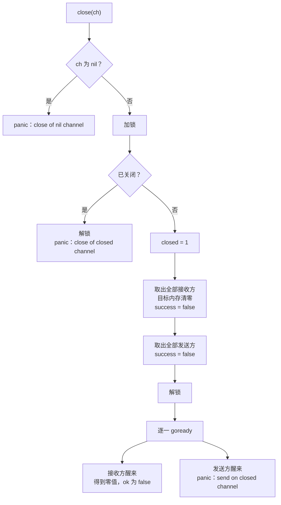
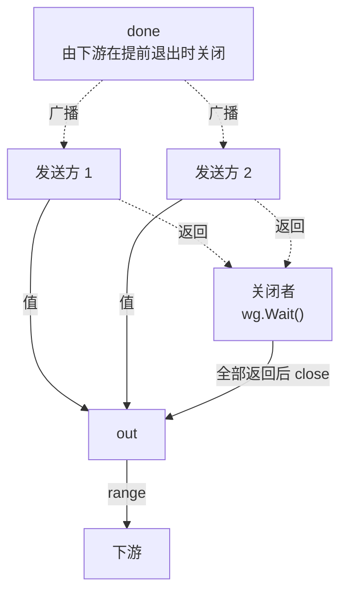

# 10.4 关闭的语义

[10.3](./sendrecv.md) 讨论的发送与接收都是一对一的：一次发送与一次接收配对，先到的一方等待后到的一方。
关闭是 channel 上唯一的一对多操作。一次 `close(ch)` 唤醒所有阻塞在这个 channel 上的 goroutine，
等待接收的各自得到零值，等待发送的各自 panic；此后的接收不再阻塞。规范对关闭的定义只有一句：`close`
记录「不会再有值发送到这个 channel 上」[[Go Authors, 2026a](#ref-go-authors-2026a)]。
因此关闭不是释放资源，而是发送方发出的一条消息，所有接收方都能收到它，而且无论接收多少次都能收到。

本节先看运行时如何实现关闭（10.4.1），再看关闭之后的接收与 `for range` 的结束（10.4.2），然后讨论关闭
作为广播的用法（10.4.3）、三种误用及其 panic（10.4.4），最后讨论应当由谁来关闭（10.4.5）。

## 10.4.1 closechan 做了什么

编译器把 `close(ch)` 翻译为对运行时函数 `closechan` 的调用。除去入口处的 nil 检查与最后的唤醒，
它的工作都在一次加锁中完成：检查是否已经关闭，把 `closed` 置为 1，再取出两个等待队列中的全部 goroutine。
下面是 Go 1.26 中的实现 [[Go Authors, 2026b](#ref-go-authors-2026b)]：

```go
// closechan 关闭 c（Go 1.26，略去竞态检测、阻塞剖析与 synctest 的处理）
func closechan(c *hchan) {
	if c == nil {
		panic(plainError("close of nil channel"))
	}

	lock(&c.lock)
	if c.closed != 0 {
		unlock(&c.lock)
		panic(plainError("close of closed channel"))
	}
	c.closed = 1

	var glist gList

	// 释放所有接收方
	for {
		sg := c.recvq.dequeue()
		if sg == nil {
			break
		}
		if sg.elem.get() != nil {
			typedmemclr(c.elemtype, sg.elem.get()) // 替接收方写入零值
			sg.elem.set(nil)
		}
		gp := sg.g
		gp.param = unsafe.Pointer(sg)
		sg.success = false // 这次唤醒不是来自一次发送
		glist.push(gp)
	}

	// 释放所有发送方，它们醒来后会 panic
	for {
		sg := c.sendq.dequeue()
		if sg == nil {
			break
		}
		sg.elem.set(nil)
		gp := sg.g
		gp.param = unsafe.Pointer(sg)
		sg.success = false
		glist.push(gp)
	}
	unlock(&c.lock)

	// 释放锁之后再唤醒
	for !glist.empty() {
		gp := glist.pop()
		gp.schedlink = 0
		goready(gp, 3)
	}
}
```

[10.3](./sendrecv.md) 的原则在这里推广到了一对多：关闭者是最后到达的一方，
它替每一个等待中的接收方完成接收。接收方阻塞之前已把目标地址记在 `sudog.elem` 中，`closechan` 用
`typedmemclr` 把那里清零，这就是接收方得到的零值；`success` 置为假，接收方醒来后据此把 `ok` 报告为
`false`。接收方醒来后不必再加锁，也不必拷贝，读出 `success` 便返回。

发送方的操作则无法代为完成，因为它的值已经无处可去。`closechan` 只把它唤醒，并把 `success` 置为假。
发送方醒来后检查这个标志（[10.3.3](./sendrecv.md)）：若为假，先确认 `c.closed` 确实非零，
否则以「chansend: spurious wakeup」终止程序，然后 panic，信息与直接向已关闭 channel 发送时相同。阻塞在
`select` 中的发送也是如此，`selectgo` 发现被选中的发送 case 没有成功，就转到同一个
panic（[10.5](./select.md)）。

置位与清空队列在同一次加锁中完成，因此不会有 goroutine 在队列清空之后才排进来，从而错过这次关闭：
此后的任何收发都要先获取同一把锁，看到的 `closed` 已经是 1。被取出的 goroutine 先收集在局部的 `glist` 中，
释放 channel 的锁之后才逐一调用 `goready`，原因是 [10.2.6](./impl.md) 介绍的加锁次序：持有 channel
的锁时不得改变另一个 goroutine 的状态，否则可能与栈收缩形成死锁。`closechan` 原本在锁内逐个唤醒，
是当时唯一违反这一次序的地方，Austin Clements 在 2016 年把它改成了现在的形式
[[Clements, 2016](#ref-clements-2016)]。

`closed` 只会从 0 变为 1，运行时中没有任何路径把它改回 0。这一单调性使不加锁地读取 `closed` 成为可能：
一旦读到「已关闭」，这个事实便永远成立。[10.3.5](./sendrecv.md) 中非阻塞操作的快速路径，
以及「已关闭且为空」时不加锁直接返回零值的优化，都依赖这一点。



## 10.4.2 关闭之后的接收

关闭不会丢弃缓冲区中的值。规范规定，调用 `close` 之后，接收操作先取得此前发送的值，取完之后才返回零值且
不再阻塞 [[Go Authors, 2026a](#ref-go-authors-2026a)]。`chanrecv` 在持锁之后的判断次序保证了这一点
（[10.3.4](./sendrecv.md)）：只有「已关闭」与「缓冲区为空」同时成立，才立即返回零值；缓冲区中还有值时，
照常从队首取出。已关闭的 channel 上不会再有等待的发送方，`closechan` 已经把它们全部释放，之后的发送又会
直接 panic，所以缓冲区中剩下的值就是最后一批，取完即止。

```go {run=true}
package main

import "fmt"

func main() {
	ch := make(chan int, 3)
	ch <- 1
	ch <- 2
	close(ch)
	fmt.Println("关闭之后 len =", len(ch))

	for range 4 {
		v, ok := <-ch
		fmt.Println(v, ok)
	}

	words := make(chan string, 2)
	words <- "a"
	words <- "b"
	close(words)
	for w := range words {
		fmt.Println(w)
	}
	fmt.Println("range 结束")
}
```

```
关闭之后 len = 2
1 true
2 true
0 false
0 false
a
b
range 结束
```

规范对 `ok` 的定义是：收到的值来自一次成功的发送时为 `true`，是因 channel 已关闭且为空而产生的零值时为
`false` [[Go Authors, 2026a](#ref-go-authors-2026a)]。可见 `ok` 回答的并不是「channel 是否已关闭」：
上例中关闭之后取出的两个缓冲值，`ok` 仍为 `true`。Go 也没有提供单独查询「是否已关闭」的操作。早年的
`closed(c)` 须在接收之后另行调用，2011 年被一次完成的 `v, ok := <-c` 取代（[10.1.5](./model.md)）。
在并发程序中，这类查询本来也只能回答过去某一时刻的状态，等到调用者据此行动时，结论可能已经过时。

`for v := range ch` 的结束条件也由此而来。编译器把它改写为一个循环，每一轮执行一次带 `ok` 的接收，`ok` 为
`false` 时退出 [[Go Authors, 2026c](#ref-go-authors-2026c)]：

```go
// for v := range ch { ... } 的改写（示意）
for {
	hv1, hb := <-ch
	if !hb {
		break
	}
	v = hv1
	// 循环体
	hv1 = 零值 // 以免阻塞在下一次接收时仍引用上一个值（issue #15281）
}
```

因此，循环在 channel 关闭且缓冲区取空时结束。对一个永不关闭的 channel，`range` 在取完最后一个值之后会一直
阻塞下去。

这一设计可以追溯到 Hoare 1978 年的 CSP 论文。论文中的重复命令允许以输入命令作守卫，例如
`*[c:character; west?c → east!c]` 反复从进程 `west` 读入字符并转发给 `east`。按论文的规定，
输入命令在其来源进程终止时失败，以输入为守卫的重复命令在所有来源都终止之后随之终止
[[Hoare, 1978](#ref-hoare-1978)]。CSP 按进程名通信，「来源已经终止」是可以观察到的事实。Go 的 channel 与
goroutine 相互独立：一个 goroutine 退出了，并不说明不会再有值发往它曾经使用的 channel，同一个 channel
上可能还有其他发送方。因此「不会再有值」必须由发送方显式声明，这就是 `close`。Hoare
本人在论文的讨论部分也承认，这种自动终止虽然方便，却「当然不是原语」，同样的效果可以通过显式交换 `end()`
信号得到，只是相当不便。Go 的做法介于两者之间：结束的通知是显式的，接收方的循环却仍然自动结束。

## 10.4.3 关闭作为广播

一次发送只能唤醒一个接收方。要通知 $n$ 个 goroutine，用发送就要发 $n$ 次，而且必须事先知道 $n$。
关闭则一次唤醒所有等待者，此后到达的接收也立即返回，所以通知方既不必知道有多少接收方，
也不必关心它们何时开始等待。Sameer Ajmani 在介绍流水线的文章中，正是用关闭来通知「数量未知且没有上限」的
goroutine 停止发送，并称这次关闭实际上是一个广播信号 [[Ajmani, 2014a](#ref-ajmani-2014a)]。这样的 channel
通常不传递数据，元素类型为 `struct{}`，习惯上称为 done channel。下面的程序等三个 goroutine 都阻塞在同一个
done channel 上之后（等待的办法与 [10.3.6](./sendrecv.md) 相同），用一次 `close` 唤醒全部三个：

```go {run=true}
package main

import (
	"fmt"
	"runtime"
	"strings"
	"sync"
)

// blocked 等到恰有 n 个 goroutine 停在给定的等待状态上。
func blocked(state string, n int) {
	buf := make([]byte, 1<<16)
	for strings.Count(string(buf[:runtime.Stack(buf, true)]), "["+state+"]") != n {
		runtime.Gosched()
	}
}

func main() {
	done := make(chan struct{})
	var wg sync.WaitGroup
	woke := make([]bool, 3)
	for i := range 3 {
		wg.Go(func() {
			<-done
			woke[i] = true
		})
	}
	blocked("chan receive", 3)
	fmt.Println("三个 goroutine 都阻塞在 <-done 上")

	close(done)
	wg.Wait()
	fmt.Println("一次 close 之后：", woke)

	_, ok := <-done
	fmt.Println("此后的接收立即返回，ok =", ok)
}
```

```
三个 goroutine 都阻塞在 <-done 上
一次 close 之后： [true true true]
此后的接收立即返回，ok = false
```

done channel 传递的不只是一个事件。内存模型规定，channel 的关闭同步先于因关闭而返回零值的接收
（[10.1.3](./model.md)）[[Go Authors, 2022](#ref-go-authors-2022)]，所以关闭方在 `close` 之前写入的数据，
接收方在收到关闭之后一定能看到。done channel 因此也可以用来发布数据：先写好结果，再关闭 channel，
所有等待者醒来后都能读到这份结果。在竞态检测器中，这条规则体现为 `closechan` 对 channel 执行的一次
`racerelease`，以及它为每个被唤醒的 goroutine 执行的 `raceacquireg`。

关闭是一次性的。channel 不能重新打开，重复关闭会 panic（10.4.4），因此一个 channel 只能广播一次；
需要多次通知时，只能每次准备一个新的 channel，或者改用条件变量（[11.4.6](../ch11sync/cond.md)）。`context`
的取消恰好是一次性的事件，与关闭的语义相合 [[Ajmani, 2014b](#ref-ajmani-2014b)]。每个可取消的
context 持有自己的 done channel，在第一次调用 `Done` 时才创建；`cancel` 在互斥锁内检查是否已经取消，
保证只关闭一次，若还没有人调用过 `Done`，就存入一个预先关闭的共享 channel 代替；取消沿 context
树向下传播时，每个后代关闭各自的 channel（[11.8](../ch11sync/context.md)）。

## 10.4.4 三种误用与 panic

关闭涉及三种运行时 panic：

| 误用 | 检出位置 | panic 信息 |
| --- | --- | --- |
| 向已关闭的 channel 发送 | `chansend` 持锁后检查 `closed`；阻塞的发送方醒来后检查 `success`；`selectgo` 中被选中的发送 case | `send on closed channel` |
| 关闭已关闭的 channel | `closechan` 持锁后检查 `closed` | `close of closed channel` |
| 关闭 nil channel | `closechan` 入口检查 `c == nil` | `close of nil channel` |

此外，对只能接收的 channel 调用 `close` 在编译期就被拒绝（[10.1.1](./model.md)）。

这三种 panic 都是普通的运行时 panic：panic 的值实现了 `runtime.Error`，`chansend` 与 `closechan` 在 panic
之前已经释放了 channel 的锁，channel 的状态是一致的，`recover` 可以照常捕获它们。2011 年
1 月以前并非如此：向已关闭 channel 的发送起初被静默忽略，累计到一定次数后，
运行时以无法捕获的致命错误终止程序，这正是那一年的修改所要解决的问题（[10.1.5](./model.md)）。

```go {run=true}
package main

import (
	"fmt"
	"runtime"
)

func try(name string, f func()) {
	defer func() {
		r := recover()
		_, isRuntimeError := r.(runtime.Error)
		fmt.Printf("%s：%v（runtime.Error：%t）\n", name, r, isRuntimeError)
	}()
	f()
}

func main() {
	ch := make(chan int, 1)
	close(ch)
	try("向已关闭的 channel 发送", func() { ch <- 1 })
	try("再次关闭", func() { close(ch) })

	var nilCh chan int
	try("关闭 nil channel", func() { close(nilCh) })

	fmt.Println("程序继续执行")
}
```

```
向已关闭的 channel 发送：send on closed channel（runtime.Error：true）
再次关闭：close of closed channel（runtime.Error：true）
关闭 nil channel：close of nil channel（runtime.Error：true）
程序继续执行
```

能够恢复，不等于应当恢复。这三种情况都说明程序对 channel 的归属判断有误，而不是运行环境出了意外：
向已关闭的 channel 发送，说明发送方不知道「不会再有值」已经被宣布；重复关闭，
说明有两方都认为自己负责收尾；关闭 nil channel，多半是变量没有初始化。可以这样理解语言为何选择 panic：
若静默忽略，发送语句的完成就不再意味着值已被接收或进入缓冲区，错误会表现为下游莫名缺失的数据；
若返回错误值，每一次发送都要多处理一个正确的程序中不会出现的结果。立即 panic，则把错误暴露在它发生的地方。

更根本的是，用 `recover` 兜住「向已关闭的 channel 发送」并不能修复程序。发送与关闭之间若没有同步先于关系，
程序就存在数据竞争：竞态检测器把发送记作对 channel 的读，把关闭记作写，
即使某次运行中发送恰好先于关闭完成、没有 panic，`go run -race` 也会报告这一对操作
（[10.3.5](./sendrecv.md)）。接收与关闭并发则不算竞争，关闭本来就是为了通知接收方。
检测器用来记录这些读写的地址是 `hchan` 中特意选定的字段，它避开了 `len` 与 `cap` 读取的两个计数，所以
`len`、`cap` 与关闭并发执行也不算竞争；Go 1.11 曾把这种情形误报为竞争，Go 1.11.1 予以修正
[[Randall, 2018](#ref-randall-2018)]。

## 10.4.5 由谁关闭

上面的分析归结为一条惯例：由发送方关闭 channel，接收方永远不关闭。Go 教程的表述是「只有发送方才应关闭
channel，接收方永远不应关闭」[[Go Authors, 2026d](#ref-go-authors-2026d)]。理由很直接：「不会再有值」只有
发送方知道；接收方若贸然关闭，仍在发送的一方就会 panic。

这条惯例也反映了关闭的单向性。在 CSP 中，输出命令在目的进程终止时同样失败，
通信的双方都可以用终止告诉对方「不再继续」[[Hoare, 1978](#ref-hoare-1978)]。Go 的关闭只有一个方向，
它只能表达「不会再有值」，channel 上没有表达「不再接收」的操作。接收方想提前退出时，需要另一个反方向的
channel 通知发送方，这正是 done channel 的另一种用途。由接收方关闭 done channel 并不违反惯例，因为在 done
channel 上，接收方才是「停止」这条消息的发送方。

一个 channel 有多个发送方时，任何一个发送方都不能独自关闭它，因为它无从知道其他发送方是否已经发完。Ajmani
给出的做法是另起一个 goroutine 负责关闭，它用 `sync.WaitGroup` 等所有发送方都返回之后再关闭
[[Ajmani, 2014a](#ref-ajmani-2014a)]。下面的 `merge` 把多个输入合并到一个输出 channel，同时用 `done` 支持
提前退出：

```go
func merge(done <-chan struct{}, inputs ...<-chan int) <-chan int {
	out := make(chan int)
	var wg sync.WaitGroup
	for _, c := range inputs {
		wg.Go(func() {
			for v := range c {
				select {
				case out <- v:
				case <-done: // 下游已经不再接收
					return
				}
			}
		})
	}
	go func() {
		wg.Wait() // 所有发送方都已返回，此后不会再有发送
		close(out)
	}()
	return out
}
```

两个 channel 各有一个关闭者：`out` 由等待所有发送方返回的那个 goroutine 关闭，`done` 由下游关闭。



最后，关闭并不是每个 channel 都必需的。Go 教程提醒：channel 不同于文件，通常不需要关闭；
只有必须告诉接收方不会再有值时，例如为了结束一个 `range` 循环，才需要关闭
[[Go Authors, 2026d](#ref-go-authors-2026d)]。一个不再被引用的 channel，无论是否关闭，都会被垃圾回收。
真正的代价落在等待它的 goroutine 上：接收方若在一个永远不会关闭、也不会再有值的 channel 上等待，
就会永远阻塞，它占用的栈和它引用的对象都无法回收。Go 1.26 以实验形式引入的 goroutine 泄漏检测，
识别的正是这类阻塞在不可达的 channel 上的 goroutine（[9.3.4](../ch09sched/mpg.md)）。

## 延伸阅读

- <a id="ref-ajmani-2014a"></a>[Ajmani, 2014a] Sameer Ajmani. *Go Concurrency Patterns: Pipelines and
  cancellation.* The Go Blog, 2014. https://go.dev/blog/pipelines
  done channel 取消模式的原始论述。
- <a id="ref-ajmani-2014b"></a>[Ajmani, 2014b] Sameer Ajmani. *Go Concurrency Patterns: Context.* The Go
  Blog, 2014. https://go.dev/blog/context
  在关闭之上构建的取消传播。
- <a id="ref-clements-2016"></a>[Clements, 2016] Austin Clements. runtime: define lock order between G
  status and channel lock. Go commit d45bf7228f, 2016. https://go.dev/cl/20041
  为 issue #12967 而作，随 Go 1.7 发布。
- <a id="ref-go-authors-2022"></a>[Go Authors, 2022] The Go Authors. *The Go Memory Model.* Version of
  June 6, 2022. https://go.dev/ref/mem#chan
  channel communication 一节，含关闭同步先于因关闭而返回零值的接收这一条。
- <a id="ref-go-authors-2026a"></a>[Go Authors, 2026a] The Go Authors. *The Go Programming Language
  Specification: Close, Receive operator, For statements with range clause.* https://go.dev/ref/spec#Close
- <a id="ref-go-authors-2026b"></a>[Go Authors, 2026b] The Go Authors. *runtime/chan.go.*
  https://github.com/golang/go/blob/master/src/runtime/chan.go
  （`closechan`、`chanrecv`、`chansend` 的关闭分支）本节对照 Go 1.26。
- <a id="ref-go-authors-2026c"></a>[Go Authors, 2026c] The Go Authors.
  *cmd/compile/internal/walk/range.go.*
  https://github.com/golang/go/blob/master/src/cmd/compile/internal/walk/range.go
  （`walkRange` 对 channel 的改写）本节对照 Go 1.26。
- <a id="ref-go-authors-2026d"></a>[Go Authors, 2026d] The Go Authors. *A Tour of Go: Range and Close.*
  https://go.dev/tour/concurrency/4
- <a id="ref-hoare-1978"></a>[Hoare, 1978] C. A. R. Hoare. "Communicating Sequential Processes."
  *Communications of the ACM*, 21(8), 1978. https://doi.org/10.1145/359576.359585
  channel 通信的理论源头。输入输出命令的失败见第 2.3 节，重复命令的终止见第 2.4 节，作者对自动终止的保留见
  第 7.9 节。
- <a id="ref-randall-2018"></a>[Randall, 2018] Keith Randall. runtime: ignore races between close and
  len/cap. Go commit 83dfc3b001, 2018. https://go.dev/cl/135698
  修复 issue #27070，随 Go 1.11.1 与 Go 1.12 发布。
- 本书 [10.3 收发与直接传递](./sendrecv.md)、[10.5 select 的实现](./select.md)、[11.8
  上下文](../../part3concurrency/ch11sync/context.md)、[11.9
  内存一致模型](../../part3concurrency/ch11sync/mem.md).
