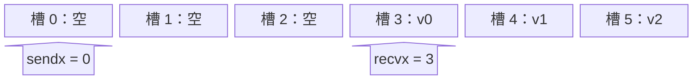

# 10.2 hchan：通道的内部结构

在运行时中，一个 channel 是一个 `hchan` 结构，`make(chan T, n)` 返回的 channel 值只是指向它的指针。这与
`make` 的一般做法一致：`make` 返回的值内部带有隐式的指针 [[Cox, 2009](#ref-cox-2009)]。因此 channel
值可以随意复制、传递，所有副本指向同一个 `hchan`。本节先看 `runtime/chan.go` 开头写明的不变式，再依次介绍
`hchan` 的字段、环形缓冲区、等待队列、`makechan` 的三种分配方式，以及保护这一切的锁。
下文给出的结构体都删去了与讨论无关的字段，完整定义见 `runtime/chan.go` 与 `runtime/runtime2.go`
[[Go Authors, 2026a](#ref-go-authors-2026a)]。

## 10.2.1 三条不变式

`chan.go` 的开头写着 channel 实现所维持的不变式：

- `c.sendq` 与 `c.recvq` 至少有一个为空。唯一的例外是：一个 goroutine 用 `select` 语句同时在同一个无缓冲
  channel 上发送和接收，并因此阻塞；这时两个队列的长度只受这条 `select` 语句大小的限制。
- 对有缓冲 channel，`c.qcount > 0` 蕴含 `c.recvq` 为空。
- 对有缓冲 channel，`c.qcount < c.dataqsiz` 蕴含 `c.sendq` 为空。

这几条的含义很直接。缓冲区中有值时，不应有接收方在等待，因为它本可以取走这个值；缓冲区有空位时，
不应有发送方在等待，因为它本可以放下自己的值；有接收方在等待时，新来的发送方会直接与它配对，
所以发送方不会也去排队。例外来自 `select`：一个 goroutine 不能与自己配对，当它的 `select` 中同时有
`case c <- v` 与 `case <-c` 时，它会同时出现在 `c` 的两个队列中。收发的实现（[10.3](./sendrecv.md)）
处处维持这些不变式：能与等待者配对就配对，能使用缓冲区就使用缓冲区，两者都不行时才进入等待队列。

## 10.2.2 hchan 的结构

```go
type hchan struct {
	qcount   uint           // 缓冲区中现有的元素个数
	dataqsiz uint           // 缓冲区的容量，即 make 的第二个参数
	buf      unsafe.Pointer // 指向可存放 dataqsiz 个元素的数组
	elemsize uint16         // 元素的大小
	closed   uint32         // 是否已关闭
	timer    *timer         // 向这个 channel 发送时间的计时器（若有）
	elemtype *_type         // 元素的类型
	sendx    uint           // 下一次发送写入的位置
	recvx    uint           // 下一次接收读出的位置
	recvq    waitq          // 等待接收的 goroutine
	sendq    waitq          // 等待发送的 goroutine
	bubble   *synctestBubble

	// lock 保护 hchan 的所有字段，以及阻塞在这个 channel 上的 sudog 的若干字段。
	lock mutex
}
```

字段可以分为几组。`qcount`、`dataqsiz`、`buf`、`sendx`、`recvx` 描述环形缓冲区（10.2.3）；`recvq` 与
`sendq` 是两个等待队列（10.2.4）；`closed` 记录关闭状态（[10.4](./close.md)）；`elemsize` 与 `elemtype`
用于复制元素，`elemtype` 还决定了复制时是否需要写屏障。`dataqsiz` 在创建之后不再改变，
因此运行时可以不加锁地读取它；不加锁判断「发送是否会阻塞」的 `full` 与「接收是否会阻塞」的 `empty`
就依赖这一点（[10.3](./sendrecv.md)）。

另外两个字段服务于其他组件。`timer` 只在 `time.NewTimer` 等函数创建的 channel 上不为空：接收时，
运行时借助它检查计时器是否已经到期，若已到期而尚未发送，就当场执行发送（[9.10](../ch09sched/timer.md)）。
`bubble` 记录创建这个 channel 的 `testing/synctest` 气泡（Go 1.25）：气泡之外的 goroutine
对它收发或关闭都会使程序终止，气泡之内阻塞在它上面的 goroutine 则被视为只能由气泡内的其他 goroutine 唤醒，
`synctest` 据此判断何时推进虚拟时钟。

## 10.2.3 环形缓冲区

有缓冲 channel 的元素存放在一个**环形缓冲区**中。`buf` 指向一段能放下 `dataqsiz` 个元素的连续内存，
`sendx` 与 `recvx` 是两个下标：发送把元素写到 `sendx` 处，然后让它前进一格；接收从 `recvx` 处读出，
然后让它前进一格；二者到达末尾后回到 0。`qcount` 记录现有元素的个数，缓冲区满即 `qcount == dataqsiz`，
空即 `qcount == 0`。第 `i` 个槽的地址由 `chanbuf` 计算：

```go
func chanbuf(c *hchan, i uint) unsafe.Pointer {
	return add(c.buf, uintptr(i)*uintptr(c.elemsize))
}
```

下图是一个容量为 6、存有 3 个元素的 channel。`recvx` 指向最早写入、下一个被读出的元素，`sendx`
指向下一个空位；槽 5 之后是槽 0。



下标前进时，运行时不取模，而是比较后归零：

```go
c.sendx++
if c.sendx == c.dataqsiz {
	c.sendx = 0
}
```

容量一般不是 2 的幂，取模需要一次除法，比较则不需要。channel 先进先出，
环形缓冲区使入队与出队都只需移动一个下标，不必搬动元素。

早期的实现并非如此。2011 年 4 月之前，缓冲区是一个环形链表，各元素虽然分配在同一块内存中，却靠指针相连。
Russ Cox 把它改成了用下标访问的数组，省去了指针的跟随和存储；这一修改同时去掉了 channel
指向自身内存块的指针。这个自引用构成一个环，而处在环中的内存块不保证能正确执行终结器；当时在一些系统上，
channel 依靠终结器释放操作系统层面的锁，于是这样的 channel 无法被回收 [[Cox, 2011](#ref-cox-2011)]。

无缓冲 channel 的 `dataqsiz` 为 0，没有缓冲区，值总是在两个 goroutine
之间直接传递（[10.3](./sendrecv.md)）。

## 10.2.4 等待队列与 sudog

缓冲区无法完成操作时，例如向满的 channel 发送、从空的 channel 接收，或 channel 根本没有缓冲区，当前
goroutine 就必须等待对方到来。无缓冲 channel 上的收发正是 Hoare 意义上的会合：先到的一方等待后到的一方
[[Hoare, 1978](#ref-hoare-1978)]。等待者排在 `recvq` 或 `sendq` 中，二者都是 `waitq` 类型的双向链表：

```go
type waitq struct {
	first *sudog // 队头：最早进入、最先被唤醒
	last  *sudog // 队尾
}
```

链表的节点是 `sudog`，它表示一个阻塞在某个 channel 上的 goroutine，以及它要发送或接收的元素
[[Go Authors, 2026b](#ref-go-authors-2026b)]：

```go
type sudog struct {
	// 以下字段由该 sudog 所阻塞的 channel 的 hchan.lock 保护。
	g    *g
	next *sudog
	prev *sudog
	elem maybeTraceablePtr // 要发送或接收的元素，可能指向栈

	isSelect bool               // g 是否在执行 select
	success  bool               // true：通信完成；false：因 channel 关闭而被唤醒
	c        maybeTraceableChan // 阻塞在哪个 channel 上
	...
}
```

队列的节点不直接是 `g`，是因为 goroutine 与 channel 之间不是一对一的关系：一条 `select` 语句可以让一个
goroutine 同时阻塞在多个 channel 上，此时它为每个 channel 各准备一个 `sudog`。`elem`
指向的内存往往在等待者自己的栈上，这使发送方可以把值直接写入等待中的接收方的栈，
而不经过缓冲区（[10.3](./sendrecv.md)）。Go 1.26 中，`elem` 与 `c` 的类型是可以对 GC 隐藏的指针，供基于
GC 的 goroutine 泄漏检测使用（[9.3](../ch09sched/mpg.md)）。

`sudog` 并非 channel 专用。运行时的信号量也用 `sudog` 排队，它支撑着 `sync.Mutex`
等同步原语（[11.2](../ch11sync/mutex.md)），上面省略的字段大多是为信号量准备的。`sudog` 经由每个 P
的缓存及一个全局缓存复用，不必每次分配。

入队接在队尾，出队从队头取下。出队时有一处特殊情况：一个执行 `select` 的 goroutine 可能已被另一个 case
唤醒，但还没来得及把自己从其他队列中移除。`dequeue` 遇到这样的节点时，用 `g.selectDone` 上的一次 CAS
判断谁赢得了唤醒它的权利，失败就跳过这个节点：

```go
func (q *waitq) dequeue() *sudog {
	for {
		sgp := q.first
		if sgp == nil {
			return nil
		}
		// ……把 sgp 从队头摘下……
		if sgp.isSelect && !sgp.g.selectDone.CompareAndSwap(0, 1) {
			continue // 这个 goroutine 已被别处唤醒
		}
		return sgp
	}
}
```

队列原本是单向链表。被唤醒的 `select` 必须把自己的 `sudog` 从其余 channel 的队列中移除，在单向链表中，
这需要从头查找。当一个 channel 上排着大量等待者时，逐个移除的总开销可能达到平方级。Keith Randall 在 Go
1.5 中把它改为双向链表，使移除任意节点只需常数时间，在相应的基准测试中，耗时降低了 75.54%
[[Randall, 2014](#ref-randall-2014)]。先进入队列的等待者先被唤醒，这一顺序的意义见
[10.3.6](./sendrecv.md)。

## 10.2.5 makechan 的三种分配方式

`make(chan T, n)` 由编译器翻译为对 `makechan` 的调用。它计算缓冲区的大小，向堆申请内存，并填写元素的信息。
由于总是调用 `mallocgc`，channel 总是分配在堆上。删去调试与 `synctest` 相关代码之后：

```go
func makechan(t *chantype, size int) *hchan {
	elem := t.Elem
	if elem.Size_ >= 1<<16 {
		throw("makechan: invalid channel element type")
	}
	mem, overflow := math.MulUintptr(elem.Size_, uintptr(size))
	if overflow || mem > maxAlloc-hchanSize || size < 0 {
		panic(plainError("makechan: size out of range"))
	}

	var c *hchan
	switch {
	case mem == 0:
		// 无缓冲，或元素大小为 0：不需要缓冲区
		c = (*hchan)(mallocgc(hchanSize, nil, true))
		c.buf = c.raceaddr()
	case !elem.Pointers():
		// 元素不含指针：hchan 与缓冲区一次分配
		c = (*hchan)(mallocgc(hchanSize+mem, nil, true))
		c.buf = add(unsafe.Pointer(c), hchanSize)
	default:
		// 元素含指针：缓冲区单独分配，并带上元素类型
		c = new(hchan)
		c.buf = mallocgc(mem, elem, true)
	}
	c.elemsize = uint16(elem.Size_)
	c.elemtype = elem
	c.dataqsiz = uint(size)
	lockInit(&c.lock, lockRankHchan)
	return c
}
```

三个分支的区别在于 GC 是否需要扫描这块内存。

- `mem == 0` 包括两种情况：无缓冲 channel，以及元素大小为 0 的 channel，如用作信号的 `chan struct{}`。
  二者都不需要缓冲区，只分配一个 `hchan`；`buf` 指向 `hchan` 内部的一个地址，供竞态检测器作为同步地址。
- 元素不含指针时，`hchan` 与缓冲区由一次 `mallocgc` 分配，缓冲区紧接在 `hchan` 之后。
- 元素含指针时，缓冲区必须单独分配，并把元素类型交给分配器，GC 才能找到缓冲区中尚未取走的元素所引用的对
  象。

前两个分支传给 `mallocgc` 的类型是 `nil`，整块内存不会被扫描。值得注意的是，`hchan` 本身也含有指针字段，
它为什么可以不被扫描？源码的注释给出了三条理由：`buf` 指向同一块内存；`elemtype`
指向的类型信息是永久存在的；等待队列中的 `sudog` 由它所属的 goroutine 引用，不会因此被回收。
只有第三个分支用 `new(hchan)` 分配一个需要扫描的 `hchan`，再单独分配需要扫描的缓冲区。

分配次数可以直接观察：

```go {run=true}
package main

import (
	"fmt"
	"testing"
)

var (
	sinkInt    chan int
	sinkPtr    chan *int
	sinkSignal chan struct{}
)

func main() {
	allocs := func(f func()) float64 { return testing.AllocsPerRun(100, f) }
	fmt.Println("make(chan int)          ", allocs(func() { sinkInt = make(chan int) }))
	fmt.Println("make(chan struct{}, 8)  ", allocs(func() { sinkSignal = make(chan struct{}, 8) }))
	fmt.Println("make(chan int, 8)       ", allocs(func() { sinkInt = make(chan int, 8) }))
	fmt.Println("make(chan *int, 8)      ", allocs(func() { sinkPtr = make(chan *int, 8) }))
}
```

```
make(chan int)           1
make(chan struct{}, 8)   1
make(chan int, 8)        1
make(chan *int, 8)       2
```

`elemsize` 是 16 位整数，所以元素必须小于 64 KiB。编译器在编译期检查这一点，`make(chan [1 << 16]byte)`
会得到错误「channel element type too large (>64kB)」，`makechan` 中的检查只是保险。
这一限制在实践中几乎碰不到：大的值应当以指针的形式经由 channel 传递。

## 10.2.6 锁

`hchan` 最后的 `lock` 保护 `hchan` 的所有字段，以及阻塞在这个 channel 上的 `sudog` 的 `g`、`next`、
`prev`、`elem` 等字段。发送、接收、关闭与 `select` 在读写这些状态之前都要先获取它。内存模型对 channel
的保证（[10.1](./model.md)）就是在这把锁的临界区中实现的，详见 [10.6](./lockfree.md)。

这把锁带有一条纪律，写在它的注释中：持有它时不得改变另一个 goroutine 的状态，特别是不得唤醒一个
goroutine，否则可能与栈收缩形成死锁。原因在于加锁的次序。运行时收缩一个阻塞在 channel 上的 goroutine
的栈时，先通过状态中的扫描位锁住这个 goroutine，再获取它所等待的各个 channel 的锁，以便修正 `sudog.elem`
中指向旧栈的指针。如果另一个 goroutine 持有 channel 的锁，又去改变这个 goroutine 的状态，
它就要等待扫描位清除，两方各持一把、各等一把。Austin Clements 在 2016 年为实现并发的栈收缩确定了这一次序，
并修正了当时唯一违反它的 `closechan` [[Clements, 2016](#ref-clements-2016)]。这项工作的起因是 Rhys
Hiltner 报告的 issue #12967：在标记终止期间收缩栈，显著延长了停顿，涉及的正是
[9.11](../ch09sched/numa.md) 中那个拥有大量 goroutine 的程序。因此，发送、
接收与关闭都在持锁时把等待者从队列中摘下，释放锁之后才调用 `goready` 唤醒它们（[10.3](./sendrecv.md)、
[10.4](./close.md)）。

用一把锁保护整个 channel，实现简单，正确性容易论证，代价是同一个 channel 上的并发操作在这把锁上串行。
Dmitry Vyukov 在 2014 年 1 月的设计文档中提出过一系列提速 channel 的办法，目标包括加快无竞争的操作、
有竞争的生产者消费者场景、失败的非阻塞操作与 `select`；文档同时把「让 channel 完全无锁」列为非目标，
理由是这会使实现复杂得多，并让常见情形变慢 [[Vyukov, 2014a](#ref-vyukov-2014a)]。同年 8 月，Vyukov
为失败的非阻塞操作加入了不加锁的快速路径，在 `GOMAXPROCS` 为 4 时耗时降低了 97%
[[Vyukov, 2014b](#ref-vyukov-2014b)]；今天的 `full` 与 `empty` 就是这条快速路径的组成部分。channel
至今仍是一个有锁的结构，此后关于无锁 channel 的尝试见 [10.6](./lockfree.md)。

## 延伸阅读

- <a id="ref-clements-2016"></a>[Clements, 2016] Austin Clements. runtime: define lock order between G
  status and channel lock. Go commit d45bf7228f, 2016. https://go.dev/cl/20041
  关联 issue #12967，随 Go 1.7 发布。
- <a id="ref-cox-2009"></a>[Cox, 2009] Russ Cox. *Go Data Structures.* 2009.
  https://research.swtch.com/godata
- <a id="ref-cox-2011"></a>[Cox, 2011] Russ Cox. runtime: drop chan circular linked list in favor of
  circular buffer. Go commit 507df959e4, 2011. https://github.com/golang/go/commit/507df959e4
  修复 issue #1676。
- <a id="ref-go-authors-2026a"></a>[Go Authors, 2026a] The Go Authors. *runtime/chan.go*（`hchan`、
  `waitq`、 `makechan`、`chanbuf`，含开头的不变式注释）.
  https://github.com/golang/go/blob/master/src/runtime/chan.go
  本节对照 Go 1.26。
- <a id="ref-go-authors-2026b"></a>[Go Authors, 2026b] The Go Authors. *runtime/runtime2.go*（`sudog`
  的定义与字段说明）. https://github.com/golang/go/blob/master/src/runtime/runtime2.go
- <a id="ref-hoare-1978"></a>[Hoare, 1978] C. A. R. Hoare. *Communicating Sequential Processes.*
  Communications of the ACM, 21(8), 1978. https://doi.org/10.1145/359576.359585
- <a id="ref-randall-2014"></a>[Randall, 2014] Keith Randall. runtime: use doubly-linked lists for channel
  send/recv queues. Go commit 8eb8b40a49, 2014. https://github.com/golang/go/commit/8eb8b40a49
  随 Go 1.5 发布。
- <a id="ref-vyukov-2014a"></a>[Vyukov, 2014a] Dmitry Vyukov. *Go channels on steroids*（提速 channel
  的设计，完全无锁被列为非目标）. 2014.
  https://docs.google.com/document/d/1yIAYmbvL3JxOKOjuCyon7JhW4cSv1wy5hC0ApeGMV9s
- <a id="ref-vyukov-2014b"></a>[Vyukov, 2014b] Dmitry Vyukov. runtime: add fast paths to non-blocking
  channel operations. Go commit f6ceefa2bf, 2014. https://github.com/golang/go/commit/f6ceefa2bf
  随 Go 1.4 发布。
- 本书 [10.1 通道与 CSP 的工程化](./model.md)、[10.3 收发与直接传递](./sendrecv.md)、
  [11.9 内存一致模型](../ch11sync/mem.md)、[12 内存分配](../../part4memory/ch12alloc)。
