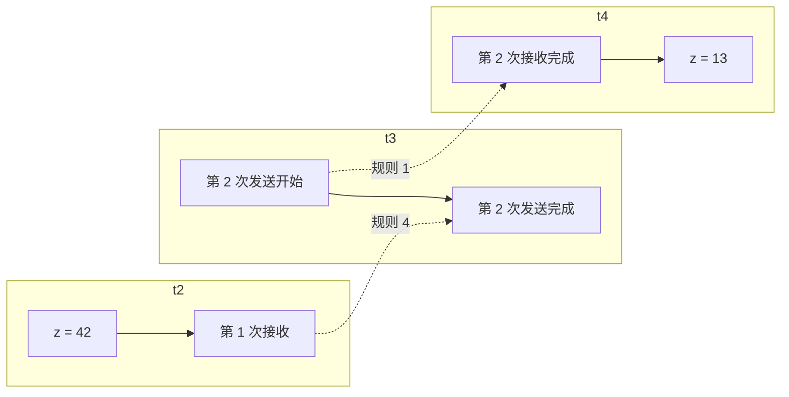

# 10.6 内存模型与无锁演进

[10.1.3](./model.md) 列出了 Go 内存模型为 channel 规定的四条规则。本节讨论它们的确切含义与来历：规则为何都
落在某个操作的「完成」上（10.6.1），无缓冲 channel 为何是双向的同步（10.6.2），关于有缓冲 channel 的第四条
规则如何在 2014 年才被写下（10.6.3），竞态检测器如何把这些规则变成可执行的检查（10.6.4），以及这些规则
连同先来先服务、`select` 与关闭一起，为何使 channel 至今仍由一把锁保护（10.6.5）。

## 10.6.1 规则落在「完成」上

Go 内存模型用三种关系描述 goroutine 之间的可见性 [[Go Authors, 2022](#ref-go-authors-2022)]：同一
goroutine 中，前面的语句在程序次序上先于后面的语句（sequenced before）；同步操作之间存在同步先于关系
（synchronized before）；二者的传递闭包是先行发生（happens before）。一次写入先行发生于一次读取，
读取才保证看到这次写入。channel 的四条规则都是同步先于关系：

1. 一次发送同步先于对应接收的完成。
2. channel 的关闭同步先于因关闭而返回零值的接收。
3. 无缓冲 channel 上的一次接收同步先于对应发送的完成。
4. 容量为 $C$ 的 channel 上，第 $k$ 次接收同步先于第 $k+C$ 次发送的完成。

规则 1、3、4 的后一半都是某个操作的「完成」，规则 2 中因关闭而返回零值的接收，说的也是这次接收的完成。
channel 操作可能阻塞，它有开始，也有完成，二者之间可能相隔任意长的时间。规则承诺的是：等到操作完成，
即接收拿到值、发送返回时，对方在同步点之前的写入才可见。内存模型中的例子是：

```go
var c = make(chan int, 10)
var a string

func f() {
	a = "hello, world"
	c <- 0
}

func main() {
	go f()
	<-c
	print(a)
}
```

对 `a` 的写入在 `f` 中先于发送；发送同步先于 `main` 中接收的完成（规则 1）；接收在 `main` 中先于 `print`。
三段连起来，写入先行发生于读取，程序一定打印 `hello, world`。把 `c <- 0` 换成 `close(c)`，由规则 2
得到同样的保证；关闭作为广播的用法见 [10.4.3](./close.md)。「完成」二字并非修辞，10.6.4 将看到它的后果。

## 10.6.2 无缓冲 channel：双向的同步

规则 3 把方向倒了过来：对无缓冲 channel，接收也同步先于对应发送的完成。把上面的例子交换收发两侧，并改用
无缓冲 channel：

```go
var c = make(chan int)
var a string

func f() {
	a = "hello, world"
	<-c
}

func main() {
	go f()
	c <- 0
	print(a)
}
```

`main` 中的发送要等 `f` 的接收到来才能完成（[10.3.2](./sendrecv.md) 的直接传递），`f` 在接收之前的写入
在发送返回后可见，程序同样一定打印 `hello, world`。若把 `c` 改为 `make(chan int, 1)`，发送把值放进缓冲区
就返回，此时 `f` 可能还没有运行，程序便不再有这一保证 [[Go Authors, 2022](#ref-go-authors-2022)]。

规则 1 与规则 3 合起来，使无缓冲 channel 上的一次通信成为双向的同步：双方各自在通信之前的写入，
在通信完成后都对另一方可见。这正是 Hoare 在 CSP 中定义的通信：相互对应的输入命令与输出命令「同时执行」，
没有自动缓冲，先到的一方要等另一方就绪 [[Hoare, 1978](#ref-hoare-1978)]。Hoare
在论文的讨论部分说明了不提供自动缓冲的两个理由：在多个互不相连的处理器上难以实现；需要缓冲时，
可以用已有的原语写出来。Hoare 也承认，反过来同样可以主张用一对带缓冲的输入与输出来表达同步。Go
两者都提供，内存模型则精确地写出了二者的差别：有了缓冲，从接收到发送这个方向的同步不再逐次成立，而要相隔
$C$ 次才成立，这就是规则 4。

## 10.6.3 有缓冲 channel：相隔 C 次的同步

规则 4 的直观含义是槽位的复用。容量为 $C$ 的缓冲区有 $C$ 个槽位，第 $k+C$ 次发送用的正是第 $k$ 次接收
腾出的槽位，它只能在那次接收之后完成。$C = 0$ 时，规则 4 就是规则 3。下面的程序展示了这种对应：

```go {run=true}
package main

import "fmt"

func main() {
	const C = 3
	c := make(chan struct{}, C)
	send := func(k int) {
		select {
		case c <- struct{}{}:
			fmt.Printf("第 %d 次发送完成\n", k)
		default:
			fmt.Printf("第 %d 次发送不能完成：缓冲区已满\n", k)
		}
	}
	for k := 1; k <= C+1; k++ {
		send(k)
	}
	<-c
	fmt.Println("第 1 次接收完成")
	send(C + 1)
}
```

```
第 1 次发送完成
第 2 次发送完成
第 3 次发送完成
第 4 次发送不能完成：缓冲区已满
第 1 次接收完成
第 4 次发送完成
```

这条规则使有缓冲 channel 可以充当计数信号量（[1.3](../../part1overview/ch01intro/csp.md)）：发送是获取，
接收是释放，容量是可以同时持有的上限。内存模型用这种写法把同时执行的任务数限制为 3，下面改用 Go 1.25
加入的 `sync.WaitGroup.Go` 来写：

```go
var limit = make(chan struct{}, 3)

func run(work []func()) {
	var wg sync.WaitGroup
	for _, w := range work {
		wg.Go(func() {
			limit <- struct{}{} // 获取
			w()
			<-limit // 释放
		})
	}
	wg.Wait()
}
```

除了限制同时执行的任务数，规则 4 还保证，一个任务在释放名额之前的写入，对随后取得这个名额的任务可见。

这条规则是 2014 年才写进内存模型的。此前只有前三条规则，要有内存模型的保证，信号量只能反过来写：先把
channel 填满，用接收获取、用发送释放，这样获取名额的接收与上一个持有者释放名额的发送之间，有规则 1
的保证。Effective Go 当时就是这样写的，并特意说明：由于数据同步发生在从 channel 接收时，
获取信号量必须通过接收，而不能通过发送。然而用发送获取的写法更自然，早已广泛使用，标准库中也有。Dan
Kortschak 在 2013 年 8 月提出 issue，指出 golang-nuts 与 golang-dev 上的讨论认为这种写法并无正式的保证，
尽管它在当时的实现中能正确工作 [[Kortschak, 2013](#ref-kortschak-2013)]。2014 年 3 月，Cox
把这条规则写进了内存模型，同时改写了 Effective Go 中的例子，提交说明写道：「这条规则的缺失已经在
golang-dev 和 issue 中引起过多次讨论。我们曾经公开表示它成立，却从未把它写下来。
现在写下来。」[[Cox, 2014](#ref-cox-2014)]。这次写下的规则方向却是反的：第 $k$ 次发送先行发生于第 $k+C$
次接收的完成。两个多月后，Vyukov 改正了它，并在提交说明中写道：「当前的措辞有两处写反了。
不知道它是怎么拿到 4 个 LGTM 的（其中也有我的一个）。」[[Vyukov, 2014a](#ref-vyukov-2014a)]。前者随 Go
1.3 发布，改正随 Go 1.4 发布。

内存模型中的规则，是对实现早已提供的行为所作的承诺。写下一条规则并不改变任何程序的运行，却决定了程序可以
依赖什么。把承诺写准确并不容易：评审者都清楚这条规则的含义，仍然没有发现措辞写反了。

## 10.6.4 竞态检测器中的规则

运行时在硬件上兑现这些规则的方式很直接：成功的收发几乎都在持有 channel 的锁时完成，锁的获取与释放本身就
排定了内存访问的次序；不加锁的快速路径只在操作失败，或接收已关闭且已取空的 channel 时返回，其中的次序论证
见 [10.3.5](./sendrecv.md)。一把锁提供的次序比内存模型承诺的更强。程序是否只依赖了承诺的部分，要由竞态
检测器来检查。

竞态检测器基于 ThreadSanitizer。它为每个 goroutine 维护一个向量时钟，记录这个 goroutine 已经知道的其他
goroutine 的历史；同步操作在某个地址对应的同步对象中存取时钟，两次访问之间若没有先行发生关系，就报告竞争。
channel 的规则在 `chan.go` 中都有对应的标注 [[Go Authors, 2026](#ref-go-authors-2026)]：

- 无缓冲 channel 上，收发双方由 `racesync` 互相交换时钟，对应规则 1 与规则 3 的双向同步；
- 有缓冲 channel 上，每个槽位的地址充当一个同步对象，发送与接收都通过 `racenotify` 对所用的槽位调用
  `racereleaseacquire`，`select.go` 中的 `bufsend` 与 `bufrecv` 也是如此；
- 关闭时对 channel 调用 `racerelease`，因关闭而返回的接收对同一地址调用 `raceacquire`，对应规则 2。

`racereleaseacquire` 先把当前 goroutine 的时钟存入同步对象，覆盖原有的内容，
再把同步对象中原来的时钟并入自己 [[LLVM Project, 2023](#ref-llvm-project-2023)]。用在槽位上，
它恰好实现了规则 1 与规则 4：第 $k$ 次发送把自己的历史留在槽位中，由第 $k$ 次接收取走；第 $k$
次接收又把自己的历史留下，由第 $k+C$ 次发送取走。存入的是取走之前的时钟，所以第 $k+C$ 次发送取得的历史，
不会随它放入的值传给第 $k+C$ 次接收。这就是规则中「完成」的含义：发送在开始时交出自己的历史，
在完成时才得到上一位使用者的历史。

这个先后次序曾经是反的。2020 年 2 月，Daniel S. Fava 在阅读 `chan.go` 时发现，有缓冲 channel 的收发
先取走、再存入，并给出了一个检测器漏报的程序 [[Fava, 2020a](#ref-fava-2020a)]。下面的版本用睡眠固定了
执行次序；睡眠不建立先行发生关系：

```go
var z int

func main() {
	c := make(chan bool, 1)
	var wg sync.WaitGroup
	wg.Go(func() { c <- true })                                      // t1：第 1 次发送
	wg.Go(func() { z = 42; <-c })                                    // t2：第 1 次接收
	wg.Go(func() { time.Sleep(10 * time.Millisecond); c <- true })   // t3：第 2 次发送
	wg.Go(func() { time.Sleep(20 * time.Millisecond); <-c; z = 13 }) // t4：第 2 次接收
	wg.Wait()
}
```

t2 的接收是第 1 次接收，同步先于 t3 发送的完成（规则 4，$C = 1$）；t3 的发送同步先于 t4 接收的完成（规则
1）。但 t3 的发送开始于它的完成之前，两条关系连不起来，`z = 42` 与 `z = 13` 之间没有先行发生关系，
这是一次数据竞争：



旧的标注让 t3 先取得 t2 留下的历史，再连同自己的历史一起存入槽位，t4 于是知道了 t2 的写入，
检测器不再报告竞争。在 Go 的实现中，t3 的值只能在 t2 腾出槽位之后放入，各次访问又都经过同一把锁，
两次写入事实上是有序的；但这是实现提供的次序，内存模型并不承诺，检测器要检查的是后者。Fava
的修改交换了先后次序，并为此在 ThreadSanitizer 中加入了先存入、再取走的新操作
[[Fava, 2020b](#ref-fava-2020b)] [[Fava, 2020c](#ref-fava-2020c)]，随 Go 1.16 发布。用 Go 1.26 的 `-race`
运行上面的程序，每次都报告这一竞争。

修改合入之后，`cmd/go` 中一段把有缓冲 channel 用作信号量的代码，在竞态检测下偶尔报告竞争，
而代码本身并没有竞争 [[Mills, 2020](#ref-mills-2020)]。原因在于元素大小为零的
channel（这段代码用的是元素类型为 `struct{}` 的 `chan token`）没有真正的缓冲区，所有槽位的地址相同，
共用一个同步对象，按槽位交换历史的做法在这里对应不上规则 4。Go 团队一度准备回滚这一修改，Vyukov
的理由是「误报比漏报糟糕得多」[[Vyukov, 2020](#ref-vyukov-2020)]。最终只对这类 channel 恢复了累积的做法：
每次操作先取走、再连同自己的历史一起存入 [[Fava, 2020d](#ref-fava-2020d)]。对这类 channel，
检测器认定的先行发生关系多于内存模型的承诺，可能漏报，但不会误报；把上面程序中的 `chan bool` 换成
`chan struct{}`，检测器就不再报告。用作信号量的 channel，元素类型通常正是 `struct{}`。

## 10.6.5 为什么 channel 仍是一把锁

[10.2.6](./impl.md) 提到，Vyukov 在 2014 年 1 月的设计文档中把「让 channel 完全无锁」列为非目标。那份设计
要做的，是让常见的路径不再加锁 [[Vyukov, 2014b](#ref-vyukov-2014b)]。有缓冲 channel 的环形缓冲区中，
每个槽位带一个圈数，偶数圈可写、奇数圈可读；发送方用 CAS 推进发送位置，抢到位置者写入槽位，再把圈数加一，
接收方对称地读取。只有需要阻塞时才加锁，操作等待队列，并在入队之后重新检查一次缓冲区，以免错过刚刚到来的
对端。`select` 也不再一次锁住全部 channel，而是逐个 channel 加锁、入队、复查，再用一次 CAS 保证只被唤醒
一次。槽位的圈数与规则 4 描述的是同一件事：一个槽位在第 $k$ 次接收之后，才能被第 $k+C$ 次发送使用。

同年 10 月，Vyukov 提交了 issue #8899 与实现：在一个曾因性能原因放弃 channel、
改用其他同步原语的实际应用上，它带来了 23% 的端到端提速 [[Vyukov, 2014c](#ref-vyukov-2014c)]。这个 issue
至今没有关闭，状态是 Unplanned。Vyukov 本人给出了两个原因。其一，在那份设计中，有缓冲 channel
上被唤醒的接收方与其他接收方平等竞争，抢不到就再次阻塞，这正是 Go 1.6 之前的协议；Go 1.6 的修改
[[Randall, 2015](#ref-randall-2015)]让唤醒者直接完成被唤醒者的操作，解决了 Cox 提出的 issue #11506
[[Cox, 2015](#ref-cox-2015)]，实现从此提供先来先服务（[10.3.6](./sendrecv.md)）。Vyukov 在 2016 年写道，
在这次关于公平的修改之后，自己的算法已不再适用，因为它不具备现有代码提供的公平性质
[[Vyukov, 2016a](#ref-vyukov-2016a)]。其二，这项工作「一再让位于运行时的其他改动，因而不断过时」，Vyukov
没能跟上，主要的问题变成了把它移植到新的运行时代码上 [[Vyukov, 2017](#ref-vyukov-2017)]。

后来的提议遇到的是同样的要求。2016 年，有人在这个 issue 中展示了一个用户态的无锁 channel，Vyukov
指出了它的问题：不是先进先出；收发可能无故失败；`len` 可能返回 -1；不能告诉调度器何时阻塞、何时唤醒
goroutine；`select` 同样如此 [[Vyukov, 2016b](#ref-vyukov-2016b)]。2022 年又有类似的提议，Taylor
的回复是：「channel 不只是线程安全的队列，它们还要处理 select 语句与 close
函数。」[[Taylor, 2022](#ref-taylor-2022)]。

这把锁保护的不是一个队列，而是一组相互关联的性质：等待者的服务次序（10.3.6）；`select` 在多个 channel 上的
原子选择与均匀的随机选择（[10.5](./select.md)），后者在 Go 1.9 中曾因随机数的缺陷而失效
[[Chenebault, 2017](#ref-chenebault-2017)]；关闭时对全部等待者的唤醒（[10.4.1](./close.md)）；以及建立在
这些之上的四条同步规则。无锁的实现要逐一重新证明它们。Shenghou Ma 在讨论中建议，若要在运行时中加入更多无锁
结构，应当先写出形式模型，并始终让它与源码同步 [[Ma, 2016](#ref-ma-2016)]。运行时有过这样的先例：Cox 在
2011 年为调度器写了一个 Promela 模型，用 SPIN 穷举了一百一十多万个状态 [[Cox, 2011](#ref-cox-2011)]；
两年多后，Vyukov 以「已经完全过时」为由把它删除 [[Vyukov, 2014d](#ref-vyukov-2014d)]。

## 延伸阅读

- <a id="ref-chenebault-2017"></a>[Chenebault, 2017] Benjamin Chenebault. Go issue #21806. *runtime:
  select is not fair.* 2017. https://github.com/golang/go/issues/21806
- <a id="ref-cox-2011"></a>[Cox, 2011] Russ Cox. runtime: faster entersyscall, exitsyscall. Go commit
  025abd530e, 2011. https://github.com/golang/go/commit/025abd530e
  加入调度器的 Promela 模型 `src/pkg/runtime/proc.p`。
- <a id="ref-cox-2014"></a>[Cox, 2014] Russ Cox. doc: allow buffered channel as semaphore without
  initialization. Go commit 132e816734, 2014. https://github.com/golang/go/commit/132e816734
  修复 issue #6242，随 Go 1.3 发布；改动中可以看到 Effective Go 原先的信号量写法与说明。
- <a id="ref-cox-2015"></a>[Cox, 2015] Russ Cox. Go issue #11506. *runtime: make sure blocked channels run
  operations in FIFO order.* 2015. https://github.com/golang/go/issues/11506
  由 Go 1.6 中的 CL 16740 修复（见 [Randall, 2015]）。
- <a id="ref-fava-2020a"></a>[Fava, 2020a] Daniel S. Fava. Go issue #37355. *runtime/race: running with
  -race misses races (mismatch with memory model).* 2020. https://github.com/golang/go/issues/37355
- <a id="ref-fava-2020b"></a>[Fava, 2020b] Daniel S. Fava. runtime: swap the order of raceacquire() and
  racerelease(). Go commit 35455fff0e, 2020. https://go.dev/cl/220419
  修复 issue #37355，随 Go 1.16 发布。
- <a id="ref-fava-2020c"></a>[Fava, 2020c] Daniel S. Fava. tsan: Adding releaseAcquire() to ThreadClock.
  LLVM review D76322, 2020. https://reviews.llvm.org/D76322
- <a id="ref-fava-2020d"></a>[Fava, 2020d] Daniel S. Fava. runtime: check channel's elemsize before
  calling race detector. Go commit df68e01b68, 2020. https://go.dev/cl/271987
  修复 issue #42598，随 Go 1.16 发布。
- <a id="ref-go-authors-2022"></a>[Go Authors, 2022] The Go Authors. *The Go Memory Model* (Version of
  June 6, 2022). 节「Channel communication」. https://go.dev/ref/mem
- <a id="ref-go-authors-2026"></a>[Go Authors, 2026] The Go Authors.
  *src/runtime/chan.go、src/runtime/select.go.* https://github.com/golang/go/tree/master/src/runtime
  Go 1.26 中 `hchan` 仍由 `lock` 保护；本节用到 `racesync`、`racenotify`，以及 `select.go` 中的 `bufsend`
  与 `bufrecv`。
- <a id="ref-hoare-1978"></a>[Hoare, 1978] C. A. R. Hoare. "Communicating Sequential Processes."
  *Communications of the ACM*, 21(8), 1978. https://doi.org/10.1145/359576.359585
  第 2 节定义相互对应的输入与输出命令，第 7.4 节讨论自动缓冲。
- <a id="ref-kortschak-2013"></a>[Kortschak, 2013] Dan Kortschak. Go issue #6242. *spec: clarify the
  guarantees for HB behaviour of buffered chans.* 2013. https://github.com/golang/go/issues/6242
- <a id="ref-llvm-project-2023"></a>[LLVM Project, 2023] The LLVM Project.
  *compiler-rt/lib/tsan/rtl/tsan_vector_clock.cpp*（`ReleaseStore`、`ReleaseStoreAcquire`）.
  https://github.com/llvm/llvm-project/blob/51bfeff0e4b0757ff773da6882f4d538996c9b04/compiler-rt/lib/tsan/rtl/tsan_vector_clock.cpp
  Go 1.26 的竞态检测运行时库在多数平台上由 LLVM 提交 51bfeff0e4 构建，见 `src/runtime/race/README`。
- <a id="ref-ma-2016"></a>[Ma, 2016] Shenghou Ma. Comment on golang/go#8899, 2016.
  https://github.com/golang/go/issues/8899#issuecomment-202166577
  2016 年 3 月 27 日：建议先为运行时中的无锁结构写出形式模型。
- <a id="ref-mills-2020"></a>[Mills, 2020] Bryan C. Mills. Go issue #42598. *runtime: apparent
  false-positive race report for a buffered channel after CL 220419.* 2020.
  https://github.com/golang/go/issues/42598
- <a id="ref-randall-2015"></a>[Randall, 2015] Keith Randall. runtime: simplify chan ops, take 2. Go
  commit e410a527b2, 2015. https://go.dev/cl/16740
  随 Go 1.6 发布。
- <a id="ref-taylor-2022"></a>[Taylor, 2022] Ian Lance Taylor. Comment on golang/go#52652, 2022.
  https://github.com/golang/go/issues/52652#issuecomment-1115348887
  2022 年 5 月 2 日：channel 不只是线程安全的队列。
- <a id="ref-vyukov-2014a"></a>[Vyukov, 2014a] Dmitry Vyukov. doc: fix happens-before rules for buffered
  channels. Go commit 81a93ef24a, 2014. https://github.com/golang/go/commit/81a93ef24a
  随 Go 1.4 发布。
- <a id="ref-vyukov-2014b"></a>[Vyukov, 2014b] Dmitry Vyukov. *Go channels on steroids.* 2014.
  https://docs.google.com/document/d/1yIAYmbvL3JxOKOjuCyon7JhW4cSv1wy5hC0ApeGMV9s
- <a id="ref-vyukov-2014c"></a>[Vyukov, 2014c] Dmitry Vyukov. *runtime: lock-free channels.* Go issue
  #8899（含设计文档与 CL 12544043；报告约 23% 提速；至 go1.26 仍为 Unplanned，未合并）.
  https://github.com/golang/go/issues/8899
- <a id="ref-vyukov-2014d"></a>[Vyukov, 2014d] Dmitry Vyukov. runtime: delete proc.p. Go commit
  0e027fca42, 2014. https://github.com/golang/go/commit/0e027fca42
- <a id="ref-vyukov-2016a"></a>[Vyukov, 2016a] Dmitry Vyukov. Comment on golang/go#8899, 2016.
  https://github.com/golang/go/issues/8899#issuecomment-269321360
  2016 年 12 月 27 日：Go 1.6 的公平性修改之后，这一算法不再适用。
- <a id="ref-vyukov-2016b"></a>[Vyukov, 2016b] Dmitry Vyukov. Comment on golang/go#8899, 2016.
  https://github.com/golang/go/issues/8899#issuecomment-202024390
  2016 年 3 月 27 日：对一个用户态无锁 channel 的五点意见。
- <a id="ref-vyukov-2017"></a>[Vyukov, 2017] Dmitry Vyukov. Comment on golang/go#8899, 2017.
  https://github.com/golang/go/issues/8899#issuecomment-292491545
  2017 年 4 月 7 日：这项工作未能合入的原因。
- <a id="ref-vyukov-2020"></a>[Vyukov, 2020] Dmitry Vyukov. Comment on golang/go#42598, 2020.
  https://github.com/golang/go/issues/42598#issuecomment-731033819
  2020 年 11 月 20 日：主张回滚 CL 220419，误报比漏报糟糕得多。
- 本书 [10.3 收发与直接传递](./sendrecv.md)、[10.5 select 的实现](./select.md)、
  [11.9 内存一致模型](../ch11sync/mem.md).
