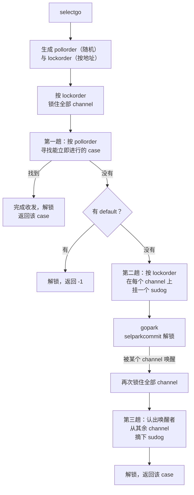

# 10.5 select 的实现

`select` 让一个 goroutine 同时等待多个 channel 操作，哪一个先能进行就执行哪一个；带 `default` 时，
一个都不能进行也不会阻塞。它的语义由规范规定 [[Go Authors, 2026a](#ref-go-authors-2026a)]，
[10.1.4](./model.md) 已经介绍：进入 `select` 时先对所有 case 中的 channel 与待发送的值求值；若有多个 case
可以进行，以均匀的伪随机方式选择其中一个。

单个 channel 上的收发只涉及一把锁。`select` 同时面对多个 channel，实现上多出三个问题：多个 case
同时就绪时如何公平地选择；为了原子地检查与等待而同时持有多把锁时，如何避免死锁；阻塞之后同时挂在多个
channel 上，如何保证只被其中一个唤醒。运行时的 `selectgo` 回答了这三个问题
[[Go Authors, 2026b](#ref-go-authors-2026b)]。本节先看编译器如何把简单的情形挑出去（10.5.1），再看
`selectgo` 的数据结构（10.5.2）、公平（10.5.3）、加锁次序（10.5.4）与完整的流程（10.5.5），最后讨论
`select` 与 CSP 的关系（10.5.6）。

## 10.5.1 编译器先挑出简单情形

编译器在 walk 阶段改写 `select` 语句，按 case 的数目分出四种情形
[[Go Authors, 2026c](#ref-go-authors-2026c)]：

| 形式 | 改写结果 |
| --- | --- |
| `select {}` | 调用 `runtime.block`，永久阻塞 |
| 只有一个 case | 一次普通的收发 |
| 一个 case 加 `default` | 一次非阻塞收发：`selectnbsend` 或 `selectnbrecv` |
| 其余 | 调用 `selectgo` |

用 `go build -gcflags=-S` 编译下面四个函数，可以在汇编中看到各自调用的运行时函数：`zero` 调用 `block`，
`one` 调用 `chanrecv2`，`nonblocking` 调用 `selectnbrecv`，`two` 调用 `selectgo`（Go 1.26，amd64 与 arm64
相同）。`one` 调用的是带 `ok` 的接收：编译器把每个接收 case 都表示为带 `ok` 的形式，没有写出的 `ok`
记为空白标识符；只有值与 `ok` 都没有写出（`case <-c:`）时，单个 case 才化为普通的接收表达式，调用
`chanrecv1`。

```go
func zero() {
	select {}
}

func one(c chan int) int {
	select {
	case v := <-c:
		return v
	}
}

func nonblocking(c chan int) (int, bool) {
	select {
	case v := <-c:
		return v, true
	default:
		return 0, false
	}
}

func two(a, b chan int) int {
	select {
	case v := <-a:
		return v
	case b <- 1:
		return 0
	}
}
```

`selectnbsend` 与 `selectnbrecv` 只是以 `block` 为假调用 `chansend` 与 `chanrecv`，操作不能进行时，由
[10.3.5](./sendrecv.md) 中不加锁的快速路径直接返回。「一个 case 加 `default`」的非阻塞探测在实际代码中
很常见，它们由此完全避开了 `selectgo`。

其余情形中，编译器在栈上准备两个数组：一个存放各 case 的描述，发送 case 在前，接收 case 在后；另一个留给
`selectgo` 存放次序。然后调用 `selectgo`，按返回的下标跳到对应的分支：

```go
// select { case v := <-a: ...; case b <- x: ...; default: ... } 的改写（示意）
var cases [2]scase  // 发送 case 在前，接收 case 在后
var order [4]uint16 // 留给 selectgo 存放两套次序
cases[0] = scase{c: b, elem: &x}
cases[1] = scase{c: a, elem: &v}
chosen, recvOK := selectgo(&cases[0], &order[0], nil, 1, 1, false) // 有 default，block 为假
switch {
case chosen < 0: // default 分支
case chosen == 0: // b <- x 分支
case chosen == 1: // v := <-a 分支；若写了 ok，则 ok = recvOK
}
```

这一布局经过两次简化。Go 1.11 之前，编译器为每个 case 调用一次运行时函数（`selectsend`、`selectrecv`、
`selectdefault`）来登记；Matthew Dempsky 改为由编译器直接填写数组 [[Dempsky, 2018](#ref-dempsky-2018)]。
Go 1.16 中，Dempsky 又去掉了 `scase` 中区分发送、接收与 default 的 `kind` 字段：编译器把发送 case 排在前、
接收 case 排在后，分别给出两者的数目，`default` 的有无改由参数 `block` 表示。提交说明写道，这样重排 case
是安全的，「因为运行时无论如何都会把轮询的次序随机化」[[Dempsky, 2020a](#ref-dempsky-2020a)]。

## 10.5.2 selectgo 的数据结构

```go
// scase 描述一个 case（Go 1.26）
type scase struct {
	c    *hchan         // case 所操作的 channel
	elem unsafe.Pointer // 发送时为待发送值的地址，接收时为存放结果的地址
}

func selectgo(cas0 *scase, order0 *uint16, pc0 *uintptr, nsends, nrecvs int, block bool) (int, bool)
```

`cas0` 指向 case 数组，下标小于 `nsends` 的是发送 case，其余是接收 case。`pc0` 只在竞态检测时使用。
`order0` 指向一个长度为 case 数两倍的 `uint16` 数组，`selectgo` 把它分成两半，分别存放两套次序：

```go
ncases := nsends + nrecvs
scases := cas1[:ncases:ncases]
pollorder := order1[:ncases:ncases]          // 轮询次序：按什么次序检查各 case 能否进行
lockorder := order1[ncases:][:ncases:ncases] // 加锁次序：按什么次序获取各 channel 的锁
```

`pollorder` 服务于公平，`lockorder` 服务于避免死锁，两者都存放 case 的下标。下标的类型是 `uint16`，所以
`selectgo` 要求 case 数不超过 65536。channel 为 nil 的 case 永远不能进行（[10.1.4](./model.md)），
构造次序时直接把它们略去，两套次序都只含其余的 case；这一处理也是 Dempsky 在 Go 1.16 中加入的
[[Dempsky, 2020b](#ref-dempsky-2020b)]。

## 10.5.3 公平：随机的轮询次序

若总按书写次序检查各 case，排在前面的 case 只要一直能进行，后面的 case
就永远得不到执行（[1.3.5](../../part1overview/ch01intro/csp.md) 中的演示）。`selectgo`
在检查之前先生成一个随机的轮询次序：

```go
// 生成 pollorder（Go 1.26，略去计时器 channel 与 synctest 的处理）
norder := 0
for i := range scases {
	cas := &scases[i]
	if cas.c == nil { // nil channel 的 case 不参与轮询与加锁
		cas.elem = nil
		continue
	}
	j := cheaprandn(uint32(norder + 1)) // [0, norder] 中的一个随机位置
	pollorder[norder] = pollorder[j]
	pollorder[j] = uint16(i)
	norder++
}
pollorder = pollorder[:norder]
lockorder = lockorder[:norder]
```

这是 Fisher–Yates 洗牌的一种写法：每个新的下标放到已有序列中的一个随机位置，原先在那里的下标移到末尾。
归纳可知结果是均匀的：已放入 $k$ 个下标时，它们的 $k!$ 种排列等可能；第 $k+1$ 个下标的位置在 $k+1$
个位置中均匀选取，每种新的排列恰好对应一种旧排列与一个位置，所以 $(k+1)!$ 种排列同样等可能。
第一趟扫描（10.5.5）按这个次序检查，执行第一个能进行的 case。在均匀随机的排列中，各个就绪的 case
谁排在最前是等可能的，与其中混有多少个不能进行的 case 无关。这一结论成立于伪随机数的精度之内：
`cheaprandn` 用一次乘法和移位把 32 位随机数映射到 $[0, n)$ [[Lemire, 2019](#ref-lemire-2019)]，
不做拒绝采样，偏差在 $n/2^{32}$ 的量级。

最后一点并非显然。2011 年 1 月以前，`select` 用另一种办法打乱次序：随机选一个起点 $o$ 与一个与 case
数互素的步长 $p$，按 $o, o+p, o+2p, \dots$（对 case 数取模）依次检查。Eoghan Sherry 报告了这种做法的偏差：
一条 `select` 中有三个 case 从同一个 channel `c` 接收，第四个 case 从一个永远没有数据的 channel `d` 接收；
循环 4000 次，三个计数本应都接近 1333，实际是 1484、1008 与 1508。报告还提到，Newsqueak 的 select 与
plan9port 的 libthread 没有这个问题 [[Sherry, 2011](#ref-sherry-2011)]。Russ Cox 的分析是：只要有一个
case 永远不就绪，在这种访问次序中紧随其后的 case 就会多得机会；要保证公平，唯一的办法是让所有排列等可能。
Cox 据此改为显式生成一个随机排列，并指出 case 数超过 12 时随机性不足以做到完美：
当时随机数发生器的状态只有 32 位，至多给出 $2^{32}$ 种不同的序列，而 $12! < 2^{32} < 13!$；
但结果仍比原来好得多 [[Cox, 2011](#ref-cox-2011)]。下面的程序重现了当年的报告：

```go {run=true}
package main

import "fmt"

func main() {
	c := make(chan bool)
	d := make(chan bool) // 没有发送方，这个 case 永远不会就绪
	go func() {
		for {
			c <- true
		}
	}()
	var count [3]int
	for range 30000 {
		select {
		case <-c:
			count[0]++
		case <-c:
			count[1]++
		case <-c:
			count[2]++
		case <-d:
		}
	}
	fmt.Println(count)
}
```

三个计数之和为 30000，各自在 10000 上下浮动，每次运行的结果都不相同。某一次运行的结果如下：

```
[10012 10058 9930]
```

随机数本身的质量同样要紧。Go 1.9 中，Josh Bleecher Snyder 把 `fastrandn(n)` 由取模改为乘法再移位，
耗时减少一半以上 [[Snyder, 2017](#ref-snyder-2017)]。取模的结果主要取决于随机数的低位，
乘法移位的结果取决于高位，而当时的 `fastrand` 是一个线性反馈移位寄存器：
每次输出只是把上一次的状态左移一位，再视最高位异或一个常数，下一次输出的高位基本上就是上一次的高位左移一
位。Benjamin Chenebault 报告 Go 1.9 中的 `select` 不再公平之后，Keith Randall 用一张二维直方图说明了原因：
连续调用两次 `fastrandn(4)`，若第一次得到 0，第二次只可能是 0 或 1
[[Chenebault, 2017](#ref-chenebault-2017)]。洗牌的各步因此不再相互独立，某些排列出现得更多。Go 1.10 换用
Giovanni Bajo 提交的 xorshift64+ 生成器 [[Bajo, 2017](#ref-bajo-2017)]，Go 1.9.2 则由 Cox 把 `fastrandn`
退回取模的写法，并留下注释：「不要取巧。`fastrand` 的质量不足以支撑取巧的写法。
直接取模即可。」[[Cox, 2017](#ref-cox-2017)]。可见均匀的排列要同时依靠两样东西：正确的洗牌算法，
以及前后独立的随机数。如今的 `cheaprand` 在每个 M 上保存自己的状态；在编译器能把 `math.Mul64`
直接编译为硬件乘法指令的平台（如 amd64 与 arm64）上使用 wyrand，其余平台使用 xorshift64+。
源码注释说它的「便宜」既指开销，也指质量 [[Go Authors, 2026d](#ref-go-authors-2026d)]。

## 10.5.4 加锁次序

`selectgo` 要同时锁住所有涉及的 channel。第一趟扫描要检查所有 case；若都不能进行，第二趟要把自己挂到每个
channel 的等待队列上。如果在这两步之间放开某个 channel 的锁，对端可能恰在此时到达：
它看到等待队列中没有人，便自己阻塞，而本 goroutine 随后才挂上队列，双方互相等待，本应完成的通信就此错过。
所以从第一趟开始，直到挂上全部队列为止，所有相关 channel 的锁都要一直持有。

同时持有多把锁就有死锁的危险。goroutine A 执行 `select { case <-x: case <-y: }`，B 执行
`select { case <-y: case <-x: }`，若各自按书写次序加锁，A 持有 `x` 的锁等待 `y`，B 持有 `y` 的锁等待 `x`。
Coffman 等人在 1971 年的综述中列出了死锁的四个必要条件：互斥、持有并等待、不可剥夺与循环等待，并介绍了
Havender 提出的预防办法，其中之一是为所有资源规定一个线性次序，任何任务只能按这个次序申请资源；
在这一约束下，等待关系不可能成环 [[Coffman et al., 1971](#ref-coffman-et-al-1971)]。`selectgo`
采用的正是这种办法，次序的键是 channel 的地址：

```go
func (c *hchan) sortkey() uintptr {
	return uintptr(unsafe.Pointer(c))
}
```

地址之所以能作为全局一致的键，是因为 channel 总是由 `makechan` 在堆上分配，而 Go 的垃圾回收器不移动对象
（[13.1](../../part4memory/ch13gc/basic.md)），一个 channel 的地址在它的生命周期内不变。

`selectgo` 以 `sortkey` 为键对 case 做堆排序。源码注释给出的理由是保证 $O(n\log n)$ 的时间与恒定的栈空间：
堆排序原地进行，不需要递归，`selectgo` 的栈帧不随 case 数增长。这段代码最初是冒泡排序，Cox 在 Go 1.1 中
把它换成了堆排序 [[Cox, 2013](#ref-cox-2013)]。

```go
// 以 channel 地址为键，原地堆排序得到 lockorder（Go 1.26）
for i := range lockorder {
	j := i
	// 从 pollorder 取元素，以打乱同一 channel 上的多个 case
	c := scases[pollorder[i]].c
	for j > 0 && scases[lockorder[(j-1)/2]].c.sortkey() < c.sortkey() {
		k := (j - 1) / 2
		lockorder[j] = lockorder[k]
		j = k
	}
	lockorder[j] = pollorder[i]
}
for i := len(lockorder) - 1; i >= 0; i-- {
	// 把堆顶换到末尾，再让换上来的元素下沉（略）
}
```

排序的输入取自 `pollorder`，而不是 case 的原始次序，注释说明这是为了打乱同一 channel 上的多个 case。这些
case 的键相同，排序后彼此相邻，它们之间的先后取决于输入的次序。这个先后有实际的影响：第二趟按 `lockorder`
把等待者挂到队列上，同一个 channel 上先挂上的先被唤醒。Go 1.7 之前，`lockorder` 存放的是 channel 指针，
无从区分同一 channel 上的不同 case；Austin Clements 把它改为存放 case 的下标，这行注释也是那时加上的
[[Clements, 2016a](#ref-clements-2016a)]。

加锁按 `lockorder` 依次进行，同一 channel 只锁一次；`selunlock` 按相反的次序解锁：

```go
func sellock(scases []scase, lockorder []uint16) {
	var c *hchan
	for _, o := range lockorder {
		c0 := scases[o].c
		if c0 != c { // 同一 channel 的 case 相邻，只加一次锁
			c = c0
			lock(&c.lock)
		}
	}
}
```

## 10.5.5 三趟扫描



第一趟按 `pollorder` 寻找能立即进行的 case。接收 case 依次看有没有等待的发送方、缓冲区中有没有数据、
channel 是否已关闭；发送 case 先看 channel 是否已关闭，再看有没有等待的接收方、缓冲区有没有空位：

```go
// 第一趟：寻找能立即进行的 case（Go 1.26，略去竞态检测）
for _, casei := range pollorder {
	casi = int(casei)
	cas = &scases[casi]
	c = cas.c
	if casi >= nsends { // 接收 case
		if sg = c.sendq.dequeue(); sg != nil {
			goto recv // 与等待的发送方直接传递
		}
		if c.qcount > 0 {
			goto bufrecv // 从缓冲区取出
		}
		if c.closed != 0 {
			goto rclose // 已关闭：得到零值
		}
	} else { // 发送 case
		if c.closed != 0 {
			goto sclose // 已关闭：panic
		}
		if sg = c.recvq.dequeue(); sg != nil {
			goto send // 与等待的接收方直接传递
		}
		if c.qcount < c.dataqsiz {
			goto bufsend // 放入缓冲区
		}
	}
}
if !block { // 有 default
	selunlock(scases, lockorder)
	casi = -1
	goto retc
}
```

发送 case 把「已关闭」放在第一位，对应规范在 2012 年的规定：向已关闭 channel 的发送算作可以进行，`select`
可能选中它并因此 panic（[10.1.5](./model.md)）。各个标签处的代码与 [10.3](./sendrecv.md) 中的单个 channel
收发相同，`recv` 与 `send` 直接调用那里的 `recv` 与 `send` 函数，只是把解锁函数换成了 `selunlock`。
都不能进行而 `block` 为假时，解锁并返回 -1，编译器生成的代码据此执行 `default` 分支。

都不能进行而又必须阻塞时，进入第二趟：为每个 case 取一个 `sudog`，标记 `isSelect`，按 `lockorder` 串成
`gp.waiting` 链表，并挂到相应 channel 的发送或接收等待队列上：

```go
// 第二趟：在每个 channel 上排队（Go 1.26，有删节）
nextp = &gp.waiting
for _, casei := range lockorder {
	casi = int(casei)
	cas = &scases[casi]
	c = cas.c
	sg := acquireSudog()
	sg.g = gp
	sg.isSelect = true
	sg.elem.set(cas.elem)
	sg.c.set(c)
	*nextp = sg // 按加锁次序串成 gp.waiting
	nextp = &sg.waitlink
	if casi < nsends {
		c.sendq.enqueue(sg)
	} else {
		c.recvq.enqueue(sg)
	}
}
gp.param = nil
gp.parkingOnChan.Store(true)
gopark(selparkcommit, nil, waitReason, traceBlockSelect, 1)
```

`gp.waiting` 按加锁次序排列，是 Clements 在 Go 1.7 中为并发收缩栈所做的调整
[[Clements, 2016b](#ref-clements-2016b)]：收缩一个阻塞在 `select` 中的 goroutine 的栈时，
运行时沿这条链表逐个锁住它的 channel，以便修正 `sudog.elem` 中指向旧栈的指针。链表的次序就是这里加锁的
次序，所以它必须与全局的加锁次序一致。
`gopark` 的解锁函数 `selparkcommit` 同样沿这条链表解锁，而不读 `lockorder`。`gopark`
规定解锁函数不得访问当前 goroutine 的栈，因为这个栈在调用 `gopark` 与调用解锁函数之间可能被移动
[[Go Authors, 2026e](#ref-go-authors-2026e)]；`scases` 与 `lockorder` 都在这个栈上，`sudog` 则在堆上。
`selparkcommit` 还要等走过同一 channel 的最后一个 `sudog` 之后才解开这个 channel 的锁，因为锁一旦解开，
这些 `sudog` 的字段就可能被其他 goroutine 修改：

```go
// selparkcommit 的解锁部分（Go 1.26）
var lastc *hchan
for sg := gp.waiting; sg != nil; sg = sg.waitlink {
	if sg.c.get() != lastc && lastc != nil {
		unlock(&lastc.lock) // 已走过 lastc 的最后一个 sudog
	}
	lastc = sg.c.get()
}
if lastc != nil {
	unlock(&lastc.lock)
}
```

在此之前，`selparkcommit` 先设置 `activeStackChans` 并清除 `parkingOnChan`，作用与单个 channel
上的阻塞相同（[10.3.3](./sendrecv.md)）。

此后，这个 goroutine 同时排在多个等待队列中，可能有多个对端几乎同时找到它。[10.2.4](./impl.md) 中的
`dequeue` 保证只有一个对端成功：取出一个 `isSelect` 的 `sudog` 时，先对 `g.selectDone` 做一次 CAS，
失败说明这个 goroutine 已被别的 channel 认领，跳过即可。`selectDone` 原本是 `select` 所在 goroutine
栈上的一个变量，由其他 goroutine 远程写入，与栈复制之间需要相当微妙的配合；Daniel Morsing 在 Go 1.10
中把它移进了 `g` 结构 [[Morsing, 2017](#ref-morsing-2017)]。

被唤醒之后进入第三趟。`selectgo` 重新锁住全部 channel，从 `gp.param` 得知唤醒自己的是哪个 `sudog`，
然后按加锁次序走一遍 `gp.waiting`：唤醒者的 `sudog` 已被对端取走，记下它对应的 case；其余的 `sudog`
仍在各自的队列中，逐个摘下。若不摘下，它们会在不再活跃的 channel 上越积越多：

```go
// 第三趟：从其余 channel 上摘下 sudog（Go 1.26，有删节）
sg = (*sudog)(gp.param) // 唤醒者的 sudog
sglist = gp.waiting
gp.waiting = nil
for _, casei := range lockorder {
	k = &scases[casei]
	if sg == sglist { // 唤醒者已把它从队列中取走
		casi = int(casei)
		cas = k
		caseSuccess = sglist.success
	} else {
		if int(casei) < nsends {
			k.c.sendq.dequeueSudoG(sglist)
		} else {
			k.c.recvq.dequeueSudoG(sglist)
		}
	}
	sgnext = sglist.waitlink
	sglist.waitlink = nil
	releaseSudog(sglist)
	sglist = sgnext
}
```

摘下任意一个 `sudog` 只需常数时间，这得益于等待队列是双向链表（[10.2.4](./impl.md)）。选中的若是发送 case
而 `success` 为假，说明唤醒它的是 `close`，`selectgo` 随即 panic（[10.4.1](./close.md)）；若是接收 case，
`success` 就是返回给调用方的 `ok`。

合起来看，一次不阻塞的 `select` 要排序一次、加锁并解锁一轮；一次阻塞的 `select` 还要为每个 case
取得并归还一个 `sudog`，在醒来之后再加锁一轮。这是同时等待多个 channel 的代价，case 越多，代价越高。
`reflect.Select` 走的也是 `selectgo`，只是 case 数组与次序数组由 `reflect_rselect` 在堆上分配。

## 10.5.6 从输入守卫到输出守卫

`select` 源自 Dijkstra 的守卫命令与 Hoare 1978 年的 CSP，二者的关系与 Hoare 对选择方式不作规定的立场，
[1.3.2](../../part1overview/ch01intro/csp.md) 已经介绍。这里只看 Go 与 1978 年的 CSP 不同的两点，以及一个
缺失的特性如何被补上。

第一，Go 的 `select` 允许发送 case。1978 年的 CSP 只允许输入命令出现在守卫中。Hoare 在论文的讨论部分写道，
既然输入命令可以出现在守卫中，同样允许输出命令似乎更加对称，例如有界缓冲区的程序就能明显简化；
也许更有说服力的理由是，有了输出守卫，每个并行命令对外的行为都能用一个顺序命令来刻画；
但这一扩展没有进入当时的语言 [[Hoare, 1978](#ref-hoare-1978)]。用 Go 来写，并行地执行 `x <- 2` 与
`y <- 3`，对外等价于：

```go
select {
case x <- 2:
	y <- 3
case y <- 3:
	x <- 2
}
```

若不看哪一边能够进行就先定下一种次序，而接收方恰好要求另一种次序，程序就会死锁。输出守卫的困难在于，
通信的双方可能都在若干个候选之间选择，一次通信的成立需要双方同时认可。`selectgo`
在共享内存中给出了一种解法：主动的一方锁住自己涉及的全部 channel，以全局一致的次序避免死锁（10.5.4）；
被动的一方已经阻塞，不必持有其他 channel 的锁，由主动方以一次 CAS 认领，未被选中的 `sudog`
留待它醒来后自行清理（10.5.5）。

第二，Go 规定了选择的方式。Hoare 讨论过语言的定义是否应当要求实现公平，回答是：「这里我相当确定，
答案是否定的」。程序员有责任证明程序正确终止，而不能假定实现是公平的；高效的实现应当尽量做到合理的公平，
但正确性的证明不能依赖这一点 [[Hoare, 1978](#ref-hoare-1978)]。Go 的规范则要求以均匀的伪随机方式选择。
这并不是对公平的确定性保证：若 `select` 有 $n$ 个 case，一个始终就绪的 case 每次至少有 $1/n$
的机会被选中，连续落选的概率随次数指数下降，却不会是零。Hoare 的告诫因此在 Go 中依然成立。

守卫命令中的守卫可以是一个布尔条件，条件为假的分支不参与选择 [[Dijkstra, 1975](#ref-dijkstra-1975)]。Go
的 `select` 没有布尔守卫，但 nil channel 起到了同样的作用：把某个 case 的 channel 变量置为 nil，这个 case
就不再参与选择（[10.1.4](./model.md)）。`selectgo` 构造次序时直接略去这些 case（10.5.2），
布尔条件为假的守卫在实现中也就不占任何开销。

## 延伸阅读

- <a id="ref-bajo-2017"></a>[Bajo, 2017] Giovanni Bajo. runtime: improve fastrand with a better generator.
  Go commit e7e4a4ffa3, 2017. https://go.dev/cl/62530
  修复 issue #21806，随 Go 1.10 发布。
- <a id="ref-chenebault-2017"></a>[Chenebault, 2017] Benjamin Chenebault. Go issue #21806. *runtime:
  select is not fair.* 2017. https://github.com/golang/go/issues/21806
  Go 1.9 中 `select` 不公平的报告；讨论中 Keith Randall 给出了 `fastrandn` 相邻输出相关的直方图。
- <a id="ref-clements-2016a"></a>[Clements, 2016a] Austin Clements. runtime: use indexes for select lock
  order. Go commit 26594c3dfd, 2016. https://go.dev/cl/20036
  随 Go 1.7 发布。
- <a id="ref-clements-2016b"></a>[Clements, 2016b] Austin Clements. runtime: put g.waiting list in lock
  order. Go commit 005140a77e, 2016. https://go.dev/cl/20037
  为 issue #12967 而作，随 Go 1.7 发布。
- <a id="ref-coffman-et-al-1971"></a>[Coffman et al., 1971] E. G. Coffman, M. Elphick, A. Shoshani.
  "System Deadlocks." *ACM Computing Surveys*, 3(2): 67–78, 1971. https://doi.org/10.1145/356586.356588
  第 2 节给出死锁的四个必要条件，第 3 节介绍 Havender 的预防办法。
- <a id="ref-cox-2011"></a>[Cox, 2011] Russ Cox. runtime: make select fairer. Go commit 4f269d3060, 2011.
  https://github.com/golang/go/commit/4f269d3060
  修复 issue #1425。
- <a id="ref-cox-2013"></a>[Cox, 2013] Russ Cox. runtime: replace bubble sort with heap sort in select. Go
  commit cb32ea9c19, 2013. https://github.com/golang/go/commit/cb32ea9c19
  随 Go 1.1 发布。
- <a id="ref-cox-2017"></a>[Cox, 2017] Russ Cox. [release-branch.go1.9] runtime: use simple, more robust
  fastrandn. Go commit d93cb46280, 2017. https://go.dev/cl/70991
  修复 issue #22253，随 Go 1.9.2 发布。
- <a id="ref-dempsky-2018"></a>[Dempsky, 2018] Matthew Dempsky. cmd/compile: open code
  select{send,recv,default}. Go commit 004260afde, 2018. https://go.dev/cl/37934
  随 Go 1.11 发布。
- <a id="ref-dempsky-2020a"></a>[Dempsky, 2020a] Matthew Dempsky. runtime: eliminate scase.kind field. Go
  commit fe23ba4a14, 2020. https://go.dev/cl/245125
  修复 issue #40410，随 Go 1.16 发布。
- <a id="ref-dempsky-2020b"></a>[Dempsky, 2020b] Matthew Dempsky. runtime: omit nil-channel cases from
  selectgo's orders. Go commit 8a984e8e3f, 2020. https://go.dev/cl/245123
  随 Go 1.16 发布。
- <a id="ref-dijkstra-1975"></a>[Dijkstra, 1975] Edsger W. Dijkstra. "Guarded Commands, Nondeterminacy and
  Formal Derivation of Programs." *Communications of the ACM*, 18(8), 1975.
  https://doi.org/10.1145/360933.360975
- <a id="ref-go-authors-2026a"></a>[Go Authors, 2026a] The Go Authors. *The Go Programming Language
  Specification: Select statements.* https://go.dev/ref/spec#Select_statements
- <a id="ref-go-authors-2026b"></a>[Go Authors, 2026b] The Go Authors. *runtime/select.go.*
  https://github.com/golang/go/blob/master/src/runtime/select.go
  （`selectgo`、`sellock`、`selparkcommit`、`sortkey`）本节对照 Go 1.26。
- <a id="ref-go-authors-2026c"></a>[Go Authors, 2026c] The Go Authors.
  *cmd/compile/internal/walk/select.go.*
  https://github.com/golang/go/blob/master/src/cmd/compile/internal/walk/select.go
  （零个 case、单个 case 与「一个 case 加 default」的改写）本节对照 Go 1.26。
- <a id="ref-go-authors-2026d"></a>[Go Authors, 2026d] The Go Authors. *runtime/rand.go.*
  https://github.com/golang/go/blob/master/src/runtime/rand.go
  （`cheaprand`、`cheaprandn`）本节对照 Go 1.26。
- <a id="ref-go-authors-2026e"></a>[Go Authors, 2026e] The Go Authors. *runtime/proc.go.*
  https://github.com/golang/go/blob/master/src/runtime/proc.go
  （`gopark` 对解锁函数的约定）本节对照 Go 1.26。
- <a id="ref-hoare-1978"></a>[Hoare, 1978] C. A. R. Hoare. "Communicating Sequential Processes."
  *Communications of the ACM*, 21(8), 1978. https://doi.org/10.1145/359576.359585
  第 7.6 节讨论公平，第 7.8 节讨论输出守卫。
- <a id="ref-lemire-2019"></a>[Lemire, 2019] Daniel Lemire. "Fast Random Integer Generation in an
  Interval." *ACM Transactions on Modeling and Computer Simulation*, 29(1), 2019.
  https://doi.org/10.1145/3230636
- <a id="ref-morsing-2017"></a>[Morsing, 2017] Daniel Morsing. runtime: move selectdone into g. Go commit
  32b94f13cf, 2017. https://go.dev/cl/53390
  随 Go 1.10 发布。
- <a id="ref-sherry-2011"></a>[Sherry, 2011] Eoghan Sherry. Go issue #1425. *select can be unfair.* 2011.
  https://github.com/golang/go/issues/1425
- <a id="ref-snyder-2017"></a>[Snyder, 2017] Josh Bleecher Snyder. runtime: speed up fastrand() % n. Go
  commit 46a75870ad, 2017. https://go.dev/cl/36932
  随 Go 1.9 发布。
- 本书 [10.1 通道与 CSP 的工程化](./model.md)、[10.3 收发与直接传递](./sendrecv.md)、
  [10.4 关闭的语义](./close.md)、[10.6 内存模型与无锁演进](./lockfree.md)。
