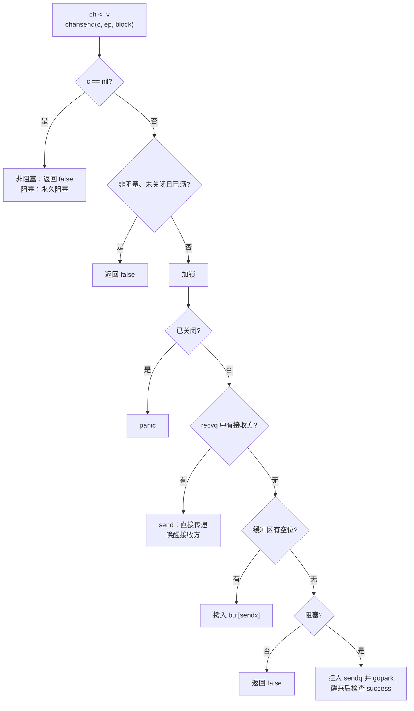

# 10.3 收发与直接传递

[10.2](./impl.md) 描述了 `hchan` 的静态结构：一把锁、一个环形缓冲区，以及发送方与接收方各自的等待队列。
本节考察这些结构上发生的动作，即一次 `ch <- v` 或 `v := <-ch` 在运行时中如何完成。

整条路径遵循一条原则：一旦收发中的某一方不得不阻塞，后到的一方就在持锁期间替它完成整个操作，
包括数据的拷贝，然后才唤醒它。被唤醒者醒来时操作已经结束，不必再加锁重试，也不会扑空。这条原则对无缓冲
channel 是与生俱来的，对带缓冲 channel 则直到 Go 1.6 才成立（10.3.6）。无缓冲 channel 的会合、
等待者的先来先服务，以及内存模型对 channel 的同步保证，都建立在它之上。
它的核心动作是在双方之间直接拷贝值而不经过缓冲区，通常是从一个 goroutine 的栈写到另一个 goroutine 的栈上，
称为**直接传递**（direct handoff）。

## 10.3.1 发送的三种去向

编译器把收发语句翻译为对运行时的调用。`ch <- v` 变为 `chansend1(c, &v)`；`v := <-ch` 变为 `chanrecv1`，`v, ok := <-ch`
变为 `chanrecv2`，单独的 `<-ch` 语句同样调用 `chanrecv1`，只是不提供存放结果的地址。
只含一个收发分支与一个 `default` 分支的 `select` 是特例，编译器把它改写为 `selectnbsend` 或
`selectnbrecv`。这些入口最终都调用 `chansend` 或 `chanrecv`，区别只在参数 `block`：前三个入口传入真，`selectnbsend`
与 `selectnbrecv` 传入假。reflect 包的 `TrySend` 与 `TryRecv` 同样以非阻塞方式进入，
含多个分支的 `select` 则由 `selectgo` 另行实现（[10.5](./select.md)）。值总是以指针传入，
运行时按元素的大小拷贝。

下面的交互图先建立直觉：带缓冲 channel 是一条定长队列，缓冲区满时发送方阻塞，空时接收方阻塞。可以调整
容量，或者手动收发。

<div class="viz" data-viz="channel"></div>

剥去竞态检测、`synctest` 气泡与阻塞剖析的代码，`chansend` 的主干如下
[[Go Authors, 2026a](#ref-go-authors-2026a)]：

```go
// chansend 的主干（Go 1.26，有删节）
func chansend(c *hchan, ep unsafe.Pointer, block bool, callerpc uintptr) bool {
	if c == nil { // nil channel：非阻塞时失败，否则永久阻塞
		if !block {
			return false
		}
		gopark(nil, nil, waitReasonChanSendNilChan, traceBlockForever, 2)
		throw("unreachable")
	}
	if !block && c.closed == 0 && full(c) { // 不加锁的快速路径，见 10.3.5
		return false
	}

	lock(&c.lock)
	if c.closed != 0 {
		unlock(&c.lock)
		panic(plainError("send on closed channel"))
	}
	if sg := c.recvq.dequeue(); sg != nil { // 去向一：交给等待的接收方
		send(c, sg, ep, func() { unlock(&c.lock) }, 3)
		return true
	}
	if c.qcount < c.dataqsiz { // 去向二：放入缓冲区
		qp := chanbuf(c, c.sendx)
		typedmemmove(c.elemtype, qp, ep)
		c.sendx++
		if c.sendx == c.dataqsiz {
			c.sendx = 0
		}
		c.qcount++
		unlock(&c.lock)
		return true
	}
	if !block {
		unlock(&c.lock)
		return false
	}
	// 去向三：挂入 sendq 并阻塞，见 10.3.3
	...
}
```

三种去向的次序本身就是设计。有接收方在等待时，发送方总是把值直接交给它，即使这是一个带缓冲的 channel。
这样做不会越过缓冲区中更早的值：按照 [10.2.1](./impl.md) 的不变式，带缓冲 channel 的 `recvq`
非空时，缓冲区必然为空，否则接收方不会阻塞。直接交付因此既不破坏先进先出，又省去了「拷入缓冲区、再拷出」
中的一次拷贝。`send` 的注释把这个前提写成了调用约定：channel 必须为空，并且已经加锁。

缓冲区有空位时，发送只是把值拷入 `buf[sendx]` 并推进 `sendx`，回绕的写法见 [10.2.3](./impl.md)。
两条路都走不通时，发送方只能阻塞。

## 10.3.2 直接传递

`send` 完成去向一的全部工作：

```go
// send 与 sendDirect（Go 1.26，有删节）
func send(c *hchan, sg *sudog, ep unsafe.Pointer, unlockf func(), skip int) {
	if sg.elem.get() != nil {
		sendDirect(c.elemtype, sg, ep) // 写入接收方栈上的变量
		sg.elem.set(nil)
	}
	gp := sg.g
	unlockf() // 先释放 channel 锁
	gp.param = unsafe.Pointer(sg)
	sg.success = true // 告诉接收方：操作已正常完成
	goready(gp, skip+1) // 再唤醒接收方
}

func sendDirect(t *_type, sg *sudog, src unsafe.Pointer) {
	// src 在当前 goroutine 的栈上，dst 是另一个栈上的槽位。
	// 从 sg 读出 elem 之后，若目标栈被复制（收缩），读出的值不会随之更新，
	// 因此读出与使用之间不能有抢占点。
	dst := sg.elem.get()
	typeBitsBulkBarrier(t, uintptr(dst), uintptr(src), t.Size_)
	memmove(dst, src, t.Size_)
}
```

接收方在阻塞之前，把接收变量的地址记在自己的 `sudog` 的 `elem` 中，这个地址通常指向它自己的栈；栈被复制时
`elem` 要随之调整，[14.4](../../part4memory/ch14stack/copy.md) 会回到这一点。发送方找到它之后，
不经过缓冲区，用一次 `memmove` 把值从自己的栈直接写到对方的栈上。如果 `elem` 为空，
说明接收方不需要这个值（例如单独的 `<-ch` 语句），拷贝也就省去了。

写入另一个 goroutine 的栈之所以安全，依靠两点。其一，接收方处于 `_Gwaiting`
状态（[9.3.4](../ch09sched/mpg.md)），不会同时读写这个变量。其二，发送方持有 channel 锁，
而运行时在复制这样的栈之前，要先取得它所等待的 channel 的锁（[10.2.6](./impl.md)），
因此拷贝期间槽位不会移动。

跨栈写入还牵涉垃圾回收。并发标记假定栈只由它的主人在运行时写入：一个阻塞的 goroutine 的栈被扫描之后，
不会再出现新的指针，对栈的写入因此可以不经过写屏障（[13.2](../../part4memory/ch13gc/barrier.md)）。
直接传递打破了这个假定。这里原本已有一次显式的写屏障，但它依据堆的位图寻找指针，目标在栈上时不起作用。Russ
Cox 在 Go 1.5 中把它改为依据类型位图的 `typeBitsBulkBarrier`，再配合普通的 `memmove`；为此，
类型位图的适用范围被扩大到 64 KB 以内的所有类型，正好覆盖 channel
元素的大小上限（[10.2.5](./impl.md)）[[Cox, 2015a](#ref-cox-2015a)]。反方向的 `recvDirect`
从发送方的栈上读取，起初没有屏障。Go 1.8 引入混合写屏障，不再在标记终止时重新扫描栈，这成了漏洞：
一个尚未扫描的栈可以把一个白色对象的指针交给已经扫描过的栈，然后从自己的栈上删去它；
若这是该对象唯一受保护的引用，对象就会从垃圾回收器的视野中消失。Austin Clements 为 `recvDirect`
补上了同样的屏障 [[Clements, 2016](#ref-clements-2016)]。屏障只在标记阶段生效，其余时间
`typeBitsBulkBarrier` 立即返回。

`send` 先释放锁，再唤醒接收方，这是 [10.2.6](./impl.md) 所述锁纪律的要求。`goready` 把接收方放入当前 P 的
`runnext`，让它继承发送方剩余的时间片（[9.4.3](../ch09sched/schedule.md)）。发送方一旦阻塞或让出，接收方
便在同一个处理器上立即运行，一来一回的通信因此像一个整体那样被调度。接收方醒来时，值已经在它的变量里，`success`
为真，它无须再碰 channel 便可返回。

## 10.3.3 阻塞与唤醒

缓冲区已满（无缓冲 channel 可以看作永远是满的）且没有接收方在等待时，阻塞的发送执行 `chansend` 的
最后一段：

```go
	// chansend 的阻塞部分（Go 1.26，有删节）
	gp := getg()
	mysg := acquireSudog()
	mysg.elem.set(ep) // 待发送的值所在的地址
	mysg.g = gp
	mysg.c.set(c)
	gp.waiting = mysg
	c.sendq.enqueue(mysg)
	gp.parkingOnChan.Store(true)
	gopark(chanparkcommit, unsafe.Pointer(&c.lock), waitReasonChanSend, traceBlockChanSend, 2)

	// 被唤醒之后从这里继续
	KeepAlive(ep)
	gp.waiting = nil
	gp.activeStackChans = false
	closed := !mysg.success
	mysg.c.set(nil)
	releaseSudog(mysg)
	if closed {
		panic(plainError("send on closed channel"))
	}
	return true
```

发送方把自己包装成一个 `sudog`，记下待发送值的地址，挂到 `sendq` 的队尾，然后调用 `gopark` 让出处理器。
接收方阻塞的过程与此对称，只是挂入 `recvq`，`elem` 记录的是接收变量的地址。此后先到的一方什么也不做，
后到的一方会在自己的路径上找到它，替它完成拷贝，再调用 `goready`。

传给 `gopark` 的 `chanparkcommit` 在 goroutine 进入 `_Gwaiting` 之后才释放 channel 锁。[9.4.3](../ch09sched/schedule.md)
已经说明了这一次序的理由：若先释放锁再停下，对方可能在这个间隙中摘下
`sudog`，去唤醒一个仍在运行的 goroutine，而 `ready` 遇到不处于 `_Gwaiting` 的 goroutine 会报告
`bad g->status in ready` 并终止程序 [[Go Authors, 2026b](#ref-go-authors-2026b)]。

`chanparkcommit` 在释放锁之前还要做两件事，都与栈收缩有关。第一件是把 `activeStackChans` 置为真，告诉
栈复制「有 `sudog` 指向这个栈，复制前要锁住相关的 channel」；这个标志由 Austin Clements 在 Go 1.14 中引入
[[Clements, 2019](#ref-clements-2019)]。第二件是清除 `parkingOnChan`。goroutine 的状态在 `gopark` 中先变为
`_Gwaiting`，`chanparkcommit` 稍后才执行；在这个窗口中，并发标记的工作者可能已经认定这个 goroutine
停稳，却读到尚未置位的 `activeStackChans`，从而在不加锁的情况下移动它的栈。Michael Knyszek 在 Go 1.16 中用
`parkingOnChan` 关闭了这个窗口：标志为真时一律不收缩 [[Knyszek, 2020](#ref-knyszek-2020)]。

醒来之后，发送方只需检查 `mysg.success`。正常完成时，唤醒它的接收方已经取走了值，并把它置为真；若为假，
说明唤醒它的是 `close`（[10.4](./close.md)），发送方于是 panic。`KeepAlive(ep)` 保证待发送的值在对方取走
之前不会被回收，因为 `sudog` 中的指针不是栈扫描的根。

把三种去向与阻塞合起来，`chansend` 的全貌如下：



## 10.3.4 接收与会合

`chanrecv` 与 `chansend` 大体对称，多出的一支是「已关闭且缓冲区为空」，此时接收立即成功并得到零值：

```go
// chanrecv 的主干（Go 1.26，有删节）
func chanrecv(c *hchan, ep unsafe.Pointer, block bool) (selected, received bool) {
	if c == nil { /* 与发送相同：非阻塞时失败，否则永久阻塞 */ }
	if !block && empty(c) { /* 不加锁的快速路径，见 10.3.5 */ }

	lock(&c.lock)
	if c.closed != 0 {
		if c.qcount == 0 { // 已关闭且缓冲区为空：得到零值
			unlock(&c.lock)
			if ep != nil {
				typedmemclr(c.elemtype, ep)
			}
			return true, false
		}
		// 已关闭但缓冲区中仍有数据：照常取出
	} else if sg := c.sendq.dequeue(); sg != nil { // 有发送方在等待
		recv(c, sg, ep, func() { unlock(&c.lock) }, 3)
		return true, true
	}
	if c.qcount > 0 { // 从缓冲区取出
		qp := chanbuf(c, c.recvx)
		if ep != nil {
			typedmemmove(c.elemtype, ep, qp)
		}
		typedmemclr(c.elemtype, qp) // 清空槽位，不再让 GC 看到旧值
		c.recvx++
		if c.recvx == c.dataqsiz {
			c.recvx = 0
		}
		c.qcount--
		unlock(&c.lock)
		return true, true
	}
	if !block {
		unlock(&c.lock)
		return false, false
	}
	// 挂入 recvq 并阻塞，与发送对称
	...
}
```

有发送方在等待时，接收方同样替它完成操作，但要分两种情况：

```go
// recv 的主干（Go 1.26，有删节）
func recv(c *hchan, sg *sudog, ep unsafe.Pointer, unlockf func(), skip int) {
	if c.dataqsiz == 0 { // 无缓冲：直接从发送方的栈上拷贝
		if ep != nil {
			recvDirect(c.elemtype, sg, ep)
		}
	} else { // 缓冲区已满：取走队头，发送方的值补入队尾，二者是同一个槽位
		qp := chanbuf(c, c.recvx)
		if ep != nil {
			typedmemmove(c.elemtype, ep, qp)
		}
		typedmemmove(c.elemtype, qp, sg.elem.get())
		c.recvx++
		if c.recvx == c.dataqsiz {
			c.recvx = 0
		}
		c.sendx = c.recvx
	}
	sg.elem.set(nil)
	gp := sg.g
	unlockf()
	gp.param = unsafe.Pointer(sg)
	sg.success = true
	goready(gp, skip+1)
}
```

无缓冲 channel 没有缓冲区可用，接收方用 `recvDirect` 从发送方的栈上直接取值，这是 `sendDirect` 的反方向。
带缓冲 channel 则不同。发送方之所以阻塞，是因为缓冲区已满，而缓冲区中的值都比它早到。为了保持先进先出，
接收方必须取走队头的值，而不是发送方手中的值。缓冲区满时，下一个写入的位置恰好就是队头，所以队头被取走后
空出的这一格，正好用来存放发送方的值；`recvx` 前进一格，`sendx` 随之等于 `recvx`。一次接收由此完成了两个
操作，缓冲区仍然是满的。在四种情形（向等待的接收方发送、从等待的发送方接收，各分有无缓冲）中，这是唯一
需要两次拷贝的一种 [[Randall, 2015a](#ref-randall-2015a)]。

无缓冲 channel 的缓冲区容量为零，`full` 与 `empty` 都退化为「对面的队列中是否有人」。
一次成功的收发因此必须由双方共同完成：要么发送方遇到排队的接收方，要么接收方遇到排队的发送方，
先到的一方一律阻塞，值从一个栈直接到达另一个栈，不在任何中间位置停留。这正是 Hoare 在 CSP 中规定的会合：
输出命令与对应的输入命令配对时，值从一个进程复制到另一个进程；没有自动的缓冲，先就绪的一方等待另一方
[[Hoare, 1978](#ref-hoare-1978)]。

内存模型规定，无缓冲 channel 上的一次接收同步先于对应发送的完成
（[10.1.3](./model.md)）[[Go Authors, 2022](#ref-go-authors-2022)]。这条反方向的保证在实现中有直接的来源。
若接收方先到，它在临界区中把自己挂入 `recvq`，再由 `chanparkcommit` 释放锁；发送方随后必须获取同一把锁，
才能找到它。若发送方先到，它要等接收方完成拷贝并调用 `goready` 之后才能继续运行。两种情况下，发送方从
`chansend` 返回之前，都经过了一个与接收方同步的点，即锁的获取或被对方唤醒。接收方在接收之前所做的写入，
因此对完成了发送的发送方可见。这些规则在运行时中的完整落实见 [10.6](./lockfree.md)。

## 10.3.5 非阻塞操作的快速路径

非阻塞的收发有两个来源：只含一个收发分支与一个 `default` 分支的 `select`，以及 reflect 包的 `TrySend` 与
`TryRecv`。含多个分支的 `select` 即使带有 `default`，也由 `selectgo` 加锁处理（[10.5](./select.md)）。
非阻塞操作最常见的结果是失败：channel 尚未就绪，立即返回。为了让这种失败足够便宜，Dmitry Vyukov 在
2014 年为它加入了不加锁的快速路径（[10.2.6](./impl.md)）[[Vyukov, 2014](#ref-vyukov-2014)]。
发送一侧的判断是 `!block && c.closed == 0 && full(c)`，其中 `full` 只读一个字：

```go
// full 报告向 c 发送是否会阻塞（Go 1.26）
func full(c *hchan) bool {
	if c.dataqsiz == 0 { // 无缓冲：没有等待的接收方
		return c.recvq.first == nil
	}
	return c.qcount == c.dataqsiz // 有缓冲：缓冲区已满
}
```

不加锁地先后读取两个会变化的字，读到的是两个不同时刻的状态。快速路径要论证的是：存在某一时刻，channel
确实处于「未关闭且不可发送」的状态，于是可以当作在那一刻观察了 channel，报告失败。发送一侧先读到未关闭，
再读到已满。对带缓冲 channel，若它在两次读取之间被关闭，由于关闭之后不再有发送，缓冲区中的元素只减不增，
第二次读到的「满」在关闭的那一刻必然已经成立，关闭前的一瞬便是所需的时刻。无缓冲 channel 的「满」
指没有等待的接收方，而关闭本身就会清空 `recvq`，这一论证并不成立；不过发送与关闭相互竞争本身就是数据竞争，
竞态检测器会报告它，运行时也就不必为这种情形提供更强的保证。即使两次读取被处理器重排，变成先读到满、
后读到未关闭，由于 channel 关闭后不能重新打开，后读到的「未关闭」意味着读到「满」的那一刻同样未关闭。
两种次序都能得出结论，所以 `full` 只用普通的读取。

接收一侧的论证并不对称。按程序次序，先读到空、后读到未关闭，可以推出读到空的那一刻同样未关闭。但若两次
读取被重排，变成先读到未关闭、后读到空，结论就不再成立：channel 可能在两次读取之间被关闭，缓冲区中剩下的值
随后被其他接收方取尽。两次读取看到了「未关闭」与「空」，这两个状态却从未同时出现；正确的结果是「已关闭且
为空」，接收应当立即成功并得到零值。差别在于关闭之后，缓冲区可以变空，却不能变满。因此接收一侧必须禁止
重排，`empty` 与对 `c.closed` 的读取都使用原子操作，而 Go 的原子操作是顺序一致的
（[11.9](../ch11sync/mem.md)）：

```go
// empty 报告从 c 接收是否会阻塞（Go 1.26，略去计时器 channel 的处理）
func empty(c *hchan) bool {
	if c.dataqsiz == 0 {
		return atomic.Loadp(unsafe.Pointer(&c.sendq.first)) == nil
	}
	return atomic.Loaduint(&c.qcount) == 0
}
```

最初的快速路径只处理「未关闭且为空」这一种失败。从已关闭且为空的 channel 作非阻塞接收，结果其实是确定的，
即立即成功并得到零值，却仍要走加锁的慢路径。Ben Schwartz 测得，对空的 channel 作非阻塞接收，
已关闭时比未关闭时慢约 700 倍。Schwartz 的修改在读到「已关闭」之后再检查一次 `empty`：channel
已经不可逆地关闭，若此时仍为空，就不必加锁，直接写入零值并返回。第二次检查不可省略，
因为在第一次读到空与读到关闭之间，可能有发送方在关闭之前送入了值。这项修改在 Go 1.14 的开发周期中合入，
随后因为竞态检测器的误报（#36714）被回滚：慢路径会在竞态检测器中记录「关闭先于接收」的同步，
快速路径却没有。补上这一步之后，它在 Go 1.15 中重新合入，相应基准的耗时降低了 99.82%
[[Schwartz, 2020](#ref-schwartz-2020)]。`full` 与 `empty` 这两个函数，
以及注释中「这里没有任何东西保证前向进展」一句，都来自这次修改：不加锁的读取不保证何时能看到新的状态，
运行时依靠 `chanrecv` 与 `closechan` 释放锁时的副作用，来更新当前线程看到的 `c.closed` 与缓冲区状态。

## 10.3.6 先来先服务

Go 1.6 之前，「后到者替先到者完成操作」只对无缓冲 channel 成立。带缓冲 channel 采用另一套协议：
向有接收方等待的 channel 发送时，发送方把值放入缓冲区，然后只是唤醒一个接收方；接收方醒来后要重新加锁、
重新检查缓冲区，若值已被别人取走，就回到队尾再次等待。反方向同样如此。这在当时的 `chansend` 中是一个循环，
注释写着「有人唤醒了我们，再试一次」。今天 `chansend` 上方的注释仍说「最简单的办法是循环并重新执行操作」，
这段话在 Go 1 用 C 语言写成的运行时中就已存在，代码早已不再循环。

被唤醒者从醒来到真正运行之间有一段延迟。正在运行的 goroutine 若恰好在这段时间里操作同一个 channel，
就会抢先完成，这种现象称为「插队」（barging，另见 [11.2.4](../ch11sync/mutex.md)）。被插队的 goroutine
白白醒来一次。这类徒劳的唤醒曾让执行追踪的早期用户误以为程序中有一个并不存在的循环，Dmitry Vyukov
为此让追踪器识别并剔除它们 [[Vyukov, 2015](#ref-vyukov-2015)]。

2015 年 7 月，Russ Cox 在 issue #11506 中指出了插队的后果：若它反复发生，阻塞的 goroutine
可能等待任意长的时间，尽管 channel 每隔一段时间就会就绪，等待者之间的次序也会被打乱
[[Cox, 2015b](#ref-cox-2015b)]。Cox 提议让带缓冲 channel 采用与无缓冲 channel 相同的做法，
由解除阻塞的操作直接完成被阻塞的操作，这样一旦排队，服务的次序就确定了。Cox 也承认，
从先行发生关系的角度看，这个区别并不存在：阻塞在同一个 channel 上的两个 goroutine 之间没有先行发生关系，
任何次序都同样合法；但从实际发生了什么的角度看，区别是真实的，而许多 Go 程序在意延迟。
这一提议明确限定为对实现的修改，而不是对语言的修改。

讨论中出现了不同的意见。Rob Pike 赞同，但预计在激烈的竞争下，这种做法需要更多的上下文切换。Austin
Clements 担心严格的先进先出会像确定的 map 遍历次序一样，被用户依赖而无法再放松，建议引入有界的随机性；Keith
Randall 认为调度器在竞态检测模式下的随机化，会自然地打乱等待的次序。Vyukov 的反对最为具体：从
goroutine 的角度看，交给队首的等待者是公平的；但从消息的角度看，队首的消息被交给了一个不知何时才能运行的
goroutine，而一个正在运行、本可以立即处理它的 goroutine 却只能阻塞，或者先处理后面的消息，
生产者消费者模式的延迟反而会变差。Rick Hudson 则提到 Doug Lea 对 Java 同步器的测量：在完全饱和的竞争下，
允许插队的锁的开销，往往比公平模式的锁低两个数量级 [[Lea, 2004](#ref-lea-2004)]。

Randall 的修改在 Cox 提出问题之前就已写好 [[Randall, 2015a](#ref-randall-2015a)]。它删去了带缓冲 channel
的重试循环：发送遇到等待的接收方时直接交付，接收遇到等待的发送方时采用 10.3.4 的「取队头、补队尾」，
被唤醒者不再需要重新加锁。它所列的 13 项 channel 基准全部变快，耗时最多减少 12%。这一修改于 2015 年 11 月
5 日合入，次日即被回滚：构建机上的测试开始随机失败，`testing` 包从 channel 中收到的 `*testing.T` 竟是
nil（#13169）。Randall 找到的原因是，发送方从 `sudog` 中读出接收方槽位的地址之后、写入之前，
经过了一次函数调用（即对 `sendDirect` 的调用），也就是一个可能挂起 goroutine 的位置；就在这时，
接收方的栈被收缩并复制到别处，发送方随后把值写进了已经作废的旧栈。
修正的办法是让读出地址与使用地址之间不存在任何挂起点，这就是今天 `sendDirect` 中那段注释的来历（10.3.2）。
修正后的版本于 11 月 8 日重新合入，随 Go 1.6 发布；Randall 在提交说明中写道，旧代码能够正确工作，
恐怕基本上是出于偶然 [[Randall, 2015b](#ref-randall-2015b)]。

今天的行为可以直接观察。下面的程序先让三个接收方依次阻塞在一个容量为 2 的空 channel 上，再让三个发送方依次
阻塞在同一个已满的 channel 上。为了让到达的次序确定，程序借助 `runtime.Stack` 等到每个 goroutine 确实处于
`chan receive` 或 `chan send` 等待状态，才启动下一个：

```go {run=true}
package main

import (
	"fmt"
	"runtime"
	"strings"
	"sync"
)

// blocked 等到恰有 n 个 goroutine 停在给定的等待状态上。
func blocked(state string, n int) {
	buf := make([]byte, 1<<16)
	for strings.Count(string(buf[:runtime.Stack(buf, true)]), "["+state+"]") != n {
		runtime.Gosched()
	}
}

func main() {
	ch := make(chan int, 2)

	// 接收方先到：三个接收方依次阻塞在空的缓冲区上。
	var wg sync.WaitGroup
	got := make([]int, 3)
	for i := range 3 {
		wg.Go(func() { got[i] = <-ch })
		blocked("chan receive", i+1)
	}
	for v := 1; v <= 3; v++ {
		ch <- v
		fmt.Printf("发送 %d 之后 len=%d\n", v, len(ch))
	}
	wg.Wait()
	fmt.Println("三个接收方依次收到", got)

	// 发送方先到：缓冲区已满，三个发送方依次阻塞。
	ch <- 1
	ch <- 2
	for i := 3; i <= 5; i++ {
		go func() { ch <- i }()
		blocked("chan send", i-2)
	}
	for range 5 {
		v := <-ch
		fmt.Printf("接收 %d 之后 len=%d\n", v, len(ch))
	}
}
```

```
发送 1 之后 len=0
发送 2 之后 len=0
发送 3 之后 len=0
三个接收方依次收到 [1 2 3]
接收 1 之后 len=2
接收 2 之后 len=2
接收 3 之后 len=2
接收 4 之后 len=1
接收 5 之后 len=0
```

第一部分中，每次发送都把值直接交给了队首的接收方，值没有进入缓冲区，`len` 始终为 0，三个接收方按到达的
次序收到 1、2、3。第二部分中，前三次接收各自取走队头，又把一个排队发送方的值补入队尾，缓冲区一直是满的，
直到排队的发送方耗尽。若按 Go 1.5 的代码，第一部分的值会先进入缓冲区，接收方醒来之前 `len` 不会是 0。

需要区分两种先进先出。语言规范规定 channel 是先进先出的队列：一个 goroutine 发送的值，另一个 goroutine
按发送的次序接收 [[Go Authors, 2026c](#ref-go-authors-2026c)]。等待者的次序则是实现的行为，
规范与内存模型都没有承诺；依赖它的程序，依赖的是当前的实现。

同样面对插队与公平的取舍，`sync.Mutex` 作出了不同的选择：它默认允许插队，
只在等待者饥饿时才把锁直接移交给队首（[11.2.4](../ch11sync/mutex.md)）。差别在于移交的是什么。
把锁移交给一个尚未运行的 goroutine，锁在它醒来之前无人使用，其他 goroutine 只能等待；channel
的直接传递则在移交的同时完成了操作，channel 本身立即回到可用的状态。Vyukov 指出的代价依然存在，
只是它落在消息上，而不再落在 channel 上。

单个 channel 上的收发至此完整了。[10.4](./close.md) 讨论关闭如何一次唤醒所有的等待者，[10.5](./select.md)
则把这套机制推广到同时等待多个 channel 的 `select`。

## 延伸阅读

- <a id="ref-clements-2016"></a>[Clements, 2016] Austin Clements. runtime: perform write barriers on
  direct channel receive. Go commit f2d05389da, 2016. https://go.dev/cl/32450
  修复 issue #17694，随 Go 1.8 发布。
- <a id="ref-clements-2019"></a>[Clements, 2019] Austin Clements. runtime: make copystack/sudog
  synchronization more explicit. Go commit 36a432f27b, 2019. https://go.dev/cl/172982
  引入 `activeStackChans`，随 Go 1.14 发布。
- <a id="ref-cox-2015a"></a>[Cox, 2015a] Russ Cox. runtime: use type-based write barrier for remote stack
  write during chansend. Go commit 80ec711755, 2015. https://go.dev/cl/10815
  随 Go 1.5 发布。
- <a id="ref-cox-2015b"></a>[Cox, 2015b] Russ Cox. Go issue #11506. *runtime: make sure blocked channels
  run operations in FIFO order.* https://github.com/golang/go/issues/11506
- <a id="ref-go-authors-2022"></a>[Go Authors, 2022] The Go Authors. *The Go Memory Model.* Version of
  June 6, 2022. https://go.dev/ref/mem （channel communication 一节）
- <a id="ref-go-authors-2026a"></a>[Go Authors, 2026a] The Go Authors. *runtime/chan.go.*
  https://github.com/golang/go/blob/master/src/runtime/chan.go
  （`chansend`、`chanrecv`、`send`、`recv`、`sendDirect`、`recvDirect`、`full`、`empty`）
  本节对照 Go 1.26。
- <a id="ref-go-authors-2026b"></a>[Go Authors, 2026b] The Go Authors. *runtime/proc.go.*
  https://github.com/golang/go/blob/master/src/runtime/proc.go （`gopark`、`goready`、`ready`）
  本节对照 Go 1.26。
- <a id="ref-go-authors-2026c"></a>[Go Authors, 2026c] The Go Authors. *The Go Programming Language
  Specification: Channel types.* https://go.dev/ref/spec#Channel_types
- <a id="ref-hoare-1978"></a>[Hoare, 1978] C. A. R. Hoare. "Communicating Sequential Processes."
  *Communications of the ACM*, 21(8), 1978. https://doi.org/10.1145/359576.359585
- <a id="ref-knyszek-2020"></a>[Knyszek, 2020] Michael Knyszek. runtime: disable stack shrinking in
  activeStackChans race window. Go commit eb3c6a93c3, 2020. https://go.dev/cl/247050
  修复 issue #40641，随 Go 1.16 发布。
- <a id="ref-lea-2004"></a>[Lea, 2004] Doug Lea. "The java.util.concurrent Synchronizer Framework."
  *CSJP '04*, 2004. https://gee.cs.oswego.edu/dl/papers/aqs.pdf
  第 4.1 节讨论插队与公平，第 5 节给出测量。
- <a id="ref-randall-2015a"></a>[Randall, 2015a] Keith Randall. runtime: simplify buffered channels. Go
  commit 8e496f1d69, 2015. https://go.dev/cl/9345
  修复 issue #11506；次日因 issue #13169 被回滚（<https://go.dev/cl/16716>）。
- <a id="ref-randall-2015b"></a>[Randall, 2015b] Keith Randall. runtime: simplify chan ops, take 2. Go
  commit e410a527b2, 2015. https://go.dev/cl/16740
  修复 issue #13169，随 Go 1.6 发布。
- <a id="ref-schwartz-2020"></a>[Schwartz, 2020] Ben Schwartz. runtime: speed up receive on empty closed
  channel. Go commit 02e492f1a3, 2020. https://go.dev/cl/216818
  修复 issue #32529；首次提交为 https://go.dev/cl/181543 ，因 issue #36714 回滚，随 Go 1.15 发布。
- <a id="ref-vyukov-2014"></a>[Vyukov, 2014] Dmitry Vyukov. runtime: add fast paths to non-blocking
  channel operations. Go commit f6ceefa2bf, 2014. https://github.com/golang/go/commit/f6ceefa2bf
  随 Go 1.4 发布。
- <a id="ref-vyukov-2015"></a>[Vyukov, 2015] Dmitry Vyukov. runtime: remove futile wakeups from trace. Go
  commit 4396ea96c4, 2015. https://go.dev/cl/7380
  随 Go 1.5 发布。
- 本书 [10.2 hchan：通道的内部结构](./impl.md)、[10.4 关闭的语义](./close.md)、[10.5
  select 的实现](./select.md)、[9.4 调度循环](../ch09sched/schedule.md)、[11.9
  内存一致模型](../ch11sync/mem.md).
