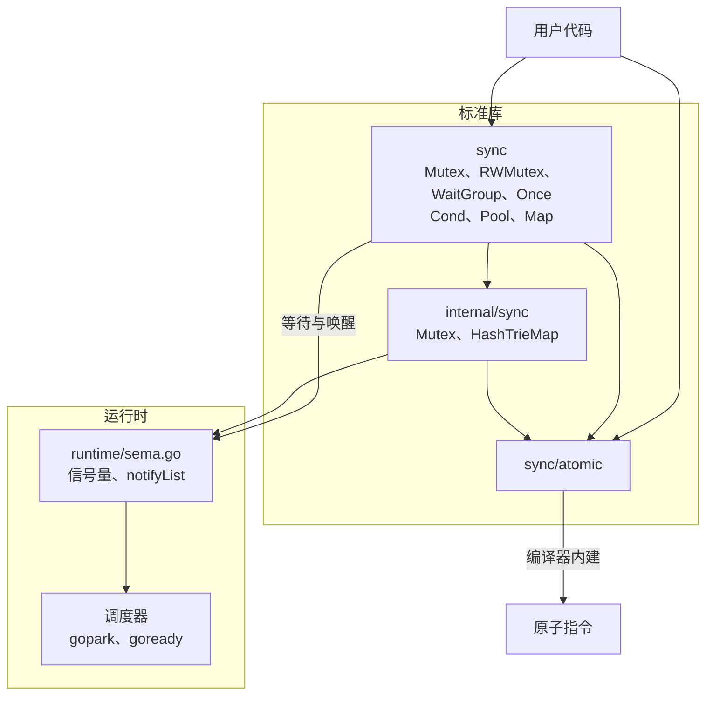

# 11.1 共享内存式同步模式

[1.3.1](../../part1overview/ch01intro/csp.md) 介绍过线程协作的两类方式，即共享内存加锁与消息传递，
并引述了 Lauer 与 Needham 的结论：二者可以相互转换。[第 10 章](../ch10chan/readme.md)讨论了 Go
对消息传递的实现，本章转向共享内存一侧。本节先说明这一侧的工具如何从信号量发展为管程，
再详细考察两类方式之间的对偶关系，并用一个 Go 程序把它写出来；最后说明 Go 如何安排这两类工具，以及 `sync`
包在实现上分为哪几层。

## 11.1.1 从信号量到管程

共享内存一脉的起点，是 Dijkstra 的长文《协作的顺序进程》（Cooperating Sequential
Processes）[[Dijkstra, 1968](#ref-dijkstra-1968)]。文章先讨论只凭普通的读写，
如何让两个进程互斥地进入各自的临界区：几种看似可行的写法被逐一否定，直到 Dekker 给出第一个正确的解，
随后又推广到 N 个进程。这条只用读写的路线，[11.2.1](./mutex.md) 还会讨论。Dijkstra
接着指出这类解法的两个缺陷。其一，程序晦涩，很难看出它满足的只是「互斥」这样一个简单的要求。其二，
等待者一直在反复读写公共变量，白白占用处理器和存储器；而等待期间它们本无事可做，「完全可以去睡眠」。
解法之所以如此曲折，根源在于对公共变量的每次访问都是单向的：一个进程读到某个值之后、据此行动之前，
这个值可能已被其他进程改变，而读本身不会给其他进程留下任何痕迹。

为此，Dijkstra 引入了信号量：一个只能通过 P、V 两个不可分割的操作访问的非负整数。V 把它加一；P
在结果不为负时把它减一，否则让进程等待，直到其他进程执行 V。有了信号量，N 个进程的互斥变得「平凡」：
一个初值为 1 的信号量，把临界区写在一对 P、V 之间即可。取值只有 0 和 1 的称为二元信号量；Scholten
展示了取值更大的「一般信号量」的广泛用途，文中以它解决生产者与消费者问题：在容量为 N 的缓冲区上，
一个信号量为消费者计数已放入的数据，另一个为生产者计数空位，再用一个二元信号量保护缓冲区本身的读写。
文章的最后讨论了「死锁」（原文称 deadly embrace）与避免死锁的银行家算法。

信号量能表达各种同步，但它与它所保护的数据之间没有任何联系：P 与 V 可以写在程序的任何位置，漏写一个 V，
或者在不该持有时访问了数据，编译器都无从发现。1973 至 1974 年，Brinch Hansen 与 Hoare
提出的管程把这种联系固定下来 [[Hoare, 1974](#ref-hoare-1974)]。管程把一组共享数据和操作这些数据的过程声明
在一起：同一时刻只有一个进程能在管程的过程中执行；管程的数据只能由管程自己的过程访问。Hoare 指出，
这一限制能够防止某些隐蔽的、与时序相关的错误，而且只需检查程序文本即可保证，很容易由编译器自动完成。
进程在管程内部需要等待某个条件时，在条件变量上执行 wait，同时让出管程；另一个进程使条件成立后执行 signal
唤醒它（signal 之后由谁先运行，Hoare 与后来的 Mesa 规定不同，见 [11.4](./cond.md)）。Hoare
还引入了管程不变式：程序员可以为管程的数据规定一个不变式，它在初始化之后、每次过程调用的前后以及每次 wait
之前都必须成立。

管程与信号量的表达能力相同。Hoare 在同一篇论文中给出了两个方向的论证：用几个信号量和计数器就能实现
管程的进入、退出、wait 与 signal；反过来，一个只管理单一资源的管程模拟了一个二元信号量，其 acquire 与
release 分别对应 P 与 V，这「简单地证明了管程与条件的概念在原则上并不弱于信号量」。二者的区别在于
写法的结构。Hoare 说，条件变量意在取代信号量，并有自己的使用风格，正如 while 循环或协程意在取代跳转。

另一脉的消息传递，源于 Hoare 的 CSP [[Hoare, 1978](#ref-hoare-1978)]与 Hewitt 等人的 Actor 模型
[[Hewitt et al., 1973](#ref-hewitt-et-al-1973)]，其演变以及二者的区别见
[1.3](../../part1overview/ch01intro/csp.md)，这里不再重复。

## 11.1.2 Lauer 与 Needham 的对偶

1978 年，Hugh Lauer 与 Roger Needham 在 IRIA 的一次操作系统研讨会上发表了《论操作系统结构的对偶性》，
次年重刊于 *Operating Systems Review* [[Lauer and Needham, 1979](#ref-lauer-needham-1979)]。文章自称
是一篇「经验性」的研究：作者考察了一批操作系统，发现它们在进程、同步与通信的组织方式上，大多明显偏向
两类中的一类。消息式系统只有少量、相对固定的大进程，进程之间通过显式的消息通道通信，很少直接共享
内存，例如 IBM 的 OS/360 与 GEC 4080；过程式系统则有大量小进程，创建和销毁都很快，通过直接共享
并加锁的数据通信，例如 HYDRA 与 Plessey System 250。作者为两类系统各构造了一个规范模型，由此得出三点
观察：

1. 两类模型互为对偶。严格按一类模型的原语写成的程序，可以直接映射为符合另一类模型的对偶程序。
2. 对偶的两个程序在逻辑上相同，在文本上也可以非常相似，只在非本质的细节上有差别。
3. 在调度策略相同的前提下，一个程序与其对偶程序的性能相同，包括队列长度、等待时间与服务速率等；而且
   一类操作系统提供的原语，可以做得与另一类中的对偶原语同样高效。

映射关系由下表给出，按原文的对照表整理：

| 消息式 | 过程式 |
| --- | --- |
| 进程，`CreateProcess` | 管程，`NEW`/`START` |
| 消息通道 | 外部过程的标识符 |
| 消息端口 | `ENTRY` 过程的标识符 |
| 发送消息后立即等待回复（`SendMessage`; `AwaitReply`） | 普通的过程调用 |
| 发送消息，稍后再等待回复 | `FORK` …… `JOIN` |
| 发送回复（`SendReply`） | 过程返回（`RETURN`） |
| 资源管理进程的主循环：`WaitForMessage` 与 case 语句 | 管程的锁，过程的 `ENTRY` 属性 |
| case 语句的各个分支 | 各个 `ENTRY` 过程的声明 |
| 有选择地等待消息 | 条件变量，`WAIT` 与 `SIGNAL` |

其中最关键的是主循环与锁的对应。原文写道，资源管理进程的主循环连同其中的 `WaitForMessage` 与 case
语句，「与管程上的互斥锁所起的作用完全相同，即把对服务的请求串行化，每次只接纳一个」；case 语句根据
消息区分所请求的服务，正如管程以不同的过程名区分服务。换言之，锁让一组并发的请求排成一列、依次执行，
一个独占状态、逐条处理消息的进程做的也正是这件事。

下面用 Go 把这种对应写出来。两个类型实现同一个资源池：池中有 n 个单元，`Acquire` 取走一个，没有空闲
单元时等待；`Release` 归还一个。`MonitorPool` 按管程的写法，用一把锁保护计数，用条件变量等待；
`ServerPool` 按消息式的写法，由一个 goroutine 独占计数，在主循环中逐条处理请求。

```go {run=true}
package main

import (
	"fmt"
	"sync"
	"time"
)

// 管程式：一把锁保护状态，条件变量负责等待。
type MonitorPool struct {
	mu   sync.Mutex
	cond sync.Cond
	free int
}

func NewMonitorPool(n int) *MonitorPool {
	p := &MonitorPool{free: n}
	p.cond.L = &p.mu
	return p
}

func (p *MonitorPool) Acquire() {
	p.mu.Lock()
	for p.free == 0 {
		p.cond.Wait()
	}
	p.free--
	p.mu.Unlock()
}

func (p *MonitorPool) Release() {
	p.mu.Lock()
	p.free++
	p.mu.Unlock()
	p.cond.Signal()
}

// 消息式：一个 goroutine 独占状态，在主循环中逐条处理请求。
type ServerPool struct {
	acquire, release chan struct{}
}

func NewServerPool(n int) *ServerPool {
	p := &ServerPool{make(chan struct{}), make(chan struct{})}
	go func() {
		free := n
		for {
			acquire := p.acquire
			if free == 0 {
				acquire = nil // 没有空闲单元时，不接收 Acquire 请求
			}
			select {
			case <-acquire:
				free--
			case <-p.release:
				free++
			}
		}
	}()
	return p
}

func (p *ServerPool) Acquire() { p.acquire <- struct{}{} }
func (p *ServerPool) Release() { p.release <- struct{}{} }

type Pool interface {
	Acquire()
	Release()
}

func try(name string, p Pool) {
	for range 3 {
		p.Acquire()
	}
	done := make(chan struct{})
	go func() {
		p.Acquire()
		close(done)
	}()
	select {
	case <-done:
		fmt.Println(name, "第 4 次 Acquire 没有等待")
		return
	case <-time.After(50 * time.Millisecond):
		fmt.Print(name, "第 4 次 Acquire 在等待；")
	}
	p.Release()
	<-done
	fmt.Println("Release 之后得以完成")
}

func main() {
	try("管程式：", NewMonitorPool(3))
	try("消息式：", NewServerPool(3))
}
```

运行结果如下：

```
管程式：第 4 次 Acquire 在等待；Release 之后得以完成
消息式：第 4 次 Acquire 在等待；Release 之后得以完成
```

两种写法逐项对应。`MonitorPool` 的 `mu` 保证 `Acquire` 与 `Release` 每次只有一个在执行；在
`ServerPool` 中，这项工作由服务 goroutine 的 `for`-`select` 主循环完成，计数 `free` 只属于这个
goroutine，因此不需要锁。两个方法对应 `select` 的两个分支，正如表中 `ENTRY` 过程对应 case 语句的分支。
没有空闲单元时，管程式在条件变量上 `Wait`；消息式则把局部变量 `acquire` 置为 nil，使这个分支暂时
不可选择（[10.1.4](../ch10chan/model.md)），这就是表中最后一行的「有选择地等待消息」：服务 goroutine
暂不接收 `Acquire` 请求，请求方于是阻塞在发送上。此外，无缓冲 channel 的会合把「发送请求」与「等待回复」
合成了一步：发送完成时，服务 goroutine 已经接收了请求，而它只在有空闲单元时才接收 `Acquire` 请求，
因此不需要单独的回复消息。

Lauer 与 Needham 也指出了两类模型之间的一处不对称。过程式的 `WAIT` 比选择性地等待消息更灵活：进程可以
在 `ENTRY` 过程中的任何位置，甚至在它调用的内层过程中等待。代价是，它必须保证等待时管程的不变式成立，
而它的局部变量中可能保存着从管程数据中取得的中间结果，这些结果在它等待期间可能因其他进程进入管程而
失效。因此，在他们看来，`WAIT`「几乎与臭名昭著的 go to 语句一样缺乏结构」。几年前，Hoare 把条件变量
比作取代跳转的 while 循环；到了这里，`WAIT` 本身又被比作了跳转。上例的 `Acquire` 把 `Wait` 写在 `for`
循环里，醒来后重新检查条件，防备的正是这种失效；Go 为什么要求这样使用 `Cond.Wait`，见 [11.4](./cond.md)。

第三点观察有两个前提：调度策略相同，且两类原语可以做得同样高效。在 Go 中，后一个前提并不成立。按
[10.7.2](../ch10chan/pattern.md) 的测量，一次无竞争的 `Mutex` 加锁再解锁约需 5 ns，一次无缓冲 channel
的往返（两次会合）约需 200 ns：`MonitorPool` 在无竞争时只需几次原子操作，`ServerPool`
的每次操作都要与服务 goroutine 会合，通常还要唤醒它。此外，服务 goroutine 永不退出。上例中的池与程序同寿，
因此无妨；若池可以被丢弃，就必须为它提供一个关闭的途径，否则这个 goroutine
会泄漏（[10.4.5](../ch10chan/close.md)）。

Lauer 与 Needham 由此得出结论：选择哪一类模型，不取决于系统要支持的应用，而取决于系统所依托的
「基底」，即在给定的机器架构与硬件约束下，哪一组原语更容易构建、更为合适。他们还评论说，设计团队中
关于进程与同步的争论往往「高度情绪化」，消耗的精力超过系统的任何其他部分，争的却恰恰是这一分析表明
无关紧要的问题。

拿这两类规范模型对照 Go，会发现 Go 兼有二者的特征：goroutine 数量多，创建和销毁都很廉价，这是过程式
模型的特征；goroutine 之间又可以通过 channel 传递消息，这是消息式模型的特征。Lauer 与 Needham 还设想过，
若把消息式的原语嵌入 Mesa 这样的强类型语言，对消息体施加与参数列表相同的类型检查，并把主循环、等待
消息与 case 语句吸收进描述进程的语言单位，那么一个系统与它的对偶在文本上将「只在某些关键字的拼写上
不同」。Go 的类型化 channel 与 `select`，在很大程度上提供了这样的语言构件。

## 11.1.3 Go 的安排

Go 同时提供两类工具，但安排的位置不同。goroutine、channel 与 `select` 是语言的一部分，有专门的语法，
由编译器做类型检查（[第 10 章](../ch10chan/readme.md)）；互斥锁、条件变量、原子操作等则是标准库 `sync`
与 `sync/atomic` 中的普通类型与函数。Effective Go 解释了这种偏向：在许多环境中，并发编程的困难来自
正确访问共享变量所需的种种细节，而 Go 鼓励把共享的值在 channel 上传递，任一时刻只有一个 goroutine
能访问它，数据竞争在设计上就不会发生；同一段文字也承认这种做法可能走得太远，例如引用计数也许最好用一把
互斥锁保护一个整数来实现 [[Go Authors, 2026a](#ref-go-authors-2026a)]。何时该用 channel、何时该用锁，见
[10.7.3](../ch10chan/pattern.md)。

把锁放在库中，意味着语言并不知道一把锁保护的是什么。`sync.Mutex` 加上它所保护的字段，相当于一个手工
构造的管程（[1.3.1](../../part1overview/ch01intro/csp.md)），`sync.Cond` 则是它的条件变量；但管程的数据
只能由管程的过程访问，这一点可以由编译器检查，而一把 `Mutex` 保护哪些字段、哪些代码必须持锁，只能写在
注释里。违反约定的访问，要靠竞态检测器在运行时发现（[10.6.4](../ch10chan/lockfree.md)）。

锁也不属于任何 goroutine。`sync.Mutex` 的文档写道，一把已锁定的 `Mutex` 不与特定的 goroutine 相关联，
允许一个 goroutine 加锁、另一个 goroutine 解锁 [[Go Authors, 2026b](#ref-go-authors-2026b)]。
既然没有持有者，同一个 goroutine 再次加锁也就无从识别，只会阻塞：Go 的互斥锁不可重入。这是有意的设计。
2010 年，一位把 Java 程序移植到 Go 的用户在 golang-nuts 邮件列表上问到 Go 的互斥锁似乎不可重入，Russ Cox
答复说，使用互斥锁的根本原因是它保护不变式：加锁等于声明「我需要不变式成立」，或许还有「我将暂时破坏它」；
解锁等于声明「我不再依赖不变式」以及「若我破坏过它，现已恢复」[[Cox, 2010](#ref-cox-2010)]。若函数 `F`
持锁时调用了同样加锁的 `G`，可重入锁会让 `G` 的加锁直接成功，而此刻 `F` 可能正处于破坏了不变式的中途。Cox
因此认为可重入锁「不保护不变式」，并建议把需要在两种情形下调用的函数拆成两个版本：一个假定调用方已经持锁，
另一个先加锁再调用前者。这里的不变式，与 Hoare 为管程规定的不变式是同一个概念。

goroutine 也没有对外可见的标识，因而也没有与线程局部存储相当的 goroutine 局部存储。Go 的 FAQ 解释说，
goroutine 是匿名的，为的是在并发代码中可以使用完整的语言：一旦某个 goroutine 有了名字，
人们就倾向于把所有计算都与它关联，而忽略用多个、甚至共享的 goroutine 处理同一件事的可能。假如 `net/http`
把每个请求的状态与某个 goroutine 关联，处理请求时就无法再使用更多的 goroutine。
图形库要求所有操作都在「主线程」上执行，也说明了这种做法在并发语言中有多么别扭。确实有某个 goroutine
地位特殊时，可以用 channel 与它交互 [[Go Authors, 2026c](#ref-go-authors-2026c)]，上例中的服务 goroutine
就是如此。与请求相关的数据，则沿着调用链显式传递（[11.8](./context.md)）。

## 11.1.4 sync 包的构成

`sync` 与 `sync/atomic` 的接口在 Go 1 之后只增不减。据 Go 源码树中 `api` 目录对各版本接口的记录
[[Go Authors, 2026d](#ref-go-authors-2026d)]，主要的变化如下：

| 版本 | 变化 |
| --- | --- |
| Go 1.0 | `Mutex`、`RWMutex`、`Once`、`WaitGroup`、`Cond`、`Locker`；原子操作的 `Add`、`CompareAndSwap`、`Load`、`Store` 系列 |
| Go 1.2 | 原子操作的 `Swap` 系列 |
| Go 1.3 | `Pool` |
| Go 1.4 | `atomic.Value` |
| Go 1.9 | `Map` |
| Go 1.15 | `Map.LoadAndDelete` |
| Go 1.17 | `Value.CompareAndSwap`、`Value.Swap` |
| Go 1.18 | `Mutex.TryLock`、`RWMutex.TryLock`、`RWMutex.TryRLock` |
| Go 1.19 | 原子类型 `atomic.Int64`、`atomic.Pointer[T]` 等 |
| Go 1.20 | `Map.Swap`、`Map.CompareAndSwap`、`Map.CompareAndDelete` |
| Go 1.21 | `OnceFunc`、`OnceValue`、`OnceValues` |
| Go 1.23 | `Map.Clear`；原子操作的 `And`、`Or` 系列 |
| Go 1.25 | `WaitGroup.Go` |

Go 1 之后新增的数据结构只有 `Pool`、`atomic.Value` 与 `Map`；其余的新增，多是已有类型上的新方法、
更便利的写法（`TryLock`、`OnceFunc`、`WaitGroup.Go`），或者对已有原子操作的类型化包装。

在实现上，`sync` 中的类型大多分为两部分：无竞争时，在用户态用几次原子操作完成的快速路径；需要等待时，
求助于运行时的慢速路径。



自下而上看：`sync/atomic` 中的函数被编译器视为 `internal/runtime/atomic` 中对应函数的别名，
后者在主流架构上直接展开为原子指令，不经过函数调用（[11.3](./atomic.md)）。`sync.Mutex` 自 Go 1.24
起只是一层包装，实现移到了 `internal/sync`。这样做是为了理顺包的依赖：`HashTrieMap` 需要互斥锁，而 `sync`
又要依赖 `HashTrieMap`，锁的实现因此必须位于两者之下；同一版本中，`sync.Map` 默认改由 `HashTrieMap`
实现（[11.7](./map.md)）。`Mutex`、`RWMutex` 与 `WaitGroup` 需要等待时，调用运行时 `sema.go` 中的信号量；
`Cond` 使用同一文件中的 `notifyList`；`Pool` 借助运行时禁止抢占并取得当前 P 的编号，以访问按 P
划分的缓存，运行时还在每轮垃圾回收开始时清理这些缓存（[11.6](./pool.md)）。

运行时的信号量仍然只有两个操作，`semacquire` 与 `semrelease`，分别对应 Dijkstra 的 P 与 V。但 `sema.go`
开头的注释提醒读者，不要把它们看作信号量，而应看作一种实现睡眠与唤醒的方式：每次睡眠都与一次唤醒配对，
即使由于竞争，唤醒发生在睡眠之前 [[Go Authors, 2026e](#ref-go-authors-2026e)]。这与 Dijkstra
引入信号量的初衷相合，即让等待者去睡眠。其设计参照了 Plan 9 的信号量
[[Mullender and Cox, 2008](#ref-mullender-and-cox-2008)]。获取失败时，`semacquire1` 通过 `goparkunlock`
挂起的是当前 goroutine，而不是它所在的线程：线程随即回到调度循环，转去执行其他
goroutine（[9.4.3](../ch09sched/schedule.md)），直到某次释放调用 `goready` 把等待者重新放入运行队列。在
Go 中，去睡眠的是 goroutine。等待队列如何组织、何时把锁直接交给等待者，见 [11.2](./mutex.md)。

本章其余各节的内容如下：

- [11.2](./mutex.md) 互斥锁：`Mutex` 与 `RWMutex` 的状态字、自旋与饥饿模式，以及运行时信号量的实现。
- [11.3](./atomic.md) 原子操作：`sync/atomic` 的接口、编译器内建与无锁编程的理论。
- [11.4](./cond.md) 条件变量：Hoare 与 Mesa 两种唤醒语义，`Cond` 与 `notifyList` 的实现。
- [11.5](./waitgroup.md) 同步组：`WaitGroup` 的状态字与 `WaitGroup.Go`。
- [11.6](./pool.md) 缓存池：`Pool` 按 P 划分的缓存与 victim 缓存。
- [11.7](./map.md) 并发安全散列表：`sync.Map` 的两代实现。
- [11.8](./context.md) 上下文：取消信号与截止时间沿调用树的传播。
- [11.9](./mem.md) 内存模型：上述原语与 channel 共同提供的先行发生关系
  [[Go Authors, 2026f](#ref-go-authors-2026f)]。

## 延伸阅读

- <a id="ref-cox-2010"></a>[Cox, 2010] Russ Cox. Reply in "Experimenting with GO." golang-nuts, 9 June
  2010. https://groups.google.com/g/golang-nuts/c/XqW1qcuZgKg/m/Ui3nQkeLV80J
  解释 Go 的互斥锁为何不可重入：互斥锁保护的是不变式。
- <a id="ref-dijkstra-1968"></a>[Dijkstra, 1968] Edsger W. Dijkstra. "Cooperating Sequential Processes."
  In F. Genuys (ed.), *Programming Languages: NATO Advanced Study Institute*, 43–112. Academic Press,
  1968. https://www.cs.utexas.edu/~EWD/transcriptions/EWD01xx/EWD123.html
  手稿编号 EWD123，信号量的出处。讨论了临界区、Dekker 的解、P 与 V 操作、生产者与消费者，以及死锁与
  银行家算法。
- <a id="ref-go-authors-2026a"></a>[Go Authors, 2026a] The Go Authors. *Effective Go: Share by
  communicating.* https://go.dev/doc/effective_go#sharing
- <a id="ref-go-authors-2026b"></a>[Go Authors, 2026b] The Go Authors. *src/sync/mutex.go*（`Mutex.Unlock`
  的文档）. https://github.com/golang/go/blob/release-branch.go1.26/src/sync/mutex.go
- <a id="ref-go-authors-2026c"></a>[Go Authors, 2026c] The Go Authors. *Frequently Asked Questions (FAQ)*,
  "Why is there no goroutine ID?" https://go.dev/doc/faq#no_goroutine_id
- <a id="ref-go-authors-2026d"></a>[Go Authors, 2026d] The Go Authors. *api/*（各版本公开接口的记录）.
  https://github.com/golang/go/tree/release-branch.go1.26/api
- <a id="ref-go-authors-2026e"></a>[Go Authors, 2026e] The Go Authors. *src/runtime/sema.go*.
  https://github.com/golang/go/blob/release-branch.go1.26/src/runtime/sema.go
- <a id="ref-go-authors-2026f"></a>[Go Authors, 2026f] The Go Authors. *The Go Memory Model.*
  https://go.dev/ref/mem
- <a id="ref-hewitt-et-al-1973"></a>[Hewitt et al., 1973] Carl Hewitt, Peter Bishop, Richard Steiger. "A
  Universal Modular ACTOR Formalism for Artificial Intelligence." *IJCAI*, 1973. Actor 模型的出处。
- <a id="ref-hoare-1974"></a>[Hoare, 1974] C. A. R. Hoare. "Monitors: An Operating System Structuring
  Concept." *Communications of the ACM*, 17(10), 1974. https://doi.org/10.1145/355620.361161
- <a id="ref-hoare-1978"></a>[Hoare, 1978] C. A. R. Hoare. "Communicating Sequential Processes."
  *Communications of the ACM*, 21(8), 1978. https://doi.org/10.1145/359576.359585
  消息传递一脉的奠基之作，见 [1.3](../../part1overview/ch01intro/csp.md)。
- <a id="ref-lauer-needham-1979"></a>[Lauer and Needham, 1979] Hugh C. Lauer, Roger M. Needham. "On the
  Duality of Operating System Structures." *ACM SIGOPS Operating Systems Review*, 13(2): 3–19, 1979.
  https://doi.org/10.1145/850657.850658
  原载于 1978 年 10 月 IRIA 第二届操作系统国际研讨会论文集。论证消息传递与共享内存两类系统互为对偶。
- <a id="ref-mullender-and-cox-2008"></a>[Mullender and Cox, 2008] Sape Mullender and Russ Cox.
  *Semaphores in Plan 9*. 2008. https://swtch.com/semaphore.pdf
  Go 运行时信号量（`runtime/sema.go`）的设计渊源。
