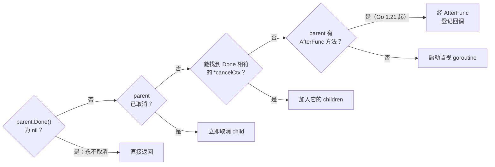
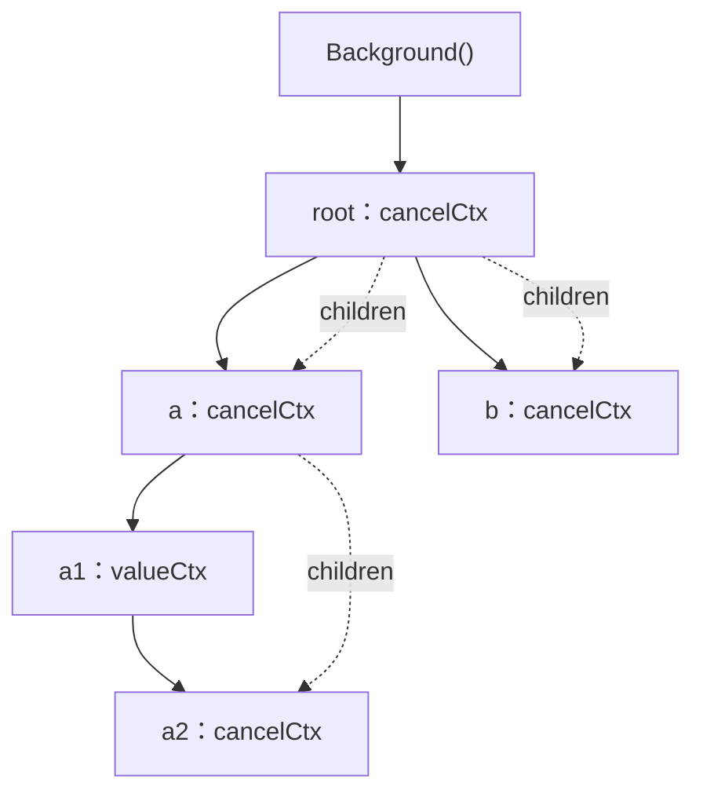

# 11.8 上下文

服务器收到的一个请求，通常不会只由一个 goroutine 处理完。处理函数会再启动 goroutine 去查询数据库、
调用下游服务、读取缓存，这些 goroutine 还可能继续派生，形成一棵以请求为根的树。
一旦请求的发起方不再需要结果，例如客户端断开了连接，或者上游已经超时，树上仍在运行的工作就成了浪费：
它们占用连接、锁与内存，产出却无人读取。问题于是成为：如何把「停止」这一信号从树根送到每一片叶子，
并让每个 goroutine 各自收尾。

`context` 包是 Go 对这一问题的标准回答。按照包文档的说法，`Context` 在 API 边界之间、
进程之间携带截止时间、取消信号以及其他请求范围内的值 [[Go Authors, 2026a](#ref-go-authors-2026a)]。它在
Google 内部开发，2014 年以 `golang.org/x/net/context` 公开 [[Ajmani, 2014b](#ref-ajmani-2014b)]；2016 年，
Brad Fitzpatrick 与 Sameer Ajmani 提议将其并入标准库 [[Fitzpatrick, 2016a](#ref-fitzpatrick-2016a)]，随
Go 1.7 发布 [[Fitzpatrick, 2016b](#ref-fitzpatrick-2016b)]。同一版本中，`net/http` 的 `Request` 有了
`Context` 方法，`net.Dialer` 有了 `DialContext`，`os/exec` 有了 `CommandContext`。

本节先说明取消为什么是协作式的，再沿取消树走一遍实现，接着讨论截止时间与 Go 1.20、1.21 补充的接口，
然后把 `context` 放进结构化并发的谱系，最后回顾围绕值传递与显式传参的争论。

## 11.8.1 协作式取消

最直接的设计，是提供一个从外部终止 goroutine 的操作。Go 没有这样的操作，Java 的经历说明了原因。Java
最初提供 `Thread.stop`，JDK 1.2 即将其废弃。Oracle 的说明是：被停止的线程会释放它锁住的所有监视器，
这些监视器保护的对象若正处于不一致的状态，其他线程就会看到「受损」的对象；而且线程是被静默杀死的，
程序得不到任何警告，损坏可能在数小时甚至数天之后才显现 [[Oracle, 2023](#ref-oracle-2023)]。
锁所保护的不变式只在临界区的边界上成立，外部无从知道目标线程此刻是否正处在临界区之中。JDK 20 把
`Thread.stop` 改为总是抛出 `UnsupportedOperationException` [[OpenJDK, 2022](#ref-openjdk-2022)]，JDK 26
则将它删除 [[OpenJDK, 2025](#ref-openjdk-2025)]。

Go 从一开始就没有给出这种操作的入口：goroutine 是匿名的，不向程序员暴露任何标识符、名字或数据结构
[[Go Authors, 2026b](#ref-go-authors-2026b)]，`go` 语句也不返回可以用来控制它的句柄。
取消因此只能是一个信号：发出方只负责通知，接收方在自己选定的检查点查看信号，再决定如何撤销、回滚、
释放资源。这种方式称为**协作式取消**。它并非 Go 独有。.NET 的取消模型明言「取消是协作式的，
不会强加给监听者」[[Microsoft, 2026](#ref-microsoft-2026)]；Kotlin 文档同样说明协程的取消是协作式的
[[JetBrains, 2026b](#ref-jetbrains-2026b)]；Java 的结构化并发在取消时也只是中断子任务的线程，
并要求子任务在被中断时尽快结束 [[Bateman et al., 2026](#ref-bateman-et-al-2026)]。

在 `context` 出现之前，Go 程序用 done channel 传递取消：关闭一个 channel 能唤醒数量未知的等待者，
相当于一次广播（[10.4.3](../ch10chan/close.md)）[[Ajmani, 2014a](#ref-ajmani-2014a)]。
这一手法在一条流水线之内足够好用，但工作扇出成树之后，它的局限就显现出来：一个 done channel
只能取消整棵树，要单独取消某棵子树，就得再引入一个 channel；截止时间、取消的原因都要另行传递；
而且各个库各有各的取消方式，调用方的 channel 无法传进别人的函数 [[Štrba, 2017](#ref-strba-2017)]。
`context` 用一个统一的接口解决了这些问题，并使取消沿树自动传播。

## 11.8.2 取消树

`Context` 接口只有四个方法（注释从略）：

```go
type Context interface {
	Deadline() (deadline time.Time, ok bool)
	Done() <-chan struct{}
	Err() error
	Value(key any) any
}
```

`Done` 返回一个在取消时被关闭的 channel，永远不会被取消的 context 可以返回 nil；使用方把它放进 `select`，
与自己的正常工作并列等待。`Done` 关闭之前，`Err` 返回 nil，关闭之后返回 `Canceled` 或 `DeadlineExceeded`，
说明取消的原因。`Deadline` 报告截止时间，`Value` 读取请求范围内的值（11.8.6）。

接口中没有 `Cancel` 方法。Ajmani 解释说，这与 `Done` 只能接收是同一个道理：
接收取消信号的函数通常不是发出信号的那一方，父操作为子操作启动 goroutine 时，子操作不应能够取消父操作
[[Ajmani, 2014b](#ref-ajmani-2014b)]。取消的权力因此不随 `Context` 传递，而是作为单独的 `CancelFunc`
交给创建者。.NET 的设计与此相同：`CancellationTokenSource` 负责发出取消请求，传给各个操作的
`CancellationToken` 只能监听，文档称之为「请求与监听相分离」[[Microsoft, 2026](#ref-microsoft-2026)]。

所有 context 都从一个根派生。`Background` 返回的根永不取消，没有值，也没有截止时间；`TODO` 与它相同，
只用来标记「此处尚未确定该用哪个 context」。`WithCancel`、`WithDeadline`、`WithTimeout`、`WithValue`
各自接受一个父 context，返回派生的子 context。文档规定，一个 context 被取消时，从它派生的所有 context
也随之取消 [[Go Authors, 2026a](#ref-go-authors-2026a)]；而它的父节点与兄弟节点不受影响。下面的程序在
`root` 之下派生出 `a` 与 `b`，在 `a` 之下先附加一个值，再派生出 `a2`，然后取消 `a`：

```go {run=true}
package main

import (
	"context"
	"errors"
	"fmt"
)

type traceKey struct{}

func main() {
	root, cancelRoot := context.WithCancel(context.Background())
	defer cancelRoot()

	a, cancelA := context.WithCancelCause(root)
	a1 := context.WithValue(a, traceKey{}, "trace-42")
	a2, cancelA2 := context.WithCancel(a1)
	defer cancelA2()
	b, cancelB := context.WithCancel(root)
	defer cancelB()

	cancelA(errors.New("配额耗尽"))

	for _, n := range []struct {
		name string
		ctx  context.Context
	}{{"root", root}, {"a", a}, {"a2", a2}, {"b", b}} {
		fmt.Printf("%-4s Err=%v Cause=%v\n", n.name, n.ctx.Err(), context.Cause(n.ctx))
	}
	fmt.Printf("a2 中的追踪 ID：%v\n", a2.Value(traceKey{}))
}
```

运行结果如下：

```
root Err=<nil> Cause=<nil>
a    Err=context canceled Cause=配额耗尽
a2   Err=context canceled Cause=配额耗尽
b    Err=<nil> Cause=<nil>
a2 中的追踪 ID：trace-42
```

取消只沿派生关系向下传播，`root` 与 `b` 不受影响。`Err` 只能给出笼统的 `context canceled`，具体原因要用
`Cause` 取回（11.8.4）。值在取消之后仍然可以读取。需要说明的是，`Done` 的文档允许关闭在 `cancel`
返回之后才异步发生，上面的输出之所以确定，是因为标准库自己的 context 在 `cancel`
返回之前就已逐个取消了所有后代；父节点是自定义实现时，情况有所不同，见下文。

可取消的 context 由 `cancelCtx` 实现：

```go
type cancelCtx struct {
	Context

	mu       sync.Mutex            // protects following fields
	done     atomic.Value          // of chan struct{}, created lazily, closed by first cancel call
	children map[canceler]struct{} // set to nil by the first cancel call
	err      atomic.Value          // set to non-nil by the first cancel call
	cause    error                 // set to non-nil by the first cancel call
}
```

嵌入的 `Context` 指向父节点，`children` 记录需要随之取消的后代。这个结构的几处细节都来自后来的性能修改。
`done` 起初在创建时就分配，2017 年 Josh Bleecher Snyder 把它改为在第一次调用 `Done` 时才创建：许多
context 从未被人监听，或者在被监听之前就已取消。深度为 1 的取消树的基准测试中，每次操作的分配从
176 字节降到 80 字节 [[Snyder, 2017](#ref-snyder-2017)]。2021 年，`done` 改存于 `atomic.Value`，`Done`
的快速路径不再加锁，起因是一份报告指出 `cancelCtx` 的互斥锁在高并发下争用极其严重；相应基准测试的耗时从
67.5 纳秒降到 2.2 纳秒 [[Snyder, 2021](#ref-snyder-2021)]。

`err` 也经历了同样的修改，并由此引出一个微妙的错误。Go 1.25 把 `err` 改为原子变量，`Err` 不再加锁，
源码注释说原子读取比互斥锁快约 5 倍，在紧凑的循环里这一差距可能很重要 [[Neil, 2025a](#ref-neil-2025a)]。
但 `cancel` 是先写入 `err`、再关闭 `done` 的，两者分别发布，不加锁的读者可能看到 `err` 已经非 nil、而
`done` 尚未关闭，这违反了接口文档「`Done` 关闭之前 `Err` 返回 nil」的承诺。Go 1.26 修正了这一点
[[Neil, 2025b](#ref-neil-2025b)]：

```go
func (c *cancelCtx) Err() error {
	// An atomic load is ~5x faster than a mutex, which can matter in tight loops.
	if err := c.err.Load(); err != nil {
		// Ensure the done channel has been closed before returning a non-nil error.
		<-c.Done()
		return err.(error)
	}
	return nil
}
```

读到非 nil 的错误之后，先等 `done` 关闭再返回。返回 nil 的路径没有变化；返回错误的路径慢了约 3 倍，但仍比
Go 1.25 之前快，而且一个检查 `Err` 的循环在第一次得到非 nil 时就会结束，这条路径并不关键。
两个分别发布的状态必须以确定的次序被观察到，这正是内存模型讨论的问题（[11.9](./mem.md)）。

取消本身由 `cancel` 完成（删去了参数检查）：

```go
func (c *cancelCtx) cancel(removeFromParent bool, err, cause error) {
	// ……
	c.mu.Lock()
	if c.err.Load() != nil {
		c.mu.Unlock()
		return // already canceled
	}
	c.err.Store(err)
	c.cause = cause
	d, _ := c.done.Load().(chan struct{})
	if d == nil {
		c.done.Store(closedchan)
	} else {
		close(d)
	}
	for child := range c.children {
		// NOTE: acquiring the child's lock while holding parent's lock.
		child.cancel(false, err, cause)
	}
	c.children = nil
	c.mu.Unlock()

	if removeFromParent {
		removeChild(c.Context, c)
	}
}
```

锁内的检查保证 `cancel` 是幂等的，`done` 至多关闭一次；若还没有人调用过 `Done`，就存入一个预先关闭的共享
channel `closedchan`，免去分配。随后在持有自身锁的情况下逐个取消后代，后代再递归取消自己的后代。
注释特意指出，这里在持有父节点锁的同时获取子节点的锁；取消沿树向下传播时，锁总是按先父后子的次序获取。
最后把 `children` 置为 nil，并在释放锁之后把自己从父节点的 `children` 中摘除。

子节点如何挂到父节点上，由 `propagateCancel` 决定，它要应付父节点的各种形态：



第三个判断不检查父节点是不是 `*cancelCtx`，而是向它查询一个特殊的键 `&cancelCtxKey`：`cancelCtx`
对这个键返回自身，于是无论中间隔着多少层 `WithValue`，或者被哪种自定义实现包装，都能找到最近的
`*cancelCtx`；只要它的 done channel 与父节点 `Done` 返回的相同，说明包装没有改变取消的语义，
就可以直接登记。这是 Russ Cox 2019 年的修改，此前的做法是沿已知类型逐层上溯，用户为了管理值而自己实现
`Context` 时，`WithCancel` 就会为之额外启动 goroutine [[Cox, 2019](#ref-cox-2019)]。前面例子中的 `a2`
正是这样越过 `a1`，直接登记在 `a` 的 `children` 中的：



图中实线表示派生关系，虚线表示 `children` 中的登记，取消沿虚线传播。

流程图的最后一条分支是兜底：父节点完全是一个未知的实现时，只能启动一个 goroutine 等待两者之一结束。
父节点先取消，就把取消转发给子节点；子节点先结束，这个 goroutine 就退出。此时取消要经过一次 goroutine
调度才能到达子节点，`Done` 的文档说关闭「可能在 `cancel` 返回之后异步发生」，指的就是这种情形。

## 11.8.3 截止时间

截止时间是到点自动触发的取消。`timerCtx` 在 `cancelCtx` 之上只多了一个定时器与一个时刻：

```go
type timerCtx struct {
	cancelCtx
	timer *time.Timer // Under cancelCtx.mu.

	deadline time.Time
}
```

`WithDeadline` 直接调用 `WithDeadlineCause`，后者的实现如下（删去了 nil 检查）：

```go
func WithDeadlineCause(parent Context, d time.Time, cause error) (Context, CancelFunc) {
	// ……
	if cur, ok := parent.Deadline(); ok && cur.Before(d) {
		// The current deadline is already sooner than the new one.
		return WithCancel(parent)
	}
	c := &timerCtx{
		deadline: d,
	}
	c.cancelCtx.propagateCancel(parent, c)
	dur := time.Until(d)
	if dur <= 0 {
		c.cancel(true, DeadlineExceeded, cause) // deadline has already passed
		return c, func() { c.cancel(false, Canceled, nil) }
	}
	c.mu.Lock()
	defer c.mu.Unlock()
	if c.err.Load() == nil {
		c.timer = time.AfterFunc(dur, func() {
			c.cancel(true, DeadlineExceeded, cause)
		})
	}
	return c, func() { c.cancel(true, Canceled, nil) }
}
```

父节点的截止时间若早于新的截止时间，父节点到点时会连同子节点一起取消，再为子节点安装定时器是多余的，
于是退化为 `WithCancel`。截止时间若已经过去，立即以 `DeadlineExceeded` 取消。否则用 `time.AfterFunc`
注册回调（[9.10](../ch09sched/timer.md)），到点时取消。`WithTimeout(parent, d)` 不过是
`WithDeadline(parent, time.Now().Add(d))`。`DeadlineExceeded` 实现了 `net.Error` 接口，其 `Timeout`
方法返回 true，使它在网络代码中可以与 I/O 超时一并处理。`Deadline`
方法让被调方在开始工作之前就能判断剩余时间是否足够，不够时干脆不开始
[[Ajmani, 2014b](#ref-ajmani-2014b)]。

无论取消由谁触发，`WithCancel`、`WithDeadline`、`WithTimeout` 返回的 `CancelFunc` 都必须调用，
哪怕工作已经正常结束。文档写道，调用它会取消子节点及其后代、移除父节点对子节点的引用、停止相关的定时器；
不调用，子节点及其后代就会一直泄漏，直到父节点被取消 [[Go Authors, 2026a](#ref-go-authors-2026a)]。
在一个长期存在的父节点之下，这就是持续增长的内存泄漏。惯用写法是在创建之后紧接着 `defer cancel()`。
`go vet` 的 lostcancel 检查与 `context` 同在 Go 1.7 加入，它在控制流图上寻找从 `WithCancel` 到 `return`
却没有使用 `cancel` 的路径；Alan Donovan 在 5 万个源文件的样本上运行它，找到 2068 处把 `cancel`
赋给空白标识符的写法和 118 处在调用 `cancel` 之前返回的错误，人工检查其中 20 处，没有发现误报
[[Donovan, 2016](#ref-donovan-2016)]。这项检查需要显式运行 `go vet`，`go test`
自动运行的那组检查不包括它。

## 11.8.4 取消的原因、脱离与回调

`Err` 只能区分「被取消」与「超时」两种结果，排查问题时往往不够。2018 年有人在 issue 中请求，希望能查出
context 是在哪里被取消的；Ajmani 据此在 2022 年提出了取消原因的接口 [[Ajmani, 2022a](#ref-ajmani-2022a)]。
提案列出了 Go 1 兼容性带来的约束：不能给 `Context` 接口增加方法，不能改变 `CancelFunc`
的类型和已有函数的签名，`Err` 也只能返回 nil、`Canceled`、`DeadlineExceeded` 三者之一。于是 Go 1.20
新增了 `WithCancelCause`，它返回的 `CancelCauseFunc` 接受一个 error 作为原因，记入 `cancelCtx.cause`；
原因由包级函数 `Cause` 取回，它同样借助 `&cancelCtxKey` 找到最近的 `cancelCtx`。原因由第一次取消决定：
父节点先以 cause1 取消，则父子两者的原因都是 cause1；子节点先以 cause2 取消，则子节点的原因保持为 cause2。
Go 1.21 又补上了 `WithDeadlineCause` 与 `WithTimeoutCause`，为到点触发的取消指定原因，它们返回的
`CancelFunc` 不设置原因 [[Ajmani, 2022b](#ref-ajmani-2022b)]。

Go 1.21 还加入了两个函数。`WithoutCancel` 派生一个保留值、但切断取消的 context：它的 `Done` 返回 nil，
`Err` 恒为 nil，`Cause` 也返回 nil。提案者 Carlo Alberto Ferraris 列举的用途是：触发事件（例如一个 HTTP
请求）已被取消或已经结束，却仍要完成回滚、清理或长时间的后续操作，而这些操作需要请求附带的认证、日志、
追踪等值；改用 `Background` 就会丢失这些值。提案还指出，类似的函数已在各处被重复实现了多次，例如
`x/tools` 内部的 `xcontext.Detach` [[Ferraris, 2020](#ref-ferraris-2020)]。实现上，`withoutCancelCtx` 的
`Done` 返回 nil，从它派生的子节点在 `propagateCancel` 的第一个判断处就直接返回，不会登记到原来的取消树上；
它在被查询 `&cancelCtxKey` 时也返回 nil，否则 `Cause` 会穿过它找到原来的 `cancelCtx`，取回父节点的原因。

`AfterFunc(ctx, f)` 在 `ctx` 取消之后，于一个新的 goroutine 中运行 `f`，并返回一个 `stop`
函数用于撤销登记。Damien Neil 的提案指出，要在取消时打断一个不认识 context 的阻塞操作，例如 `net.Conn`
上的读写或 `sync.Cond` 上的等待，只能为每次操作启动一个监视取消的 goroutine，
操作本身很便宜时这样做并不划算；`AfterFunc` 只登记一个回调，在通常不发生取消的情况下不必创建 goroutine
[[Neil, 2023](#ref-neil-2023)]。它的实现是一个嵌入 `cancelCtx` 的 `afterFuncCtx`，作为子节点挂进取消树，
另用一个 `sync.Once` 在「运行 `f`」与「被 `stop` 撤销」之间二选一。
标准库的示例用它让条件变量的等待可以被取消（删去了部分注释）：

```go
waitOnCond := func(ctx context.Context, cond *sync.Cond, conditionMet func() bool) error {
	stopf := context.AfterFunc(ctx, func() {
		// We need to acquire cond.L here to be sure that the Broadcast
		// below won't occur before the call to Wait, which would result
		// in a missed signal (and deadlock).
		cond.L.Lock()
		defer cond.L.Unlock()

		// ……
		cond.Broadcast()
	})
	defer stopf()

	for !conditionMet() {
		cond.Wait()
		if ctx.Err() != nil {
			return ctx.Err()
		}
	}

	return nil
}
```

这段代码浓缩了 [11.4](./cond.md) 的几个要点。回调先取得 `cond.L` 再广播，否则广播可能发生在等待者调用
`Wait` 之前，造成信号丢失。条件变量无法只唤醒某一个特定的等待者，只能广播，N 个并发的等待者因此各自引起
O(N) 次无谓的唤醒，总开销是 O(N²)，示例的原注释明确指出了这一代价。等待者被唤醒时，可能是因为别人的
context 被取消，所以必须在循环中重新检查条件与 `ctx.Err()`，这正是 Mesa
语义的要求（[11.4.2](./cond.md)）。

`AfterFunc` 还反过来补全了 `propagateCancel`：自定义的 context 只要提供 `AfterFunc(func()) func() bool`
方法，从它派生子节点时就会走上图中「经 AfterFunc 登记回调」的分支，用回调代替监视 goroutine。

## 11.8.5 结构化并发

`context` 回答的是「如何让一棵 goroutine 树上的工作停下来」，并不约束这棵树的形状。「结构化并发」一词由
Martin Sústrik 在 2016 年提出 [[Sústrik, 2016](#ref-sustrik-2016)]，经 Nathaniel J. Smith
2018 年的文章而广为人知 [[Smith, 2018](#ref-smith-2018)]，其含义与动机见
[3.6.5](../../part1overview/ch03life/main.md)。从它的角度看，取消只是问题的一半，另一半是等待。

Dave Cheney 在 2017 年指出，`Context` 最重要的功能是广播取消信号，但这一功能并不完整，
因为无法等待信号得到确认 [[Cheney, 2017](#ref-cheney-2017)]。Cheney 拿来对照的是 Gustavo Niemeyer
2011 年的 tomb 包 [[Niemeyer, 2011](#ref-niemeyer-2011)]：它只管 goroutine 的生命周期，既能通知目标停止，
也能等待目标确认已经停止，还能收集最终的错误。Smith 描述的 Trio 正是把这一半做进了作用域：nursery
总是等待其中的任务退出，即使任务正在被取消，也要等它运行完清理代码；某个任务抛出未处理的异常时，nursery
先取消其余任务、等它们结束，再把异常向外抛出。Smith 同时提醒，这要求 nursery 与语言的取消机制紧密结合，
而在 C# 或 Go 这类靠手工传递对象与约定来管理取消的语言里，这可能并不容易。

各语言的做法可以对照如下：

| 系统 | 作用域原语 | 取消如何送达 | 离开作用域时 |
| --- | --- | --- | --- |
| Trio | nursery | 在下一个检查点抛出 `Cancelled` | 等待全部任务结束 |
| Python asyncio（3.11 起） | `TaskGroup` | 在任务中抛出 `CancelledError` | 等待全部任务结束 |
| Kotlin | 协程作用域 | 在下一次检查取消时抛出 `CancellationException` | 父协程等待子协程结束 |
| Java | `StructuredTaskScope` | 中断子任务的线程 | `close` 等待子任务的线程结束 |
| .NET | 无对应原语 | `CancellationToken`，由轮询、回调或等待句柄得知 | 由调用方自行等待 |
| Go | 无语言原语，errgroup 近似 | 关闭 `Done` channel，由代码在 `select` 中检查 | 调用 `Wait` 时才等待 |

Python 的 `TaskGroup` 自 3.11 起提供 [[Python Software Foundation, 2026](#ref-psf-2026)]。Kotlin 文档说，
父协程在结束之前等待子协程完成，父协程失败或被取消时，所有子协程被递归取消
[[JetBrains, 2026a](#ref-jetbrains-2026a)]，这与 `context` 的取消树几乎同构。Java 的
`StructuredTaskScope` 在 JDK 19、20 中以孵化模块的形式出现，JDK 21 起成为预览 API，此后在 JDK 22 至 27
中多次重新预览，其中 JDK 25 的第五轮预览对 API 作了较大调整
[[Bateman et al., 2025](#ref-bateman-et-al-2025)]；正式版 JEP 543 提议在 JDK 28 中不加修改地定稿，
目前状态为「已集成」。按照它的描述，子任务失败时其余子任务被中断，所有者线程被中断时子任务也随之取消，
作用域关闭时等待所有子任务的线程结束 [[Bateman et al., 2026](#ref-bateman-et-al-2026)]。

对照之下有两点值得注意。其一，各家的取消都是协作式的，区别在于取消如何送达。Trio、asyncio、Kotlin
由运行时在挂起点或检查点自动抛出异常，因为运行时知道每个任务属于哪个作用域；Go 的取消是一个显式传递的值，
没有接收 `ctx` 的阻塞操作，例如 channel 的收发、`Mutex.Lock`、`time.Sleep`，都不会察觉取消，
每一处需要响应取消的等待都要写成 `select`。这正是 `ctx` 不得不出现在一长串函数签名中的原因（11.8.6）。
其二，等待在 Java、Trio、Kotlin 中由作用域保证，在 Go 中则交给 `WaitGroup` 与 errgroup：errgroup 把等待、
收集第一个错误与取消派生的 context 结合在一起，其实现见 [10.7.4](../ch10chan/pattern.md)；`WaitGroup.Go`
使「启动时即登记」成为最简单的写法（[11.5.7](./waitgroup.md)）；Go 社区关于修改 `go` 语句的讨论见
[10.7.6](../ch10chan/pattern.md)。Smith 后来在文章的脚注中补记：有人指出了 Go 中与此高度相关的 errgroup。

## 11.8.6 值与显式传参之争

`WithValue` 返回的 `valueCtx` 极为简单：

```go
type valueCtx struct {
	Context
	key, val any
}
```

`Value(key)` 命中自己的键就返回，否则沿父节点链向上查找，耗时与派生深度成正比。Go 1.18 起，
这一查找由递归改为循环：一个生产服务器的剖析显示，2.3% 的 CPU 时间花在调用链中有 12 层以上 `Value`
嵌套时的栈扩张上 [[roudkerk, 2021](#ref-roudkerk-2021)]。派生从不修改父节点，所有 context
构成一个不可变的持久化链表，兄弟节点共享祖先，并发读取不需要任何同步。文档对键提出了几条要求：
键必须可比较，不应使用 `string` 等内置类型，以免不同包之间冲突；包应当定义未导出的键类型，
并提供类型安全的存取函数；键常用 `struct{}` 类型，赋给接口时不必分配
[[Go Authors, 2026a](#ref-go-authors-2026a)]。

更大的争议在于什么该放进 `Value`，以及 `ctx` 是否该出现在每个函数的签名中。文档划出的界线是：
值只用于跨越进程与 API 边界的、请求范围内的数据，不要用它向函数传递可选参数。Michal Štrba 在
2017 年的文章中批评，`context` 像病毒一样扩散，一个库只要可能被服务器使用，就得在耗时的函数上接受 `ctx`；
`Value` 没有静态类型，与线程局部存储相似；整个 `context` 在多数情况下只是一个低效的链表。但 Štrba 也承认，
它确实解决了取消这个在 Go 中颇为困难的问题，并主张由 Go 2 在语言层面直接解决
[[Štrba, 2017](#ref-strba-2017)]，次年提交的相应提案三周后即被关闭 [[Štrba, 2018](#ref-strba-2018)]。
Damien Neil 则从另一个方向提出，可否用 goroutine 局部存储整个取代 `Context`
[[Neil, 2017](#ref-neil-2017)]。Ian Lance Taylor 关闭了这一提案，理由是现行的显式机制是有意选择的，
而且看来行之有效，若每创建一个 goroutine 都复制一份局部数据，代价也可能很高
[[Taylor, 2018b](#ref-taylor-2018b)]。Go 的 FAQ 给出了更根本的理由：goroutine 之所以匿名，
正是为了避免把计算绑定在某个特定的 goroutine 上；假如 `net/http` 把每个请求的状态与 goroutine 关联起来，
客户端在处理请求时就无法再使用更多的 goroutine [[Go Authors, 2026b](#ref-go-authors-2026b)]。

Cheney 的主张与 Štrba 方向相反：值才是 `context` 名副其实的用途，应当让它只是一个请求范围内的、
写时复制的值列表，而把生命周期管理分离出去 [[Cheney, 2017](#ref-cheney-2017)]。Taylor 在
2018 年开设了讨论 `context` 新版本的 issue，汇总了几项不满：`ctx context.Context` 的写法重复；`WithValue`
接受任意类型的键，容易误用；`Context` 这个名字令人困惑，因为它主要用于取消；以及到处显式传递 `ctx` 本身
[[Taylor, 2018a](#ref-taylor-2018a)]。这个 issue 至今仍未关闭。

与显式传参相应的另一条规则，是不要把 `Context` 存进结构体，而应把它作为第一个参数显式传给每个需要它的函数
[[Barkhuysen and Proud, 2021](#ref-barkhuysen-proud-2021)]。Fitzpatrick 在并入标准库的提案中就说过，
真正的建议是不要「保存」context，它应像参数一样被传递 [[Fitzpatrick, 2016a](#ref-fitzpatrick-2016a)]。
`http.Request` 内部持有 context 是这条规则的例外：Go 1.7 引入 `context` 时，`Client.Do`
等方法若增加参数就会破坏兼容性，`net/http` 于是把 context 放进请求结构体，由 `WithContext` 返回携带新
context 的请求；另一种兼容的做法是增加以 `Context` 为后缀的新函数，例如 `net.Dialer` 的 `DialContext`
[[Barkhuysen and Proud, 2021](#ref-barkhuysen-proud-2021)]。显式传参的代价是签名冗长，
换来的是取消与截止时间的传递路径在代码中清晰可见，并能由工具静态检查。在「签名整洁」与「数据流可见」之间，
Go 又一次选择了后者。

## 延伸阅读

- <a id="ref-ajmani-2014a"></a>[Ajmani, 2014a] Sameer Ajmani. *Go Concurrency Patterns: Pipelines and
  cancellation.* The Go Blog, March 13, 2014. https://go.dev/blog/pipelines
- <a id="ref-ajmani-2014b"></a>[Ajmani, 2014b] Sameer Ajmani. *Go Concurrency Patterns: Context.* The Go
  Blog, July 29, 2014. https://go.dev/blog/context
- <a id="ref-ajmani-2022a"></a>[Ajmani, 2022a] Sameer Ajmani. Go issue #51365. *context: add APIs for
  writing and reading cancelation cause.* 2022. https://github.com/golang/go/issues/51365
  随 Go 1.20 发布。
- <a id="ref-ajmani-2022b"></a>[Ajmani, 2022b] Sameer Ajmani. Go issue #56661. *context: add APIs for
  setting a cancelation cause when deadline or timer expires.* 2022.
  https://github.com/golang/go/issues/56661
  随 Go 1.21 发布。
- <a id="ref-barkhuysen-proud-2021"></a>[Barkhuysen and Proud, 2021] Jean Barkhuysen, Matt T. Proud.
  *Contexts and structs.* The Go Blog, February 24, 2021. https://go.dev/blog/context-and-structs
- <a id="ref-bateman-et-al-2025"></a>[Bateman et al., 2025] Alan Bateman, Viktor Klang, Ron Pressler. *JEP
  505: Structured Concurrency (Fifth Preview).* OpenJDK, JDK 25. https://openjdk.org/jeps/505
- <a id="ref-bateman-et-al-2026"></a>[Bateman et al., 2026] Alan Bateman, Viktor Klang, Ron Pressler. *JEP
  543: Structured Concurrency.* OpenJDK, 2026. https://openjdk.org/jeps/543
- <a id="ref-cheney-2017"></a>[Cheney, 2017] Dave Cheney. *Context isn't for cancellation.* August 20,
  2017. https://dave.cheney.net/2017/08/20/context-isnt-for-cancellation
- <a id="ref-cox-2019"></a>[Cox, 2019] Russ Cox. context: use fewer goroutines in WithCancel/WithTimeout.
  Go commit 0ad368675b, 2019. https://go.dev/cl/196521
  随 Go 1.14 发布。
- <a id="ref-donovan-2016"></a>[Donovan, 2016] Alan Donovan. cmd/vet: -lostcancel: check for discarded
  result of context.WithCancel. Go commit b65cb7f198, 2016. https://go.dev/cl/24150
  随 Go 1.7 发布。
- <a id="ref-ferraris-2020"></a>[Ferraris, 2020] Carlo Alberto Ferraris. Go issue #40221.
  *context: add WithoutCancel.* 2020. https://github.com/golang/go/issues/40221
  随 Go 1.21 发布。
- <a id="ref-fitzpatrick-2016a"></a>[Fitzpatrick, 2016a] Brad Fitzpatrick. Go issue #14660. *proposal:
  context: new package for standard library.* 2016. https://github.com/golang/go/issues/14660
  `context` 进入标准库的原始提案。
- <a id="ref-fitzpatrick-2016b"></a>[Fitzpatrick, 2016b] Brad Fitzpatrick. context: add the context
  package from golang.org/x/net/context. Go commit 9db7ef5614, 2016. https://go.dev/cl/20346
  随 Go 1.7 发布。
- <a id="ref-go-authors-2026a"></a>[Go Authors, 2026a] The Go Authors. *Package context.*
  https://pkg.go.dev/context ；源码见 `src/context/context.go`（本节对照 Go 1.26）。
- <a id="ref-go-authors-2026b"></a>[Go Authors, 2026b] The Go Authors. *Frequently Asked Questions: Why is
  there no goroutine ID?* https://go.dev/doc/faq#no_goroutine_id
- <a id="ref-jetbrains-2026a"></a>[JetBrains, 2026a] JetBrains. *Coroutines basics.* Kotlin Documentation.
  https://kotlinlang.org/docs/coroutines-basics.html
- <a id="ref-jetbrains-2026b"></a>[JetBrains, 2026b] JetBrains. *Cancellation and timeouts.* Kotlin
  Documentation. https://kotlinlang.org/docs/coroutines-cancellation.html
- <a id="ref-microsoft-2026"></a>[Microsoft, 2026] Microsoft. *Cancellation in Managed Threads.* .NET
  Documentation.
  https://learn.microsoft.com/en-us/dotnet/standard/threading/cancellation-in-managed-threads
- <a id="ref-neil-2017"></a>[Neil, 2017] Damien Neil. Go issue #21355. *proposal: Replace Context with
  goroutine-local storage.* 2017. https://github.com/golang/go/issues/21355
- <a id="ref-neil-2023"></a>[Neil, 2023] Damien Neil. Go issue #57928. *context: add AfterFunc.* 2023.
  https://github.com/golang/go/issues/57928
  随 Go 1.21 发布。
- <a id="ref-neil-2025a"></a>[Neil, 2025a] Damien Neil. context: use atomic operation in ctx.Err. Go
  commit 0a0e6af39b, 2025. https://go.dev/cl/653795
  随 Go 1.25 发布。
- <a id="ref-neil-2025b"></a>[Neil, 2025b] Damien Neil. context: don't return a non-nil from Err before
  Done is closed. Go commit 8ca209ec39, 2025. https://go.dev/cl/705235
  随 Go 1.26 发布。
- <a id="ref-niemeyer-2011"></a>[Niemeyer, 2011] Gustavo Niemeyer. *Death of goroutines under control.*
  2011. https://blog.labix.org/2011/10/09/death-of-goroutines-under-control ；配套库 `gopkg.in/tomb.v2`。
  存档：https://web.archive.org/web/20250812232118/https://blog.labix.org/2011/10/09/death-of-goroutines-under-control
  tomb，协作式取消的早期实践。
- <a id="ref-openjdk-2022"></a>[OpenJDK, 2022] OpenJDK. JDK-8289610. *Degrade Thread.stop.* JDK 20, 2022.
  https://bugs.openjdk.org/browse/JDK-8289610
- <a id="ref-openjdk-2025"></a>[OpenJDK, 2025] OpenJDK. JDK-8368226. *Remove Thread.stop.* JDK 26, 2025.
  https://bugs.openjdk.org/browse/JDK-8368226
- <a id="ref-oracle-2023"></a>[Oracle, 2023] Oracle. *Java Thread Primitive Deprecation.* Java SE 21.
  https://docs.oracle.com/en/java/javase/21/docs/api/java.base/java/lang/doc-files/threadPrimitiveDeprecation.html
  `Thread.stop` 为何被废弃。
- <a id="ref-psf-2026"></a>[Python Software Foundation, 2026] Python Software Foundation. *Coroutines and
  Tasks: Task Groups.* Python 3 Documentation.
  https://docs.python.org/3/library/asyncio-task.html#task-groups
- <a id="ref-roudkerk-2021"></a>[roudkerk, 2021] roudkerk. context: implement Context.Value using
  iteration rather than recursion. Go commit afe43f1e5e, 2021. https://go.dev/cl/335790
  随 Go 1.18 发布。
- <a id="ref-smith-2018"></a>[Smith, 2018] Nathaniel J. Smith. *Notes on structured concurrency, or: Go
  statement considered harmful.* April 25, 2018.
  https://vorpus.org/blog/notes-on-structured-concurrency-or-go-statement-considered-harmful/
- <a id="ref-snyder-2017"></a>[Snyder, 2017] Josh Bleecher Snyder. context: lazily initialize cancelCtx
  done channel. Go commit 986768de7f, 2017. https://go.dev/cl/34979
  随 Go 1.9 发布。
- <a id="ref-snyder-2021"></a>[Snyder, 2021] Josh Bleecher Snyder. context: reduce contention in
  cancelCtx.Done. Go commit ae1fa08e41, 2021. https://go.dev/cl/288193
  随 Go 1.17 发布。
- <a id="ref-strba-2017"></a>[Štrba, 2017] Michal Štrba. *Context should go away for Go 2.* August 6,
  2017. https://faiface.github.io/post/context-should-go-away-go2/
- <a id="ref-strba-2018"></a>[Štrba, 2018] Michal Štrba. Go issue #27982. *proposal: Go 2: bake a
  cooperative goroutine cancellation mechanism into the language.* 2018.
  https://github.com/golang/go/issues/27982
- <a id="ref-sustrik-2016"></a>[Sústrik, 2016] Martin Sústrik. *Structured Concurrency.* February 7, 2016.
  https://sustrik.github.io/250bpm/blog:71/index.html
- <a id="ref-taylor-2018a"></a>[Taylor, 2018a] Ian Lance Taylor. Go issue #28342. *proposal: context/v2:
  update context package.* 2018. https://github.com/golang/go/issues/28342
- <a id="ref-taylor-2018b"></a>[Taylor, 2018b] Ian Lance Taylor. Comment on golang/go#21355, 2018.
  https://github.com/golang/go/issues/21355#issuecomment-371308423
- 本书 [10.4 关闭的语义](../ch10chan/close.md)、[10.7 工程实践与跨语言对照](../ch10chan/pattern.md)、
  [9.10 计时器](../ch09sched/timer.md)、[11.4 条件变量](./cond.md)、[11.5 同步组](./waitgroup.md)、
  [11.9 内存一致模型](./mem.md)。
