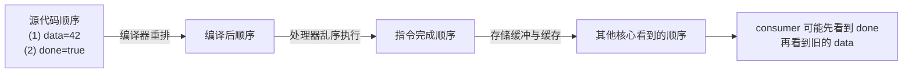
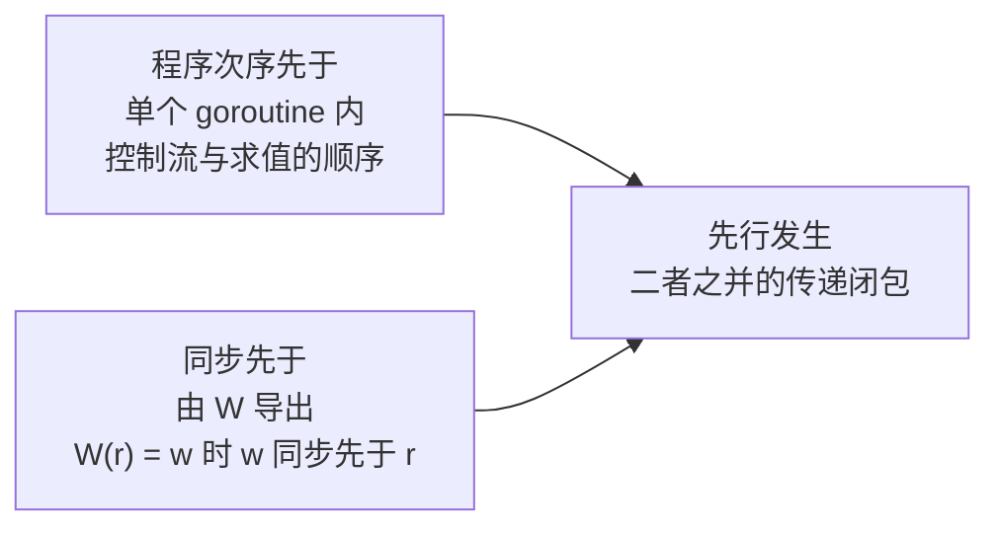
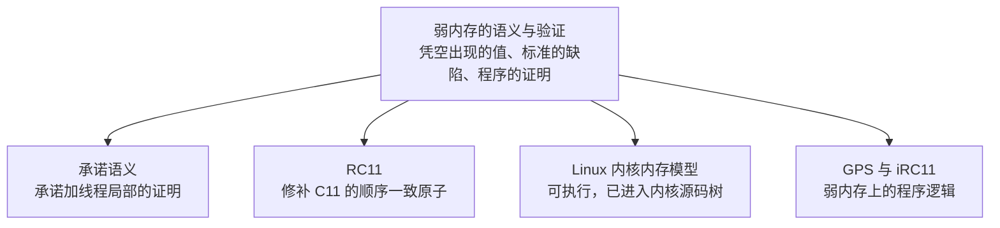

# 11.9 内存一致模型

前面各节讨论同步原语时，屡次用到「同步先于」与「先行发生」这样的说法，却一直没有正面回答一个更基本的问题：
两个 goroutine 同时读写同一个变量时，一方的写入在什么条件下保证为另一方所见？
回答这个问题的规范称为**内存一致模型**（memory consistency model），简称内存模型。Go
内存模型的文档开宗明义 [[Go Authors, 2022](#ref-go-authors-2022)]：

> Go 内存模型规定了一些条件，在这些条件下，一个 goroutine 对某个变量的读取，保证能观察到另一个 goroutine 对同一变量写入的值。

紧随其后的是一段忠告：被多个 goroutine 同时访问的数据，对它的修改必须串行化，办法是使用 channel 操作，
或者 `sync` 与 `sync/atomic` 中的同步原语；「如果必须读完本文其余部分才能理解程序的行为，
那就是在自作聪明。别自作聪明。」这段忠告是 Pike 在 2014 年加进文档的 [[Pike, 2014a](#ref-pike-2014a)]。

忠告只有寥寥数语，背后却是硬件、编译器与语言规范三方数十年的博弈。本节先说明为什么需要内存模型，
再介绍顺序一致、弱序与免数据竞争这几个基本概念，依次考察硬件与编程语言的内存模型，然后回到 Go：
它的形式化定义、同步的来源、几种错误的写法与 `sync.Once` 的实现、这份文档的演进，
以及这一领域尚未解决的问题。

## 11.9.1 为什么需要内存模型

一个 Go 程序从源代码到实际执行，要经过编译器的转换与优化，再由处理器执行，
而现代处理器自身也会以多种方式改变指令与访存的次序。这些优化遵守同一条底线：
不改变单个线程自身能够观察到的行为。一旦有第二个线程观察同一块内存，这条底线就不足以说明程序会做什么。
考虑一个最小的生产者与消费者，它们共享 `data` 与 `done`：

```go
var data int
var done bool

func producer() {
	data = 42      // (1)
	done = true    // (2)
}

func consumer() {
	for !done {    // (3)
	}
	print(data)    // (4)
}
```

源代码中 (1) 写在 (2) 之前，直觉上，`consumer` 一旦读到 `done == true`，就应当读到 `data == 42`。
然而这段程序既不保证打印 42，也不保证循环会结束。编译器可以交换彼此无依赖的 (1) 与 (2)，也可以把循环中对
`done` 的读取提到循环之外，此后循环反复检查寄存器中的旧值，永远不会退出；处理器可以乱序执行指令，
只为单个核心维持数据依赖；写入还会先进入核心私有的存储缓冲，何时对其他核心可见，与写入的先后未必一致。



内存模型就是为此订立的契约。它位于程序员、编译器与硬件之间，规定一个线程的写入在什么条件下必然为另一个线程
的读取所见：编译器与硬件可以做任何不违反契约的优化，程序员则只能依赖契约写明的保证。契约定得太强，
会堵死优化的空间；定得太弱，程序员又无从推理。一种硬件体系结构一旦选定了较强的模型，
日后也很难在不破坏已有程序的前提下改弱，因为已有的程序可能已经依赖了它。

能不能干脆规定这类程序也按直觉运行？2022 年 1 月，Warren Bare 提议规定 `bool`、`byte`、`int`
等少数基本类型天然适用于一个写者、多个读者的场景，使 `for running { … }` 这样的循环能因另一个 goroutine
写入 `running = false` 而停下 [[Bare, 2022](#ref-bare-2022)]。Cox 回复说 [[Cox, 2022a](#ref-cox-2022a)]：

> 这些改动看似无害，其后果却是编译器为了有竞争的程序而放弃一些非常重要的优化。……与 C/C++ 相比，我们已经对编译器施加了相当多的限制，我认为这样做是正当的，可以限制竞争造成的损害。但竞争终究是竞争。

在 Cox 看来，满足这一提议需要在许多场合生成效率低得多的代码，现有的、完全没有竞争的 Go 程序都会因此变慢，
却得不到任何好处。提案于同年 2 月被拒绝。

硬件层面的重排也不只是理论上的可能。下面的程序是一个**石蕊测试**（litmus test），
即专门用来逼出某种重排的小型并发程序。两个 goroutine 各写一个变量，再读对方的变量；主 goroutine
用两个原子计数器让它们每一轮同时起跑，等双方都完成后检查结果：

```go
package main

import (
	"fmt"
	"sync/atomic"
)

const n = 1_000_000

var (
	x, y   int // 普通变量，读写构成数据竞争
	r1, r2 int
	start  atomic.Int64 // 第 i 轮开始
	finish atomic.Int64 // 已结束的半轮数
)

func worker(id int) {
	for i := int64(1); i <= n; i++ {
		for start.Load() < i {
		}
		if id == 0 {
			x = 1
			r1 = y
		} else {
			y = 1
			r2 = x
		}
		finish.Add(1)
	}
}

func main() {
	go worker(0)
	go worker(1)
	both := 0
	for i := int64(1); i <= n; i++ {
		x, y = 0, 0
		start.Store(i)
		for finish.Load() < 2*i {
		}
		if r1 == 0 && r2 == 0 {
			both++
		}
	}
	fmt.Printf("%d 轮中 r1 == r2 == 0 出现 %d 次\n", n, both)
}
```

在任何顺序一致的交错中，总有一方的写先于另一方的读执行，`r1` 与 `r2` 不可能同时为 0。在一台 Apple M5
Pro（arm64）上运行三次，100 万轮中 `r1 == r2 == 0` 分别出现了 997948、997173 与 994657 次，
几乎每一轮都出现。用 `go build -gcflags=-S` 查看汇编，`worker` 中对 `x` 的存储 `MOVD R2, main.x(SB)`
仍然排在对 `y` 的载入 `MOVD main.y(SB), R3` 之前，编译器没有交换二者；交换发生在硬件中：
写入还停留在存储缓冲里，后面的读已经完成。

把 `x` 与 `y` 改为 `atomic.Int64`、读写改用 `Store` 与 `Load` 之后，同样的实验中这一结果一次也没有出现。
这并非侥幸：Go 的原子操作顺序一致（[11.3.6](./atomic.md)），内存模型保证它不会出现。
原来的程序存在数据竞争，用 `-race` 构建（并把轮数减为 1000）后运行，竞态检测器报告
`Found 2 data race(s)`，程序照常打印结果，最后以退出码 66 结束。这个程序的结果取决于硬件与调度，
因此不作为可运行的示例给出。

## 11.9.2 顺序一致、弱序与免数据竞争

最符合直觉的内存模型由 Lamport 于 1979 年提出，称为**顺序一致性**（sequential consistency,
SC）[[Lamport, 1979](#ref-lamport-1979)]：

> 任何一次执行的结果，都与所有处理器的操作按某种顺序依次执行的结果相同，并且每个处理器的操作在这个顺序中按其程序指定的次序出现。

顺序一致的机器就像所有处理器轮流访问同一块内存：每次只执行一个操作，各处理器的操作可以任意交错，
但谁也不能打乱自己的次序。就硬件而言，11.9.1 的两个程序在这样的机器上都不会出错。

顺序一致常与线性一致性（linearizability）混淆。后者由 Herlihy 与 Wing 于 1990 年提出，针对的是并发对象：
每个操作都必须看起来在其调用与返回之间的某一瞬间原子地生效
[[Herlihy and Wing, 1990](#ref-herlihy-wing-1990)]。因此线性一致性尊重实时次序，
一个操作返回之后才开始的操作，必须排在它之后；顺序一致只要求存在一个与各处理器的程序次序相容的全序，
并不考虑实时。分布式存储中常说的因果一致性与最终一致性更弱，它们主要描述多个副本如何收敛，本节不再展开。

顺序一致的代价在于它禁止了存储缓冲这类最基本的优化：11.9.1 的实验之所以得到 `r1 == r2 == 0`，
正是因为写入暂存在缓冲中，后面的读先完成了。主流的通用处理器都没有采用顺序一致作为硬件模型。
退而求其次的思路是：硬件不必对所有程序都顺序一致，只需对按规矩同步的程序如此。Adve 与 Hill 在
1990 年把这一思路表述为**弱序**（weak ordering）的定义 [[Adve and Hill, 1990](#ref-adve-hill-1990)]：

> 令同步模型为一组对内存访问的约束，它规定需要如何以及何时进行同步。硬件相对于某个同步模型是弱序的，当且仅当它对遵守该同步模型的一切软件都表现为顺序一致。

最常用的一种规矩是免数据竞争。两个操作访问同一内存位置，至少一个是写，而二者之间没有同步建立先后，
便构成一次**数据竞争**（data race）；一个程序的所有执行都不含数据竞争，
就称它**免数据竞争**（data-race-free, DRF）。由此得到软硬件之间的一笔交易，称为 DRF-SC：
程序员负责消除数据竞争，系统负责让这样的程序表现得如同顺序一致。它把「理解弱内存模型」这一难题，
换成了「消除数据竞争」这一更明确、也能由工具检测的义务。Adve 与 Gharachorloo
1996 年的教程梳理了这一时期提出的各种宽松模型
[[Adve and Gharachorloo, 1996](#ref-adve-gharachorloo-1996)]；此后，Java、C++ 与 Go 的内存模型都以 DRF-SC
为基础 [[Adve and Boehm, 2010](#ref-adve-boehm-2010)]。

## 11.9.3 硬件内存模型

讨论硬件之前，需要先分清两个常被混用的概念。缓存一致性（cache coherence）保证对同一个内存位置的写入，
所有核心就其先后达成一致；内存一致性管的则是跨越多个位置时，一个核心的读写次序在其他核心看来是什么样子。
前者是后者的基础，却不能代替后者 [[Sorin et al., 2011](#ref-sorin-2011)]。

次序被打乱的主要来源是**存储缓冲**（store buffer）：核心执行写入时，先把它放进私有的缓冲，
不等写入抵达缓存就继续执行后面的指令。核心因此不必停顿，代价是其他核心要等缓冲中的写入排出之后才能看到它；
核心自己的后续读取则可以直接从缓冲中取得刚写入的值。乱序执行与推测执行也会让访存不按程序次序完成。
这些机制对单线程透明，对多线程则需要规则约束。为了在需要时恢复次序，
非顺序一致的硬件提供称为**内存屏障**（memory barrier）或栅栏（fence）的指令。在 11.9.1 的实验中，
若两个线程各在写与读之间加一道屏障，先把自己的写入排出到内存再开始读，`r1 == r2 == 0` 便不可能出现。
屏障的种类与语义因体系结构而异 [[Cox, 2021a](#ref-cox-2021a)]。

按约束的强弱，主流硬件的内存模型大致可以排成一条谱系 [[Cox, 2021a](#ref-cox-2021a)]。

x86（Intel 与 AMD）位于较强的一端，其模型称为 x86-TSO（total store order）：所有核心共享一个内存，
每个核心有一个先进先出的存储缓冲，写入按程序次序排出，读取先查本核心的缓冲。
唯一可见的重排是写之后的读先于该写对其他核心可见（store→load）[[Sewell et al., 2010](#ref-sewell-2010)]。11.9.1
实验中 `r1 == r2 == 0` 的结果，x86-TSO 同样允许。在 x86 上碰巧不出错的并发代码，往往依赖的正是 TSO
的这份强度。

ARMv8 与 POWER 位于较弱的一端，store→store、store→load、load→load、load→store 四种重排都可能发生。
二者的分野在于**多副本原子性**（multi-copy atomicity）：核心可以提前读到自己尚未对外可见的写入，
但一个写入只要被另一个核心看到，就必须对所有核心可见（严格地说，这称为其他多副本原子性）。POWER
不满足这一性质，两个写入可以被不同的读者以不同的次序看到 [[Sarkar et al., 2011](#ref-sarkar-2011)]；ARMv8
最初也不满足，后来架构修订为多副本原子，模型因此大为简化 [[Pulte et al., 2018](#ref-pulte-2018)]。RISC-V
的基本模型 RVWMO 是弱序的，同时是多副本原子的；可选的 Ztso 扩展在此基础上提供全存储定序
[[RISC-V International, 2026](#ref-riscv-2026)]。

历史上的 DEC Alpha 更为特殊：地址依赖都不能为它的载入定序。即使 `p` 是刚刚载入的指针，`*p` 也可能读到比
`p` 更旧的内容。原因在于 Alpha 的本地缓存分为两部分，先后到达的两次写入可能分别由忙闲不同的两部分处理，
后到的反而先生效 [[Stern, 2017](#ref-stern-2017)]。Linux 内核为此设立了 `smp_read_barrier_depends` 屏障，
它在其他架构上都是空操作；4.15 版起，这道屏障被并入 `READ_ONCE` [[Deacon, 2017](#ref-deacon-2017)]，5.9
版删除了这一接口 [[Deacon, 2019](#ref-deacon-2019)]。

判断一种硬件允许哪些重排，用的正是石蕊测试。常用的几个如下：

| 测试 | 形态 | 考察 | 允许反直觉结果的模型 |
| --- | --- | --- | --- |
| SB 存储缓冲 | 两个线程各写一个变量，再读对方的变量 | store→load | x86-TSO、ARMv8、POWER、RISC-V；仅 SC 禁止 |
| MP 消息传递 | 一方先写数据再置标志，另一方见到标志后读数据 | store→store、load→load | ARMv8、POWER、RISC-V；SC 与 x86-TSO 禁止 |
| LB 载入缓冲 | 两个线程各读一个变量，再写对方读的变量 | load→store | ARMv8、POWER；SC 与 x86-TSO 禁止 |
| IRIW 独立读独立写 | 两个写者各写一个变量，两个读者以相反的次序读这两个变量（读者的两次读之间以地址依赖定序） | 多副本原子性 | POWER、修订前的 ARMv8；SC、x86-TSO、修订后的 ARMv8 与 RISC-V 禁止 |

IRIW 要单独考察多副本原子性，需要先排除读者自身的读读重排，表中的办法是让第二次读的地址依赖第一次读的结
果；不加这一约束的普通 IRIW，在 ARM 与 POWER 上都允许出现反直觉的结果 [[Cox, 2021a](#ref-cox-2021a)]。
模型允许的结果，硬件也未必真会产生：LB 虽为 ARM 与 POWER 的模型所允许，Maranget 等人 2012 年的实验却只在
ARM 上观察到它，从未在 POWER 上观察到 [[Cox, 2021a](#ref-cox-2021a)]。硬件实际比模型强，
程序就可能在不知不觉中依赖这份额外的强度，而在日后更弱的硬件上出错。

这些模型并非口头约定。给硬件建模有两条路：操作式（operational）模型描述一台带缓冲与队列的抽象机器如何逐步
执行；公理式（axiomatic）模型把一次执行看作事件之间的关系图，用若干无环条件规定哪些结果合法。Alglave、Maranget
与 Tautschnig 给出了统一的公理式框架，配套的 herd、litmus 与 diy 工具既能在模型上模拟石蕊测试，
也能在真实芯片上运行它们；在 ARM 硬件上的测试中，他们发现了一种后来被 ARM 确认为缺陷的行为
[[Alglave et al., 2014](#ref-alglave-2014)]。

Go 支持 amd64、arm64、ppc64、riscv64 等架构，它们分布在这条谱系的不同位置。同一个 Go
程序在所有这些架构上遵守同一个内存模型，差异由编译器与运行时吸收：
它们为同步操作生成各架构所需的屏障或带定序语义的指令。[11.3.2](./atomic.md) 列出了同一个原子操作在 amd64
与 arm64 上编译出的不同指令。程序员只需面对一个模型，硬件之间的差异不会传到上层代码。

## 11.9.4 语言内存模型

硬件模型只解决了一半问题。即使程序运行在 x86 这样较强的硬件上，它仍然可能出错，
因为编译器也会改变访存的次序。编译器的优化以单线程语义为前提：把循环中的读取提到循环之外、
把变量长期留在寄存器中、重排彼此无依赖的读写，对单线程都是正确的变换，却足以让 11.9.1 的程序失效。
语言因此需要自己的内存模型，把编译器也约束进来。


Java 是第一个试图写明自己对多线程程序作何保证的主流语言 [[Cox, 2021b](#ref-cox-2021b)]，第一版却并不成功。1999
年，Pugh 指出了其中的一系列问题 [[Pugh, 1999](#ref-pugh-1999)]。JSR-133
的常见问题解答列举了旧模型的几处严重缺陷 [[Manson and Goetz, 2004](#ref-manson-goetz-2004)]：它难以理解，
因而被普遍违反，例如在许多情况下，它不允许每个 JVM 实际都在做的重排；它对 final 字段没有任何特殊处理，
另一个线程可能先看到字段的默认值、之后才看到构造后的值，于是 `String`
这样的不可变对象看起来会改变自己的值；它还允许 volatile 写与非 volatile 的读写重排，
与多数开发者的直觉相悖。新模型经 JSR-133 制定，随 2004 年发布的 Java 5.0 采用
[[Manson et al., 2005](#ref-manson-2005)]：以先行发生关系为核心，保证免数据竞争的程序顺序一致，并为 final
字段提供了可见性保证。

难点在于有竞争的程序。Java 的安全性不允许把它们简单地判为未定义行为，新模型因此规定：
对不超过一个字的变量，一次读必须读到某一次写入的值，可以是先行发生于它、且尚未被覆盖的写，
也可以是与它竞争的写 [[Cox, 2021b](#ref-cox-2021b)]。仅有这条规则还不够。考虑下面的程序，`x` 与 `y`
初值为 0：

```go
// 线程 1      // 线程 2
r1 = x         r2 = y
y = r1         x = r2
```

`r1` 与 `r2` 能否都等于 42？假设 `r1 = x` 读到 42，那么 `y = r1` 写入 42，与之竞争的 `r2 = y` 便可以读到
42，`x = r2` 随之写入 42，而这次写又与最初的 `r1 = x` 竞争，恰好为最初的假设提供了依据。这里的 42
称为**凭空出现的值**（out-of-thin-air value, OOTA）：它毫无来由地出现，又以循环论证为自己辩护。
先行发生关系本身排除不了这种结果，Java 模型为此加入了一套复杂的因果性要求。Adve 与 Boehm 在
2010 年这样回顾这段工作 [[Adve and Boehm, 2010](#ref-adve-boehm-2010)]：

> 以一种不同时禁止其他所需优化的方式来禁止这类因果性违背，结果出人意料地困难。……经过许多提案和五年的激烈争论，现行模型作为最佳折中获得批准。……遗憾的是，这个模型非常复杂，已知存在一些出人意料的行为，最近还被证明有一个缺陷。

C 与 C++ 在 2011 年的标准中引入内存模型，理论基础来自 Boehm 与 Adve 2008 年的工作
[[Boehm and Adve, 2008](#ref-boehm-adve-2008)]。它对有竞争的程序采取了与 Java 相反的立场：
任何数据竞争都是未定义行为，程序可以做任何事，这一立场常被称为「DRF-SC or Catch
Fire」[[Cox, 2021b](#ref-cox-2021b)]。为了让专家仍能写出高性能的无锁代码，C++ 为原子操作提供了多种内存序：
顺序一致（`seq_cst`）、获取与释放（`acquire`/`release`）、松弛（`relaxed`），以及一个意图更弱的
`consume`。松弛原子的读写彼此竞争而不算数据竞争，Java 在定义有竞争程序时遇到的困难，于是原样回到了 C++。C++11
试图以形式化的规则排除一部分凭空出现的值，结果这些规则既不足以推理使用松弛原子的程序，
又可以说禁止了 `relaxed` 在 ARM 与 POWER 上的一切合理实现，C++14 便删去了它们，只留下一句含糊的建议：
实现应当确保不计算出循环依赖于自身计算的「凭空」值。用 Cox 的话概括：Java
试图形式化地排除所有非因果的执行，失败了；C++11 吸取教训，只试图排除其中一部分，同样失败了；C++14
干脆不再给出任何形式化的规定 [[Cox, 2021b](#ref-cox-2021b)]。直到 2019 年，WG21 仍表示无法在 C++
层面给出「凭空出现」的有意义的定义 [[Boehm, 2019](#ref-boehm-2019)]。

`consume` 的命运同样说明了这一领域的艰难。它本意是只靠数据依赖定序，以便在 ARM 与 POWER 上以低于
`acquire` 的代价支撑 Linux 内核 RCU 这类用法，但它实现复杂，对「依赖」的定义又过于宽泛，
所有编译器实际上都把它当作 `acquire` 实现，WG21 于 2016 年劝阻使用它 [[Boehm, 2016](#ref-boehm-2016)]，
并在 2025 年通过提案，在 C++26 中弃用它 [[Boehm, 2025](#ref-boehm-2025)]。后一份提案的理由之一是，
主流架构已不太需要 `consume`：在常见的 ARM 微架构上，获取载入乃至顺序一致载入的开销与松弛载入相近。

尽管细节各异，C、C++、Java、JavaScript、Rust、Swift 与 Go 最终都提供了同一个承诺：
免数据竞争的程序顺序一致。它们的分野在于如何对待有竞争的程序：C 与 C++ 视之为未定义行为，Java 与
JavaScript 则把结果限制在有限的范围内。Go 站在后者一边，下一小节会看到它的具体规定。

## 11.9.5 Go 的内存模型

Go 1.19 修订后的内存模型给出了形式化的定义，紧随 Boehm 与 Adve 2008 年的方法，
免数据竞争程序的定义与顺序一致的保证都与之等价 [[Go Authors, 2022](#ref-go-authors-2022)]。

程序的执行由 goroutine 的执行组成，goroutine 的执行又由内存操作组成。一个内存操作由四项描述：种类，
即普通的读、普通的写，或者原子访问、互斥锁操作、channel 操作这样的同步操作；它在程序中的位置；
所访问的内存位置或变量；读出或写入的值。读、原子读、加锁与 channel 接收是读型操作；写、原子写、解锁、channel
发送与关闭是写型操作；比较并交换这样的操作两者兼具。在此基础上，模型提出三项要求：

1. 每个 goroutine 中的内存操作，在给定读写之值的情况下，必须对应该 goroutine 的一次正确的顺序执行，
   并且与**程序次序先于**（sequenced before）关系一致。程序次序先于是语言规范为控制流结构与表达式求值顺序
   规定的偏序。
2. 一次程序执行由一组 goroutine 的执行与一个映射 W 组成，W 指明每个读型操作读自哪个写型操作。W
   限制在同步操作上时，必须能够由同步操作的某个隐含全序解释，这个全序与程序次序及这些操作读写的值相容。
3. 对内存位置 x 上的普通读 r，W(r) 必须是一个对 r 可见的写 w。可见是指：w 先行发生于 r，并且 w
   不先行发生于另一个先行发生于 r 的、对 x 的写 w'。

第三项用到的先行发生关系由两部分构成，其中一部分由 W 导出：同步的读型操作 r 观察到同步的写型操作 w，即
W(r) = w 时，称 w **同步先于**（synchronized before）r。非形式地说，
同步先于关系是第二项中那个隐含全序的子集，只包含 W 直接观察到的那部分信息。**先行发生**（happens before）
定义为程序次序先于与同步先于两者之并的传递闭包：



「先行发生」一词来自 Lamport 1978 年关于分布式系统的论文。在那里，事件之间的「happened before」
关系由两部分生成：同一进程内事件的先后，以及一条消息的发送先于它的接收
[[Lamport, 1978](#ref-lamport-1978)]。Go 的定义与之对应：程序次序先于对应进程内的先后，
同步先于对应消息的收发。channel 的规则（[10.6](../ch10chan/lockfree.md)）读起来像消息传递，并非偶然。

据此可以定义 Go 中的数据竞争。内存位置 x 上的读写竞争，由 x 上的一个读型操作与一个写型操作组成，
二者至少有一个不是同步操作，并且先行发生关系不能为它们定序；写写竞争的定义相同，只是两个操作都是写型操作。
如果 x 上没有任何竞争，x 上的任何读 r 的 W(r) 只有一种可能：按先行发生关系紧挨在它之前的那个写。更一般地，
可以证明免数据竞争的 Go 程序只能产生可由各 goroutine 执行的某种顺序一致交错解释的结果，证明与 Boehm 和
Adve 论文的第 7 节相同。这就是 DRF-SC。文档明言，这一形式化定义的意图是与 C、C++、Java、JavaScript、Rust
与 Swift 为无竞争程序提供的保证一致。

对有竞争的程序，文档以非形式的方式规定了实现必须提供的语义。实现检测到数据竞争时，可以报告竞争并终止程序。
文档说以 `go build -race` 构建的实现正是这样做的；不过竞态检测器默认报告之后继续运行，
到程序结束时才以退出码 66 退出（11.9.1），以 `GORACE=halt_on_error=1` 运行才会在第一次报告后终止。
除此之外：

- 对不超过一个机器字的内存位置，一次读必须观察到某一次写 w，r 不先行发生于 w，并且不存在先行发生于 r、而
  w 又先行发生于它的另一次写 w'。也就是说，每次读都观察到一次在它之前或与它并发的写所写入的值。非因果的、
  凭空出现的写也不允许被观察到。
- 数组、结构体与复数的读写，可以实现为对各个元素、字段或实部虚部分别读写，次序不定。
- 超过一个机器字的读写，鼓励但不要求满足同样的语义。出于性能考虑，
  实现可以把它们当作一组次序不定的单字操作，因此对多字数据结构的竞争，
  可能读到并非来自任何单次写入的不一致的值。当这些值依赖内部的（指针，长度）或（指针，类型）
  二元组的一致性时，例如在大多数 Go 实现中的接口值、映射、切片与字符串，这样的竞争可能导致任意的内存损坏。

单字规则与 Java 的规定如出一辙，这使 Go 更像 Java 或 JavaScript，而不像 C 与 C++。用文档的话说，Go
的做法旨在让出错的程序更可靠、更易调试，同时坚持竞争就是错误，并且能由工具诊断和报告。但与 Java 不同，Go
不保证有竞争的程序内存安全：一个接口值由类型指针与数据指针两个字组成，
竞争的读可能拼出一个类型与数据不匹配的值。

内存模型对编译器的约束不亚于对程序的约束。文档列出了三条禁令：编译器不得引入原程序中不存在的写，
不得让一次读观察到多个值，也不得让一次写写入多个值。例如，编译器不得把

```go
*p = 1
if cond {
	*p = 2
}
```

改写为

```go
*p = 2
if !cond {
	*p = 1
}
```

如果 `cond` 为假，而另一个 goroutine 正在读 `*p`，原程序中它只能观察到 `*p` 先前的值与 1，
改写后它却可能观察到 2。同理，编译器不能假定循环一定结束、被调用的函数一定返回或不含同步操作，
从而把之后的访存提到前面；也不能为了节省寄存器而丢弃一个局部变量，再从共享内存重新载入它，因为 `*p`
可能已被修改。这些优化在 C/C++ 编译器中都是允许的，与 C/C++ 共用后端的 Go 编译器必须注意关闭它们。

## 11.9.6 同步从何而来

先行发生关系中的同步先于一边，来自语言与标准库明确规定的同步操作。文档给出的规则如下：

| 同步来源 | 规则 | 详见 |
| --- | --- | --- |
| 包初始化 | 包 p 导入包 q 时，q 的 `init` 函数全部完成先行发生于 p 的任何 `init` 开始；所有 `init` 完成同步先于 `main.main` 开始 | [3.6.2](../../part1overview/ch03life/main.md) |
| goroutine 创建 | 启动新 goroutine 的 `go` 语句同步先于该 goroutine 开始执行 | |
| goroutine 退出 | 不保证同步先于程序中的任何事件 | |
| channel | 发送同步先于对应接收的完成；关闭同步先于因关闭而返回零值的接收；无缓冲 channel 的接收同步先于对应发送的完成；容量为 C 的 channel，第 k 次接收同步先于第 k+C 次发送的完成 | [10.6](../ch10chan/lockfree.md) |
| 互斥锁与读写锁 | 对 n < m，第 n 次 `Unlock` 同步先于第 m 次 `Lock` 返回；读锁另有对应的规则；成功的 `TryLock` 等同于 `Lock`，失败的 `TryLock` 不产生任何同步效果 | [11.2.6](./mutex.md)、[11.2.7](./mutex.md) |
| `sync.Once` | `once.Do(f)` 中 `f` 的完成同步先于任何一次 `once.Do(f)` 的返回 | 11.9.7 |
| 原子操作 | 原子操作 A 的效果被原子操作 B 观察到，则 A 同步先于 B；所有原子操作如同按某个顺序一致的次序执行 | [11.3.6](./atomic.md) |
| 终结器 | `SetFinalizer(x, f)` 同步先于终结调用 `f(x)` | [13.10.1](../../part4memory/ch13gc/finalizer.md) |

goroutine 退出一行值得多看一眼。文档的例子是：

```go
var a string

func hello() {
	go func() { a = "hello" }()
	print(a)
}
```

对 `a` 的赋值之后没有任何同步事件，因此不保证被其他 goroutine 观察到；激进的编译器甚至可以删去整条 `go`
语句。要让一个 goroutine 的效果为另一个 goroutine 所见，必须用锁或 channel 这样的同步机制建立相对次序。

表中之外的同步抽象，由各自的文档写明保证。Cox 在 2022 年修订内存模型时，同时为 `runtime`、`sync` 与
`sync/atomic` 补写了这些说明，并在提交说明中确立了一条原则：每个用于帮助 Go 程序同步的类型，
都应当写明它的先行发生保证 [[Cox, 2022e](#ref-cox-2022e)]。本章各节已分别讨论过条件变量
（[11.4.5](./cond.md)）、同步组（[11.5.6](./waitgroup.md)）、缓存池（[11.6.6](./pool.md)）
与并发安全的散列表（[11.7.3](./map.md)）的保证。这样的保证需要实现者主动维护。`context`
包的文档写明「Done 尚未关闭时，Err 返回 nil」，Go 1.25 把错误改存为原子变量之后，`Err` 却可能先于 `Done`
关闭而返回非 nil，直到 Go 1.26 才修复（[11.8.2](./context.md)）。

## 11.9.7 错误的同步与 sync.Once

文档用几个例子说明有竞争的程序会出什么问题。第一个例子中，`f` 先写 `a` 再写 `b`，`g` 先读 `b` 再读 `a`：

```go
var a, b int

func f() {
	a = 1
	b = 2
}

func g() {
	print(b)
	print(a)
}

func main() {
	go f()
	g()
}
```

`g` 可能先打印 2、再打印 0。一次读即使观察到了某个并发写的值，也不意味着它之后的读能观察到那个写之前的写。
这一事实否定了几种常见的写法。最典型的是双重检查锁定（double-checked locking），
它试图在初始化完成之后省去同步的开销：

```go
var a string
var done bool

func setup() {
	a = "hello, world"
	done = true
}

func doprint() {
	if !done {
		once.Do(setup)
	}
	print(a)
}
```

`doprint` 观察到 `done` 为真，并不意味着它能观察到对 `a` 的写入，程序可能打印空字符串。
忙等一个标志（11.9.1 的 `consumer`）有同样的问题，而且循环不保证结束；用一个指针发布初始化好的对象，在
`for g == nil {}` 之后读取 `g.msg`，也是如此。这些例子的解决办法相同：使用显式的同步。

`sync.Once` 正是双重检查锁定的正确写法，它的实现只有十几行 [[Go Authors, 2026a](#ref-go-authors-2026a)]：

```go
// src/sync/once.go
type Once struct {
	_ noCopy

	// done indicates whether the action has been performed.
	// It is first in the struct because it is used in the hot path.
	// The hot path is inlined at every call site.
	// ……
	done atomic.Bool
	m    Mutex
}

func (o *Once) Do(f func()) {
	// Note: Here is an incorrect implementation of Do:
	//
	//	if o.done.CompareAndSwap(false, true) {
	//		f()
	//	}
	//
	// Do guarantees that when it returns, f has finished.
	// This implementation would not implement that guarantee:
	// given two simultaneous calls, the winner of the cas would
	// call f, and the second would return immediately, without
	// waiting for the first's call to f to complete.
	// This is why the slow path falls back to a mutex, and why
	// the o.done.Store must be delayed until after f returns.
	if !o.done.Load() {
		// Outlined slow-path to allow inlining of the fast-path.
		o.doSlow(f)
	}
}

func (o *Once) doSlow(f func()) {
	o.m.Lock()
	defer o.m.Unlock()
	if !o.done.Load() {
		defer o.done.Store(true)
		f()
	}
}
```

与上面错误的写法相比，结构几乎相同，区别在于 `done` 是原子变量，第二次检查在锁内进行。快速路径上，一次
`Load` 读到 `true`，它观察到的是 `doSlow` 中那次 `Store(true)`，后者同步先于前者；`f`
的执行按程序次序先于被推迟到它返回之后的 `Store`，于是 `f` 中的写入先行发生于快速路径返回之后的读取。
慢速路径上，后来者在 `Lock` 处等待，先来者的 `Unlock` 同步先于后来者的 `Lock` 返回，得到同样的链条。
两条路径合起来，正是内存模型对 `Once` 的规定。

注释中的反例也值得一读：只用一次比较并交换，能保证 `f` 只执行一次，却不能保证 `Do` 返回时 `f` 已经执行完，
并发调用中的失败者会立刻返回，读到尚未初始化的数据。这段注释是 Cox 在 2019 年加上的，
因为「为什么不这样实现」的问题在几个月内已经在 golang-dev 上被问了两次 [[Cox, 2019](#ref-cox-2019)]。
把慢速路径单独拆成 `doSlow`，是为了让只含一次原子载入与一次条件跳转的快速路径能够内联到每个调用处；Carlo
Alberto Ferraris 2018 年的这一修改，使 `Once` 的基准测试从 4.54 ns 降到 2.06 ns，并把 `done`
移到结构体开头，使快速路径的指令更短 [[Ferraris, 2018](#ref-ferraris-2018)]。Go 1.25 起，`done` 的类型由
`atomic.Uint32` 改为 `atomic.Bool` [[Dogra, 2025](#ref-dogra-2025)]。

`f` 发生 panic 时，`defer` 仍会执行 `Store(true)`，`Once` 便认为 `f` 已经返回，此后的 `Do` 不再调用 `f`。Go
1.4 之前的行为相反，`f` 会被反复调用，直到有一次正常完成。Pike 2014 年修改这一行为时解释说，应当把
`Once` 理解为只在第一次被调用时运行函数，而不是反复运行直到函数完成一次 [[Pike, 2014b](#ref-pike-2014b)]。Go
1.21 加入的 `sync.OnceFunc` [[Gerrand, 2022](#ref-gerrand-2022)]换了一种处理方式：按其文档，`f` 发生
panic 时，返回的函数在之后的每次调用中都以同一个值 panic。两者的差别可以直接观察：

```go {run=true}
package main

import (
	"fmt"
	"sync"
)

func main() {
	var once sync.Once
	initf := func() {
		fmt.Println("执行初始化")
		panic("初始化失败")
	}
	for i := range 2 {
		func() {
			defer func() { fmt.Printf("once.Do 第 %d 次：recover = %v\n", i+1, recover()) }()
			once.Do(initf)
		}()
	}

	f := sync.OnceFunc(initf)
	for i := range 2 {
		func() {
			defer func() { fmt.Printf("OnceFunc 第 %d 次：recover = %v\n", i+1, recover()) }()
			f()
		}()
	}
}
```

运行结果如下：

```
执行初始化
once.Do 第 1 次：recover = 初始化失败
once.Do 第 2 次：recover = <nil>
执行初始化
OnceFunc 第 1 次：recover = 初始化失败
OnceFunc 第 2 次：recover = 初始化失败
```

两者都只执行一次初始化。`once.Do` 的第二次调用静默返回，调用者无从得知初始化已经失败；`OnceFunc`
则让每个调用者都看到同一个失败。

## 11.9.8 设计的演进

Go 的内存模型文档比 Go 的开源还早。下表是它在 Go 1.19 之前的主要修改：

| 时间 | 修改 | 出处 |
| --- | --- | --- |
| 2009 年 2 月 | 起草文档，以先行发生关系为核心，给出初始化、goroutine 创建、channel、锁与 Once 的规则 | [[Cox, 2009](#ref-cox-2009)] |
| 2010 年 12 月 | 增补 goroutine 退出：不保证先行发生于任何事件 | [[Cox, 2010](#ref-cox-2010)] |
| 2011 年 5 月 | 增补 channel 关闭的规则 | [[Cox, 2011](#ref-cox-2011)] |
| 2012 年 3 月 | Go 1：初始化期间创建的 goroutine 不再等到所有 `init` 结束才开始运行 | [[Ma, 2012](#ref-ma-2012)] |
| 2012 年 9 月 | 删去「有竞争的程序不会崩溃」的说法，改为可能打印空字符串、崩溃或做别的事（Go 1.1） | [[Symonds, 2012](#ref-symonds-2012)] |
| 2014 年 3 月至 6 月 | 增补容量为 C 的 channel 的规则，使缓冲 channel 可以直接用作计数信号量；随后修正了规则中写反的两处（Go 1.3、Go 1.4） | [[Cox, 2014](#ref-cox-2014)] [[Vyukov, 2014](#ref-vyukov-2014)] |
| 2014 年 10 月 | 加入「别自作聪明」的忠告（Go 1.4） | [[Pike, 2014a](#ref-pike-2014a)] |

这一时期的文档有两处明显的空白。其一，它没有说明原子操作与内存模型的关系。`sync/atomic` 包的文档自
2011 年该包加入时起只是提醒，这些函数需要非常小心才能用对，除了特殊的底层应用，同步最好用 channel 或
`sync` 包完成 [[Go Authors, 2026b](#ref-go-authors-2026b)]；而需要无锁数据结构的库作者，
实际上一直依赖一份没有写下来的约定。2013 年，Cox 为此开了 issue #5045 [[Cox, 2013](#ref-cox-2013)]，并在
2016 年的评论中表示，相当确定规则将是：Go 的原子操作在原子变量之间保证顺序一致，行为如同 C/C++ 的
`seq_cst` 原子；同一个内存字不应混用原子访问与非原子访问 [[Cox, 2016](#ref-cox-2016)]。这个 issue 直到
2022 年才随修订关闭。其二，它只说有竞争的程序是错误的，却没有说明错误的程序可能做什么，
也没有说明编译器不得做什么。

2021 年夏天，Cox 发表了三篇长文：《Hardware Memory Models》梳理硬件模型，《Programming Language Memory
Models》梳理 C/C++、Java 与 JavaScript 的语言模型，《Updating the Go Memory Model》提出 Go 的修订方案
[[Cox, 2021a](#ref-cox-2021a)] [[Cox, 2021b](#ref-cox-2021b)] [[Cox, 2021c](#ref-cox-2021c)]，并在 GitHub
上发起讨论 [[Cox, 2021d](#ref-cox-2021d)]。2022 年 1 月，讨论的结论整理成了 issue #50859
[[Cox, 2022c](#ref-cox-2022c)]，修订随 Go 1.19 发布 [[Cox, 2022d](#ref-cox-2022d)]，
文档的版本标注为「Version of June 6, 2022」。

Cox 称这些是相对较小的调整，修订的主要工作是把长期默守的约定写成明确的条文。issue #50859 列出的修改如下：

1. 写明整体做法：DRF-SC，以及对有竞争程序的有限保证；形式化定义改为程序次序先于、同步先于与映射 W，与
   Boehm 和 Adve 的框架对齐。
2. 写明多字数据上的竞争可能导致内存损坏。
3. 写明 `sync/atomic` 的语义与 C++ 的顺序一致原子及 Java 的 volatile 变量相同（[11.3.6](./atomic.md)）。
4. 写明 `runtime.SetFinalizer` 的同步语义，并要求 `sync` 中的其他类型在各自的文档中写明保证
   [[Cox, 2022e](#ref-cox-2022e)]。
5. 写明编译器不得进行的优化。

讨论中产生的另一项提议单独立为 issue #50860：新增类型化的原子 API，把「这个值只能以原子方式访问」
写进类型（[11.3.7](./atomic.md)）[[Cox, 2022b](#ref-cox-2022b)]，它同样随 Go 1.19 发布。

此后除了错字与格式的修正，只有一处实质修改：2023 年，文档补充说明数组、结构体与复数可以按元素、
字段或实部虚部分别读写（Go 1.22）[[Cox, 2023](#ref-cox-2023)]。

《Updating the Go Memory Model》中还有一项提议没有被采纳：提供不参与同步、也不算数据竞争的原子读写，
即其他语言中的松弛原子。Cox 承认，C、C++、Rust 与 Swift 都有松弛原子，Java 有 VarHandle 的 plain 模式，
唯独 Go 没有办法做到这一点，「也许应该有，我不知道」。Cox 的结论是 [[Cox, 2021c](#ref-cox-2021c)]：

> 以我们今天掌握的证据之少，添加这个 API 是没有道理的。

若有人坚持，需要拿出两方面的证据：它在程序员确实需要编写的代码中普遍适用；
它在广泛使用的系统上带来显著的性能提升。

## 11.9.9 前沿与开放问题

Go 的内存模型在工程上已经落定，日常编程并不需要再往下读。但这份契约底下的理论远未完结，11.9.4
提到的凭空出现问题至今仍是这一领域的核心难题：如何给松弛原子一个既禁止凭空之值、又不妨碍编译器优化的语义。
围绕弱内存的语义与验证，近十年来出现了几条有代表性的路线：



一条路线是承诺语义（promising semantics）。它允许一个线程先对未来的某个写作出承诺，让其他线程提前读到，
但每个承诺都必须附带一份线程局部的证明，表明即使没有这个承诺，被承诺的写也能够执行，
以此切断自我论证的循环。作者称，这是第一个同时满足以下条件的宽松内存模型：
可证明地容许许多标准的编译器优化与重排，以及到 x86-TSO 和 POWER 的标准编译方案；排除凭空出现的行为；提供
DRF 保证；不借助未定义行为来定义有竞争的程序 [[Kang et al., 2017](#ref-kang-2017)]。后续的 Promising 2.0
补上了原模型无法支持的若干全局优化 [[Lee et al., 2020](#ref-lee-2020)]。它们都还是研究成果，
尚未进入任何语言标准。

另一条路线是修补现有的标准。Lahav 等人在 2017 年指出，C11 中顺序一致原子的语义存在缺陷，编译到 POWER
的两种标准方案都不健全；他们提出的 RC11 恢复了健全性，并保留了 DRF-SC
[[Lahav et al., 2017](#ref-lahav-2017)]。

也有模型直接进入了工程实践。Linux 内核内存模型（LKMM）是一个可由工具执行的形式化模型，覆盖 `READ_ONCE`、
各类屏障乃至 RCU，位于内核源码树的 `tools/memory-model` 目录中，供内核开发者用石蕊测试检验自己的并发代码
[[Alglave et al., 2018](#ref-alglave-2018)] [[Stern, 2017](#ref-stern-2017)]。

还有一条路线为弱内存上的程序建立可机器检验的证明体系。从 GPS [[Turon et al., 2014](#ref-turon-2014)]
到基于 Iris 框架的 iRC11，研究者把分离逻辑、幽灵状态与协议带进了弱内存；Dang 等人用它验证 Rust
标准库中的并发原语时，发现了 `Arc` 中的一处数据竞争 [[Dang et al., 2020](#ref-dang-2020)]。

连这一领域最顶尖的研究者，都还在为它的基础部分较劲。Go 只给出一个简单的模型、
只向用户提供顺序一致的原子操作，背后正有这门学科的难度作注脚。

## 11.9.10 小结

Go 内存模型中最能体现设计取向的一笔，是只向用户提供顺序一致的原子操作。C++ 提供从 `relaxed` 到 `seq_cst`
的整套内存序，能把硬件性能压榨到极致，代价是把理解弱内存模型的负担交给了应用开发者。Go 的判断是，
对绝大多数程序，顺序一致原子的性能已经足够，换来的可推理性比峰值性能更有价值（[11.3.6](./atomic.md)）；
而松弛原子是否值得添加，在拿出证据之前不予考虑。运行时自己在确有需要的地方使用获取与释放语义
（[11.6.3](./pool.md)），却没有把它们交给用户。这与 Go 在调度、垃圾回收等处的取向一致：让出可控的性能，
换取语义的简单与稳妥。

落到实践中，Go 对用户的建议仍是文档开头那一句：别自作聪明。用 channel、`sync` 与 `sync/atomic`
消除数据竞争，并用竞态检测器持续检查。检测器实现的是 Go 的内存模型，而不是 x86 或 ARM 的模型
[[Cox, 2021c](#ref-cox-2021c)]；一个只在某种硬件上碰巧正确的程序，只要有竞争的路径被执行到，
就逃不过它的检查。

## 延伸阅读

- <a id="ref-adve-boehm-2010"></a>[Adve and Boehm, 2010] Sarita V. Adve and Hans-J. Boehm. Memory Models:
  A Case for Rethinking Parallel Languages and Hardware. *Communications of the ACM*, 53(8):90–101, 2010.
  https://doi.org/10.1145/1787234.1787255
- <a id="ref-adve-gharachorloo-1996"></a>[Adve and Gharachorloo, 1996] Sarita V. Adve and Kourosh
  Gharachorloo. Shared Memory Consistency Models: A Tutorial. *IEEE Computer*, 29(12):66–76, 1996.
  https://doi.org/10.1109/2.546611
- <a id="ref-adve-hill-1990"></a>[Adve and Hill, 1990] Sarita V. Adve and Mark D. Hill. Weak Ordering: A
  New Definition. *ISCA 1990*, pp. 2–14. https://doi.org/10.1145/325164.325100
- <a id="ref-alglave-2014"></a>[Alglave et al., 2014] Jade Alglave, Luc Maranget, and Michael Tautschnig.
  Herding Cats: Modelling, Simulation, Testing, and Data Mining for Weak Memory. *ACM TOPLAS*, 36(2):1–74,
  2014. https://doi.org/10.1145/2627752 ；herd、litmus、diy 工具：http://diy.inria.fr
- <a id="ref-alglave-2018"></a>[Alglave et al., 2018] Jade Alglave, Luc Maranget, Paul E. McKenney, Andrea
  Parri, and Alan Stern. Frightening Small Children and Disconcerting Grown-ups: Concurrency in the Linux
  Kernel. *ASPLOS 2018*, pp. 405–418. https://doi.org/10.1145/3173162.3177156
- <a id="ref-bare-2022"></a>[Bare, 2022] Warren Bare. Go issue #50590. *proposal: Go Memory Model
  clarifications.* 2022. https://github.com/golang/go/issues/50590
  用户提案，2022 年 2 月被拒绝。
- <a id="ref-boehm-2016"></a>[Boehm, 2016] Hans-J. Boehm. P0371R1: Temporarily discourage
  memory_order_consume. WG21, 2016. https://www.open-std.org/jtc1/sc22/wg21/docs/papers/2016/p0371r1.html
- <a id="ref-boehm-2019"></a>[Boehm, 2019] Hans-J. Boehm, with input from many others. P1217R2:
  Out-of-thin-air, revisited, again. WG21, 2019.
  https://www.open-std.org/jtc1/sc22/wg21/docs/papers/2019/p1217r2.html
- <a id="ref-boehm-2025"></a>[Boehm, 2025] Hans Boehm. P3475R2: Defang and deprecate
  memory_order::consume. WG21, 2025. https://www.open-std.org/jtc1/sc22/wg21/docs/papers/2025/p3475r2.pdf
- <a id="ref-boehm-adve-2008"></a>[Boehm and Adve, 2008] Hans-J. Boehm and Sarita V. Adve. Foundations of
  the C++ Concurrency Memory Model. *PLDI 2008*, pp. 68–78. https://doi.org/10.1145/1375581.1375591
- <a id="ref-cox-2009"></a>[Cox, 2009] Russ Cox. draft of memory model. Go commit 82c38cf8dd, 2009.
  https://github.com/golang/go/commit/82c38cf8dd
  随 Go 1 发布。
- <a id="ref-cox-2010"></a>[Cox, 2010] Russ Cox. go_mem: goroutine exit is not special. Go commit
  7ff68b365b, 2010. https://golang.org/cl/3628041
  随 Go 1 发布。
- <a id="ref-cox-2011"></a>[Cox, 2011] Russ Cox. doc/go_mem.html: close happens before receive on closed
  channel. Go commit 9f03d4a3f7, 2011. https://golang.org/cl/4551042
  随 Go 1 发布。
- <a id="ref-cox-2013"></a>[Cox, 2013] Russ Cox. Go issue #5045. *doc: define how sync/atomic interacts
  with memory model.* 2013. https://github.com/golang/go/issues/5045
- <a id="ref-cox-2014"></a>[Cox, 2014] Russ Cox. doc: allow buffered channel as semaphore without
  initialization. Go commit 132e816734, 2014. https://golang.org/cl/75130045
  随 Go 1.3 发布。
- <a id="ref-cox-2016"></a>[Cox, 2016] Russ Cox. Comment on golang/go#5045, 2016.
  https://github.com/golang/go/issues/5045#issuecomment-252730563
- <a id="ref-cox-2019"></a>[Cox, 2019] Russ Cox. sync: document implementation of Once.Do. Go commit
  bc593eac2d, 2019. https://go.dev/cl/184261
  随 Go 1.13 发布。
- <a id="ref-cox-2021a"></a>[Cox, 2021a] Russ Cox. *Hardware Memory Models.* June 29, 2021.
  https://research.swtch.com/hwmm ；*Memory Models* 系列索引：https://research.swtch.com/mm
- <a id="ref-cox-2021b"></a>[Cox, 2021b] Russ Cox. *Programming Language Memory Models.* July 6, 2021.
  https://research.swtch.com/plmm
- <a id="ref-cox-2021c"></a>[Cox, 2021c] Russ Cox. *Updating the Go Memory Model.* July 12, 2021.
  https://research.swtch.com/gomm
- <a id="ref-cox-2021d"></a>[Cox, 2021d] Russ Cox. Go discussion #47141. *Updating the Go memory model.*
  2021. https://github.com/golang/go/discussions/47141
- <a id="ref-cox-2022a"></a>[Cox, 2022a] Russ Cox. Comment on golang/go#50590, 2022.
  https://github.com/golang/go/issues/50590#issuecomment-1016793899
- <a id="ref-cox-2022b"></a>[Cox, 2022b] Russ Cox. Go issue #50860. *sync/atomic: add typed atomic
  values.* 2022. https://github.com/golang/go/issues/50860
- <a id="ref-cox-2022c"></a>[Cox, 2022c] Russ Cox. Go issue #50859. *doc: update Go memory model.* 2022.
  https://github.com/golang/go/issues/50859
- <a id="ref-cox-2022d"></a>[Cox, 2022d] Russ Cox. doc: update Go memory model. Go commit 865911424d,
  2022. https://go.dev/cl/381315
  随 Go 1.19 发布。
- <a id="ref-cox-2022e"></a>[Cox, 2022e] Russ Cox. runtime, sync, sync/atomic: document happens-before
  guarantees. Go commit a71ca3dfbd, 2022. https://go.dev/cl/381316
  随 Go 1.19 发布。
- <a id="ref-cox-2023"></a>[Cox, 2023] Russ Cox. doc/go_mem: explain arrays, structs, and complex numbers.
  Go commit 977e23a707, 2023. https://go.dev/cl/514476
  随 Go 1.22 发布。
- <a id="ref-dang-2020"></a>[Dang et al., 2020] Hoang-Hai Dang, Jacques-Henri Jourdan, Jan-Oliver Kaiser,
  and Derek Dreyer. RustBelt Meets Relaxed Memory. *Proceedings of the ACM on Programming Languages*,
  4(POPL):1–29, 2020. https://doi.org/10.1145/3371102
  iRC11。
- <a id="ref-deacon-2017"></a>[Deacon, 2017] Will Deacon. locking/barriers: Add implicit
  smp_read_barrier_depends() to READ_ONCE(). Linux commit 76ebbe78f739, 2017.
  https://github.com/torvalds/linux/commit/76ebbe78f739
  随 Linux 4.15 发布。
- <a id="ref-deacon-2019"></a>[Deacon, 2019] Will Deacon. locking/barriers: Remove definitions for
  [smp_]read_barrier_depends(). Linux commit 93fab07c2293, 2019.
  https://github.com/torvalds/linux/commit/93fab07c2293
  随 Linux 5.9 发布。
- <a id="ref-dogra-2025"></a>[Dogra, 2025] Prabhav Dogra. sync: use atomic.Bool for Once.done. Go commit
  95611c0eb4, 2025. https://go.dev/cl/666895
  随 Go 1.25 发布。
- <a id="ref-ferraris-2018"></a>[Ferraris, 2018] Carlo Alberto Ferraris. sync: allow inlining the Once.Do
  fast path. Go commit ca8354843e, 2018. https://go.dev/cl/152697
  随 Go 1.13 发布。
- <a id="ref-gerrand-2022"></a>[Gerrand, 2022] Andrew Gerrand. Go issue #56102. *sync: add OnceFunc,
  OnceValue, OnceValues.* 2022. https://github.com/golang/go/issues/56102
  随 Go 1.21 发布。
- <a id="ref-go-authors-2022"></a>[Go Authors, 2022] The Go Authors. *The Go Memory Model.* Version of
  June 6, 2022. https://go.dev/ref/mem
- <a id="ref-go-authors-2026a"></a>[Go Authors, 2026a] The Go Authors. `src/sync/once.go`. Go 1.26.
  https://github.com/golang/go/blob/release-branch.go1.26/src/sync/once.go
- <a id="ref-go-authors-2026b"></a>[Go Authors, 2026b] The Go Authors. `src/sync/atomic/doc.go`. Go 1.26.
  https://github.com/golang/go/blob/release-branch.go1.26/src/sync/atomic/doc.go
  包文档的告诫文字自该包 2011 年加入时即已存在（Go commit 22eab1f5c7）。
- <a id="ref-herlihy-wing-1990"></a>[Herlihy and Wing, 1990] Maurice P. Herlihy and Jeannette M. Wing.
  Linearizability: A Correctness Condition for Concurrent Objects. *ACM TOPLAS*, 12(3):463–492, 1990.
  https://doi.org/10.1145/78969.78972
- <a id="ref-kang-2017"></a>[Kang et al., 2017] Jeehoon Kang, Chung-Kil Hur, Ori Lahav, Viktor Vafeiadis,
  and Derek Dreyer. A Promising Semantics for Relaxed-Memory Concurrency. *POPL 2017*, pp. 175–189.
  https://doi.org/10.1145/3009837.3009850
- <a id="ref-lahav-2017"></a>[Lahav et al., 2017] Ori Lahav, Viktor Vafeiadis, Jeehoon Kang, Chung-Kil
  Hur, and Derek Dreyer. Repairing Sequential Consistency in C/C++11. *PLDI 2017*, pp. 618–632.
  https://doi.org/10.1145/3062341.3062352
- <a id="ref-lamport-1978"></a>[Lamport, 1978] Leslie Lamport. Time, Clocks, and the Ordering of Events in
  a Distributed System. *Communications of the ACM*, 21(7):558–565, 1978.
  https://doi.org/10.1145/359545.359563
- <a id="ref-lamport-1979"></a>[Lamport, 1979] Leslie Lamport. How to Make a Multiprocessor Computer That
  Correctly Executes Multiprocess Programs. *IEEE Transactions on Computers*, C-28(9):690–691, 1979.
  https://doi.org/10.1109/TC.1979.1675439
- <a id="ref-lee-2020"></a>[Lee et al., 2020] Sung-Hwan Lee, Minki Cho, Anton Podkopaev, Soham
  Chakraborty, Chung-Kil Hur, Ori Lahav, and Viktor Vafeiadis. Promising 2.0: Global Optimizations in
  Relaxed Memory Concurrency. *PLDI 2020*, pp. 362–376. https://doi.org/10.1145/3385412.3386010
- <a id="ref-ma-2012"></a>[Ma, 2012] Shenghou Ma. doc/go_mem: init-created goroutine behavior changes for
  Go 1. Go commit 6b770f05ad, 2012. https://golang.org/cl/5732061
  随 Go 1 发布。
- <a id="ref-manson-2005"></a>[Manson et al., 2005] Jeremy Manson, William Pugh, and Sarita V. Adve. The
  Java Memory Model. *POPL 2005*, pp. 378–391. https://doi.org/10.1145/1040305.1040336
- <a id="ref-manson-goetz-2004"></a>[Manson and Goetz, 2004] Jeremy Manson and Brian Goetz. *JSR 133 (Java
  Memory Model) FAQ.* February 2004. https://www.cs.umd.edu/~pugh/java/memoryModel/jsr-133-faq.html
- <a id="ref-pike-2014a"></a>[Pike, 2014a] Rob Pike. doc/go_mem.html: don't be clever. Go commit
  2eb1b65830, 2014. https://golang.org/cl/158500043
  随 Go 1.4 发布。
- <a id="ref-pike-2014b"></a>[Pike, 2014b] Rob Pike. sync/once: panicking functions still marked as
  complete. Go commit b22dc6385d, 2014. https://golang.org/cl/137350043
  随 Go 1.4 发布。
- <a id="ref-pugh-1999"></a>[Pugh, 1999] William Pugh. Fixing the Java Memory Model. *Proceedings of the
  ACM 1999 Conference on Java Grande*, pp. 89–98, 1999. https://doi.org/10.1145/304065.304106
- <a id="ref-pulte-2018"></a>[Pulte et al., 2018] Christopher Pulte, Shaked Flur, Will Deacon, Jon French,
  Susmit Sarkar, and Peter Sewell. Simplifying ARM Concurrency: Multicopy-atomic Axiomatic and Operational
  Models for ARMv8. *Proceedings of the ACM on Programming Languages*, 2(POPL), 2018.
  https://doi.org/10.1145/3158107
- <a id="ref-riscv-2026"></a>[RISC-V International, 2026] RISC-V International. *The RISC-V Instruction
  Set Manual, Volume I: Unprivileged Architecture.* RVWMO Memory Consistency Model; RVWMO Explanatory
  Material. https://github.com/riscv/riscv-isa-manual
- <a id="ref-sarkar-2011"></a>[Sarkar et al., 2011] Susmit Sarkar, Peter Sewell, Jade Alglave, Luc
  Maranget, and Derek Williams. Understanding POWER Multiprocessors. *PLDI 2011*, pp. 175–186.
  https://doi.org/10.1145/1993498.1993520
- <a id="ref-sewell-2010"></a>[Sewell et al., 2010] Peter Sewell, Susmit Sarkar, Scott Owens, Francesco
  Zappa Nardelli, and Magnus O. Myreen. x86-TSO: A Rigorous and Usable Programmer's Model for x86
  Multiprocessors. *Communications of the ACM*, 53(7):89–97, 2010. https://doi.org/10.1145/1785414.1785443
- <a id="ref-sorin-2011"></a>[Sorin et al., 2011] Daniel J. Sorin, Mark D. Hill, and David A. Wood. *A
  Primer on Memory Consistency and Cache Coherence.* Morgan & Claypool, 2011.
  https://doi.org/10.1007/978-3-031-01733-9
  第 2 版（2020）作者为 Vijay Nagarajan、Daniel J. Sorin、Mark D. Hill 与 David A. Wood：
  https://doi.org/10.1007/978-3-031-01764-3
- <a id="ref-stern-2017"></a>[Stern, 2017] Alan Stern. *Explanation of the Linux-Kernel Memory Consistency
  Model.* Linux kernel `tools/memory-model/Documentation/explanation.txt`, 2017.
  https://github.com/torvalds/linux/blob/master/tools/memory-model/Documentation/explanation.txt
- <a id="ref-symonds-2012"></a>[Symonds, 2012] David Symonds. doc: Don't imply incorrect guarantees about
  data races. Go commit aecf5033df, 2012. https://golang.org/cl/6489075
  随 Go 1.1 发布。
- <a id="ref-turon-2014"></a>[Turon et al., 2014] Aaron Turon, Viktor Vafeiadis, and Derek Dreyer. GPS:
  Navigating Weak Memory with Ghosts, Protocols, and Separation. *OOPSLA 2014*, pp. 691–707.
  https://doi.org/10.1145/2660193.2660243
- <a id="ref-vyukov-2014"></a>[Vyukov, 2014] Dmitriy Vyukov. doc: fix happens-before rules for buffered
  channels. Go commit 81a93ef24a, 2014. https://golang.org/cl/101980047
  随 Go 1.4 发布。
- 本书 [11.3 原子操作](./atomic.md)、[10.6 内存模型与无锁演进](../ch10chan/lockfree.md)、[11.2
  互斥锁](./mutex.md)、[3.6 主 goroutine 的生与死](../../part1overview/ch03life/main.md)、[13.10
  终结器](../../part4memory/ch13gc/finalizer.md)。
