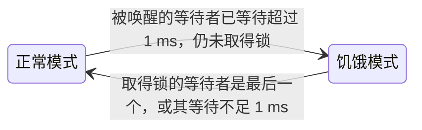

# 11.2 互斥锁

`sync.Mutex` 的约定很简单：零值是一把未加锁的锁；`Lock` 在锁被占用时阻塞调用方，`Unlock` 释放它；锁不属于
任何 goroutine（[11.1.3](./basic.md)）。实现要回答的核心问题却不简单：锁被释放时，交给谁？严格按到达的
顺序交给下一个等待者，最为公平，但每次交接都要等被唤醒者真正运行起来；允许正在运行的 goroutine 抢先拿走，
吞吐更高，却可能让某个等待者一再落空。Go 的互斥锁在这两种做法之间走过一个来回。本节先介绍互斥问题的
理论与硬件基础，再看 Go 的实现，并沿着它的历史说明这一取舍。

## 11.2.1 互斥问题与它的基础

程序中访问共享数据、同一时刻只允许一个执行单元进入的代码段，称为**临界区**（critical section）。
如何保证这一点，就是互斥问题。[11.1.1](./basic.md) 提到，Dijkstra 在《协作的顺序进程》
中先尝试只用普通的读写来解决它，并给出了 Dekker 的两进程解；1965 年，Dijkstra 在一页纸的短文中给出了 N
个进程的一般解 [[Dijkstra, 1965](#ref-dijkstra-1965)]。1974 年，Lamport 提出了面包店算法（bakery
algorithm）[[Lamport, 1974](#ref-lamport-1974)]：进程像在面包店里取号一样，
先取一个比所有已发号码都大的号，再按号码从小到大依次进入临界区。每个共享变量只由一个进程写入。Lamport
后来写道，自己是在写完正确性证明之后才发现，这个证明并不依赖与写操作重叠的读操作读到什么值：
即使读到的是任意值，算法依然正确 [[Lamport, nd](#ref-lamport-nd)]。

只用读写的算法证明了互斥在原理上可解，但代价随进程数增长（面包店算法要检查所有进程的号码），而且要求
存储器按程序的顺序执行读写，在现代处理器上还需要额外的内存屏障（[11.9](./mem.md)）。实际的锁都建立在
硬件提供的原子读改写指令之上，例如比较并交换（CAS）与取后加（[11.3](./atomic.md)）：一条指令就能完成
「读出旧值、判断、写入新值」，Dijkstra 所说的单向访问问题由硬件解决了。

有了原子指令，等待的方式仍有两种。一种是自旋：在循环中反复尝试，直到成功。锁很快就会释放时，
自旋的代价最小；但等待者一直占着处理器，而且所有等待者反复读写同一个变量，
使它所在的缓存行在处理器之间来回传递。票号锁（ticket lock）用取后加发号，使等待者按顺序获得锁；Mellor-Crummey
与 Scott 的 MCS 锁让每个等待者在自己的变量上自旋，交接时只写后继者的变量
[[Mellor-Crummey and Scott, 1991](#ref-mellor-crummey-scott-1991)]。另一种是阻塞：等待者让出处理器去睡眠，
由释放者唤醒。过去这意味着每次加锁都要进入内核，Linux 的 futex 改变了这一点
[[Franke et al., 2002](#ref-franke-et-al-2002)]：锁的状态放在用户空间，无竞争时只需原子操作，
只有发生竞争、需要排队和调度时才进入内核。

`sync.Mutex` 结合了这两种方式：无竞争时一次 CAS；有竞争时先短暂自旋（11.2.3），仍拿不到锁就阻塞。阻塞
所用的是运行时信号量，`runtime/sema.go` 开头的注释说，它的目标与 Linux 的 futex 相同，语义却简单得多
[[Go Authors, 2026a](#ref-go-authors-2026a)]。不同之处在于它挂起的是 goroutine，而不是线程
（[11.1.4](./basic.md)）。futex 在 Go 中处于更低的一层：运行时内部的锁与 `note` 需要让线程 M 睡眠时，
在 Linux 等系统上使用 futex（[9.5.2](../ch09sched/thread.md)）。

## 11.2.2 状态字与快速路径

自 Go 1.24 起，`sync.Mutex` 只是 `internal/sync.Mutex` 的一层包装（[11.1.4](./basic.md)），后者只有
两个字段 [[Go Authors, 2026b](#ref-go-authors-2026b)]：

```go
type Mutex struct {
	state int32
	sema  uint32
}

const (
	mutexLocked = 1 << iota // mutex is locked
	mutexWoken
	mutexStarving
	mutexWaiterShift = iota

	starvationThresholdNs = 1e6
)
```

`sema` 是交给运行时信号量的地址。`state` 是一个位域：最低位 `mutexLocked` 表示锁已被持有；`mutexWoken`
表示已有一个被唤醒或正在自旋的 goroutine 准备取锁，解锁者因此不必再唤醒别人；`mutexStarving` 表示锁处于
饥饿模式（11.2.4）；其余高位记录等待者的数目，增减一个等待者就是加减 `1<<mutexWaiterShift`。这些信息
放在同一个 32 位整数中，一次 CAS 就能同时检查并修改它们。

两条快速路径如下（省略了与竞态检测器有关的代码）：

```go
func (m *Mutex) Lock() {
	// Fast path: grab unlocked mutex.
	if atomic.CompareAndSwapInt32(&m.state, 0, mutexLocked) {
		return
	}
	// Slow path (outlined so that the fast path can be inlined)
	m.lockSlow()
}

func (m *Mutex) Unlock() {
	// Fast path: drop lock bit.
	new := atomic.AddInt32(&m.state, -mutexLocked)
	if new != 0 {
		// Outlined slow path to allow inlining the fast path.
		m.unlockSlow(new)
	}
}
```

只有 `state` 为 0，即未加锁、无等待者、无任何标志时，加锁的 CAS 才能成功；解锁时减去 `mutexLocked`，
结果为 0 说明没有人在等待，解锁就此结束。慢速路径被拆成单独的函数，是为了让快速路径足够小，能够被编译器
内联到调用处。这是 Ferraris 在 Go 1.13 中所做的两处修改，仅内联 `Lock` 一项就使无竞争的加锁快了约 14%
[[Ferraris, 2018a](#ref-ferraris-2018a)] [[Ferraris, 2018b](#ref-ferraris-2018b)]。

## 11.2.3 慢速路径：自旋与排队

发生竞争时，goroutine 并不急于睡眠：锁往往只被持有很短的时间，睡眠与唤醒的开销可能超过等待本身。Go 1.5
起，Vyukov 为 `Mutex` 加入了有限的主动自旋 [[Vyukov, 2015](#ref-vyukov-2015)]。运行时的 `canSpin`
只在以下条件同时满足时允许自旋：本次已自旋的次数少于 4；机器有多个 CPU；除自己之外至少还有一个 P 在运行；
当前 P 的本地运行队列为空 [[Go Authors, 2026c](#ref-go-authors-2026c)]。每次自旋调用 `procyield(30)`，在
amd64 上即执行 30 次 `PAUSE` 指令。Vyukov 在提交说明中解释了为什么要自旋：此前 `sync.Mutex`
一发现竞争就进入调度器，而锁可能很快就被释放，临界区很短时尤其如此；服务器程序的 CPU 利用率通常只有 50%
左右，切换去运行其他 goroutine 未必划算。自旋又必须保守，因为自旋者占着 P，其他 goroutine 可能正等着运行；
与运行时内部的锁不同，这里也不做让出线程的被动自旋，因为全局队列或其他 P 上可能还有工作。

自旋期间，若已有等待者而还没有人被唤醒，自旋者会设置 `mutexWoken`，告诉解锁者「已经有人准备取锁」：
解锁者见到这一位便不再唤醒等待者，锁留给自旋者。

自旋的条件不再满足时，`lockSlow` 计算新的状态，用 CAS 把自己登记为等待者，然后在信号量上睡眠：

```go
if atomic.CompareAndSwapInt32(&m.state, old, new) {
	if old&(mutexLocked|mutexStarving) == 0 {
		break // locked the mutex with CAS
	}
	// If we were already waiting before, queue at the front of the queue.
	queueLifo := waitStartTime != 0
	if waitStartTime == 0 {
		waitStartTime = runtime_nanotime()
	}
	runtime_SemacquireMutex(&m.sema, queueLifo, 2)
	starving = starving || runtime_nanotime()-waitStartTime > starvationThresholdNs
	// ……
```

第一次排队的 goroutine 排在队尾；被唤醒后又没取到锁、需要再次排队的，排到队首。在 Go 1.9 之前，后者也被
排到队尾，有多个等待者时更不公平 [[Vyukov, 2016](#ref-vyukov-2016)]。`waitStartTime` 记录第一次排队的
时刻，它决定了下一节的饥饿模式何时开启。

信号量本身只是一个 `uint32` 计数。`semacquire` 先尝试用 CAS 把它减一，失败才排队；排队的 goroutine
按信号量的地址组织在全局的 `semtable` 中。这张表有 251 个桶，取素数是为了避免与用户程序中地址的规律
相关；每个桶由一把运行时内部的锁保护，桶内是一棵以地址为键的树堆（treap），每个节点代表一个地址，挂着
在这个地址上等待的 goroutine 链表。同一地址上的入队与出队是 O(1)，在不同地址间查找是 O(log n)
[[Go Authors, 2026a](#ref-go-authors-2026a)]。这一结构是逐步形成的。2011 年，Vyukov 把原先集中的一张
等待表换成按地址散列的分布式表，并使释放者在没有等待者时无需加锁 [[Vyukov, 2011a](#ref-vyukov-2011a)]。2017
年，Cox 发现多把锁散列到同一个桶时，查找某把锁的等待者要扫过另一把锁的全部等待者，n 次获取锁的
总开销是 O(n²)（#17953）；于是先把桶内的单链表改成按地址分组的两级链表，又把顶层换成树堆
[[Cox, 2017a](#ref-cox-2017a)] [[Cox, 2017b](#ref-cox-2017b)]。

## 11.2.4 移交、插队与饥饿模式

锁被释放时交给谁，Go 的回答改过两次。

2008 年 Cox 写下的第一版 `Mutex` 只有一个计数器和一个信号量 [[Cox, 2008](#ref-cox-2008)]。下面是 2011 年
修改之前的代码，算法与 2008 年相同：

```go
func (m *Mutex) Lock() {
	if atomic.AddInt32(&m.key, 1) == 1 {
		// changed from 0 to 1; we hold lock
		return
	}
	runtime.Semacquire(&m.sema)
}

func (m *Mutex) Unlock() {
	switch v := atomic.AddInt32(&m.key, -1); {
	case v == 0:
		// changed from 1 to 0; no contention
		return
	case v == -1:
		// changed from 0 to -1: wasn't locked
		// (or there are 4 billion goroutines waiting)
		panic("sync: unlock of unlocked mutex")
	}
	runtime.Semrelease(&m.sema)
}
```

`key` 同时计数持有者与等待者。解锁时若还有等待者，`key` 仍大于零，锁并没有真正释放：被 `Semrelease`
唤醒的 goroutine 醒来就持有锁。这种做法称为移交（handoff）：锁始终处于被持有的状态，没有人能插到被唤醒
者的前面。

2011 年，Vyukov 把「已加锁」与「等待者数目」拆开，形成了今天 `state` 的雏形
[[Vyukov, 2011b](#ref-vyukov-2011b)]。解锁时清除加锁位，再唤醒一个等待者；被唤醒者醒来后，要与此时到达的
goroutine 重新竞争。提交说明写道，新的实现允许一个 goroutine 在有阻塞者时连续多次获得锁，
也允许新来者先于阻塞者获得锁，即不再强制先进先出。这种做法称为**插队**（barging）。
在竞争激烈的基准测试中，效果是数量级的：`GOMAXPROCS` 为 16 时，`BenchmarkMutex` 从 1380 ns 降到 96.3 ns。

插队为什么更快？Lea 在设计 Java 的 `java.util.concurrent` 时也选择了插队，理由是它缩短了「锁已空闲、却
因下一个线程尚在被唤醒而无人持有」的时间 [[Lea, 2004](#ref-lea-2004)]。WebKit 的 Pizlo 从另一个角度说明：
在严格先进先出的锁上，竞争者排成一列「车队」，每人每轮只能持锁一次，每次获取锁都伴随一次上下文切换；插队
则允许正在运行的线程在一轮中多次获取锁 [[Pizlo, 2016](#ref-pizlo-2016)]。

代价是公平性。Lea 在同一节中就指出，插队的锁只有概率意义上的公平：若新来者到达的速度快于被唤醒者醒来的
速度，队首的线程就很少能赢。2015 年，Cox 在 #13086 中报告了一个极端的例子 [[Cox, 2015](#ref-cox-2015)]：
一个 goroutine 几乎一直持有锁，每次只短暂释放；另一个 goroutine 每隔 100 µs 需要锁一次，却常常要等待
100 秒以上。原因是前者解锁并唤醒后者之后继续运行，在后者真正被调度之前又把锁拿了回去；这一过程在后者
成功一次之前重复了数百万次。Cox 提议在检测到严重的不公平时退回到移交，并写道，不希望看到解释「何时用
`sync.Mutex`、何时用 `sync.FairMutex`」的博客文章。

一年后，Vyukov 给出了实现，随 Go 1.9 发布 [[Vyukov, 2016](#ref-vyukov-2016)]。源码中的注释把它描述为
两种模式。在正常模式下，等待者按先进先出排队，但被唤醒的等待者并不拥有锁，要与新来者竞争；新来者正在
CPU 上运行，而且可能有很多个，被唤醒者很可能输掉，输了便排回队首。某个等待者若超过 1 ms 仍未获得锁，就把
锁切换到饥饿模式。在饥饿模式下，锁的所有权由解锁者直接移交给队首的等待者；新来者即使看到锁像是空闲的，
也不尝试获取，也不自旋，而是排到队尾。获得锁的等待者若发现自己是队列中的最后一个，或者自己的等待不足
1 ms，就把锁切回正常模式。注释的总结是：正常模式的性能好得多，因为即使有阻塞的等待者，一个 goroutine 也
可以连续多次获得锁；饥饿模式则用来防止病态的尾延迟。



退出条件中的「等待不足 1 ms」并非可有可无。代码注释说，饥饿模式的效率很低，两个 goroutine 一旦把锁切换
到饥饿模式，就可能无限地交替持锁，所以必须在这里根据等待时间退出。

解锁一侧的两种模式如下：

```go
func (m *Mutex) unlockSlow(new int32) {
	if (new+mutexLocked)&mutexLocked == 0 {
		fatal("sync: unlock of unlocked mutex")
	}
	if new&mutexStarving == 0 {
		old := new
		for {
			// If there are no waiters or a goroutine has already
			// been woken or grabbed the lock, no need to wake anyone.
			// In starvation mode ownership is directly handed off from unlocking
			// goroutine to the next waiter. We are not part of this chain,
			// since we did not observe mutexStarving when we unlocked the mutex above.
			// So get off the way.
			if old>>mutexWaiterShift == 0 || old&(mutexLocked|mutexWoken|mutexStarving) != 0 {
				return
			}
			// Grab the right to wake someone.
			new = (old - 1<<mutexWaiterShift) | mutexWoken
			if atomic.CompareAndSwapInt32(&m.state, old, new) {
				runtime_Semrelease(&m.sema, false, 2)
				return
			}
			old = m.state
		}
	} else {
		// Starving mode: handoff mutex ownership to the next waiter, and yield
		// our time slice so that the next waiter can start to run immediately.
		// Note: mutexLocked is not set, the waiter will set it after wakeup.
		// But mutex is still considered locked if mutexStarving is set,
		// so new coming goroutines won't acquire it.
		runtime_Semrelease(&m.sema, true, 2)
	}
}
```

正常模式下，解锁者先用 CAS 取得「唤醒一个人」的权利，再释放信号量；被唤醒者拿到的只是参与竞争的机会，
而不是锁本身。这也回答了读者常问的一个问题：[既然唤醒的是队首的等待者，为什么还会有等待者饿死](https://github.com/golang-design/under-the-hood/issues/80)？
因为在正常模式下，唤醒并不等于移交。

饥饿模式下，`Semrelease` 的第二个参数 `handoff` 为真：运行时替被唤醒者完成信号量的减一，其他 goroutine
无法从中抢走。Go 1.14 又进了一步 [[Ferraris, 2019](#ref-ferraris-2019)]：释放者把等待者放入当前 P 的
`runnext` 之后立即让出，等待者继承剩余的时间片，马上开始运行。`sema.go` 的注释说明了为什么只在饥饿模式
下这样做：在正常模式下，让出期间可能有另一个 goroutine 取得信号量，让出就白费了。

下面的程序重现了 #13086 中的场景：

```go {run=true native=true}
package main

import (
	"fmt"
	"sync"
	"time"
)

func main() {
	var mu sync.Mutex
	done := make(chan struct{})

	// 第一个 goroutine 几乎一直持有锁，只在两次加锁之间短暂释放。
	go func() {
		for {
			select {
			case <-done:
				return
			default:
				mu.Lock()
				time.Sleep(100 * time.Microsecond)
				mu.Unlock()
			}
		}
	}()

	// 主 goroutine 只偶尔需要锁，并且每次只持有极短的时间。
	var longest time.Duration
	for range 50 {
		time.Sleep(100 * time.Microsecond)
		start := time.Now()
		mu.Lock()
		longest = max(longest, time.Since(start))
		mu.Unlock()
	}
	close(done)
	fmt.Printf("50 次加锁中，最长的一次等待了 %.1f ms\n", float64(longest)/1e6)
}
```

某一次运行的结果如下：

```
50 次加锁中，最长的一次等待了 1.3 ms
```

主 goroutine 排队之后，每次被唤醒都抢不过另一个 goroutine，只能排回队首；等到某次醒来时已等待超过 1 ms，
它在重新排队的同时把锁切换到饥饿模式，对方下一次解锁就把锁直接交给它。因此最长的等待约为 1 ms 加上一两个
临界区的长度。Cox 在 2015 年测得的是 100 秒以上；Vyukov 的提交说明中，同一程序的等待约为 1.2 ms。

## 11.2.5 公平性的光谱

其他系统在这个问题上做出了不同的选择。

Java 的 `ReentrantLock` 把选择交给使用者：构造时可以要求公平，默认则不公平。文档提醒，许多线程使用的公平
锁吞吐量可能低得多，但获得锁所需时间的方差更小，并且保证不会饥饿；锁的公平也并不意味着线程调度的公平
[[Oracle, 2023](#ref-oracle-2023)]。

WebKit 的 `WTF::Lock` 选择插队，Pizlo 用实验说明了这一选择 [[Pizlo, 2016](#ref-pizlo-2016)]：
十个线程争用同一把锁 100 ms，操作系统的互斥锁完全公平，但每个线程至多获得约 3000 次锁；`WTF::Lock`
不保证公平，运气最差的线程也获得了约 55.7 万次，约是前者的 180 倍。Pizlo 的结论是，
公平的算法适合临界区都很长、需要保证最长等待有界的场合；对于临界区很短的程序，保证公平的代价过高。

Rust 的 `parking_lot` 借鉴了 WebKit 的设计。直到 0.12.5，它都采用「最终公平」：平均每 0.5 ms 强制一次
公平的解锁，把锁交给下一个等待者 [[d'Antras, 2025](#ref-dantras-2025)]；2026 年 10 月发布的 0.13 去掉了
自动的最终公平，只保留显式的公平解锁接口 [[d'Antras, 2026](#ref-dantras-2026)]。

Go 不提供选择：只有一种 `Mutex`，它以 1 ms 为界在两种模式之间自动切换。这与 Cox 在 #13086 中的期望一致：
使用者最好不必知道、更不必考虑这些细节。

## 11.2.6 读写锁

读者与写者问题由 Courtois、Heymans 与 Parnas 于 1971 年提出
[[Courtois et al., 1971](#ref-courtois-et-al-1971)]：多个读者可以同时访问数据，写者则必须独占。`sync.RWMutex`
的结构如下 [[Go Authors, 2026d](#ref-go-authors-2026d)]：

```go
type RWMutex struct {
	w           Mutex        // held if there are pending writers
	writerSem   uint32       // semaphore for writers to wait for completing readers
	readerSem   uint32       // semaphore for readers to wait for completing writers
	readerCount atomic.Int32 // number of pending readers
	readerWait  atomic.Int32 // number of departing readers
}

const rwmutexMaxReaders = 1 << 30
```

`readerCount` 记录读者的数目。`RLock` 把它加一，结果非负就直接返回；`RUnlock` 把它减一。读者的快速路径
只有一次原子加，不需要加锁，这是 Vyukov 2011 年重写的结果，无竞争的读锁因此快了近一半
[[Vyukov, 2011c](#ref-vyukov-2011c)]。

写者加锁时，先用 `w` 排除其他写者，再把 `readerCount` 减去 `rwmutexMaxReaders`（2^30），使它变为负数：
此后到来的读者在 `RLock` 中看到负数，便在 `readerSem` 上等待。减法的结果加回 2^30，
就是此刻仍持有读锁的读者数；写者把它加到 `readerWait` 上，在 `writerSem` 上等这些读者离开，
最后一个离开的读者唤醒写者。写者解锁时把 2^30 加回 `readerCount`，结果就是在此期间被挡住的读者数，
写者逐一唤醒它们，再释放 `w`。

这种安排使写者优先：文档写明，读锁被持有时若有 goroutine 调用 `Lock`，此后的 `RLock` 都会阻塞，直到写者
获得并释放了锁，以保证写者终究能拿到锁。代价是不能递归地加读锁：一个已持有读锁的 goroutine 若再次调用
`RLock`，而两次之间有写者到来，第二次 `RLock` 要等写者，写者又要等第一次的读锁释放，两者互相等待。读锁也
不能升级为写锁，写锁也不能降级为读锁。

用内存模型的术语（[11.9](./mem.md)）：第 n 次 `Unlock` 同步先于第 m 次 `Lock`（n < m）；对任意一次
`RLock`，存在 n，使第 n 次 `Unlock` 同步先于这次 `RLock`，而与之对应的 `RUnlock` 同步先于第 n+1 次 `Lock`
[[Go Authors, 2026d](#ref-go-authors-2026d)] [[Go Authors, 2026e](#ref-go-authors-2026e)]。

## 11.2.7 TryLock

2010 年，Cox 在解释 Go 的互斥锁为何不可重入的同一封邮件中写道，「我相信我们终究会需要
TryLock」[[Cox, 2010](#ref-cox-2010)]。它真正加入却是在 11 年之后。2021 年的提案 #45435 起初遭到 Cox
本人的反对：锁是用来保护不变式的（[11.1.3](./basic.md)），锁被别人持有时，关于不变式就什么也说不出来，TryLock
会助长对锁的不精确思考 [[Cox, 2021a](#ref-cox-2021a)]。改变看法的理由来自竞态检测器：
在库外用一个互斥锁加一个原子变量也能实现 TryLock，但这样的实现在失败时也会给竞态检测器制造虚假的先行发生关
系，从而掩盖真实的数据竞争；内建在 `sync` 中的 TryLock 则不会。实现它的提交说明写道，
使用这些函数「几乎（但并非总）是个坏主意」[[Cox, 2021b](#ref-cox-2021b)]。`Mutex.TryLock`、`RWMutex.TryLock`
与 `RWMutex.TryRLock` 随 Go 1.18 发布。

`Mutex.TryLock` 的实现只有一次 CAS（省略了与竞态检测器有关的代码）：

```go
func (m *Mutex) TryLock() bool {
	old := m.state
	if old&(mutexLocked|mutexStarving) != 0 {
		return false
	}

	// There may be a goroutine waiting for the mutex, but we are
	// running now and can try to grab the mutex before that
	// goroutine wakes up.
	if !atomic.CompareAndSwapInt32(&m.state, old, old|mutexLocked) {
		return false
	}
	return true
}
```

锁已被持有或处于饥饿模式时立即失败；否则，即使有等待者，也可以抢在被唤醒者之前拿到锁，这正是正常模式下的
插队。按内存模型，一次成功的 `TryLock` 等同于一次 `Lock`，失败的 `TryLock` 则不建立任何同步先于关系。文档
提醒，正确使用 `TryLock` 的场合确实存在，但很少见，使用它往往说明对互斥锁的某种用法存在更深的问题。

## 11.2.8 误用与诊断

锁的全部状态都在 `Mutex` 的值里，复制一把锁得到的是另一把独立的锁，若复制时恰好处于加锁状态，副本也是
加锁的。文档因此要求 `Mutex` 在首次使用后不得复制，`go vet` 的 copylocks 检查会报告这类复制。Go 1.24
为 `Mutex` 加上了显式的 `noCopy` 字段，使这一检查不再依赖 `Mutex` 的内部结构
[[Knyszek, 2024](#ref-knyszek-2024)]。

对未加锁的 `Mutex` 调用 `Unlock`，程序会以 `fatal error: sync: unlock of unlocked mutex` 终止，`recover`
无法捕获。Go 1.8 之前这里是一个普通的 panic，但 panic 之后锁处于不可用的状态，而要让它保持可用，会使锁
显著变慢、扩展性变差；因此 Cox 改为直接终止程序 [[Cox, 2016](#ref-cox-2016)]。

锁的竞争可以用互斥锁分析（mutex profile）来定位。它由 Weinberger 在 Go 1.8 中加入：调用
`runtime.SetMutexProfileFraction` 开启采样后，`pprof` 的 `mutex` 分析记录的是被争用的锁的持有者而非等待者
的调用栈 [[Weinberger, 2016](#ref-weinberger-2016)]。前面 `sema.go` 中的 `semrelease1` 正是在解锁时，
把等待者被耽误的时间记在解锁者的头上。Go 1.22 起，这一时间按被阻塞的 goroutine 数累计：100 个 goroutine
在同一把锁上等待 10 ms，记为 1000 ms 的争用，这与该分析器所仿照的 Google C++（今 Abseil）互斥锁分析器一致
[[Cox, 2023](#ref-cox-2023)]。

## 延伸阅读

- <a id="ref-courtois-et-al-1971"></a>[Courtois et al., 1971] P. J. Courtois, F. Heymans, D. L. Parnas.
  "Concurrent Control with 'Readers' and 'Writers'." *Communications of the ACM*, 14(10): 667–668, 1971.
  https://doi.org/10.1145/362759.362813
  读者与写者问题的出处。
- <a id="ref-cox-2008"></a>[Cox, 2008] Russ Cox. add mutex.Mutex. Go commit bf3dd3f0ef, 2008-12-04.
  https://github.com/golang/go/commit/bf3dd3f0efe5b45947a991e22660c62d4ce6b671
  Go 的第一个互斥锁：一个计数器加一个信号量，解锁时把锁移交给被唤醒者。
- <a id="ref-cox-2010"></a>[Cox, 2010] Russ Cox. Reply in "Experimenting with GO." golang-nuts, 9 June
  2010. https://groups.google.com/g/golang-nuts/c/XqW1qcuZgKg/m/Ui3nQkeLV80J
- <a id="ref-cox-2015"></a>[Cox, 2015] Russ Cox. Go issue #13086. *runtime: fall back to fair locks after
  repeated sleep-acquire failures.* 2015. https://github.com/golang/go/issues/13086
  lockskew 程序与插队、移交的讨论；提案于 2016 年 12 月被接受。
- <a id="ref-cox-2016"></a>[Cox, 2016] Russ Cox. sync: throw, not panic, for unlock of unlocked mutex. Go
  commit 40d81cf061, 2016. https://go.dev/cl/31359
  修复 issue #13879，随 Go 1.8 发布。
- <a id="ref-cox-2017a"></a>[Cox, 2017a] Russ Cox. runtime: use two-level list for semaphore address
  search in semaRoot. Go commit 45c6f59e1f, 2017. https://go.dev/cl/36792
  修复 issue #17953，随 Go 1.9 发布。
- <a id="ref-cox-2017b"></a>[Cox, 2017b] Russ Cox. runtime: use balanced tree for addr lookup in semaphore
  implementation. Go commit 990124da2a, 2017. https://go.dev/cl/37103
- <a id="ref-cox-2021a"></a>[Cox, 2021a] Russ Cox. Comment on golang/go#45435, 2021.
  https://github.com/golang/go/issues/45435#issuecomment-832910477
  2021 年 5 月 5 日：「锁是用来保护不变式的。」5 月 13 日的评论提出了竞态检测器的理由。
- <a id="ref-cox-2021b"></a>[Cox, 2021b] Russ Cox. sync: add Mutex.TryLock, RWMutex.TryLock,
  RWMutex.TryRLock. Go commit 645d07819b, 2021. https://go.dev/cl/319769
  随 Go 1.18 发布。
- <a id="ref-cox-2023"></a>[Cox, 2023] Russ Cox. runtime: change mutex profile to count every blocked
  goroutine. Go commit 1c00354013, 2023. https://go.dev/cl/506415
  随 Go 1.22 发布。
- <a id="ref-dantras-2025"></a>[d'Antras, 2025] Amanieu d'Antras. *parking_lot 0.12.5:
  src/mutex.rs*（「Fairness」一节）. 2025.
  https://github.com/Amanieu/parking_lot/blob/parking_lot-v0.12.5/src/mutex.rs
- <a id="ref-dantras-2026"></a>[d'Antras, 2026] Amanieu d'Antras. *parking_lot CHANGELOG*, 0.13.0,
  2026-10-21. https://github.com/Amanieu/parking_lot/blob/master/CHANGELOG.md
  「Removed automatic eventual fairness.」
- <a id="ref-dijkstra-1965"></a>[Dijkstra, 1965] Edsger W. Dijkstra. "Solution of a Problem in Concurrent
  Programming Control." *Communications of the ACM*, 8(9): 569, 1965.
  https://doi.org/10.1145/365559.365617
  互斥问题的形式化与 N 个进程的一般解（两个进程的解属于 Dekker）。
- <a id="ref-ferraris-2018a"></a>[Ferraris, 2018a] Carlo Alberto Ferraris. sync: allow inlining the
  Mutex.Lock fast path. Go commit 41cb0aedff, 2018. https://go.dev/cl/148959
  随 Go 1.13 发布。
- <a id="ref-ferraris-2018b"></a>[Ferraris, 2018b] Carlo Alberto Ferraris. sync: allow inlining the
  Mutex.Unlock fast path. Go commit 4c3f26076b, 2018. https://go.dev/cl/148958
  随 Go 1.13 发布。
- <a id="ref-ferraris-2019"></a>[Ferraris, 2019] Carlo Alberto Ferraris. sync: yield to the waiter when
  unlocking a starving mutex. Go commit a8f57f4ada, 2019. https://go.dev/cl/200577
  修复 issue #33747，随 Go 1.14 发布。
- <a id="ref-franke-et-al-2002"></a>[Franke et al., 2002] Hubertus Franke, Rusty Russell, Matthew
  Kirkwood. "Fuss, Futexes and Furwocks: Fast Userlevel Locking in Linux." *Proceedings of the Ottawa
  Linux Symposium*, 2002. https://www.kernel.org/doc/ols/2002/ols2002-pages-479-495.pdf
  futex，用户态快锁的地基。
- <a id="ref-go-authors-2026a"></a>[Go Authors, 2026a] The Go Authors. *src/runtime/sema.go*.
  https://github.com/golang/go/blob/release-branch.go1.26/src/runtime/sema.go
- <a id="ref-go-authors-2026b"></a>[Go Authors, 2026b] The Go Authors. *Mutex 的实现*.
  `src/internal/sync/mutex.go`、 `src/sync/mutex.go`.
  https://github.com/golang/go/tree/master/src/internal/sync
- <a id="ref-go-authors-2026c"></a>[Go Authors, 2026c] The Go Authors.
  *src/runtime/proc.go*（`internal_sync_runtime_canSpin`）.
  https://github.com/golang/go/blob/release-branch.go1.26/src/runtime/proc.go
- <a id="ref-go-authors-2026d"></a>[Go Authors, 2026d] The Go Authors. *src/sync/rwmutex.go*.
  https://github.com/golang/go/blob/release-branch.go1.26/src/sync/rwmutex.go
- <a id="ref-go-authors-2026e"></a>[Go Authors, 2026e] The Go Authors. *The Go Memory Model: Locks.*
  https://go.dev/ref/mem
- <a id="ref-knyszek-2024"></a>[Knyszek, 2024] Michael Anthony Knyszek. sync: add explicit noCopy fields
  to Map, Mutex, and Once. Go commit 53b2b64b64, 2024. https://go.dev/cl/627777
  随 Go 1.24 发布。
- <a id="ref-lamport-1974"></a>[Lamport, 1974] Leslie Lamport. "A New Solution of Dijkstra's Concurrent
  Programming Problem." *Communications of the ACM*, 17(8): 453–455, 1974.
  https://doi.org/10.1145/361082.361093
  面包店算法。
- <a id="ref-lamport-nd"></a>[Lamport, nd] Leslie Lamport. *The Writings of Leslie Lamport*，「A New
  Solution of Dijkstra's Concurrent Programming Problem」条目的评注.
  https://lamport.azurewebsites.net/pubs/pubs.html
- <a id="ref-lea-2004"></a>[Lea, 2004] Doug Lea. "The java.util.concurrent Synchronizer Framework."
  *Workshop on Concurrency and Synchronization in Java Programs (CSJP)*, 2004.
  https://gee.cs.oswego.edu/dl/papers/aqs.pdf
  第 4.1 节讨论插队式先进先出策略的吞吐与公平。
- <a id="ref-mellor-crummey-scott-1991"></a>[Mellor-Crummey and Scott, 1991] John M. Mellor-Crummey,
  Michael L. Scott. "Algorithms for Scalable Synchronization on Shared-Memory Multiprocessors." *ACM
  Transactions on Computer Systems*, 9(1): 21–65, 1991. https://doi.org/10.1145/103727.103729
  MCS 锁与可扩展锁的奠基。
- <a id="ref-oracle-2023"></a>[Oracle, 2023] Oracle. *Java SE 21 API:
  java.util.concurrent.locks.ReentrantLock.* 2023.
  https://docs.oracle.com/en/java/javase/21/docs/api/java.base/java/util/concurrent/locks/ReentrantLock.html
- <a id="ref-pizlo-2016"></a>[Pizlo, 2016] Filip Pizlo. "Locking in WebKit." WebKit Blog, 6 May 2016.
  https://webkit.org/blog/6161/locking-in-webkit/
  插队与公平的讨论，以及与操作系统互斥锁的公平性比较。
- <a id="ref-vyukov-2011a"></a>[Vyukov, 2011a] Dmitriy Vyukov. runtime: replace Semacquire/Semrelease
  implementation. Go commit 997c00f991, 2011.
  https://github.com/golang/go/commit/997c00f9919794d878aee4a87187dfaaebef6cd9
- <a id="ref-vyukov-2011b"></a>[Vyukov, 2011b] Dmitriy Vyukov. sync: improve Mutex to allow successive
  acquisitions. Go commit dd2074c82a, 2011.
  https://github.com/golang/go/commit/dd2074c82acda9b50896bf29569ba290a0d13b03
- <a id="ref-vyukov-2011c"></a>[Vyukov, 2011c] Dmitriy Vyukov. sync: improve RWMutex performance. Go
  commit daaf29cf93, 2011. https://github.com/golang/go/commit/daaf29cf9320011af9b5feee36f75cb2ac175718
- <a id="ref-vyukov-2015"></a>[Vyukov, 2015] Dmitry Vyukov. sync: add active spinning to Mutex. Go commit
  edcad8639a, 2015. https://go.dev/cl/5430
  修复 issue #8889，随 Go 1.5 发布。
- <a id="ref-vyukov-2016"></a>[Vyukov, 2016] Dmitry Vyukov. *sync: make Mutex more fair*（Go 1.9
  饥饿模式）. Go commit 0556e26273, 2016. https://go-review.googlesource.com/c/go/+/34310
  相关讨论见 issue #13086。
- <a id="ref-weinberger-2016"></a>[Weinberger, 2016] Peter Weinberger. runtime: Profile goroutines holding
  contended mutexes. Go commit ca922b6d36, 2016. https://go.dev/cl/29650
  随 Go 1.8 发布。
- 本书 [11.3 原子操作](./atomic.md)、[11.9 内存一致模型](./mem.md)。
