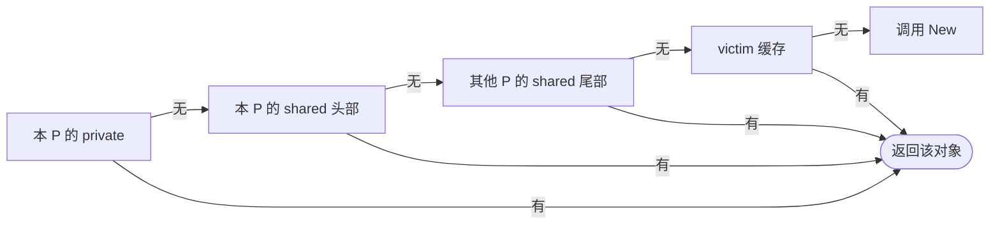

# 11.6 缓存池

程序反复分配又丢弃同一类临时对象时，每个对象都要经历一次分配，最后由垃圾回收器
（[13](../../part4memory/ch13gc)）回收。`sync.Pool` 让这些对象在用完之后暂存起来，下次直接取用。
文档对它的定位是：缓存已分配但暂未使用的对象以备复用，减轻垃圾回收器的压力
[[Go Authors, 2026a](#ref-go-authors-2026a)]。文档的示例用它缓存日志用的缓冲区：

```go
var bufPool = sync.Pool{
	New: func() any {
		// The Pool's New function should generally only return pointer
		// types, since a pointer can be put into the return interface
		// value without an allocation:
		return new(bytes.Buffer)
	},
}

func Log(w io.Writer, key, val string) {
	b := bufPool.Get().(*bytes.Buffer)
	b.Reset() // 取回的对象可能留有上一次使用的内容
	// …… 向 b 写入一行日志
	w.Write(b.Bytes())
	bufPool.Put(b)
}
```

`Get` 从池中取出任意一个对象，池为空时调用 `New` 创建；`Put` 把对象放回。池中的对象随时可能被回收，`Get`
返回的究竟是旧对象还是新对象，调用方无从得知，也不应关心。本节先说明对象缓存的由来，以及 Go
为何把「何时清空」交给垃圾回收器；再依次讨论按 P 分片、无锁窃取与 victim 缓存这三层实现。

## 11.6.1 对象缓存

预先备好一批对象、反复借还，是内存管理中很早就有的做法，自由表
（[12.2](../../part4memory/ch12alloc/component.md)）便是一例。1994 年，Jeff Bonwick 为 SunOS 5.4
内核设计的 slab 分配器把它发展为一套对象缓存原语：对象在两次使用之间保留已构造的状态，
从而降低分配复杂对象的代价 [[Bonwick, 1994](#ref-bonwick-1994)]。2001 年，Bonwick 与 Jonathan Adams 指出
slab 分配器的全局锁无法随处理器数目扩展，为它加上了每个处理器一层的缓存
[[Bonwick and Adams, 2001](#ref-bonwick-adams-2001)]。他们把这层缓存称为弹匣（magazine）：
每个处理器持有一个装填中的弹匣与一个备用弹匣，分配与释放就是对弹匣的出栈与入栈，
绝大多数操作在处理器本地完成；两个弹匣都无法满足时，才去全局的仓库（depot）换取满的或空的弹匣。
论文还指出，弹匣后进先出的性质使同一批对象被反复使用，处理器的缓存中往往已有它们的缓存行。

弹匣层之上还有一个问题：缓存多少才合适。Bonwick 与 Adams 借用 Denning 的工作集概念
[[Denning, 1968](#ref-denning-1968)]，让仓库持续统计一段时间内满弹匣数目的变化幅度，
超出这一幅度的弹匣可以回收，但只有在内存紧张时才真正释放。内核分配器能这样做，
是因为它清楚地知道内存何时紧张。在带垃圾回收的语言中，回收内存是回收器的职责，对象缓存面对的问题因而变成：
缓存中的对象应当在什么时候交还给回收器。

## 11.6.2 何时清空

2013 年 1 月，Brad Fitzpatrick 在 issue #4720 中列举了标准库里各自为政的对象复用：`regexp`
复用匹配用的线程，`fmt` 有自己的空闲缓存，`io.Copy` 的 32 KB 缓冲区出现在 dl.google.com 的性能剖析中，
dl.google.com 本身每秒分配数百 MB，在加入一个内部的字节池之前频繁触发垃圾回收
[[Fitzpatrick, 2013](#ref-fitzpatrick-2013)]。这种模式在每个包里私下重新实现一遍，而且实现得很差，因此
Fitzpatrick 希望有一个人人可以复用的好实现。Dmitry Vyukov 随即在讨论中提出一个由 `Get` 与 `Put`
组成的通用池，随后做出了基于处理器本地数据的原型，起初名为 `sync.Cache`，后来认为 `Pool`
这个名字更不易与各种缓存混淆。

这个提案拖了将近一年。Russ Cox 先以运行时仍在剧烈变动为由没有让它进入 Go 1.1，到 Go 1.2 时又已来不及，
并提醒急切的用户：`sync.Pool` 同样是一个临时拼凑的漏桶，不是灵丹妙药。2013 年 11 月，Cox 在 golang-dev
上重新提出一个「感知垃圾回收的池」，并指出此前的提案都卡在池的大小上，也就是何时、以多快的速度清空它
[[Cox, 2013](#ref-cox-2013)]。用池的操作次数充当虚拟时钟，一个完全不再使用的池就永远不会清空；
用真实时间也不对。Cox 的论证是：

> 池最常见的目的，是让已分配的内存早于下一次垃圾回收、并免去其代价地得到复用。……在回收之前清空池不够理想，
> 因为在回收之前这些内存没有机会被复用。在回收之后仍保留池中的值也不够理想，因为这些内存本可以被回收，用作别的
> 类型或者还给操作系统。

既然回收之前太早、回收之后太晚，清空池的时机就只能是回收期间：池的语义必须是每次垃圾回收时清空。
实现也很直接：维护一张非空池的名单，向空池 `Put` 时把它加入名单；每次回收开始时清空名单上所有的池，
再清空名单。这样，回收时的工作量受上次回收以来池操作次数的限制。Cox 还把它与弱指针作了比较：
弱指针只有在没有普通指针指向同一对象时才被置空，这实际上要求回收器扫描两遍；池则不论内存的其余部分如何，
一律在回收时清空。池中的指针本不应在别处使用，否则复用它就是一个错误，
因此弱指针那个昂贵的条件对池毫无益处。

同年 12 月，Fitzpatrick 提交了 `sync.Pool`，采用 Cox 提出的接口，另加了一个可选的 `New` 字段，
因为几乎所有调用方都需要它；提交说明坦言这只是一个临时实现，等 Vyukov 把它做快。`sync.Pool` 随 Go 1.3
发布。它的文档几经修订，至今仍保留着对适用范围的说明 [[Go Authors, 2026a](#ref-go-authors-2026a)]：

- 它让构建高效、线程安全的自由表变得容易，但并非适用于所有自由表；
- 合适的用法是管理一组临时对象，它们被一个包的众多相互独立的并发使用者静默共享并可能复用，`Pool`
  借此把分配开销分摊到众多使用者身上。`fmt` 包是一个好例子，它维护一个大小可变的临时输出缓冲区集合，
  负载高时扩大，静止时收缩；
- 作为某个短命对象的一部分而维护的自由表不适合使用 `Pool`，因为开销在这种场景下摊不开，让这类对象自己实现
  自由表更为高效。

## 11.6.3 按 P 分片

2014 年 1 月，Vyukov 实现了可扩展的 `Pool`：每个 P 有一个固定大小的本地缓存，本地缓存溢出或耗尽时，
与一个由互斥锁保护的全局缓存成批交换对象 [[Vyukov, 2014a](#ref-vyukov-2014a)]。这与弹匣层的结构如出一辙，
TCMalloc 的前端缓存按线程或按逻辑 CPU 划分，也是同一思路
[[Ghemawat and Menage, n.d.](#ref-ghemawat-menage-nd)]。同年 4 月，Vyukov 又发现每个 P 至多缓存
15 个对象、且其他 P 无法取用，若池中缓存的是 2 MB 的大对象，而 `GOMAXPROCS` 设为 32，池最多会浪费 960 MB。
新的策略是每个 P 只独占一个对象，其余对象在 P 之间共享 [[Vyukov, 2014b](#ref-vyukov-2014b)]。今天每个 P
的本地缓存仍是这个形状：

```go
// Local per-P Pool appendix.
type poolLocalInternal struct {
	private any       // Can be used only by the respective P.
	shared  poolChain // Local P can pushHead/popHead; any P can popTail.
}

type poolLocal struct {
	poolLocalInternal

	// Prevents false sharing on widespread platforms with
	// 128 mod (cache line size) = 0 .
	pad [128 - unsafe.Sizeof(poolLocalInternal{})%128]byte
}
```

`private` 只能由所属的 P 存取，即取即还的常见用法只需一次普通的字段读写。`shared` 承接溢出的对象，所属的
P 在它的头部存取，其他 P 只能从尾部窃取（[9.2](../ch09sched/steal.md)），所属 P
的常规存取与偶尔的窃取分处两端，彼此很少争用。`pad` 把每个 `poolLocal` 的大小补齐为 128 字节的整数倍，
使相邻 P 的本地缓存不会落在同一条缓存行上，避免假共享
（[12.2](../../part4memory/ch12alloc/component.md)）。2014 年的实现已有一段 128 字节的填充；2017 年，
Aliaksandr Valialkin 把它改为补齐到 128 字节的整数倍，在 amd64 上 `poolLocal` 因此从 176 字节缩小到
128 字节 [[Valialkin, 2017](#ref-valialkin-2017)]。

`Pool` 的 `local` 字段指向一个按 P 编号索引的 `poolLocal` 数组，`localSize` 记录数组的长度。`Get` 与
`Put` 都从 `pin` 开始：

```go
func (p *Pool) pin() (*poolLocal, int) {
	// ……
	pid := runtime_procPin()
	// In pinSlow we store to local and then to localSize, here we load in opposite order.
	// Since we've disabled preemption, GC cannot happen in between.
	// Thus here we must observe local at least as large localSize.
	// We can observe a newer/larger local, it is fine (we must observe its zero-initialized-ness).
	s := runtime_LoadAcquintptr(&p.localSize) // load-acquire
	l := p.local                              // load-consume
	if uintptr(pid) < s {
		return indexLocal(l, pid), pid
	}
	return p.pinSlow()
}
```

`runtime_procPin` 把当前 M 的 `locks` 计数加一，并返回当前 P 的编号。M 持有锁时不会被抢占，goroutine
因而不会离开这个 P，在它解除固定之前，别的 goroutine 也无法在这个 P 上运行。垃圾回收要先停止一切，
而停止一切需要抢占每个 P，所以固定期间也不会发生垃圾回收。这一点是整个快速路径的基础：`private`
的读写无需原子操作，与回收时清空池之间的同步，也靠固定本身来保证。

数组只在 `pinSlow` 中分配：第一次使用这个池，或者 `GOMAXPROCS` 变大、当前 P 的编号超出数组长度时，
`pinSlow` 在全局锁 `allPoolsMu` 下按当前的 `GOMAXPROCS` 分配新数组，先原子地写入 `local`，
再以存储-释放写入 `localSize`；首次分配时，它还把这个池加入名单 `allPools`。`pin` 则按相反的次序，
先以加载-获取读取 `localSize`，再读 `local`。这是 [11.9](./mem.md) 中消息传递（message passing）的形状：
读到新的长度，就一定读到不短于它的数组。消息传递只需要获取与释放语义，因此这里用的是运行时内部包
`internal/runtime/atomic` 中的 `LoadAcquintptr` 与 `StoreReluintptr`。这两个函数不属于 `sync/atomic`，Go
没有把获取/释放语义提供给用户（[11.3.6](./atomic.md)），运行时自己却在确有需要的地方使用它们；
这个包的原子类型在 `LoadAcquire` 一类方法上警告：慎用，且务必小心。

固定之后，`Get` 由近及远地查找：

```go
func (p *Pool) Get() any {
	// ……
	l, pid := p.pin()
	x := l.private
	l.private = nil
	if x == nil {
		// Try to pop the head of the local shard. We prefer
		// the head over the tail for temporal locality of
		// reuse.
		x, _ = l.shared.popHead()
		if x == nil {
			x = p.getSlow(pid)
		}
	}
	runtime_procUnpin()
	// ……
	if x == nil && p.New != nil {
		x = p.New()
	}
	return x
}
```

先取 `private`，再从本地 `shared` 的头部取。注释说明了为何取头部：最近放回的对象最可能还在缓存中，
这正是弹匣后进先出的理由。两处都没有，`getSlow` 从下一个 P 开始，依次从各个 P 的 `shared` 尾部窃取，
自己的分片排在最后，最后查看 victim 缓存（11.6.5 节）。仍然没有，才在解除固定之后调用 `New`。`Put`
更简单：`private` 为空就放进 `private`，否则放进本地 `shared` 的头部。



## 11.6.4 无锁窃取

2014 年的设计中，`shared` 是一个由互斥锁保护的切片，存入溢出对象与窃取都要先加锁。2019 年，Austin
Clements 在提交说明中解释了这带来的麻烦 [[Clements, 2019a](#ref-clements-2019a)]：
池在停止一切的清扫终止阶段清空，靠的是把 goroutine 固定在 P 上来与 `Get`、`Put` 同步，这使快速路径极快，
甚至不需要原子写。问题在于固定期间不能获取互斥锁，否则可能死锁，所以慢速路径必须先解除固定，
而解除固定之后的慢速路径就不再与清空同步。由此产生三个后果：

1. 慢速路径与清空之间的竞争难以推理，推理还常常依赖抢占点出现在何处这类未加规定的细节；
2. 为了防止并发的慢速路径使所有对象继续存活，清空时必须把每个池中每个对象的指针置空。
   这发生在停止一切期间，停顿时间因此与池中对象的总数成正比；
3. 若要实现 victim 缓存，清空只会更慢。

当时的 `poolCleanup` 确实逐个置空每个池的 `private` 与 `shared` 中的每个元素，注释称之为「防御性地」清零。
Clements 的办法是把加锁的切片换成无锁结构，`Get` 与 `Put` 在操作分片的整个过程中都保持固定，
不再与清空竞争；清空因而无需触碰池中的对象，停止一切期间的工作量降为与池的个数成正比。
提交说明中模拟停顿的基准测试从 71.0 微秒降到 5.6 微秒。这次修改同时关闭了 issue #22331。那个 issue
报告的是运行时在同一个函数 `clearpools` 中逐个断开 `sudog` 与 `defer` 缓存链表造成的长时间停顿
[[Chan, 2017](#ref-chan-2017)]，池的清空与它们一样，都在停止一切期间进行。

新的 `shared` 是 `poolChain`，一条由 `poolDequeue` 组成的双向链表。`poolDequeue` 是固定大小的单生产者、
多消费者无锁队列 [[Go Authors, 2026b](#ref-go-authors-2026b)]：

```go
// poolDequeue is a lock-free fixed-size single-producer,
// multi-consumer queue. The single producer can both push and pop
// from the head, and consumers can pop from the tail.
//
// It has the added feature that it nils out unused slots to avoid
// unnecessary retention of objects. This is important for sync.Pool,
// but not typically a property considered in the literature.
type poolDequeue struct {
	// headTail packs together a 32-bit head index and a 32-bit
	// tail index. Both are indexes into vals modulo len(vals)-1.
	// ……
	headTail atomic.Uint64

	// vals is a ring buffer of interface{} values stored in this
	// dequeue. The size of this must be a power of 2.
	// ……
	vals []eface
}
```

头尾两个索引打包在一个 64 位字中，与 `WaitGroup` 的状态字（[11.5](./waitgroup.md)）一样，
一次原子操作就能得到二者的一致快照。生产者即所属的 P，它在头部存取，取出时用比较并交换把头部索引减一，
与窃取者争夺同一个槽位；窃取者用比较并交换把尾部索引加一，赢得槽位后读出对象，再把槽位置空，
以原子写入类型指针为 nil 的方式把槽位交还给生产者。生产者存入前若看到槽位尚未交还，就认为队列已满。
置空槽位是注释特意强调的：一般文献中的无锁队列不关心取走的元素是否还留在数组里，`Pool`
却不能让已经取走的对象因为残留的引用而继续存活。

`poolChain` 在头部的队列装满时，分配一个两倍大的新队列接在链表头部，初始大小为 8，上限为 $2^{30}$；
窃取者从链表尾部的队列取，尾部队列取空且已有后继时，把它从链表中摘下。

## 11.6.5 victim 缓存

无锁窃取解决了停顿的问题，但每次回收都清空全部池的语义仍然留着。2017 年，Joe Tsai 在 issue #22950
中给出一个基准测试：每轮从池中取出 1000 个 `flate.Writer` 再全部放回，然后调用 `runtime.GC()`，
结果每轮都要重新分配约 1000 次 [[Tsai, 2017a](#ref-tsai-2017a)]。对周而复始地使用大量对象的负载，
清空全部内容并不合理。Tsai 建议记录上次清空以来 `Get` 的调用次数，至多保留这么多个对象。

Clements 最终采用的是另一种设计，即 victim 缓存 [[Clements, 2019b](#ref-clements-2019b)]。
每次回收时不再清空池，而是丢弃 victim 缓存，再把主缓存整体降为 victim 缓存。提交说明指出：
稳态下几乎不再有新的分配，而当池的使用减少时，对象仍会在两次回收之内被回收，此前是一次。

```go
func poolCleanup() {
	// This function is called with the world stopped, at the beginning of a garbage collection.
	// It must not allocate and probably should not call any runtime functions.

	// Because the world is stopped, no pool user can be in a
	// pinned section (in effect, this has all Ps pinned).

	// Drop victim caches from all pools.
	for _, p := range oldPools {
		p.victim = nil
		p.victimSize = 0
	}

	// Move primary cache to victim cache.
	for _, p := range allPools {
		p.victim = p.local
		p.victimSize = p.localSize
		p.local = nil
		p.localSize = 0
	}

	// The pools with non-empty primary caches now have non-empty
	// victim caches and no pools have primary caches.
	oldPools, allPools = allPools, nil
}
```

运行时在每次回收开始、并发标记之前的停止一切阶段调用它（`runtime.clearpools`）。两张名单各司其职：
`allPools` 是主缓存非空的池，`oldPools` 是 victim 缓存可能非空的池。整个过程只交换指针，
与池中对象的数目无关。对象的寿命由此确定：放入池中的对象在下一次回收时降入 victim 缓存，
再下一次回收时被丢弃；在此之前被 `Get` 取走、再 `Put` 回来，它就回到主缓存，重新开始计算。

`getSlow` 先窃取所有 P 的主缓存，最后才查看 victim 缓存，注释给出的理由是希望 victim
缓存中的对象尽可能老化掉。victim 缓存也取空时，`getSlow` 把 `victimSize` 置零，之后的 `Get` 就不再查看它。
下面的程序只用一个 P，结果是确定的：

```go {run=true}
package main

import (
	"fmt"
	"runtime"
	"sync"
)

func main() {
	runtime.GOMAXPROCS(1) // 只有一个 P，结果才是确定的

	n := 0
	pool := sync.Pool{New: func() any {
		n++
		return fmt.Sprintf("New 创建的第 %d 个对象", n)
	}}

	pool.Put("放回的对象")
	runtime.GC()
	fmt.Println("经过一次 GC：", pool.Get())

	pool.Put("放回的对象")
	runtime.GC()
	runtime.GC()
	fmt.Println("经过两次 GC：", pool.Get())
}
```

运行结果如下：

```
经过一次 GC： 放回的对象
经过两次 GC： New 创建的第 1 个对象
```

用 `-race` 运行时，输出可能不同：竞争检测器模式下，`Put` 会随机丢弃四分之一的对象（11.6.6 节）。

victim 缓存还改善了池与回收节奏的关系。Clements 在提交说明中指出，旧的做法使池中的对象都成为短命对象；
但应用处于稳态时，池会立即被重新填满，这些对象对存活堆大小的影响如同长寿对象。
计算回收的触发点与目标时它们被当作短命对象，在存活堆中却表现得像长寿对象，结果回收触发得过于频繁。有了
victim 缓存，池中的对象就按长寿对象影响触发点与目标。基准测试中，每次操作调用 `New` 的次数从 40.0 次降到
12.4 次。这两项修改随 Go 1.13 发布，发布说明写道：大型 `Pool` 不再延长停止一切的停顿；`Pool`
不必在每次回收后完全重新填充，它会跨回收保留一部分对象 [[Go Authors, 2019](#ref-go-authors-2019)]。

「victim 缓存」的名字来自体系结构。1990 年，Norman Jouppi 提出在直接映射的缓存与下一级存储之间加一个小的全
相联缓存，存放刚被替换出去的缓存行，以减少冲突失效 [[Jouppi, 1990](#ref-jouppi-1990)]。`sync.Pool`
借用了这个想法：被逐出主缓存的对象并不立即作废，而是在二级缓存中再停留一个周期。

## 11.6.6 使用的前提

`Pool` 的文档几乎只承诺它是并发安全的，其余都是不作保证的声明：池中的任何对象都可能在任何时候被自动移除，
且不另行通知；`Get` 可以忽略池，把它当作空的；调用方不应假定传给 `Put` 的值与 `Get`
返回的值之间有任何关系 [[Go Authors, 2026a](#ref-go-authors-2026a)]。因此它只适合存放可以随时重建的对象，
不能用作连接池这类需要保持存活的资源池。

内存模型方面，文档给出两条同步先于的保证：一次 `Put(x)` 同步先于返回同一个 `x` 的 `Get`；`New` 返回 `x`
同步先于返回同一个 `x` 的 `Get`。由此，一个 goroutine 在放回对象之前对它的写入，取到它的 goroutine
都能看到。Go 内存模型的正文只列出池等类型，说明它们的保证见各自的文档
[[Go Authors, 2022](#ref-go-authors-2022)]。竞争检测器看不到池内部的同步，`Put` 与 `Get`
便以对象指针的散列值选出一个地址，在其上显式地释放与获取。在竞争检测器模式下，`Put`
还会随机丢弃四分之一的对象。这是 Cox 在 2016 年加入的，此前在竞争检测器模式下 `Pool` 完全不缓存对象
[[Cox, 2016](#ref-cox-2016)]。随机丢弃符合文档的承诺，也能暴露依赖池中一定留有对象的程序。

`New` 应当返回指针类型。文档示例中的注释说明了原因：指针可以直接放进接口值，不需要分配。
若池中存放的是切片，每次 `Put` 都要先把切片头复制到堆上，才能装进 `any`，
池省下的分配又以另一种形式回来了：

```go {run=true}
package main

import (
	"fmt"
	"sync"
	"testing"
)

func main() {
	var pool sync.Pool
	buf := make([]byte, 1024)
	ptr := &buf

	slice := testing.AllocsPerRun(1000, func() {
		pool.Put(buf) // 切片转换为 any，需要在堆上存放切片头
		pool.Get()
	})
	pointer := testing.AllocsPerRun(1000, func() {
		pool.Put(ptr) // 指针可以直接放进接口值
		pool.Get()
	})
	fmt.Println("放入切片，每次分配：", slice)
	fmt.Println("放入指针，每次分配：", pointer)
}
```

运行结果如下：

```
放入切片，每次分配： 1
放入指针，每次分配： 0
```

池中的对象还应当大致等重。2017 年，Tsai 在 issue #23199 中指出，文档当时的示例缓存 `bytes.Buffer`，
而缓冲区的容量随使用量增长 [[Tsai, 2017b](#ref-tsai-2017b)]。`Get` 返回的是任意一个对象，
池把所有对象一视同仁；少数几次大请求留下的大缓冲区，可能在之后源源不断的小请求中被反复取出放回，
长期占据内存。Clements 赞同应当在文档中说明这一点 [[Clements, 2017](#ref-clements-2017)]。Tsai 随后修正了
`fmt`：缓冲区容量超过 64 KB 时，不再把打印器放回池中 [[Tsai, 2018](#ref-tsai-2018)]；
如今的实现进一步改为只丢弃缓冲区，仍回收打印器本身。

在同一条评论中，Clements 转述了 Rick Hudson 常说的一句话：每一处对 `sync.Pool` 的使用，
都是对垃圾回收器的一份缺陷报告。垃圾回收器已经改进了许多，但对于高频分配、生命周期明确且无需清零的对象，
`sync.Pool` 仍可能是显著的优化。它是对回收器不足之处的弥补，引入之前，
应当先用性能剖析确认临时分配确实是瓶颈。

## 延伸阅读

- <a id="ref-bonwick-1994"></a>[Bonwick, 1994] Jeff Bonwick. "The Slab Allocator: An Object-Caching Kernel
  Memory Allocator." *USENIX Summer 1994 Technical Conference*, 1994.
  https://www.usenix.org/legacy/publications/library/proceedings/bos94/bonwick.html
  对象缓存式分配的经典。
- <a id="ref-bonwick-adams-2001"></a>[Bonwick and Adams, 2001] Jeff Bonwick, Jonathan Adams. "Magazines
  and Vmem: Extending the Slab Allocator to Many CPUs and Arbitrary Resources." *USENIX Annual Technical
  Conference*, 2001. https://www.usenix.org/legacy/event/usenix01/full_papers/bonwick/bonwick.pdf
  每处理器的弹匣层与仓库。
- <a id="ref-chan-2017"></a>[Chan, 2017] Bryan Chan. Go issue #22331. *runtime: clearpools causes
  excessive STW1 time.* 2017. https://github.com/golang/go/issues/22331
- <a id="ref-clements-2017"></a>[Clements, 2017] Austin Clements. Comment on golang/go#23199, 2017.
  https://github.com/golang/go/issues/23199#issuecomment-353670473
  转述 Rick Hudson「每一处对 sync.Pool 的使用都是对垃圾回收器的一份缺陷报告」。
- <a id="ref-clements-2019a"></a>[Clements, 2019a] Austin Clements. sync: use lock-free structure for Pool
  stealing. Go commit d5fd2dd6a1, 2019.
  https://github.com/golang/go/commit/d5fd2dd6a17a816b7dfd99d4df70a85f1bf0de31
  `shared` 改为无锁队列，随 Go 1.13 发布。
- <a id="ref-clements-2019b"></a>[Clements, 2019b] Austin Clements. sync: smooth out Pool behavior over GC
  with a victim cache. Go commit 2dcbf8b369, 2019.
  https://github.com/golang/go/commit/2dcbf8b3691e72d1b04e9376488cef3b6f93b286
  修复 issue #22950，随 Go 1.13 发布。
- <a id="ref-cox-2013"></a>[Cox, 2013] Russ Cox. gc-aware pool draining policy. golang-dev, 2013.
  https://groups.google.com/g/golang-dev/c/kJ_R6vYVYHU/m/LjoGriFTYxMJ
  提出在每次垃圾回收时清空池。
- <a id="ref-cox-2016"></a>[Cox, 2016] Russ Cox. sync: enable Pool when using race detector. Go commit
  ba048f7ce4, 2016. https://go.dev/cl/31589
  修复 issue #17306，随 Go 1.8 发布。
- <a id="ref-denning-1968"></a>[Denning, 1968] Peter J. Denning. "The Working Set Model for Program
  Behavior." *Communications of the ACM*, 11(5): 323–333, 1968. https://doi.org/10.1145/363095.363141
- <a id="ref-fitzpatrick-2013"></a>[Fitzpatrick, 2013] Brad Fitzpatrick. Go issue #4720. *sync: add Pool
  type.* 2013. https://github.com/golang/go/issues/4720
  `sync.Pool` 的提案与讨论；实现见 Go commit 8c6ef061e3（https://golang.org/cl/41860043），随 Go 1.3 发布。
- <a id="ref-ghemawat-menage-nd"></a>[Ghemawat and Menage, n.d.] Sanjay Ghemawat, Paul Menage.
  *TCMalloc: Thread-Caching Malloc.* https://google.github.io/tcmalloc/design.html
  前端缓存按线程或按逻辑 CPU 划分，与本节的按 P 分片同构。
- <a id="ref-go-authors-2019"></a>[Go Authors, 2019] The Go Authors. *Go 1.13 Release Notes*（sync.Pool 的
  victim 缓存）. https://go.dev/doc/go1.13
  提案与讨论见 golang/go#22950，https://github.com/golang/go/issues/22950 。
- <a id="ref-go-authors-2022"></a>[Go Authors, 2022] The Go Authors. *The Go Memory Model.*
  https://go.dev/ref/mem
  「Additional Mechanisms」一节对 `Pool` 等类型只指向各自的文档。
- <a id="ref-go-authors-2026a"></a>[Go Authors, 2026a] The Go Authors.
  *sync.Pool 文档与 src/sync/pool.go.* https://pkg.go.dev/sync#Pool
  本节摘录取自 Go 1.26。
- <a id="ref-go-authors-2026b"></a>[Go Authors, 2026b] The Go Authors. src/sync/poolqueue.go. Go 1.26
  源码. https://github.com/golang/go/blob/release-branch.go1.26/src/sync/poolqueue.go
- <a id="ref-jouppi-1990"></a>[Jouppi, 1990] Norman P. Jouppi. "Improving Direct-Mapped Cache Performance
  by the Addition of a Small Fully-Associative Cache and Prefetch Buffers." *ISCA 1990*, 364–373, 1990.
  https://doi.org/10.1145/325164.325162
  victim 缓存的出处。
- <a id="ref-tsai-2017a"></a>[Tsai, 2017a] Joe Tsai. Go issue #22950. *sync: avoid clearing the full Pool
  on every GC.* 2017. https://github.com/golang/go/issues/22950
- <a id="ref-tsai-2017b"></a>[Tsai, 2017b] Joe Tsai. Go issue #23199. *sync: Pool example suggests
  incorrect usage.* 2017. https://github.com/golang/go/issues/23199
- <a id="ref-tsai-2018"></a>[Tsai, 2018] Joe Tsai. fmt: fix usage of sync.Pool. Go commit e82d152e66,
  2018. https://go.dev/cl/136116
  随 Go 1.12 发布。
- <a id="ref-valialkin-2017"></a>[Valialkin, 2017] Aliaksandr Valialkin. sync: align poolLocal to CPU
  cache line size. Go commit 8aa31d5dae, 2017. https://go.dev/cl/40918
  随 Go 1.9 发布。
- <a id="ref-vyukov-2014a"></a>[Vyukov, 2014a] Dmitriy Vyukov. sync: scalable Pool. Go commit f8e0057bb7,
  2014. https://github.com/golang/go/commit/f8e0057bb71cded5bb2d0b09c6292b13c59b5748
  每 P 分片，随 Go 1.3 发布。
- <a id="ref-vyukov-2014b"></a>[Vyukov, 2014b] Dmitriy Vyukov. sync: less agressive local caching in Pool.
  Go commit 8fc6ed4c89, 2014. https://github.com/golang/go/commit/8fc6ed4c8901d13fe1a5aa176b0ba808e2855af5
  每 P 只独占一个对象，随 Go 1.3 发布。
- 本书 [9.2 工作窃取](../ch09sched/steal.md)、[11.9 内存一致模型](./mem.md)、
  [12.2 分配器组件](../../part4memory/ch12alloc/component.md)（每 P 缓存与偷取的同源设计）。
