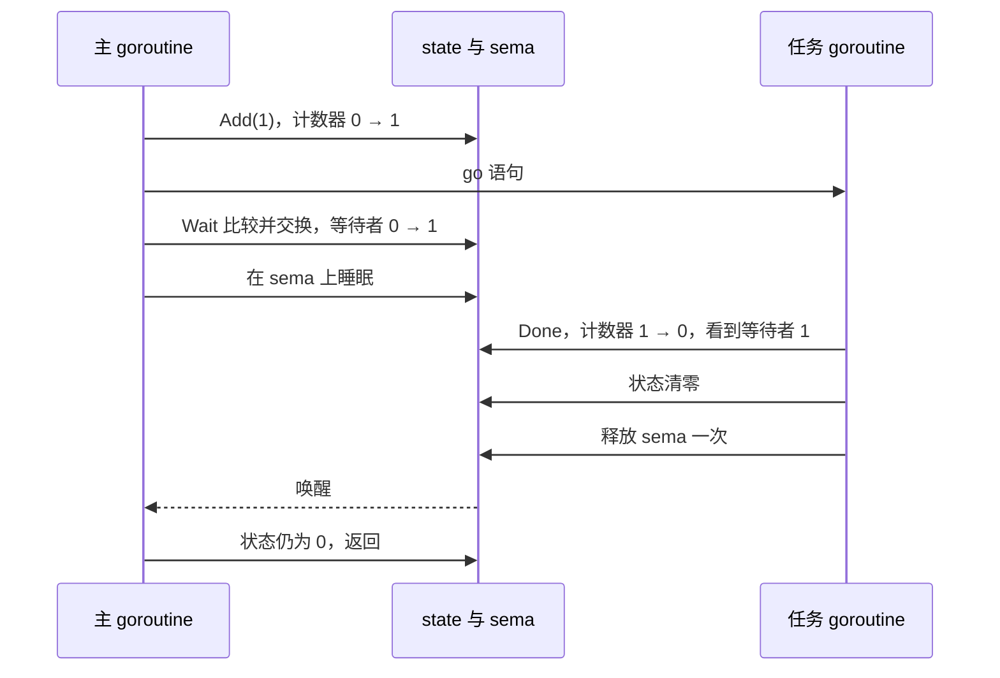

# 11.5 同步组

互斥锁（[11.2](./mutex.md)）与条件变量（[11.4](./cond.md)）处理的是多个 goroutine 争用同一份状态。
`sync.WaitGroup` 处理的是另一种结构：一个 goroutine 派生出若干任务，等它们全部结束后再继续。
这种先分后合的结构称为 fork-join：

```go
var wg sync.WaitGroup
for _, t := range tasks {
	wg.Go(func() { process(t) })
}
wg.Wait() // 所有任务结束后才返回
```

`WaitGroup` 的核心是一个计数器：每派生一个任务加一，每结束一个任务减一，计数归零时放行等待者。这个想法比
Go 早得多，1963 年 Melvin Conway 为多处理器计算机设计的 FORK 与 JOIN 指令就建立在这样一个计数器之上
[[Conway, 1963](#ref-conway-1963)]。2011 年，Gustavo Niemeyer 以「屏障的实现」为题提议把它加入 `sync` 包
[[Niemeyer, 2011](#ref-niemeyer-2011)]。此后它的实现几经重写，从一把互斥锁加一个按需分配的信号量，
演变为今天的一个 64 位字加一个信号量；它的使用规则逐步写明，误用也有了运行时、竞态检测器与 `go vet`
三层检查。Go 1.25 新增的 `WaitGroup.Go` 把最常见的写法收进一个方法，Go 1.26 又修正了它在任务 panic
时的行为。

## 11.5.1 汇合计数器

Conway 把并行看作流程图上的分叉：一个过程总是从流程图上的某一点开始，
所以「所有的并行都来自流程图路径上的分叉」，分开的路径可以在汇合点重新合并
[[Conway, 1963](#ref-conway-1963)]。论文为此在指令集中加入了 FORK 与 JOIN。以两路分叉为例，
`FORK 200, 299, 2` 先把地址 299 的内容置为 2，再分别从 101 与 200 两处继续执行；两条路径的末尾各有一条
`JOIN 299`，含义是：

> 把 299 处的计数器减一。如果结果为零，转到 299 + 1；否则释放这个处理器。

这个计数器，论文称为汇合点（junction）。两条路径各自运行在一个处理器上，谁先结束无从预知，
但把计数器减到零的那个处理器知道自己是最后一个。Conway 由此指出，在 N 路分叉中，
唯一扮演特殊角色的处理器是最后完成的那一个，因为必须由它转向汇合点之后的代码，其余处理器都被释放。JOIN
因而「还有一项至关重要的工作：等待」，汇合点之后的代码必须等所有路径都完成才能开始。

分叉的数目未必能事先确定。如果某条 FORK 是否执行取决于条件，汇合计数器就无法在分叉之初一次设定。
论文为此给出 FORK 的另一种形式 `FORK A, J`：先把 J 处的值加一，再分叉到 A。这正是今天 `wg.Add(1)` 加 `go`
语句的组合。Niemeyer 为 `WaitGroup` 写的第一个文档示例恰好也是条件分叉：循环中只为满足条件的元素调用
`Add(1)` 并启动 goroutine [[Niemeyer, 2011](#ref-niemeyer-2011)]。

`WaitGroup` 保留了计数器，改变了汇合的方式。Conway 的处理器是稀缺的硬件，先到者应当尽早让出；goroutine
却很廉价，汇合点之后的代码通常也属于发起分叉的那个 goroutine。因此 Go 不让最后到达者接着执行，而是让调用
`Wait` 的 goroutine 在计数器上睡眠，最后一次 `Done` 把计数减到零时唤醒它。
两种做法的差别在于由谁执行汇合之后的代码：Conway 交给最后完成的路径，`WaitGroup` 留给发起分叉的一方，
代价是一次阻塞与一次唤醒，好处是汇合之后的代码仍写在原处。Go 1.25 起，`WaitGroup`
的文档称它为一种计数信号量（counting semaphore）[[Go Authors, 2026a](#ref-go-authors-2026a)]，
但阻塞的条件与经典的计数信号量（[11.1.1](./basic.md)）恰好相反：Dijkstra 的 P 操作在计数为零时阻塞，
`Wait` 则阻塞到计数为零。

Conway 的「最后到达者继续执行」并没有消失。Java 的 `CyclicBarrier` 可以带一个屏障动作，
由最后到达的线程在放行其他线程之前执行；`Phaser` 每一阶段的推进动作，同样由触发推进的那个参与方执行
[[Oracle, 2023](#ref-oracle-2023)]。下表把几种等待「一组事件全部发生」的原语放在一起：

| 原语 | 计数如何设定 | 能否复用 | 谁在等待 |
| --- | --- | --- | --- |
| `CountDownLatch`（Java 5） | 构造时给定，只减不增 | 否，计数无法重置 | 任意线程等计数归零 |
| `CyclicBarrier`（Java 5） | 参与方数目在构造时固定 | 是，放行后自动复用 | 参与方彼此等齐 |
| `Phaser`（Java 7） | 参与方可随时注册与注销 | 是，按阶段推进 | 参与方等本阶段结束 |
| `CountdownEvent`（.NET Framework 4） | 初值加 `AddCount`，归零后不能再加 | 须显式 `Reset` | 任意线程等计数归零 |
| `sync.WaitGroup`（Go） | `Add` 随时增减 | 是，上一轮的 `Wait` 全部返回之后 | 任意 goroutine 等计数归零 |

`CyclicBarrier` 解决的是另一个问题：一组对等的线程彼此等齐，没有「一方等多方」之分。与 `WaitGroup`
最接近的是 `CountDownLatch` 与 `CountdownEvent`，三者都是一组等待者等一个计数器归零，
差别在于归零之后怎么办。`CountDownLatch` 就此报废，计数无法重置；`CountdownEvent`
在计数归零后进入已触发状态，此时再调用 `AddCount` 会抛出 `InvalidOperationException`，必须先 `Reset`
[[Microsoft, 2026](#ref-microsoft-2026)]。`WaitGroup` 则在唤醒等待者时把状态清零，下一轮可以直接从零开始
`Add`。这份便利有一个前提，即下一节的规则：从零开始的 `Add` 不能与 `Wait` 并发。

## 11.5.2 用法与规则

Go 1.25 之后，`WaitGroup` 推荐的用法只涉及两个方法：`Go(f)` 在新的 goroutine 中运行 `f`
并把它登记为一个任务，`Wait` 阻塞到所有登记的任务结束。此前的代码用 `Add` 与 `Done` 手动维护计数，
文档至今保留了这种写法作为对照 [[Go Authors, 2026a](#ref-go-authors-2026a)]：

```go
var wg sync.WaitGroup
wg.Add(1) // 在 go 语句之前登记
go func() {
	defer wg.Done() // 任务结束时注销
	task()
}()
wg.Wait()
```

`Done` 等价于 `Add(-1)`。计数器不能为负，`Add` 一旦使它变负就会 panic。真正需要留意的是 `Add` 与 `Wait`
之间的次序，`Add` 的文档用三句话规定了它：

1. 计数器为零时以正数调用的 `Add`，必须先行发生于 `Wait`。
2. 以负数调用的 `Add`，以及在计数器大于零时以正数调用的 `Add`，可以在任何时候发生。
3. 如果用同一个 `WaitGroup` 先后等待几组相互独立的事件，新一组的 `Add` 必须发生在上一组的 `Wait`
   全部返回之后。

第一条规则的通常含义是：`Add` 应当写在启动 goroutine 的语句之前，而不是写在新 goroutine 的内部。
第二条规则允许任务在运行中派生新的任务：派生者自己尚未结束，计数器就大于零，它调用的 `Add` 不会与 `Wait`
冲突。`Go` 方法的文档把这一点写得更直白：由 `Go` 启动的 goroutine 本身也可以调用 `Go`。
第三条规则针对复用。三条规则说的是同一件事：计数器从零变为正数的那一刻标志着新一轮等待的开始，
它与等待者之间必须有确定的先后，不能并发。

这些措辞是逐步形成的。2013 年，Russ Cox 应 issue #4762 的请求在文档中加了一句提醒：以正数调用的 `Add`
必须在调用 `Wait` 之前发生，否则 `Wait` 等待的可能是一组过小的任务 [[Cox, 2013](#ref-cox-2013)]。
读者有的把其中的「调用」理解为「所有调用」，有的理解为「至少一次调用」，两种读法导致的行为截然不同。
2014 年，Andrew Gerrand 把它改写为今天的前两条规则 [[Gerrand, 2014](#ref-gerrand-2014)]。第三条规则是
2015 年随实现的重写一起加入的，下一节会讲到它的来由。

## 11.5.3 实现的演进

Niemeyer 的第一版实现用一把互斥锁保护三个字段：计数器、等待者数目，以及一个指向信号量的指针
[[Niemeyer, 2011](#ref-niemeyer-2011)]。`Wait` 在锁内把等待者数目加一，然后在信号量上睡眠；
把计数器减到零的 `Add` 在锁内按等待者数目逐个释放信号量，再把信号量指针置空，
下一次有人等待时分配一个新的。源码的注释解释了按需分配的理由，它针对的是下面这个交错：

```
G1: Add(1)
G1: go G2()
G1: Wait() // 释放锁之后、Semacquire 之前被切换出去
G2: Done() // 释放信号量：sema == 1，waiters == 0，G1 尚未运行
G3: Wait() // 看到 counter == 0、waiters == 0，不阻塞
G3: Add(1) // counter == 1，waiters == 0
G3: go G4()
G3: Wait() // G1 仍未运行，G3 看到 sema == 1，于是被放行：错误
```

G2 释放的那一次信号量本是留给 G1 的，却被下一轮的 G3 取走了。每轮换一个新的信号量，
上一轮遗留的释放就不会被下一轮误用。

同年 7 月，Dmitry Vyukov 为它加上了不加锁的快速路径 [[Vyukov, 2011](#ref-vyukov-2011)]。
计数器与等待者数目改为两个原子变量：`Add` 先原子地修改计数器，若结果大于零或无人等待就直接返回；`Wait`
先原子地读一次计数器，为零就直接返回。只有真正需要睡眠或唤醒时才进入锁。提交说明中的基准测试里，多个
goroutine 反复对已归零的计数器调用 `Wait`，在 GOMAXPROCS 为 16 时每次调用从约 104 纳秒降到约 1.3 纳秒，
因为它们不再争用同一把锁。快速路径也带来了一处微妙之处，`Wait` 中的注释写道：

```go
wg.m.Lock()
atomic.AddInt32(&wg.waiters, 1)
// This code is racing with the unlocked path in Add above.
// The code above modifies counter and then reads waiters.
// We must modify waiters and then read counter (the opposite order)
// to avoid missing an Add.
if atomic.LoadInt32(&wg.counter) == 0 {
	atomic.AddInt32(&wg.waiters, -1)
	wg.m.Unlock()
	return
}
```

`Wait` 的这一段虽然持有锁，与之竞争的却是 `Add` 不加锁的快速路径。`Add` 先写计数器、再读等待者数目，
`Wait` 先写等待者数目、再读计数器：双方各写一个变量，再读对方的变量，正是 [11.9](./mem.md)
所说的存储缓冲（store buffering）石蕊测试的形状。如果两次读都可能看到旧值，`Add`
会以为无人等待而直接返回，`Wait` 会以为计数尚未归零而去睡眠，唤醒就此丢失。只有原子操作顺序一致，
两次读才不会同时落空。2021 年 Cox 论证 Go 的原子操作应当顺序一致时，举的例子之一正是「`sync.WaitGroup`
的一个旧实现用了一对原子 uint32 值，`wg.counter` 与 `wg.waiters`」[[Cox, 2021](#ref-cox-2021)]
（[11.3.6](./atomic.md)）。

2014 年，Rui Ueyama 修复了这一版中的一次虚假唤醒（issue #7734）[[Ueyama, 2014](#ref-ueyama-2014)]。G1
把计数器减到零，看到有等待者，准备进入锁去唤醒它们；在它拿到锁之前，G2 把计数器加一并调用 `Wait`，
排进了等待者的行列；G1 拿到锁后把所有等待者一并唤醒，其中也包括 G2，而 G2 等的那一轮还没有结束。
修复的办法是在锁内再读一次计数器，仍为零才唤醒。2011 年的按需分配与 2014 年的这次修复，
都是为了让相邻两轮的操作交错时程序依然正确。

2015 年，Vyukov 换了思路，重新审视 Niemeyer 的那段注释，认为它描述的场景本身就不成立：G3 的 `Add(1)` 与
G1 的 `Wait` 并发发生，G1 等不等这次 `Add` 都说得通，这样的程序不可能有合理的行为
[[Vyukov, 2015](#ref-vyukov-2015)]。既然是误用，就无需为它按需分配信号量。去掉动态分配之后，
互斥锁也不再必要：计数器与等待者数目被打包进同一个 64 位字，`Add` 与 `Wait`
都只需一次原子的读改写来更新状态。相邻两轮的交错从此不再被容忍，而是被检测：文档加入了
11.5.2 节的第三条规则，`Add` 与 `Wait` 中加入了相应的 panic。按这条规则，Ueyama 修复的那个场景中，G2
在上一轮的等待者返回之前就开始新一轮，同样属于误用。提交说明中的基准测试显示，实际发生等待的场景快了约
18% 至 21%，每次等待的内存分配从两次降为一次。

此后的改动都围绕这个 64 位字的存放。32 位平台上的 64 位原子操作要求操作数按 8 字节对齐，
而结构体字段只保证 4 字节对齐。Vyukov 的版本因此声明了 12 字节的数组 `state1 [12]byte`，由 `state()`
方法在运行时挑出其中按 8 字节对齐的那 8 个字节。2018 年，Diogo Pinela 把它改为 `state1 [3]uint32`，
让信号量占用余下的 4 个字节，省去了单独的 `sema` 字段 [[Pinela, 2018](#ref-pinela-2018)]。2022 年，Cuong
Manh Le 改用 Go 1.19 新增的 `atomic.Uint64`，这个类型自身保证 64 位对齐，
手工对齐的代码随之删除（[11.3.7](./atomic.md)）[[Le, 2022](#ref-le-2022)]。2025 年，Damien Neil 为
`testing/synctest` 从等待者数目中借出最高的一位，记录这个 `WaitGroup` 是否属于某个 synctest 气泡
[[Neil, 2025](#ref-neil-2025)]。

| 提交于 | 发布于 | 状态的表示 | 作者 |
| --- | --- | --- | --- |
| 2011 年 2 月 | Go 1 | 互斥锁 + 计数器 + 等待者数目 + 按需分配的信号量 | Niemeyer |
| 2011 年 7 月 | Go 1 | 计数器与等待者数目改为原子变量，增加快速路径 | Vyukov |
| 2015 年 | Go 1.5 | 去掉互斥锁与动态信号量，状态打包进 `state1 [12]byte` | Vyukov |
| 2018 年 | Go 1.11 | `state1 [3]uint32`，信号量放进余下的 4 字节 | Pinela |
| 2022 年 | Go 1.20 | `atomic.Uint64` 加独立的 `sema` | Le |
| 2025 年 | Go 1.25 | 借出一位作 synctest 气泡标志 | Neil |

## 11.5.4 Add 与 Wait

今天的 `WaitGroup` 只有三个字段 [[Go Authors, 2026a](#ref-go-authors-2026a)]：

```go
type WaitGroup struct {
	noCopy noCopy

	// Bits (high to low):
	//   bits[0:32]  counter
	//   bits[32]    flag: synctest bubble membership
	//   bits[33:64] wait count
	state atomic.Uint64
	sema  uint32
}
```

`noCopy` 不占空间，只供 `go vet` 检查首次使用后的复制（[11.3.7](./atomic.md)）。`state` 的高
32 位是计数器，即尚未结束的任务数；低 31 位是等待者数目，即阻塞在 `Wait` 中的 goroutine 数；
两者之间的一位是 synctest 气泡的标志。`sema` 是等待者睡眠所用的信号量，由运行时的 `sema.go`
实现（[11.2](./mutex.md)）。

计数器与等待者数目放在同一个字里，换来的是一致的快照：一次原子操作同时得到两个值，不会出现读完计数器、再读
等待者数目时前者已被别人改掉的情形。`Add` 的主干如下，竞态检测器与 synctest 的代码以 `// ……` 代替：

```go
func (wg *WaitGroup) Add(delta int) {
	// ……
	state := wg.state.Add(uint64(delta) << 32)
	// ……
	v := int32(state >> 32)
	w := uint32(state & 0x7fffffff)
	// ……
	if v < 0 {
		panic("sync: negative WaitGroup counter")
	}
	if w != 0 && delta > 0 && v == int32(delta) {
		panic("sync: WaitGroup misuse: Add called concurrently with Wait")
	}
	if v > 0 || w == 0 {
		return
	}
	// This goroutine has set counter to 0 when waiters > 0.
	// Now there can't be concurrent mutations of state:
	// - Adds must not happen concurrently with Wait,
	// - Wait does not increment waiters if it sees counter == 0.
	// Still do a cheap sanity check to detect WaitGroup misuse.
	if wg.state.Load() != state {
		panic("sync: WaitGroup misuse: Add called concurrently with Wait")
	}
	// Reset waiters count to 0.
	wg.state.Store(0)
	// ……
	for ; w != 0; w-- {
		runtime_Semrelease(&wg.sema, false, 0)
	}
}
```

`delta` 左移 32 位后加到状态上，只改变高 32 位的计数器。负的 `delta` 转换为 `uint64` 后是一个很大的数，
左移再相加，在模 $2^{64}$ 的意义下等同于从高 32 位中减去相应的值，低位不受影响。加完之后，`Add`
从返回的新状态中取出计数器 `v` 与等待者数目 `w`：计数器为负，panic；这次调用把计数器从零抬起，
却已有等待者，说明它与某个 `Wait` 并发，也 panic；计数器大于零或无人等待，直接返回，
绝大多数调用走的是这条路径。剩下的情形是这次调用把计数器减到了零，而且有人在等。

对这一情形，注释给出了一段推理：此时不应再有任何并发的状态修改。新的 `Add` 不能与 `Wait` 并发，这是
11.5.2 节的规则；`Wait` 看到计数器为零时也不会再增加等待者数目。因此 `Add`
可以用一次普通的原子存储把整个状态清零，不必使用比较并交换。清零之前它再读一次状态，与刚才的结果比较，
作为对误用的一次廉价检查。清零之后，按等待者数目逐个释放信号量。

`Wait` 是一个比较并交换的循环：

```go
func (wg *WaitGroup) Wait() {
	// ……
	for {
		state := wg.state.Load()
		v := int32(state >> 32)
		// ……
		if v == 0 {
			// Counter is 0, no need to wait.
			// ……
			return
		}
		// Increment waiters count.
		if wg.state.CompareAndSwap(state, state+1) {
			// ……
			runtime_SemacquireWaitGroup(&wg.sema, synctestDurable)
			isReset := wg.state.Load() != 0
			// ……
			if isReset {
				panic("sync: WaitGroup is reused before previous Wait has returned")
			}
			return
		}
	}
}
```

计数器为零时，`Wait` 直接返回。否则它尝试把状态加一，也就是把低位的等待者数目加一；
若在读取与比较并交换之间状态被别人改变，比较并交换失败，重新读取再试。登记成功后，它在信号量上睡眠。
被唤醒之后，`Wait` 检查状态是否仍为零。唤醒它的 `Add` 在释放信号量之前已经把状态清零，
如果此刻状态又不为零，说明在它返回之前已经有人开始了新一轮的 `Add`，违反了第三条规则。这正是 Niemeyer
那段注释中 G3 的行为：2011 年的实现为它按需分配信号量，2015 年之后的实现把它报告为误用。

一轮完整的等待如下图所示：



## 11.5.5 误用与检测

`WaitGroup` 的误用分为两类，检测的手段也不同。

第一类是计数不平衡。`Done` 多于 `Add`，计数器变负，`Add` 立即 panic；`Done` 少于 `Add`，
计数器永远不会归零，`Wait` 永远不会返回，若所有 goroutine 都因此阻塞，运行时会报告死锁。前者是确定的，
可以用 `recover` 捕获：

```go {run=true}
package main

import (
	"fmt"
	"sync"
)

func main() {
	defer func() { fmt.Println("recover:", recover()) }()

	var wg sync.WaitGroup
	wg.Add(1)
	wg.Done()
	wg.Done() // 多出的一次 Done
}
```

运行结果如下：

```
recover: sync: negative WaitGroup counter
```

第二类是 `Add` 与 `Wait` 的次序错误，最常见的形式是把 `Add` 写进新 goroutine 的内部：

```go
var wg sync.WaitGroup
go func() {
	wg.Add(1) // 错误：应在 go 语句之前调用
	defer wg.Done()
	work()
}()
wg.Wait()
```

如果 `Wait` 先读到状态，它看到计数器为零，立即返回，`work` 可能还没有开始。此时并不会 panic：
`Add called concurrently with Wait` 只在已有等待者时才可能触发，而这个 `Wait` 根本没有登记为等待者。如果
`Add` 抢先执行，`Wait` 正常阻塞，程序的行为恰好正确。结果取决于调度，测试中可能始终遇不到出错的那一次。

能稳定发现这类错误的是另外两层工具。2013 年，Vyukov 改进了竞态检测器对 `WaitGroup` 的建模
[[Vyukov, 2013](#ref-vyukov-2013)]：把计数器从零开始的那次 `Add` 视为对 `sema` 字段的一次读，
把第一个真正阻塞的 `Wait` 视为对它的一次写。两者之间若没有同步，竞态检测器就报告数据竞争。这恰好发生在
`Add` 抢先、程序看似正确的那些运行中：在 `go` 语句之后稍作停顿，让 `Add` 先执行，再用 `-race`
运行上面的程序，程序照常结束，竞态检测器却报告主 goroutine 的写与新 goroutine 先前的读构成数据竞争。
提交说明列出的另一种可检测的误用，是有多个等待者时错误地复用 `WaitGroup`。Go 1.25 起，`go vet` 加入了
`waitgroup` 分析器，在静态检查阶段就能指出上面的写法，报告
`WaitGroup.Add called from inside new goroutine` [[Go Authors, 2025](#ref-go-authors-2025)]。

| 误用 | 运行时 | 竞态检测器（`-race`） | `go vet` |
| --- | --- | --- | --- |
| `Done` 多于 `Add` | panic | | |
| `Add` 写在新 goroutine 内部 | 通常不报错，`Wait` 可能提前返回 | 报告数据竞争 | 报告（Go 1.25 起） |
| 上一轮 `Wait` 未全部返回就开始新一轮 `Add` | 交错发生时 panic | 报告数据竞争（多个等待者时） | |

## 11.5.6 同步先于

`WaitGroup` 除了计数，还提供一条内存模型上的保证。用 [11.9](./mem.md) 的术语说：一次 `Done`
同步先于它所解除阻塞的那次 `Wait` 的返回。`Go` 方法的文档给出同样的保证：`f`
的返回同步先于它所解除阻塞的那次 `Wait` 的返回。由此，任务结束之前对内存的写入，在 `Wait`
返回之后对等待者都可见，等待者读取任务的结果无需再加锁：

```go {run=true}
package main

import (
	"fmt"
	"sync"
)

func main() {
	squares := make([]int, 10)
	var wg sync.WaitGroup
	for i := range squares {
		wg.Go(func() { squares[i] = i * i }) // 每个任务只写自己的一格
	}
	wg.Wait()

	sum := 0
	for _, s := range squares {
		sum += s
	}
	fmt.Println(squares, sum)
}
```

运行结果如下：

```
[0 1 4 9 16 25 36 49 64 81] 285
```

每个任务只写自己的那一格，任务之间没有竞争。任务的写入按程序次序先于 `f` 的返回，`f` 的返回同步先于
`Wait` 的返回，`Wait` 的返回又按程序次序先于之后的读取，三段串起来就是一条从写到读的先行发生链。
没有这条保证，`Wait` 之后读取 `squares` 便是一次数据竞争。

在实现中，这条保证由状态字上的原子操作承担。每次 `Done` 都是对同一个字的原子读改写，
后一次读到前一次写下的值，所有 `Done` 因而依次同步；最后一次 `Done` 再经由状态字或信号量，
同步到看见计数器归零的那个 `Wait`。Go 的原子操作顺序一致，一次原子操作观察到另一次的结果，
后者就同步先于前者（[11.3.6](./atomic.md)）。`Add` 与 `Wait` 在操作状态字时关闭了竞态检测器的记录，
转而把这条边显式告诉它：`Add` 遇到负的 `delta` 时调用 `race.ReleaseMerge`，`Wait` 返回之前调用
`race.Acquire`。

这条保证写进 `waitgroup.go` 的文档是在 2022 年，随 Go 1.19 发布 [[Cox, 2022](#ref-cox-2022)]。
这一措辞出自 Cox 2021 年关于更新内存模型的文章，文章同时建议把这类保证写进 `sync` 包各类型的文档，
为第三方的同步原语树立说明次序保证的榜样 [[Cox, 2021](#ref-cox-2021)]。如今 Go 内存模型的正文只列出
`WaitGroup` 等类型，说明它们的保证见各自的文档 [[Go Authors, 2022](#ref-go-authors-2022)]。

## 11.5.7 WaitGroup.Go

`Add(1)`、`go` 语句与 `defer wg.Done()` 三件套写多了，难免漏写或写错位置。2023 年，Olivier Mengué 提议给
`WaitGroup` 加一个 `Go` 方法 [[Mengué, 2023](#ref-mengue-2023)]。理由是这三处对初学者都显得神秘：`Add(1)`
中的 1 像一个魔数，`go` 关键字和函数字面量后面的 `()` 令人费解，`defer` 以及 `Done`
写在任务代码之前也是如此；而且，「与循环变量的修改（#60078）结合起来，编写并行代码会少出很多错」。
这里说的修改，是 Go 1.22 起每轮迭代各有一份循环变量
（[6.1.3](../../part2lang/ch06func/func.md)）[[Chase and Cox, 2023](#ref-chase-cox-2023)]，
此前在闭包中使用循环变量需要先手写 `t := t` 复制一份。

提案于 2025 年 4 月被接受，随 Go 1.25 发布 [[Go Authors, 2025](#ref-go-authors-2025)]。
最初的实现与提案中的一样简单 [[qiulaidongfeng, 2025](#ref-qiulaidongfeng-2025)]：

```go
func (wg *WaitGroup) Go(f func()) {
	wg.Add(1)
	go func() {
		defer wg.Done()
		f()
	}()
}
```

文档对 `f` 只提了一条要求：不得 panic。Alan Donovan 在讨论中解释了这样措辞的原因：永远不要承诺会 panic，
而应当陈述前提条件，这样日后还有放宽的余地 [[Donovan, 2025a](#ref-donovan-2025a)]。

`defer wg.Done()` 有一个隐患，并不限于 `Go` 方法。2025 年 7 月，Jille Timmermans 报告了这样一个程序
[[Timmermans, 2025](#ref-timmermans-2025)]：

```go
func main() {
	var wg sync.WaitGroup
	wg.Add(1)
	go func() {
		defer wg.Done()
		panic("test")
	}()
	wg.Wait()
	os.Exit(0)
}
```

goroutine 中未被恢复的 panic 会终止整个程序，退出码为 2。但 panic 展开时先执行延迟调用，`wg.Done()`
唤醒了主 goroutine；从唤醒到运行时打印 panic 信息并终止进程之间还有一段时间，主 goroutine
若在这段时间内先调用了 `os.Exit(0)`，程序就以退出码 0 结束，panic 无声无息地消失了。
报告者在自己的机器上观察到约 3% 的运行如此。更常见的后果是，`Wait`
之后的代码读到一个尚未初始化的结果而再次 panic，掩盖了真正的原因。

这个 issue 当天即被关闭，理由正是不应承诺会 panic。同年 10 月，maxim2266 再次提出这个问题，建议 `Go` 不用
`defer`，在 `f` 返回之后再调用 `Done` [[maxim2266, 2025](#ref-maxim2266-2025)]：`f` 若 panic，
程序终将终止，`Done` 不调用也无妨。这个写法遗漏了第三种结束方式：`f` 可能调用 `runtime.Goexit`。`Goexit`
终止当前 goroutine 并执行它的延迟调用，但它不是 panic，延迟函数中的 `recover` 返回
nil（[6.3.1](../../part2lang/ch06func/panic.md)）。不用 `defer`，`Goexit` 之后 `Done` 就不会被调用，
`Wait` 将永远阻塞：

```go {run=true}
package main

import (
	"fmt"
	"runtime"
	"sync"
	"time"
)

// goWithoutDefer 是 issue #76126 最初建议的写法：f 返回之后才调用 Done。
func goWithoutDefer(wg *sync.WaitGroup, f func()) {
	wg.Add(1)
	go func() {
		f()
		wg.Done()
	}()
}

// returns 报告 wg.Wait 能否在一秒之内返回。
func returns(wg *sync.WaitGroup) bool {
	done := make(chan struct{})
	go func() {
		wg.Wait()
		close(done)
	}()
	select {
	case <-done:
		return true
	case <-time.After(time.Second):
		return false
	}
}

func main() {
	task := func() {
		defer fmt.Println("任务的延迟调用照常执行")
		runtime.Goexit()
	}

	var a sync.WaitGroup
	a.Go(task)
	fmt.Printf("wg.Go：Wait 返回了吗？%v\n", returns(&a))

	var b sync.WaitGroup
	goWithoutDefer(&b, task)
	fmt.Printf("不用 defer：Wait 返回了吗？%v\n", returns(&b))
}
```

运行结果如下：

```
任务的延迟调用照常执行
wg.Go：Wait 返回了吗？true
任务的延迟调用照常执行
不用 defer：Wait 返回了吗？false
```

Donovan 在 #76126 中给出了第三种方案 [[Donovan, 2025b](#ref-donovan-2025b)]：保留 `defer`，
在延迟函数中用 `recover` 区分 panic 与 `Goexit`。Jes Cok 据此修改了实现，同时修复了上面两个 issue，随 Go
1.26 发布 [[Cok, 2025](#ref-cok-2025)]：

```go
func (wg *WaitGroup) Go(f func()) {
	wg.Add(1)
	go func() {
		defer func() {
			if x := recover(); x != nil {
				// f panicked, which will be fatal because
				// this is a new goroutine.
				// ……
				panic(x)
			}

			// f completed normally, or abruptly using goexit.
			// Either way, decrement the semaphore.
			wg.Done()
		}()
		f()
	}()
}
```

`f` 正常返回或以 `Goexit` 结束时，`recover` 返回 nil，`Done` 照常调用。`f` panic 时，
延迟函数以同一个值重新 panic，不调用 `Done`，`Wait` 不会被唤醒，进程由这次 panic 终止。
这一区分之所以可靠，是因为 Go 1.21 起 `panic(nil)` 默认会被替换为 `*runtime.PanicNilError`，`recover`
返回 nil 只意味着没有 panic（[6.3.1](../../part2lang/ch06func/panic.md)）。重新 panic 也不会丢失现场：
延迟函数运行时，原先 panic 的栈帧仍在栈上，崩溃时打印的调用栈依然指向 `f` 中出错的那一行；若 `f` 执行的是
`panic("test")`，首行是 Go 1.25 起的格式 `panic: test [recovered, repanicked]`。

修复只覆盖 `Go` 方法。手写 `defer wg.Done()` 的代码仍有 Timmermans 描述的问题，这也是优先使用 `Go`
的又一个理由。

## 11.5.8 错误与取消

`WaitGroup` 只回答「何时全部结束」，至于任务返回的错误如何带回、一个任务出错时如何让其余任务尽早停下，
它都不管。`golang.org/x/sync/errgroup` 在 `WaitGroup` 之上补齐了这两件事
[[Go Authors, 2026b](#ref-go-authors-2026b)]，它的实现与用法见 [10.7.4](../ch10chan/pattern.md)。
把一组任务的生命周期约束在一个词法作用域之内的结构化并发，以及它在各语言中的形态，见
[11.8.5](./context.md)。

## 延伸阅读

- <a id="ref-chase-cox-2023"></a>[Chase and Cox, 2023] David Chase, Russ Cox. *Fixing For Loops in Go
  1.22.* The Go Blog, 2023. https://go.dev/blog/loopvar-preview
  规范变更的细节见 https://go.dev/wiki/LoopvarExperiment 。
- <a id="ref-cok-2025"></a>[Cok, 2025] Jes Cok. sync: don't call Done when f() panics in WaitGroup.Go. Go
  commit 95a0e5adc1, 2025. https://go.dev/cl/717760
  修复 issue #74702 与 #76126，随 Go 1.26 发布。
- <a id="ref-conway-1963"></a>[Conway, 1963] Melvin E. Conway. "A Multiprocessor System Design."
  *Proceedings of the AFIPS Fall Joint Computer Conference*, 139–146, 1963.
  https://doi.org/10.1145/1463822.1463838
  FORK 与 JOIN 指令以及汇合计数器的原始提出。
- <a id="ref-cox-2013"></a>[Cox, 2013] Russ Cox. sync: add caution about where to call (*WaitGroup).Add.
  Go commit 02e05817ad, 2013. https://github.com/golang/go/commit/02e05817ada2bd3d0492387a032b1aa879c2cd3f
  修复 issue #4762，随 Go 1.1 发布。
- <a id="ref-cox-2021"></a>[Cox, 2021] Russ Cox. Updating the Go Memory Model. research!rsc, 2021.
  https://research.swtch.com/gomm
  以 `WaitGroup` 的旧实现为例论证原子操作应当顺序一致。
- <a id="ref-cox-2022"></a>[Cox, 2022] Russ Cox. runtime, sync, sync/atomic: document happens-before
  guarantees. Go commit a71ca3dfbd, 2022. https://go.dev/cl/381316
  随 Go 1.19 发布。
- <a id="ref-donovan-2025a"></a>[Donovan, 2025a] Alan Donovan. Comment on golang/go#63796, 2025.
  https://github.com/golang/go/issues/63796#issuecomment-2825614606
  「f must not panic」这一措辞的由来。
- <a id="ref-donovan-2025b"></a>[Donovan, 2025b] Alan Donovan. Comment on golang/go#76126, 2025.
  https://github.com/golang/go/issues/76126#issuecomment-3473417226
  用 `recover` 区分 panic 与 `Goexit` 的方案。
- <a id="ref-gerrand-2014"></a>[Gerrand, 2014] Andrew Gerrand. sync: be more explicit in WaitGroup docs.
  Go commit bc64c07825, 2014. https://github.com/golang/go/commit/bc64c078259b97392c2a9d5ee6bda75ae3971579
  修复 issue #8543「sync: WaitGroup Add vs Done keeps confusing people」，随 Go 1.4 发布。
- <a id="ref-go-authors-2022"></a>[Go Authors, 2022] The Go Authors. *The Go Memory Model* (Version of
  June 6, 2022). https://go.dev/ref/mem
  「Additional Mechanisms」一节对 `WaitGroup` 等类型只指向各自的文档。
- <a id="ref-go-authors-2025"></a>[Go Authors, 2025] The Go Authors. *Go 1.25 Release Notes*（新增
  `WaitGroup.Go`，提案 #63796）. https://go.dev/doc/go1.25
  同时加入了 `go vet` 的 `waitgroup` 分析器。
- <a id="ref-go-authors-2026a"></a>[Go Authors, 2026a] The Go Authors. *Package sync: type WaitGroup.*
  https://pkg.go.dev/sync#WaitGroup
  源码 `src/sync/waitgroup.go`，本节摘录取自 Go 1.26。
- <a id="ref-go-authors-2026b"></a>[Go Authors, 2026b] The Go Authors. *Package errgroup.*
  https://pkg.go.dev/golang.org/x/sync/errgroup
  源码 `golang.org/x/sync/errgroup`。
- <a id="ref-le-2022"></a>[Le, 2022] Cuong Manh Le. sync: use atomic.Uint64 for WaitGroup state. Go commit
  ee833ed72e, 2022. https://go.dev/cl/424835
  随 Go 1.20 发布。
- <a id="ref-maxim2266-2025"></a>[maxim2266, 2025] maxim2266. Go issue #76126. *sync: WaitGroup.Go(f) may
  cause Wait's return to race with termination of process when f panics.* 2025.
  https://github.com/golang/go/issues/76126
- <a id="ref-mengue-2023"></a>[Mengué, 2023] Olivier Mengué. Go issue #63796. *sync: add WaitGroup.Go.*
  2023. https://github.com/golang/go/issues/63796
- <a id="ref-microsoft-2026"></a>[Microsoft, 2026] Microsoft. CountdownEvent.AddCount Method.
  *.NET API Reference.*
  https://learn.microsoft.com/en-us/dotnet/api/system.threading.countdownevent.addcount
  计数已归零（实例已触发）时调用会抛出 `InvalidOperationException`。
- <a id="ref-neil-2025"></a>[Neil, 2025] Damien Neil. runtime, internal/synctest, sync: associate
  WaitGroups with bubbles. Go commit b170c7e94c, 2025. https://go.dev/cl/676656
  随 Go 1.25 发布。
- <a id="ref-niemeyer-2011"></a>[Niemeyer, 2011] Gustavo Niemeyer. sync: Proposal for barrier
  implementation. Go commit 63457d089e, 2011.
  https://github.com/golang/go/commit/63457d089ea4aebe35223dc6b70feae804a6a926
  `WaitGroup` 的第一版实现，随 Go 1 发布。
- <a id="ref-oracle-2023"></a>[Oracle, 2023] Oracle.
  *java.util.concurrent: CountDownLatch、 CyclicBarrier、Phaser.* Java SE 21 & JDK 21 API Specification,
  2023.
  https://docs.oracle.com/en/java/javase/21/docs/api/java.base/java/util/concurrent/package-summary.html
- <a id="ref-pinela-2018"></a>[Pinela, 2018] Diogo Pinela. sync: make WaitGroup more space-efficient. Go
  commit 9ff7df003d, 2018. https://go.dev/cl/100515
  修复 issue #19149，随 Go 1.11 发布。
- <a id="ref-qiulaidongfeng-2025"></a>[qiulaidongfeng, 2025] qiulaidongfeng. sync: add WaitGroup.Go. Go
  commit 822031dffc, 2025. https://go.dev/cl/662635
  随 Go 1.25 发布。
- <a id="ref-timmermans-2025"></a>[Timmermans, 2025] Jille Timmermans. Go issue #74702. *sync: defer
  wg.Done() is dangerous.* 2025. https://github.com/golang/go/issues/74702
- <a id="ref-ueyama-2014"></a>[Ueyama, 2014] Rui Ueyama. sync: fix spurious wakeup from WaitGroup.Wait. Go
  commit e9347c781b, 2014. https://github.com/golang/go/commit/e9347c781be66056bbc724f4d70d4b8b9bc0288c
  修复 issue #7734，随 Go 1.3 发布。
- <a id="ref-vyukov-2011"></a>[Vyukov, 2011] Dmitriy Vyukov. sync: add fast paths to WaitGroup. Go commit
  ee6e1a3ff7, 2011. https://github.com/golang/go/commit/ee6e1a3ff77a41eff5a606a5aa8c46bf8b571a13
  随 Go 1 发布。
- <a id="ref-vyukov-2013"></a>[Vyukov, 2013] Dmitriy Vyukov. sync: improve race instrumentation of
  WaitGroup. Go commit 0f4897ae1a, 2013.
  https://github.com/golang/go/commit/0f4897ae1a99d5c9de78c33c7b0963e71960c678
  随 Go 1.2 发布。
- <a id="ref-vyukov-2015"></a>[Vyukov, 2015] Dmitry Vyukov. sync: simplify WaitGroup. Go commit
  03a48ebe1c, 2015. https://go.dev/cl/4117
  随 Go 1.5 发布。
- 本书 [11.3 原子操作](./atomic.md)、[11.8 上下文](./context.md)、[11.9 内存一致模型](./mem.md)、
  [6.1 函数](../../part2lang/ch06func/func.md)、[10.7 并发模式](../ch10chan/pattern.md)。
