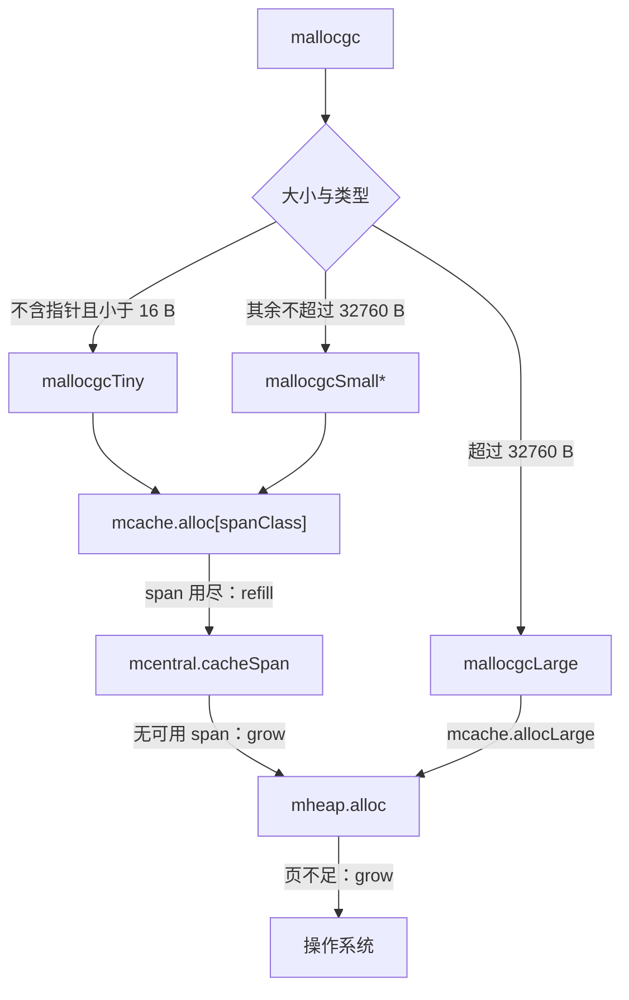

# 12.2 组件

[12.1](./basic.md) 中的分层结构由四类数据结构实现：描述一段连续页的 `mspan`、每个 P 的本地缓存 `mcache`、
每个 span 类的中心缓存 `mcentral`，以及全局的页堆 `mheap`。此外，`heapArena` 为页堆提供从地址到 span
的索引，`fixalloc` 与 `persistentalloc` 则为这些结构本身提供存储。本节依次介绍它们在 Go 1.26
中的定义与职责，最后说明一个 span 如何在它们之间流转。结构体的摘录只保留讨论到的字段，省略处以 `// ……`
标出 [[Go Authors, 2026](#ref-go-authors-2026)]。

## 12.2.1 mspan：span 与槽位

span 是由若干连续页组成的一段内存，每个 span 由一个 `mspan` 结构描述。小对象的 span 被切分为同一尺寸类的
等大槽位；大对象各自独占一个 span；goroutine 的栈也从 span 中分配，这类 span 由栈分配器自行管理
（[14.2](../ch14stack/alloc.md)）。`mspan` 的主要字段如下：

```go
type mspan struct {
	_    sys.NotInHeap
	next *mspan     // next span in list, or nil if none
	prev *mspan     // previous span in list, or nil if none
	// ……
	startAddr uintptr // address of first byte of span aka s.base()
	npages    uintptr // number of pages in span

	manualFreeList gclinkptr // list of free objects in mSpanManual spans
	// ……
	freeindex uint16
	// ……
	nelems uint16 // number of object in the span.
	// ……
	allocCache uint64
	// ……
	allocBits  *gcBits
	gcmarkBits *gcBits
	// ……
	sweepgen              uint32
	divMul                uint32        // for divide by elemsize
	allocCount            uint16        // number of allocated objects
	spanclass             spanClass     // size class and noscan (uint8)
	state                 mSpanStateBox // mSpanInUse etc; accessed atomically (get/set methods)
	needzero              uint8         // needs to be zeroed before allocation
	// ……
	elemsize              uintptr       // computed from sizeclass or from npages
	// ……
	largeType             *_type        // malloc header for large objects.
}
```

`startAddr` 与 `npages` 给出 span 覆盖的地址范围。`spanclass` 由尺寸类与是否含指针合成
（[12.1.5](./basic.md)），`elemsize` 是槽位的大小，`nelems` 是槽位的个数，`divMul` 是
[12.1.3](./basic.md) 提到的除法魔数，`largeType` 是大对象的类型指针（[12.1.4](./basic.md)）。首字段
`sys.NotInHeap` 表明 `mspan` 本身不能分配在垃圾回收的堆上，它的存储另有来源（12.2.5）。

空闲槽的记录方式经历过一次重要的改变。Go 1.7 以前，span 中的空闲槽用自由表串联。**自由表**（free list）
把空闲的块用指针连成链表，指针就存放在空闲块自身的第一个字中，因此不占用额外的空间；分配时摘下表头，
释放时插回表头。TCMalloc 的各级缓存都建立在自由表之上。在这种表示下，
清扫器的主要工作是根据标记阶段留下的标记位，为每个 span 重建自由表。Clements 2015 年的设计文档
[[Clements, 2015](#ref-clements-2015)]认为这一步在某种意义上是多余的：

> 它主要是把空闲堆的一种表示（标记位）转换为另一种表示（自由表）。这不仅耗费时间，而且自由表这种表示对现代
> CPU 并不友好，因为它难以缓存，对它的访问也难以预测。

文档估计，典型的 Go 程序约有 5% 的 CPU 时间花在清扫器以及自由表引起的缓存缺失上。Hudson 在 Go 1.7 中实现了
这一设计，分配直接使用位图 [[Hudson, 2016b](#ref-hudson-2016b)]。每个 span 有两个位图，每个槽位各占 1 位：
`allocBits` 记录哪些槽已被占用，`gcmarkBits` 记录本轮标记中哪些对象被标记。清扫一个 span 时，`gcmarkBits`
直接成为新的 `allocBits`，旧的 `allocBits` 被释放，再换上一份清零的位图作为下一轮的 `gcmarkBits`。存活的
对象在新位图中仍是已占用，死去对象的槽位随之变为空闲，无需逐个插回链表（[13.5](../ch13gc/sweep.md)）。

分配时，`freeindex` 之前的槽位都已分配过，分配器从 `freeindex` 起在 `allocBits` 中寻找下一个为 0 的位。
为了不必每次都访问位图，`allocCache` 缓存了从 `freeindex` 开始的 64 位，并按位取反，
于是一条计算末尾零个数的指令就能找到下一个空闲槽 [[Hudson, 2016a](#ref-hudson-2016a)]。
这条快速路径的代码见 [12.5](./smallalloc.md)。自由表并没有从运行时中消失：栈所在的 span
由栈分配器手动管理，仍以 `manualFreeList` 串联空闲的栈。

span 的状态有三种：`mSpanDead` 表示不代表任何内存，`mSpanInUse` 表示用于垃圾回收的堆，`mSpanManual`
表示由运行时手动管理，例如栈。状态的转换受垃圾回收的约束。源码注释指出，回收进行期间，span
不得从使用中或手动管理的状态转为空闲，因为并发的回收器可能已经读到了一个指针、正要查找它所在的 span，span
的状态必须单调；同理，把状态设为 `mSpanInUse` 或 `mSpanManual` 必须以原子操作进行，
并且只能在其他字段都已有效之后。`sweepgen` 与全局的清扫代比较，可以判断 span 是否尚待清扫、
正在清扫或已被某个 `mcache` 缓存，其规则见 [13.5](../ch13gc/sweep.md)。

span 的槽位数并不总等于 [12.1.3](./basic.md) 表中的对象数。Go 1.26 默认启用的 Green Tea
回收器（[13.11](../ch13gc/greentea.md)）在 16 至 512 字节的尺寸类所用的单页 span 末尾预留一个
`spanInlineMarkBits` 结构，供以 span 为单位的标记使用；含指针对象的 span
还要在末尾预留堆位图（[12.1.4](./basic.md)）。下面的程序分配 1000 个 33 字节的对象，它们都落入 48 字节的
5 号尺寸类：

```go {run=true}
package main

import (
	"fmt"
	"unsafe"
)

var objs [1000]*[33]byte

func main() {
	aligned := true
	perSpan := map[uintptr]int{}
	for i := range objs {
		objs[i] = new([33]byte)
		addr := uintptr(unsafe.Pointer(objs[i]))
		if addr%8192%48 != 0 { // 5 号尺寸类的 span 恰为一页，即 8 KiB
			aligned = false
		}
		perSpan[addr/8192]++
	}
	most := 0
	for _, n := range perSpan {
		most = max(most, n)
	}
	fmt.Printf("对象在 span 中的偏移都是 48 的倍数：%v\n", aligned)
	fmt.Printf("同一 span 中最多的对象数：%d\n", most)
}
```

运行结果如下：

```
对象在 span 中的偏移都是 48 的倍数：true
同一 span 中最多的对象数：168
```

每个对象都从 span 起点的 48 字节整数倍处开始，可见 33 字节的请求占用的是 48 字节的槽位。
1000 个对象需要六七个 span，其中被完全占满的 span 容纳了 168 个对象，而不是表中的 170 个：
`spanInlineMarkBits` 由 63 字节的扫描位、1 字节的所有权标志、63 字节的标记位和 1 字节的 span 类组成，共
128 字节，(8192 − 128) / 48 取整为 168。以 `GOEXPERIMENT=nogreenteagc` 关闭 Green Tea 后，同一程序输出
170。按 `initSpan` 的计算，含指针的 48 字节对象还要再预留 128 字节的堆位图，每个 span 只有 (8192 − 256) /
48 取整，即 165 个槽位。Green Tea 的这一布局由 Knyszek 引入 [[Knyszek, 2025](#ref-knyszek-2025)]，在 Go
1.25 中以实验的形式提供，在 Go 1.26 中默认启用。

## 12.2.2 mcache：本地缓存

`mcache` 是每个 P 的本地缓存，对应 TCMalloc 的线程缓存
[[TCMalloc Authors, 2026](#ref-tcmalloc-authors-2026)]；jemalloc 2006 年的设计则没有这一层，
而是把线程分派到多个 arena 上 [[Evans, 2006](#ref-evans-2006)]。由于同一时刻只有一个 M 持有某个 P，访问
`mcache` 无需加锁：

```go
type mcache struct {
	_ sys.NotInHeap

	// The following members are accessed on every malloc,
	// so they are grouped here for better caching.
	nextSample  int64   // trigger heap sample after allocating this many bytes
	memProfRate int     // cached mem profile rate, used to detect changes
	scanAlloc   uintptr // bytes of scannable heap allocated
	// ……
	tiny       uintptr
	tinyoffset uintptr
	tinyAllocs uintptr

	// The rest is not accessed on every malloc.

	// alloc contains spans to allocate from, indexed by spanClass.
	alloc [numSpanClasses]*mspan
	// ……
	stackcache [_NumStackOrders]stackfreelist

	// flushGen indicates the sweepgen during which this mcache
	// was last flushed. If flushGen != mheap_.sweepgen, the spans
	// in this mcache are stale and need to be flushed so they
	// can be swept. This is done in acquirep.
	flushGen atomic.Uint32
}
```

字段按访问频率分组，每次分配都要访问的字段集中在前面，以便落在同一组缓存行中。核心是 `alloc` 数组：
68 个尺寸类各有含指针与不含指针两个 span 类，共 136 项，每项是该 span 类当前用于分配的 span。`nextSample`
与 `memProfRate` 服务于内存剖析的采样（[16.5](../../part5toolchain/ch16tools/perf.md)），`tiny`
等三个字段服务于微对象分配器（[12.6](./tinyalloc.md)），`stackcache`
是栈的本地缓存（[14.2](../ch14stack/alloc.md)）。`flushGen` 记录这份缓存上一次被清空时的清扫代：
每轮标记结束后，`mcache` 中缓存的 span 必须在该 P 下一次分配之前交还，以便清扫。回收器在标记终止后让每个
P 执行这一步，P 被重新获取时也会再检查一次；上面的注释只提到了后者。

`mcache` 同样不在垃圾回收的堆上，由页堆的 `cachealloc` 在持有堆锁时分配。每个 P 初始化时通过
`allocmcache` 得到自己的 `mcache`，P 被销毁时（例如 `GOMAXPROCS` 减小）通过 `freemcache` 归还。
分配器在任何 P 存在之前就已需要工作，因此启动阶段由 `mallocinit` 创建一个 `mcache0`，此后交给 0 号 P
使用。`allocmcache` 把 `alloc` 的每一项都初始化为 `emptymspan`，这是一个没有空闲槽的哨兵 span，每个 span
类的第一次分配因而直接进入补充流程，快速路径上无需判断空指针。

span 用尽时，`refill` 把它交还中心缓存，再换回一个有空闲槽的 span：

```go
func (c *mcache) refill(spc spanClass) {
	// Return the current cached span to the central lists.
	s := c.alloc[spc]
	// ……
	if s != &emptymspan {
		// Mark this span as no longer cached.
		if s.sweepgen != mheap_.sweepgen+3 {
			throw("bad sweepgen in refill")
		}
		mheap_.central[spc].mcentral.uncacheSpan(s)
		// ……
	}

	// Get a new cached span from the central lists.
	s = mheap_.central[spc].mcentral.cacheSpan()
	// ……
	// Indicate that this span is cached and prevent asynchronous
	// sweeping in the next sweep phase.
	s.sweepgen = mheap_.sweepgen + 3
	// ……
	c.alloc[spc] = s
}
```

被省略的部分还负责统计。换入新 span 时，`refill` 假定其中所有空闲槽都将被占用，
立即把它们计入回收器所估计的存活堆大小；span 被交还时再修正高估的部分。源码注释解释了为什么宁可高估：
低估会使回收节奏的控制器误以为情况比实际要好，这似乎会导致更多的内存占用
[[Knyszek, 2022](#ref-knyszek-2022)]。这一估计正是 [12.1.5](./basic.md) 所说的回收触发条件的依据。

## 12.2.3 mcentral：中心缓存

每个 span 类有一个 `mcentral`，所有 P 共享。它本身并不保存空闲对象，只保存 span：

```go
type mcentral struct {
	_         sys.NotInHeap
	spanclass spanClass

	// partial and full contain two mspan sets: one of swept in-use
	// spans, and one of unswept in-use spans. These two trade
	// roles on each GC cycle. The unswept set is drained either by
	// allocation or by the background sweeper in every GC cycle,
	// so only two roles are necessary.
	//
	// sweepgen is increased by 2 on each GC cycle, so the swept
	// spans are in partial[sweepgen/2%2] and the unswept spans are in
	// partial[1-sweepgen/2%2]. Sweeping pops spans from the
	// unswept set and pushes spans that are still in-use on the
	// swept set. Likewise, allocating an in-use span pushes it
	// on the swept set.
	// ……
	partial [2]spanSet // list of spans with a free object
	full    [2]spanSet // list of spans with no free objects
}
```

span 按两个维度分为四个集合：是否还有空闲槽（`partial` 与 `full`），以及本轮是否已清扫。清扫代每轮回收增加
2，`sweepgen/2%2` 的奇偶决定了两个下标中哪一个表示「已清扫」。新一轮回收开始时，上一轮的「已清扫」集合
随着清扫代的变化而成为「待清扫」集合，无需移动任何 span。

`cacheSpan` 按代价从低到高寻找 span：先取已清扫且有空闲槽的 span；没有时，从待清扫的 span 中取出一个，
就地清扫后使用，先找有空闲槽的，再找已满的；仍然没有时，调用 `grow` 向页堆申请新的页。清扫待清扫的 span
未必能得到空闲槽，因此搜索设有上限：

```go
	// If we sweep spanBudget spans without finding any free
	// space, just allocate a fresh span. This limits the amount
	// of time we can spend trying to find free space and
	// amortizes the cost of small object sweeping over the
	// benefit of having a full free span to allocate from. By
	// setting this to 100, we limit the space overhead to 1%.
	// ……
	spanBudget := 100
```

连续清扫 100 个 span 都找不到空闲槽时，便直接申请新的 span。这是时间与空间之间的权衡：
清扫的耗时因此有了上界，而每 100 个没有空闲槽的 span 至多对应一个新 span，额外的空间开销不超过 1%。

`spanSet` 是一个支持并发压入与弹出的集合。它由一根可增长的「脊」（spine）和若干固定大小的块组成，每块容纳
512 个 span 指针。读写脊与块都不需要加锁，只有增加块或扩大脊时才需要获取脊锁；由于每个 span 至少覆盖
8 KiB 的堆，而在集合中只占 8 字节，脊的增长相当有限。这一实现始于 Go 1.15。此前，`mcentral`
由两条链表组成，一条是有空闲对象的 span，一条是没有空闲对象的 span，二者由同一把锁保护。Knyszek
在提交说明中指出，这一设计导致了严重的锁争用，span 的归属也错综复杂，同一个 span 可能同时被清扫缓冲区、
并发清扫器、`mcentral` 或 `mcache` 中的几方持有；新的实现以带原子快速路径的集合取代链表，
并规定除少数例外，任一时刻只有 `mcentral`、清扫器或 `mcache` 中的一方持有一个 span
[[Knyszek, 2020a](#ref-knyszek-2020a)] [[Knyszek, 2020b](#ref-knyszek-2020b)]。`mcentral.go`
的头注释至今仍以 `c->nonempty` 与 `c->empty` 描述那两条链表，那是 C 语言时代留下的文字。

## 12.2.4 mheap 与 heapArena：页堆

页堆 `mheap` 是全局唯一的，即变量 `mheap_`。它的主要字段如下：

```go
type mheap struct {
	_ sys.NotInHeap

	// lock must only be acquired on the system stack, otherwise a g
	// could self-deadlock if its stack grows with the lock held.
	lock mutex

	pages pageAlloc // page allocation data structure

	sweepgen uint32 // sweep generation, see comment in mspan; written during STW
	// ……
	allspans []*mspan // all spans out there
	// ……
	arenas [1 << arenaL1Bits]*[1 << arenaL2Bits]*heapArena
	// ……
	central [numSpanClasses]struct {
		mcentral mcentral
		pad      [(cpu.CacheLinePadSize - unsafe.Sizeof(mcentral{})%cpu.CacheLinePadSize) % cpu.CacheLinePadSize]byte
	}

	spanalloc                  fixalloc // allocator for span
	// ……
	cachealloc                 fixalloc // allocator for mcache
	// ……
}
```

`lock` 保护页堆的大部分状态，是分配器中少数几把全局锁之一。但在需要的页数少于 16 时，`allocSpan`
会先尝试每个 P 的页缓存，多数情况下无需获取这把锁。`pages` 是页分配器，回答「哪里有足够的连续空闲页」
这一问题，页缓存与页分配器的实现见 [12.7](./pagealloc.md)。`central` 是所有 `mcentral` 组成的数组，
每一项都填充到缓存行的整数倍，使相邻 span 类的 `mcentral` 不会落在同一缓存行中，避免多个 P 同时访问不同
span 类时发生伪共享。源码注释称填充是为了让每个 `mcentral.lock` 独占一个缓存行，这同样是 Go 1.15
之前的描述。`spanalloc` 与 `cachealloc` 分别为 `mspan` 与 `mcache` 提供存储（12.2.5）。

`arenas` 是从地址到 `heapArena` 的两级映射。堆的地址空间被划分为大小固定的区域（arena），在大多数
64 位平台上为 64 MiB（[12.3](./init.md)），每个区域有一个 `heapArena` 结构记录它的元数据：

```go
type heapArena struct {
	_ sys.NotInHeap

	// spans maps from virtual address page ID within this arena to *mspan.
	// For allocated spans, their pages map to the span itself.
	// For free spans, only the lowest and highest pages map to the span itself.
	// Internal pages map to an arbitrary span.
	// For pages that have never been allocated, spans entries are nil.
	// ……
	spans [pagesPerArena]*mspan
	// ……
	pageInUse [pagesPerArena / 8]uint8
	// ……
	pageMarks [pagesPerArena / 8]uint8
	// ……
	pageSpecials [pagesPerArena / 8]uint8
	// ……
	pageUseSpanInlineMarkBits [pagesPerArena / 8]uint8
	// ……
	zeroedBase uintptr
}
```

`spans` 把区域中的每一页映射到它所属的 span。对于任意一个指针，回收器都可以经由 `arenas` 找到对应的
`heapArena`，再按页号查到 span，进而得知对象的大小、类型信息与标记位，这就是 `spanOf` 所做的查找。
其后几个位图都以页为索引，但只使用每个 span 第一页对应的位：`pageInUse` 标记处于使用中的 span，
`pageMarks` 标记含有已标记对象的 span，清扫器借此迅速找到可以整体释放的 span；`pageSpecials`
标记带有终结器等特殊记录的 span，`pageUseSpanInlineMarkBits` 标记在末尾存放 `spanInlineMarkBits` 的 span。
Go 1.22 以前，`heapArena` 还保存着覆盖整个区域的指针位图，分配头取代它之后，
这部分元数据不复存在（[12.1.4](./basic.md)）。

`zeroedBase` 记录区域中从未被使用过的第一个字节。从操作系统新获得的内存已经清零，
因此这个位置之上的页无需再次清零。注释指出，仅凭这一个字段就能判断一次分配是否需要清零，
因为页分配器采用按地址排序的首次适配政策，总是优先使用低地址的页。Wilson 等人的综述认为，
按地址排序的首次适配产生的碎片可能明显少于按后进先出排序的首次适配，它是研究最多、似乎也是使用最广的变体
[[Wilson et al., 1995](#ref-wilson-1995)]。

## 12.2.5 运行时自身的元数据：fixalloc 与 persistentalloc

`mspan`、`mcache` 以及终结器等特殊记录，都不能分配在垃圾回收的堆上。它们是分配器与回收器自身的数据结构：
若由 `mallocgc` 分配，分配器在补充 span 时就要先调用自身，回收器也要追踪和回收自己赖以工作的数据。
这些类型以 `sys.NotInHeap` 标记，由两种更简单的分配器提供存储。

`fixalloc` 是一个固定大小对象的自由表分配器。页堆中的每一种元数据都有一个专属的 `fixalloc`，例如前面的
`spanalloc` 与 `cachealloc`：

```go
func (f *fixalloc) alloc() unsafe.Pointer {
	// ……
	if f.list != nil {
		v := unsafe.Pointer(f.list)
		f.list = f.list.next
		f.inuse += f.size
		if f.zero {
			memclrNoHeapPointers(v, f.size)
		}
		return v
	}
	if uintptr(f.nchunk) < f.size {
		f.chunk = uintptr(persistentalloc(uintptr(f.nalloc), 0, f.stat))
		f.nchunk = f.nalloc
	}

	v := unsafe.Pointer(f.chunk)
	if f.first != nil {
		f.first(f.arg, v)
	}
	f.chunk = f.chunk + f.size
	f.nchunk -= uint32(f.size)
	f.inuse += f.size
	return v
}

func (f *fixalloc) free(p unsafe.Pointer) {
	f.inuse -= f.size
	v := (*mlink)(p)
	v.next = f.list
	f.list = v
}
```

释放的对象被插回自由表的表头，下次分配优先复用；自由表为空时，从当前的大块中切出一个对象；大块用尽时，
再通过 `persistentalloc` 申请一个新的大块。大块的大小是不超过 16 KiB 的对象大小的整数倍，
因此切分时没有尾部浪费。`fixalloc` 本身不加锁，由调用者负责同步，这就是 `allocmcache` 要先获取堆锁的原因。

`persistentalloc` 则更为简单：它从操作系统成批获取内存，按需切出，从不释放。源码注释说明它用于函数、类型、
调试信息等需要永久存在的数据。`fixalloc` 释放的对象只回到自己的自由表，而不会归还给操作系统，这对 `mspan`
这类数量随堆的规模波动、但会被反复重用的结构是合适的。

## 12.2.6 组件之间的协作

下图把 [12.1.4](./basic.md) 的五条路径与本节的组件联系起来：



小对象的分配从 `mcache` 中当前的 span 取一个空闲槽。span 用尽时，`refill` 通过 `uncacheSpan`
把它交还给对应的 `mcentral`，按是否仍有空闲槽放入已清扫的 `partial` 或 `full` 集合；再通过 `cacheSpan`
换回一个有空闲槽的 span。`mcentral` 中没有合适的 span 时，`grow` 调用 `mheap_.alloc`
申请该尺寸类所需的页数，初始化后交给 `mcache`。页堆中也没有足够的连续空闲页时，`mheap.grow` 以
4 MiB（wasm 上为 512 KiB）为单位扩充堆：先从当前已预留的区域中划出，
不够时再向操作系统预留新的区域（[12.3](./init.md)）。

大对象跳过 `mcache` 与 `mcentral` 的查找，由 `mcache.allocLarge` 直接向页堆申请整页。得到的 span 属于
0 号尺寸类，随即被放入对应 `mcentral` 的已清扫 `full` 集合。Go 1.15 的重写改由遍历各个 `mcentral`
来驱动清扫，不再为清扫单独维护一份全局的 span 列表，大对象的 span 因此也放入 `mcentral`，
以便清扫器在其后的回收周期中找到它们 [[Knyszek, 2020b](#ref-knyszek-2020b)]。

## 12.2.7 小结

`mspan` 是分配与回收共同的基本单位，它用两个位图同时记录分配状态与标记结果，自 Go 1.7 起不再维护自由表。
`mcache` 让绝大多数分配只访问当前 P 的数据；`mcentral` 以带原子快速路径的集合在 P 之间周转 span，
并在分配的同时分担清扫；`mheap` 以页为单位管理整个堆，通过 `heapArena` 支持从任意地址到 span 的查找。
这些结构自身不在垃圾回收的堆上，而由 `fixalloc` 与 `persistentalloc` 管理。这一层次与 TCMalloc
的线程缓存、中心自由表与页堆几乎一一对应，不同之处在于每一层都承载了回收器所需的状态。[12.3](./init.md)
介绍这些结构在程序启动时如何建立。

## 延伸阅读

- <a id="ref-clements-2015"></a>[Clements, 2015] Austin Clements. *Proposal: Dense mark bits and
  sweep-free allocation.* 2015. https://go.dev/design/12800-sweep-free-alloc
- <a id="ref-evans-2006"></a>[Evans, 2006] Jason Evans. "A Scalable Concurrent malloc(3) Implementation
  for FreeBSD." *BSDCan 2006*, 2006. https://people.freebsd.org/~jasone/jemalloc/bsdcan2006/jemalloc.pdf
  jemalloc 的最初设计：多个 arena，线程轮流分派。
- <a id="ref-go-authors-2026"></a>[Go Authors, 2026] The Go Authors. src/runtime/mheap.go、mcache.go、
  mcentral.go、mspanset.go、mfixalloc.go. Go 1.26 源码.
  https://github.com/golang/go/tree/release-branch.go1.26/src/runtime
- <a id="ref-hudson-2016a"></a>[Hudson, 2016a] Rick Hudson. [dev.garbage] runtime: add bit and cache ctz64
  (count trailing zero). Go commit 4093481523, 2016. https://go.dev/cl/20200
  随 Go 1.7 发布。
- <a id="ref-hudson-2016b"></a>[Hudson, 2016b] Rick Hudson. [dev.garbage] runtime: allocate directly from
  GC mark bits. Go commit 3479b065d4, 2016. https://go.dev/cl/19470
  随 Go 1.7 发布。
- <a id="ref-knyszek-2020a"></a>[Knyszek, 2020a] Michael Knyszek. Go issue #37487. *runtime: improve
  mcentral scalability.* 2020. https://github.com/golang/go/issues/37487
- <a id="ref-knyszek-2020b"></a>[Knyszek, 2020b] Michael Anthony Knyszek. runtime: add new mcentral
  implementation. Go commit a13691966a, 2020. https://go.dev/cl/221182
  随 Go 1.15 发布。
- <a id="ref-knyszek-2022"></a>[Knyszek, 2022] Michael Knyszek. Go issue #53738. *runtime: memory use
  regressions in various benchmarks on perf.golang.org/dashboard.* 2022.
  https://github.com/golang/go/issues/53738
- <a id="ref-knyszek-2025"></a>[Knyszek, 2025] Michael Anthony Knyszek. runtime: mark and scan small
  objects in whole spans [green tea]. Go commit 1b40dbce1a, 2025. https://go.dev/cl/658036
  随 Go 1.25 发布，以实验形式提供。
- <a id="ref-tcmalloc-authors-2026"></a>[TCMalloc Authors, 2026] The TCMalloc Authors.
  *TCMalloc: Thread-Caching Malloc.* 2026. https://google.github.io/tcmalloc/design.html
  线程缓存、中心自由表与页堆的设计，对应 mcache、mcentral 与 mheap。
- <a id="ref-wilson-1995"></a>[Wilson et al., 1995] Paul R. Wilson, Mark S. Johnstone, Michael Neely,
  David Boles. "Dynamic Storage Allocation: A Survey and Critical Review." *IWMM 1995*, 1–116, 1995.
  https://doi.org/10.1007/3-540-60368-9_19
- 本书 [12.1 设计原则](./basic.md)、[12.5 小对象分配](./smallalloc.md)、
  [13.5 清扫与位图](../ch13gc/sweep.md)。
