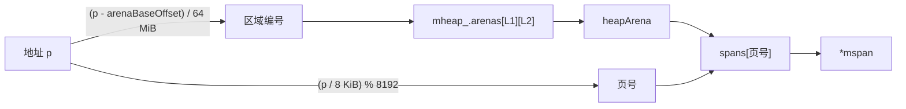
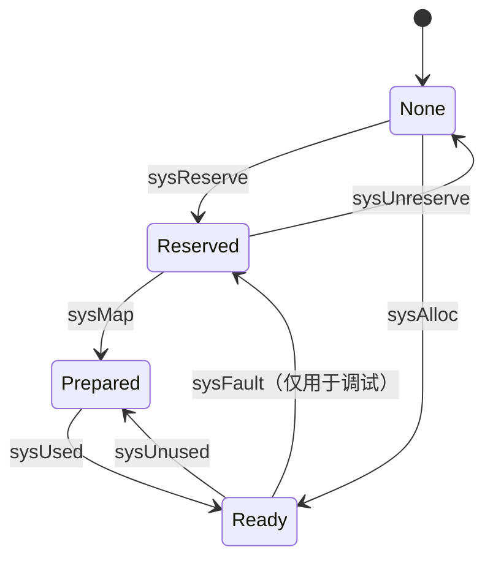

# 12.3 初始化

[12.2](./component.md) 介绍了分配器的各个组件。本节讨论这些组件在程序启动时如何建立，
以及堆如何从操作系统获得地址空间与物理内存。初始化确立了两项此后一直沿用的设计：其一，
堆的地址空间被划分为大小固定、按自身大小对齐的区域，任何一个地址都可以经由几次算术运算与查表找到描述它的元
数据；其二，向操作系统预留地址空间与为其提交物理内存是两个独立的步骤，这解释了为什么 Go
进程的虚拟内存往往远大于它的常驻内存。

分配器由 `mallocinit` 初始化。调度器初始化函数 `schedinit` 在初始化执行栈（`stackinit`）
与随机数生成器（`randinit`）之后调用它，其后的 `mcommoninit`、`modulesinit`
等步骤都需要分配内存（[3.5](../../part1overview/ch03life/boot.md)）。

## 12.3.1 mallocinit

`mallocinit` 首先检查一系列编译期常量与运行环境之间的约束，任何一条不成立都会立即终止程序。
其中几条把前两节的设计联系在一起：

```go
func mallocinit() {
	if gc.SizeClassToSize[tinySizeClass] != maxTinySize {
		throw("bad TinySizeClass")
	}
	// ……
	// Check that the minimum size (exclusive) for a malloc header is also
	// a size class boundary. This is important to making sure checks align
	// across different parts of the runtime.
	//
	// While we're here, also check to make sure all these size classes'
	// span sizes are one page. Some code relies on this.
	minSizeForMallocHeaderIsSizeClass := false
	sizeClassesUpToMinSizeForMallocHeaderAreOnePage := true
	for i := 0; i < len(gc.SizeClassToSize); i++ {
		if gc.SizeClassToNPages[i] > 1 {
			sizeClassesUpToMinSizeForMallocHeaderAreOnePage = false
		}
		if gc.MinSizeForMallocHeader == uintptr(gc.SizeClassToSize[i]) {
			minSizeForMallocHeaderIsSizeClass = true
			break
		}
	}
	// ……
```

第一条检查要求微对象分配器所用尺寸类的大小恰为 16 字节（[12.6](./tinyalloc.md)）。后一段检查确认
512 字节是一个尺寸类的边界，并且不超过 512 字节的尺寸类，其 span 都只占一页。[12.1.4](./basic.md)
所述的含指针小对象把指针位图放在 span 末尾的做法，以及 Green Tea 在单页 span
末尾预留标记位的做法（[12.2.1](./component.md)），都依赖于这两点
[[Go Authors, 2026e](#ref-go-authors-2026e)]。其余的检查确认操作系统报告的物理页大小是 2 的幂，
并且落在运行时支持的范围之内。还有一条检查要求 `heapArenaBitmapWords` 为 2 的幂，它针对的是 Go 1.22
以前每个区域所带的堆位图。这一位图已被移除，这个常量在 Go 1.26 中也只剩下这一处用途。

检查之后，`mallocinit` 初始化页堆，并创建第一个本地缓存：

```go
	// Initialize the heap.
	mheap_.init()
	mcache0 = allocmcache()
```

`mheap_.init` 为页堆的各类元数据初始化各自的 `fixalloc`（[12.2.5](./component.md)）：除 `mspan` 与
`mcache` 之外，还有终结器、清理函数、弱指针句柄、剖析记录、固定计数等十种特殊记录。随后它初始化全部
136 个中心缓存与页分配器（[12.7](./pagealloc.md)）。其中有一项设置值得注意：

```go
	// Don't zero mspan allocations. Background sweeping can
	// inspect a span concurrently with allocating it, so it's
	// important that the span's sweepgen survive across freeing
	// and re-allocating a span to prevent background sweeping
	// from improperly cas'ing it from 0.
	//
	// This is safe because mspan contains no heap pointers.
	h.spanalloc.zero = false
```

`fixalloc` 默认在分配时清零，`mspan` 是例外。后台清扫器可能在一个 span 被重新分配的同时检视它，并通过 CAS
推进其清扫代 `sweepgen`（[13.5](../ch13gc/sweep.md)）。若重新分配时 `sweepgen` 被清零，清扫器可能基于这个
0 值错误地执行 CAS。源码注释说明，由于 `mspan` 不含堆指针，不清零是安全的。

`allocmcache` 在持有堆锁时从 `cachealloc` 取得一个 `mcache`。此时还没有任何 P，这个 `mcache0`
供引导阶段使用：`getMCache` 在当前 M 尚无 P 时返回它。`procresize` 创建 P 时把 `mcache0` 交给 0 号 P，
随后将其置空（[3.5](../../part1overview/ch03life/boot.md)）。此后每个 `mcache` 都与一个 P 绑定。

## 12.3.2 区域：地址空间的划分

Go 1.10 及以前，64 位平台上的堆是一段连续的地址空间，`mallocinit` 在启动时一次性预留整段空间及其前方的
span 索引与堆位图。预留的规模随版本增长：Go 1.0 为 16 GB，Go 1.1 增至 128 GB
[[Cox, 2012](#ref-cox-2012)]，Go 1.5 起为 512 GB（在 Go 1.5 中，加上 32 GB 的位图实际预留 544 GB）。
这一设计有几个问题：堆的大小有硬性上限 [[Daniels, 2015](#ref-daniels-2015)]；
预留的地址若与其他映射冲突（例如竞态检测器所用的 TSAN 运行时），运行时会在初始化或堆增长时崩溃；
庞大的预留使进程的虚拟内存大小（VSIZE）同样庞大，这至少令人困惑，严重时与 `ulimit -v` 的限制相冲突，
而为此引入的「不预留」模式又带来了新的复杂性。Go 1.11 中，Clements 把堆改为由许多区域组成的稀疏映射，
区域可以位于地址空间的任何位置，上述问题随之消失，代价是 GC 密集的基准测试变慢约 1%
[[Clements, 2017](#ref-clements-2017)]。

**区域**（arena）是堆向操作系统申请地址空间的单位，大小固定，并按自身大小对齐。区域的大小、
地址的位数与索引的层次之间满足下面的关系：

```go
	// The number of bits in a heap address, the size of heap
	// arenas, and the L1 and L2 arena map sizes are related by
	//
	//   (1 << addr bits) = arena size * L1 entries * L2 entries
	//
	// Currently, we balance these as follows:
	//
	//       Platform  Addr bits  Arena size  L1 entries   L2 entries
	// --------------  ---------  ----------  ----------  -----------
	//       */64-bit         48        64MB           1    4M (32MB)
	// windows/64-bit         48         4MB          64    1M  (8MB)
	//      ios/arm64         40         4MB           1  256K  (2MB)
	//       */32-bit         32         4MB           1  1024  (4KB)
	//     */mips(le)         31         4MB           1   512  (2KB)
	//           wasm         32       512KB           1  8192 (64KB)
```

在 64 位的 Linux 与 macOS 上，堆地址按 48 位计算，每个区域为 64 MiB，地址空间中可容纳约 420 万个区域。Windows
使用 4 MiB 的较小区域，因为 Windows 把所有已提交的内存都计入进程的额度，即使这些内存从未被访问；
对于堆很小的进程，映射的区域空间应当与堆的规模相称 [[Go Authors, 2026a](#ref-go-authors-2026a)]。wasm
的线性内存同样全部计入程序的占用。Go 1.26 把 wasm 的区域由 4 MiB 缩小为 512 KiB，一个 hello world
程序所需的线性内存因此由 8 MB 降至 3 MB 以下 [[Mui, 2025](#ref-mui-2025)]。

给定一个地址，运行时先计算它所在区域的编号，再以编号的高位与低位分别索引两级表 `mheap_.arenas`：

```go
func arenaIndex(p uintptr) arenaIdx {
	return arenaIdx((p - arenaBaseOffset) / heapArenaBytes)
}
```

amd64 的地址是 48 位符号扩展的，`arenaBaseOffset` 为 `0xffff800000000000`，
减去它可以把高半部分的地址折叠到索引空间中；其他平台的用户地址空间从 0 开始，偏移为 0（AIX 例外）。在
64 位非 Windows 平台上，第一级只有一项，区域编号实际上直接索引第二级表。这张表有约 420 万项，占 32 MiB，
在第一个区域建立时才分配，并且不计入运行时的任何统计：

```go
			// Allocate an L2 arena map.
			//
			// Use sysAllocOS instead of sysAlloc or persistentalloc because there's no
			// statistic we can comfortably account for this space in. With this structure,
			// we rely on demand paging to avoid large overheads, but tracking which memory
			// is paged in is too expensive. Trying to account for the whole region means
			// that it will appear like an enormous memory overhead in statistics, even though
			// it is not.
			l2 = (*[1 << arenaL2Bits]*heapArena)(sysAllocOS(unsafe.Sizeof(*l2), "heap index"))
```

这张表只有被写入过的页才占用物理内存。以 4 KiB 的页计，一页可容纳 512 个区域的指针，覆盖 32 GiB
的地址空间，堆较小的进程只会触及其中一两页。Windows 的区域较小，若仍只用一级索引，第二级表会过大，因此
Windows 上的第一级有 64 项，第二级表按需逐张分配。

找到区域的 `heapArena` 之后，按页号查它的 `spans` 数组即得到 span（[12.2.4](./component.md)）。`spanOf`
完成整个查找，其源码注释指出，借助对 `arenaL1Bits` 的常量折叠，这个看似冗长的函数可以被内联，
生成的代码相当短 [[Go Authors, 2026b](#ref-go-authors-2026b)]。下图是 64 位非 Windows 平台上的查找过程：



## 12.3.3 区域提示与堆基址

在 64 位平台上，`mallocinit` 并不预留任何区域，只生成一串**区域提示**（arena hint），
即运行时希望堆从何处开始增长的地址。第一次堆增长时，`mheap.sysAlloc` 依次以这些地址为提示请求预留。
操作系统未能在提示的地址处满足请求时，运行时丢弃这个提示，尝试下一个；所有提示都失败时，
接受操作系统给出的任意对齐地址，并在这段空间的两端各生成一个新提示，使堆此后可以在原地向两个方向连续增长。

提示地址的选择在源码中有详细说明：

```go
		// On a 64-bit machine, we pick the following hints
		// because:
		//
		// 1. Starting from the middle of the address space
		// makes it easier to grow out a contiguous range
		// without running in to some other mapping.
		//
		// 2. This makes Go heap addresses more easily
		// recognizable when debugging.
		//
		// 3. Stack scanning in gccgo is still conservative,
		// so it's important that addresses be distinguishable
		// from other data.
		//
		// Starting at 0x00c0 means that the valid memory addresses
		// will begin 0x00c0, 0x00c1, ...
		// In little-endian, that's c0 00, c1 00, ... None of those are valid
		// UTF-8 sequences, and they are otherwise as far away from
		// ff (likely a common byte) as possible. ……
```

默认的提示形如 `i<<40 | 0x00c0<<32`，`i` 从 0x7f 递减到 0，链表以 `0x00c000000000` 为首，这就是以往的 Go
程序在 amd64 等平台上常见的 `0xc000……` 地址的来源。以 0x00c0 开头的地址按小端序存放时，其字节 `c0 00`、`c1 00`
等都不是合法的 UTF-8 序列，也远离常见的 `ff`，在内存转储中容易辨认。这一选择沿用自连续堆的时代：Go
1.0 的起始地址以 0x00f8 开头，Go 1.1 扩大预留时改为 0x00c0 [[Cox, 2012](#ref-cox-2012)]。当时 Go
自身的回收器还是保守式（[13.7](../ch13gc/safe.md)）的，非指针数据恰好与堆地址相同会使本应回收的对象被保
留，容易辨认的地址可以降低这种误判的几率；如今只有 gccgo 的栈扫描仍需考虑这一点。arm64 是例外：使用 4 KiB
页与三级页表时，用户地址空间只有 39 位，提示因此以 `0x0040<<32` 为起点。竞态检测器要求堆位于
`[0x00c000000000, 0x00e000000000)` 之内，`-race` 模式下的提示因此以 `1<<32` 为步长排列在这一范围中。
默认模式下，`i` 大于 0x3f 的那一半提示留给实验性的 `arena` 包（`GOEXPERIMENT=arenas`）。

Go 1.26 改变了这一传统。Webb 在 2018 年提出，堆应当像进程中的其他映射一样参与地址空间布局随机化（ASLR），
而不是总映射在固定地址 [[Webb, 2018](#ref-webb-2018)]。Shoemaker 的实现在 Go 1.26 中默认启用
[[Shoemaker, 2025](#ref-shoemaker-2025)]：`mallocinit` 借助 `bootstrapRand` 生成一个随机数（这正是
`randinit` 必须先于 `mallocinit` 执行的原因），以它的若干位构造一个按区域大小对齐的随机地址，
作为生成提示的基础；第一次堆增长时，再在区域内选取一个按页分配器块（4 MiB）对齐的随机偏移；
最后把块中开头随机数量的页标记为已分配，下一个可用页的地址即为最终的堆基址。源码注释给出的熵的下界是
`heapAddrBits` − 13 − 2 位，amd64 上再减去 1 位，即 arm64 上至少 33 位、amd64 上至少 32 位。
发布说明将这一改动定位为安全增强：使用 cgo 的程序中，攻击者更难预测内存地址并利用漏洞
[[Go Authors, 2026g](#ref-go-authors-2026g)]。启用竞态检测器、MemorySanitizer 或 AddressSanitizer 时，
以及在 32 位与 sbrk 式平台上，随机化不生效；构建时设置 `GOEXPERIMENT=norandomizedheapbase64` 可以关闭它。

下面的程序输出一个堆对象的地址：

```go {run=true}
package main

import "fmt"

var sink *[64]byte

func main() {
	sink = new([64]byte) // 赋给全局变量，对象逃逸到堆上
	fmt.Printf("%p\n", sink)
}
```

在 macOS（arm64）上以 Go 1.26.10 分别按默认设置、关闭随机化与开启竞态检测构建并运行，结果如下：

```shell
$ go build -o addr . && ./addr && ./addr && ./addr
0x5198a721a300
0x31a0144a6040
0x24013594300
$ GOEXPERIMENT=norandomizedheapbase64 go build -o addr . && ./addr && ./addr && ./addr
0x1400001e300
0x1400001e300
0x1400001e300
$ go build -race -o addr . && ./addr
0xc00001e300
```

默认构建下，每次运行的地址都不同。关闭随机化后，地址固定在 `0x14000000000` 附近。按上面的公式，这是 `i`
为 1 的提示 `1<<40 | 0x0040<<32`，可见 `i` 为 0 的提示未能取得，运行时改用了下一个。
开启竞态检测时随机化不生效，堆位于 TSAN 所要求的范围之内。在本书的沙箱（js/wasm）中运行，
输出的则是一个较小的地址（例如 `0x218280`），同一程序每次运行都相同：wasm 属于 sbrk 式平台，
堆从线性内存的低端开始，不做随机化。

32 位平台的地址空间只有 4 GiB，运行时更关心堆的连续性：`mallocinit` 在启动时预留全部区域元数据所需的空间，
然后从程序映像的末端之上开始，尝试一次性预留 512 MB、256 MB 或 128 MB 的初始堆空间，
并把提示设在这段空间之后。wasm 与 Plan 9 采用 sbrk 式的内存管理，不生成提示。wasm 的线性内存只能通过
`memory.grow` 向上增长；运行时释放末端的内存时只降低自己记录的边界，而不缩小线性内存
[[Go Authors, 2026f](#ref-go-authors-2026f)]。

## 12.3.4 预留、映射与提交

**预留**（reserve）只取得一段地址的使用权，而不取得物理内存；**提交**（commit）
则使一段地址可以被安全访问，并由操作系统为其提供物理内存。运行时把它所管理的地址空间抽象为四种状态，
所有与操作系统打交道的内存操作都表现为状态之间的转换 [[Go Authors, 2026c](#ref-go-authors-2026c)]：

```go
// Regions of the address space managed by the runtime may be in one of four
// states at any given time:
// 1) None - Unreserved and unmapped, the default state of any region.
// 2) Reserved - Owned by the runtime, but accessing it would cause a fault.
//               Does not count against the process' memory footprint.
// 3) Prepared - Reserved, intended not to be backed by physical memory (though
//               an OS may implement this lazily). Can transition efficiently to
//               Ready. Accessing memory in such a region is undefined (may
//               fault, may give back unexpected zeroes, etc.).
// 4) Ready - may be accessed safely.
//
// This set of states is more than strictly necessary to support all the
// currently supported platforms. One could get by with just None, Reserved, and
// Ready. However, the Prepared state gives us flexibility for performance
// purposes. For example, on POSIX-y operating systems, Reserved is usually a
// private anonymous mmap'd region with PROT_NONE set, and to transition
// to Ready would require setting PROT_READ|PROT_WRITE. However the
// underspecification of Prepared lets us use just MADV_FREE to transition from
// Ready to Prepared. Thus with the Prepared state we can set the permission
// bits just once early on, we can efficiently tell the OS that it's free to
// take pages away from us when we don't strictly need them.
```

Prepared 状态把「设置访问权限」与「告知操作系统可以收回物理页」分开：权限只需在映射时设置一次，
此后交还物理页只需一次 `madvise`。状态之间的转换由下面几个函数完成，`sysFree`
则可以把任何状态的内存直接归还为 None：



堆的增长依次经过这些状态。`mheap.sysAlloc` 以区域为单位预留地址（None → Reserved），它没有对应的释放函数，
堆的地址空间只增不减；它与包级别的 `sysAlloc` 同名但不同义，后者由操作系统选定地址并直接进入 Ready，供
`persistentalloc` 等堆外的内存使用（[12.2.5](./component.md)）。`mheap.grow` 每次以 4 MiB（wasm 上为
512 KiB）为单位对预留的空间调用 `sysMap`（Reserved → Prepared），并把这部分内存记为已归还（released）。`allocSpan`
分配的页中含有已归还的页时，调用 `sysUsed`（Prepared → Ready），
因此新映射的内存在第一次被分配时进入 Ready。长期空闲的页由 `sysUnused` 交还操作系统（Ready → Prepared），
何时交还、交还多少见 [12.7](./pagealloc.md)。

这些转换在各平台上的实现如下（`sysUsed` 在 Linux 上仅当设置 `GODEBUG=harddecommit=1` 时才有实际操作）：

| 函数 | 状态转换 | Linux | macOS | Windows | wasm |
| --- | --- | --- | --- | --- | --- |
| `sysReserve` | None → Reserved | `mmap`，`PROT_NONE` | `mmap`，`PROT_NONE` | `VirtualAlloc`，`MEM_RESERVE` | 取自自由表或推进 sbrk 边界 |
| `sysMap` | Reserved → Prepared | `mmap`，可读写，`MAP_FIXED` | `mmap`，可读写，`MAP_FIXED` | 无操作 | 无操作 |
| `sysUsed` | Prepared → Ready | 无操作 | `madvise`，`MADV_FREE_REUSE` | `VirtualAlloc`，`MEM_COMMIT` | 无操作 |
| `sysUnused` | Ready → Prepared | `madvise`，`MADV_DONTNEED` | `madvise`，`MADV_FREE_REUSABLE` | `VirtualFree`，`MEM_DECOMMIT` | 无操作 |

Linux 与 macOS 没有独立的提交步骤（macOS 上的 `MADV_FREE_REUSE` 只是为了保持内核统计的准确）：`sysMap`
之后地址已可读写，物理页在第一次写入时才由内核通过缺页中断提供，即按需调页。Windows 则不同，`sysUsed`
的注释指出，这一步在没有显式提交与严格超额分配限制的系统上通常是空操作，在 Windows 上却至关重要
[[Go Authors, 2026c](#ref-go-authors-2026c)]：Windows 在提交时就把内存计入进程的额度，
这也是它使用较小区域的原因。

Linux 上的 `sysUnused` 经历过一次反复。`MADV_FREE` 自 Linux 4.5 起可用，与 `MADV_DONTNEED` 相比，
被交还的页只有在内核确实回收它之后才会在下次访问时产生缺页中断，因此更快。Go 1.12 改为优先使用
`MADV_FREE` [[Klauser, 2018](#ref-klauser-2018)]。然而 `MADV_FREE`
交还的页在内核真正回收之前仍计入进程的常驻内存，此后出现了大量关于内存统计令人困惑的问题报告。Go 1.16
又把默认值改回 `MADV_DONTNEED` [[Clements, 2020](#ref-clements-2020)]，运行时初始化调试变量时写道：

```go
	if GOOS == "linux" {
		// On Linux, MADV_FREE is faster than MADV_DONTNEED,
		// but doesn't affect many of the statistics that
		// MADV_DONTNEED does until the memory is actually
		// reclaimed. This generally leads to poor user
		// experience, like confusing stats in top and other
		// monitoring tools; and bad integration with
		// management systems that respond to memory usage.
		// Hence, default to MADV_DONTNEED.
		debug.madvdontneed = 1
	}
```

Clements 在提交说明中还指出，自 Go 1.12 以来，后台归还内存的机制已变得及时且能自我调节节奏，改用较慢的
`MADV_DONTNEED` 只会使内存稍慢地交还给系统。设置 `GODEBUG=madvdontneed=0` 可以恢复 `MADV_FREE`。
两者的差别还影响清零：对私有匿名映射执行 `MADV_DONTNEED` 之后，再次访问得到的是全零的页。Go 1.26 起，一个
span 的页若全部是交还过的页，运行时便利用这一保证跳过清零 [[Yang, 2025](#ref-yang-2025)]；`MADV_FREE`
不提供这一保证，`needZeroAfterSysUnusedOS` 在这种情况下要求清零
[[Go Authors, 2026d](#ref-go-authors-2026d)]。

## 12.3.5 虚拟内存与常驻内存

Go 1.25 起，Linux（5.17 及以上）上的运行时会通过 `prctl` 为自己的匿名映射命名，在 `/proc/<pid>/maps`
中可以看到每段映射的用途。下面摘录的是这项改动的提交说明所附示例中属于 Go 的几行（开发版本，
尚无堆基址随机化，空白有删节）[[Huard, 2025](#ref-huard-2025)]：

```
c000000000-c000400000 rw-p 00000000 00:00 0  [anon: Go: heap]
c000400000-c004000000 ---p 00000000 00:00 0  [anon: Go: heap reservation]
777f58300000-777f58400000 rw-p 00000000 00:00 0  [anon: Go: page alloc index]
777f58400000-777f5a400000 rw-p 00000000 00:00 0  [anon: Go: heap index]
777f5a400000-777f6a580000 ---p 00000000 00:00 0  [anon: Go: scavenge index]
777f6a580000-777f6a581000 rw-p 00000000 00:00 0  [anon: Go: scavenge index]
777f6a581000-777f7a400000 ---p 00000000 00:00 0  [anon: Go: scavenge index]
777f7a400000-777f8a580000 ---p 00000000 00:00 0  [anon: Go: page summary]
```

前两行合起来恰为一个 64 MiB 的区域：开头的 4 MiB 已经 `sysMap`，权限为可读写；其余 60 MiB 只是预留，
权限为 `---p`（`PROT_NONE`）。第四行的 32 MiB 是 12.3.2 所述的第二级区域索引。
页分配器的元数据（[12.7](./pagealloc.md)）同样预先预留了数百 MiB 的地址空间，
只在需要时映射其中的一小部分。所有这些地址都计入进程的虚拟内存，却几乎不占用物理内存。

即使是运行时认为已在使用（Ready）的内存，在 Linux 与 macOS 上也要到第一次写入时才占用物理页。
下面的程序分配 256 MiB 的切片，比较运行时统计的 `HeapInuse` 与操作系统报告的峰值常驻内存；它通过
`getrusage` 读取后者，因此只能在 Linux 与 macOS 上运行：

```go {run=true native=true}
package main

import (
	"fmt"
	"runtime"
	"syscall"
)

// peakRSS 返回进程的峰值常驻内存（MiB）。ru_maxrss 在 macOS 上以字节计，在 Linux 上以 KiB 计。
func peakRSS() uint64 {
	var ru syscall.Rusage
	syscall.Getrusage(syscall.RUSAGE_SELF, &ru)
	if runtime.GOOS == "darwin" {
		return uint64(ru.Maxrss) >> 20
	}
	return uint64(ru.Maxrss) >> 10
}

func report(stage string) {
	var m runtime.MemStats
	runtime.ReadMemStats(&m)
	fmt.Printf("%s：HeapInuse = %d MiB，峰值 RSS = %d MiB\n", stage, m.HeapInuse>>20, peakRSS())
}

func main() {
	report("启动后")
	b := make([]byte, 256<<20)
	report("分配 256 MiB 后")
	for i := 0; i < len(b); i += 4096 {
		b[i] = 1
	}
	report("逐页写入后")
	runtime.KeepAlive(b)
}
```

在 macOS（arm64）上运行结果如下：

```
启动后：HeapInuse = 0 MiB，峰值 RSS = 4 MiB
分配 256 MiB 后：HeapInuse = 256 MiB，峰值 RSS = 5 MiB
逐页写入后：HeapInuse = 256 MiB，峰值 RSS = 261 MiB
```

分配之后，运行时已把 256 MiB 计为使用中，常驻内存却只增加了约 1 MiB。这段内存来自新映射的区域，位于
`zeroedBase` 之上（[12.2.4](./component.md)），分配器知道它全为零而无需清零，
切片所在的页因此一页也没有被访问；直到程序逐页写入，内核才逐页提供物理内存。

由此可以理解 Go 进程的虚拟内存（VIRT）为什么常常远大于常驻内存（RES）：前者包括所有预留与映射的地址，
后者只包括实际被访问、驻留在物理内存中的页。这并不意味着内存泄漏。与运行时的统计相对照：
只预留而未映射的地址不出现在 `runtime.MemStats` 的任何字段中；经 `sysMap` 映射的部分计入 `HeapSys`，
并且最初记为 `HeapReleased`（[12.8](./mstats.md)）。堆收缩时，长期空闲的页由 `sysUnused` 交还内核。在
Linux 的默认设置下，页一经交还，常驻内存随即下降，因此常驻内存何时下降取决于运行时何时交还
（[12.7](./pagealloc.md)）；只有在设置 `GODEBUG=madvdontneed=0` 时，才要等到内核真正回收这些页。

## 12.3.6 小结

`mallocinit` 返回时，页堆、136 个中心缓存、页分配器与 `mcache0` 都已就绪。在 64 位平台上，
此时只生成了区域提示，尚未预留任何区域；页分配器已为自己的元数据预留了地址空间，`persistentalloc` 也已为
`mcache0` 与区域提示等元数据取得了少量内存。第一个区域在第一次堆增长时才预留，其后的分配路径见
[12.4](./largealloc.md) 至 [12.6](./tinyalloc.md)。

区域的划分使任意地址都能在常数时间内找到所属的 span，这是回收器（[第 13 章](../ch13gc/)）赖以工作的基础；
预留与提交的分离使运行时可以廉价地占用大片地址空间，而只为实际使用的页付出物理内存。Go 1.11
的稀疏区域取消了堆的大小上限，Go 1.16 在 Linux 上改回 `MADV_DONTNEED`，Go 1.26 随机化了堆基址并缩小了
wasm 的区域：这一层的设计至今仍在随平台与使用场景调整。

## 延伸阅读

- <a id="ref-clements-2017"></a>[Clements, 2017] Austin Clements. runtime: use sparse mappings for the
  heap. Go commit 2b415549b8, 2017. https://go.dev/cl/85887
  随 Go 1.11 发布。
- <a id="ref-clements-2020"></a>[Clements, 2020] Austin Clements. runtime: default to MADV_DONTNEED on
  Linux. Go commit 05e6d28849, 2020. https://go.dev/cl/267100
  随 Go 1.16 发布。
- <a id="ref-cox-2012"></a>[Cox, 2012] Russ Cox. runtime: allow up to 128 GB of allocated memory. Go
  commit 9799a5a4fd, 2012. https://go.dev/cl/6826088
  随 Go 1.1 发布。
- <a id="ref-daniels-2015"></a>[Daniels, 2015] Noah Daniels. Go issue #10460. *runtime: 512GB memory
  limitation.* 2015. https://github.com/golang/go/issues/10460
- <a id="ref-go-authors-2026a"></a>[Go Authors, 2026a] The Go Authors.
  src/runtime/malloc.go（`mallocinit`、区域常量、区域提示与 `mheap.sysAlloc`）. Go 1.26 源码.
  https://github.com/golang/go/blob/release-branch.go1.26/src/runtime/malloc.go
- <a id="ref-go-authors-2026b"></a>[Go Authors, 2026b] The Go Authors.
  src/runtime/mheap.go（`mheap.init`、`heapArena`、`arenaIndex`、`spanOf` 与 `mheap.grow`）. Go 1.26 源码.
  https://github.com/golang/go/blob/release-branch.go1.26/src/runtime/mheap.go
- <a id="ref-go-authors-2026c"></a>[Go Authors, 2026c] The Go Authors.
  src/runtime/mem.go（None、Reserved、Prepared、Ready 四种状态与状态转换函数）. Go 1.26 源码.
  https://github.com/golang/go/blob/release-branch.go1.26/src/runtime/mem.go
- <a id="ref-go-authors-2026d"></a>[Go Authors, 2026d] The Go Authors. src/runtime/mem_linux.go（以 `mmap`
  与 `madvise` 实现 `sysReserve`、`sysMap`、`sysUnused` 等）. Go 1.26 源码.
  https://github.com/golang/go/blob/release-branch.go1.26/src/runtime/mem_linux.go
- <a id="ref-go-authors-2026e"></a>[Go Authors, 2026e] The Go Authors.
  src/runtime/mbitmap.go（`heapBitsInSpan`、`writeHeapBitsSmall`、`span.heapBits()`；Go 1.22 起，不超过
  `gc.MinSizeForMallocHeader` 的含指针对象把指针位图放在 span
  末尾，更大的对象使用分配头，不再有按区域存放的位图）. Go 1.26 源码.
  https://github.com/golang/go/blob/release-branch.go1.26/src/runtime/mbitmap.go
- <a id="ref-go-authors-2026f"></a>[Go Authors, 2026f] The Go Authors.
  src/runtime/mem_darwin.go、mem_windows.go、mem_sbrk.go、mem_wasm.go、runtime1.go. Go 1.26 源码.
  https://github.com/golang/go/tree/release-branch.go1.26/src/runtime
- <a id="ref-go-authors-2026g"></a>[Go Authors, 2026g] The Go Authors. *Go 1.26 Release Notes.* 2026.
  https://go.dev/doc/go1.26
- <a id="ref-huard-2025"></a>[Huard, 2025] Lénaïc Huard. runtime: decorate anonymous memory mappings. Go
  commit 52eaed6633, 2025. https://go.dev/cl/646095
  随 Go 1.25 发布。
- <a id="ref-klauser-2018"></a>[Klauser, 2018] Tobias Klauser. runtime: use MADV_FREE on Linux if
  available. Go commit 77f9b2728e, 2018. https://go.dev/cl/135395
  随 Go 1.12 发布。
- <a id="ref-mui-2025"></a>[Mui, 2025] Cherry Mui. runtime: use a smaller arena size on Wasm. Go commit
  53009b26dd, 2025. https://go.dev/cl/683296
  随 Go 1.26 发布。
- <a id="ref-shoemaker-2025"></a>[Shoemaker, 2025] Roland Shoemaker. runtime: randomize heap base address.
  Go commit 6669aa3b14, 2025. https://go.dev/cl/674835
  随 Go 1.26 发布。
- <a id="ref-webb-2018"></a>[Webb, 2018] Shawn Webb. Go issue #27583. *runtime: feature request: Support
  for ASLR with the heap.* 2018. https://github.com/golang/go/issues/27583
- <a id="ref-yang-2025"></a>[Yang, 2025] Lance Yang. runtime: avoid zeroing scavenged memory. Go commit
  27937289dc, 2025. https://go.dev/cl/715160
  随 Go 1.26 发布。
- 本书 [3.5 Go 程序启动引导](../../part1overview/ch03life/boot.md)、[12.2 组件](./component.md)、[12.7
  页分配器](./pagealloc.md)、[第 13 章 垃圾回收器](../ch13gc)。
