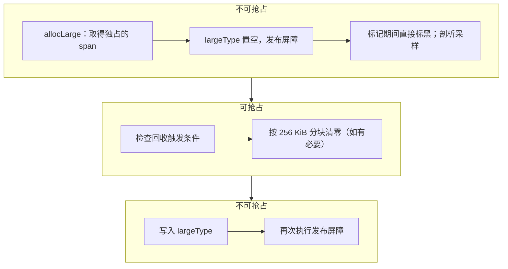

# 12.4 大对象分配

在 Go 1.26 中，超过 32760 字节的对象称为**大对象**（large object）。大对象不经过本地缓存与中心缓存，
每个对象独占一个由整页组成的 span，直接向页堆申请（[12.1.4](./basic.md)）。
本节讨论大小对象的分界从何而来，`mallocgcLarge` 如何在分配、清零与发布之间安排可抢占的时机，
页堆如何为大对象提供整页，以及这条路径的代价。

## 12.4.1 大与小的分界

分界的数值继承自 TCMalloc。Ghemawat 与 Menage 2005 年的设计文档把不超过 32K 的对象视为小对象；
更大的对象向上取整到页的大小，由中心的页堆分配，因此总是按页对齐，并占据整数个页
[[Ghemawat and Menage, 2005](#ref-ghemawat-menage-2005)]。Go 1.0 的 `MaxSmallSize` 同样是 32 KiB，
并沿用至今。其他分配器的划分不尽相同。jemalloc 最初的设计把尺寸分为小、大、巨三类：大于半页的是大对象，由
chunk 中的连续页提供；大于半个 chunk（默认 chunk 为 2 MB）的是巨对象，直接由专用的 chunk 承载
[[Evans, 2006](#ref-evans-2006)]。TCMalloc 如今以 `kMaxSize` 为界，超过它的对象直接由后端分配，
既不在前端缓存，也不在中间层缓存 [[TCMalloc Authors, 2026](#ref-tcmalloc-authors-2026)]。

Go 的尺寸类表说明了 32 KiB 附近为什么适合作为分界。尺寸类的作用在于让许多同样大小的对象共享一个 span，
从而共享一次补充 span 的代价。表的末端，66 号尺寸类（28672 字节）的 span 只容纳 2 个对象，67
号尺寸类（32768 字节）的 span 占 4 页、只容纳 1 个对象 [[Go Authors, 2026d](#ref-go-authors-2026d)]。
到了这里，按尺寸类分配已与按页分配没有区别，再向上增加尺寸类只会增加缓存的数量，而得不到共享的收益。

Go 1.22 引入分配头之后，分界变为 32760 字节。超过 512 字节的含指针对象要在对象前存放
8 字节的分配头（[12.1.4](./basic.md)），一个 32768 字节的含指针对象加上分配头便无法放入最大的尺寸类。
分界处的比较并不区分对象是否含指针，而是对所有对象统一减去分配头的大小，
引入这一比较的提交在注释中解释了这样做的理由 [[Knyszek, 2023](#ref-knyszek-2023)]：

```go
	// Note: This comparison looks a little strange, but it exists to smooth out
	// the crossover between the largest size class and large objects that have
	// their own spans. The small window of object sizes between maxSmallSize-mallocHeaderSize
	// and maxSmallSize will be considered large, even though they might fit in
	// a size class. In practice this is completely fine, since the largest small
	// size class has a single object in it already, precisely to make the transition
	// to large objects smooth.
	if size <= maxSmallSize-mallocHeaderSize {
```

也就是说，32761 至 32768 字节的对象即使不含指针，也按大对象分配。由于 67 号尺寸类本就是一个 span
一个对象，而 32761 字节按页取整后同样是 4 页即 32768 字节，分界两侧的对象实际占用的内存相同，
区别只在于所走的路径。Go 1.24 重构 `mallocgc` 时删去了这段注释，比较本身保留至今
[[Knyszek, 2024](#ref-knyszek-2024)]。

运行时的指标可以区分这两条路径。`runtime/metrics` 中的 `/gc/heap/allocs-by-size:bytes`
是按尺寸统计的堆分配次数直方图，每个尺寸类对应一个桶，所有大对象无论大小都计入最后一个桶：

```go {run=true}
package main

import (
	"fmt"
	"runtime"
	"runtime/metrics"
)

var sink []byte

// counts 返回分配次数直方图最后两个桶的计数：67 号尺寸类与大对象。
func counts() (class67, large uint64) {
	s := []metrics.Sample{{Name: "/gc/heap/allocs-by-size:bytes"}}
	runtime.GC() // 回收结束时各 P 的本地缓存交还 span，小对象的计数随之汇总
	metrics.Read(s)
	h := s[0].Value.Float64Histogram()
	n := len(h.Counts)
	return h.Counts[n-2], h.Counts[n-1]
}

func main() {
	for _, size := range []int{32760, 32761} {
		c0, l0 := counts()
		sink = make([]byte, size)
		c1, l1 := counts()
		fmt.Printf("%d 字节：67 号尺寸类 +%d，大对象 +%d\n", size, c1-c0, l1-l0)
	}
}
```

运行结果如下：

```
32760 字节：67 号尺寸类 +1，大对象 +0
32761 字节：67 号尺寸类 +0，大对象 +1
```

小对象的分配次数在本地缓存交还 span 时才汇总到全局统计，程序因此在读取指标前先执行一次回收；
大对象的次数则在分配时立即计入。

## 12.4.2 mallocgcLarge：分配、清零与发布

`mallocgcLarge` 的主体如下 [[Go Authors, 2026a](#ref-go-authors-2026a)]：

```go
func mallocgcLarge(size uintptr, typ *_type, needzero bool) (unsafe.Pointer, uintptr) {
	// Set mp.mallocing to keep from being preempted by GC.
	mp := acquirem()
	// ……
	mp.mallocing = 1

	c := getMCache(mp)
	// For large allocations, keep track of zeroed state so that
	// bulk zeroing can be happen later in a preemptible context.
	span := c.allocLarge(size, typ == nil || !typ.Pointers())
	span.freeindex = 1
	span.allocCount = 1
	span.largeType = nil // Tell the GC not to look at this yet.
	size = span.elemsize
	x := unsafe.Pointer(span.base())

	// Ensure that the store above that sets largeType to
	// nil happens before the caller can make x observable
	// to the garbage collector.
	// ……
	publicationBarrier()

	if writeBarrier.enabled {
		// Allocate black during GC.
		// All slots hold nil so no scanning is needed.
		// This may be racing with GC so do it atomically if there can be
		// a race marking the bit.
		gcmarknewobject(span, uintptr(x))
	} else {
		// ……
		span.freeIndexForScan = span.freeindex
	}

	// Note cache c only valid while m acquired; see #47302
	// ……
	c.nextSample -= int64(size)
	if c.nextSample < 0 || MemProfileRate != c.memProfRate {
		profilealloc(mp, x, size)
	}
	mp.mallocing = 0
	releasem(mp)

	// Check to see if we need to trigger the GC.
	if t := (gcTrigger{kind: gcTriggerHeap}); t.test() {
		gcStart(t)
	}

	// Objects can be zeroed late in a context where preemption can occur.
	//
	// x will keep the memory alive.
	if needzero && span.needzero != 0 {
		// N.B. size == fullSize always in this case.
		memclrNoHeapPointersChunked(size, x) // This is a possible preemption point: see #47302
	}

	// ……
	mp = acquirem()
	if typ != nil && typ.Pointers() {
		// Finish storing the type information, now that we're certain the memory is zeroed.
		getMCache(mp).scanAlloc += heapSetTypeLarge(uintptr(x), size, typ, span)
	}
	// Publish the object again, now with zeroed memory and initialized type information.
	// ……
	publicationBarrier()
	releasem(mp)
	return x, size
}
```

整个过程分为三段。第一段不可抢占：`acquirem` 与 `mallocing` 保证分配进行到一半时不会被回收器打断。`allocLarge`
取得一个独占的 span（12.4.3），把唯一的槽位标记为已占用，对象的地址即 span 的起始地址。`largeType`
是大对象的类型指针，存放在 `mspan` 中（[12.1.4](./basic.md)）；此时先把它置空，
告诉回收器暂时不要检视这个对象，随后的发布屏障保证这一写入先于对象的地址被其他线程看到。
在弱内存序的机器上，若没有这道屏障，回收器可能循着一个指向新对象的指针，读到 `largeType` 的旧值。
分配若发生在标记期间，对象直接被标黑，回收器在本轮不再扫描它（[12.1.5](./basic.md)）。

这一段还完成内存剖析的采样，代码中的注释提到了 issue #47302。Go 1.17 把大对象的清零移到可抢占的位置之后，
位于清零之后的采样代码偶尔会损坏运行时的数据结构：goroutine 在清零期间可能被抢占，恢复执行时已在另一个 P
上，此前取得的 `mcache` 不再属于它。Chase 的修复把采样移回持有 M 的区间之内
[[Chase, 2021](#ref-chase-2021)]。

第二段可以被抢占。`allocLarge` 已经把整个 span 计入存活堆大小，这里先检查回收的触发条件，再进行清零，
两者的考虑都已在 [12.1.5](./basic.md) 中说明。大对象的每次分配都检查一次触发条件，小对象则只在补充 span
时检查；清零函数内部没有安全点，长时间的清零会推迟需要暂停所有 goroutine 的回收阶段，
因此清零放在可抢占的这一段，并以 256 KiB 为一块分批进行 [[Chase, 2020](#ref-chase-2020)]。`span.needzero`
为 0 时，内存已知全为零，清零被完全省去（12.4.3）。

第三段重新进入不可抢占的状态。对含指针的对象，`heapSetTypeLarge` 以原子操作写入 `largeType`，
然后再执行一次发布屏障。这一顺序保证回收器只要看到非空的 `largeType`，看到的就一定是已经清零的内存；
反过来，回收器在清零期间暂停这个 goroutine 时，只能看到空的 `largeType`，于是不会检视尚未清零的内存
[[Go Authors, 2026d](#ref-go-authors-2026d)]。否则，回收器可能把未清零内存中的残留数据当作指针扫描，
导致程序崩溃。三段的关系如下：



## 12.4.3 向页堆申请整页

`mcache.allocLarge` 把字节数换算为页数，并向页堆申请 [[Go Authors, 2026b](#ref-go-authors-2026b)]：

```go
func (c *mcache) allocLarge(size uintptr, noscan bool) *mspan {
	// ……
	npages := size >> gc.PageShift
	if size&pageMask != 0 {
		npages++
	}

	// Deduct credit for this span allocation and sweep if
	// necessary. mHeap_Alloc will also sweep npages, so this only
	// pays the debt down to npage pages.
	deductSweepCredit(npages*pageSize, npages)

	spc := makeSpanClass(0, noscan)
	s := mheap_.alloc(npages, spc)
	if s == nil {
		throw("out of memory")
	}

	// Count the alloc in consistent, external stats.
	stats := memstats.heapStats.acquire()
	atomic.Xadd64(&stats.largeAlloc, int64(npages*pageSize))
	atomic.Xadd64(&stats.largeAllocCount, 1)
	memstats.heapStats.release()
	// ……
	// Update heapLive.
	gcController.update(int64(s.npages*pageSize), 0)

	// Put the large span in the mcentral swept list so that it's
	// visible to the background sweeper.
	mheap_.central[spc].mcentral.fullSwept(mheap_.sweepgen).push(s)
	// ……
}
```

`deductSweepCredit` 实现比例清扫：分配之前，按分配的字节数先完成相应数量的清扫工作，
使清扫在下一轮回收开始之前完成（[13.5](../ch13gc/sweep.md)）。span 类 `makeSpanClass(0, noscan)` 中的
0 号尺寸类专门表示大对象。`largeAllocCount` 正是 12.4.1 的直方图中最后一个桶的来源。分配完成后，span
被放入 0 号尺寸类对应中心缓存的已清扫 `full` 集合，以便清扫器在之后的回收周期中找到它
（[12.2.6](./component.md)）。

`mheap.alloc` 切换到系统栈上执行，因为它可能获取堆锁，而持锁时若发生栈增长，
栈增长本身又需要分配堆内存（[12.2.4](./component.md)）。若上一轮的清扫尚未完成，
它先清扫并回收至少同样多的页，以抑制堆的过度增长，然后调用 `allocSpan`。需要的页数少于 16 时，`allocSpan`
先尝试当前 P 的页缓存。页缓存是一段 64 页的空闲位图，从中取页以及取得 `mspan`
结构都无需获取堆锁（页缓存为空时，补充它需要短暂地获取堆锁）；页缓存不能满足时，才获取堆锁，
向页分配器申请连续的空闲页，必要时扩充堆（[12.7](./pagealloc.md)）。因此，不超过 15 页（120 KiB）
的大对象有机会完全避开堆锁，更大的对象则每次都要获取它。

取得页之后，`initSpan` 初始化 span。0 号尺寸类的 span 只有一个槽位，槽位的大小即 span 的全部字节数：

```go
		if sizeclass := spanclass.sizeclass(); sizeclass == 0 {
			s.elemsize = nbytes
			s.nelems = 1
			s.divMul = 0
		}
```

是否需要清零也在这里决定 [[Go Authors, 2026c](#ref-go-authors-2026c)]：

```go
	// Always call allocNeedsZero to update the arena's zeroedBase watermark
	// and determine if the memory is considered dirty.
	needZero := h.allocNeedsZero(base, npages)
	// If these pages were scavenged (returned to the OS), the kernel guarantees
	// they will be zero-filled on next use (fault-in), so we can treat them as
	// already zeroed and skip explicit clearing.
	if (needZeroAfterSysUnused() || scav != npages*pageSize) && needZero {
		s.needzero = 1
	}
```

有两种内存已知全为零：位于区域的 `zeroedBase` 之上、从未被使用过的页（[12.2.4](./component.md)）；以及在
Linux 默认设置下全部交还过操作系统的页，内核保证它们再次被访问时以零填充，这一判断是 Go 1.26
加入的（[12.3.4](./init.md)）[[Yang, 2025](#ref-yang-2025)]。只有其余情况才把 `needzero` 置为 1，由
`mallocgcLarge` 在可抢占的状态下清零。

## 12.4.4 代价

大对象的路径没有现成的 span 可用，每次分配都要完整地经过 `allocLarge`、`mheap.alloc` 与 `allocSpan`：
偿还清扫债务，查找连续的空闲页，初始化一个新的 `mspan`，页数不少于 16 或页缓存不能满足时还要获取堆锁。
与小对象快速路径上的一次位图查找相比，这条路径的固定开销高得多，只是这一开销分摊在较多的字节上。

按页取整造成的内部碎片不超过一页，即 8191 字节，相对于对象大小的比例随对象增大而下降。40961
字节的对象占用 6 页即 49152 字节，多出 8191 字节，约为请求的 20%；1000000 字节的对象占用 123 页，
多出 7616 字节，不到 1%。[12.1.3](./basic.md) 中 33000 字节的切片经 `append` 得到 40960 字节的容量，
也是这一取整的结果。由 `append` 增长的切片会用上取整后的全部容量，直接以 `make` 创建的切片则不会。

大对象不会比同样字节数的小对象更频繁地触发回收，因为回收的节奏取决于分配的字节数
（[13.3](../ch13gc/pacing.md)）。不同之处在于计入的粒度：每个大对象在分配时立即以整页计入存活堆大小并检查
触发条件，一次数 MiB 的分配就可能单独使堆越过触发点。

清零的代价与对象大小成正比。重新使用的页需要分块清零；从未使用过的页与全部交还过的页无需清零，
但第一次写入时要由内核按需提供物理页，代价转移到缺页中断上（[12.3.5](./init.md)）。

应用可以自行复用生命周期短、反复申请的大缓冲区，例如借助 `sync.Pool`。但池中的对象应当大致等重，
否则少数大缓冲区可能在之后的小请求中被反复取出放回，长期占用内存
（[11.6](../../part3concurrency/ch11sync/pool.md)）。

## 12.4.5 小结

大对象的分界继承自 TCMalloc 的 32 KiB，并在 Go 1.22 引入分配头之后变为 32760 字节；在这一尺寸附近，
尺寸类已经退化为一个 span 一个对象，再按尺寸类缓存得不到共享的收益。每个大对象独占一个 0 号尺寸类的 span，
由页堆按整页提供，较小的大对象还可以借助每个 P 的页缓存避开堆锁。`mallocgcLarge`
把分配与类型的发布放在不可抢占的区间内，而把耗时与对象大小成正比的清零放在可抢占的区间中，
并以两次发布屏障保证回收器不会看到未清零的内存。[12.5](./smallalloc.md) 讨论与之相对的小对象路径。

## 延伸阅读

- <a id="ref-chase-2020"></a>[Chase, 2020] David Chase. runtime: break up large calls to
  memclrNoHeapPointers to allow preemption. Go commit 0bbfc5c31e, 2020. https://go.dev/cl/270943
  随 Go 1.17 发布。起因是 Go issue #42642 报告的数毫秒的清扫终止停顿。
- <a id="ref-chase-2021"></a>[Chase, 2021] David Chase. runtime: move mem profile sampling into m-acquired
  section. Go commit fdb45acd1f, 2021. https://go.dev/cl/336449
  随 Go 1.17 发布，修复 Go issue #47302。
- <a id="ref-evans-2006"></a>[Evans, 2006] Jason Evans. "A Scalable Concurrent malloc(3) Implementation
  for FreeBSD." *BSDCan 2006*, 2006. https://people.freebsd.org/~jasone/jemalloc/bsdcan2006/jemalloc.pdf
- <a id="ref-ghemawat-menage-2005"></a>[Ghemawat and Menage, 2005] Sanjay Ghemawat, Paul Menage.
  *TCMalloc: Thread-Caching Malloc.* 2005. http://goog-perftools.sourceforge.net/doc/tcmalloc.html
  gperftools 项目现在维护的版本：https://gperftools.github.io/gperftools/tcmalloc.html
- <a id="ref-go-authors-2026a"></a>[Go Authors, 2026a] The Go Authors.
  src/runtime/malloc.go（`mallocgcLarge`、尺寸分流与回收触发）. Go 1.26 源码.
  https://github.com/golang/go/blob/release-branch.go1.26/src/runtime/malloc.go
- <a id="ref-go-authors-2026b"></a>[Go Authors, 2026b] The Go Authors.
  src/runtime/mcache.go（`mcache.allocLarge`：取整为页、清扫额度与统计）. Go 1.26 源码.
  https://github.com/golang/go/blob/release-branch.go1.26/src/runtime/mcache.go
- <a id="ref-go-authors-2026c"></a>[Go Authors, 2026c] The Go Authors.
  src/runtime/mheap.go（`mheap.alloc`、`allocSpan`、`initSpan`、页缓存与堆锁路径）. Go 1.26 源码.
  https://github.com/golang/go/blob/release-branch.go1.26/src/runtime/mheap.go
- <a id="ref-go-authors-2026d"></a>[Go Authors, 2026d] The Go Authors.
  src/runtime/mbitmap.go（`heapSetTypeLarge`）、src/runtime/metrics.go、src/internal/runtime/gc/sizeclasses.go.
  Go 1.26 源码.
  https://github.com/golang/go/tree/release-branch.go1.26/src
- <a id="ref-knyszek-2023"></a>[Knyszek, 2023] Michael Anthony Knyszek. runtime: implement experiment to
  replace heap bitmap with alloc headers. Go commit 38ac7c41aa, 2023. https://go.dev/cl/437955
  随 Go 1.22 发布。
- <a id="ref-knyszek-2024"></a>[Knyszek, 2024] Michael Anthony Knyszek. runtime: refactor mallocgc into
  several independent codepaths. Go commit 8730fcf885, 2024. https://go.dev/cl/614257
  随 Go 1.24 发布。
- <a id="ref-tcmalloc-authors-2026"></a>[TCMalloc Authors, 2026] The TCMalloc Authors.
  *TCMalloc: Thread-Caching Malloc.* 2026. https://google.github.io/tcmalloc/design.html
  大对象绕过线程缓存，直接由页堆分配。
- <a id="ref-yang-2025"></a>[Yang, 2025] Lance Yang. runtime: avoid zeroing scavenged memory. Go commit
  27937289dc, 2025. https://go.dev/cl/715160
  随 Go 1.26 发布。
- 本书 [11.6 缓存池](../../part3concurrency/ch11sync/pool.md)（大缓冲区复用）、[12.5
  小对象分配](./smallalloc.md)（作为对照的小对象精巧路径）、[12.7
  页分配器](./pagealloc.md)（`h.pages.alloc` 如何找出连续空闲页、`grow` 如何向操作系统增长）、[第
  13 章 垃圾回收器](../ch13gc)（大对象如何牵动回收步调）。
