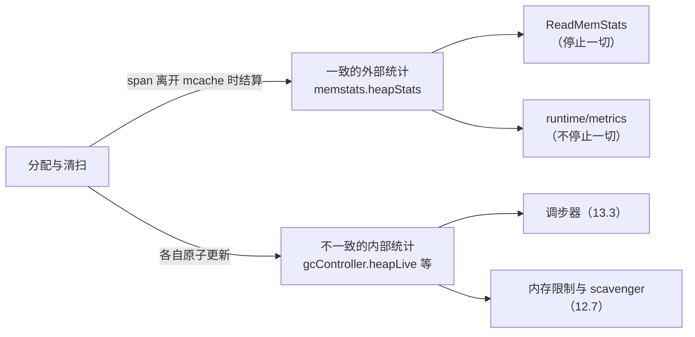

# 12.8 内存统计

分配器与回收器在工作的同时维护着一组计数：运行时从操作系统映射了多少内存，其中多少存放着对象、多少空闲、
多少已经归还，累计分配与释放了多少对象。这些计数有两类读者。一类在运行时之外：程序通过
`runtime.ReadMemStats`、`runtime/metrics` 与堆剖面了解自身的内存状况，监控系统据此绘制曲线、发出告警。
另一类在运行时之内：调步器据此决定下一轮回收何时开始（[13.3](../ch13gc/pacing.md)），内存限制与 scavenger
据此决定是否提前回收、归还多少物理内存（[12.7](./pagealloc.md)）。

维护这些计数面临两个相互牵制的要求。分配的快速路径执行得极为频繁，在其中更新共享的计数器会拖慢每一次分配；
读者却需要同一时刻的完整画面，例如各类内存之和恰好等于总量。本节依次说明统计把内存分为哪些类别，
运行时如何在不拖慢分配的前提下更新计数，如何在不停止一切的前提下读出一致的快照，两种读取接口有何差别，
以抽样方式记录分配位置的堆剖面如何工作，以及运行时自身读取的是哪些计数。

## 12.8.1 内存的分类

运行时映射的每一字节内存都恰好属于一个类别。`runtime/metrics` 把这些类别组织为以 `/memory/classes/`
为前缀的一棵树：叶子互不相交，总和为 `/memory/classes/total:bytes`
[[Go Authors, 2026b](#ref-go-authors-2026b)]。`runtime.MemStats` 的字段是其中若干类别之和，
对应关系可以从两者的计算代码中读出 [[Go Authors, 2026c](#ref-go-authors-2026c)]：

| `/memory/classes/` 下的指标 | 含义 | 对应的 `MemStats` 字段 |
|---|---|---|
| `heap/objects:bytes` | 堆对象，包括已不可达但尚未清扫的对象 | `HeapAlloc` |
| `heap/unused:bytes` | 已划归堆对象、当前却未存放对象的内存 | `HeapInuse` − `HeapAlloc` |
| `heap/free:bytes` | 空闲且仍有物理内存支撑的页 | `HeapIdle` − `HeapReleased` |
| `heap/released:bytes` | 空闲且没有物理内存支撑的页 | `HeapReleased` |
| `heap/stacks:bytes` | 从堆中分配给 goroutine 栈的内存 | `StackInuse` |
| `os-stacks:bytes` | 直接向操作系统申请的线程栈，非 cgo 程序中为零 | `StackSys` − `StackInuse` |
| `metadata/mspan/inuse:bytes`、`metadata/mspan/free:bytes` | `mspan` 结构 | `MSpanInuse`、`MSpanSys` − `MSpanInuse` |
| `metadata/mcache/inuse:bytes`、`metadata/mcache/free:bytes` | `mcache` 结构 | `MCacheInuse`、`MCacheSys` − `MCacheInuse` |
| `metadata/other:bytes` | 其余的运行时元数据，包括回收器的工作缓冲区 | `GCSys` |
| `profiling/buckets:bytes` | 剖析所用的调用栈哈希表 | `BuckHashSys` |
| `other:bytes` | 执行追踪的缓冲区、终结器与剖析的特殊记录等 | `OtherSys` |
| `total:bytes` | 以上各项之和 | `Sys` |

`HeapAlloc` 包括已经不可达、但尚未被清扫的对象。清扫在两轮回收之间逐步进行（[13.5](../ch13gc/sweep.md)），`HeapAlloc`
随分配上升、随清扫下降，因此文档指出它的变化是平滑的，不同于停止一切的回收器常见的锯齿形
[[Go Authors, 2026a](#ref-go-authors-2026a)]。表中的两个差值各有含义：`HeapInuse` − `HeapAlloc`
是已经划归某个尺寸类、却未被使用的内存，是碎片的上界；`HeapIdle` − `HeapReleased`
是运行时为将来的增长而保留、可以归还却尚未归还的内存，它若明显大于堆本身，说明存活堆最近有过短暂的峰值
[[Go Authors, 2026a](#ref-go-authors-2026a)]。

最容易误读的是 `Sys` 与 `HeapSys`。`MemStats` 的文档说 `Sys`「measures the virtual address space reserved
by the Go runtime」，这里的 reserved 是宽泛的说法。在 [12.3.4](./init.md) 介绍的四种状态中，只有经
`sysMap` 进入 Prepared 或 Ready 的内存才计入统计，仅处于 Reserved
状态的地址不计入任何字段（[12.3.5](./init.md)）。`/memory/classes/total:bytes` 的说明更准确：
它是运行时以读写权限映射进进程的全部内存 [[Go Authors, 2026b](#ref-go-authors-2026b)]。在 64 位的 Linux
与 macOS 上，堆以 64 MiB 的区域为单位预留地址，`mheap.grow` 却以 4 MiB 为单位映射：[12.3.5](./init.md)
所引的 `/proc/<pid>/maps` 中，一个区域只有开头的 4 MiB 可读写，其余 60 MiB 的权限为 `---p`，后者不计入
`Sys`。

新映射的堆内存首先被计为已归还。`mheap.grow` 把预留的地址转为 Prepared 时这样记录
[[Go Authors, 2026d](#ref-go-authors-2026d)]：

```go
	// Transition the space we're going to use from Reserved to Prepared.
	//
	// The allocation is always aligned to the heap arena
	// size which is always > physPageSize, so its safe to
	// just add directly to heapReleased.
	sysMap(unsafe.Pointer(v), nBase-v, &gcController.heapReleased, "heap")

	// The memory just allocated counts as both released
	// and idle, even though it's not yet backed by spans.
	stats := memstats.heapStats.acquire()
	atomic.Xaddint64(&stats.released, int64(nBase-v))
	memstats.heapStats.release()
```

这段内存从未被访问，不占用物理内存，在统计上与 scavenger 归还的页处于同一状态。`HeapSys`
的文档把它与已归还的内存分开描述（「reserved but not yet used … but tends to be small」），
实现中两者都计入 `HeapReleased`。由此得到一个常用的量：`Sys` − `HeapReleased` 是处于 Ready 状态的内存，
运行时内部称为 `mappedReady`，`readmemstats_m` 在调试模式下断言两者相等
[[Go Authors, 2026c](#ref-go-authors-2026c)]。GC 指南正是用 `Sys` − `HeapReleased`
定义内存限制所约束的内存（[13.3.3](../ch13gc/pacing.md)）[[Go Authors, 2022](#ref-go-authors-2022)]。
它也是运行时对常驻内存的估计，但只是近似：处于 Ready 而从未写入的页还不占用物理内存
（[12.3.5](./init.md)），cgo 与 `syscall.Mmap` 分配的内存则不在统计之内。

判断内存是否泄漏，应当看每轮回收后的存活堆是否持续上升，即 `/gc/heap/live:bytes`（Go 1.21
加入）[[Geisendörfer, 2022](#ref-geisendorfer-2022)]，而不是 `Sys` 或进程的虚拟内存。按文档的说法，`HeapSys`
估计的是堆曾经达到的最大规模，它不会因为存活堆变小而下降；虚拟内存还包括大量只预留、
未映射的地址。

## 12.8.2 以 span 为单位结算

分配一个小对象时，快速路径只修改所用 span 的 `allocCount`（微对象另计入 `mcache.tinyAllocs`），
不触碰任何全局计数。这些分配要等到 span 离开 `mcache` 时才结算：一种情形是 `refill` 用新的 span
替换已满的 span，另一种是 `releaseAll` 清空整个缓存，后者发生在每轮标记终止后各 P 的第一次分配之前、`ReadMemStats`
读取之前以及 P 被销毁时。`refill` 中与统计有关的部分如下
[[Go Authors, 2026d](#ref-go-authors-2026d)]：

```go
	if s != &emptymspan {
		// ……
		// Count up how many slots were used and record it.
		stats := memstats.heapStats.acquire()
		slotsUsed := int64(s.allocCount) - int64(s.allocCountBeforeCache)
		atomic.Xadd64(&stats.smallAllocCount[spc.sizeclass()], slotsUsed)
		// ……
		memstats.heapStats.release()

		// Count the allocs in inconsistent, internal stats.
		bytesAllocated := slotsUsed * int64(s.elemsize)
		gcController.totalAlloc.Add(bytesAllocated)
		// ……
	}
	// ……
	// Store the current alloc count for accounting later.
	s.allocCountBeforeCache = s.allocCount

	// Update heapLive and flush scanAlloc.
	//
	// We have not yet allocated anything new into the span, but we
	// assume that all of its slots will get used, so this makes
	// heapLive an overestimate.
	//
	// When the span gets uncached, we'll fix up this overestimate
	// if necessary (see releaseAll).
	//
	// We pick an overestimate here because an underestimate leads
	// the pacer to believe that it's in better shape than it is,
	// which appears to lead to more memory used. See #53738 for
	// more details.
	usedBytes := uintptr(s.allocCount) * s.elemsize
	gcController.update(int64(s.npages*pageSize)-int64(usedBytes), int64(c.scanAlloc))
```

`allocCountBeforeCache` 记下 span 被缓存时已有的对象数，离开缓存时两者之差就是这段时间内的分配次数。一个
span 最多容纳 1024 个对象（8 KiB 的 span 切成 8 字节的对象），全局计数上的原子操作因此由每个对象一次摊薄为
每个 span 一次。大对象本来就要经过页堆（[12.4](./largealloc.md)），在 `allocLarge` 中直接计数。
释放由清扫器统计，每清扫一个 span 计一次（[13.5](../ch13gc/sweep.md)）。

`refill` 的注释提到了「不一致的内部统计」。统计确实分为两套，`allocLarge` 把它们并排写出
[[Go Authors, 2026d](#ref-go-authors-2026d)]：

```go
	// Count the alloc in consistent, external stats.
	stats := memstats.heapStats.acquire()
	atomic.Xadd64(&stats.largeAlloc, int64(npages*pageSize))
	atomic.Xadd64(&stats.largeAllocCount, 1)
	memstats.heapStats.release()

	// Count the alloc in inconsistent, internal stats.
	gcController.totalAlloc.Add(int64(npages * pageSize))

	// Update heapLive.
	gcController.update(int64(s.npages*pageSize), 0)
```

「一致的外部统计」是 `memstats.heapStats`，供 `ReadMemStats` 与 `runtime/metrics` 读取，
其中各项计数必须彼此一致，机制见 12.8.3。「不一致的内部统计」是 `gcController` 中的 `totalAlloc`、`heapLive`
等字段，供运行时自己做决定：每个计数各自原子地更新，读者一次只读一个，不要求它们彼此一致。

两套统计对未用完的 span 采取了相反的估计。`heapLive` 在 span 进入缓存时就把其中的全部空闲槽位算作已分配，
离开缓存时再扣除未用的部分，因而偏高。注释说明了原因：偏低的估计会让调步器以为情况比实际要好，
结果用掉更多内存。这一改动随 Go 1.19 发布，起因是性能看板上多项基准测试的内存用量回升
[[Knyszek, 2022b](#ref-knyszek-2022b)]。一致的统计则只计实际用掉的槽位。Go 1.16 至 1.18 中，它也在 span
进入缓存时按全部空闲槽位计入，离开缓存时再回退，于是 `runtime/metrics`
中标为单调递增的分配计数偶尔会减少；Go 1.19 利用 `mspan` 中 16 位的填充空间加入 `allocCountBeforeCache`，
使计数精确且单调 [[Knyszek, 2022a](#ref-knyszek-2022a)]。

下图概括了计数的来源与去向：



## 12.8.3 不停止一切的一致快照

一致性的必要可以从 `/memory/classes/heap/free:bytes` 的计算看出。它由「已提交的内存」减去「堆对象所在的
span」「栈」与「工作缓冲区」得出 [[Go Authors, 2026c](#ref-go-authors-2026c)]。
若读者读到的已提交量来自一次分配之后，另外几项却来自这次分配之前，或者相反，结果就会偏大或偏小，甚至为负。
各项计数必须取自同一时刻。

Go 1.15 及以前，部分统计暂存在各 P 的 `mcache` 中，每轮回收时才汇总，`ReadMemStats`
只能停止一切再汇总。Go 1.16 引入了 `consistentHeapStats`，目的就是不停止一切也能读出一致的结果
[[Knyszek, 2020b](#ref-knyszek-2020b)]。它把统计保存为三组增量，三组之和是统计的当前值；全局的代数 `gen`
指明写者当前写入哪一组；每个 P 另有一个序号 `statsSeq`。写者在修改之前调用 `acquire`
[[Go Authors, 2026c](#ref-go-authors-2026c)]：

```go
func (m *consistentHeapStats) acquire() *heapStatsDelta {
	if pp := getg().m.p.ptr(); pp != nil {
		seq := pp.statsSeq.Add(1)
		if seq%2 == 0 {
			// Should have been incremented to odd.
			print("runtime: seq=", seq, "\n")
			throw("bad sequence number")
		}
	} else {
		lock(&m.noPLock)
	}
	gen := m.gen.Load() % 3
	return &m.stats[gen]
}
```

序号为奇数表示该 P 正在写，`release` 再把它加一，恢复为偶数。没有 P 的写者很少见，它们改用一把互斥锁。
读者调用 `read`，核心步骤如下 [[Go Authors, 2026c](#ref-go-authors-2026c)]：

```go
	// Rotate gen, effectively taking a snapshot of the state of
	// these statistics at the point of the exchange by moving
	// writers to the next set of deltas.
	//
	// This exchange is safe to do because we won't race
	// with anyone else trying to update this value.
	m.gen.Swap((currGen + 1) % 3)

	// ……

	for _, p := range allp {
		// Spin until there are no more writers.
		for p.statsSeq.Load()%2 != 0 {
		}
	}

	// ……
	m.stats[currGen].merge(&m.stats[prevGen])
	m.stats[prevGen] = heapStatsDelta{}

	// Finally, copy out the complete delta.
	*out = m.stats[currGen]
```

设读者到来时 `gen` 为 $g$。读者先把 `gen` 改为 $g+1$，此后开始的写都落在第 $g+1$ 组，
这一刻就是快照的时刻。仍在写第 $g$ 组的写者，其序号必为奇数，读者逐个等待所有 P 的序号变为偶数，此后第
$g$ 组不再变化。第 $g-1$ 组保存着截至上一次快照的累计值，第 $g$ 组是此后的增量，读者把前者并入后者，
得到截至此刻的完整统计，再把第 $g-1$ 组清零。下一次读取会把写者引向 $g+2$，在模 3
的意义下就是刚清零的这一组。注释总结了需要三组而不是两组的原因：一组供写者写入，一组存放最新的数据，
一组保持清空，使写者在 `gen` 改变的那一刻就有地方可写。

奇偶序号的约定与 Linux 内核的顺序计数器（sequence counter）相同：写者进入与离开临界区时各把计数加一，
计数为奇数表示更新正在进行 [[Linux kernel, n.d.](#ref-linux-kernel-nd)]。区别在于读者的做法。
内核的读者在读到奇数或读后发现计数变化时重读；这里的读者不重读，而是把写者引向另一组增量，
只等待已经开始的写完成。写者因此既不等待读者，也不互相等待，序号又按 P 分开；
剩下的开销只是对共享增量的原子加法，而 12.8.2 的按 span 结算已经把它摊薄。两者都要求写者的临界区不被打断：
内核文档指出，写者若被读者抢占，读者会空转整个调度周期；这里的 `acquire` 与 `release` 标为 `nosplit`，
并要求两次调用之间所在的 P 不变。代价落在读者一侧：同一时间只能有一个读者，`read`
的调用者必须停止一切或持有 `metricsSema`。

## 12.8.4 两种读取接口

`runtime.ReadMemStats` 自 Go 1 起就是读取内存统计的接口 [[Go Authors, 2026c](#ref-go-authors-2026c)]：

```go
func ReadMemStats(m *MemStats) {
	_ = m.Alloc // nil check test before we switch stacks, see issue 61158
	stw := stopTheWorld(stwReadMemStats)
	systemstack(func() {
		readmemstats_m(m)
	})
	startTheWorld(stw)
}
```

第一行在切换到系统栈之前访问一次 `m`：`m` 为空时，错误发生在用户的调用栈上，栈回溯中不会出现
`runtime.systemstack` 等运行时内部的帧。这一检查随 Go 1.21 加入，修复 issue 61158
[[Randall, 2023](#ref-randall-2023)]。`readmemstats_m` 先调用 `flushallmcaches`，让每个 P 的 `mcache`
交还全部 span，把 12.8.2 中尚未结算的分配计入统计，再在停止一切的状态下直接累加三组增量，
最后计算各个字段。这两步都要求所有 P 停下，因此每次调用都要停止一切一次。好处是读数最新：文档强调，
它反映调用时刻的状态，不同于反映上一轮回收结束时状态的堆剖面
[[Go Authors, 2026a](#ref-go-authors-2026a)]。

`MemStats` 的另一个限制是形式固定。字段受 Go 1 兼容性承诺的约束，既不能删除，也不能改变含义：`EnableGC`
恒为真，`DebugGC` 早已不用；`BySize` 写死为 61 项，而 Go 1.26 有 68 个尺寸类，第 61 至
67 号尺寸类不在其中；`PauseNs` 每轮回收只记一个数，即该轮所有暂停之和。Knyszek 在 2020 年的提案中引述了
Austin Clements 的总结：`MemStats` 难以演进，新增一个字段就要永久维护；`GODEBUG=gctrace=1`
的格式不受兼容性约束，却只输出到标准错误，难以被程序收集。提案又指出，`ReadMemStats` 还要停止一切
[[Knyszek, 2020a](#ref-knyszek-2020a)]。提案据此提出几项要求：容易增加新指标，
也容易废弃旧指标而不破坏程序；指标可以枚举；可以表达分布；读取本身不应显著影响被测量的程序。

`runtime/metrics` 随 Go 1.16 发布 [[Go Authors, 2021](#ref-go-authors-2021);
[Knyszek, 2020c](#ref-knyszek-2020c)]。指标以字符串命名，冒号之后是单位，例如 `/gc/heap/goal:bytes`；
单位写进名字，是因为单位改变往往意味着含义改变，此时应当换用新的名字
[[Go Authors, 2026b](#ref-go-authors-2026b)]。`metrics.All` 列出当前支持的全部指标及其说明、
值的类型和是否累积。废弃的机制也已经用上：Go 1.22 加入四个停止一切的暂停时长直方图，`/gc/pauses:seconds`
因与其中的 `/sched/pauses/total/gc:seconds` 完全相同而被标为废弃，但仍可读取
[[Go Authors, 2024](#ref-go-authors-2024); [Pratt, 2023](#ref-pratt-2023)]。

读取时，`metrics.Read` 持有 `metricsSema`，按所请求的指标计算它们依赖的几组聚合：堆的统计通过 12.8.3 的
`read` 取得一致的快照；堆外的统计逐个原子读取，其中 `mspan` 与 `mcache` 的使用量要短暂持有堆锁
[[Go Authors, 2026d](#ref-go-authors-2026d)]。整个过程不停止一切。
设计文档原本打算在每个指标的描述中标明读取它是否需要停止一切，以便监控系统降低采样频率；最终的
`Description` 只有名称、说明、类型与是否累积四个字段 [[Knyszek, 2020a](#ref-knyszek-2020a)]：
有了一致的统计，已经没有哪个指标需要停止一切。下面的程序比较两种接口各读 100 次所引起的、
与回收无关的停止一切的次数：

```go {run=true}
package main

import (
	"fmt"
	"runtime"
	"runtime/metrics"
)

// pauses 返回迄今与回收无关的停止一切的次数。
func pauses() uint64 {
	s := []metrics.Sample{{Name: "/sched/pauses/total/other:seconds"}}
	metrics.Read(s)
	var n uint64
	for _, c := range s[0].Value.Float64Histogram().Counts {
		n += c
	}
	return n
}

func main() {
	var m runtime.MemStats
	sample := []metrics.Sample{{Name: "/memory/classes/total:bytes"}}

	n0 := pauses()
	for range 100 {
		metrics.Read(sample)
	}
	n1 := pauses()
	for range 100 {
		runtime.ReadMemStats(&m)
	}
	n2 := pauses()

	fmt.Println("100 次 metrics.Read：", n1-n0, "次暂停")
	fmt.Println("100 次 ReadMemStats：", n2-n1, "次暂停")
}
```

运行结果如下：

```
100 次 metrics.Read： 0 次暂停
100 次 ReadMemStats： 100 次暂停
```

不停止一切也有代价。其一，`metrics.Read` 不清空 `mcache`，各 P 仍在使用的 span 中的分配尚未结算，
分配计数因此会滞后，滞后量不超过每个 P 每种 span 类别一个 span。其二，各组聚合在不同的时刻取得，
组与组之间可能略有偏差；`sysStatsAggregate` 的注释说明，这几项统计彼此独立，不构成真正的一致性问题
[[Go Authors, 2026d](#ref-go-authors-2026d)]。两种接口的差别归纳如下：

| | `runtime.ReadMemStats` | `runtime/metrics` |
|---|---|---|
| 形式 | 固定的结构体，受 Go 1 兼容性约束 | 以名称索引的指标集合，可以增加与废弃 |
| 读取 | 停止一切，并清空所有 `mcache` | 不停止一切，只计算所请求的指标 |
| 时效 | 包括 `mcache` 中尚未结算的分配 | 不包括尚未结算的分配 |
| 分布 | 只有 `PauseNs` 环形缓冲区与 `BySize` | 直方图 |
| 适用 | 偶尔的诊断 | 持续的监控，新代码的首选 |

监控中常用的几项是：每轮回收后的存活堆 `/gc/heap/live:bytes`；处于 Ready 状态的内存，即
`/memory/classes/total:bytes` 减去 `/memory/classes/heap/released:bytes`；回收的频率，即
`/gc/cycles/total:gc-cycles` 的增长速率；停止一切的暂停时长，即 `/sched/pauses/total/gc:seconds`
的高分位。`runtime/metrics` 的用法及其与 Prometheus 等系统的对接见
[16.6](../../part5toolchain/ch16tools/metric.md)。

## 12.8.5 堆剖面

以上统计回答「用了多少」，**堆剖面**（heap profile）回答「谁分配的」：
它按分配位置的调用栈汇总分配与释放的对象数和字节数。为每次分配记录调用栈的代价太高，运行时只抽样记录，
平均每分配 `runtime.MemProfileRate` 字节记录一次，默认值为 512 KiB
[[Go Authors, 2026e](#ref-go-authors-2026e)]。每个 `mcache` 保存一个计数 `nextSample`，
每次分配从中减去对象的大小，减到负数时调用 `profilealloc` 记录调用栈，并抽取下一个间隔
[[Go Authors, 2026e](#ref-go-authors-2026e)]：

```go
// nextSample returns the next sampling point for heap profiling. The goal is
// to sample allocations on average every MemProfileRate bytes, but with a
// completely random distribution over the allocation timeline; this
// corresponds to a Poisson process with parameter MemProfileRate. In Poisson
// processes, the distance between two samples follows the exponential
// distribution (exp(MemProfileRate)), so the best return value is a random
// number taken from an exponential distribution whose mean is MemProfileRate.
func nextSample() int64 {
	// ……
	return int64(fastexprand(MemProfileRate))
}
```

把分配看作一条以字节为刻度的时间线，抽样点构成一个**泊松过程**（Poisson process），
相邻抽样点的间隔服从均值为 $R$ 的指数分布，$R$ 即 `MemProfileRate`。指数分布无记忆：
无论距上一个抽样点有多远，接下来的 $S$ 个字节中出现抽样点的概率都是 $1-e^{-S/R}$。一个大小为 $S$
的对象被抽中的概率因此只取决于它的大小，把每个样本除以这一概率，就得到实际分配量的无偏估计。`runtime/pprof`
对每条记录按其平均对象大小这样还原 [[Go Authors, 2026e](#ref-go-authors-2026e)]：

```go
	avgSize := float64(size) / float64(count)
	scale := 1 / (1 - math.Exp(-avgSize/float64(rate)))

	return int64(float64(count) * scale), int64(float64(size) * scale)
```

对象远小于 $R$ 时，$1-e^{-S/R} \approx S/R$，每个样本约代表 $R$ 字节的分配；对象远大于 $R$ 时，概率趋近于
1，大对象几乎总被记录。最初的实现并非如此。2010 年 Russ Cox 加入 `MemProfileRate` 时，间隔取 $[0, 2R)$
上的均匀分布，不小于 $R$ 的对象一律记录 [[Cox, 2010](#ref-cox-2010)]。均匀分布的间隔没有无记忆性，
一个对象被抽中的概率还取决于它距上一个抽样点多远，无法只由大小算出。2015 年 Raul Silvera
发现这种抽样带来的偏差干扰了还原，堆剖面因此与预期不符，遂改为泊松过程，同时加入上面的还原公式，随 Go 1.6
发布 [[Silvera, 2015](#ref-silvera-2015)]。

堆剖面中「仍在使用」的数据还有一个时间上的问题。分配实时发生，释放却要等清扫时才知道。
若剖面包括截至此刻的全部分配，却只包括截至上一次清扫的释放，结果就会偏向最近的分配。
运行时因此只发布截至上一次标记终止的快照：其中的分配都发生在那次标记终止之前，释放则由随后的清扫统计。
实现上，全局的剖面周期 $C$ 在标记终止时加一，事件按如下规则计入未来的周期
[[Go Authors, 2026e](#ref-go-authors-2026e)]：

```go
	// Mallocs are accounted to cycle C+2.
	// Explicit frees are accounted to cycle C+2.
	// GC frees (done during sweeping) are accounted to cycle C+1.
```

标记终止之后，周期 $C$ 的数据并入已发布的剖面；`runtime.GC` 在清扫全部完成后还会发布 $C+1$。这一机制由
Clements 在 Go 1.9 中引入。此前快照在标记终止重新启动世界之后才取得，
两者之间的分配与释放可能计入错误的周期，一次释放甚至可能计入其分配之前的周期，使剖面中出现负的使用量
[[Clements, 2017](#ref-clements-2017)]。`runtime.MemProfile` 的文档因此说明，剖面最多可能滞后两轮回收
[[Go Authors, 2026e](#ref-go-authors-2026e)]。下面的程序记录每一次分配，观察剖面何时反映一次 4000 KiB
的分配与释放：

```go {run=true}
package main

import (
	"fmt"
	"runtime"
)

var sink [][]byte

//go:noinline
func alloc() {
	for range 1000 {
		sink = append(sink, make([]byte, 4096))
	}
}

// inuse 返回堆剖面中由 alloc 分配、尚未释放的字节数，以 KiB 计。
func inuse() int64 {
	n, _ := runtime.MemProfile(nil, true)
	p := make([]runtime.MemProfileRecord, n+64)
	n, _ = runtime.MemProfile(p, true)
	var total int64
	for _, r := range p[:n] {
		for _, pc := range r.Stack() {
			if f := runtime.FuncForPC(pc); f != nil && f.Name() == "main.alloc" {
				total += r.InUseBytes()
				break
			}
		}
	}
	return total / 1024
}

func main() {
	runtime.MemProfileRate = 1 // 记录每一次分配
	sink = make([][]byte, 0, 1000)
	runtime.GC()

	alloc()
	fmt.Printf("分配之后：%d KiB\n", inuse())

	runtime.GC()
	fmt.Printf("一次 GC 之后：%d KiB\n", inuse())

	sink = nil
	runtime.GC()
	fmt.Printf("释放并 GC 之后：%d KiB\n", inuse())
}
```

运行结果如下：

```
分配之后：0 KiB
一次 GC 之后：4000 KiB
释放并 GC 之后：0 KiB
```

分配刚完成时，剖面中还没有这些对象；一次回收之后它们才出现；释放后又要等下一次回收才消失。
程序开头先执行一次回收，是因为在还没有发布过任何数据时，`MemProfile` 会把所有未发布的周期一并计入，
以便关闭回收的程序也能取得剖面 [[Go Authors, 2026e](#ref-go-authors-2026e)]；先回收一次，
才能看到正常情况下的滞后。

通过 `net/http/pprof` 的 `/debug/pprof/heap` 取得的默认是供 `go tool pprof` 读取的二进制格式；加上
`?debug=1` 得到文本格式，记录之后附有一段以 `# runtime.MemStats` 开头的 `MemStats` 字段列表
[[Go Authors, 2026e](#ref-go-authors-2026e)]。文本格式的首行把抽样率写为 `2*MemProfileRate`，
源码注释解释，这是因为早期的 C++ 堆剖析器如此报告，pprof 沿用了这一约定。堆剖面的使用见
[16.5](../../part5toolchain/ch16tools/perf.md)。

## 12.8.6 运行时读取的计数

调步器、内存限制与 scavenger 都不读取 `MemStats`，而是读取 `gcController`
中的内部统计（[13.3](../ch13gc/pacing.md)）：

- `heapLive` 是上一轮回收保留下来的字节与此后新分配的字节之和，按 12.8.2 的方式偏高地估计；
  它不含尚未清扫的死对象，因此在两轮回收之间只增不减。调步器将它与触发点比较，
  决定何时开始下一轮回收（[13.3.4](../ch13gc/pacing.md)）。
- `heapMarked` 是上一轮标记得到的存活堆，即 `/gc/heap/live:bytes`。它与栈、全局变量的扫描量一起决定
  `GOGC` 所对应的堆目标（[13.3.2](../ch13gc/pacing.md)）。`MemStats.NextGC` 与 `/gc/heap/goal:bytes`
  都取自 `gcController.heapGoal()`，即 `GOGC` 与内存限制分别给出的目标中较小的一个，再经若干修正。
- `mappedReady` 即 `Sys` − `HeapReleased`。内存限制据此推算堆目标（[13.3.3](../ch13gc/pacing.md)），scavenger
  据此决定是否要把内存压到上限的 95% 以下（[12.7.8](./pagealloc.md)）。
- `heapInUse` 与 `heapFree` 之和是堆保留的内存，scavenger 按 `GOGC`
  计算的归还目标与它比较（[12.7.7](./pagealloc.md)）。

内部统计与对外的统计含义不同，读 `gctrace` 的输出时应当注意：其中以箭头相连的前两个堆大小是回收开始与标记
结束时的 `heapLive`，第三个是本轮标记的存活堆（[13.3.6](../ch13gc/pacing.md)），它们与同一时刻的
`HeapAlloc` 不必相等。`gctrace` 中的 CPU 占比与 `MemStats.GCCPUFraction` 相同，
都是自程序启动以来回收占用的 CPU 时间（不含空闲时的标记）与可用 CPU 时间之比
[[Go Authors, 2026a](#ref-go-authors-2026a)]。

## 12.8.7 小结

运行时的内存统计在三个层面上取舍。计数时，小对象的分配以 span 为单位结算，快速路径不触碰共享的计数器；
统计分为供外部读取的一致统计与供运行时决策的内部统计，后者为了调步的安全宁可高估。读取时，`ReadMemStats`
以停止一切换取最新、完整的读数，`runtime/metrics` 借助按 P 分开的序号与三组轮换的增量，
在不停止一切的前提下读出一致的快照，代价是不含尚未结算的分配。记录分配位置时，堆剖面以泊松过程抽样，
使样本可以按对象大小还原为实际的分配量，并只发布截至上一次标记终止的快照，以免偏向最近的分配。理解 `Sys`
统计的是映射而非预留的内存、`HeapReleased` 包括从未使用过的映射，是读懂这些数字的前提。

## 延伸阅读

- <a id="ref-clements-2017"></a>[Clements, 2017] Austin Clements. runtime: snapshot heap profile during
  mark termination. Go commit eee85fc5a1, 2017. https://go.dev/cl/37714
  随 Go 1.9 发布，修复 Go issue #19311。
- <a id="ref-cox-2010"></a>[Cox, 2010] Russ Cox. runtime: malloc sampling, pprof interface. Go commit
  6eb251f244, 2010. https://go.dev/cl/719041
  早于 Go 1.0。
- <a id="ref-geisendorfer-2022"></a>[Geisendörfer, 2022] Felix Geisendörfer. runtime/metrics: add
  /gc/heap/live:bytes. Go commit ef2bb813c8, 2022. https://go.dev/cl/497315
  随 Go 1.21 发布。
- <a id="ref-go-authors-2021"></a>[Go Authors, 2021] The Go Authors. Go 1.16 Release Notes. 2021.
  https://go.dev/doc/go1.16 （新增 `runtime/metrics`，取代 `runtime.ReadMemStats` 与 `debug.GCStats`）
- <a id="ref-go-authors-2022"></a>[Go Authors, 2022] The Go Authors. *A Guide to the Go Garbage
  Collector.* https://tip.golang.org/doc/gc-guide （`GOGC`、`GOMEMLIMIT` 与存活堆如何决定 GC 节奏）
- <a id="ref-go-authors-2024"></a>[Go Authors, 2024] The Go Authors. Go 1.22 Release Notes. 2024.
  https://go.dev/doc/go1.22 （新增四个停止一切的暂停时长直方图，`/gc/pauses:seconds` 废弃）
- <a id="ref-go-authors-2026a"></a>[Go Authors, 2026a] The Go Authors. *Package runtime, type MemStats.*
  https://pkg.go.dev/runtime#MemStats （各字段的权威语义，尤其 Heap 系列的状态划分）
- <a id="ref-go-authors-2026b"></a>[Go Authors, 2026b] The Go Authors. *Package runtime/metrics.*
  https://pkg.go.dev/runtime/metrics
  （Go 1.16 引入的可扩展接口：`Sample`、`Value`、`All`，及全部指标名与单位）
- <a id="ref-go-authors-2026c"></a>[Go Authors, 2026c] The Go Authors.
  *runtime/mstats.go、 runtime/metrics/description.go.* Go 1.26 源码.
  https://github.com/golang/go/tree/release-branch.go1.26/src/runtime
  （`ReadMemStats` 的 STW 实现与记账细节）
- <a id="ref-go-authors-2026d"></a>[Go Authors, 2026d] The Go Authors. src/runtime/mcache.go（`refill`、`allocLarge`）、src/runtime/mheap.go（`grow`）、src/runtime/metrics.go（`readMetrics`
  与各组聚合）. Go
  1.26 源码. https://github.com/golang/go/tree/release-branch.go1.26/src/runtime
- <a id="ref-go-authors-2026e"></a>[Go Authors, 2026e] The Go Authors. src/runtime/mprof.go（剖面周期、`MemProfileRate`、`MemProfile`）、src/runtime/malloc.go（`nextSample`）、src/runtime/pprof/protomem.go（`scaleHeapSample`）、src/runtime/pprof/pprof.go（`writeHeapInternal`）.
  Go 1.26 源码.
  https://github.com/golang/go/tree/release-branch.go1.26/src/runtime
- <a id="ref-knyszek-2020a"></a>[Knyszek, 2020a] Michael Knyszek. *Proposal: API for unstable runtime
  metrics (runtime/metrics).* Go design document, 2020.
  https://go.googlesource.com/proposal/+/master/design/37112-unstable-runtime-metrics.md ；讨论见
  https://github.com/golang/go/issues/37112 （metrics 接口的设计动机与权衡）
- <a id="ref-knyszek-2020b"></a>[Knyszek, 2020b] Michael Anthony Knyszek. runtime: add consistent heap
  statistics. Go commit fe7ff71185, 2020. https://go.dev/cl/247037
  随 Go 1.16 发布。
- <a id="ref-knyszek-2020c"></a>[Knyszek, 2020c] Michael Anthony Knyszek. runtime/metrics: add package
  interface. Go commit 2159c26ceb, 2020. https://go.dev/cl/247040
  随 Go 1.16 发布。
- <a id="ref-knyszek-2022a"></a>[Knyszek, 2022a] Michael Anthony Knyszek. runtime: make alloc count
  metrics truly monotonic. Go commit 79db59ded9, 2022. https://go.dev/cl/377516
  随 Go 1.19 发布。
- <a id="ref-knyszek-2022b"></a>[Knyszek, 2022b] Michael Anthony Knyszek. runtime: overestimate the amount
  of allocated memory in heapLive. Go commit 1ebc983000, 2022. https://go.dev/cl/416417
  随 Go 1.19 发布，对应 Go issue #53738。
- <a id="ref-linux-kernel-nd"></a>[Linux kernel, n.d.] The Linux Kernel. *Sequence counters and sequential
  locks.* https://docs.kernel.org/locking/seqlock.html
- <a id="ref-pratt-2023"></a>[Pratt, 2023] Michael Pratt. runtime/metrics: add STW stopping and total time
  metrics. Go commit 6ef98ac87c, 2023. https://go.dev/cl/534161
  随 Go 1.22 发布。
- <a id="ref-randall-2023"></a>[Randall, 2023] Keith Randall. runtime: have ReadMemStats do a nil check
  before switching stacks. Go commit e126572f8a, 2023. https://go.dev/cl/507755
  随 Go 1.21 发布，修复 Go issue #61158。
- <a id="ref-silvera-2015"></a>[Silvera, 2015] Raul Silvera. pprof: improve sampling for heap profiling.
  Go commit 27ee719fb3, 2015. https://go.dev/cl/14590
  随 Go 1.6 发布，修复 Go issue #12620。
- 本书 [13.3 触发频率及其调步算法](../ch13gc/pacing.md)、[12.7 页分配器](./pagealloc.md)、[12.3
  初始化](./init.md).
- 本书 [第 16 章 工具与可观测性](../../part5toolchain/ch16tools/readme.md)（pprof、metric 的实操）.
