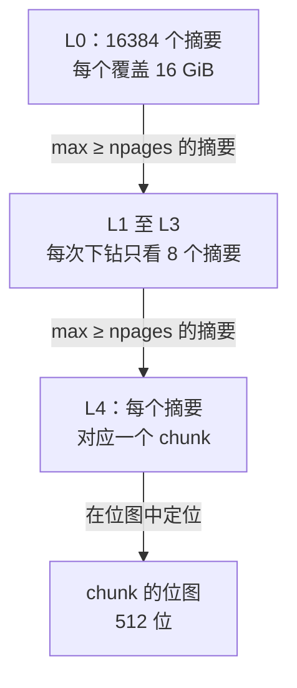

# 12.7 页分配器

运行时以 8 KiB 的**页**（page）为单位管理堆。这里的页是运行时自己的单位 `pageSize`，与操作系统的物理页
`physPageSize`（常见为 4 KiB）不是一回事。span 由若干连续的页组成（[12.2.1](./component.md)），小对象的
span、大对象、goroutine 的栈以及回收器的工作缓冲区，所用的页都出自页堆中的**页分配器**（page allocator）。
它记录哪些页属于某个 span、哪些页空闲，申请时找出一段足够长的连续空闲页，释放时把页收回。页分配器的另一项
职责是把长期空闲的页所占用的物理内存交还操作系统，运行时称之为**归还**（scavenging）。

现行的页分配器是 Go 1.14 重写的结果：以位图记录每一页的状态，以一棵基数树概括位图，再为每个 P
配备一份无需加锁的页缓存 [[Knyszek and Clements, 2019](#ref-knyszek-clements-2019)]。
本节先说明页分配器要解决的问题，回顾此前以 treap 为核心的实现及其瓶颈，然后依次讨论位图与摘要、
基数树上的查找、分配与释放、页缓存，最后讨论归还：后台与同步两条途径，各自追求的目标，
以及设置内存限制之后的变化。

## 12.7.1 问题

页分配器对外只有两个操作：`alloc(npages)` 返回一段 `npages` 页的连续空闲区间的起始地址，`free(base, npages)`
把一段区间重新标记为空闲。困难在于下面三项要求必须同时满足。

第一，区间必须连续，而且分配策略要控制碎片。Go 的页分配器采用按地址排序的**首次适配**（address-ordered
first fit）：在所有足够大的空闲区间中，总是选择地址最低的一个（[12.2.4](./component.md)）。
这一策略使已分配的页向低地址聚集，较大的空闲区间倾向于留在高地址；归还从高地址开始，
与分配相互干扰的机会因而最小 [[Knyszek, 2019b](#ref-knyszek-2019b)]。

第二，申请相当频繁。在垃圾回收之下，对象的寿命以回收周期为单位结束，大量 span 在清扫时成批变空，交还页堆，
随后又被重新申请。设计文档据此推测，Go 程序向页分配器申请内存的频率高于 TCMalloc
这类释放之后立即重用对象的分配器。在 Kubernetes 的负载测试中，最常见的对象约为 1 KiB，大约每
10 次分配就有一次要进入页堆；99.89% 的 span 申请是小对象的 span
[[Knyszek and Clements, 2019](#ref-knyszek-clements-2019)]，85% 以上的页申请恰好只要一页
[[Knyszek, 2019c](#ref-knyszek-2019c)]。

第三，多个 P 并发申请。页堆的状态由一把堆锁 `mheap.lock` 保护（[12.2.4](./component.md)），申请越频繁、`GOMAXPROCS`
越大，这把锁的争用就越严重。

因此，页分配器的「快」有两层含义：持锁的时间要短；常见的情况最好根本不必持锁。Go 1.14
的重写分别从这两方面入手。

## 12.7.2 Go 1.14 之前：自由表与 treap

Go 1.0 至 1.8 的页堆沿用 TCMalloc 的组织方式（[12.1.2](./basic.md)）：空闲的 span 按页数挂在数组 `free`
的各条链表上，每种页数一条，覆盖 1 MiB 以内的 span；更大的 span 统一挂在另一条链表上（Go 1.8 中名为
`freelarge`）。前者按页数直接索引，插入与取出都是常数时间；后者只能线性查找。随着堆逼近 100 GB，
线性查找的代价已经显现，Hudson 在 Go 1.9 中把这条链表换成了一棵 treap（树堆）：节点按键构成二叉搜索树，
同时按随机赋予的优先级构成堆，因而在概率意义上保持平衡，插入与删除的期望代价为对数级。提交说明估算，支持
1 TiB 的堆至多需要约一百万个节点，理想深度为 20，实验中观察到的深度约为理想值的两倍
[[Hudson, 2017](#ref-hudson-2017)]。

Go 1.12 中，Knyszek 去掉了按页数索引的链表数组，所有空闲 span 都放进 treap，以简化实现
[[Knyszek, 2018](#ref-knyszek-2018)]；已归还的 span 另放一棵 treap。Go 1.13 又把多棵 treap 合并为一棵，
改以 span 的起始地址为键，并在每个节点上记录其子树中最大 span 的页数，据此实现按地址排序的首次适配。
由于树按地址排序，自右向左遍历便得到「从最高地址开始归还」的顺序 [[Knyszek, 2019a](#ref-knyszek-2019a)]。

treap 的问题在 Go 1.12 发布前后集中暴露出来（Go issue #28479 等）。设计文档的分析指出，根本原因在于堆锁：
页堆的一切操作都要持有它，而早在 Go 1.11 中就已观察到这把锁上的插队（barging）现象，说明锁的争用在 1.12
的退化之前就已经失控 [[Knyszek and Clements, 2019](#ref-knyszek-clements-2019)]。持锁期间的工作也不轻。在
Kubernetes 12 小时负载测试的跟踪数据中（Go 1.12.4），前 50 个尺寸类的 span 分配平均每次在临界区内花费 4.0
µs。treap 的深度随空闲区间的数量增长，在 20 GiB 的堆中，一次分配可能要沿指针下行约 20 层，小堆上约 100 ns
的页分配在大堆上会增长到 4 µs 以上。释放要做一次 treap 插入，与相邻区间合并时还要再做一两次删除。

设计文档由此提出两项改变：以位图取代空闲 span 来记录空闲页，使分配器本身更快、持锁时间更短；在此基础上，
允许每个 P 缓存一部分空闲页，使常见的申请无需获取堆锁
[[Knyszek and Clements, 2019](#ref-knyszek-clements-2019)]。

## 12.7.3 位图与摘要

新的页分配器不再有「空闲 span」的概念。它用一张位图记录页的状态，每一页对应一位，1 表示已用（即属于某个
span），0 表示空闲。位图按 **chunk** 分片，每个 chunk 覆盖 512 页即 4 MiB
[[Go Authors, 2026a](#ref-go-authors-2026a)]：

```go
	// The size of a bitmap chunk, i.e. the amount of bits (that is, pages) to consider
	// in the bitmap at once. It is 4MB on most platforms, except on Wasm it is 512KB.
	// We use a smaller chuck size on Wasm for the same reason as the smaller arena
	// size (see heapArenaBytes).
	pallocChunkPages    = 1 << logPallocChunkPages
	pallocChunkBytes    = pallocChunkPages * pageSize
	logPallocChunkPages = 9*(1-goarch.IsWasm) + 6*goarch.IsWasm
```

在 wasm 上，一个 chunk 只有 64 页，即 512 KiB。每个 chunk 的元数据是两张等长的位图
[[Go Authors, 2026b](#ref-go-authors-2026b)]：

```go
// pallocData encapsulates pallocBits and a bitmap for
// whether or not a given page is scavenged in a single
// structure. It's effectively a pallocBits with
// additional functionality.
//
// Update the comment on (*pageAlloc).chunks should this
// structure change.
type pallocData struct {
	pallocBits
	scavenged pageBits
}
```

`pallocBits` 与 `pageBits` 都是 `[8]uint64`，各 64 字节。前者是分配位图；
后者记录哪些空闲页已经归还操作系统，供 12.7.7 讨论的归还使用。在 48 位地址空间的 64 位平台上，所有 chunk
的元数据若平铺开来要占 GiB 量级的地址空间，因此它们与区域索引（[12.3.2](./init.md)）
一样组织成两级稀疏数组：第一级 $2^{13}$ 项直接放在 `pageAlloc` 结构中，每项指向一个容纳
$2^{13}$ 个 chunk、大小为 1 MiB 的第二级数组，堆增长到相应的地址范围时才分配。
这些位图同样受堆锁保护，源码注释写明「Protected by mheapLock.」。位图本身并没有消除堆锁，
它的作用是让持锁期间的工作变得简短而可预测。

位图只说明每一页的状态。若要找出一段连续的空闲页，仍须逐字扫描，堆越大，扫描越慢。
设计文档的做法是为每段位图附上一份**摘要**（summary），只用三个数概括这段位图中与连续空闲页有关的全部信
息：`start` 是开头连续空闲页的个数，`end` 是结尾连续空闲页的个数，`max` 是其中最长的一段连续空闲页的长度。
以 16 页为例，若从低地址到高地址各页的状态依次为 `0001100000111000`，则 `start` 为 3，`end` 为 3，`max`
为 5。

摘要的价值在于可以合并。两段相邻的区域 A（低地址）与 B（高地址）各覆盖 L 页，
合并后的摘要可以只由两者的摘要算出，而无需查看位图：除非 A 全部空闲（此时为 L + B.start），合并后的
`start` 就是 A.start；`end` 与之对称；`max` 则取 A.max、B.max 与跨越边界的 A.end + B.start
三者中的最大者。`mergeSummaries` 把这一规则推广到任意多段相邻区域
[[Go Authors, 2026a](#ref-go-authors-2026a)]：

```go
func mergeSummaries(sums []pallocSum, logMaxPagesPerSum uint) pallocSum {
	// Merge the summaries in sums into one.
	//
	// We do this by keeping a running summary representing the merged
	// summaries of sums[:i] in start, most, and end.
	start, most, end := sums[0].unpack()
	for i := 1; i < len(sums); i++ {
		// Merge in sums[i].
		si, mi, ei := sums[i].unpack()

		// Merge in sums[i].start only if the running summary is
		// completely free, otherwise this summary's start
		// plays no role in the combined sum.
		if start == uint(i)<<logMaxPagesPerSum {
			start += si
		}

		// Recompute the max value of the running sum by looking
		// across the boundary between the running sum and sums[i]
		// and at the max sums[i], taking the greatest of those two
		// and the max of the running sum.
		most = max(most, end+si, mi)

		// Merge in end by checking if this new summary is totally
		// free. If it is, then we want to extend the running sum's
		// end by the new summary. If not, then we have some alloc'd
		// pages in there and we just want to take the end value in
		// sums[i].
		if ei == 1<<logMaxPagesPerSum {
			end += 1 << logMaxPagesPerSum
		} else {
			end = ei
		}
	}
	return packPallocSum(start, most, end)
}
```

三个数朴素地存放需要 12 或 24 字节，都无法整齐地排进缓存行。设计文档把它们压缩进一个 `uint64`：每个数占
21 位，共 63 位。21 位的上限来自基数树根层的划分（12.7.4）：根层每个摘要覆盖 $2^{21}$ 页，即
16 GiB。计数要能表示 0 至 $2^{21}$，后者本需第 22 位，但它只在整个区域全部空闲时出现，
此时三个数都等于 $2^{21}$，于是用剩下的最高位单独表示这一情形
[[Go Authors, 2026a](#ref-go-authors-2026a)]：

```go
// pallocSum is a packed summary type which packs three numbers: start, max,
// and end into a single 8-byte value. Each of these values are a summary of
// a bitmap and are thus counts, each of which may have a maximum value of
// 2^21 - 1, or all three may be equal to 2^21. The latter case is represented
// by just setting the 64th bit.
type pallocSum uint64

// packPallocSum takes a start, max, and end value and produces a pallocSum.
func packPallocSum(start, max, end uint) pallocSum {
	if max == maxPackedValue {
		return pallocSum(uint64(1 << 63))
	}
	return pallocSum((uint64(start) & (maxPackedValue - 1)) |
		((uint64(max) & (maxPackedValue - 1)) << logMaxPackedValue) |
		((uint64(end) & (maxPackedValue - 1)) << (2 * logMaxPackedValue)))
}
```

这种编码还有一个便利：一段全部已用的区域，摘要恰好是 0。查找时只需一次加载和一次比较，就能跳过它。

## 12.7.4 基数树上的查找

摘要按层组织成一棵树：叶层的每个摘要概括一个 chunk，上一层的每个摘要由下一层相邻的若干个摘要合并而来。
由于每一层对应地址的一段二进制位，把地址右移不同的位数即可得到它在各层中的下标，
这棵树实际上是一棵以地址为键的**基数树**（radix tree）。每一层的分叉由 `summaryLevelBits` 决定
[[Go Authors, 2026a](#ref-go-authors-2026a)]：

```go
	// The number of radix bits for each level.
	//
	// The value of 3 is chosen such that the block of summaries we need to scan at
	// each level fits in 64 bytes (2^3 summaries * 8 bytes per summary), which is
	// close to the L1 cache line width on many systems. Also, a value of 3 fits 4 tree
	// levels perfectly into the 21-bit pallocBits summary field at the root level.
	//
	// The following equation explains how each of the constants relate:
	// summaryL0Bits + (summaryLevels-1)*summaryLevelBits + logPallocChunkBytes = heapAddrBits
	//
	// summaryLevels is an architecture-dependent value defined in mpagealloc_*.go.
	summaryLevelBits = 3
	summaryL0Bits    = heapAddrBits - logPallocChunkBytes - (summaryLevels-1)*summaryLevelBits
```

每层分叉为 8，下钻一层时要查看的 8 个摘要恰好占 64 字节，大致是一条缓存行。叶层的一个摘要对应
$512 = 2^9$ 页，往上四层各乘以 8，根层的一个摘要对应 $2^{9+12} = 2^{21}$ 页，恰好用尽
21 位的计数。在 48 位地址空间的 64 位平台上，树共有 5 层，`summaryL0Bits` 为 48 − 22 − 4 × 3 = 14：

| 层 | 摘要个数 | 每个摘要覆盖的地址空间 |
| --- | --- | --- |
| L0（根） | $2^{14}$ | 16 GiB |
| L1 | $2^{17}$ | 2 GiB |
| L2 | $2^{20}$ | 256 MiB |
| L3 | $2^{23}$ | 32 MiB |
| L4（叶） | $2^{26}$ | 4 MiB，即一个 chunk |

32 位平台上树只有 4 层。这棵树没有用指针连接的节点，每一层就是一个大数组，父子关系由下标隐含：第 $l$
层的第 $i$ 项对应第 $l+1$ 层的第 `i<<3` 至 `(i+1)<<3 - 1` 项。设计文档以最小堆作类比：隐式的堆以数组表示，
显式的堆以指针链接，这棵树属于前者。遍历这棵树只涉及数组下标的运算，不需要沿指针跳转。代价是地址空间：
每一层的数组在初始化时按整个地址空间预留，堆增长时才映射其中用到的部分。按上表计算，五层共有
76693504 个摘要，每个 8 字节，合计约 585 MiB，设计文档的估计是约 600 MiB。这部分地址只预留而不映射，
几乎不占物理内存，却计入进程的虚拟内存（[12.3.5](./init.md)）。



查找由 `pageAlloc.find` 完成。它从根层开始逐层下行，每一层只在当前关注的一组摘要中从左到右扫描
[[Go Authors, 2026a](#ref-go-authors-2026a)]：

```go
nextLevel:
	for l := 0; l < len(p.summary); l++ {
		// For the root level, entriesPerBlock is the whole level.
		entriesPerBlock := 1 << levelBits[l]
		logMaxPages := levelLogPages[l]

		// We've moved into a new level, so let's update i to our new
		// starting index. This is a no-op for level 0.
		i <<= levelBits[l]

		// Slice out the block of entries we care about.
		entries := p.summary[l][i : i+entriesPerBlock]
		// ……
		var base, size uint
		for j := j0; j < len(entries); j++ {
			sum := entries[j]
			if sum == 0 {
				// A full entry means we broke any streak and
				// that we should skip it altogether.
				size = 0
				continue
			}
			// ……
			s := sum.start()
			if size+s >= uint(npages) {
				// If size == 0 we don't have a run yet,
				// which means base isn't valid. So, set
				// base to the first page in this block.
				if size == 0 {
					base = uint(j) << logMaxPages
				}
				// We hit npages; we're done!
				size += s
				break
			}
			if sum.max() >= uint(npages) {
				// The entry itself contains npages contiguous
				// free pages, so continue on the next level
				// to find that run.
				i += j
				lastSumIdx = i
				lastSum = sum
				continue nextLevel
			}
			if size == 0 || s < 1<<logMaxPages {
				// We either don't have a current run started, or this entry
				// isn't totally free (meaning we can't continue the current
				// one), so try to begin a new run by setting size and base
				// based on sum.end.
				size = sum.end()
				base = uint(j+1)<<logMaxPages - size
				continue
			}
			// The entry is completely free, so continue the run.
			size += 1 << logMaxPages
		}
		// ……
```

扫描时维护一段「当前连续空闲页」（起点 `base`、长度 `size`），对每个摘要依次判断三种情形。
若前面累积的空闲页加上本摘要的 `start` 已经够长，所需的区间就跨在边界上，地址可以直接算出，无需再下钻；
若本摘要内部的 `max` 足够，就进入它在下一层对应的 8 个摘要；否则以本摘要的 `end` 开始新的一段，
若本摘要全部空闲，则把它整个接在当前一段之后。全满的摘要以一次比较跳过。根层没有父节点限定范围，
整层构成一组，扫描从 `searchAddr` 所在的位置开始。若在根层扫描到底也一无所获，
说明堆中没有足够长的连续空闲页，调用者随后会扩充堆（12.7.5）。

`searchAddr` 是查找的起点，它的不变式写在 `pageAlloc` 的字段注释中
[[Go Authors, 2026a](#ref-go-authors-2026a)]：

```go
	// The address to start an allocation search with. It must never
	// point to any memory that is not contained in inUse, i.e.
	// inUse.contains(searchAddr.addr()) must always be true. The one
	// exception to this rule is that it may take on the value of
	// maxOffAddr to indicate that the heap is exhausted.
	//
	// We guarantee that all valid heap addresses below this value
	// are allocated and not worth searching.
	searchAddr offAddr
```

首次适配使低地址趋于填满，`searchAddr` 之下没有空闲页，查找因此从这里开始。分配之后，`find`
返回一个可能更高的新起点；释放的页若低于 `searchAddr`，起点随之下移。设计文档指出，没有这一提示，
连续的分配会反复走过同样已满的区域，总代价与堆大小和分配次数之积成正比
[[Knyszek and Clements, 2019](#ref-knyszek-clements-2019)]。`pageAlloc.alloc` 还有一条更短的路径：若
`searchAddr` 所在 chunk 的叶层摘要表明其中有足够长的空闲页，就直接在这个 chunk 的位图中查找，
完全不经过上面的逐层扫描。

到达叶层之后，查找落到一个 chunk 的位图上。对单页的申请，`find1` 逐个取出 64 位的字，找到第一个不全为 1
的字，再用一次 `TrailingZeros64` 定位空闲位。对多页的申请，需要在一个字中找出连续 $n$ 个空闲位，
所用的函数是 `findBitRange64` [[Go Authors, 2026b](#ref-go-authors-2026b)]。下面的程序原样摘录了它，
只把运行时内部的 `sys.TrailingZeros64` 换成了 `math/bits` 中的等价函数：

```go {run=true}
package main

import (
	"fmt"
	"math/bits"
)

// findBitRange64 摘自 runtime/mpallocbits.go，仅替换了 TrailingZeros64 的来源。
func findBitRange64(c uint64, n uint) uint {
	// This implementation is based on shrinking the length of
	// runs of contiguous 1 bits. We remove the top n-1 1 bits
	// from each run of 1s, then look for the first remaining 1 bit.
	p := n - 1   // number of 1s we want to remove.
	k := uint(1) // current minimum width of runs of 0 in c.
	for p > 0 {
		if p <= k {
			// Shift p 0s down into the top of each run of 1s.
			c &= c >> (p & 63)
			break
		}
		// Shift k 0s down into the top of each run of 1s.
		c &= c >> (k & 63)
		if c == 0 {
			return 64
		}
		p -= k
		// We've just doubled the minimum length of 0-runs.
		// This allows us to shift farther in the next iteration.
		k *= 2
	}
	// Find first remaining 1.
	// Since we shrunk from the top down, the first 1 is in
	// its correct original position.
	return uint(bits.TrailingZeros64(c))
}

func main() {
	// 1 表示空闲：第 1 至 3 页、第 7 至 9 页、第 12 至 15 页空闲。
	const c = 0b1111_0011_1000_1110
	for n := uint(1); n <= 5; n++ {
		if i := findBitRange64(c, n); i < 64 {
			fmt.Printf("连续 %d 页：从第 %d 页开始\n", n, i)
		} else {
			fmt.Printf("连续 %d 页：找不到\n", n)
		}
	}
}
```

运行结果如下：

```
连续 1 页：从第 1 页开始
连续 2 页：从第 1 页开始
连续 3 页：从第 1 页开始
连续 4 页：从第 12 页开始
连续 5 页：找不到
```

这里 1 表示空闲，与分配位图的约定相反，调用者会先把位图取反。`c &= c >> s` 之后，第 $i$ 位仍为 1，
当且仅当原来的第 $i$ 位与第 $i+s$ 位都是 1。只要两段 1 之间的 0 都不短于 $s$，这就意味着第 $i$ 至 $i+s$
位全为 1，于是每一段连续的 1 恰好从顶端缩短 $s$ 位。缩短之后，两段 1 之间的每一段 0 也随之至少加长 $s$
位，所以第一次只能移 1 位，此后可以移 2 位、4 位……，每次加倍。把每段 1 缩短 $n-1$ 位只需约 $\log_2 n$ 步，
剩下的最低一个 1 就是第一段长度不小于 $n$ 的连续空闲位的起点。`findSmallN`
在此基础上处理跨越相邻两个字的情形，超过 64 页的申请则由 `findLargeN` 按字计数。

综合起来，一次查找的工作量有明确的上界：根层之下最多 4 层，每层最多查看 8 个摘要，最后在一个 chunk 的
8 个字中定位；根层的扫描从 `searchAddr` 开始，全满的摘要各以一次比较跳过。树的高度不随堆的大小变化，
所有访问都落在连续的数组上。设计文档报告了一个运行时之外的原型的测量结果：
以真实程序的堆布局为起点持续分配，不使用页缓存时，一次页分配平均约需 680 ns，且几乎不随堆的大小变化；
使用页缓存后降至平均 20 ns [[Knyszek and Clements, 2019](#ref-knyszek-clements-2019)]。这些是原型的数据，
而非当前运行时的测量。Go 1.14 的发布说明对实际效果的概括是：页分配器更为高效，在 `GOMAXPROCS`
较大时锁争用显著减少，并行、高速的大块分配因而延迟更低、吞吐更高
[[Go Authors, 2020](#ref-go-authors-2020)]。

## 12.7.5 分配、释放与增长

找到地址之后，`allocRange` 把位图中相应的位置为 1，统计其中有多少页曾被归还（这部分需要重新提交，见
[12.3.4](./init.md)），然后调用 `update` 修正摘要。`update` 先重算受影响的叶层摘要，再沿树向上逐层合并
[[Go Authors, 2026a](#ref-go-authors-2026a)]：

```go
	// Walk up the radix tree and update the summaries appropriately.
	changed := true
	for l := len(p.summary) - 2; l >= 0 && changed; l-- {
		// Update summaries at level l from summaries at level l+1.
		changed = false

		// "Constants" for the previous level which we
		// need to compute the summary from that level.
		logEntriesPerBlock := levelBits[l+1]
		logMaxPages := levelLogPages[l+1]

		// lo and hi describe all the parts of the level we need to look at.
		lo, hi := addrsToSummaryRange(l, base, limit+1)

		// Iterate over each block, updating the corresponding summary in the less-granular level.
		for i := lo; i < hi; i++ {
			children := p.summary[l+1][i<<logEntriesPerBlock : (i+1)<<logEntriesPerBlock]
			sum := mergeSummaries(children, logMaxPages)
			old := p.summary[l][i]
			if old != sum {
				changed = true
				p.summary[l][i] = sum
			}
		}
	}
```

某一层的摘要一旦不再变化，更高层也不会变化，循环随即停止；叶层摘要不变时，`update`
在进入这个循环之前就已返回。一次分配若跨越多个 chunk，中间那些 chunk 必然整个变满（释放时则整个变空），
它们的叶层摘要被直接置为 0 或 `freeChunkSum`，只有两端的 chunk 需要扫描位图重算。

释放是分配的镜像。`free` 把位图中相应的位清零：只有一页时直接清除一位，否则按 chunk 清除一段位；
然后同样调用 `update`。相邻的空闲区间不需要任何显式的合并，它们在重算摘要时自然连成一片，`max` 与
`start`、`end` 如实反映合并之后的结果。treap 时期每次释放所需的插入与删除，
在这里只剩下清除若干位与沿树更新至多 5 层摘要。设计文档还指出，回收器在清扫时按地址顺序成批释放 span，
同一 chunk 内的多次释放可以分摊摘要的更新 [[Knyszek and Clements, 2019](#ref-knyszek-clements-2019)]。

页分配器找不到足够长的空闲区间时，`mheap.allocSpan` 调用 `mheap.grow` 扩充堆，增长总以整数个 chunk 为单位
[[Go Authors, 2026d](#ref-go-authors-2026d)]：

```go
	// We must grow the heap in whole palloc chunks.
	// We call sysMap below but note that because we
	// round up to pallocChunkPages which is on the order
	// of MiB (generally >= to the huge page size) we
	// won't be calling it too much.
	ask := alignUp(npage, pallocChunkPages) * pageSize
```

新映射的内存处于 Prepared 状态，并记为已归还（[12.3.4](./init.md)）。`pageAlloc.grow` 相应地按需分配
chunk 的第二级数组，把新 chunk 的 `scavenged` 位全部置 1（注释写道「Newly-grown memory is always
considered scavenged.」），再像释放一样更新摘要，使这段内存对后续的查找可见。

## 12.7.6 每 P 的页缓存

位图与基数树缩短了持锁的时间，却没有消除堆锁。Go 1.14 同时为每个 P 加入了一份页缓存，
使大多数页申请完全不必持锁 [[Knyszek, 2019c](#ref-knyszek-2019c)]。[12.4.3](./largealloc.md) 已经说明，
申请的页数少于 16 时，`allocSpan` 先尝试当前 P 的页缓存，并从同样属于每个 P 的 `mspan` 缓存中取得 span
结构；没有后者，即使页的分配无需加锁，从受堆锁保护的 `fixalloc` 中取得一个 `mspan` 仍然需要加锁。
这里讨论页缓存的内部结构 [[Go Authors, 2026b](#ref-go-authors-2026b)]：

```go
// pageCache represents a per-p cache of pages the allocator can
// allocate from without a lock. More specifically, it represents
// a pageCachePages*pageSize chunk of memory with 0 or more free
// pages in it.
type pageCache struct {
	base  uintptr // base address of the chunk
	cache uint64  // 64-bit bitmap representing free pages (1 means free)
	scav  uint64  // 64-bit bitmap representing scavenged pages (1 means scavenged)
}
```

一份页缓存覆盖一段按 64 页对齐的地址，`cache` 中的 1 表示空闲，与全局位图的约定相反。这样，
分配一页只需一次 `TrailingZeros64`，分配多页则直接调用 `findBitRange64`：

```go
func (c *pageCache) alloc(npages uintptr) (uintptr, uintptr) {
	if c.cache == 0 {
		return 0, 0
	}
	if npages == 1 {
		i := uintptr(sys.TrailingZeros64(c.cache))
		scav := (c.scav >> i) & 1
		c.cache &^= 1 << i // set bit to mark in-use
		c.scav &^= 1 << i  // clear bit to mark unscavenged
		return c.base + i*pageSize, uintptr(scav) * pageSize
	}
	return c.allocN(npages)
}
```

页缓存为空时，`allocSpan` 短暂地获取堆锁，调用 `allocToCache` 重新填充。它找到地址最低的空闲页，
把这一页所在的 64 页对齐的整段一次性取走，其中所有的空闲页，无论是否连续，都在全局位图中标记为已用，
交给这个 P 独占：

```go
		c = pageCache{
			base:  chunkBase(ci) + alignDown(uintptr(j), 64)*pageSize,
			cache: ^chunk.pages64(j),
			scav:  chunk.scavenged.block64(j),
		}
```

取走之后，`searchAddr` 被推进到这段地址的最后一页。设计文档指出，取得第一组含有空闲页的
64 位与分配一页本质上是同一件事，都是寻找堆中第一个空闲页，因此填充缓存的代价与一次单页分配相当
[[Knyszek and Clements, 2019](#ref-knyszek-clements-2019)]。

页缓存的代价是碎片与可见性。每个 P 至多持有 64 页即 512 KiB，这些页别的 P 用不上，
分配因而不再是严格串行的首次适配；设计文档认为这部分碎片随 P 的数量增长，是可以接受的代价。另一方面，
缓存中的页在全局位图中记为已用，scavenger 看不到它们。每轮标记结束时，`gcMarkTermination` 为空闲的 P
清空页缓存，源码注释说明了理由 [[Go Authors, 2026d](#ref-go-authors-2026d)]：

```go
	// While we're here, flush the page cache for idle Ps to avoid
	// having pages get stuck on them. These pages are hidden from
	// the scavenger, so in small idle heaps a significant amount
	// of additional memory might be held onto.
```

P 被销毁时（例如 `GOMAXPROCS` 减小），`(*p).destroy` 同样把它的页缓存交还页分配器。

## 12.7.7 归还物理内存

页被释放之后仍然映射在进程中，其物理内存也仍然计入常驻内存。`mgcscavenge.go` 的开头说明了归还的含义与途径
[[Go Authors, 2026c](#ref-go-authors-2026c)]：

```go
// This file implements scavenging (the release of physical pages backing mapped
// memory) of free and unused pages in the heap as a way to deal with page-level
// fragmentation and reduce the RSS of Go applications.
//
// Scavenging in Go happens on two fronts: there's the background
// (asynchronous) scavenger and the allocation-time (synchronous) scavenger.
```

归还通过 `sysUnused` 完成，它在各平台上的实现与 Linux 上 `MADV_FREE` 与 `MADV_DONTNEED` 的取舍见
[12.3.4](./init.md)；在 Linux 的默认设置下，页一经归还，常驻内存随即下降，
这些页再次被分配时由内核以零填充，Go 1.26 起运行时据此跳过清零（[12.4.3](./largealloc.md)）。
归还并非越多越好：每次归还都是一次系统调用，归还过的页再次使用时还要经历缺页中断，
若刚刚归还的页很快又被分配，两项开销都白白付出。

Go 1.11 只有一个周期性的归还机制：每 2.5 分钟检查一次，归还连续 5 分钟未被使用的 span。
它对内存用量的变化反应太慢，进程常驻内存的峰值远高于实际使用的峰值。Go 1.12 增加了堆增长时的同步归还，Go
1.13 的设计则提出了沿用至今的框架 [[Knyszek, 2019b](#ref-knyszek-2019b)]。这一设计的出发点是 Go 相对于
C/C++ 分配器的一项优势：运行时知道在下一轮回收开始之前，堆会增长到堆目标（[13.3](../ch13gc/pacing.md)）。
因此，堆目标以内的内存很可能很快被用到，不值得归还；超出的部分才是归还的对象。

没有设置内存限制时，归还的目标定义如下 [[Go Authors, 2026c](#ref-go-authors-2026c)]：

```go
// For the former, the goal is defined as:
//   (retainExtraPercent+100) / 100 * (heapGoal / lastHeapGoal) * lastHeapInUse
```

堆目标以对象的字节计，常驻内存则以页计，二者之间隔着 span 内部的碎片。`heapGoal / lastHeapGoal`
反映堆的伸缩，乘以上一轮回收结束时实际使用的页 `lastHeapInUse`，便把这部分碎片考虑在内。`retainExtraPercent`
为 10，额外保留 10% 未归还的内存，使更多的分配可以落在无需缺页的内存上。
与目标比较的是 `heapRetained`，即使用中与空闲而未归还的堆内存之和，它是运行时对堆所占常驻内存的估计。

后台的归还由常驻的 goroutine `bgscavenge` 承担。每一轮清扫结束时，
最后一个清扫者请求唤醒它，由 sysmon 代为执行（[9.8](../../part3concurrency/ch09sched/sysmon.md)）。
醒来之后，它反复调用归还函数，每次至多归还 64 KiB，直到累计工作满 1 ms，或者目标已经达到；
然后按工作的时长睡眠一段时间。睡眠的长度由一个比例积分控制器调节，使归还所占的 CPU 时间趋近于全部 CPU
时间的 1%（`scavengePercent`）：

```go
	cpuFraction := worked / ((float64(slept) + worked) * float64(s.gomaxprocs()))
```

分母乘以 `GOMAXPROCS`，衡量的是相对于全部 P 的时间，而非一个 CPU 的时间。这是 Go 1.18 的改变，
此前的目标是一个 CPU 的 1%；同一版本还以控制器取代了原先一系列临时的调节机制
[[Knyszek, 2021b](#ref-knyszek-2021b); [Knyszek, 2021c](#ref-knyszek-2021c)]。

归还的顺序是从高地址到低地址。Go 1.19 重新设计了这部分实现 [[Knyszek, 2022](#ref-knyszek-2022)]：
页分配器维护一份覆盖整个地址空间的索引 `scavengeIndex`，标出哪些 chunk 中可能有可归还的页；scavenger
从高到低逐个检查候选的 chunk，页被释放时，页分配器立即更新索引，使新出现的可归还内存对所有 scavenger
可见。Go 1.21 把索引中每个 chunk 对应的一位扩展为一条记录 `scavChunkData`，
其中包括已用的页数与一个代计数，代计数在每轮标记结束时由 `nextGen` 加一。据此加入了一条密度规则：
在一轮回收中占用率达到 96.875%（512 页中的 496 页）的 chunk，在本轮与下一轮中都不参与后台归还和堆增长时的
归还 [[Knyszek and Pratt, 2023](#ref-knyszek-pratt-2023)]。理由是回收周期末尾的堆往往十分紧密，这样的
chunk 很快会被重新填满，归还它们只会徒增开销，还会拆散大页。同一设计中显式标记大页的部分，在 Go 1.22
中因造成长时间的停顿而撤回 [[Knyszek, 2023](#ref-knyszek-2023)]，密度规则保留至今。

真正执行归还的是 `scavengeOne`。系统调用可能很慢，它并不在持有堆锁时进行
[[Go Authors, 2026c](#ref-go-authors-2026c)]：

```go
			// Mark the range we're about to scavenge as allocated, because
			// we don't want any allocating goroutines to grab it while
			// the scavenging is in progress. Be careful here -- just do the
			// bare minimum to avoid stepping on our own scavenging stats.
			p.chunkOf(ci).allocRange(base, npages)
			p.update(addr, uintptr(npages), true, true)

			// With that done, it's safe to unlock.
			unlock(p.mheapLock)

			if !p.test {
				// Only perform sys* operations if we're not in a test.
				// It's dangerous to do so otherwise.
				sysUnused(unsafe.Pointer(addr), uintptr(npages)*pageSize)
				// ……
			}

			// Relock the heap, because now we need to make these pages
			// available allocation. Free them back to the page allocator.
			lock(p.mheapLock)
			if b := (offAddr{addr}); b.lessThan(p.searchAddr) {
				p.searchAddr = b
			}
			p.chunkOf(ci).free(base, npages)
			p.update(addr, uintptr(npages), true, false)

			// Mark the range as scavenged.
			p.chunkOf(ci).scavenged.setRange(base, npages)
			unlock(p.mheapLock)
```

它先把要归还的页暂时标记为已用，使其他 goroutine 在此期间无法分配它们，然后释放堆锁、执行系统调用，
最后重新加锁，把这些页释放回位图，并在 `scavenged` 位图中记录它们已被归还。2019 年的设计文档中，
归还仍然持有堆锁；如今只有标记与恢复两小步需要持锁。挑选候选区间的 `findScavengeCandidate`
还会避免拆散一个空闲且未归还的大页：若候选区间跨过大页的边界，就把它扩展为整个大页。

后台归还按自己的节奏进行，可能跟不上程序制造可归还内存的速度。因此 `allocSpan`
在取得页之后，还会检查两个条件，必要时由申请者当场归还 [[Go Authors, 2026d](#ref-go-authors-2026d)]：

```go
	bytesToScavenge := uintptr(0)
	forceScavenge := false
	if limit := gcController.memoryLimit.Load(); !gcCPULimiter.limiting() {
		// Assist with scavenging to maintain the memory limit by the amount
		// that we expect to page in.
		inuse := gcController.mappedReady.Load()
		// Be careful about overflow, especially with uintptrs. Even on 32-bit platforms
		// someone can set a really big memory limit that isn't math.MaxInt64.
		if uint64(scav)+inuse > uint64(limit) {
			bytesToScavenge = uintptr(uint64(scav) + inuse - uint64(limit))
			forceScavenge = true
		}
	}
	if goal := scavenge.gcPercentGoal.Load(); goal != ^uint64(0) && growth > 0 {
		// We just caused a heap growth, so scavenge down what will soon be used.
		// By scavenging inline we deal with the failure to allocate out of
		// memory fragments by scavenging the memory fragments that are least
		// likely to be re-used.
		// ……
		if retained := heapRetained(); retained+uint64(growth) > goal {
			// ……
			todo := growth
			if overage := uintptr(retained + uint64(growth) - goal); todo > overage {
				todo = overage
			}
			if todo > bytesToScavenge {
				bytesToScavenge = todo
			}
		}
	}
```

第二个条件对应堆增长：堆之所以增长，是因为现有的空闲区间都放不下这次申请，
而这些放不下的碎片正是最不可能被重用的内存，于是申请者归还与增长量相当的内存，抵消增长带来的常驻内存上升。
第一个条件与内存限制有关，见 12.7.8。

除了这两条途径，`runtime/debug.FreeOSMemory` 还提供一条强制的路径：先执行一次完整的回收，再调用
`scavengeAll` 归还所有空闲页，不理会密度规则，也不受 1% 的 CPU 预算约束。下面的程序借助 `runtime/metrics`
观察这一过程，其中 `/memory/classes/heap/free:bytes` 是空闲而未归还的堆内存，`/memory/classes/heap/released:bytes`
是已归还操作系统的堆内存（[12.8](./mstats.md)）：

```go {run=true}
package main

import (
	"fmt"
	"runtime"
	"runtime/debug"
	"runtime/metrics"
)

var sink [][]byte

// heap 返回堆中空闲但未归还、以及已归还操作系统的内存（GiB）。
func heap() (free, released float64) {
	s := []metrics.Sample{
		{Name: "/memory/classes/heap/free:bytes"},
		{Name: "/memory/classes/heap/released:bytes"},
	}
	metrics.Read(s)
	return float64(s[0].Value.Uint64()) / (1 << 30), float64(s[1].Value.Uint64()) / (1 << 30)
}

func main() {
	for i := 0; i < 256; i++ {
		sink = append(sink, make([]byte, 1<<20)) // 共 256 MiB
	}
	sink = nil
	runtime.GC()
	free, released := heap()
	fmt.Printf("回收后：空闲未归还 %.2f GiB\n", free)

	debug.FreeOSMemory()
	free2, released2 := heap()
	fmt.Printf("强制归还后：空闲未归还 %.2f GiB，新归还 %.2f GiB\n", free2, released2-released)
}
```

运行结果如下：

```
回收后：空闲未归还 0.25 GiB
强制归还后：空闲未归还 0.00 GiB，新归还 0.25 GiB
```

回收结束时，256 MiB 已经全部回到页分配器，却一页也没有归还。这些页所在的 chunk 在回收之前曾被填满，
按照密度规则，直到下一轮回收的标记结束，它们对后台 scavenger 都不可见：若在 `runtime.GC()` 之后等待几秒，
空闲而未归还的内存几乎不减少；再执行一次回收，后台 scavenger 才在随后很短的时间内把它们归还。`FreeOSMemory`
不理会这一规则，立即把它们全部归还。归还之后空闲而未归还的内存并不严格为零，只是不足
0.01 GiB：例如仍在运行的 P 的页缓存中的空闲页，在位图中记为已用，scavenger 看不到它们（12.7.6）。

## 12.7.8 内存限制下的归还

`GOMEMLIMIT`（或 `debug.SetMemoryLimit`）为运行时设置软内存限制，由 Go 1.19 引入
[[Knyszek, 2021a](#ref-knyszek-2021a)]。与其他语言中只限制堆对象的类似接口不同，
这个限制针对运行时使用的全部内存，包括堆的元数据、碎片，以及空闲但尚未归还的页。因此，
仅靠更频繁的回收无法维持它，scavenger 必须参与。回收器如何据此调整堆目标见 [13.3.3](../ch13gc/pacing.md)，
这里只讨论归还一侧。

设置限制之后，归还多了一个目标 [[Go Authors, 2026c](#ref-go-authors-2026c)]：

```go
// If a memory limit is set, then we wish to pick a scavenge goal that maintains
// that memory limit. For that, we look at total memory that has been committed
// (memstats.mappedReady) and try to bring that down below the limit. In this case,
// we want to give buffer space in the *opposite* direction. When the application
// is close to the limit, we want to make sure we push harder to keep it under, so
// if we target below the memory limit, we ensure that the background scavenger is
// giving the situation the urgency it deserves.
//
// In this case, the goal is defined as:
//    (100-reduceExtraPercent) / 100 * memoryLimit
```

`reduceExtraPercent` 为 5，目标是上限的 95%。与之比较的是 `mappedReady`，即运行时已经提交（处于 Ready
状态）的全部内存，它与限制的口径一致。缓冲的方向与 `retainExtraPercent` 相反：没有限制时多保留 10%，
以减少缺页；有限制时少保留 5%，使内存接近上限时后台 scavenger 不会恰好停在上限上，而是继续工作。
两个目标在每轮回收结束时更新，后台 scavenger 只要有一个目标尚未达到，就继续运行。

需要注意的是，后台 scavenger 的 CPU 预算并不因为接近上限而增加，始终是全部 CPU 时间的 1%。
设计文档曾提议用一个比例积分控制器，随着内存与上限的距离调高这一预算；现行实现的做法则是让申请者分担，即
12.7.7 中 `allocSpan` 的第一个条件：若本次申请需要重新提交的页加上 `mappedReady` 将超过上限，
申请者当场归还超出的部分，而且是强制归还，忽略密度规则。若同时发生了堆增长，
申请者按两项要求中较大的一项归还，两项因而同时得到满足。申请者花在归还上的时间计入回收器的 CPU 限制器；
限制器生效时，申请者不再为内存限制归还，进行中的归还也会提前停止，以免程序陷入回收与归还占满 CPU
而无法前进的境地 [[Knyszek, 2021a](#ref-knyszek-2021a)]。

在容器等有固定内存配额的环境中，常见的做法是把 `GOMEMLIMIT` 设为略低于配额的值，
使运行时在接近配额时主动回收与归还，而不是等到被系统终止 [[Go Authors, 2022](#ref-go-authors-2022)]。

## 12.7.9 小结

页分配器以位图记录每一页是否属于某个 span，以三个数的摘要概括任意一段位图，再以隐式的基数树组织摘要，
使查找连续空闲页的工作量有一个不随堆大小变化的上界。它仍然受堆锁保护，Go 1.14 的重写缩短了持锁的时间，
并以每 P 的页缓存与 `mspan` 缓存使大多数页申请无需加锁。归还有两条途径：后台 scavenger 以 1% 的 CPU
预算从高地址向低地址归还超出目标的内存，申请者在堆增长或超出内存限制时当场归还。目标由堆目标推出，
设置内存限制之后再加上一个以限制为准的目标。分配的速度与常驻内存的多少始终相互牵制，
页分配器的设计是在两者之间所作的权衡；回收器一侧的权衡见 [第 13 章](../ch13gc)。

## 延伸阅读

- <a id="ref-go-authors-2020"></a>[Go Authors, 2020] The Go Authors. Go 1.14 Release Notes. 2020.
  https://go.dev/doc/go1.14 （页分配器「更高效，在 `GOMAXPROCS` 较大时锁争用显著减少」）
- <a id="ref-go-authors-2022"></a>[Go Authors, 2022] The Go Authors. *A Guide to the Go Garbage
  Collector.* https://go.dev/doc/gc-guide （`GOGC` 与 `GOMEMLIMIT` 的配合与调优）
- <a id="ref-go-authors-2026a"></a>[Go Authors, 2026a] The Go Authors. src/runtime/mpagealloc.go（pageAlloc、pallocSum、
  基数树查找 find）. Go 1.26 源码.
  https://github.com/golang/go/blob/release-branch.go1.26/src/runtime/mpagealloc.go
- <a id="ref-go-authors-2026b"></a>[Go Authors, 2026b] The Go Authors. src/runtime/mpagecache.go、src/runtime/mpallocbits.go（
  每 P 页缓存、chunk 位图 pallocData、`findBitRange64`）. Go 1.26 源码.
  https://github.com/golang/go/blob/release-branch.go1.26/src/runtime/mpagecache.go
- <a id="ref-go-authors-2026c"></a>[Go Authors, 2026c] The Go Authors. src/runtime/mgcscavenge.go（后
  台与同步 scavenger、归还目标的推导、`scavengeIndex`）. Go 1.26 源码.
  https://github.com/golang/go/blob/release-branch.go1.26/src/runtime/mgcscavenge.go
- <a id="ref-go-authors-2026d"></a>[Go Authors, 2026d] The Go Authors. src/runtime/mheap.go（`allocSpan`、`grow`、`tryAllocMSpan`）、src/runtime/mgc.go（`gcMarkTermination`）、src/runtime/proc.go（`(*p).destroy`）、src/runtime/mgcsweep.go.
  Go 1.26 源码.
  https://github.com/golang/go/tree/release-branch.go1.26/src/runtime
- <a id="ref-hudson-2017"></a>[Hudson, 2017] Rick Hudson. runtime: redo insert/remove of large spans. Go
  commit 6e9ec14186, 2017. https://go.dev/cl/38732
  随 Go 1.9 发布，修复 Go issue #19393。
- <a id="ref-knyszek-2018"></a>[Knyszek, 2018] Michael Anthony Knyszek. runtime: use only treaps for
  tracking spans. Go commit 07e738ec32, 2018. https://go.dev/cl/139837
  随 Go 1.12 发布。
- <a id="ref-knyszek-2019a"></a>[Knyszek, 2019a] Michael Anthony Knyszek. runtime: change the span
  allocation policy to first-fit. Go commit 40036a99a0, 2019. https://go.dev/cl/164101
  随 Go 1.13 发布。
- <a id="ref-knyszek-2019b"></a>[Knyszek, 2019b] Michael Knyszek. Proposal: Smarter Scavenging. Go design
  document, 2019. https://go.googlesource.com/proposal/+/master/design/30333-smarter-scavenging.md
- <a id="ref-knyszek-2019c"></a>[Knyszek, 2019c] Michael Anthony Knyszek. runtime: add per-p page
  allocation cache. Go commit a2cd2bd55d, 2019. https://go.dev/cl/195701
  随 Go 1.14 发布。
- <a id="ref-knyszek-clements-2019"></a>[Knyszek and Clements, 2019] Michael Knyszek, Austin Clements.
  Proposal: Scaling the Go page allocator. Go design document, 2019.
  https://go.googlesource.com/proposal/+/master/design/35112-scaling-the-page-allocator.md
  （Go 1.14 页分配器重写，位图 + 基数树）
- <a id="ref-knyszek-2021a"></a>[Knyszek, 2021a] Michael Knyszek. Proposal: Soft memory limit. Go design
  document, 2021. https://go.googlesource.com/proposal/+/master/design/48409-soft-memory-limit.md
  （`GOMEMLIMIT`，Go 1.19）
- <a id="ref-knyszek-2021b"></a>[Knyszek, 2021b] Michael Anthony Knyszek. runtime: use a controller to
  control the scavenge rate. Go commit e48e4b4cbb, 2021. https://go.dev/cl/353975
  随 Go 1.18 发布。
- <a id="ref-knyszek-2021c"></a>[Knyszek, 2021c] Michael Anthony Knyszek. runtime: pace the scavenger
  according to 1% of overall CPU time. Go commit 6f32d2050d, 2021. https://go.dev/cl/358675
  随 Go 1.18 发布。
- <a id="ref-knyszek-2022"></a>[Knyszek, 2022] Michael Anthony Knyszek. runtime: redesign scavenging
  algorithm. Go commit 91f863013e, 2022. https://go.dev/cl/399474
  随 Go 1.19 发布。
- <a id="ref-knyszek-2023"></a>[Knyszek, 2023] Michael Anthony Knyszek. runtime: avoid MADV_HUGEPAGE for
  heap memory. Go commit 9f9bb26880, 2023. https://go.dev/cl/516795
  随 Go 1.22 发布。
- <a id="ref-knyszek-pratt-2023"></a>[Knyszek and Pratt, 2023] Michael Knyszek, Michael Pratt. A more
  hugepage-aware Go heap. Go design document, 2023.
  https://go.googlesource.com/proposal/+/master/design/59960-heap-hugepage-util.md
- 本书 [12.2 组件](./component.md)、[9.8 系统监控](../../part3concurrency/ch09sched/sysmon.md)（唤
  醒 scavenger）、[第 13 章 垃圾回收器](../ch13gc)。
- 本书 [12.3 初始化](./init.md)（地址空间的四种状态与 `sysUnused`）、[12.4 大对象分配](./largealloc.md)（页
  缓存的使用条件）、[13.3 触发频率及其调步算法](../ch13gc/pacing.md)（堆目标与内存限制）。
