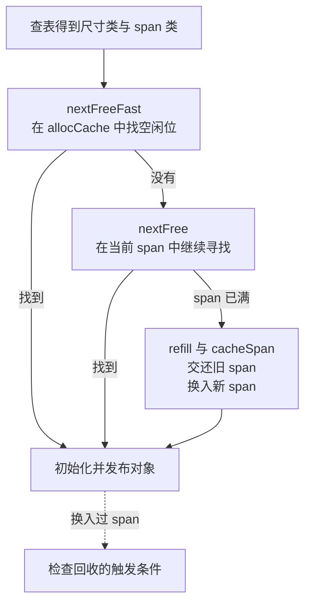

# 12.5 小对象分配

**小对象**（small object）是由尺寸类管理的对象。不含指针的对象从 16 字节起（更小的交给微对象分配器，[12.6](./tinyalloc.md)），
含指针的对象则不论多小都在此列，上限都是 32760 字节。`mallocgc` 按是否含指针、
是否需要分配头，把它们分派给三个函数（[12.1.4](./basic.md)）：`mallocgcSmallNoscan`、`mallocgcSmallScanNoHeader`
与 `mallocgcSmallScanHeader`。三者的骨架相同：由大小求出尺寸类，
从本地缓存当前的 span 中取一个空闲槽，取不到时向中心缓存换一个 span，最后初始化对象，
使其能够安全地被回收器看到。本节沿这一骨架展开，以不含指针的版本为主线，并在各处指出含指针的版本有何不同；
最后讨论槽位如何在回收之后被重新使用。



## 12.5.1 由大小到尺寸类

下面是 `mallocgcSmallNoscan` 的开头 [[Go Authors, 2026a](#ref-go-authors-2026a)]：

```go
func mallocgcSmallNoscan(size uintptr, typ *_type, needzero bool) (unsafe.Pointer, uintptr) {
	// Set mp.mallocing to keep from being preempted by GC.
	mp := acquirem()
	// ……
	mp.mallocing = 1

	checkGCTrigger := false
	c := getMCache(mp)
	var sizeclass uint8
	if size <= gc.SmallSizeMax-8 {
		sizeclass = gc.SizeToSizeClass8[divRoundUp(size, gc.SmallSizeDiv)]
	} else {
		sizeclass = gc.SizeToSizeClass128[divRoundUp(size-gc.SmallSizeMax, gc.LargeSizeDiv)]
	}
	size = uintptr(gc.SizeClassToSize[sizeclass])
	spc := makeSpanClass(sizeclass, true)
	span := c.alloc[spc]
	// ……
```

`acquirem` 增加当前 M 的锁计数，`mallocing` 标记 M 正在分配，两者都会使 `canPreemptM` 返回假；
协作式抢占（`newstack`）与异步抢占（`isAsyncSafePoint`）都以它为准，因此分配过程中 goroutine
不会被抢占（[9.7](../../part3concurrency/ch09sched/preemption.md)）。这一点是必需的：本地缓存属于 P，goroutine
若在中途被抢占、随后换到另一个 P 上继续执行，手中的 `c` 便不再属于它。`nextFree`
的注释要求它在不可抢占的上下文中运行，原因即在于此。

尺寸类的查找用两张表。不超过 1016 字节的请求按 8 字节一档，查 129 项的 `SizeToSizeClass8`；更大的请求减去
1024 后按 128 字节一档，查 249 项的 `SizeToSizeClass128`；其中 1017 至 1024 字节的请求减去 1024
后在无符号运算中回绕，向上取整恰好得到 0 号档，即 1024 字节。两张表由 `mksizeclasses.go`
对每一档的上界求出所属的尺寸类后写入 [[Go Authors, 2026d](#ref-go-authors-2026d)]。1024
字节以下的尺寸类都是 8 的倍数，以上的都是 128 的倍数，因此同一档内的请求必然落入同一个尺寸类，
查表的结果是精确的；分两种档距，则使两张表都保持在数百字节之内。`divRoundUp` 的除数是 2 的幂常量，
源码注释指出编译器会把这次除法优化掉，实际只剩一次加法与一次移位。`mallocgcSmallScanNoHeader`
只处理不超过 512 字节的对象，所以只查第一张表。`makeSpanClass` 把尺寸类左移一位，
最低位记录对象是否不含指针，68 个尺寸类因而对应 136 个 span 类，本地缓存的 `alloc` 数组即以 span
类为下标（[12.2.2](./component.md)）。

查表解决了由大小求尺寸类的问题。反方向的计算同样频繁：给定 span 中的一个地址，求它属于第几个对象。
回收器标记时遇到的指针可能指向对象内部，须先求出对象的序号，才能找到对应的标记位；分配时标黑新对象、`runtime.Pinner`
固定对象时，也要做同样的计算。序号等于地址相对 span 起点的偏移除以对象大小，
而整数除法比乘法慢得多。`mspan.divideByElemSize` 用一次乘法和一次移位代替除法
[[Go Authors, 2026c](#ref-go-authors-2026c)]：

```go
	// See explanation in mksizeclasses.go's computeDivMagic.
	q := uintptr((uint64(n) * uint64(s.divMul)) >> 32)
```

其中的 `divMul` 取自 `SizeClassToDivMagic` 表，值为 ⌊(2³² − 1)/d⌋ + 1，d 为对象大小。以 48 字节为例，
魔数为 89478486，偏移 4800 处的对象序号为 (4800 × 89478486) >> 32 = 100。
以乘代除只在被除数不超过一定范围时精确。Lemire、Kaser 与 Kurz 给出了所需小数位数的界
[[Lemire et al., 2019](#ref-lemire-2019)]，`mksizeclasses.go` 依据这一界确认每个尺寸类用 32 位就已足够，
并对从 0 到 span 长度的每一个偏移逐一验证乘法的结果与真正的除法相同，任何一处不符都会使生成失败
[[Go Authors, 2026e](#ref-go-authors-2026e)]。Go 1.17 以前，这一计算按对象大小是否为 2 的幂分支，并用
`divShift`、`divMul`、`divShift2` 三个参数先移位、再相乘、再移位；Dempsky
借助上述的界把它改为无条件的一次乘法，编译器基准测试的耗时几何平均减少 1.6%
[[Dempsky, 2021](#ref-dempsky-2021)]。

## 12.5.2 快速路径：nextFreeFast

`span` 是本地缓存为这一 span 类保留的当前 span。分配器先尝试 `nextFreeFast`
[[Go Authors, 2026a](#ref-go-authors-2026a)]：

```go
// nextFreeFast returns the next free object if one is quickly available.
// Otherwise it returns 0.
func nextFreeFast(s *mspan) gclinkptr {
	theBit := sys.TrailingZeros64(s.allocCache) // Is there a free object in the allocCache?
	if theBit < 64 {
		result := s.freeindex + uint16(theBit)
		if result < s.nelems {
			freeidx := result + 1
			if freeidx%64 == 0 && freeidx != s.nelems {
				return 0
			}
			s.allocCache >>= uint(theBit + 1)
			s.freeindex = freeidx
			s.allocCount++
			return gclinkptr(uintptr(result)*s.elemsize + s.base())
		}
	}
	return 0
}
```

`allocCache` 是 `allocBits` 从 `freeindex` 起的 64 位的反码，最低位对应 `freeindex`
所指的槽（[12.2.1](./component.md)）[[Hudson, 2016a](#ref-hudson-2016a)]。`TrailingZeros64` 求出最低的
1 位，即下一个空闲槽与 `freeindex` 的距离。编译器把它翻译为一两条指令：arm64 上是 `RBIT` 与 `CLZ`；amd64
上是 `BSFQ` 加一条条件传送，`GOAMD64=v3` 及以上则直接使用 `TZCNTQ`；wasm 上是 `i64.ctz`
[[Go Authors, 2026g](#ref-go-authors-2026g)]。确认找到的槽在 `nelems` 之内后，函数把缓存右移，
移走已分配的位，推进 `freeindex` 与 `allocCount`，并以「序号 × 槽大小 + 基址」得到对象的地址。

其中两处检查需要说明。第一处是 `result < s.nelems`：缓存每次装入 8 个字节，最后一个窗口可能含有超出
`nelems` 的位，`mspan` 的字段注释明言调用者必须忽略这些位。第二处针对窗口的边界：若刚分配的槽恰是
64 位窗口中的最后一个，缓存已经耗尽，需要从 `allocBits` 装入下一段。`nextFreeFast` 并不自己装入，而是返回
0，把这种情形连同缓存为空的情形一起交给慢速路径。这是有意的取舍：最初的版本在这里调用 `refillAllocCache`，
函数因体积与复杂度超出了编译器内联的限度；Hudson 把这一情形交给慢速路径以后，`nextFreeFast` 才得以内联
[[Hudson, 2016c](#ref-hudson-2016c)]。在 Go 1.26 中，它被内联到 `malloc.go` 的四个调用处，
即微对象与三种小对象的分配函数：

```shell
$ cd $(go env GOROOT)/src/runtime
$ go build -gcflags=-m 2>&1 | grep -oE 'malloc\.go:.*nextFreeFast$'
malloc.go:969:6: can inline nextFreeFast
malloc.go:1277:19: inlining call to nextFreeFast
malloc.go:1395:19: inlining call to nextFreeFast
malloc.go:1527:19: inlining call to nextFreeFast
malloc.go:1625:19: inlining call to nextFreeFast
```

位图取代自由表之前，这一步的代码如下 [[Go Authors, 2016](#ref-go-authors-2016)]：

```go
			v := s.freelist
			if v.ptr() == nil {
				systemstack(func() {
					c.refill(int32(sizeclass))
				})
				shouldhelpgc = true
				s = c.alloc[sizeclass]
				v = s.freelist
			}
			s.freelist = v.ptr().next
			s.ref++
			// prefetchnta offers best performance, see change list message.
			prefetchnta(uintptr(v.ptr().next))
```

摘下表头同样只需寥寥数行，代价却在读取 `v.ptr().next` 上：下一个空闲块的地址存放在当前空闲块之中，
而空闲块散布在 span 各处，访问的地址难以预测，缓存也难以命中。Hudson 曾为此在每次分配时预取下一个空闲块，
在 garbage 基准上得到约 1% 的提升 [[Hudson, 2015](#ref-hudson-2015)]；Clements 的设计文档则测得，`mallocgc`
的时间中有 14% 至 19% 花在遍历自由表上 [[Clements, 2015](#ref-clements-2015)]。位图方案中，`allocCache`
与 `freeindex` 都在 `mspan` 结构中，分配时访问的是刚刚用过的元数据，
寻找空闲槽只是寄存器中的位运算。以位图直接分配 [[Hudson, 2016b](#ref-hudson-2016b)]
的这一系列改动合入主干时，garbage 基准的耗时减少了 3.9% [[Hudson, 2016d](#ref-hudson-2016d)]。

## 12.5.3 慢速路径：nextFree

`nextFreeFast` 返回 0 时，分配器调用 `nextFree`，下面省略了其中的一致性检查
[[Go Authors, 2026a](#ref-go-authors-2026a)]：

```go
func (c *mcache) nextFree(spc spanClass) (v gclinkptr, s *mspan, checkGCTrigger bool) {
	s = c.alloc[spc]
	checkGCTrigger = false
	freeIndex := s.nextFreeIndex()
	if freeIndex == s.nelems {
		// The span is full.
		// ……
		c.refill(spc)
		checkGCTrigger = true
		s = c.alloc[spc]

		freeIndex = s.nextFreeIndex()
	}
	// ……
	v = gclinkptr(uintptr(freeIndex)*s.elemsize + s.base())
	s.allocCount++
	// ……
	return
}
```

`nextFreeIndex` 是 `nextFreeFast` 的完整版本 [[Go Authors, 2026c](#ref-go-authors-2026c)]。缓存全为 0 时，
它把 `freeindex` 推进到下一个 64 位窗口的起点并重新装入缓存，直到找到空闲位或走到 span 的末尾；
取走的槽若是窗口中的最后一个，它负责装入下一段，这正是 `nextFreeFast` 不予处理的情形。`freeindex`
只增不减，因此在两次清扫之间，一个 span 从头到尾被分配完，装入缓存的次数不超过其中 64 位窗口的个数，
均摊到每次分配上是常数。

`nextFreeIndex` 返回 `nelems`，说明 span 已满，此时才调用 `refill`，交还当前的 span，
由中心缓存换入一个有空闲槽的 span（[12.2.2](./component.md)、[12.2.3](./component.md)）。若换入的是新
span，这一路径每分配满一个 span 才走一次：48 字节的尺寸类每个 span 约有 170 个槽，1024 字节的尺寸类只有
8 个。也只有走过这一路径，`checkGCTrigger` 才为真，分配结束时检查是否应当开始新一轮回收
（[12.1.5](./basic.md)）。

交出的 span 未必从头开始分配，`freeindex` 也未必是 64 的倍数。例如，从已满的待清扫 span
中清扫得到空闲槽时，`cacheSpan` 把 `freeindex` 设为清扫后第一个空闲槽的序号。因此，`cacheSpan` 在交出
span 之前要让缓存与 `freeindex` 对齐 [[Go Authors, 2026b](#ref-go-authors-2026b)]：

```go
	freeByteBase := s.freeindex &^ (64 - 1)
	whichByte := freeByteBase / 8
	// Init alloc bits cache.
	s.refillAllocCache(whichByte)

	// Adjust the allocCache so that s.freeindex corresponds to the low bit in
	// s.allocCache.
	s.allocCache >>= s.freeindex % 64
```

它先装入 `freeindex` 所在的整个窗口，再右移 `freeindex % 64` 位，使缓存的最低位对应 `freeindex`。
向页堆新申请的 span 无需装入，`initSpan` 直接把缓存置为全 1，表示所有槽都空闲
[[Go Authors, 2026f](#ref-go-authors-2026f)]。

## 12.5.4 取得槽位之后

取得槽位以后，`mallocgcSmallNoscan` 还要完成清零、发布、标记与采样。开头省略的一段在
`GOEXPERIMENT=runtimefreegc` 下先检查本地缓存中有无可以重用的对象，这一实验在 Go 1.26 中默认关闭
（[12.9](./history.md)）。其余部分如下 [[Go Authors, 2026a](#ref-go-authors-2026a)]：

```go
	v := nextFreeFast(span)
	if v == 0 {
		v, span, checkGCTrigger = c.nextFree(spc)
	}
	x := unsafe.Pointer(v)
	if needzero && span.needzero != 0 {
		memclrNoHeapPointers(x, size)
	}

	// Ensure that the stores above that initialize x to
	// type-safe memory and set the heap bits occur before
	// the caller can make x observable to the garbage
	// collector. Otherwise, on weakly ordered machines,
	// the garbage collector could follow a pointer to x,
	// but see uninitialized memory or stale heap bits.
	publicationBarrier()

	if writeBarrier.enabled {
		// Allocate black during GC.
		// All slots hold nil so no scanning is needed.
		// This may be racing with GC so do it atomically if there can be
		// a race marking the bit.
		gcmarknewobject(span, uintptr(x))
	} else {
		// Track the last free index before the mark phase. This field
		// is only used by the garbage collector. During the mark phase
		// this is used by the conservative scanner to filter out objects
		// that are both free and recently-allocated. It's safe to do that
		// because we allocate-black if the GC is enabled. The conservative
		// scanner produces pointers out of thin air, so without additional
		// synchronization it might otherwise observe a partially-initialized
		// object, which could crash the program.
		span.freeIndexForScan = span.freeindex
	}

	// Note cache c only valid while m acquired; see #47302
	// ……
	c.nextSample -= int64(size)
	if c.nextSample < 0 || MemProfileRate != c.memProfRate {
		profilealloc(mp, x, size)
	}
	mp.mallocing = 0
	releasem(mp)

	if checkGCTrigger {
		if t := (gcTrigger{kind: gcTriggerHeap}); t.test() {
			gcStart(t)
		}
	}
	return x, size
}
```

先看清零。`span.needzero` 记录 span 中的内存是否可能不为零（[12.4.3](./largealloc.md)）；
不含指针的对象还要看调用者传入的 `needzero`。`growslice` 为不含指针的元素扩容时传入 `false`，因为
`append` 随即会覆盖从旧长度到新长度的部分，它只清零此后的部分；`slicebytetostring` 分配的内存也会立即被
`memmove` 写满 [[Go Authors, 2026g](#ref-go-authors-2026g)]。含指针的对象则必须清零，`mallocgc`
遇到相反的请求会直接抛出错误。`growslice` 中的注释给出了理由：否则回收器可能扫描到未初始化的内存。

含指针的对象还要记录哪些字是指针（[12.1.4](./basic.md)）。`mallocgcSmallScanNoHeader` 在清零之后调用
`heapSetTypeNoHeader`，把类型的指针掩码写入 span 末尾的堆位图。对象不超过 512 字节，即至多 64 个字，
在位图中所占的位数不超过一个字，因此写入至多涉及两个相邻的字
[[Go Authors, 2026c](#ref-go-authors-2026c)]。64 位平台上 8 字节的 1 号尺寸类是例外：
这一尺寸类中含指针的对象只有一个字，这个字必然是指针，因此 `initHeapBits` 在 span 初始化时已把位图全部置
1，分配时无需写入。`mallocgcSmallScanHeader` 则在查表之前给大小加上 8 字节，把类型指针写入槽位的第一个字，
返回给调用者的是其后的地址。

接下来是发布屏障。调用者得到对象后，会把它的地址写到某处，例如一个全局变量中；从这一刻起，
运行在其他线程上的回收器就可能沿着这个指针找到它。在弱内存序的处理器上
（[11.9](../../part3concurrency/ch11sync/mem.md)），初始化对象的写入与发布地址的写入可能被重排，
回收器便会看到尚未清零的内存或过时的堆位图。`publicationBarrier` 保证屏障之前的写入先于其后的写入被其他处
理器观察到。它在 arm64 上是一条 `DMB ST` 指令；x86 本身保证写入的顺序，amd64 上的实现只是一条 `RET`，
作用仅在于阻止编译器重排；wasm 上同样是一条 `RET` [[Go Authors, 2026g](#ref-go-authors-2026g)]。
读的一方不需要对应的屏障，`stubs.go` 中的注释指出，Go 支持的体系结构都保证数据依赖的顺序。

然后是标记。回收器正在标记时，写屏障开启，新对象立即被标记，即「分配即标黑」：对象刚被清零，不含非 nil
的指针，无需扫描，标记它只是为了让本轮回收不把它当作垃圾；若所在的 span 使用 Green Tea
回收器的内联标记位，它的扫描位也同时被置位（[13.11](../ch13gc/greentea.md)）。不在标记阶段时，分配器更新
`freeIndexForScan`，这一字段服务于保守式扫描。被异步抢占打断的栈帧没有精确的指针信息
（[9.7](../../part3concurrency/ch09sched/preemption.md)、[13.7.4](../ch13gc/safe.md)），
回收器只能把其中每个形似指针的值都当作指针，这样的值可能恰好指向一个刚分配、尚未初始化的槽。`scanConservative`
借助 `isFreeOrNewlyAllocated` 过滤这类值：序号不小于 `freeIndexForScan`、
且在上次清扫时空闲的槽，要么仍然空闲，要么是标记开始之后才分配的对象，而后者已被标黑，两种情况都可以跳过
[[Go Authors, 2026f](#ref-go-authors-2026f)]。`freeindex` 在槽被取走时就已前移，此时对象尚未清零、
堆位图尚未写入；`freeIndexForScan` 则在初始化与发布屏障之后才更新。Go 1.20 以前，扫描器直接依据
`freeindex` 判断，在并发分配时可能扫描到未初始化的对象，issue #54596 报告的 compress/flate
中的内存损坏即与此有关；Mui 为扫描器单独设立了这一字段 [[Mui, 2022](#ref-mui-2022)]。

最后两步：`nextSample` 按分配的字节数递减，降到零以下时记录一次内存剖析的样本
（[16.5](../../part5toolchain/ch16tools/perf.md)），注释中提到的 #47302 见 [12.4.2](./largealloc.md)；本次
分配若换入过 span，则在恢复可抢占之后检查回收的触发条件。

## 12.5.5 槽位的回收与重用

槽位只在清扫时被释放。清扫一个 span 时（[13.5](../ch13gc/sweep.md)），运行时以本轮的标记位取代分配位，并把
`freeindex` 归零 [[Go Authors, 2026f](#ref-go-authors-2026f)]：

```go
	s.allocCount = nalloc
	s.freeindex = 0 // reset allocation index to start of span.
	s.freeIndexForScan = 0
	// ……

	// gcmarkBits becomes the allocBits.
	// get a fresh cleared gcmarkBits in preparation for next GC
	s.allocBits = s.gcmarkBits
	s.gcmarkBits = newMarkBits(uintptr(s.nelems))
	// ……

	// Initialize alloc bits cache.
	s.refillAllocCache(0)
```

此后，这个 span 中的分配从第一个槽重新开始，按地址递增的顺序填补死去对象留下的空槽，越过存活的对象。两次
清扫之间，没有任何槽被释放：`freeindex` 之前的槽要么仍然存活，要么已经死去而尚未被清扫，分配器都不会回头
使用。`runtimefreegc` 实验中由编译器显式释放的对象经由本地缓存中的另一张表重用，`allocBits` 仍然只由清扫器
改写（[12.9](./history.md)）。

下面的程序分配 80 个 112 字节、不含指针的对象，它们落入 9 号尺寸类；随后释放其中的奇数号对象，调用
`runtime.GC()`，再分配 4 个同样大小的对象。`runtime.GC()` 在返回之前会完成本轮的清扫，源码注释说，
这样做既是为了完成整个周期，也是因为它常被测试与基准用来使系统进入相对稳定的状态
[[Go Authors, 2026f](#ref-go-authors-2026f)]。程序把 `GOMAXPROCS` 设为 1：有多个 P 时，回收之后由哪个 P
继续执行 `main`、那个 P 的本地缓存中已有哪个 span 都不确定，新对象未必落在这些对象所在的 span 中。

```go {run=true}
package main

import (
	"fmt"
	"runtime"
	"slices"
	"unsafe"
)

const size = 112 // 落入 9 号尺寸类；[]byte 不含指针

var objs [80][]byte

func addr(b []byte) uintptr { return uintptr(unsafe.Pointer(&b[0])) }

func main() {
	runtime.GOMAXPROCS(1) // 只有一个 P，回收前后使用同一份本地缓存
	for i := range objs {
		objs[i] = make([]byte, size)
	}
	fmt.Print("连续分配，相邻地址之差：")
	for i := 73; i < 80; i++ {
		fmt.Print(addr(objs[i])-addr(objs[i-1]), " ")
	}
	fmt.Println()

	var freed []uintptr
	for i := 1; i < len(objs); i += 2 {
		freed = append(freed, addr(objs[i]))
		objs[i] = nil // 释放奇数号对象
	}
	runtime.GC()

	var again [4][]byte
	for i := range again {
		again[i] = make([]byte, size)
	}
	fmt.Print("回收之后，相邻地址之差：")
	reused := true
	for i, b := range again {
		if i > 0 {
			fmt.Print(addr(b)-addr(again[i-1]), " ")
		}
		reused = reused && slices.Contains(freed, addr(b))
	}
	fmt.Println("\n新对象都位于被释放对象原来的位置：", reused)
	runtime.KeepAlive(&objs)
}
```

运行结果如下：

```
连续分配，相邻地址之差：112 112 112 112 112 112 112
回收之后，相邻地址之差：224 224 224
新对象都位于被释放对象原来的位置： true
```

连续分配的对象相距 112 字节，占据相邻的槽位。回收之后的 4 个对象相距 224 字节，每次越过一个存活的对象，
落在被释放的槽位上。新对象所在的 span 末尾还有从未分配过的槽，它们排在被释放的槽之后，因而后被使用。

## 12.5.6 代价

走快速路径时，取得一个槽位只需一次查表、一次计算末尾零个数、一次移位和一次乘加，既不加锁，`nextFreeFast`
也已被内联。TCMalloc 的快速路径同样不获取任何锁 [[Ghemawat and Menage, 2005](#ref-ghemawat-menage-2005)]；
现行的 TCMalloc 还可以按 CPU 而非按线程缓存，借助 Linux 的可重启序列（rseq）
在不使用锁与原子指令的情况下存取每个 CPU 的缓存 [[TCMalloc Authors, 2026](#ref-tcmalloc-authors-2026)]。Go
的本地缓存属于 P，同一时刻只有一个 M 持有 P，因此无需借助这类机制（[12.2.2](./component.md)）。
慢速路径的代价按 span 均摊：换入 span 时，中心缓存的集合以原子操作存取，必要时还要就地清扫，
或者经由页堆（[12.7](./pagealloc.md)）申请新的页，并在换入时按比例承担清扫的工作
（[13.5](../ch13gc/sweep.md)）。越往下，同步的代价越大，走到的频率越低。这与调度器为每个 P
维护本地运行队列（[9.2](../../part3concurrency/ch09sched/steal.md)）、`sync.Pool` 按 P
分片（[11.6](../../part3concurrency/ch11sync/pool.md)）出于同样的考虑：只在本地资源用尽时才访问共享状态。

因此，单次分配本身很少成为瓶颈，分配的成本主要体现在回收上。分配的字节数推动堆向回收的触发点增长
（[13.3](../ch13gc/pacing.md)）；存活的对象要被标记，死去的槽要被清扫，含指针的对象还要被逐字扫描。
减少分配的次数与字节数，比加快单次分配更有效：逃逸分析能把不逃逸的对象留在栈上
（[15.5](../../part5toolchain/ch15compile/escape.md)），`sync.Pool`
能复用临时对象（[11.6](../../part3concurrency/ch11sync/pool.md)），不含指针的数据布局则能免去扫描。
在分配器一侧，Go 1.27 为不超过 80 字节的尺寸类启用了专用的分配函数，
尺寸类等信息在这些函数中成为编译期常量（[12.1.4](./basic.md)）。

## 12.5.7 小结

小对象分配先由两张表把大小映射到尺寸类，再在 span 的分配位图中寻找空闲槽。`allocCache`
让这一步成为寄存器中的几条位运算，其中不常见的情形都留给慢速路径，使快速路径得以内联；span
用尽时才向中心缓存换取新的 span。取得槽位之后，清零、写堆位图、发布屏障、标黑与 `freeIndexForScan`
共同保证回收器只会看到完整初始化的对象。槽位只在清扫时被释放，清扫把标记位变为分配位并让 `freeindex`
归零，此后的分配按地址顺序填补空槽。这一设计始于 Go 1.7 以位图取代自由表，
此后的改动主要在于让快速路径更短、让回收器看到的状态更一致。

## 延伸阅读

- <a id="ref-clements-2015"></a>[Clements, 2015] Austin Clements. *Proposal: Dense mark bits and
  sweep-free allocation.* 2015. https://go.dev/design/12800-sweep-free-alloc
- <a id="ref-dempsky-2021"></a>[Dempsky, 2021] Matthew Dempsky. runtime: simplify divmagic for span
  calculations. Go commit 4662029264, 2021. https://go.dev/cl/300994
  随 Go 1.17 发布。
- <a id="ref-ghemawat-menage-2005"></a>[Ghemawat and Menage, 2005] Sanjay Ghemawat, Paul Menage.
  *TCMalloc: Thread-Caching Malloc.* 2005. http://goog-perftools.sourceforge.net/doc/tcmalloc.html
  gperftools 项目现在维护的版本：https://gperftools.github.io/gperftools/tcmalloc.html
- <a id="ref-go-authors-2016"></a>[Go Authors, 2016] The Go Authors. src/runtime/malloc.go（自由表时代的
  `mallocgc`）. Go 1.6 源码. https://github.com/golang/go/blob/release-branch.go1.6/src/runtime/malloc.go
- <a id="ref-go-authors-2026a"></a>[Go Authors, 2026a] The Go Authors.
  src/runtime/malloc.go（`mallocgcSmallNoscan` / `mallocgcSmallScanNoHeader` / `mallocgcSmallScanHeader` /
  `nextFreeFast` / `mcache.nextFree`）. Go 1.26 源码.
  https://github.com/golang/go/blob/release-branch.go1.26/src/runtime/malloc.go
- <a id="ref-go-authors-2026b"></a>[Go Authors, 2026b] The Go Authors.
  src/runtime/mcache.go（`refill`）、src/runtime/mcentral.go（`cacheSpan` / `grow`）. Go 1.26 源码.
  https://github.com/golang/go/blob/release-branch.go1.26/src/runtime/mcache.go
- <a id="ref-go-authors-2026c"></a>[Go Authors, 2026c] The Go Authors.
  src/runtime/mbitmap.go（`nextFreeIndex` / `refillAllocCache`，allocBits 与 allocCache 的位扫描）. Go
  1.26 源码. https://github.com/golang/go/blob/release-branch.go1.26/src/runtime/mbitmap.go
- <a id="ref-go-authors-2026d"></a>[Go Authors, 2026d] The Go Authors.
  src/internal/runtime/gc/sizeclasses.go（68 个尺寸类、`SizeToSizeClass8/128`；取整浪费与尾部浪费各不超过
  12.5%，小于 128 字节的尺寸类受对齐约束除外）. Go 1.26 源码.
  https://github.com/golang/go/blob/release-branch.go1.26/src/internal/runtime/gc/sizeclasses.go
- <a id="ref-go-authors-2026e"></a>[Go Authors, 2026e] The Go Authors.
  src/runtime/_mkmalloc/mksizeclasses.go（尺寸类表与除法魔数的生成及验证）. Go 1.26 源码.
  https://github.com/golang/go/blob/release-branch.go1.26/src/runtime/_mkmalloc/mksizeclasses.go
- <a id="ref-go-authors-2026f"></a>[Go Authors, 2026f] The Go Authors.
  src/runtime/mgcsweep.go、src/runtime/mgc.go（`GC`）、src/runtime/mgcmark.go（`gcmarknewobject`、`scanConservative`）、src/runtime/mheap.go（`initSpan`）.
  Go 1.26 源码.
  https://github.com/golang/go/tree/release-branch.go1.26/src/runtime
- <a id="ref-go-authors-2026g"></a>[Go Authors, 2026g] The Go Authors.
  src/runtime/stubs.go、asm_amd64.s、atomic_arm64.s、asm_wasm.s（`publicationBarrier`）、src/runtime/slice.go、src/runtime/string.go、src/cmd/compile/internal/ssa/_gen/*.rules（`Ctz64`
  的降低规则）. Go 1.26 源码. https://github.com/golang/go/tree/release-branch.go1.26/src
- <a id="ref-hudson-2015"></a>[Hudson, 2015] Rick Hudson. runtime: Add prefetch to allocation code. Go
  commit 99482f2f9e, 2015. https://go.dev/cl/5350
  随 Go 1.5 发布。
- <a id="ref-hudson-2016a"></a>[Hudson, 2016a] Rick Hudson. [dev.garbage] runtime: add bit and cache ctz64
  (count trailing zero). Go commit 4093481523, 2016. https://go.dev/cl/20200
  随 Go 1.7 发布。
- <a id="ref-hudson-2016b"></a>[Hudson, 2016b] Rick Hudson. [dev.garbage] runtime: allocate directly from
  GC mark bits. Go commit 3479b065d4, 2016. https://go.dev/cl/19470
  随 Go 1.7 发布。
- <a id="ref-hudson-2016c"></a>[Hudson, 2016c] Rick Hudson. [dev.garbage] runtime: simplify nextFreeFast
  so it is inlined. Go commit e9eaa181fc, 2016. https://go.dev/cl/22598
  随 Go 1.7 发布。
- <a id="ref-hudson-2016d"></a>[Hudson, 2016d] Rick Hudson. Merge remote-tracking branch
  'origin/dev.garbage'. Go commit 56b5491262, 2016.
  https://go.googlesource.com/go/+/56b54912628934707977a2a0a3824288c0286830
  随 Go 1.7 发布。
- <a id="ref-lemire-2019"></a>[Lemire et al., 2019] Daniel Lemire, Owen Kaser, Nathan Kurz. "Faster
  Remainder by Direct Computation: Applications to Compilers and Software Libraries." *Software: Practice
  and Experience* 49(6): 953–970, 2019. https://doi.org/10.1002/spe.2689
- <a id="ref-mui-2022"></a>[Mui, 2022] Cherry Mui. runtime: make GC see object as allocated after it is
  initialized. Go commit febe7b8e2a, 2022. https://go.dev/cl/449017
  随 Go 1.20 发布，修复 Go issue #54596。
- <a id="ref-tcmalloc-authors-2026"></a>[TCMalloc Authors, 2026] The TCMalloc Authors.
  *TCMalloc: Thread-Caching Malloc.* 2026. https://google.github.io/tcmalloc/design.html
  尺寸类与线程缓存的思想原型。
- 本书 [12.2 组件](./component.md)、[12.6 微对象分配](./tinyalloc.md)、[13.5
  清扫与位图](../ch13gc/sweep.md)（allocBits ← gcmarkBits 的交换）。
- 本书 [15.5 逃逸分析](../../part5toolchain/ch15compile/escape.md)、[11.6
  缓存池](../../part3concurrency/ch11sync/pool.md)（减少分配次数的两条途径）。
