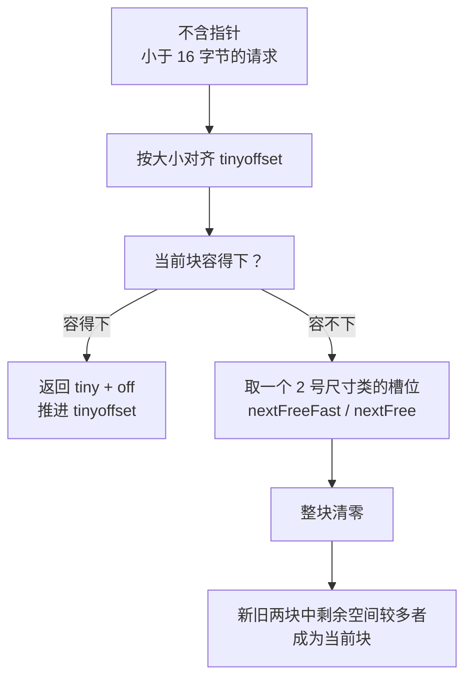

# 12.6 微对象分配

**微对象**（tiny object）是小于 16 字节且不含指针的对象。`mallocgc` 把它们交给 `mallocgcTiny`：
多个微对象被合并到同一个 16 字节的块中，块内所有对象都不可达之后，整块才被回收。[12.1.4](./basic.md)
已经说明了这样做的理由：微对象数量很多，若各占一个最小的槽位，浪费的比例很高；限定不含指针，
则使潜在的浪费有界；在 secret 模式下分配的对象不使用这一机制。本节讨论它的实现：块与偏移如何管理，
合并的效果如何观察，16 字节这一大小从何而来，以及多个对象共享同一块内存带来的后果。

微对象分配器由 Vyukov 在 2014 年加入，随 Go 1.3 发布，提交说明写道：把小于
16 字节的不含指针的分配合并到同一个内存块中 [[Vyukov, 2014](#ref-vyukov-2014)]。此后它的基本结构没有改变，
后来的改动主要处理它与回收器、竞态检测器以及其他运行时机制的配合。

## 12.6.1 块与偏移

每个 P 的本地缓存中有三个字段服务于微对象：`tiny` 指向当前块的起点，`tinyoffset` 是块内已用到的偏移，
`tinyAllocs` 统计这个 P 完成的微对象分配次数（[12.2.2](./component.md)）。`mallocgcTiny` 的主体如下，
开头省略了一段与 [12.5.1](./smallalloc.md) 相同的序言，结尾省略了与 [12.5.4](./smallalloc.md) 相同的发布、
标记与采样 [[Go Authors, 2026a](#ref-go-authors-2026a)]：

```go
	c := getMCache(mp)
	off := c.tinyoffset
	// Align tiny pointer for required (conservative) alignment.
	if size&7 == 0 {
		off = alignUp(off, 8)
	} else if goarch.PtrSize == 4 && size == 12 {
		// Conservatively align 12-byte objects to 8 bytes on 32-bit
		// systems so that objects whose first field is a 64-bit
		// value is aligned to 8 bytes and does not cause a fault on
		// atomic access. See issue 37262.
		// TODO(mknyszek): Remove this workaround if/when issue 36606
		// is resolved.
		off = alignUp(off, 8)
	} else if size&3 == 0 {
		off = alignUp(off, 4)
	} else if size&1 == 0 {
		off = alignUp(off, 2)
	}
	if off+size <= maxTinySize && c.tiny != 0 {
		// The object fits into existing tiny block.
		x := unsafe.Pointer(c.tiny + off)
		c.tinyoffset = off + size
		c.tinyAllocs++
		mp.mallocing = 0
		releasem(mp)
		return x, 0
	}
	// Allocate a new maxTinySize block.
	checkGCTrigger := false
	span := c.alloc[tinySpanClass]
	v := nextFreeFast(span)
	if v == 0 {
		v, span, checkGCTrigger = c.nextFree(tinySpanClass)
	}
	x := unsafe.Pointer(v)
	(*[2]uint64)(x)[0] = 0 // Always zero
	(*[2]uint64)(x)[1] = 0
	// See if we need to replace the existing tiny block with the new one
	// based on amount of remaining free space.
	if !raceenabled && (size < c.tinyoffset || c.tiny == 0) {
		// Note: disabled when race detector is on, see comment near end of this function.
		c.tiny = uintptr(x)
		c.tinyoffset = size
	}
	// ……
```

偏移的对齐只取决于请求的大小：大小是 8 的倍数时对齐到 8，是 4 的倍数时对齐到 4，是 2 的倍数时对齐到 2，
否则不对齐。一个类型的大小总是其对齐的整数倍，所以按大小推断的对齐不会小于类型实际需要的对齐，
注释因而称之为保守的对齐。32 位平台上的 12 字节对象是例外。在这些平台上，64 位字段只按 4 字节对齐，
而对未按 8 字节对齐的 64 位值做原子操作可能出错。惯常的做法是把需要原子访问的 64 位字段放在结构体开头，
依靠分配器返回 8 字节对齐的地址（[11.3](../../part3concurrency/ch11sync/atomic.md)）；
`struct { a uint64; b byte }` 在 32 位平台上的大小是 12 字节，微对象分配器按规则只会把它对齐到 4，
使这一做法失效。Knyszek 为此单独把 12 字节的对象对齐到 8 [[Knyszek, 2020](#ref-knyszek-2020)]。

当前块容得下时，分配只是返回 `c.tiny + off` 并推进偏移，不清零，不访问 span，也不检查回收的触发条件。这条
路径返回的槽位大小为 0。`mallocgc` 在结尾按「槽位大小减请求大小」为分配者追加标记辅助的债务，槽位大小为 0
时跳过这一步，因此合并进已有块的分配只按请求的大小计入，块中剩余的空间已由开启这个块的那次分配承担。

当前块容不下时，分配器从本地缓存中取一个 `tinySpanClass` 的槽位，即 2 号尺寸类、不含指针的 16 字节槽位
[[Go Authors, 2026c](#ref-go-authors-2026c)]，取法与小对象完全相同（[12.5.2](./smallalloc.md)）。
新块总是被整块清零，`mallocgcTiny` 也没有 `needzero` 参数。随后决定以哪个块作为当前块：新块用去 `size`
字节，剩余 16 − `size`；旧块剩余 16 − `tinyoffset`。只有新块剩余较多，即 `size < c.tinyoffset` 时，
才以新块替换旧块，此后的微对象继续填入剩余较多的那个块。未被选中的块并没有特殊之处，它只是一个普通的
16 字节对象，其中的微对象存活多久，它就存活多久。



`tiny` 是一个指向堆的指针，而本地缓存不在垃圾回收的堆上，回收器不会扫描它。运行时以两种方式处理这一点。
其一，`mcache.go` 中的注释指出，标记终止时 `releaseAll` 清空 `tiny` 与 `tinyoffset`，
新一轮回收周期中的微对象总是从新块开始。其二，标记开始时，运行时在停止所有 goroutine 的状态下把每个 P
的当前块标灰。Go 1.8 的混合写屏障要求新分配的对象都是黑色的，而当前块若是在标记开始之前分配的，
此后从中切出的微对象都不会触发标黑，回收器便可能清扫一个仍然可达的块。Clements
选择在标记开始时一次性处理所有当前块，代码中的注释说明了另一种做法为何被放弃：每次从块中分配都把块标黑，
会拖慢微对象分配器 [[Clements, 2016](#ref-clements-2016)]（[13.2](../ch13gc/barrier.md)）。

## 12.6.2 合并的效果

下面的程序分别分配 2²⁰ 个 3 字节、4 字节、12 字节和 16 字节的不含指针的对象，并全部保持可达，
计算每个对象平均占用的堆内存。`runtime.GC()` 在两次读取之间使统计稳定下来，
同时也在标记终止时清空了当前块，每组分配都从新块开始。

```go {run=true}
package main

import (
	"fmt"
	"runtime"
)

const n = 1 << 20

var (
	b3  [n]*[3]byte
	b4  [n]*[4]byte
	b12 [n]*[12]byte
	b16 [n]*[16]byte
)

// perObject 返回 alloc 分配的 n 个对象平均占用的堆内存（字节）。
func perObject(alloc func(i int)) float64 {
	var before, after runtime.MemStats
	runtime.GC()
	runtime.ReadMemStats(&before)
	for i := range n {
		alloc(i)
	}
	runtime.GC()
	runtime.ReadMemStats(&after)
	return float64(after.HeapAlloc-before.HeapAlloc) / n
}

func main() {
	fmt.Printf(" 3 字节：%.1f\n", perObject(func(i int) { b3[i] = new([3]byte) }))
	fmt.Printf(" 4 字节：%.1f\n", perObject(func(i int) { b4[i] = new([4]byte) }))
	fmt.Printf("12 字节：%.1f\n", perObject(func(i int) { b12[i] = new([12]byte) }))
	fmt.Printf("16 字节：%.1f\n", perObject(func(i int) { b16[i] = new([16]byte) }))
}
```

运行结果如下：

```
 3 字节：3.2
 4 字节：4.0
12 字节：16.0
16 字节：16.0
```

3 字节的对象不需要对齐，一个块容纳 5 个，用去 15 字节，平均每个占 3.2 字节；4 字节的对象一个块恰好容纳
4 个。若没有微对象分配器，它们都会落入 8 字节的 1 号尺寸类，各占 8 字节。12 字节的对象对齐到 4，
第二个对象从偏移 12 开始便超出 16 字节，于是取一个新块；此时 `size < c.tinyoffset` 即 12 < 12 不成立，
只用了 12 字节的旧块仍是当前块，新对象独占一个块，最终每个对象都占满 16 字节，与不合并没有区别。
旧块剩下的 4 字节留给之后更小的请求。16 字节的对象不是微对象，直接从 2 号尺寸类分配，作为对照。

以 `-race` 运行同一程序，四行都是 16.0。竞态检测器启用时，替换当前块的条件中的 `!raceenabled` 使 `tiny`
始终为空，每个微对象都独占一个块；`mallocgcTiny` 还把对象放在块的末尾，使越过对象末尾的指针运算能被
checkptr 检查出来。这一做法由 Randall 加入，修复了 issue #38872 报告的 checkptr 对微对象的漏报
[[Randall, 2021](#ref-randall-2021)]。

## 12.6.3 为什么是 16 字节

`mallocgcTiny` 开头的注释讨论了块的大小 [[Go Authors, 2026a](#ref-go-authors-2026a)]：

```go
	// Size of the memory block used for combining (maxTinySize) is tunable.
	// Current setting is 16 bytes, which relates to 2x worst case memory
	// wastage (when all but one subobjects are unreachable).
	// 8 bytes would result in no wastage at all, but provides less
	// opportunities for combining.
	// 32 bytes provides more opportunities for combining,
	// but can lead to 4x worst case wastage.
	// The best case winning is 8x regardless of block size.
```

这里的倍数以不合并时的占用为基准：一个微对象若单独分配，至少占一个 8 字节的槽位。
最坏的情形是块中只剩一个子对象存活，它使整块无法回收，占用的内存是块的大小，相对 8 字节的基准，块为
16 字节时是 2 倍，32 字节时是 4 倍，8 字节时则与不合并相同，没有额外的浪费。最好的情形是块中全是
1 字节的对象，每个只占 1 字节，而单独分配时各占 8 字节，占用只有不合并时的八分之一，与块的大小无关。
块越大，合并的机会越多，最坏情形也越差；16 字节是两者之间的折中。块的大小必须是某个尺寸类的大小，
新块才能直接从这一尺寸类中取得，`mallocinit` 在启动时检查 2 号尺寸类的大小是否等于 `maxTinySize`。

Vyukov 最初的提交报告了这一取舍的实际效果：在 json 基准上，分配次数减少 11.3%，堆占用减少 19.7%；在
garbage 基准上，分配次数减少 12.3%，堆占用减少 1.5% [[Vyukov, 2014](#ref-vyukov-2014)]。
这与注释中「分配次数减少约 12%、堆大小减少约 20%」的数字相符。

## 12.6.4 共享生死的后果

块中的微对象同生共死，这一点对依赖对象生命周期的机制有直接的影响。终结器、
清理函数与弱指针都以「对象不再可达」为触发条件，而一个已经不可达的微对象可能因同块中的其他对象存活而一直不
被回收。`runtime.SetFinalizer`、`runtime.AddCleanup` 与 `weak.Pointer` 的文档对此都有同样的说明，
以终结器为例 [[Go Authors, 2026d](#ref-go-authors-2026d)]：

> 由于终结器可能在对象不再被引用之后的任意时刻才执行，运行时被允许进行一种节省空间的优化，把若干对象合并到同一个
> 分配槽位中。这样的分配中一个不再被引用的对象，若总与一个被引用的对象处于同一批中，它的终结器可能永远不会执行。
> 通常，这种合并只发生在微小的（约 16 字节或更小）、不含指针的对象上。

终结器的这段说明来自 Ou 的提交，解决了 issue #46827 中提出的文档缺失 [[Ou, 2021](#ref-ou-2021)]；Go 1.24
加入的清理函数与弱指针沿用了同样的表述。运行时在实现上也为微对象留了余地：`SetFinalizer`
通常要求指针指向分配块的起点，但若对象的类型不含指针且小于 16 字节，便允许指向块的内部；`AddCleanup`
为清理函数的参数分配存储时则有意绕开微对象分配器，源码注释给出的理由是避免存活性问题，
因为这块存储会被回收器当作根（[13.10](../ch13gc/finalizer.md)）。Go 1.26 的 `runtime/secret`
实验出于类似的原因让 secret 模式下的分配绕开微对象分配器：块中的其他对象可能使整块长期存活，而 secret
对象须在释放时及时清零 [[Morsing, 2025](#ref-morsing-2025)]。

统计也受到影响。运行时并不跟踪单个微对象的生命周期，只跟踪它们所在的块。`runtime.MemStats`
出于历史原因把微对象的分配次数同时计入 `Mallocs` 与 `Frees`，源码注释承认这在某种意义上重复计算了内存，
因为块本身也被计入；逐个跟踪微对象的生命周期则代价太高 [[Go Authors, 2026d](#ref-go-authors-2026d)]。
`runtime/metrics` 把微对象的分配次数单独列为 `/gc/heap/tiny/allocs:objects`，
按大小统计的直方图中只包含块。内存剖析也只按块采样：只有开启新块的分配会扣减 `nextSample`，扣减的是整块的
16 字节，合并进已有块的分配不会被采样。

`runtimefreegc` 实验同样避开了微对象：`reusableSize` 拒绝小于 16 字节的对象，与 `mallocgcTiny`
注释中「从微对象分配器得到的对象不能被显式释放」的要求一致（[12.9](./history.md)）。
在默认关闭的按尺寸专用分配函数中，微对象的函数按请求大小而非尺寸类生成，从 `mallocgcTinySize1` 到
`mallocgcTinySize15` 共 15 个，请求大小在其中是编译期常量（[12.1.4](./basic.md)）。

## 12.6.5 微对象在分配路径中的位置

[12.1.4](./basic.md) 列出了 `mallocgc` 的五条路径，微对象是其中之一，但它并不自成一套：它的块就是
2 号尺寸类的普通槽位，与 16 字节的不含指针的小对象共用同一个 span 类，
取块时走的正是小对象的快速路径与慢速路径（[12.5](./smallalloc.md)）。`refill` 中有一处痕迹：交还 span 时，
若 span 类是 `tinySpanClass`，就把本地缓存累计的 `tinyAllocs` 一并计入全局统计
[[Go Authors, 2026b](#ref-go-authors-2026b)]。因此，微对象分配器可以看作在小对象分配器之上增加的一层：
小对象分配器交付一个 16 字节的槽位，微对象分配器再按偏移把它分给多个对象。

## 12.6.6 小结

微对象分配器把小于 16 字节的不含指针的对象合并到 16 字节的块中，块内按大小对齐、推进偏移，块满时从 2 号
尺寸类取一个新块，并保留剩余空间较多的块作为当前块。合并使这类对象的平均占用接近其实际大小，代价是同块的
对象共享生死：最坏情形下占用为不合并时的 2 倍，终结器、清理函数与弱指针可能因此永不触发，统计与剖析也只能
以块为单位。为了与回收器和竞态检测器正确配合，运行时在标记开始时把当前块标灰、在标记终止时清空当前块，并在
竞争检测时关闭合并。

## 延伸阅读

- <a id="ref-clements-2016"></a>[Clements, 2016] Austin Clements. runtime: mark tiny blocks at GC start.
  Go commit 85c22bc3a5, 2016. https://go.dev/cl/31456
  随 Go 1.8 发布。
- <a id="ref-go-authors-2026a"></a>[Go Authors, 2026a] The Go Authors. src/runtime/malloc.go
  （`mallocgcTiny`、`maxTinySize`、对齐与换块逻辑、JSON 基准的实测数据）. Go 1.26 源码.
  https://github.com/golang/go/blob/release-branch.go1.26/src/runtime/malloc.go
- <a id="ref-go-authors-2026b"></a>[Go Authors, 2026b] The Go Authors. src/runtime/mcache.go
  （`tiny`/`tinyoffset` 字段与 `tinySpanClass`）. Go 1.26 源码.
  https://github.com/golang/go/blob/release-branch.go1.26/src/runtime/mcache.go
- <a id="ref-go-authors-2026c"></a>[Go Authors, 2026c] The Go Authors. src/runtime/mheap.go
  （`tinySpanClass = tinySizeClass<<1 | 1`、`makeSpanClass`）. Go 1.26 源码.
  https://github.com/golang/go/blob/release-branch.go1.26/src/runtime/mheap.go
- <a id="ref-go-authors-2026d"></a>[Go Authors, 2026d] The Go Authors.
  src/runtime/mfinal.go（`SetFinalizer`）、src/runtime/mcleanup.go（`AddCleanup`）、src/weak/pointer.go、
  src/runtime/mstats.go、src/runtime/metrics/description.go、src/runtime/mgc.go（`gcStart`）、
  src/runtime/mgcmark.go（`gcMarkTinyAllocs`）、 src/runtime/malloc_generated.go. Go 1.26 源码.
  https://github.com/golang/go/tree/release-branch.go1.26/src
- <a id="ref-knyszek-2020"></a>[Knyszek, 2020] Michael Anthony Knyszek. runtime: align 12-byte objects to
  8 bytes on 32-bit systems. Go commit 5756b35601, 2020. https://go.dev/cl/254057
  随 Go 1.16 发布，修复 Go issue #37262：https://go.dev/issue/37262
- <a id="ref-morsing-2025"></a>[Morsing, 2025] Daniel Morsing. Go issue #76356. *runtime: tiny allocator
  can keep allocations alive longer than expected.* 2025. https://go.dev/issue/76356
  secret 模式下的分配因此绕开微对象分配器。
- <a id="ref-ou-2021"></a>[Ou, 2021] Changkun Ou. runtime: clarify finalizer semantics for tiny objects.
  Go commit 80d487111b, 2021. https://go.dev/cl/337391
  随 Go 1.20 发布，修复 Go issue #46827。
- <a id="ref-randall-2021"></a>[Randall, 2021] Keith Randall. runtime: top align tinyallocs in race mode.
  Go commit 2c05ba4ae0, 2021. https://go.dev/cl/315029
  随 Go 1.17 发布，修复 Go issue #38872。
- <a id="ref-vyukov-2014"></a>[Vyukov, 2014] Dmitriy Vyukov. runtime: combine small NoScan allocations. Go
  commit 1fa7029425, 2014. https://codereview.appspot.com/38750047
  随 Go 1.3 发布。
- 本书 [12.4 大对象分配](./largealloc.md)、[12.5 小对象分配](./smallalloc.md)
  （微对象路径所依托的两端）。
- 本书 [12.2 组件](./component.md)（mcache、span、尺寸类）、
  [第 13 章 垃圾回收器](../ch13gc)（块的整体存活、扫描与清扫）。
