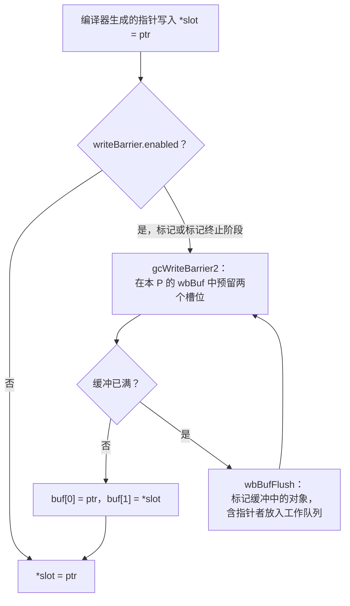

# 13.2 写屏障技术

[13.1.4](./basic.md) 说明了并发标记的风险：赋值器把一个白色对象的指针写入黑色对象，
同时破坏了从灰色对象通往它的所有路径，回收器便会漏掉这个仍然可达的对象。**写屏障**（write barrier）
是防止这种情况的手段：编译器在可能指向堆的指针写入处插入一小段代码，在写入发生时把必要的信息告知回收器。
本节先介绍两类经典的写屏障及其各自的代价，再讨论 Go 1.8 起使用的混合写屏障，
最后说明它在编译器与运行时中的实现。

这里的写屏障是垃圾回收意义上的概念，指赋值器执行的一段软件逻辑，与处理器层面约束访存顺序的内存屏障
（memory barrier，见 [11.9](../../part3concurrency/ch11sync/mem.md)）不是一回事。两者在 Go 的实现中有一处
交集，13.2.4 将会提到。

## 13.2.1 两类写屏障

漏标需要两个条件同时成立：赋值器把指向白色对象的指针写入黑色对象；并且从灰色对象通往该白色对象的原有路径
被破坏，回收器来不及看到它 [[Wilson, 1992](#ref-wilson-1992)]。一次指针写入 `*slot = ptr` 涉及两个指针：
写入的新值 `ptr` 与被覆盖的旧值 `*slot`。写屏障可以监视其中任意一个，由此分为两类，各自排除一个条件。

插入写屏障（insertion barrier）监视新值，又称增量更新（incremental update）屏障。
它在写入之前把新值指向的对象置灰，确保写入之后黑色对象不会指向白色对象，从而排除第一个条件，
维持强三色不变式。这一思路来自 Dijkstra 等人 [[Dijkstra et al., 1978](#ref-dijkstra-1978)]，Go 1.7
使用的正是一种粗化的 Dijkstra 屏障，它不检查 `slot` 所在对象的颜色，一律置灰
[[Clements and Hudson, 2016](#ref-clements-hudson-2016)]：

```go
// Dijkstra 插入屏障（伪代码）
writePointer(slot, ptr):
	shade(ptr)
	*slot = ptr
```

删除写屏障（deletion barrier）监视旧值，又称起始快照（snapshot-at-the-beginning）屏障。
它在旧值被覆盖之前将其置灰，于是任何通往白色对象的路径被破坏时，回收器都会得到另一条路径，
第二个条件无从成立，维持的是弱三色不变式。其最知名的形式来自 Yuasa [[Yuasa, 1990](#ref-yuasa-1990)]：

```go
// Yuasa 删除屏障（伪代码）
writePointer(slot, ptr):
	shade(*slot)
	*slot = ptr
```

起始快照这个名字说明了它的效果：标记开始时可达的对象，本轮都不会被回收，即使它们在标记期间变得不可达。
这样保留下来、要到下一轮才能回收的对象称为浮动垃圾（floating garbage）。插入屏障同样会产生浮动垃圾，
因为被置灰的新值可能随即又被覆盖。

两类屏障都只把白色对象置灰，对象的颜色单调地由白变灰、由灰变黑，标记的总工作量因此以堆的大小为上界。Steele
的屏障则相反，它把黑色对象退回灰色，同一对象可能被反复扫描
[[Clements and Hudson, 2016](#ref-clements-hudson-2016)]。Pirinen 依据赋值器自身的颜色，
对各种屏障做了系统的分类 [[Pirinen, 1998](#ref-pirinen-1998)]。

赋值器的颜色指它的根，主要是 goroutine 的栈，在回收器看来处于什么状态。栈已被扫描、
回收器不再需要回头看它的赋值器是黑色的；栈尚未被扫描，或扫描后又可能藏有白色指针、
需要重新扫描的赋值器是灰色的。灰色赋值器意味着标记结束前必须重新扫描它的栈。

## 13.2.2 两类屏障在 Go 中的代价

对 Go 而言，问题的关键在于栈。goroutine 栈上的指针写入极为频繁，若对每次栈写入都执行写屏障，开销难以接受，
因此两类屏障都需要对栈做特殊处理，而每种处理都伴随一次停止一切。

Go 1.5 至 1.7 使用插入屏障 [[Hudson, 2015](#ref-hudson-2015)]，栈上的写入不设屏障。
代价是栈只能处于「永久灰色」（permagrey）的状态：回收开始时扫描过的栈，只在其 goroutine
再次运行之前保持黑色，此后就可能藏有白色对象的指针，必须视为灰色。标记结束前，
回收器要在停止一切的状态下重新扫描所有灰色的栈。设计文档指出，在 goroutine 数量众多的程序中，
这次重新扫描可能耗时数十乃至数百毫秒，是 Go 1.7 中最后一个与程序规模相关、没有上界的停顿来源
[[Clements and Hudson, 2016](#ref-clements-hudson-2016)]。

删除屏障能使扫描过的栈保持黑色，但栈上的写入同样不设屏障，起始快照必须包含所有栈，
因此要求在标记开始时停止一切，一次性扫描或复制全部栈。Yuasa 提出这一算法时，针对的是只有一个线程、
栈很小的系统；Go 程序常有成千上万个栈，在停止一切的状态下处理它们同样代价高昂。
若改为要求所有栈都扫描完毕之后才能扫描堆对象，又会在栈扫描与堆扫描之间形成并行的瓶颈。设计文档还引用
Pirinen 的结论：对于黑色赋值器，除 Yuasa 屏障之外的所有屏障都需要读屏障，
而指针读取的频率比写入高出一个数量级以上，这在性能上无法接受
[[Clements and Hudson, 2016](#ref-clements-hudson-2016)]。

## 13.2.3 混合写屏障

Go 1.8 将两类屏障结合起来，得到**混合写屏障**（hybrid write
barrier）[[Clements and Hudson, 2016](#ref-clements-hudson-2016)]。`mbarrier.go` 开头的注释先说明，
它结合了置灰被覆盖对象的 Yuasa 式删除屏障与置灰被写入对象的 Dijkstra 式插入屏障，
插入部分只在调用者的栈为灰色时才需要；随后给出伪代码，并说明两次置灰与其中的条件如何共同阻止赋值器藏匿对象
[[Go Authors, 2026a](#ref-go-authors-2026a)]：

```go
//     writePointer(slot, ptr):
//         shade(*slot)
//         if current stack is grey:
//             shade(ptr)
//         *slot = ptr
//
// ……
//
// The two shades and the condition work together to prevent a mutator
// from hiding an object from the garbage collector:
//
// 1. shade(*slot) prevents a mutator from hiding an object by moving
// the sole pointer to it from the heap to its stack. If it attempts
// to unlink an object from the heap, this will shade it.
//
// 2. shade(ptr) prevents a mutator from hiding an object by moving
// the sole pointer to it from its stack into a black object in the
// heap. If it attempts to install the pointer into a black object,
// this will shade it.
//
// 3. Once a goroutine's stack is black, the shade(ptr) becomes
// unnecessary. shade(ptr) prevents hiding an object by moving it from
// the stack to the heap, but this requires first having a pointer
// hidden on the stack. Immediately after a stack is scanned, it only
// points to shaded objects, so it's not hiding anything, and the
// shade(*slot) prevents it from hiding any other pointers on its
// stack.
```

赋值器藏匿一个对象只有两种途径：把指向它的唯一指针从堆移到栈上，或从栈上移入堆中的黑色对象。删除部分
`shade(*slot)` 堵住前者，因为从堆中摘下指针就是覆盖它，被覆盖的对象随即被置灰；插入部分 `shade(ptr)` 堵住
后者。第三点说明了插入部分为何只在栈为灰色时才需要：要把对象从栈移入堆，它必须先藏在栈上；而一个刚扫描完的
栈只指向已置灰的对象，删除部分又阻止它此后再从堆中藏匿新的指针。

由此得到混合写屏障最重要的性质：栈一旦被扫描变黑，就始终保持黑色，不再需要重新扫描。各个 goroutine
的栈可以在标记开始后逐个并发扫描，扫描时只需暂停被扫描的那一个 goroutine，
标记终止时也不必再停止一切去重扫栈。混合写屏障维持的是弱三色不变式：已扫描的黑色栈可能持有白色对象的指针，
但这个白色对象一定受到灰色对象的保护。设计文档还指出，这一屏障要求新分配的对象直接标为黑色，而 Go
原本就是这样做的；它与 IBM 实时 Java 中所用 Metronome 回收器的「双重写屏障」等价，
后者是增量而非并发的回收器，但同样要把停止一切的时间严格限制在很小的范围内
[[Clements and Hudson, 2016](#ref-clements-hudson-2016)] [[Auerbach et al., 2007](#ref-auerbach-2007)]。

效果十分显著。Clements 在关闭栈重扫的提交中报告：GOMAXPROCS=12 时，不计停止一切本身所需的时间，
标记终止的最坏耗时稳定在 100 微秒以内；在一个专门制造大量脏栈的基准中，50 万个脏栈时停止一切的 95%
分位耗时从 150 毫秒降到 195 微秒，接近三个数量级 [[Clements, 2016b](#ref-clements-2016b)]。Go 1.8
的发布说明称，回收停顿通常低于 100 微秒，常常低至 10 微秒 [[Go Authors, 2017](#ref-go-authors-2017)]。

## 13.2.4 Go 的实现：无条件的混合屏障

Go 实际实现的混合屏障省去了「当前栈是否为灰色」这个条件，总是同时置灰旧值与新值。Clements
在实现它的提交中说明了原因：channel 操作会在两个 goroutine 的栈之间直接复制数据，
屏障需要同时检查源栈与目标栈的颜色，而当时没有办法把这些信息传给写屏障
[[Clements, 2016a](#ref-clements-2016a)]。设计文档也讨论过这种无条件的变体：它的正确性更容易论证，
因为堆中根本不存在由黑色对象指向白色对象的指针；代价是在标记阶段的大部分时间里开销约为有条件版本的两倍
[[Clements and Hudson, 2016](#ref-clements-hudson-2016)]。直到 Go 1.26，屏障依然是无条件的，`wbBufFlush1`
中仍留有一条 TODO，设想在栈已被扫描时跳过新值。

`mbarrier.go` 中还有一段关于访存顺序的说明，讨论的是另一个条件：两类屏障本都可以只在 `slot`
所在的对象为黑色时才执行。设想赋值器先写入 `slot`，再读取 `slot` 所在对象的标记位，
而回收器线程同时先设置该标记位，再读取 `slot`。若两条线程的写与读之间没有昂贵的内存屏障，在包括 386 与
amd64 在内的多数硬件上，两者可能都读到旧值，赋值器以为对象仍是白色而跳过屏障，
回收器则没有看到新写入的指针。这正是 Peterson 与 Dekker 互斥算法所要避免的重排。Go 宁可无条件置灰，
也不在每次指针写入时付出内存屏障的代价 [[Go Authors, 2026a](#ref-go-authors-2026a)]。
这就是本节开头所说的写屏障与内存屏障的交集。

### 编译器插入的屏障

写屏障由编译器在 SSA 的 `writebarrier` 阶段插入。该阶段的注释描述了生成的代码形态
[[Go Authors, 2026b](#ref-go-authors-2026b)]：

```go
// writebarrier pass inserts write barriers for store ops (Store, Move, Zero)
// when necessary (the condition above). It rewrites store ops to branches
// and runtime calls, like
//
//	if writeBarrier.enabled {
//		buf := gcWriteBarrier2()	// Not a regular Go call
//		buf[0] = val
//		buf[1] = *ptr
//	}
//	*ptr = val
```

`writeBarrier.enabled` 只在标记与标记终止阶段为真（[13.1.4](./basic.md)），
其余时间一次指针写入的额外开销只是一次加载与一次条件跳转。屏障开启时，`gcWriteBarrier2` 在当前 P
的写屏障缓冲中预留两个槽位并返回其地址，生成的代码把新值与旧值依次存入，然后才执行真正的写入。
下面的函数把一个指针写入结构体的字段：

```go
package wb

type T struct{ p *int }

func set(t *T, v *int) {
	t.p = v
}
```

用 `-gcflags=-S` 查看 amd64 上第 6 行生成的指令：

```shell
$ GOARCH=amd64 go build -gcflags=-S . 2>&1 | grep 'wb.go:6)' | grep -v PCDATA | sed 's/.*)\t//'
TESTB	AL, (AX)
CMPL	runtime.writeBarrier(SB), $0
JEQ	36
MOVQ	(AX), CX
CALL	runtime.gcWriteBarrier2(SB)
MOVQ	BX, (R11)
MOVQ	CX, 8(R11)
MOVQ	BX, (AX)
```

`t` 在 `AX` 中，`v` 在 `BX` 中。第一条指令以一次读取探测 `t` 是否为空指针。`writeBarrier`
为零时直接跳到最后一条指令完成写入；否则先把旧值 `t.p` 读入 `CX`，调用 `gcWriteBarrier2` 取得缓冲地址
`R11`，把新值与旧值存入缓冲，再执行写入。这正是上面注释所描述的形态。

编译器只在必要时插入屏障。写入目标是当前栈帧中的地址时不需要屏障；目标若已知是刚分配、尚为零值的内存，
则不必记录旧值；写入的值若是 nil 或全局变量的地址，不可能指向堆，则不必记录新值。
只有新旧两个值都无需记录时，屏障才会整个省去 [[Go Authors, 2026b](#ref-go-authors-2026b)]。
但如果一个指向栈的指针被传给了被调函数，经由它的写入仍会带有屏障，因为编译器无法确定它不指向堆。
写入全局变量同样需要屏障：`mbarrier.go` 解释说，许多回收器忽略对全局变量的写入，
改在标记终止时重新扫描全局区，但这会增加停顿，Go 因此对全局变量的写入也执行屏障，以免在标记终止时重扫
[[Go Authors, 2026a](#ref-go-authors-2026a)]。整块复制或清零含指针的内存时，如 `typedmemmove` 与
`wbZero`，运行时用 `bulkBarrierPreWrite` 一次处理其中所有的指针槽位。

### 写屏障缓冲

置灰并不在屏障的快速路径中立即完成。Go 1.10 起，屏障只把指针存入每个 P 私有的缓冲 `wbBuf`，缓冲有
512 个槽位，写满时才调用 `wbBufFlush` 统一处理 [[Go Authors, 2026c](#ref-go-authors-2026c)]。
快速路径用汇编实现，不破坏任何通用寄存器，因而免去了普通 Go 函数调用保存寄存器的开销；
慢速路径则保存全部寄存器，并且不允许出现任何可能观察到这一栈帧的安全点。Clements 在引入缓冲的提交中报告，
写屏障的平均开销因此降至原来的约四分之一 [[Clements, 2017](#ref-clements-2017)]。此前，
对同一类型多个指针字段的一组写入已经共用一次分支，但每个指针仍各调用一次屏障；Go 1.21
改为由屏障调用返回缓冲中的空间，由生成的代码自行存入指针，一次调用最多可为 8 个指针预留空间
[[Randall, 2022](#ref-randall-2022)]。上面汇编中的 `gcWriteBarrier2` 即为两个指针预留空间。

刷新缓冲时，`wbBufFlush1` 逐个处理缓冲中的指针：跳过空指针等明显不指向堆的值，找到指针所在的对象，
若对象尚未标记则设置其标记位；不含指针的对象标记后即为黑色，其余对象放入回收器的工作队列，成为灰色。Green
Tea 回收器下，适合按 span 扫描的小对象改为让其所在的 span 排队（[13.11](./greentea.md)）。



## 13.2.5 小结

写屏障在赋值器修改指针时维持三色不变式。插入屏障维持强不变式，删除屏障维持弱不变式；在 Go 中，
前者要求在标记终止时停止一切以重扫栈，后者要求在标记开始时停止一切以扫描全部栈。Go 1.8
的混合写屏障结合二者，使扫描过的栈永远保持黑色，消除了栈重扫这一最大的停顿来源。
实际实现无条件地同时置灰新值与旧值，以简化 channel 等跨栈写入的处理；其开销由编译器的按需插入、
仅在标记期开启的全局开关以及每 P 的写屏障缓冲共同压低。

## 延伸阅读

- <a id="ref-auerbach-2007"></a>[Auerbach et al., 2007] Joshua Auerbach, David F. Bacon, Bob Blainey,
  Perry Cheng, Michael Dawson, Mike Fulton, David Grove, Darren Hart, Mark Stoodley. "Design and
  Implementation of a Comprehensive Real-Time Java Virtual Machine." *EMSOFT '07*, 2007, 249-258.
  https://doi.org/10.1145/1289927.1289967
- <a id="ref-clements-2016a"></a>[Clements, 2016a] Austin Clements. runtime: implement unconditional
  hybrid barrier. Go commit 5380b22991, 2016. https://go.dev/cl/31765
  随 Go 1.8 发布。
- <a id="ref-clements-2016b"></a>[Clements, 2016b] Austin Clements. runtime: disable stack rescanning by
  default. Go commit bd640c882a, 2016. https://go.dev/cl/31766
  随 Go 1.8 发布。
- <a id="ref-clements-2017"></a>[Clements, 2017] Austin Clements. runtime: buffered write barrier
  implementation. Go commit e9079a69f3, 2017. https://go.dev/cl/73711
  随 Go 1.10 发布。
- <a id="ref-clements-hudson-2016"></a>[Clements and Hudson, 2016] Austin Clements, Rick Hudson.
  *Proposal: Eliminate STW stack re-scanning.* Go design document, golang/go#17503, 2016.
  https://github.com/golang/proposal/blob/master/design/17503-eliminate-rescan.md
  混合屏障的设计与正确性证明，本节主线的一手来源。
- <a id="ref-dijkstra-1978"></a>[Dijkstra et al., 1978] Edsger W. Dijkstra, Leslie Lamport, A. J. Martin,
  C. S. Scholten, E. F. M. Steffens. "On-the-Fly Garbage Collection: An Exercise in Cooperation."
  *Communications of the ACM*, 21(11), 1978, 966-975. https://doi.org/10.1145/359642.359655
  插入屏障与三色标记的奠基之作。
- <a id="ref-go-authors-2017"></a>[Go Authors, 2017] The Go Authors. *Go 1.8 Release Notes.* 2017.
  https://go.dev/doc/go1.8
- <a id="ref-go-authors-2026a"></a>[Go Authors, 2026a] The Go Authors. src/runtime/mbarrier.go、src/runtime/mwbbuf.go、src/runtime/mgc.go（
  混合屏障实现、批量缓存与 `writeBarrier.enabled` / `gcphase`
  门控）. Go 1.26 源码. https://github.com/golang/go/tree/release-branch.go1.26/src/runtime
- <a id="ref-go-authors-2026b"></a>[Go Authors, 2026b] The Go Authors.
  src/cmd/compile/internal/ssa/writebarrier.go. Go 1.26 源码.
  https://github.com/golang/go/blob/release-branch.go1.26/src/cmd/compile/internal/ssa/writebarrier.go
- <a id="ref-go-authors-2026c"></a>[Go Authors, 2026c] The Go Authors. src/runtime/mwbbuf.go、src/runtime/asm_amd64.s（`wbBuf`、`gcWriteBarrier`）.
  Go 1.26 源码.
  https://github.com/golang/go/tree/release-branch.go1.26/src/runtime
- <a id="ref-hudson-2015"></a>[Hudson, 2015] Richard Hudson. "Go GC: Prioritizing low latency and
  simplicity." *The Go Blog*, 2015. https://go.dev/blog/go15gc
  Go 1.5 的回收器使用 Dijkstra 式插入屏障。
- <a id="ref-pirinen-1998"></a>[Pirinen, 1998] Pekka P. Pirinen. "Barrier Techniques for Incremental
  Tracing." *Proceedings of the International Symposium on Memory Management (ISMM)*, 1998, 20-25.
  https://doi.org/10.1145/286860.286863
  屏障基本动作的分类框架。
- <a id="ref-randall-2022"></a>[Randall, 2022] Keith Randall. cmd/compile: batch write barrier calls. Go
  commit 21d82e6ac8, 2022. https://go.dev/cl/447781
  随 Go 1.21 发布。
- <a id="ref-wilson-1992"></a>[Wilson, 1992] Paul R. Wilson. "Uniprocessor Garbage Collection Techniques."
  *International Workshop on Memory Management (IWMM)*, LNCS 637, 1992, 1-42.
  https://doi.org/10.1007/BFb0017182
  漏标两条件、三色不变性、增量更新与起始快照的综述。
- <a id="ref-yuasa-1990"></a>[Yuasa, 1990] Taiichi Yuasa. "Real-Time Garbage Collection on General-Purpose
  Machines." *Journal of Systems and Software*, 11(3), 1990, 181-198.
  https://doi.org/10.1016/0164-1212(90)90084-Y
  删除屏障 / 起始快照的原始论文。
- 本书 [13.1 垃圾回收的基本想法](./basic.md)、[13.6 标记终止阶段](./termination.md)、[11.9
  内存一致模型](../../part3concurrency/ch11sync/mem.md)。
