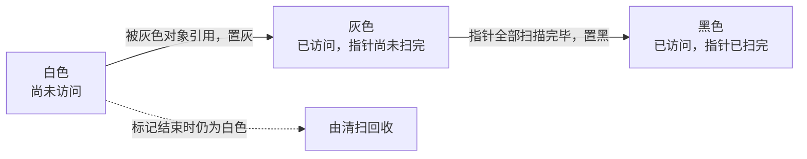
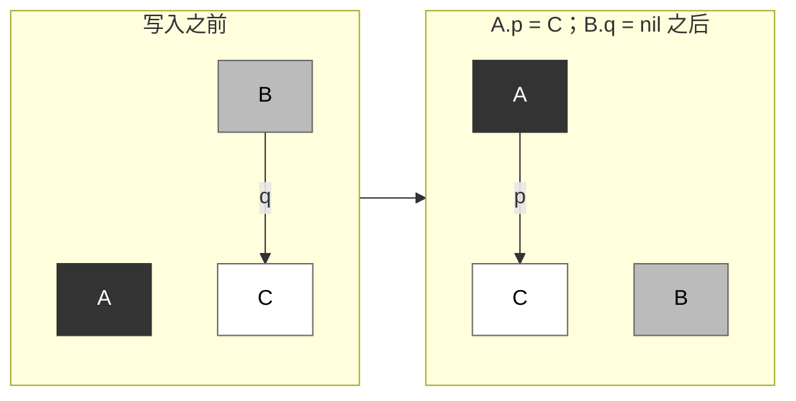
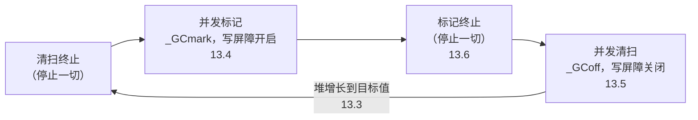

# 13.1 垃圾回收的基本想法

垃圾回收使程序不必显式释放内存，代价是运行时必须自行判断哪些内存还会被用到、哪些可以收回。本节建立全章的
基本概念：以可达性近似存活性，以标记清扫找出并收回垃圾，以三色抽象描述标记进行到一半时的状态，以三色不变式
刻画并发标记的正确性条件。最后说明 Go 的回收器在这些选择中的位置及其理由。

Dijkstra 等人把一个带有垃圾回收的程序分为两个角色 [[Dijkstra et al., 1978](#ref-dijkstra-1978)]。
**赋值器**（mutator）即用户程序；就回收而言，它所做的只是修改对象之间的引用，也就是在对象图上增删有向边。
**回收器**（collector）是运行时中负责找出并收回垃圾的部分。本章的主要困难都源自二者同时运行。

## 13.1.1 可达性与存活性

对象的**存活性**（liveness）是指程序今后是否还会访问它。这一性质依赖程序未来的执行路径，一般而言无法判定。
回收器因此采用一个保守的近似，即**可达性**（reachability）：从一组根（root）出发，
凡能沿指针到达的对象都视为存活，其余对象都是垃圾。从根无法到达的对象，程序不可能再访问到，
回收它们是安全的；反之，可达的对象未必还会被用到，例如一个不再被读取、却仍留在全局 map 中的条目。
回收器只收回不可达的对象；仍然可达却不再使用的对象，属于程序自身的内存泄漏。

Go 的根由运行时在每轮标记开始时列出。`mgc.go` 对根标记的描述是：扫描所有 goroutine 的栈，
将全局变量以及运行时堆外数据结构中的堆指针置灰 [[Go Authors, 2026a](#ref-go-authors-2026a)]。具体到
`markroot` 的任务划分，根包括数据段与 BSS 段中的全局变量、每个 goroutine 的栈、终结器与清理函数的队列，
以及挂在 span 上的终结器、弱指针与清理函数记录
（[13.10](./finalizer.md)）[[Go Authors, 2026b](#ref-go-authors-2026b)]。寄存器不单独构成一类根：
goroutine 停在安全点时，仍然存活的指针值都已保存在栈上，随栈一并扫描（[13.7](./safe.md)）。

可达性的一个直接推论是，环状结构不妨碍回收。下面的程序构造两个环，每个环由两个互相引用的节点组成，
其中一个挂在全局变量上，另一个与根之间没有任何路径。程序用 `weak.Pointer` 观察节点是否已被回收：
弱指针不使对象保持存活，对象被回收后，`Value` 返回 nil。`root = a` 使第一个环可经全局变量到达，
第二个环则在 `cycle` 返回后不再有任何强引用指向它：

```go {run=true}
package main

import (
	"fmt"
	"runtime"
	"weak"
)

type node struct {
	next *node
	data [64]byte
}

var root *node // 全局变量是根的一部分

// cycle 构造两个互相引用的节点，返回指向它们的弱指针。
// keep 为真时，把环挂到全局变量 root 上。
func cycle(keep bool) (weak.Pointer[node], weak.Pointer[node]) {
	a, b := new(node), new(node)
	a.next, b.next = b, a
	if keep {
		root = a
	}
	return weak.Make(a), weak.Make(b)
}

func main() {
	la, lb := cycle(true)
	da, db := cycle(false)
	runtime.GC()
	fmt.Println("从根可达的环：", la.Value() != nil, lb.Value() != nil)
	fmt.Println("不可达的环：  ", da.Value() != nil, db.Value() != nil)
}
```

运行结果如下：

```
从根可达的环： true true
不可达的环：   false false
```

不可达的环中，每个节点都还被另一个节点引用着，但这无关紧要：回收器只关心能否从根到达。基于引用计数的回收
则恰恰在这里失效，13.1.2 将回到这一点。

判断可达性的前提是认得出指针。Go 的回收器是精确的（precise，亦称 type-accurate）：
借助编译器生成的类型信息与栈映射，运行时能够分辨一个字是指针还是整数，不会把一个恰好像地址的整数当作指针，
从而误留本该回收的内存。这种精确是逐步实现的。Go 1.1 的发布说明称回收器变得「更精确」；Go 1.3 起，
扫描栈时也做到了精确；Go 1.4 将运行时的大部分代码由 C 改写为 Go 之后，
回收器才「完全精确」[[Go Authors, 2013](#ref-go-authors-2013)]
[[Go Authors, 2014a](#ref-go-authors-2014a)] [[Go Authors, 2014b](#ref-go-authors-2014b)]。Go 1.14
引入异步抢占后，又留下一处例外：goroutine 可能停在任意指令处，此处没有栈映射，
运行时只能保守地扫描被中断函数的栈帧以及保存其寄存器的栈帧，把其中每个指向已分配对象的字都当作指针
[[Clements, 2019](#ref-clements-2019)]。保守扫描的细节见 [13.7](./safe.md)。

## 13.1.2 标记清扫

最早的垃圾回收出现在 McCarthy 1960 年描述 Lisp 实现的论文中 [[McCarthy, 1960](#ref-mccarthy-1960)]。
程序在自由存储表耗尽时启动一个「回收周期」（reclamation cycle）：先从基址寄存器出发，沿 car 与 cdr
链找出所有可访问的单元，将它们的符号位置为负；再扫过整个表结构存储区，
把符号位未被改变的单元放回自由存储表，并将可访问单元的符号位恢复为正。这就是**标记清扫**（mark-sweep）：
标记阶段从根出发遍历对象图，记录所有可达对象；清扫阶段遍历整个堆，回收未被记录的对象。以伪代码表示如下：

```go
// 标记：从根出发遍历对象图（伪代码）
func mark(roots []*object) {
	var work []*object // 已标记、尚未扫描的对象
	for _, r := range roots {
		shade(r, &work)
	}
	for len(work) > 0 {
		obj := work[len(work)-1]
		work = work[:len(work)-1]
		for _, child := range obj.pointers() {
			shade(child, &work)
		}
	}
}

func shade(obj *object, work *[]*object) {
	if obj != nil && !obj.marked {
		obj.marked = true
		*work = append(*work, obj)
	}
}

// 清扫：回收未标记的对象，并清除存活对象的标记，为下一轮做准备（伪代码）
func sweep(heap []*object) {
	for _, obj := range heap {
		if obj.marked {
			obj.marked = false
		} else {
			free(obj)
		}
	}
}
```

另外两类经典方法是复制式回收与引用计数。复制式回收（copying）把存活对象搬到一块新的空间，旧空间整体释放，
因此没有碎片，分配也只需移动一个指针；代价是必须移动对象并更新所有指向它们的指针，
经典的半空间（semispace）做法还要预留一半的堆。引用计数（reference counting）
为每个对象记录指向它的指针数，计数归零即刻回收，回收工作分散在程序运行之中；但每次指针写入都要更新计数，
开销落在赋值器最频繁执行的路径上，而且如上一个例子所示，环中的对象计数永不归零，需要另行处理。

Go 采用标记清扫，回收器既不移动对象，也不分代。`mgc.go` 开头的注释概括了这些选择：
回收器与赋值器线程并发运行，类型精确，允许多个回收线程并行；它是使用写屏障的并发标记清扫回收器，不分代，
不压缩；分配在按 P 划分、按尺寸隔离的分配空间中进行，以减少碎片，并在常见情形下免去加锁
[[Go Authors, 2026a](#ref-go-authors-2026a)]。

不移动对象的理由，Hudson 在 2018 年的 ISMM 主题演讲中做过说明 [[Hudson, 2018](#ref-hudson-2018)]。Go
是面向值的语言，结构体的字段直接内嵌，内部指针（指向对象中间的指针）很常见，
回收器必须能由内部指针高效地找到对象的起始地址；按尺寸隔离的 span 恰好满足这一点，因为同一 span
中对象大小相同，将地址向下取整即得对象的起始。其次，团队此前在 TCMalloc、Hoard 以及 Intel
的可扩展分配器上的经验表明，非移动分配器的碎片问题并不严重。最后，Go 需要与 C 和 C++ 代码直接交互，
对象不移动，就不必为传给 C 的对象实现固定（pinning）或增加间接层。非移动带来的碎片由分配器的尺寸类来限制：
同一尺寸类的对象在同一 span 中等大排布，外部碎片转化为有上界的取整与尾部浪费，其分析见
[12.1.3](../ch12alloc/basic.md)。

## 13.1.3 三色抽象

标记若要与赋值器并发进行，就需要一种方式描述标记进行到一半时的状态。Dijkstra 等人为此提出了
**三色抽象**（tricolour abstraction）[[Dijkstra et al., 1978](#ref-dijkstra-1978)]，
从回收器的视角把对象分为三种颜色：

- 白色：回收器尚未访问到的对象。标记开始时所有对象都是白色，标记结束时仍为白色的对象不可达，即为垃圾；
- 灰色：已被访问到，但其中的指针尚未全部扫描，因而可能还指向白色对象；
- 黑色：已被访问到，且其中的指针已全部扫描。

标记从将根置灰开始，随后重复同一个动作：取出一个灰色对象，将它引用的白色对象置灰，再将它自身置黑，
直到不再有灰色对象。灰色对象构成黑色区域与白色区域之间的边界，标记的过程就是这条边界不断向前推进的过程；
边界消失时，所有可达对象都已成为黑色。



下面的交互图演示这一过程：根先被置灰，灰色边界不断将白色邻居置灰、自身转黑，直到灰色集合为空，随后清扫阶段
回收仍为白色的对象。读者可以单步执行，观察边界的推进。

<div class="viz" data-viz="gc-tricolor"></div>

颜色只是对标记进度的描述，对象本身并没有颜色字段。在 Go 中，颜色由标记位与工作队列共同决定，`mgcwork.go`
的注释写道 [[Go Authors, 2026b](#ref-go-authors-2026b)]：

```go
// For objects in workbufs, a grey object is one that is marked and
// on a work queue. A black object is marked and not on a work queue.
//
// For objects in the span queue, a grey object is one that is marked
// and has an unset scan bit. A black object is marked and has its scan
// bit set. (Green Tea GC only.)
```

白色对象即未标记的对象。第二段注释描述的 span 队列属于 Go 1.26 默认启用的 Green Tea 回收器，它以 span
而非单个对象为单位排队扫描，见 [13.11](./greentea.md)。

## 13.1.4 并发标记与三色不变式

如果标记期间暂停全部赋值器，回收对用户程序而言是一步原子操作，正确性无需论证，
但停顿时间随堆的大小线性增长。若要缩短停顿，就必须让标记与赋值器并发，这立即带来一个正确性问题。
设想标记进行到一半时，赋值器把一个白色对象 C 的指针写入黑色对象 A，随后又删除了灰色对象 B 指向 C 的指针：



黑色对象不会被再次扫描，B 也不再指向 C，于是 C 虽然仍可经 A 到达，却永远不会被置灰。标记结束时它仍为白色，
被当作垃圾回收，程序随后通过 A 访问到一块已被回收的内存。这种错误的发生需要两个条件同时成立：赋值器将指向
白色对象的指针写入黑色对象；并且从任何灰色对象出发、经由白色对象到达该对象的路径都已被破坏。只要破坏其中
任意一个条件，就不会遗漏可达对象。

与这两个条件相对应，有两种**三色不变式**（tricolour invariant）。强三色不变式要求黑色对象不得包含指向白色
对象的指针，从而排除第一个条件。弱三色不变式允许黑色对象指向白色对象，但要求该白色对象受到灰色对象的保护，
即能从某个灰色对象出发、经由一串白色对象到达，从而排除第二个条件 [[Pirinen, 1998](#ref-pirinen-1998)]
[[Clements and Hudson, 2016](#ref-clements-hudson-2016)]。维持不变式的手段是写屏障（write barrier）：
编译器在指针写入处插入一小段代码，在写入发生时做必要的着色。不同的写屏障维持不同的不变式，Go 1.8
起使用的混合写屏障维持的是弱不变式，详见 [13.2](./barrier.md)。

写屏障只在需要时开启。运行时设置回收阶段的函数同时决定写屏障的开关
[[Go Authors, 2026a](#ref-go-authors-2026a)]：

```go
func setGCPhase(x uint32) {
	atomic.Store(&gcphase, x)
	writeBarrier.enabled = gcphase == _GCmark || gcphase == _GCmarktermination
}
```

只有在标记与标记终止两个阶段中，写屏障才处于开启状态；其余时间，指针写入只需检查一次全局标志，开销很小。

## 13.1.5 一轮回收的过程

`mgc.go` 开头的注释把一轮回收分为四个阶段 [[Go Authors, 2026a](#ref-go-authors-2026a)]，下图概括了这一过程
及其在本章中对应的小节：



一轮回收开始时，运行时先暂停所有 goroutine，这一操作称为**停止一切**（stop the world，STW）。
在这段短暂的暂停中，运行时完成上一轮遗留的清扫，开启写屏障，并将根标记任务放入队列。随后赋值器恢复运行，
标记由后台的标记工作者与分配时的标记辅助共同完成，新分配的对象直接标为黑色。灰色对象耗尽后，
第二次停止一切进入标记终止，完成收尾工作后关闭写屏障，进入清扫阶段。清扫与赋值器并发进行，既由后台的清扫
goroutine 完成，也由分配内存的 goroutine 在需要时完成。堆再次增长到调步器设定的目标值时，下一轮回收开始；
调步器的设计始于 Go 1.5 [[Clements, 2015](#ref-clements-2015)]，见 [13.3](./pacing.md)。

这些阶段可以直接观察到。设置 `GODEBUG=gctrace=1` 后，每轮回收结束时运行时向标准错误输出一行摘要，运行时的
文档说明这一格式可能变化 [[Go Authors, 2026c](#ref-go-authors-2026c)]。下面的程序分配 50000 个约 1 KiB 的
对象，只保留其中十分之一：

```go {run=true env="GODEBUG=gctrace=1"}
package main

import "fmt"

type item struct {
	next *item
	buf  [1 << 10]byte
}

func main() {
	var keep *item
	for i := 0; i < 50000; i++ {
		it := &item{}
		if i%10 == 0 { // 保留十分之一，其余成为垃圾
			it.next = keep
			keep = it
		}
	}
	n := 0
	for p := keep; p != nil; p = p.next {
		n++
	}
	fmt.Println("存活对象：", n)
}
```

在 Apple M5 Pro 上运行，截取第 7 至 9 轮回收摘要中的前一部分：

```shell
$ GODEBUG=gctrace=1 ./gcdemo 2>&1 | sed -n 7,9p | cut -d, -f1
gc 7 @0.004s 5%: 0.032+0.23+0.005 ms clock
gc 8 @0.004s 5%: 0.038+0.26+0.018 ms clock
gc 9 @0.005s 5%: 0.051+0.48+0.007 ms clock
```

`gc 7` 是回收的序号，`@0.004s` 是程序启动后经过的时间，`5%` 是启动以来回收所占的时间比例。
以加号连接的三个数依次是清扫终止、并发标记与标记终止所经过的墙钟时间。
两次停止一切各在数微秒至数十微秒之间，耗时约为其十倍的标记则与程序并发进行。
摘要中其余的字段记录堆的大小与目标值，留待 [13.3](./pacing.md) 解释。

## 13.1.6 Go 的取舍与定位

Go 的回收器直接继承了上述理论脉络。`mgc.go` 的注释把它的思想渊源追溯到 Dijkstra 等人的 on-the-fly 算法，
并指出这些步骤完备、正确、可终止的证明见 Hudson 与 Moss 2003 年的论文
[[Hudson and Moss, 2003](#ref-hudson-moss-2003)]；对于垃圾回收的一般知识，它推荐以 Jones
等人的《垃圾回收手册》为起点 [[Jones et al., 2023](#ref-jones-2023)]。Go 1.5 首次实现并发标记，Go 1.8
以混合写屏障消除了标记终止时重新扫描栈的需要，演进的完整过程见 [13.12](./history.md)。

这些选择背后的目标函数是延迟。Hudson 在 Go 1.5 发布时写道，Go 的回收器是三色并发标记清扫回收器，这是有意
偏离当今大多数「企业级」回收器的选择；它被设计为优先保证低延迟，只提供 `GOGC` 一个调节参数，而 Go 1.5 的
回收停顿已远低于一年前设定的 10 毫秒目标 [[Hudson, 2015](#ref-hudson-2015)]。Hudson 在 2018 年的演讲中
解释了延迟为何如此重要：一次会话若包含 100 个请求，即便 99% 的回收停顿都低于 10 毫秒，整个会话都不受
更长停顿影响的用户也只有约 37%，因此真正需要约束的是 99.99% 分位的延迟。同一演讲给出了 2018 年的新目标：
每轮回收的停顿不超过 500 微秒 [[Hudson, 2018](#ref-hudson-2018)]。

主流的 Java 虚拟机大多采用移动式、分代的回收器，依靠移动对象消除碎片，依靠分代假设把精力集中在新生对象上。
Go 不分代的理由同样来自它的语言特性。按 Hudson 的说法，并不是分代假设在 Go 中不成立，
而是新生对象往往生于栈上、死于栈上：逃逸分析（[15.5](../../part5toolchain/ch15compile/escape.md)）
将大量短命对象分配在栈上，它们随函数返回而释放，根本不进入堆，分代回收能起的作用因此比其他托管语言小得多
[[Hudson, 2018](#ref-hudson-2018)]。Go 团队曾尝试过面向请求的回收器与非移动的分代回收器，
两者都因写屏障常开的开销而被放弃，见 [13.8](./generational.md) 与 [13.9](./roc.md)。

## 13.1.7 小结

回收器以可达性近似存活性，从根出发找出所有可达对象，其余皆为垃圾。标记清扫分两步完成这一工作，Go
在此基础上选择不移动、不分代，以尺寸类限制碎片，以逃逸分析承担新生对象。三色抽象描述了并发标记的中间状态，
三色不变式给出了赋值器与回收器并发时不遗漏可达对象的条件，写屏障负责在赋值器修改指针时维持这一条件。
本章随后各节依次讨论写屏障（[13.2](./barrier.md)）、回收的触发与调步（[13.3](./pacing.md)）、
标记（[13.4](./mark.md)）、清扫（[13.5](./sweep.md)）与标记终止（[13.6](./termination.md)）。

## 延伸阅读

- <a id="ref-clements-2015"></a>[Clements, 2015] Austin Clements. *Go 1.5 concurrent garbage collector
  pacing.* Go design document, 2015. https://go.dev/s/go15gcpacing
- <a id="ref-clements-2019"></a>[Clements, 2019] Austin Clements. runtime: scan stacks conservatively at
  async safe points. Go commit d16ec13756, 2019. https://go.dev/cl/201761
  随 Go 1.14 发布。
- <a id="ref-clements-hudson-2016"></a>[Clements and Hudson, 2016] Austin Clements, Rick Hudson.
  *Proposal: Eliminate STW stack re-scanning.* Go design document, 2016.
  https://go.dev/design/17503-eliminate-rescan
  混合写屏障的设计文档，其中给出了强、弱三色不变式的表述。
- <a id="ref-dijkstra-1978"></a>[Dijkstra et al., 1978] Edsger W. Dijkstra, Leslie Lamport, A. J. Martin,
  C. S. Scholten, E. F. M. Steffens. "On-the-Fly Garbage Collection: An Exercise in Cooperation."
  *Communications of the ACM*, 21(11), 1978, 966-975. https://doi.org/10.1145/359642.359655
  三色标记与并发 GC 的奠基。
- <a id="ref-go-authors-2013"></a>[Go Authors, 2013] The Go Authors. *Go 1.1 Release Notes.* 2013.
  https://go.dev/doc/go1.1
- <a id="ref-go-authors-2014a"></a>[Go Authors, 2014a] The Go Authors. *Go 1.3 Release Notes.* 2014.
  https://go.dev/doc/go1.3
- <a id="ref-go-authors-2014b"></a>[Go Authors, 2014b] The Go Authors. *Go 1.4 Release Notes.* 2014.
  https://go.dev/doc/go1.4
- <a id="ref-go-authors-2026a"></a>[Go Authors, 2026a] The Go Authors. src/runtime/mgc.go（GC
  总览注释，含相位与思想血统）. Go 1.26 源码.
  https://github.com/golang/go/blob/release-branch.go1.26/src/runtime/mgc.go
- <a id="ref-go-authors-2026b"></a>[Go Authors, 2026b] The Go Authors.
  src/runtime/mgcmark.go（`markroot`、`scanframeworker`）、 src/runtime/mgcwork.go. Go 1.26 源码.
  https://github.com/golang/go/tree/release-branch.go1.26/src/runtime
- <a id="ref-go-authors-2026c"></a>[Go Authors, 2026c] The Go Authors.
  src/runtime/extern.go（`GODEBUG=gctrace=1` 的输出格式）. Go 1.26 源码.
  https://github.com/golang/go/blob/release-branch.go1.26/src/runtime/extern.go
- <a id="ref-hudson-2015"></a>[Hudson, 2015] Richard Hudson. "Go GC: Prioritizing low latency and
  simplicity." *The Go Blog*, 2015. https://go.dev/blog/go15gc
  Go 选择低延迟并发回收的设计取向。
- <a id="ref-hudson-2018"></a>[Hudson, 2018] Rick Hudson. "Getting to Go: The Journey of Go's Garbage
  Collector." *The Go Blog*, 2018. https://go.dev/blog/ismmkeynote
  ISMM 2018 主题演讲的讲稿，回顾了 Go 回收器的设计选择与失败的尝试。
- <a id="ref-hudson-moss-2003"></a>[Hudson and Moss, 2003] Richard L. Hudson, J. Eliot B. Moss. "Sapphire:
  Copying Garbage Collection without Stopping the World." *Concurrency and Computation: Practice and
  Experience*, 15(3-5), 2003, 223-261. https://doi.org/10.1002/cpe.712
  并发回收器完备、正确、可终止的证明。
- <a id="ref-jones-2023"></a>[Jones et al., 2023] Richard Jones, Antony Hosking, Eliot Moss. *The Garbage
  Collection Handbook: The Art of Automatic Memory Management.* 2nd ed., CRC Press, 2023.
- <a id="ref-mccarthy-1960"></a>[McCarthy, 1960] John McCarthy. "Recursive Functions of Symbolic
  Expressions and Their Computation by Machine, Part I." *Communications of the ACM*, 3(4), 1960, 184-195.
  https://doi.org/10.1145/367177.367199
  标记清扫的源头。
- <a id="ref-pirinen-1998"></a>[Pirinen, 1998] Pekka P. Pirinen. "Barrier Techniques for Incremental
  Tracing." *Proceedings of the International Symposium on Memory Management (ISMM)*, 1998, 20-25.
  https://doi.org/10.1145/286860.286863
- 本书 [12.1 设计原则](../ch12alloc/basic.md)、[12.2 组件](../ch12alloc/component.md)、
  [13.2 写屏障技术](./barrier.md)。
