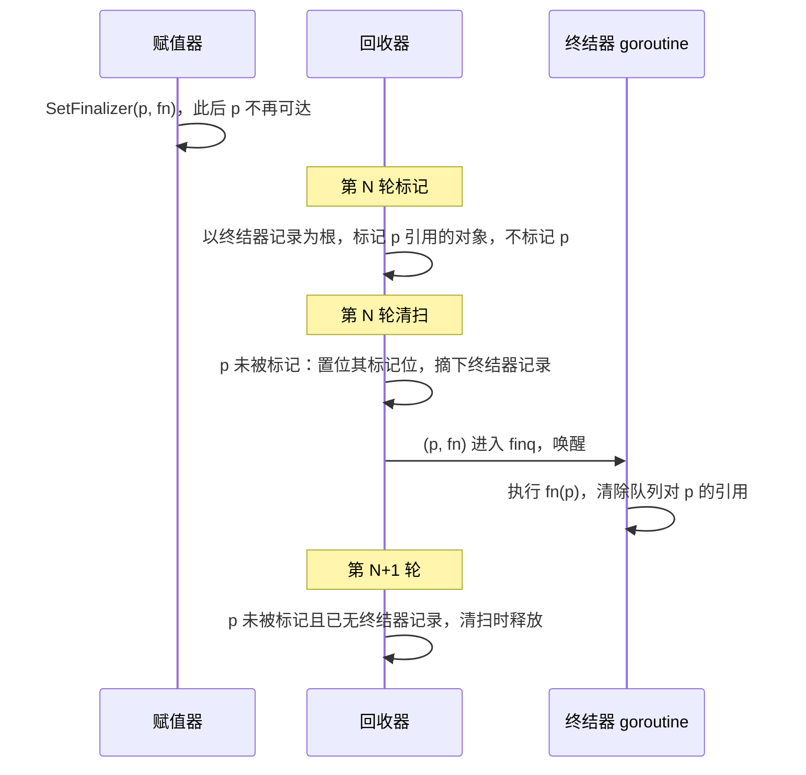

# 13.10 终结器

垃圾回收为程序提供了一种内存无限的假象：内存只需分配，无须显式释放；对象一旦不可达，
就可以在之后的任意时刻被回收，而对象的消亡在语言层面是不可观察的。Go 的 GC 指南指出，
运行时库中有三项功能打破了这一假象，即清理函数、弱指针与终结器。它们都让程序得以观察并响应对象的消亡，
终结器甚至可以逆转它 [[Go Authors, 2022a](#ref-go-authors-2022a)]。

终结器是三者中最早的一个。2010 年 2 月，Cox 将它加入运行时，同一提交中的文档已经写下了它此后十余年的基本语
义 [[Cox, 2010a](#ref-cox-2010a)]。按照 GC 指南的回顾，终结器最初是为了简化 Go 与 C 之间的接口、
清理非内存资源而加入的：把它挂在拥有 C 内存或其他资源的包装对象上，包装对象不再被使用时，资源随之释放。
这一用途决定了它的诸多限制，例如一个对象只能有一个终结器，且终结器只能挂在对象的首字节上
[[Go Authors, 2022a](#ref-go-authors-2022a)]。Go 1.24 加入的清理函数承接了这一用途，
并修正了终结器设计中的根本问题；与之一同加入的弱指针则提供了另一种观察对象消亡的方式。

本节先说明终结器如何嵌入标记与清扫，再由这一机制推出它的种种约束，然后介绍清理函数与弱指针，
最后讨论这类机制在设计上的定位，以及它们在其他语言中的对应。

## 13.10.1 终结器的机制

`runtime.SetFinalizer(obj, finalizer)` 为一个对象登记终结器。`obj` 必须是指针，指向由 `new`、
复合字面量取址或局部变量取址得到的对象；`finalizer` 必须是只接收一个参数的函数，`obj`
的类型可以赋值给这个参数，返回值被忽略。条件不满足时，`SetFinalizer` 可能终止程序
[[Go Authors, 2026a](#ref-go-authors-2026a)]。`SetFinalizer(obj, nil)` 撤销登记；
对已有终结器的对象再次登记，则以致命错误 `finalizer already set` 终止程序
[[Go Authors, 2026c](#ref-go-authors-2026c)]。

登记关系不存放在对象内部，而是作为一条**特殊记录**（special）挂在对象所在 span 的链表上。
特殊记录是堆外分配、手工管理的链表节点，链表按对象在 span 中的偏移排序；Go 1.26 中共有十种特殊记录，
终结器、清理函数、弱指针句柄与内存剖析记录都在其列 [[Go Authors, 2026f](#ref-go-authors-2026f)]。它们由
`fixalloc` 分配，不在垃圾回收的堆上（[12.2.5](../ch12alloc/component.md)），`heapArena` 中的
`pageSpecials` 位图则标出哪些 span 带有特殊记录（[12.2.4](../ch12alloc/component.md)）。这一结构始于 Go
1.3：此前终结器保存在一张全局的哈希表中，Randall 把它改为挂在 span 上的特殊记录，并用同一机制记录剖析信息
[[Randall, 2014](#ref-randall-2014)]。

回收器对终结器记录的处理分为两步，分别发生在标记与清扫中。

标记阶段，`markrootSpans` 借助 `pageSpecials` 找出带有特殊记录的 span，逐条处理其中的记录。
对终结器记录，它调用下面的函数（`mgcmark.go`）[[Go Authors, 2026f](#ref-go-authors-2026f)]：

```go
func gcScanFinalizer(spf *specialfinalizer, s *mspan, gcw *gcWork) {
	// Don't mark finalized object, but scan it so we retain everything it points to.

	// A finalizer can be set for an inner byte of an object, find object beginning.
	p := s.base() + spf.special.offset/s.elemsize*s.elemsize

	// Mark everything that can be reached from
	// the object (but *not* the object itself or
	// we'll never collect it).
	if !s.spanclass.noscan() {
		scanObject(p, gcw)
	}

	// The special itself is also a root.
	scanblock(uintptr(unsafe.Pointer(&spf.fn)), goarch.PtrSize, &oneptrmask[0], gcw, nil)
}
```

对象本身不被标记，但从它出发能到达的一切都被标记，终结函数也被当作根。
前者保证终结器运行时能访问到的对象都还在，后者保证终结函数（它可能是堆上的闭包）不被回收。`markrootSpans`
开头的注释把这两点称为带终结器对象的两条不变式。这一做法可以追溯到终结器出现后不到两个月：
最初的实现需要两遍标记与清扫，Cox 随后改为在标记时专门扫描终结器表，省去了第二遍，新函数 `markfin`
的注释写道「不标记带终结器的块本身，只标记它指向的东西」[[Cox, 2010b](#ref-cox-2010b)]。
这一步原先在停止一切的标记终止阶段执行，即使程序中没有任何终结器，遍历所有 span 也要耗费约每 GB 堆、
每个核 1 毫秒；Go 1.6 起，它被移到并发标记阶段 [[Clements, 2015](#ref-clements-2015)]。

标记结束时，带终结器而未被标记的对象，就是终结器可以运行的对象。清扫器处理一个 span 时，先遍历其特殊记录
（`mgcsweep.go`，有删节）[[Go Authors, 2026f](#ref-go-authors-2026f)]：

```go
		if !mbits.isMarked() {
			// This object is not marked and has at least one special record.
			// Pass 1: see if it has a finalizer.
			hasFinAndRevived := false
			endOffset := p - s.base() + size
			for tmp := siter.s; tmp != nil && tmp.offset < endOffset; tmp = tmp.next {
				if tmp.kind == _KindSpecialFinalizer {
					// Stop freeing of object if it has a finalizer.
					mbits.setMarkedNonAtomic()
					hasFinAndRevived = true
					break
				}
			}
			if hasFinAndRevived {
				// Pass 2: queue all finalizers and clear any weak handles. Weak handles are cleared
				// before finalization as specified by the weak package. See the documentation
				// for that package for more details.
				for siter.valid() && siter.s.offset < endOffset {
					// ……
					if special.kind == _KindSpecialFinalizer || special.kind == _KindSpecialWeakHandle {
						siter.unlinkAndNext()
						freeSpecial(special, unsafe.Pointer(p), size)
					} else {
						// All other specials only apply when an object is freed,
						// so just keep the special record.
						siter.next()
					}
				}
			} else {
				// Pass 2: the object is truly dead, free (and handle) all specials.
				// ……
			}
		}
```

置位标记位使清扫把这个对象当作存活对象保留下来，这就是**复活**（resurrection）。终结器记录随即被摘下，`freeSpecial`
对它调用 `queuefinalizer`，把对象与终结函数放入队列 `finq`；
同一对象上的弱指针句柄则被清零（13.10.4）。`queuefinalizer` 若在标记期间被调用，会直接抛出致命错误：
运行时假定终结器队列在标记期间不会增长，从而无须在标记终止时重新扫描它
[[Go Authors, 2026c](#ref-go-authors-2026c)]。队列由 `persistentalloc` 在堆外分配的块组成，
块中的函数与对象指针在每轮标记中作为根扫描，因此排队的对象在终结器运行之前不会被回收。

执行终结器的是一个专门的 goroutine。`SetFinalizer` 第一次被调用时，经由 `createfing` 启动它；
此后它在队列为空时暂止，由清扫放入新任务后唤醒。其主循环如下（`mfinal.go`，
有删节）[[Go Authors, 2026c](#ref-go-authors-2026c)]：

```go
func runFinalizers() {
	// ……
	for {
		lock(&finlock)
		fb := finq
		finq = nil
		if fb == nil {
			gopark(finalizercommit, unsafe.Pointer(&finlock), waitReasonFinalizerWait, traceBlockSystemGoroutine, 1)
			continue
		}
		argRegs = intArgRegs
		unlock(&finlock)
		// ……
		for fb != nil {
			n := fb.cnt
			for i := n; i > 0; i-- {
				f := &fb.fin[i-1]
				// ……
				fingStatus.Or(fingRunningFinalizer)
				reflectcall(nil, unsafe.Pointer(f.fn), frame, uint32(framesz), uint32(framesz), uint32(framesz), &regs)
				fingStatus.And(^fingRunningFinalizer)

				// Drop finalizer queue heap references
				// before hiding them from markroot.
				// This also ensures these will be
				// clear if we reuse the finalizer.
				f.fn = nil
				f.arg = nil
				f.ot = nil
				atomic.Store(&fb.cnt, i-1)
			}
			// ……
		}
	}
}
```

`gopark` 的提交函数 `finalizercommit` 在 goroutine 进入等待状态之后，才释放 `finlock` 并设置等待标志，
注释说明这是为了避免唤醒一个仍在运行、即将暂止的 goroutine。终结函数的参数既可以是指针，也可以是接口，
因此这里按登记时记下的参数类型准备参数帧，再经 `reflectcall` 调用。调用返回后，队列项中的指针随即清除，
对象不再被队列引用。所有终结器都由这一个 goroutine 依次执行，一个长时间运行的终结器会推迟其后的所有终结
器，文档因此建议在终结器中另起 goroutine 处理耗时的工作 [[Go Authors, 2026a](#ref-go-authors-2026a)]。
最初的实现为每个终结器新建一个 goroutine，前述不到两个月后的修改同时把它们改为由单个 goroutine 运行
[[Cox, 2010a](#ref-cox-2010a)] [[Cox, 2010b](#ref-cox-2010b)]。

终结器在另一个 goroutine 中运行，因而与程序的其余部分构成并发。Vyukov 在 2014 年的 issue #9442 中指出，
二者之间的同步关系没有定义，并提议写明 `SetFinalizer` 先行发生于终结器开始执行
[[Vyukov, 2014](#ref-vyukov-2014)]。2022 年修订的 Go 内存模型采纳了这一条：对 `SetFinalizer(x, f)`
的调用同步先于终结调用 `f(x)`（[11.9](../../part3concurrency/ch11sync/mem.md)）[[Go
Authors, 2022b](#ref-go-authors-2022b)]。`SetFinalizer`
的文档同时提醒，`KeepAlive(x)` 或对 `x` 的其他使用并不保证同步先于 `f(x)`，终结器若要访问
`x` 中可变的状态，仍需使用互斥锁或原子操作 [[Go Authors, 2026a](#ref-go-authors-2026a)]。

把上述两步连起来，一个带终结器的对象从不可达到被释放，至少跨越两轮回收：



## 13.10.2 由机制推出的约束

终结器的文档列出了一长串注意事项。它们大多不是独立的规定，而是上述两步机制的直接推论。
下面的程序构造三组对象并反复触发回收，记录每轮回收之后运行了哪些终结器或清理函数：一条带终结器的链 a → b
→ c，一条结构相同但登记清理函数的链，以及两个互相引用、各带终结器的对象 x 与 y。

```go {run=true}
package main

import (
	"fmt"
	"runtime"
	"slices"
	"strings"
	"time"
)

type node struct {
	next *node
	name string
	data [64]byte
}

var events = make(chan string, 16)

// chain 构造 a -> b -> c 三个节点，为每个节点登记终结器或清理函数。
func chain(finalizer bool) {
	c := &node{name: "c"}
	b := &node{name: "b", next: c}
	a := &node{name: "a", next: b}
	for _, n := range []*node{a, b, c} {
		if finalizer {
			runtime.SetFinalizer(n, func(n *node) { events <- n.name })
		} else {
			runtime.AddCleanup(n, func(name string) { events <- name }, n.name)
		}
	}
}

// cycle 构造互相引用的 x 与 y，并为二者登记终结器。
func cycle() {
	x, y := &node{name: "x"}, &node{name: "y"}
	x.next, y.next = y, x
	runtime.SetFinalizer(x, func(n *node) { events <- n.name })
	runtime.SetFinalizer(y, func(n *node) { events <- n.name })
}

// rounds 触发 n 轮回收，报告每轮之后运行了哪些终结器或清理函数。
func rounds(n int) {
	for i := 1; i <= n; i++ {
		runtime.GC()
		time.Sleep(20 * time.Millisecond) // 留出运行终结器与清理函数的时间
		var ran []string
		for len(events) > 0 {
			ran = append(ran, <-events)
		}
		slices.Sort(ran)
		if len(ran) == 0 {
			ran = []string{"无"}
		}
		fmt.Printf("  第 %d 轮：%s\n", i, strings.Join(ran, " "))
	}
}

func main() {
	fmt.Println("终结器链：")
	chain(true)
	rounds(3)
	fmt.Println("清理函数链：")
	chain(false)
	rounds(1)
	fmt.Println("带终结器的环：")
	cycle()
	rounds(2)
}
```

运行结果如下：

```
终结器链：
  第 1 轮：a
  第 2 轮：b
  第 3 轮：c
清理函数链：
  第 1 轮：a b c
带终结器的环：
  第 1 轮：无
  第 2 轮：无
```

第一组结果说明终结器按依赖顺序运行。第 1 轮标记时，a 的终结器记录作为根，标记了 a 引用的 b，进而标记了 c；b
与 c 虽然也带终结器，但已被标记，于是清扫只复活 a 并将其终结器排队。a 的终结器运行之后，
再没有任何对象引用 b，第 2 轮中 b 成为唯一未被标记的带终结器对象，第 3 轮轮到 c。文档对此的表述是：
若 A 指向 B，两者都有终结器且别处不可达，则只有 A 的终结器运行，A 被释放之后，B 的终结器才能运行
[[Go Authors, 2026a](#ref-go-authors-2026a)]。代价是一条长度为 $n$ 的链至少需要 $n$ 轮回收才能清理完毕，GC
指南因此建议让带终结器的结构保持浅层 [[Go Authors, 2022a](#ref-go-authors-2022a)]。

第三组结果说明环为何无法回收。x 的终结器记录标记了 x 引用的 y，y 的终结器记录又标记了 x，
二者在每一轮都被标记，既不会被复活，也不会被释放，终结器永远不会运行。文档的表述是：
若环状结构中包含带终结器的块，这个环不保证被回收，终结器也不保证运行，因为不存在满足依赖关系的顺序
[[Go Authors, 2026a](#ref-go-authors-2026a)]。指向自身的指针同样构成环，
因此带终结器的对象不能以任何路径到达它自己 [[Go Authors, 2022a](#ref-go-authors-2022a)]。
运行时自身也受过这一限制的影响：早期的 channel 实现中含有指向自身内存块的指针，而当时一些系统上的 channel
依靠终结器释放操作系统层面的锁，这样的 channel 因而无法被回收
（[10.2](../../part3concurrency/ch10chan/impl.md)）。第二组结果属于清理函数，留待 13.10.3 解释。

复活还使内存的释放至少推迟一轮。对象在第 $N$ 轮被复活，终结器运行之后，要等到第 $N+1$ 轮再次判定它不可达，
清扫才能释放它，它所引用的全部对象也随之多存活一轮。终结函数还可以把收到的指针存入全局变量，或者经
channel 发送出去，使对象真正恢复可达。此时对象已没有终结器，再次不可达时将被直接释放，不会再触发任何清理。

终结器运行的时机同样无法预料。它取决于下一轮回收何时开始、清扫何时处理到对象所在的 span，
以及终结器 goroutine 何时得到调度。文档明确表示不保证终结器在程序退出前运行，因此依靠终结器刷新
`bufio.Writer` 的缓冲是错误的，缓冲在程序退出时不会被写出 [[Go Authors, 2026a](#ref-go-authors-2026a)]。`runtime.GC`
也只保证终结器已经排队，并不等待它们执行完毕 [[Go Authors, 2022a](#ref-go-authors-2022a)]，
上面的程序因此在每轮回收之后短暂休眠。此外，有三类对象的终结器不保证运行：大小为零的对象，
因为它可能与其他零大小的对象共享地址；包级变量初始化时创建的对象，因为它们可能由链接器分配而不在堆上；
以及与其他对象合并在同一分配槽位中的微对象，只要同一块中还有对象存活，它就不会被回收
（[12.6](../ch12alloc/tinyalloc.md)）。

更隐蔽的问题是终结器运行得过早。在一个函数中，对象在最后一次被提及之后就可能不可达，
即使此时仍处在一个使用其字段的调用之中。`SetFinalizer` 文档给出的例子是：`p` 指向一个包含文件描述符 `d`
的结构体，终结器负责关闭 `d`，函数对 `p` 的最后一次使用是 `syscall.Write(p.d, buf, size)`；那么程序一进入
`syscall.Write`，`p` 就可能不可达，终结器可能恰在此时关闭 `p.d`，使写入失败，甚至写入另一个 goroutine
新打开的、复用了同一编号的文件 [[Go Authors, 2026a](#ref-go-authors-2026a)]。Taylor 在 2015 年的 issue
#13347 中以 C 指针为例提出了同一问题：把 C 指针存放在 Go 结构体中，由结构体的终结器释放它，
那么在把这个指针传给 C 函数的时刻，结构体已经死亡，终结器可能在 C 代码执行之前就释放了指针
[[Taylor, 2015](#ref-taylor-2015)]。讨论的结果是 Go 1.7 加入的 `runtime.KeepAlive`
[[Taylor, 2016](#ref-taylor-2016)]，其文档中的例子如下 [[Go Authors, 2026c](#ref-go-authors-2026c)]：

```go
p := &File{d}
runtime.SetFinalizer(p, func(p *File) { syscall.Close(p.d) })
var buf [10]byte
n, err := syscall.Read(p.d, buf[:])
// Ensure p is not finalized until Read returns.
runtime.KeepAlive(p)
// No more uses of p after this point.
```

`KeepAlive` 本身不做任何事情。编译器把对它的调用识别为内建操作，令参数至少存活到调用点；
函数体中一条永不执行的 `println(x)`，则保证 `defer runtime.KeepAlive(x)` 这类未被内建展开的调用同样有效
[[Go Authors, 2026c](#ref-go-authors-2026c)] [[Go Authors, 2026f](#ref-go-authors-2026f)]。Boehm
在 2003 年比较析构函数与终结器的论文中已经指出，对象完全可能在它的某个方法仍在执行时被终结，
这应当由语言规范与客户代码共同解决 [[Boehm, 2003](#ref-boehm-2003)]。Java 9 加入的
`Reference.reachabilityFence` 与 `KeepAlive` 作用相同 [[Oracle, 2023](#ref-oracle-2023)]。

## 13.10.3 清理函数

13.10.2 中的约束大多源于同一个设计决定：终结函数以对象本身为参数。为了把对象交给它，
回收器必须保留对象及其引用的一切，复活、两轮的延迟与环的泄漏都由此而来。Knyszek 在 2024 年 5 月提出的
issue #67535 列出了 `SetFinalizer` 的四个问题：终结器必须挂在分配块的首字节上，
这要求程序员了解语言并未暴露的「分配」概念；一个对象只能有一个终结器；处在环中的对象不会被释放，
终结器也不会运行；对象至少需要两轮回收才能释放。后两条都归结为终结器允许对象复活
[[Knyszek, 2024a](#ref-knyszek-2024a)]。提议的替代品是 `runtime.AddCleanup`，它由 Amedee 实现，随 Go 1.24
发布 [[Amedee, 2024](#ref-amedee-2024)] [[Go Authors, 2025a](#ref-go-authors-2025a)]：

```go
func AddCleanup[T, S any](ptr *T, cleanup func(S), arg S) Cleanup
```

`ptr` 不可达之后的某个时刻，运行时在另一个 goroutine 中调用 `cleanup(arg)`。**清理函数**（cleanup）
收到的是 `arg`，而不是 `ptr`。典型的用法是：`ptr` 指向包装某种底层资源的对象，`arg` 是资源本身，
例如文件描述符，清理函数负责释放它 [[Go Authors, 2026b](#ref-go-authors-2026b)]。提议解释了参数类型为何是
`func(S)` 而非 `func()`：显式的参数降低了清理函数意外捕获 `ptr` 的风险，
也便于调用方避免为每次登记分配一个闭包 [[Knyszek, 2024a](#ref-knyszek-2024a)]。

机制上的差别体现在标记一侧。清理函数同样以特殊记录挂在 span 上，记录中保存清理函数与参数。标记时，`markrootSpans`
只把记录本身当作根 [[Go Authors, 2026f](#ref-go-authors-2026f)]：

```go
func gcScanCleanup(spc *specialCleanup, gcw *gcWork) {
	// The special itself is a root.
	scanblock(uintptr(unsafe.Pointer(&spc.cleanup)), unsafe.Sizeof(cleanupFn{}), &cleanupFnPtrMask[0], gcw, nil)
}
```

与 `gcScanFinalizer` 相比，这里少了对 `scanObject` 的调用，对象所引用的东西不再被特别保留。
清扫遇到未被标记、只带清理函数记录的对象时，直接释放它，同时把清理函数放入队列，`freeSpecial` 中的注释写道
[[Go Authors, 2026f](#ref-go-authors-2026f)]：

```go
	case _KindSpecialCleanup:
		sc := (*specialCleanup)(unsafe.Pointer(s))
		// Cleanups, unlike finalizers, do not resurrect the objects
		// they're attached to, so we only need to pass the cleanup
		// function, not the object.
		gcCleanups.enqueue(sc.cleanup)
		// ……
```

这解释了前面程序中的第二组结果：三个清理函数在第 1 轮回收之后全部运行，链上的对象在同一轮中被释放。Go
1.24 的发布说明概括了清理函数与 `SetFinalizer` 的区别：一个对象可以挂多个清理函数，
清理函数可以挂在内部指针上，对象成环时一般不会造成泄漏，清理函数也不推迟对象及其所引用对象的释放
[[Go Authors, 2025a](#ref-go-authors-2025a)]。

约束也随之翻转。终结器要求对象不能从它自身到达；清理函数则要求对象不能从清理函数或参数到达，
因为二者都是根，若从它们能到达 `ptr`，`ptr` 将永远可达，清理函数永不运行
[[Go Authors, 2026b](#ref-go-authors-2026b)]。最常见的误用是把 `ptr` 本身作为 `arg` 传入，`AddCleanup`
对此直接 panic。Go 1.26 又增加了两项检查：`arg` 指向 `ptr` 所在分配块的内部，
或者清理函数的闭包捕获了指向该分配块的指针，两种情形同样 panic [[Taylor, 2025](#ref-taylor-2025)]。
这些检查只能发现直接的引用；经由其他对象间接形成的路径，需要借助 Go 1.25 加入的
`GODEBUG=checkfinalizers=1`。它以特殊记录为唯一的根运行一次局部标记，若能从中找到回到对象本身的路径，
就报告可能的泄漏 [[Knyszek, 2025c](#ref-knyszek-2025c)] [[Go Authors, 2025b](#ref-go-authors-2025b)]。

`AddCleanup` 返回一个 `Cleanup` 值，资源经正常路径释放之后，可以调用其 `Stop` 方法撤销登记。
若对象同时带有终结器与清理函数，清理函数要等终结器运行完毕、对象再次不可达且不再带终结器时才运行
[[Go Authors, 2026b](#ref-go-authors-2026b)]。13.10.1 的清扫代码中对应的处理是：
复活对象时只摘下终结器与弱指针句柄的记录，其余记录原样保留，因为它们只在对象被释放时才起作用。

清理函数的执行方式经历过一次变化。Go 1.24 中，清理函数与终结器共用同一个队列和 goroutine，
尽管文档从一开始就允许清理函数彼此并发执行。Go 1.25 把两者分开：清扫器把清理函数放入每个 P 本地的块中，
块满后转入全局的无锁队列，清扫阶段的最后一个清扫器负责转入剩余的本地块
[[Knyszek, 2025a](#ref-knyszek-2025a)]；执行清理函数的 goroutine 按需创建，数量至多为
`max(GOMAXPROCS/4, 1)` [[Go Authors, 2026d](#ref-go-authors-2026d)]。发布说明称，这使清理函数更适合像
`unique` 包那样的大量使用 [[Go Authors, 2025b](#ref-go-authors-2025b)]。与此相应，
清理函数之间没有任何顺序保证，即使对象成环也是如此 [[Go Authors, 2026b](#ref-go-authors-2026b)]。GC
指南因此为终结器保留了一席之地：正因为终结器复活对象，它的执行顺序比清理函数更明确，
对于有复杂销毁顺序要求的结构，终结器仍可能有用，尽管这种情形很少；除此之外，Go 1.24
以后都建议使用清理函数 [[Go Authors, 2022a](#ref-go-authors-2022a)]。`SetFinalizer` 的文档也写道
[[Go Authors, 2026a](#ref-go-authors-2026a)]：

> 新的 Go 代码应当考虑改用 `AddCleanup`，它比 `SetFinalizer` 更不容易出错。

## 13.10.4 弱指针

与清理函数同时加入的 `weak` 包提供**弱指针**（weak pointer）。`weak.Make(ptr)` 返回一个
`weak.Pointer[T]`，它不使对象保持可达；对象不可达之后，其 `Value` 方法可能返回 nil
[[Knyszek, 2024b](#ref-knyszek-2024b)] [[Go Authors, 2026e](#ref-go-authors-2026e)]。13.1
用它观察对象是否已被回收（[13.1.1](./basic.md)），`unique` 包则用它实现可以回收的规范化表
（[5.2](../../part2lang/ch05data/string.md)）。

弱指针并不直接保存对象的地址，而是指向一个堆上分配的句柄，句柄中存放对象的地址；
对象一侧挂一条弱指针句柄的特殊记录，记录引用这个句柄。指向同一对象同一偏移的所有弱指针共用一个句柄，
因此两个弱指针相等，当且仅当创建它们的指针相等，这一性质在对象被回收之后依然成立
[[Go Authors, 2026e](#ref-go-authors-2026e)]。标记时，`markrootSpans` 只扫描记录中的句柄字段，使句柄存活，
而不扫描句柄所指的对象；清扫判定对象死亡时，`freeSpecial` 把句柄清零，此后所有的 `Value` 调用都返回 nil。
句柄被填充到 16 字节，以免它与其他微对象合并在同一个块中而一同滞留
[[Go Authors, 2026f](#ref-go-authors-2026f)]。

`Value` 把弱指针转换为普通指针，这在并发标记期间需要特别处理。转换可能产生一个指向尚未标记对象的新引用，
若这个指针只存放在一个已经扫描过的栈上，回收器将看不到它。`Value` 因此在标记期间对结果调用 `shade`，
源码注释说明，这维持的是与写屏障中 Yuasa 部分相同的不变式（[13.2](./barrier.md)）。在标记终止阶段，
运行时设置 `work.strongFromWeak.block`，暂时阻塞新的转换，以免它们继续产生标记工作
（[13.6](./termination.md)）[[Go Authors, 2026f](#ref-go-authors-2026f)]。

弱指针与终结器的交互由清扫中的次序决定。13.10.1 的清扫代码在排队终结器的同时清零弱指针句柄，
因此终结器一旦排队，指向该对象的弱指针就开始返回 nil；若终结器使对象复活，
此后为它创建的弱指针得到新的句柄，与原有的弱指针不再相等 [[Go Authors, 2026e](#ref-go-authors-2026e)]。
持有弱指针的一方由此无法在终结器运行期间重新取得对象。

弱指针也有其局限。用作 map 的键时，弱指针不影响对应值的可达性；若值引用了键所指的对象，
这个对象将一直存活。Knyszek 指出，解决这一问题的概念是 ephemeron，它是一个可能的未来方向
[[Knyszek, 2025b](#ref-knyszek-2025b)]。

## 13.10.5 定位与谱系

终结器与析构函数常被相提并论，但二者性质不同。Boehm 在 2003 年的论文中比较了这两种机制：C++
的析构函数在对象离开作用域时同步调用，适合生命周期明确的对象；Java、Modula-3 与 C#
中的终结方法则在回收器发现对象不可达之后，于单独的线程中、在远不如前者明确的时刻运行。
论文认为二者是根本不同、可以互补的语言设施，终结器的异步性并非实现上的偶然或追踪式回收器的缺陷，
而是客户代码正确性的必要条件 [[Boehm, 2003](#ref-boehm-2003)]。Boehm
在会上报告所用的幻灯片将这一结论概括为「垃圾回收器应当在单独的线程中运行终结器」。Go 由专门的 goroutine
运行终结器，与这一结论一致。

Java 的经历与 Go 平行。终结机制自 Java 1.0 起就已存在，随 JDK 18 发布的 JEP 421 将其标记为弃用并计划移除，
列出的根本缺陷包括：从对象不可达到终结方法被调用之间的延迟不可预测；终结代码不受约束，
可以保存对象的引用使其复活；终结机制无法按需启用，也无法撤销；终结方法在未指定的线程上以任意顺序运行。JEP
421 建议的替代品之一是 Java 9 引入的 `Cleaner`：清理动作不能访问对象本身，因此不可能复活对象，
程序也可以撤销登记 [[Christian and Marks, 2021](#ref-christian-2021)] [[Oracle, 2023](#ref-oracle-2023)]。
从 `SetFinalizer` 到 `AddCleanup`，Go 走过了几乎相同的路。JEP 421 对 `Cleaner` 的评价也适用于
`AddCleanup`：清理动作仍由回收器调度，可能遭受无上界的延迟，不应用于需要及时释放资源的场合。

Go 的做法因此是把确定性的释放与安全网分开。GC 指南建议尽可能以确定的方式释放非内存资源，
把终结器与清理函数作为后备：文件描述符这类资源受系统上限约束，而运行时并不知道这些上限；回收的频率由
`GOGC` 控制，包的作者通常无从掌握，它可能被运维人员设成各种不同的值。
这两点使终结器与清理函数不适合充当释放非内存资源的唯一机制。包装非内存资源的包应当提供显式的释放方法，
例如 `Close`，再以清理函数或终结器尽力处理调用方的疏漏，或者向调用方报告资源未被正确释放。相反，C 的
`malloc` 分配的内存或 `mmap` 映射这类内存资源，则很适合由清理函数或终结器释放
[[Go Authors, 2022a](#ref-go-authors-2022a)]。对调用方而言，确定性的释放由显式的 `Close` 与 `defer`
完成（[6.2](../../part2lang/ch06func/defer.md)）。标准库本身也在迁移之中：Go 1.26 中，`os.File` 仍以
`SetFinalizer` 在调用方忘记 `Close` 时关闭文件描述符，`net` 包中同样的代码旁注明「TODO Replace with
runtime.AddCleanup」，`os.Process` 则已改用 `AddCleanup` [[Go Authors, 2026f](#ref-go-authors-2026f)]。

## 13.10.6 小结

终结器的全部行为都可以从两步机制推出：标记时，终结器记录作为根，标记对象引用的一切而不标记对象本身；
清扫时，未被标记的带终结器对象被复活，终结函数排队，由一个专门的 goroutine 依次执行。依赖顺序、环的泄漏、
至少两轮的回收延迟以及复活，都是这一设计的直接结果。Go 1.24 的清理函数收到的不是对象本身，
标记时也只把清理函数与参数当作根，从而避免了复活，代价是约束翻转为对象不能从清理函数或参数到达，
且清理函数之间没有顺序；弱指针则借助一层句柄，让程序在不延长对象生命的前提下观察它的消亡。
三者都不保证运行，也都只能作为确定性释放之外的安全网。

## 延伸阅读

- <a id="ref-amedee-2024"></a>[Amedee, 2024] Carlos Amedee. runtime: implement AddCleanup. Go CL 627695,
  November 2024. https://go.dev/cl/627695
- <a id="ref-boehm-2003"></a>[Boehm, 2003] Hans-J. Boehm. Destructors, Finalizers, and Synchronization. In
  *Proceedings of the 30th ACM SIGPLAN-SIGACT Symposium on Principles of Programming Languages (POPL
  '03)*, pp. 262–272, 2003. https://doi.org/10.1145/604131.604153 （技术报告版本 HPL-2002-335；幻灯片见
  https://hboehm.info/popl03/web/ ）
- <a id="ref-christian-2021"></a>[Christian and Marks, 2021] Brent Christian, Stuart Marks. JEP 421:
  Deprecate Finalization for Removal. OpenJDK, 2021. https://openjdk.org/jeps/421
- <a id="ref-clements-2015"></a>[Clements, 2015] Austin Clements. runtime: scan objects with finalizers
  concurrently. Go CL 14982, September 2015. https://go.dev/cl/14982
- <a id="ref-cox-2010a"></a>[Cox, 2010a] Russ Cox. finalizers; merge package malloc into package runtime.
  Go commit 33e396a4a7 (CL 198085), February 2010.
  https://github.com/golang/go/commit/33e396a4a725a2da9cc9ef1f6a0734f0c1381b8d
- <a id="ref-cox-2010b"></a>[Cox, 2010b] Russ Cox. runtime: run all finalizers in a single goroutine.
  eliminate second pass of mark+sweep by scanning finalizer table specially. Go commit 4e28cfe970 (CL
  782041), March 2010. https://github.com/golang/go/commit/4e28cfe970
- <a id="ref-go-authors-2022a"></a>[Go Authors, 2022a] The Go Authors. A Guide to the Go Garbage
  Collector. https://go.dev/doc/gc-guide （2025 年增补了「Finalizers, cleanups, and weak pointers」一节）
- <a id="ref-go-authors-2022b"></a>[Go Authors, 2022b] The Go Authors. The Go Memory Model. Version of
  June 6, 2022. https://go.dev/ref/mem#finalizer
- <a id="ref-go-authors-2025a"></a>[Go Authors, 2025a] The Go Authors. *Go 1.24 Release Notes: Improved
  finalizers.* https://go.dev/doc/go1.24#improved-finalizers
- <a id="ref-go-authors-2025b"></a>[Go Authors, 2025b] The Go Authors. Go 1.25 Release Notes: runtime.
  https://go.dev/doc/go1.25#runtimepkgruntime
- <a id="ref-go-authors-2026a"></a>[Go Authors, 2026a] The Go Authors. *runtime.SetFinalizer.* Go
  标准库文档。 https://pkg.go.dev/runtime#SetFinalizer （时机、复活、依赖序、KeepAlive 配合的权威说明）
- <a id="ref-go-authors-2026b"></a>[Go Authors, 2026b] The Go Authors.
  *runtime.AddCleanup 与 runtime.Cleanup.* Go 标准库文档。 https://pkg.go.dev/runtime#AddCleanup
- <a id="ref-go-authors-2026c"></a>[Go Authors, 2026c] The Go Authors.
  *runtime/mfinal.go*（`SetFinalizer`、`runFinalizers`、`createfing`、`KeepAlive`）. Go 1.26.
  https://github.com/golang/go/blob/release-branch.go1.26/src/runtime/mfinal.go
- <a id="ref-go-authors-2026d"></a>[Go Authors, 2026d] The Go Authors.
  *runtime/mcleanup.go*（`AddCleanup`、`Cleanup.Stop`、特殊记录的处理）. Go 1.26.
  https://github.com/golang/go/blob/release-branch.go1.26/src/runtime/mcleanup.go
- <a id="ref-go-authors-2026e"></a>[Go Authors, 2026e] The Go Authors. weak.Pointer. Go 标准库文档。
  https://pkg.go.dev/weak#Pointer
- <a id="ref-go-authors-2026f"></a>[Go Authors, 2026f] The Go Authors. src/runtime/mgcmark.go、mgcsweep.go、mheap.go；src/cmd/compile/internal/ssagen/intrinsics.go；src/os/file_unix.go、src/net/fd_posix.go、src/os/exec.go.
  Go 1.26.
  https://github.com/golang/go/tree/release-branch.go1.26/src
- <a id="ref-knyszek-2024a"></a>[Knyszek, 2024a] Michael Knyszek. *runtime: add AddCleanup*（issue
  #67535）. https://github.com/golang/go/issues/67535 （AddCleanup 设计动机与对 SetFinalizer 缺陷的讨论）
- <a id="ref-knyszek-2024b"></a>[Knyszek, 2024b] Michael Knyszek. weak: new package providing weak
  pointers. golang/go#67552, 2024. https://go.dev/issue/67552
- <a id="ref-knyszek-2025a"></a>[Knyszek, 2025a] Michael Knyszek. runtime: schedule cleanups across
  multiple goroutines. Go CL 650697, 2025. https://go.dev/cl/650697 （对应 issue #71825：runtime: allow
  cleanups to run
  concurrently）
- <a id="ref-knyszek-2025b"></a>[Knyszek, 2025b] Michael Knyszek. From unique to cleanups and weak: new
  low-level tools for efficiency. The Go Blog, March 6, 2025. https://go.dev/blog/cleanups-and-weak
- <a id="ref-knyszek-2025c"></a>[Knyszek, 2025c] Michael Knyszek. runtime: add new GODEBUG checkfinalizer.
  Go CL 634599, 2025. https://go.dev/cl/634599 （对应 issue #72949：runtime: add debug mode for finalizers
  and
  cleanups）
- <a id="ref-oracle-2023"></a>[Oracle, 2023] Oracle. Java SE 21 API Specification: java.lang.ref.Cleaner;
  java.lang.ref.Reference.
  https://docs.oracle.com/en/java/javase/21/docs/api/java.base/java/lang/ref/Cleaner.html
  、 https://docs.oracle.com/en/java/javase/21/docs/api/java.base/java/lang/ref/Reference.html
- <a id="ref-randall-2014"></a>[Randall, 2014] Keith Randall. runtime: use special records hung off the
  MSpan to record finalizers and heap profile info. Go commit 020b39c3f3 (CL 13314053), January 2014.
  https://github.com/golang/go/commit/020b39c3f3
- <a id="ref-taylor-2015"></a>[Taylor, 2015] Ian Lance Taylor. runtime: spell out rules for finalizers,
  and implement them. golang/go#13347, 2015. https://go.dev/issue/13347
- <a id="ref-taylor-2016"></a>[Taylor, 2016] Ian Lance Taylor. runtime: add KeepAlive function. Go CL
  23102, May 2016. https://go.dev/cl/23102
- <a id="ref-taylor-2025"></a>[Taylor, 2025] Ian Lance Taylor. runtime: panic on AddCleanup with self
  pointer (Go CL 697535); runtime: panic if cleanup function closes over cleanup pointer (Go CL 714000).
  2025. https://go.dev/cl/697535 、 https://go.dev/cl/714000
- <a id="ref-vyukov-2014"></a>[Vyukov, 2014] Dmitry Vyukov. doc: define how finalizers interact with
  memory model. golang/go#9442, 2014. https://go.dev/issue/9442
- 本书 [6.2 延迟语句](../../part2lang/ch06func/defer.md)、[12.2 组件](../ch12alloc/component.md)、[12.6
  微对象分配](../ch12alloc/tinyalloc.md)、[13.5 清扫与位图](./sweep.md)。
