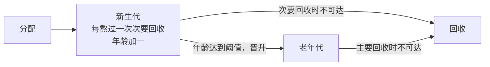

# 13.8 分代假设与代际回收

`runtime/mgc.go` 开头的注释这样概括 Go 的回收器 [[Go Authors, 2026](#ref-go-authors-2026)]：

```go
// The GC runs concurrently with mutator threads, is type accurate (aka precise), allows multiple
// GC threads to run in parallel. It is a concurrent mark and sweep that uses a write barrier. It is
// non-generational and non-compacting. Allocation is done using size segregated per P allocation
// areas to minimize fragmentation while eliminating locks in the common case.
```

不分代、不压缩，这与 HotSpot JVM 和 .NET 的做法不同，二者的回收器都按对象的年龄分代，
分代因此常被视为提高回收效率的标准手段。Go 团队并非没有尝试过：放弃请求制导回收（[13.9](./roc.md)）之后，
他们先后实现了两种不移动对象的分代回收器，经过测量后没有采用。本节先介绍分代回收的原理及其在主流运行时中的
实现，再介绍 Go 的实验和放弃它的理由。

## 13.8.1 分代假设

追踪式回收器在每个周期中都要遍历全部存活对象，开销随存活堆的大小增长（[13.1](./basic.md)）。
分代回收利用对象寿命的分布来减少这部分工作。HotSpot 的调优指南写道，
分代回收利用了多数应用中观察到的若干性质，其中最重要的一条称为弱分代假设：多数对象只存活很短的一段时间，
例如迭代器对象往往只在一次循环中存活 [[Oracle, 2021](#ref-oracle-2021)]。JEP 439 的表述更为完整：
年轻对象往往早早死亡，年老对象则往往长期存活 [[Karlsson, 2023](#ref-karlsson-2023)]。
这一观察称为**分代假设**（generational hypothesis）。Lieberman 与 Hewitt 在
1983 年提出按对象寿命划分堆区域的回收器 [[Lieberman and Hewitt, 1983](#ref-lieberman-hewitt-1983)]，Ungar
次年提出的分代清扫（generation scavenging）是这一方向上的另一项早期工作 [[Ungar, 1984](#ref-ungar-1984)]。

分代回收据此把堆分为新生代与老年代。新分配的对象放入新生代，在若干次回收中存活下来的对象被移入老年代，
这一过程称为晋升（promotion）。新生代填满时只回收新生代，称为次要回收（minor collection）；
老年代填满时才回收整个堆，称为主要回收（major collection）。HotSpot 的指南指出，
次要回收的代价近似正比于被回收区域中存活对象的数量，充满死对象的新生代可以很快回收完毕
[[Oracle, 2021](#ref-oracle-2021)]。设新生代中有 $N$ 个对象，存活比例为 $s$，一次次要回收的工作量约为
$sN$，回收的对象约为 $(1-s)N$，每回收一个对象付出的工作量约为 $s/(1-s)$。$s$ 为 5% 时，这一比值约为 0.05。
全堆的存活比例要高得多，因为老年代中的对象多数仍然存活，同样的工作量在全堆回收中换回的内存也就少得多。

## 13.8.2 记忆集与晋升

只回收新生代时，根集合不再只有栈与全局变量。老年代对象可能持有指向新生代对象的指针；
若某个新生代对象只被这样的指针引用，次要回收必须把这些字段也当作根，否则会把存活对象误判为垃圾。为此，
分代回收器需要记录老年代中可能指向新生代的位置，这一集合称为**记忆集**（remembered set），
其各种实现可参阅 [[Jones et al., 2023](#ref-jones-2023)]。记忆集由写屏障维护（[13.2](./barrier.md)）：
赋值器每次写入指针字段，写屏障都要检查或记录这次写入。

最常见的实现是**卡表**（card table）：把堆按固定大小划分为卡，通常每 512 字节对应卡表中的 1 字节；写屏障在
指针写入时把所在的卡标记为脏，次要回收只需扫描脏卡覆盖的地址范围 [[Karlsson, 2023](#ref-karlsson-2023)]。
以伪代码表示：

```go
// 赋值器写入指针字段时执行
func writePointer(slot *unsafe.Pointer, ptr unsafe.Pointer) {
	*slot = ptr
	cardTable[uintptr(unsafe.Pointer(slot))>>9] = dirty // 每 512 字节一张卡
}

// 次要回收的根：栈与全局变量，加上脏卡中的指针字段
func minorGC() {
	roots := stackAndGlobalRoots()
	for i := range cardTable {
		if cardTable[i] == dirty {
			roots = append(roots, pointersInCard(i)...)
			cardTable[i] = clean
		}
	}
	collectYoung(roots) // 复制存活对象，年龄达到阈值者晋升
}
```

这一屏障既不检查被写的对象是否位于老年代，也不检查写入的值是否指向新生代。实现可以加入过滤条件，例如
Generational ZGC 的屏障慢速路径会滤除对新生代字段的写入，但不按写入的值过滤
[[Karlsson, 2023](#ref-karlsson-2023)]。无论是否过滤，屏障在赋值器运行期间始终开启，
每次指针写入都要为它付出一份开销。

主流的分代回收器在次要回收中移动对象。HotSpot 串行回收器的新生代由 Eden 与两个幸存者空间组成：多数对象在
Eden 中分配；回收时，Eden 与一个幸存者空间中的存活对象被复制到另一个幸存者空间，
随后两个幸存者空间互换角色；对象在幸存者空间之间被复制到一定次数，或幸存者空间不足时，便被移入老年代
[[Oracle, 2021](#ref-oracle-2021)]。复制使次要回收只触及存活对象，同时整理了新生代的空闲内存，
对象的年龄也随复制的次数自然推进。一个对象在分代堆中的生命周期如下图所示：



## 13.8.3 主流运行时中的分代回收

.NET 的托管堆分为第 0、1、2 三代。新对象在第 0 代中分配；第 0 代回收后，存活对象被压缩并晋升到第 1 代，
第 1 代的存活对象再晋升到第 2 代。回收某一代时，所有更年轻的代一并回收，因此第 2 代回收就是完整回收。第 0
代与第 1 代称为短暂代（ephemeral generations）。大对象分配在大对象堆中，在逻辑上作为第 2 代的一部分回收
[[Microsoft, 2025](#ref-microsoft-2025)]。

JDK 17 的调优指南写道，HotSpot 的各种回收器中，除 ZGC 之外都使用分代回收
[[Oracle, 2021](#ref-oracle-2021)]。ZGC 以低延迟为目标，绝大部分工作与应用线程并发进行，
停顿时间在微秒量级且与堆大小无关，自 JDK 15 起可用于生产。它最初不区分对象的年龄，
每次回收都要处理全部对象；只要内存与 CPU 足以让回收跟上分配，这并无问题。JDK 21 的 JEP 439
为它加入了分代模式，目标是降低分配停顿（allocation stall）的风险，减少所需的额外堆内存与回收的 CPU 开销，
同时保持停顿不超过 1 毫秒 [[Karlsson, 2023](#ref-karlsson-2023)]。JDK 23 将分代模式设为默认
[[Boldt-Christmas, 2024a](#ref-boldt-christmas-2024a)]，JDK 24 移除了不分代的模式
[[Boldt-Christmas, 2024b](#ref-boldt-christmas-2024b)]。

ZGC 的经历值得与 Go 对照。ZGC 与 Go 的回收器同样以并发换取短停顿，最终仍然选择了分代，
可见分代的收益并不只在于缩短停顿。但 ZGC 本来就移动对象，并为此在赋值器中插入了读屏障（load barrier），
由读屏障在应用访问指针时惰性地修正指向已移动对象的旧指针；分代所需的写屏障与记忆集建立在这套已有机制之上
[[Karlsson, 2023](#ref-karlsson-2023)]。Go 的回收器不移动对象，在标记阶段之外也没有任何屏障，
引入分代的边际成本要高得多。分代是否划算，取决于回收器原本已经为哪些机制付出了代价。

## 13.8.4 Go 的非移动分代实验

Hudson 在 ISMM 2018 的主题演讲中回顾了这段经历 [[Hudson, 2018a](#ref-hudson-2018a)]。Go
团队最先尝试的是请求制导回收（[13.9](./roc.md)），失败之后才转向分代回收，本书按主题安排章节，
二者的次序与历史相反。团队不愿放弃低延迟，也不愿放弃不移动对象这一性质，因此需要的是非移动的分代回收器。

非移动的分代回收采用粘性标记位（sticky mark bits）的方法，由 Demers、Boehm 等人提出
[[Demers et al., 1990](#ref-demers-1990)]。Go 自 1.7 起直接在标记位图上分配对象
（[12.5](../ch12alloc/smallalloc.md)），这一方法恰好可以复用同一张位图。分配器沿位图前进，在值为 0
的位置上分配对象。若一个位为 1，说明对应的对象在上一轮回收中存活，属于老年代；分配器到达时仍为 0
的位置上的对象则是新分配的年轻对象。次要回收不清除上一轮的标记：若发现位为 1 的对象指向位为 0 的对象，
便把后者的位置为 1，完成晋升，并沿指针传递地晋升所有可达的年轻对象。晋升全部完成后，分配器回到位图开头，
本轮未被触及的 0 位即空闲位置 [[Hudson, 2018a](#ref-hudson-2018a)]。晋升无需复制，对象的年龄也只有一位：
上一轮回收时是否存活。

第一个版本用卡表维护记忆集。回收周期进行时，使用现有的写屏障；回收器空闲时，改用一种快速写屏障，
它把被写入的指针记入缓冲区，缓冲区满时再刷入卡表。在大堆的基准上，这一版表现不错；
在编译器团队选定的性能基准上，结果却不理想。Hudson 的结论是，写屏障虽快，却仍然不够快，而且难以优化。
例如，若对象分配之后、下一个安全点之前对它的写入只是初始化，屏障本可以省去；
但运行时正走向每条指令都可以作为安全点的设计，这样的省略机会将不复存在
[[Hudson, 2018a](#ref-hudson-2018a)]。这一方向后来随 Go 1.14 的异步抢占实现
（[9.7](../../part3concurrency/ch09sched/preemption.md)）。

第二个想法来自 Austin Clements：不用写屏障，而为每张卡保存其中全部指针的哈希值。
若一张卡在两次回收之间被写入了指针，哈希值就会改变，这张卡即视为脏卡。哈希可以借助处理器的 AES 指令完成，
遍历卡时按地址顺序访问内存，对缓存与硬件预取都很友好。这样，记录跨代指针的开销从赋值器移到了回收周期之内，
是否进行分代回收也可以推迟到每个周期开始时再决定，并交由调步器（[13.3](./pacing.md)）
对无法从分代中获益的程序关闭分代 [[Hudson, 2018a](#ref-hudson-2018a)]。2018 年 9 月，Hudson
将这一实现上传为一组标注了 DO NOT SUBMIT 的 CL，卡的大小为 1 KiB [[Hudson, 2018b](#ref-hudson-2018b)]。
新增文件 `mgcgen.go` 开头的注释说明了设计：

```go
// Go uses a sticky bit approach to implement generational
// GC. (See Alan Demers, Mark Weiser, Barry Hayes,
// Hans Boehm, Daniel Bobrow, and Scott Shenker. 1989.
// ……
// Instead of "card marking" Go uses "card hashing" to
// identify regions that may contain pointers from
// mature to young objects. This approach has the advantage
// of eliminating the write barrier typically used to
// monitor the installation of mature to young pointers.
// ……
// Go's card table entries hold a hash for each card.
// This hash is created by hashing all the heap pointers in
// the card. If a rehashing of the card produces the
// same hash then the card is considered unchanged.
// If on the other hand the hash changes from one GC cycle
// to the next cycle then the card is considered changed.
// The main advantage of this approach is that it does
// not need a write barrier so applications that do not
// benefit from a generation GC avoid the write barrier
// tax.
```

用哈希判断卡是否被改写，有一定概率出错：发生哈希冲突时，一张被改写的卡会被误判为未变，
其中的年轻对象可能被错误回收。同一文件中的注释为此做了估算：假设每年 4 亿颗芯片都运行堆大小为 10 GB 的 Go
程序，且每秒回收一次，采用 64 位哈希时，每颗芯片的平均无故障时间约为 58419 年，因此 64 位已经足够。
每个周期进行分代回收还是完整回收，则分别统计两类周期的标记与分配之比的加权衰减平均值，比较后决定
[[Hudson, 2018b](#ref-hudson-2018b)]。据 Hudson 的演讲，卡哈希版本在大堆基准上同样表现良好，
在性能基准上则出现了几个明显的离群值；由于跨代指针的处理已经集中到回收周期之内，
团队设想由调步器按周期判断并关闭分代 [[Hudson, 2018a](#ref-hudson-2018a)]。这组 CL 停留在实验阶段，
至今没有合入。

## 13.8.5 为何没有采用

2017 年，有人在 Go 的问题追踪器上问及 Go 为何不采用分代与压缩回收，提问被转至 golang-nuts 邮件列表
[[BlueBlue-Lee, 2017](#ref-blueblue-lee-2017)]，Ian Lance Taylor 在那里的回答列举了几条理由
[[Taylor, 2017](#ref-taylor-2017)]；Hudson 的演讲则给出了实验之后的判断。两者可以归结为三点。

第一，逃逸分析已经处理掉了大量短命对象。分代回收的收益主要来自短命对象，而 Go
的编译器通过逃逸分析（[15.5](../../part5toolchain/ch15compile/escape.md)）把其中许多分配在栈上，
它们随函数返回而释放，不进入堆，回收器也就无从回收 [[Taylor, 2017](#ref-taylor-2017)]。Hudson 的说法是：
「并不是分代假设对 Go 不成立，而是年轻对象在栈上存活，也在栈上早早死
去。」[[Hudson, 2018a](#ref-hudson-2018a)]下面的程序用 `testing.AllocsPerRun`
统计两个函数每次调用的平均堆分配次数：

```go {run=true}
package main

import (
	"fmt"
	"testing"
)

var sink *int

func local(n int) int {
	p := new(int) // 地址未离开函数
	for i := 0; i < n; i++ {
		*p += i
	}
	return *p
}

func escape(n int) int {
	p := new(int) // 地址被保存到全局变量
	sink = p
	for i := 0; i < n; i++ {
		*p += i
	}
	return *p
}

func main() {
	fmt.Println("local: ", testing.AllocsPerRun(1000, func() { local(10) }))
	fmt.Println("escape:", testing.AllocsPerRun(1000, func() { escape(10) }))
}
```

运行结果如下：

```
local:  0
escape: 1
```

两个函数都用 `new` 创建对象，但只有地址被保存到全局变量的那一个分配在堆上。用 `-gcflags=-m`
可以看到编译器的判断，下面只保留与 `new(int)` 有关的行，后两行对应两个函数内联到 `main` 的闭包之后的副本：

```shell
$ go build -gcflags=-m . 2>&1 | grep 'new(int)'
./main.go:11:10: new(int) does not escape
./main.go:19:10: new(int) escapes to heap
./main.go:28:66: new(int) does not escape
./main.go:29:67: new(int) escapes to heap
```

`local` 中的对象正是新生代回收所针对的那类短命对象，而在 Go 中它根本不会出现在堆上。

第二，Go 不需要用分代来缩短停顿。Taylor 指出，分代回收器通常以缩短停顿为目标，只回收最年轻的一代，
停顿便短；而 Go 的回收器是并发的，「在 Go 中，停顿时间与最年轻一代的大小无关，也与任何一代的大小无关」。
Go 的基本假设是，在多线程程序中，宁可在另一个核上并行回收、总体多花一些 CPU 时间，
也不愿为了减少回收时间而让整个程序停顿更久 [[Taylor, 2017](#ref-taylor-2017)]。Hudson
从另一面说明了这一点：

> 分代回收的真正价值在于，衡量回收耗时时，写屏障的开销被忽略了，因为它分摊在赋值器的执行之中。这是分代回收的
> 最大优势：它大大缩短了完整回收周期中漫长的停止一切，却未必能提高吞吐量。Go 没有停止一切的问题，因此必须更
> 仔细地审视吞吐量问题 [[Hudson, 2018a](#ref-hudson-2018a)]。

第三，在吞吐量上，分代回收的写屏障难以与标记的开销竞争。GC 指南给出的成本模型中，一个周期的 CPU
开销是固定开销加上与存活堆大小成正比的标记开销，而 `GOGC` 决定两次回收之间可以分配多少新内存，
约为存活堆（连同根）的 `GOGC/100` 倍 [[Go Authors, 2022](#ref-go-authors-2022)]。忽略固定开销与根，
设存活堆为 $L$，每字节的平均标记开销为 $c$，则每分配一个字节分摊到的标记开销约为

$$
\frac{cL}{L \cdot \mathrm{GOGC}/100} = \frac{100c}{\mathrm{GOGC}},
$$

与存活堆的大小无关，只取决于 `GOGC`：`GOGC` 加倍，单位分配的标记开销减半，代价是堆的峰值随之增长。
指南中的例子是：存活堆为 10 MiB、每秒分配 10 MiB 的程序，每 1 CPU 秒回收一次时，回收占用 10% 的 CPU，
堆峰值为 20 MiB；每 2 CPU 秒回收一次时，CPU 开销降至 5%，堆峰值升至 30 MiB
[[Go Authors, 2022](#ref-go-authors-2022)]。

写屏障的开销则附加在每一次指针写入上，与回收的频率无关。Hudson 估计写屏障的开销约为 4% 至 5%。
在演讲展示的分析图中，标记开销为 10% 乃至 20% 的程序，随着堆的增大，回收周期变得稀疏，
累计的标记开销迅速下降，最终降到写屏障的开销之下；写屏障的开销则是常数，无法用同样的方式降低
[[Hudson, 2018a](#ref-hudson-2018a)]。Go 现有的写屏障只在标记期间开启（[13.2](./barrier.md)）：

```go
func setGCPhase(x uint32) {
	atomic.Store(&gcphase, x)
	writeBarrier.enabled = gcphase == _GCmark || gcphase == _GCmarktermination
}
```

基于卡表的分代回收则要求屏障在赋值器运行期间始终开启；第一个版本在回收器空闲时仍要执行快速写屏障，
这正是它在性能基准上落后的原因。Hudson 对硬件的判断进一步支持了这一取舍：
芯片容量的增长比处理器更能延续摩尔定律，「将内存加倍会比将核数加倍更划
算」[[Hudson, 2018a](#ref-hudson-2018a)]。以内存换取 CPU，正是 `GOGC` 所做的事情。

压缩回收的情形与此类似。Taylor 指出，压缩的好处主要是避免碎片，并使分配器可以通过移动一个指针来分配（即指
针碰撞分配）；而基于 TCMalloc 的分配器几乎没有碎片问题，多线程程序中的指针碰撞分配又需要加锁，
不如每个线程各自缓存来得高效 [[Taylor, 2017](#ref-taylor-2017)]。Go 的分配器正是按尺寸类组织、按 P
缓存的（[12.1](../ch12alloc/basic.md)）。

这些理由都有前提。以内存换 CPU 要求内存充裕；在内存受限、设置了内存限制的部署中（[13.3](./pacing.md)），
`GOGC` 可以调节的余地变小，而降低堆内存开销恰是 Generational ZGC 的目标之一。Taylor 在 2017 年也说明，
分代回收能否减少 Go 的回收工作量尚未经过检验；Hudson 的实验给出的是当时的答案，而非定论。

## 13.8.6 小结

分代回收建立在分代假设之上：多数对象早早死亡，只回收新生代便能以较少的工作量回收较多的内存。代价是记忆集，
通常由始终开启的写屏障和卡表维护；主流实现还依赖复制来晋升对象并整理新生代。Go 团队在保持非移动、
低延迟的前提下实现过两种分代回收器，一种以缓冲写屏障维护卡表，另一种以卡哈希取代写屏障，都没有合入。
其原因在于，逃逸分析已经把大量年轻对象留在栈上，并发回收已经使停顿与代的大小无关，而在吞吐量上，
随堆增大而下降的标记开销难以抵消始终开启的写屏障。Go 后来在标记的内存访问局部性上寻求改进，即 Go 1.26
默认启用的 Green Tea（[13.11](./greentea.md)）。

## 延伸阅读

- <a id="ref-blueblue-lee-2017"></a>[BlueBlue-Lee, 2017] BlueBlue-Lee. Go issue #20373. *Why golang's
  garbage collector not implement Generational and Compact gc?* 2017.
  https://github.com/golang/go/issues/20373
  该提问被关闭并转至 golang-nuts 邮件列表；逃逸分析、并发回收使停顿与代的大小无关等解释，见 Go 团队成员
  Ian Lance Taylor 在邮件列表中的回复（Taylor, 2017）。
- <a id="ref-boldt-christmas-2024a"></a>[Boldt-Christmas, 2024a] Axel Boldt-Christmas. JEP 474: ZGC:
  Generational Mode by Default. OpenJDK, 2024. https://openjdk.org/jeps/474
  随 JDK 23 发布。
- <a id="ref-boldt-christmas-2024b"></a>[Boldt-Christmas, 2024b] Axel Boldt-Christmas. JEP 490: ZGC:
  Remove the Non-Generational Mode. OpenJDK, 2024. https://openjdk.org/jeps/490
  随 JDK 24 发布。
- <a id="ref-demers-1990"></a>[Demers et al., 1990] Alan Demers, Mark Weiser, Barry Hayes, Hans Boehm,
  Daniel Bobrow, Scott Shenker. "Combining Generational and Conservative Garbage Collection: Framework and
  Implementations." *POPL '90*, 261–269, 1990. https://doi.org/10.1145/96709.96735
  粘性标记位的出处。
- <a id="ref-go-authors-2022"></a>[Go Authors, 2022] The Go Authors. *A Guide to the Go Garbage
  Collector.* https://go.dev/doc/gc-guide
  当前非移动并发标记清扫回收器的设计说明，以及以 `GOGC` 为中心的成本模型。
- <a id="ref-go-authors-2026"></a>[Go Authors, 2026] The Go Authors. src/runtime/mgc.go（文件头注释、
  `setGCPhase`）. Go 1.26 源码. https://github.com/golang/go/blob/release-branch.go1.26/src/runtime/mgc.go
- <a id="ref-hudson-2018a"></a>[Hudson, 2018a] Rick Hudson. *Getting to Go: The Journey of Go's Garbage
  Collector.* ISMM 2018 keynote, 2018. https://go.dev/blog/ismmkeynote
  Go 实现并放弃非移动分代回收的第一手交代。
- <a id="ref-hudson-2018b"></a>[Hudson, 2018b] Rick Hudson. runtime: constants and data structures for
  generational GC. Go CL 137476, 2018. https://go.dev/cl/137476
  卡哈希分代回收 CL 系列的第一个，同一系列还包括 CL 137481（粘性标记位）与 CL 137482（分代周期的触发），
  均未合入。
- <a id="ref-jones-2023"></a>[Jones et al., 2023] Richard Jones, Antony Hosking, Eliot Moss. *The Garbage
  Collection Handbook: The Art of Automatic Memory Management.* 2nd ed., CRC Press, 2023.
  https://doi.org/10.1201/9781003276142
  记忆集、卡表与分代回收机制的系统性论述。
- <a id="ref-karlsson-2023"></a>[Karlsson, 2023] Stefan Karlsson. JEP 439: Generational ZGC. OpenJDK,
  2023. https://openjdk.org/jeps/439
  随 JDK 21 发布。
- <a id="ref-lieberman-hewitt-1983"></a>[Lieberman and Hewitt, 1983] Henry Lieberman, Carl Hewitt. "A
  Real-Time Garbage Collector Based on the Lifetimes of Objects." *Communications of the ACM* 26(6):
  419–429, 1983. https://doi.org/10.1145/358141.358147
  代际回收思想的最早源头之一。
- <a id="ref-microsoft-2025"></a>[Microsoft, 2025] Microsoft. Fundamentals of Garbage Collection. .NET
  documentation, 2025. https://learn.microsoft.com/en-us/dotnet/standard/garbage-collection/fundamentals
- <a id="ref-oracle-2021"></a>[Oracle, 2021] Oracle. *Java Platform, Standard Edition HotSpot Virtual
  Machine Garbage Collection Tuning Guide*, Release 17, 2021.
  https://docs.oracle.com/en/java/javase/17/gctuning/garbage-collector-implementation.html
- <a id="ref-taylor-2017"></a>[Taylor, 2017] Ian Lance Taylor. Re: Why golang garbage-collector not
  implement Generational and Compact gc? golang-nuts, 2017.
  https://groups.google.com/g/golang-nuts/c/KJiyv2mV2pU/m/wdBUH1mHCAAJ
- <a id="ref-ungar-1984"></a>[Ungar, 1984] David Ungar. "Generation Scavenging: A Non-Disruptive High
  Performance Storage Reclamation Algorithm." *SDE 1984*, 157–167, 1984.
  https://doi.org/10.1145/800020.808261
  「分代清扫」，分代回收的奠基工作。
- 本书 [13.9 请求假设与事务制导回收](./roc.md)、[13.12 过去、现在与未来](./history.md)、
  [15.5 逃逸分析](../../part5toolchain/ch15compile/escape.md)。
