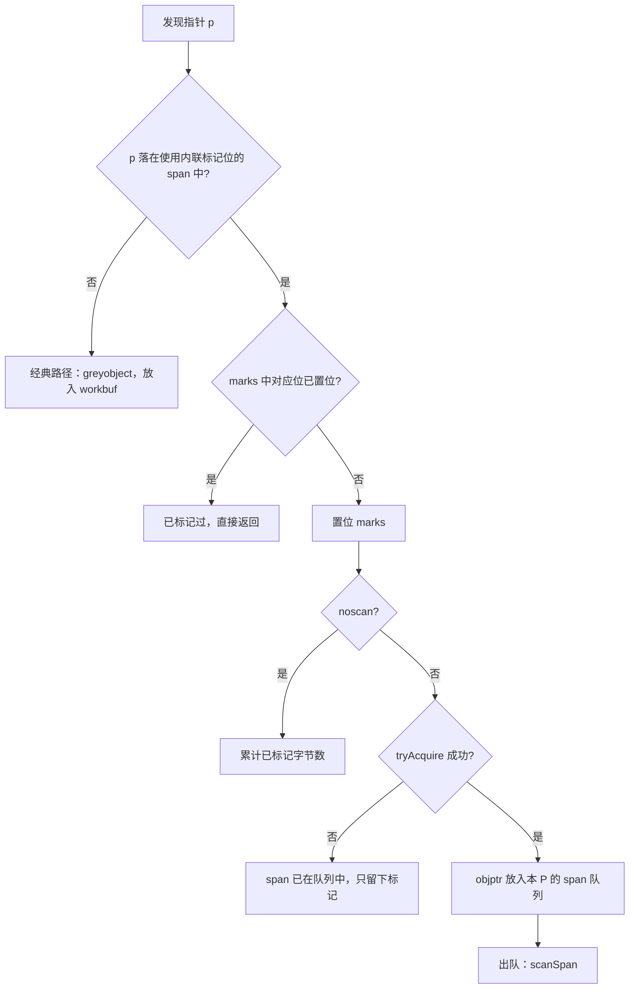
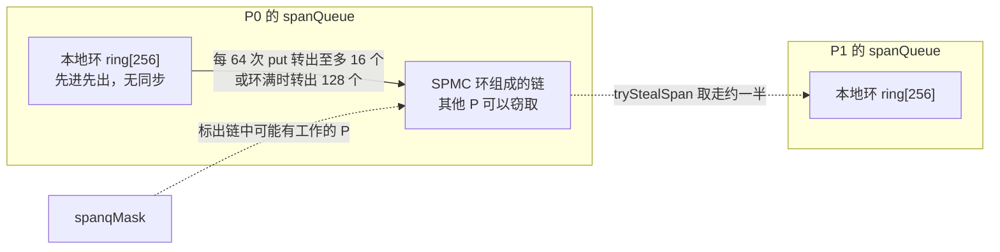

# 13.11 Green Tea：面向局部性的标记

前面几节讨论的是标记的正确与及时：写屏障（[13.2](./barrier.md)）保证并发标记不漏标，
调步与标记辅助（[13.3](./pacing.md)、[13.4](./mark.md)）保证标记赶得上分配。本节讨论另一个问题，
即标记本身执行得多快。Knyszek 与 Clements 在 Green Tea 的设计说明（issue #73581）中指出，
内存的延迟与带宽受到的制约日益严重：处理器时钟的增长快于 DRAM 时钟，
核数的增加加重了物理上有限的内存总线的负担，光速的限制又迫使内存拓扑越来越不均匀。空间局部性、
时间局部性与对拓扑的感知因此对高性能系统越来越关键，而如今大多数垃圾回收算法都与这些趋势相悖
[[Knyszek and Clements, 2025a](#ref-knyszek-clements-2025a)]。

Green Tea 是针对这一问题的新标记算法。它在 Go 1.25 中以 `GOEXPERIMENT=greenteagc` 的实验形式提供，Go 1.26
起默认启用，可用 `GOEXPERIMENT=nogreenteagc` 关闭 [[Go Authors, 2025](#ref-go-authors-2025)]
[[Go Authors, 2026a](#ref-go-authors-2026a)]。它不改变三色抽象，也不引入新的屏障，
改变的是标记器遍历对象的方式：不再逐个扫描对象，而是以 span 为单位，把落在同一个 span
中的待扫对象累积起来一并扫描。本节依次讨论它要解决的局部性问题、按 span 累积的核心机制、单对象的快速路径、span
队列与工作分配、扫描一个 span 的两条路径，最后是它的效果、局限与演进。

## 13.11.1 标记的局部性问题

经典的三色标记（[13.1](./basic.md)）从灰色对象出发，扫描其中的指针，把指向的白色对象染灰并放入工作队列，
直到队列为空。设计说明把它称为一次**图泛洪**（graph flood）：堆对象是图的节点，指针是边，
而遍历的次序完全不考虑对象在内存中的位置。其结果是极差的空间局部性，标记器在内存中完全不同的区域之间跳跃；
时间局部性同样很差，对同一块内存的重复访问被分散在整个回收周期中；对内存拓扑则毫无顾及。
设计说明给出的数据是：回收器平均 85% 的时间花在图泛洪的核心循环即扫描循环中，扫描循环中超过 35% 的 CPU
周期仅仅是在等待内存访问 [[Knyszek and Clements, 2025a](#ref-knyszek-clements-2025a)]。Green Tea
的博客从另一个角度给出了相近的结论：回收的开销约 90% 用于标记，约 10% 用于清扫，而标记时间中通常至少有
35% 停滞于访问堆内存 [[Knyszek and Clements, 2025b](#ref-knyszek-clements-2025b)]。

标记中的访存大多是指针追逐：下一次访问的地址要从上一次加载的结果中读出，
硬件预取器难以找到可以预测的访问模式；对象的元数据，例如它的指针位图，又存放在别处，需要额外的访存。
设计说明预计，随着多核与非一致内存架构的普及，这一问题只会更加严重。设计说明援引《垃圾回收算法手册》
的划分：并行回收算法分为以处理器为中心与以内存为中心两类，前者积极地在处理器之间平衡工作以求最大的并行度，
后者未必并行得那么好，但处理堆中连续的块；Go 现有的标记算法完全属于前者，
而手册断言「所有已知的并行标记算法都以处理器为中
心」[[Knyszek and Clements, 2025a](#ref-knyszek-clements-2025a)]。设计说明称 Green Tea
即使算不上以内存为中心，至少是「感知内存」的：它尽量把彼此相邻的对象放在一起处理。

这一思路与 [13.8](./generational.md)、[13.9](./roc.md) 中被放弃的两条路线形成对照。分代回收与 ROC
利用对象在时间上的规律，即年龄与请求边界，以求少扫描一些对象，代价是在赋值器运行期间始终开启的写屏障；Green
Tea 利用的是对象在空间上的规律：分配器按尺寸类把同样大小的对象放在同一个 span
中（[12.2](../ch12alloc/component.md)），这些对象大小相同、位置相邻，若它们在相近的时刻被发现，
就可以一并处理。它不减少需要扫描的对象，只设法把同样多的对象扫描得更快，因而无须改动写屏障。

## 13.11.2 按 span 累积

设计说明把 Green Tea 的核心想法概括为：回收器不再逐个扫描对象，而是以大得多的连续内存块为单位扫描。
共享的工作队列中排队的是这些内存块，块中等待扫描的对象由块自己记录。其核心假设是：块在队列中等待期间，
会累积更多需要扫描的对象，等它出队时，一次扫描就能处理不止一个对象；这既改善了访存的局部性，
也更好地摊薄了每次扫描的固定开销 [[Knyszek and Clements, 2025a](#ref-knyszek-clements-2025a)]。在 Go
的实现中，这样的块就是 span。`mgcmark_greenteagc.go` 开头的注释进一步说明，这样成批处理对象，
提高了访问相邻对象的机会，摊薄了访问对象元数据的成本，也为预取创造了更好的条件
[[Go Authors, 2026b](#ref-go-authors-2026b)]。

为此，每个 span 维护两组位：标记位 `marks` 在第一次发现指向某对象的指针时置位；扫描位 `scans`
表示对象已经扫描过。设计说明称之为灰色位与黑色位：白色对象两位都未置位，灰色对象只置了灰色位，
黑色对象两位都已置位；`mgcwork.go` 中的注释相应地写道，对于 span 队列中的对象，
灰色是已标记而扫描位未置位，黑色是已标记且扫描位已置位（[13.1.3](./basic.md)）。span 出队时，`spanSetScans`
以机器字为单位比较两组位（有删节）[[Go Authors, 2026b](#ref-go-authors-2026b)]：

```go
	for i := uintptr(0); i < bytes; i += goarch.PtrSize {
		scans := atomic.Loaduintptr(&imbScans[i/goarch.PtrSize])
		marks := imbMarks[i/goarch.PtrSize]
		// ……
		toGrey := marks &^ scans
		toScan[i/goarch.PtrSize] = toGrey

		// If there's anything left to grey, do it.
		if toGrey != 0 {
			toGrey = bswapIfBigEndian(toGrey)
			if goarch.PtrSize == 4 {
				atomic.Or32((*uint32)(unsafe.Pointer(&imbScans[i/goarch.PtrSize])), uint32(toGrey))
			} else {
				atomic.Or64((*uint64)(unsafe.Pointer(&imbScans[i/goarch.PtrSize])), uint64(toGrey))
			}
		}
		objsMarked += sys.OnesCount64(uint64(toGrey))
	}
```

已标记而未扫描的对象 `marks &^ scans` 构成本次需要扫描的集合 `toScan`，同时被并入 `scans`，于是 `scans`
变为两者的并集。即使同一个 span 先后多次入队，每个对象也只会被扫描一次，回收仍然是精确的。

这一机制只用于小对象。`gcUsesSpanInlineMarkBits` 的条件是 `heapBitsInSpan(size) && size >= 16`，即 16 至
512 字节、指针位图存放在 span 末尾的尺寸类，它们的 span 都恰好占一页 8 KiB
[[Go Authors, 2026b](#ref-go-authors-2026b)]。设计说明解释了选择小对象的原因：
回收器在每个小对象上花的扫描时间很少，每次扫描的固定开销最难摊薄
[[Knyszek and Clements, 2025a](#ref-knyszek-clements-2025a)]。其余尺寸的对象仍走原有的逐对象路径，超过
128 KiB 的对象照旧切分为 oblet 以便并行扫描（[13.4](./mark.md)）。两组位连同所有权标志与尺寸类，组成放在
span 末尾的 128 字节结构 `spanInlineMarkBits`，其布局以及它对每个 span 槽位数的影响见
[12.2.1](../ch12alloc/component.md)；`heapArena` 中的 `pageUseSpanInlineMarkBits`
位图则标出哪些页属于这样的 span（[12.2.4](../ch12alloc/component.md)）。

发现一个指针时，`tryDeferToSpanScan` 决定它走哪条路径（有删
节）[[Go Authors, 2026b](#ref-go-authors-2026b)]：

```go
func tryDeferToSpanScan(p uintptr, gcw *gcWork) bool {
	// ……
	// Quickly to see if this is a span that has inline mark bits.
	ha := heapArenaOf(p)
	if ha == nil {
		return false
	}
	pageIdx := ((p / pageSize) / 8) % uintptr(len(ha.pageInUse))
	pageMask := byte(1 << ((p / pageSize) % 8))
	if ha.pageUseSpanInlineMarkBits[pageIdx]&pageMask == 0 {
		return false
	}

	// Find the object's index from the span class info stored in the inline mark bits.
	base := alignDown(p, gc.PageSize)
	q := spanInlineMarkBitsFromBase(base)
	objIndex := uint16((uint64(p-base) * uint64(gc.SizeClassToDivMagic[q.class.sizeclass()])) >> 32)

	// Set mark bit.
	idx, mask := objIndex/8, uint8(1)<<(objIndex%8)
	if atomic.Load8(&q.marks[idx])&mask != 0 {
		return true
	}
	atomic.Or8(&q.marks[idx], mask)

	// Fast-track noscan objects.
	if q.class.noscan() {
		gcw.bytesMarked += uint64(gc.SizeClassToSize[q.class.sizeclass()])
		return true
	}

	// Queue up the pointer (as a representative for its span).
	if q.tryAcquire() {
		if gcw.spanq.put(makeObjPtr(base, objIndex)) {
			// ……
		}
	}
	return true
}
```

判断只需查一个以页为单位的位图，设计说明指出，即使堆很大，这个位图也能轻松放进缓存，争用也极低。由于这类
span 恰好一页且按页对齐，元数据的位置可以由地址直接算出：`spanInlineMarkBitsFromBase` 取页的起始地址加
8 KiB 再减去结构的大小，对象的序号则借助尺寸类的除法魔数由偏移算出，整个过程不必经过 `mspan`，
避免了严重影响性能的间接访问与相互依赖的加载。不含指针的对象只需置标记位，从不入队。含指针的对象则以
`objptr` 的形式代表它的 span 入队：页对齐的 span 起始地址低 13 位恒为零，正好用来存放对象在 span
中的序号。



## 13.11.3 单对象的快速路径

若一个 span 出队时只有一个对象需要扫描，按 span 处理就比逐对象的算法做了更多的工作。
设计说明为此采用两个办法：记下 span 入队时被标记的那个对象，作为 span 的代表；再为 span 设一个标志，
表示它在排队期间又有对象被标记。扫描时若这个标志未置位，就直接扫描代表对象，而不处理整个 span
[[Knyszek and Clements, 2025a](#ref-knyszek-clements-2025a)]。

在实现中，代表就是 `objptr` 中的对象序号，标志则是 `spanInlineMarkBits` 中的所有权字段 `owned`。
它有三种状态：`spanScanUnowned` 表示 span 无人认领；`spanScanOneMark` 表示相对于扫描位只置了一个标记位；`spanScanManyMark`
表示可能置了多个 [[Go Authors, 2026b](#ref-go-authors-2026b)]。`tryAcquire`
以原子或操作推进这一状态，只有把它从 `spanScanUnowned` 推进出去的那个线程认领成功，负责让 span 入队；
此后再有对象在这个 span 中被标记，`tryAcquire` 只把状态推进到 `spanScanManyMark`。`scanSpan` 开始时调用
`release`，以原子交换释放 span，并取回释放前的状态：

```go
	// Release span.
	if imb.release() == spanScanOneMark {
		// Nobody else set any mark bits on this span while it was acquired.
		// That means p is the sole object we need to handle. Fast-track it.
		objIndex := p.objIndex()
		bytep := &imb.scans[objIndex/8]
		mask := uint8(1) << (objIndex % 8)
		if atomic.Load8(bytep)&mask != 0 {
			return
		}
		atomic.Or8(bytep, mask)
		gcw.bytesMarked += uint64(elemsize)
		// ……
		b := spanBase + uintptr(objIndex)*elemsize
		scanObjectSmall(spanBase, b, elemsize, gcw)
		return
	}
```

返回值只是一个上界：`spanScanManyMark` 时实际上也可能只有一个标记位，此时走完整的合并与求差，
结果依然正确，只是多花一些工作。释放之后，新发现的指针可以再次认领这个 span 并让它重新入队。

## 13.11.4 span 队列与工作分配

经典的标记器让每个工作者维护一个固定大小的本地对象栈，为了保证并行度，又频繁地检查和填充全局链表；
设计说明指出，在多核系统上，全局链表的频繁修改是争用的重要来源。Green Tea 为 span 设立了单独的队列，即
**span 队列**（span queue），其结构参照 goroutine 调度器的分布式可窃取运行队列；
直接从其他工作者窃取减少了对全局链表的争用，而按 span 排队使队列中的项目少得多，争用也就从根本上降低了
[[Knyszek and Clements, 2025a](#ref-knyszek-clements-2025a)]。

每个 P 的 `spanQueue` 由两部分组成 [[Go Authors, 2026b](#ref-go-authors-2026b)]。一部分是只有本 P
访问、无须同步的 256 项环形缓冲区；另一部分是对其他 P 可见的一条链，由单生产者、多消费者的环形缓冲区串成，
注释说明这一结构仿照 `sync.Pool` 的双端队列（[11.6](../../part3concurrency/ch11sync/pool.md)）。`put`
优先放入本地环，并每放入 64 次检查一次：取本地环中 span 数的一半，至多 16 个，若这个数大于 4 且链为空，
就把这么多 span 转入链中，以便产生并行度；本地环满时则一次转出一半，即 128 个。窃取者按全局位图
`spanqMask` 找到链中可能有工作的 P，从它的链上取走约一半、至多 128 个，放入自己的本地环。
位图的维护是有意不加同步的：窃取失败的 P 会清除对方的位，可能恰好抹掉对方刚刚设置的位；
注释说明这种竞争窗口很小，被误清的位由标记终止前 `gcMarkDone` 中的不规则屏障重新设置
（[13.6](./termination.md)）。



span 在队列中的次序关系到累积的效果。设计说明比较了先进先出、后进先出、最稀疏优先、最稠密优先、
随机以及按地址排序等多种策略，先进先出使 span 出队时平均累积的待扫对象密度最高
[[Knyszek and Clements, 2025a](#ref-knyszek-clements-2025a)]；源码注释也写道，与采用后进先出的 workbuf
不同，span 队列采用先进先出，经验上这样最有利于在 span 上累积对象。

对象队列与 span 队列并存时，取工作的次序由 `mgcwork.go` 中的一张表规定
[[Go Authors, 2026d](#ref-go-authors-2026d)]：

```go
// Work queues must be prioritized in the following order wherever work
// is processed.
//
// +----------------------------------------------------------+
// | Priority | Work queue | Restrictions | Function          |
// |----------------------------------------------------------|
// | 1        | Workbufs   | P-local      | tryGetObjFast     |
// | 2        | Span queue | P-local      | tryGetSpanFast    | [greenteagc]
// | 3        | Workbufs   | None         | tryGetObj         |
// | 4        | Span queue | None         | tryGetSpan        | [greenteagc]
// | 5        | Span queue | None         | tryStealSpan      | [greenteagc]
// +----------------------------------------------------------+
//
// The rationale behind this ordering comes from two insights:
// 1. It's always preferable to look for P-local work first to avoid hammering on
//    global lists.
// 2. It's always preferable to scan individual objects first to increase the
//    likelihood that spans will accumulate more objects to scan.
```

第二条理由与先进先出的选择出于同一考虑：让 span 在队列中停留更久，使它出队时累积更多的对象。`gcDrain`
的主循环按这一次序取工作，取到对象就调用 `scanObject`，取到 span 就调用 `scanSpan`。workbuf
的组织与全局队列见 [13.4](./mark.md)。

## 13.11.5 扫描一个 span

除去单对象的快速路径，`scanSpan` 先由 `spanSetScans` 得到待扫集合与对象数，再按密度在两条路径之间选择
[[Go Authors, 2026b](#ref-go-authors-2026b)]：

```go
	// Check if we have enough density to make a dartboard scan
	// worthwhile. If not, just do what scanobject does, but
	// localized to the span, using the dartboard.
	if !scan.HasFastScanSpanPacked() || objsMarked < int(nelems/8) {
		// ……
		scanObjectsSmall(spanBase, elemsize, nelems, gcw, &toScan)
		return
	}

	// Scan the span.
	//
	// N.B. Use gcw.ptrBuf as the output buffer. This is a bit different
	// from scanObjectsSmall, which puts addresses to dereference. ScanSpanPacked
	// on the other hand, fills gcw.ptrBuf with already dereferenced pointers.
	nptrs := scan.ScanSpanPacked(
		unsafe.Pointer(spanBase),
		&gcw.ptrBuf[0],
		&toScan,
		uintptr(spanclass.sizeclass()),
		spanPtrMaskUnsafe(spanBase),
	)
```

稀疏路径 `scanObjectsSmall` 只访问 `toScan` 中置位的对象，从 span 末尾的指针位图中取出每个对象的指针位，
对每个指针字段发出预取，并把字段的地址存入缓冲区；整个 span 收集完毕之后，
才逐一读取这些字段并处理其中的指针。注释说明预取的位置是经验选定的。设计说明的致谢提到，正确的预取、
成批地加载后续指针以隐藏内存延迟，以及更简单的对象指针遍历，都来自 Intel 的 Vandriessche
对微体系结构的建议 [[Knyszek and Clements, 2025a](#ref-knyszek-clements-2025a)]。

稠密路径 `ScanSpanPacked` 在待扫对象至少占 span 槽位数的八分之一时使用。设计说明指出，
向量内核需要更高的对象密度才能胜过稀疏扫描，因而只在密度达到阈值时启用
[[Knyszek and Clements, 2025a](#ref-knyszek-clements-2025a)]。它还要求处理器具备相应的向量指令：Go 1.26
中只有 amd64 上的 AVX-512 实现，要求同时支持 AVX-512 VL、BW、DQ、BITALG、VBMI 与 GFNI 扩展。
包中虽然也有可移植的 Go 实现，但注释说明它不够快，即使对象密度相当高，逐个对象跳转的做法仍然好得多，
因此在其他平台上 `HasFastScanSpanPacked` 恒为假，所有 span 都走稀疏路径
[[Go Authors, 2026c](#ref-go-authors-2026c)]。博客描述了这一扫描过程的步骤：取出一页的标记位与扫描位，
两者的并集成为新的扫描位，差集是本次要扫描的活跃对象位图；把每个对象一位扩展为每个字一位，得到活跃字位图；
与分配器维护的指针位图求交，得到页中所有待扫指针的位置；最后按这一位图从内存中收集指针，每次处理 64 字节。
在 Go 1.26 的实现中，前两步由 `spanSetScans` 以普通的 Go 代码完成，`ScanSpanPacked`
接收的已是待扫对象位图与指针位图，内核本身负责扩展、求交与收集。扩展一步依靠 GFNI 扩展中的
`VGF2P8AFFINEQB` 指令：它把向量中的每个字节看作 GF(2) 上的 8 维向量，乘以一个 8×8 的位矩阵，
于是只需为每种对象大小准备几个矩阵，就能完成一位到多位的扩展；各尺寸类的扩展函数由代码生成器产生。
这一方法由 Clements 设计 [[Knyszek and Clements, 2025b](#ref-knyszek-clements-2025b)]。AVX-512 的
512 位寄存器宽到只用两个就能容纳一整页的元数据，这正是按 span 组织扫描才带来的可能：逐对象的图泛洪中，
对象大小各异，元数据时而只有两位，时而多达上万位，没有向量硬件可以利用的规律。

两条路径收集到的指针都不立即扫描，而是再次交给 `tryDeferToSpanScan`：指向小对象的指针，在目标 span
上置标记位，并视需要让该 span 入队；指向其他对象的指针，经 `findObject` 与 `greyobject`
进入经典的对象队列。

## 13.11.6 效果与局限

Green Tea 的效果取决于 span 出队时累积了多少对象。`GODEBUG=gctrace=2` 时，Green Tea 在每轮回收的 gctrace
行之后打印按尺寸类汇总的扫描统计；这部分输出没有写入文档，格式随时可能变化。
下面的程序以两种方式构造约两百万个 24 字节的节点：一棵完全二叉树，每棵子树的节点连续分配；
以及一条链表，节点先分配好，再随机打乱次序串起来：

```go
package main

import (
	"fmt"
	"math/rand/v2"
	"os"
	"runtime"
)

type node struct {
	left, right *node
	val         int
}

// tree 构造一棵深度为 d 的完全二叉树，每棵子树的节点连续分配。
func tree(d int) *node {
	if d == 0 {
		return &node{}
	}
	return &node{left: tree(d - 1), right: tree(d - 1)}
}

// list 把同样多的节点分配好之后随机打乱，再串成一条链表。
func list(n int) *node {
	nodes := make([]*node, n)
	for i := range nodes {
		nodes[i] = &node{}
	}
	rand.Shuffle(n, func(i, j int) { nodes[i], nodes[j] = nodes[j], nodes[i] })
	for i := 0; i+1 < n; i++ {
		nodes[i].left = nodes[i+1]
	}
	return nodes[0]
}

var sink *node

func main() {
	if len(os.Args) > 1 && os.Args[1] == "list" {
		sink = list(1<<21 - 1)
	} else {
		sink = tree(20)
	}
	runtime.GC()
	fmt.Println("done")
}
```

在 arm64 上以 Go 1.26.10 运行，取最后一轮回收（即 `runtime.GC` 触发的那一轮）的汇总行：

```shell
$ go build -o ex .
$ GODEBUG=gctrace=2 ./ex tree 2>&1 | grep 'scan: total' | tail -1
scan: total 13066+2084231+0=2097297 objs, 47595+0=47595 spans
$ GODEBUG=gctrace=2 ./ex list 2>&1 | grep 'scan: total' | tail -1
scan: total 2097227+66+0=2097293 objs, 11+0=11 spans
```

各次运行的具体数字略有出入，两者的比例则是稳定的。

按 `sizeClassScanStats` 的字段注释，对象数的三项依次是逐个扫描的对象、经稀疏路径 `scanObjectsSmall`
扫描的对象与经稠密路径 `ScanSpanPacked` 扫描的对象，span 数的两项依次是经稀疏与稠密路径扫描的 span
[[Go Authors, 2026b](#ref-go-authors-2026b)]。逐个扫描的对象，在使用内联标记位的尺寸类中来自单对象快速路径
`scanObjectSmall`，在其他尺寸类中来自 `scanObject`；前者每个 span 只扫描一个对象，不另计 span 数。arm64
没有稠密路径，第三项与 span 数的第二项都为零。二叉树的结果中，约 208 万个对象经由约 4.76 万次 span
扫描完成，平均每次扫描约 44 个对象；一个含指针的 24 字节 span 有 (8192 − 128 − 128) / 24 取整即
330 个槽位，每次扫描约处理其中的 13%。链表的结果中，几乎每个对象都经单对象路径扫描：随机打乱之后，
链上相继的节点落在不同的 span 中，span 出队时只有它的代表对象需要扫描，按 span 累积完全落空。博客承认，
这种情形可能比图泛洪更差，因为回收器为累积付出了额外的工作却一无所获；单对象的特殊路径减轻了倒退，
但不能完全消除 [[Knyszek and Clements, 2025b](#ref-knyszek-clements-2025b)]。

设计说明的评估中，在 garbage 与 binary-trees 两个回收密集的微基准上，随核数不同，回收的 CPU 开销降低了
10% 至 50%，降幅大体随核数增加，L1 与 L2 缓存未命中减少了一半。更大的基准集中，tile38 与 bleve-index
恰好对应上面的两种情形。tile38 的堆主要是一棵扇出很高的树，Green Tea 能够迅速产生大量工作和很高的密度，
回收开销降低了 35%。bleve-index 的堆主要是一棵扇出很低、被频繁修改的二叉树，一半的 span
扫描只扫描了一个对象；设计说明推测，频繁的树旋转使树的结构在一百多 MiB 的堆中被打乱，而 binary-trees
不做旋转，树的布局保持着初始分配时的良好局部性。设计说明的结论是：应用本身有良好的局部性时，Green Tea
也有良好的局部性，这一点与现有的回收器不同；但它无法凭空创造局部性
[[Knyszek and Clements, 2025a](#ref-knyszek-clements-2025a)]。需要的累积量也比直觉要小：博客报告，
每次只扫描一页的 2%，就已经能够胜过图泛洪 [[Knyszek and Clements, 2025b](#ref-knyszek-clements-2025b)]。
上面的二叉树每次约扫描 13% 的槽位，远在这一水平之上。

在更广的基准集与实际程序中，Go 1.25 与 Go 1.26 的发布说明都预计，大量使用回收器的实际程序的回收开销会降低
10% 至 40% [[Go Authors, 2025](#ref-go-authors-2025)] [[Go Authors, 2026a](#ref-go-authors-2026a)]；
博客补充说，10% 左右是最常见的改进，若程序原本有 10% 的时间用于回收，整体 CPU 便节省 1% 至 4%，Google
内部的大规模部署也得到了相近的结果 [[Knyszek and Clements, 2025b](#ref-knyszek-clements-2025b)]。Go 1.26
的发布说明另外指出，在 Intel Ice Lake、AMD Zen 4 及更新的 amd64 处理器上，借助向量指令扫描小对象，
回收开销预计还能再降低 10% 左右 [[Go Authors, 2026a](#ref-go-authors-2026a)]。也有一些基准出现了倒退，
有时回收所用的 CPU 时间虽然减少，程序整体反而变慢。设计说明给出了两个原因：标记阶段的持续时间缩短，
浮动垃圾随之减少，而浮动垃圾在某些基准中起着压舱物的作用；回收占用的时间减少之后，
程序有更多时间耗在运行时或用户代码中的其他扩展瓶颈上
[[Knyszek and Clements, 2025a](#ref-knyszek-clements-2025a)]。

## 13.11.7 演进与展望

Go 回收器早期的主要精力放在停顿上。Hudson 的回顾中，2015 年 8 月发布的 Go 1.5 首次采用并发回收，
把停顿从三四百毫秒降到三四十毫秒；2017 年 2 月发布的 Go 1.8 消除了标记末尾停止一切的栈重扫，
使停顿进入亚毫秒的范围 [[Hudson, 2018](#ref-hudson-2018)]。停顿问题基本解决之后，回收的 CPU 开销，
尤其是标记的吞吐，便成为更突出的问题。按 span 累积指针再扫描的想法，设计说明的致谢中说 Clements 早在
2018 年就已写下 [[Knyszek and Clements, 2025a](#ref-knyszek-clements-2025a)]，与 Hudson 在 ISMM
上回顾分代与 ROC 实验同年。博客回顾，2024 年 Clements 完成了一个早期版本的原型，证明核心想法可行，Green
Tea 的名字也来自那时编写原型期间喝下的大量抹茶；2025 年，Knyszek 将它实现并投入生产，
其间的想法仍在不断演变 [[Knyszek and Clements, 2025b](#ref-knyszek-clements-2025b)]。

Green Tea 的实现于 2025 年 5 月合入主干，随 Go 1.25 以实验的形式发布
[[Knyszek, 2025a](#ref-knyszek-2025a)] [[Go Authors, 2025](#ref-go-authors-2025)]。AVX-512
扫描内核与将其设为默认的修改分别于 2025 年 8 月与 10 月合入，随 Go 1.26 发布
[[Knyszek, 2025c](#ref-knyszek-2025c)] [[Knyszek, 2025b](#ref-knyszek-2025b)]。Go 1.26 的发布说明预计
`GOEXPERIMENT=nogreenteagc` 这一退出选项将在 Go 1.27 中移除 [[Go Authors, 2026a](#ref-go-authors-2026a)]；
不过到 Go 1.27.3 为止，源码中仍保留着旧的标记实现 `mgcmark_nogreenteagc.go`，这一选项依然有效
[[Go Authors, 2026e](#ref-go-authors-2026e)]。

设计说明列出了两个后续方向。一是向量化的扫描内核：为每个尺寸类生成专门的内核，利用单个 span
中对象布局的规律，以及小对象紧凑的指针位图，用 SIMD 的位操作与置换指令完成加载、掩码、重排、压缩与入队；Clements
的 AVX-512 原型在已有改进的基准上把回收开销再降低了 15% 至 20%，这一方向已在 Go 1.26 中部分实现。
二是 Clements 最初设计中的集中网络（concentrator network），一种排序网络，
用来获得向量扫描所需的更高指针密度，并为设置灰色位这类元数据操作也带来局部性。暂不采用它的原因有二：
即使密度很低，配合单对象的优化也能取得不错的效果；集中网络与现有算法的差异更大，实现也更复杂。
由于它更通用、更可调，设计说明表示仍计划探索
[[Knyszek and Clements, 2025a](#ref-knyszek-clements-2025a)]。博客则表示，希望内核的汇编代码不久能由 Go
代码取代 [[Knyszek and Clements, 2025b](#ref-knyszek-clements-2025b)]。

从更长的时间跨度看，Green Tea 延续了 Go 回收器的一贯取舍：不移动对象，不要求常驻的写屏障，
以算法与实现上的改进换取开销的降低。它的收益依赖分配器把同样大小的对象聚集在同一个 span 中，
这也是分配器与回收器协同设计的又一个例子（[12.1](../ch12alloc/basic.md)）。回收器各版本的时间线见
[13.12](./history.md)。

## 13.11.8 小结

经典的标记是一次不考虑内存位置的图泛洪，大部分时间耗在等待内存上。Green Tea 把 16 至
512 字节的小对象的扫描推迟到 span 层面：发现指针时只在 span 末尾的内联位图中置标记位，由认领成功的线程让
span 入队；span 出队时以 `marks &^ scans` 求出待扫对象，一次扫描完毕。
单对象的快速路径限制了累积失败时的代价，每 P 可窃取的先进先出 span 队列与对象优先的取工作次序，让 span
尽可能多地累积对象；在支持 AVX-512 的 amd64 处理器上，足够稠密的 span 还可以用向量内核扫描。
它在堆结构规整、局部性良好的程序上效果显著，却无法为局部性很差的堆创造局部性。Go 1.26 起，
它是默认的标记算法。

## 延伸阅读

- <a id="ref-go-authors-2025"></a>[Go Authors, 2025] The Go Authors. Go 1.25 Release Notes: New
  experimental garbage collector. https://go.dev/doc/go1.25#new-experimental-garbage-collector
- <a id="ref-go-authors-2026a"></a>[Go Authors, 2026a] The Go Authors. Go 1.26 Release Notes: New garbage
  collector. https://go.dev/doc/go1.26#new-garbage-collector
- <a id="ref-go-authors-2026b"></a>[Go Authors, 2026b] The Go Authors. *runtime/mgcmark_greenteagc.go.* Go
  1.26. https://github.com/golang/go/blob/release-branch.go1.26/src/runtime/mgcmark_greenteagc.go
  （`spanInlineMarkBits`、`spanQueue`、`scanSpan` 的实现）
- <a id="ref-go-authors-2026c"></a>[Go Authors, 2026c] The Go Authors. *internal/runtime/gc/scan.*
  `ScanSpanPacked` 与其 AVX-512 特化. Go 1.26.
  https://github.com/golang/go/tree/release-branch.go1.26/src/internal/runtime/gc/scan
- <a id="ref-go-authors-2026d"></a>[Go Authors, 2026d] The Go Authors. src/runtime/mgcwork.go、mgcmark.go；src/internal/buildcfg/exp.go.
  Go 1.26.
  https://github.com/golang/go/tree/release-branch.go1.26/src
- <a id="ref-go-authors-2026e"></a>[Go Authors, 2026e] The Go Authors.
  src/runtime/mgcmark_nogreenteagc.go；src/internal/buildcfg/exp.go. Go 1.27.3.
  https://github.com/golang/go/tree/release-branch.go1.27/src
- <a id="ref-hudson-2018"></a>[Hudson, 2018] Richard L. Hudson. *Getting to Go: The Journey of Go's
  Garbage Collector.* ISMM 2018 keynote / The Go Blog, 2018. https://go.dev/blog/ismmkeynote
  （并发标记的设计立场，Green Tea 接续的主线）
- <a id="ref-knyszek-2025a"></a>[Knyszek, 2025a] Michael Knyszek. runtime: mark and scan small objects in
  whole spans [green tea]. Go CL 658036, 2025. https://go.dev/cl/658036
- <a id="ref-knyszek-2025b"></a>[Knyszek, 2025b] Michael Knyszek. internal/buildcfg: enable greenteagc
  experiment by default. Go CL 656195, 2025. https://go.dev/cl/656195
- <a id="ref-knyszek-2025c"></a>[Knyszek, 2025c] Michael Knyszek. internal/runtime/gc/scan: import scan
  kernel from gclab [green tea]. Go CL 655280, 2025. https://go.dev/cl/655280
- <a id="ref-knyszek-clements-2025a"></a>[Knyszek and Clements, 2025a] Michael Knyszek, Austin Clements.
  *runtime: green tea garbage collector*（issue #73581）. https://github.com/golang/go/issues/73581
  （Green Tea 的设计动机、基准与默认开启的讨论）
- <a id="ref-knyszek-clements-2025b"></a>[Knyszek and Clements, 2025b] Michael Knyszek, Austin Clements.
  The Green Tea Garbage Collector. The Go Blog, October 29, 2025. https://go.dev/blog/greenteagc
- 本书 [13.1 垃圾回收的基本想法](./basic.md)、[13.4 扫描标记与标记辅助](./mark.md)、[13.8
  分代假设与代际回收](./generational.md)、[13.9 请求假设与事务制导回收](./roc.md)、[13.12
  过去、现在与未来](./history.md)、[12.2 组件](../ch12alloc/component.md)。
