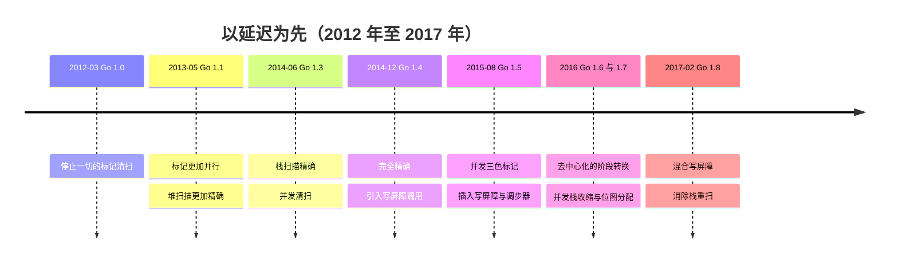
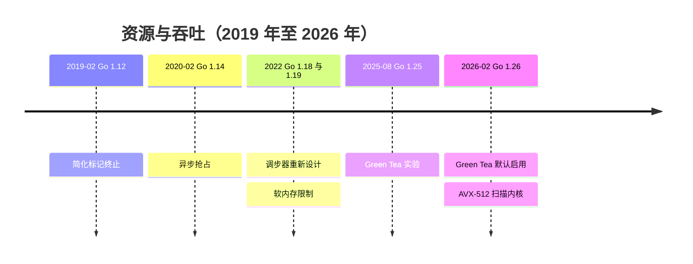

# 13.12 过去、现在与未来

前面十一节分别讨论了 Go 回收器的各个组成部分：三色标记（[13.1](./basic.md)）、
混合写屏障（[13.2](./barrier.md)）、调步器（[13.3](./pacing.md)）、标记与清扫（[13.4](./mark.md)、
[13.5](./sweep.md)）、标记终止（[13.6](./termination.md)），以及被放弃的分代与 ROC
实验（[13.8](./generational.md)、[13.9](./roc.md)）和新的 Green Tea 标记算法（[13.11](./greentea.md)）。
本节把它们放回时间轴上，说明它们在何时、出于何种考虑成为今天的样子。

这段历史大致分为三个阶段。2014 年至 2017 年，团队以延迟为首要目标，把停止一切的停顿从数百毫秒降到亚毫秒，
Hudson 称之为三个数量级的改进 [[Hudson, 2018](#ref-hudson-2018)]。此后的重心转向回收的节奏与内存用量：
调步器重新设计，运行时加入了软内存限制。2025 年起，Green Tea 把注意力转向标记本身的吞吐。贯穿三个阶段的，
是 2014 年就已定下的几项基本选择：回收器不分代、不移动对象，写屏障只在回收期间开启
[[Hudson, 2014](#ref-hudson-2014)] [[Hudson, 2018](#ref-hudson-2018)]。此后提出的每一项改进，
都要在这些约束之下证明自己的价值。

## 13.12.1 停止一切的回收器：Go 1.0 至 1.4

Go 1.5 之前的回收器在标记期间停止一切：回收开始时所有 goroutine 暂停，
回收器标记完存活对象之后才恢复用户代码。早期的几个版本主要从两个方向改进它。一是精确性。Go 1.1
使回收器在扫描堆时更加精确，代价是少量 CPU 时间，换来的是堆大小的显著缩减，在 32 位平台上尤其明显
[[Go Authors, 2013](#ref-go-authors-2013)]；Go 1.3 把同样的精确性扩展到栈上，
整数之类的非指针值从此不会被误当作指针而阻止内存回收 [[Go Authors, 2014a](#ref-go-authors-2014a)]；Go 1.4
把运行时的大部分代码从 C 改写为 Go，回收器得以准确地知道运行时自身栈上的指针，从而成为完全精确的回收器
[[Go Authors, 2014b](#ref-go-authors-2014b)]。精确与保守扫描的区别见 [13.7](./safe.md)。

二是缩短停顿。这里需要区分并行与并发：并行指多个回收线程同时工作，并发指回收与用户代码同时运行。Go 1.1
使回收器更加并行，以降低多核机器上的延迟 [[Go Authors, 2013](#ref-go-authors-2013)]。Go 1.3
采用并发的清扫算法，并改进了并行化、使用了更大的页，几项改动合计使回收停顿缩短 50% 至 70%
[[Go Authors, 2014a](#ref-go-authors-2014a)]。但标记阶段仍须停止一切，停顿时间随堆的大小增长。

Go 1.4 还为下一个版本做了准备：对堆上指针的写入改为调用一个函数，即写屏障，
以便下一版本的回收器在运行期间介入这些写入 [[Go Authors, 2014b](#ref-go-authors-2014b)]。Hudson 在
2014 年的规划中解释了提前引入它的原因：新算法必然影响吞吐，把一部分开销提前放进 1.4，可以抵消 1.4
原本的性能提升，使性能在各个版本之间单调改进，而不是 1.4 变快、1.5 又变慢
[[Hudson, 2014](#ref-hudson-2014)]。

## 13.12.2 以延迟为先：Go 1.5 的并发回收

Hudson 回顾 2014 年的处境时说，如果 Go 不能以某种方式解决回收延迟的问题，Go 就不会成功
[[Hudson, 2018](#ref-hudson-2018)]。尾延迟为何比平均延迟更要紧，见 [13.1.6](./basic.md)。同年 8 月，
Hudson 发表了 Go 1.4 之后的回收器规划，给出了量化的目标：在配置得当的机器上，回收延迟低于 10 毫秒，每
50 毫秒中赋值器至少可用 40 毫秒；硬件配置应允许堆的大小达到可达内存的两倍，并有 25% 的 CPU 周期，
通常是四个硬件线程中的一个，可供回收使用。规划用一个术语串概括了 Go 1.5 回收器的形态：不分代、不移动、
并发、三色的标记清扫回收器。规划也坦言，低延迟必然影响赋值器的吞吐 [[Hudson, 2014](#ref-hudson-2014)]。

这一形态是取舍的结果。Hudson 在 2018 年的演讲中透露，原本的长期计划是不用读屏障的并发复制回收器，
但读屏障的开销有很大的不确定性，团队希望避开它。而在 2014 年，更紧迫的是把运行时与编译器从 C 改写为 Go，
并尽快拿出一个专注于延迟的回收器，其性能损失不得超过编译器在一年内带来的提速。团队于是放弃了复制，
选择三色并发算法；写屏障只在回收期间开启，其余时间编译出的代码只检查一个全局变量，对编译器优化的影响很小。
不移动对象同样有理由：按尺寸分级的 span 能够高效地找到内部指针所指对象的起点，TCMalloc、Hoard 以及 Hudson
本人参与的 Intel Scalable Malloc 的经验表明，非移动分配器的碎片不会成为问题，而且不移动对象就无须在与 C
交互时固定对象或增加间接层 [[Hudson, 2018](#ref-hudson-2018)]。这些选择构成了第 12 章分配器与本章回收器的
共同基础。

Go 1.5 的回收器由三部分支撑：Dijkstra 式的插入写屏障维持并发标记的正确性（[13.2](./barrier.md)）；
Clements 设计的调步器决定何时开始回收，并在分配过快时要求分配者协助标记
（[13.3](./pacing.md)）[[Clements, 2015a](#ref-clements-2015a)]；后台标记工作者以 25% 的 CPU
预算完成大部分标记（[13.4](./mark.md)）。发布说明称，停止一切的阶段几乎总在 10 毫秒以下，通常还要短得多
[[Go Authors, 2015](#ref-go-authors-2015)]。Hudson 引用的 Twitter 生产服务器数据显示，2015 年
8 月的首个版本把停顿从 300 至 400 毫秒降到 30 至 40 毫秒，这是第一个数量级的改进
[[Hudson, 2018](#ref-hudson-2018)]。

## 13.12.3 逐一消除停止一切的工作：Go 1.6 至 1.8

Go 1.5 之后的工作，用 Hudson 的话说，是系统地消除停止一切期间所有与堆大小成正比的工作。六个月后，
同一台服务器上的停顿从 40 毫秒降到 4 至 5 毫秒，即第二个数量级；1.6.3 修复了若干问题，使停顿稳定在
10 毫秒的目标之下 [[Hudson, 2018](#ref-hudson-2018)]。Go 1.6 的一项结构性改动是去中心化的阶段转换。Go 1.5
的回收由一个专门的协调 goroutine 以直线式的代码驱动，所有阶段转换都要经过它，因而受制于调度器，
转换的延误会拉长回收周期、阻塞分配，偶尔造成很长的延迟；Go 1.6 改为一个显式的状态机，任何 goroutine
都可以推动阶段转换 [[Clements, 2015c](#ref-clements-2015c)]。

Go 1.7 把栈的收缩从标记终止移到了并发标记中 [[Clements, 2016](#ref-clements-2016)]。
这一版本的发布说明指出，对于有大量空闲 goroutine、栈大小剧烈变化或包级变量很大的程序，停顿明显短于 Go 1.6
[[Go Authors, 2016](#ref-go-authors-2016)]。同一版本合入了 Clements 提出的稠密标记位与免清扫分配：
标记位图直接用作下一轮的分配位图，分配时按位图寻找空闲槽位，清扫因此不必再构造自由表
（[13.5](./sweep.md)）[[Clements, 2015b](#ref-clements-2015b)]。Hudson 回顾 2016 年 8 月的数据时提到，
那台服务器的堆为 18 GB；随着与堆大小成正比的停止一切工作被逐一消除，堆可以继续增大而不影响延迟
[[Hudson, 2018](#ref-hudson-2018)]。

至此，唯一剩下的、没有上界的停止一切的工作是栈重扫。插入屏障不拦截栈上的写入，
标记终止时必须在停止一切的状态下重新扫描所有栈，在有大量活跃 goroutine 的程序中可能耗时数十乃至数百毫秒
[[Clements and Hudson, 2016a](#ref-clements-hudson-2016a)]。团队最初设计了并发重扫栈的方案，
但随后找到了简单得多的办法；并发重扫的设计文档在公开时就注明并不实际提出，只为保存其历史价值
[[Clements and Hudson, 2016b](#ref-clements-hudson-2016b)]。这一办法就是 Go 1.8 的混合写屏障，它结合
Yuasa 式的删除屏障与 Dijkstra 式的插入屏障，使栈扫描为黑之后不必再扫；设计文档报告，
初步实验中最坏的停止一切时间降到 50 微秒以下，栈屏障与重扫列表等专为栈重扫服务的机制也可以随之删除
[[Clements and Hudson, 2016a](#ref-clements-hudson-2016a)]。Go 1.8 的发布说明称，回收停顿通常低于
100 微秒，常常低至 10 微秒 [[Go Authors, 2017](#ref-go-authors-2017)]。机制与测量见
[13.2.3](./barrier.md)。Hudson 把这次改进称为第三个数量级 [[Hudson, 2018](#ref-hudson-2018)]。

此后的停顿工作转向剩余的细节。Hudson 在 2018 年提出了每轮停止一切不超过 500 微秒的新目标，同时指出，
外界对更低延迟的需求已经不大 [[Hudson, 2018](#ref-hudson-2018)]。Go 1.12 简化了标记终止：
新的标记完成算法基于分布式终止检测，消除了旧算法中的竞争；Go 1.5 为减少过早进入标记终止而把并发标记分为
mark 1 与 mark 2 两个子阶段，后者随之删除 [[Clements, 2018](#ref-clements-2018)]，现行的终止检测见
[13.6](./termination.md)。Go 1.14 的 goroutine 可以被异步抢占，没有函数调用的循环不再可能使调度器死锁或显
著推迟回收 [[Go Authors, 2020](#ref-go-authors-2020)]，见
[9.7.5](../../part3concurrency/ch09sched/preemption.md) 与 [13.7.3](./safe.md)。

## 13.12.4 从停顿到资源：Go 1.18 至 1.21

停顿降到亚毫秒之后，回收器的问题变成了何时回收、用多少 CPU、占多少内存。Go 1.18 重新设计了调步器，
栈与全局变量等非堆的回收工作从此计入回收的频率计算，回收开销在这些来源较大时变得更可预测
[[Go Authors, 2022a](#ref-go-authors-2022a)]。Go 1.19 加入了软内存限制，由 `GOMEMLIMIT` 或
`debug.SetMemoryLimit` 设置。它涵盖 Go 堆以及运行时管理的其他内存，即使 `GOGC=off` 也会得到遵守；
为了避免存活堆接近限制时回收陷入颠簸，运行时还尽量把回收的 CPU 占用限制在 50%（不计空闲时间），
宁可多用内存，也不让程序停滞 [[Go Authors, 2022b](#ref-go-authors-2022b)]。发布说明推荐的 GC
指南系统地说明了 `GOGC` 与内存限制之间的权衡 [[Go Authors, 2022c](#ref-go-authors-2022c)]。Go 1.21
的发布说明称，经过运行时内部对回收的调整，应用的尾延迟最多可降低 40%，内存用量也略有下降
[[Go Authors, 2023](#ref-go-authors-2023)]。这几个版本中调步器的每一处变化，见 [13.3.7](./pacing.md)。

内存限制也牵涉把空闲内存归还给操作系统的 scavenger。自 Go 1.18 起，后台 scavenger 的 CPU 目标固定为全部
CPU 时间的 1%，接近限制时也不会加快；内存限制一侧的归还目标是限制的 95%，与之比较的是运行时已提交的内存
`mappedReady`；一次分配若会使其超过限制，申请内存的一方当场归还超出的部分。这部分机制见
[12.7.7](../ch12alloc/pagealloc.md) 与 [12.7.8](../ch12alloc/pagealloc.md)。

## 13.12.5 没有走通的路

并非每一项计划都进入了正式版本。Hudson 2014 年的规划为 Go 1.6 设想的是提高吞吐：引入指针碰撞分配，
并为新生空间引入分代的复制回收，老年空间仍由并发回收器管理，新生空间的大小以 10 毫秒内能回收完为准；
规划称，Go 1.5 优先考虑并发、1.6 再考虑吞吐，是有意的选择 [[Hudson, 2014](#ref-hudson-2014)]。
这一计划没有实现。此后的两次尝试，2016 年至 2017 年的请求制导回收（[13.9](./roc.md)）与
2018 年的非移动分代回收（[13.8](./generational.md)），都需要在赋值器运行期间始终开启写屏障，
而这项开销未能被收益抵消；对分代而言，逃逸分析已把大量短命对象分配在栈上，收益更为有限。两者最终都被放弃
[[Hudson, 2018](#ref-hudson-2018)]。两节分别给出了实验的细节与放弃的理由。

另一条路是由程序员显式管理一部分内存。Go 1.20 起，运行时带有 `GOEXPERIMENT=arenas` 实验，
提供一个可以整批释放的 `arena.Arena` 类型。内存区域的设计文档回顾，arena 在实际应用中带来了 10% 至 15%
的性能提升，几乎全部来自更早地重用内存和推迟回收；但为了在更多场合发挥作用，大量 API 都要增加一个 arena
参数，标准库首当其冲，代价与收益不相称；arena 与语言的现有机制也难以组合，例如一旦选择从 arena 分配，
原本可以由逃逸分析分配在栈上的对象也被迫进入 arena。因此这一提案被无限期搁置
[[Knyszek, 2024](#ref-knyszek-2024)]，提案 #51317 至今仍处于搁置状态
[[Go Authors, 2022d](#ref-go-authors-2022d)]。

## 13.12.6 面向局部性：Go 1.25 起的 Green Tea

2014 年的规划希望通过分代提高吞吐，这一目标最终以另一种方式实现。Green Tea 不缩小需要扫描的对象集合，
而是改善扫描的局部性：把落在同一个 span 中的待扫对象累积起来一并扫描，不需要常开的写屏障
（[13.11](./greentea.md)）。按 span 累积再扫描的想法由 Clements 在 2018 年写下，即分代实验进行的同一年
[[Knyszek and Clements, 2025a](#ref-knyszek-clements-2025a)]；2024 年的原型证明它可行，2025 年 Knyszek
将它实现并投入生产 [[Knyszek and Clements, 2025b](#ref-knyszek-clements-2025b)]。

Green Tea 随 Go 1.25 以 `GOEXPERIMENT=greenteagc` 的实验形式发布，Go 1.26 起默认启用，同时加入了 amd64
上的 AVX-512 扫描内核。两个版本的发布说明都预计，大量使用回收器的实际程序的回收开销会降低 10% 至 40%；Go
1.26 的发布说明另外预计，在较新的 amd64 处理器上借助向量指令还能再降低 10% 左右
[[Go Authors, 2025](#ref-go-authors-2025)] [[Go Authors, 2026a](#ref-go-authors-2026a)]。
设计说明的评估还显示，改进大体随核数增加 [[Knyszek and Clements, 2025a](#ref-knyszek-clements-2025a)]。Go
1.26 的发布说明预计退出选项 `GOEXPERIMENT=nogreenteagc` 将在 Go 1.27 中移除，但到 Go 1.27.3 为止，
旧的标记实现仍在源码中 [[Go Authors, 2026a](#ref-go-authors-2026a)]
[[Go Authors, 2026c](#ref-go-authors-2026c)]。Green Tea 的实现位于 `mgcmark_greenteagc.go`
[[Go Authors, 2026b](#ref-go-authors-2026b)]。

## 13.12.7 展望

Green Tea 本身仍在演进。设计说明计划继续探索 Clements 最初设计中的集中网络，以获得更高的扫描密度
[[Knyszek and Clements, 2025a](#ref-knyszek-clements-2025a)]；博客则希望扫描内核的汇编代码不久能由 Go
代码取代 [[Knyszek and Clements, 2025b](#ref-knyszek-clements-2025b)]。

更大的方向，是在不改变回收器基本选择的前提下减少回收的工作量。2024 年 11 月，Knyszek
发起了关于内存区域（memory regions）的讨论，作为 arena 的可组合替代 [[Knyszek, 2024](#ref-knyszek-2024)]。
按设计文档，程序以 `region.Do(f)` 开启一个仅属于当前 goroutine 的区域，`f`
执行期间的分配进入堆中专门的部分；只有这个 goroutine、且只在区域活跃期间，才开启一种新的写屏障，
捕获指向区域内存的指针逃出区域的写入，并把以该指针为根的对象图转交常规的三色回收管理，
设计文档称之为「褪色」；`f` 返回时，区域的 span 立即被清扫，未逃出的内存随即重用。
它的首要目标是降低回收的资源开销，其次是可组合：不要求修改 API，并能与 `sync.Pool`、`unique.Handle`
以及逃逸分析的栈分配共存。可以看出，它与 [13.9](./roc.md) 的 ROC 同样依据请求或任务边界识别短命对象，
不同之处在于由程序员显式选择，且把写屏障限制在使用区域的 goroutine 之内。到 Go 1.27 为止，
它仍停留在设计阶段，实验标志中没有对应的条目。

另一项尝试已经进入源码。Go 1.26 加入了 `GOEXPERIMENT=runtimefreegc` 实验，其注释说明，
它使运行时在某些情形下借助编译器的帮助，更早地释放并重用内存 [[Go Authors, 2026c](#ref-go-authors-2026c)]
[[Malloy, 2025](#ref-malloy-2025)]。这些方向的共同点，与 2014 年以来的历次改进一样，是在不移动对象、
不要求常开写屏障的前提下，寻找减少回收开销的机会。

## 13.12.8 小结

Go 回收器的演进可以概括为三次目标的转移。2014 年至 2017 年以延迟为先：Go 1.5 引入并发标记，
此后的版本逐一消除停止一切期间与堆大小成正比的工作，Go 1.8 以混合写屏障消除栈重扫，使停顿进入亚毫秒。
2018 年之后转向资源：调步器重新设计并持续调整，Go 1.19 加入软内存限制，与 scavenger
的归还协同控制内存用量。2025 年起转向吞吐：Green Tea 以局部性改善标记的效率，Go 1.26 起成为默认实现。
分代与 ROC 两次尝试的失败与 Green Tea 的成功说明，在 Go 中，任何加速回收的方案都要先回答写屏障的代价问题。
下面两幅图汇总了各个版本的主要变化。

## 延伸阅读

- [Clements, 2015a] Austin Clements. *Go 1.5 concurrent garbage collector
  pacing.* 2015. https://golang.org/s/go15gcpacing
- [Clements, 2015b] Austin Clements. *Proposal: Dense mark bits and
  sweep-free allocation.* 2015. https://go.dev/design/12800-sweep-free-alloc
- [Clements, 2015c] Austin Clements. *Proposal: Decentralized GC
  coordination.* 2015. https://go.dev/design/11970-decentralized-gc
- [Clements, 2016] Austin Clements. runtime: shrink stacks during concurrent
  mark （Fixes #12967）. Go CL 20044, 2016. https://go.dev/cl/20044
- [Clements, 2018] Austin Clements. *Proposal: Simplify mark termination and
  eliminate mark 2.* 2018. https://go.dev/design/26903-simplify-mark-termination
- [Clements and Hudson, 2016a] Austin Clements, Rick Hudson.
  *Proposal: Eliminate STW stack re-scanning*（issue #17503，Go 1.8 的混合写屏障）. 2016.
  https://github.com/golang/go/issues/17503 https://go.dev/design/17503-eliminate-rescan
- [Clements and Hudson, 2016b] Austin Clements, Rick Hudson.
  *Proposal: Concurrent stack re-scanning.* 2016. https://go.dev/design/17505-concurrent-rescan
- [Go Authors, 2013] The Go Authors. *Go 1.1 Release Notes.* 2013.
  https://go.dev/doc/go1.1
- [Go Authors, 2014a] The Go Authors. *Go 1.3 Release Notes.* 2014.
  https://go.dev/doc/go1.3
- [Go Authors, 2014b] The Go Authors. *Go 1.4 Release Notes.* 2014.
  https://go.dev/doc/go1.4
- [Go Authors, 2015] The Go Authors. *Go 1.5 Release Notes.* 2015.
  https://go.dev/doc/go1.5
- [Go Authors, 2016] The Go Authors. *Go 1.7 Release Notes.* 2016.
  https://go.dev/doc/go1.7
- [Go Authors, 2017] The Go Authors. *Go 1.8 Release Notes.* 2017.
  https://go.dev/doc/go1.8
- [Go Authors, 2020] The Go Authors. *Go 1.14 Release Notes.* 2020.
  https://go.dev/doc/go1.14
- [Go Authors, 2022a] The Go Authors. *Go 1.18 Release Notes.* 2022.
  https://go.dev/doc/go1.18
- [Go Authors, 2022b] The Go Authors. *Soft memory limit (`GOMEMLIMIT`),
  Go 1.19 release notes.* 2022. https://go.dev/doc/go1.19#runtime
- [Go Authors, 2022c] The Go Authors. *A Guide to the Go Garbage
  Collector.* https://go.dev/doc/gc-guide （调步器、`GOMEMLIMIT` 与延迟/吞吐/内存权衡的官方指南）
- [Go Authors, 2022d] The Go Authors. *proposal: arena: new package
  providing memory arenas*（Go issue #51317）. 2022. https://github.com/golang/go/issues/51317
- [Go Authors, 2023] The Go Authors. *Go 1.21 Release Notes.* 2023.
  https://go.dev/doc/go1.21
- [Go Authors, 2025] The Go Authors. Go 1.25 Release Notes: New
  experimental garbage collector. https://go.dev/doc/go1.25#new-experimental-garbage-collector
- [Go Authors, 2026a] The Go Authors. Go 1.26 Release Notes: New garbage
  collector. https://go.dev/doc/go1.26#new-garbage-collector
- [Go Authors, 2026b] The Go Authors. *runtime/mgcmark_greenteagc.go.* Go
  1.26. https://github.com/golang/go/blob/release-branch.go1.26/src/runtime/mgcmark_greenteagc.go
  （`GOEXPERIMENT=greenteagc` 的实现）
- [Go Authors, 2026c] The Go Authors.
  src/internal/goexperiment/flags.go、src/runtime/mgcmark_nogreenteagc.go. Go 1.26 与 Go 1.27.3.
  https://github.com/golang/go/tree/release-branch.go1.27/src
- [Hudson, 2014] Richard L. Hudson. *Go 1.4+ Garbage Collection (GC) Plan and
  Roadmap.* August 6, 2014. https://golang.org/s/go14gc
- [Hudson, 2018] Richard L. Hudson. *Getting to Go: The Journey of Go's
  Garbage Collector.* ISMM 2018 keynote / The Go Blog, 2018. https://go.dev/blog/ismmkeynote
  （1.5 并发回收转向与低延迟立场的一手叙述）
- [Knyszek, 2024] Michael Knyszek. *Memory regions*（设计文档与 GitHub
  discussion #70257）. 2024. https://go.dev/design/70257-memory-regions
  https://github.com/golang/go/discussions/70257
- [Knyszek and Clements, 2025a] Michael Knyszek, Austin Clements.
  *runtime: green tea garbage collector*（issue #73581）. https://github.com/golang/go/issues/73581
  （Green Tea 的设计动机与基准）
- [Knyszek and Clements, 2025b] Michael Knyszek, Austin Clements.
  The Green Tea Garbage Collector. The Go Blog, October 29, 2025. https://go.dev/blog/greenteagc
- [Malloy, 2025] PJ Malloy. *Directly freeing user memory to reduce GC
  work*（Go issue #74299）. 2025. https://go.dev/design/74299-runtime-freegc
- 本书 [13.1 垃圾回收的基本想法](./basic.md)、[13.2 写屏障技术](./barrier.md)、
  [13.3 触发频率及其调步算法](./pacing.md)、[13.8 分代假设与代际回收](./generational.md)、
  [13.9 请求假设与事务制导回收](./roc.md)、[13.11 Green Tea：面向局部性的标记](./greentea.md)、
  [12.7 页分配器](../ch12alloc/pagealloc.md)。
