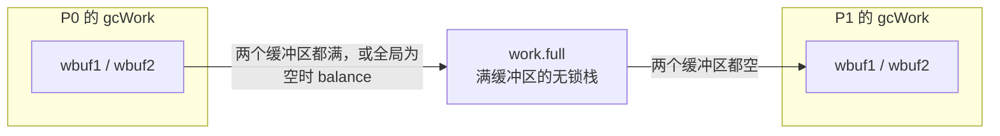

# 13.4 扫描标记与标记辅助

标记是回收的主体工作：从根出发（[13.1](./basic.md)），沿指针找到所有可达的对象，把它们由白色变为黑色。
Go 1.5 起，标记与赋值器并发进行，这带来三个问题。第一，由谁来标记，占用多少 CPU；第二，多个标记者
如何分享待扫描的灰色对象，而不在共享的数据结构上互相争抢；第三，赋值器在标记期间不断分配，凭什么保证
标记能赶在堆增长到目标之前完成。本节依次讨论标记工作者与 CPU 预算、灰色对象的队列、扫描一个对象的过程，
以及让分配者分担标记的标记辅助。

## 13.4.1 标记工作者与 25% 的预算

标记的主力是一组后台 goroutine，称为**标记工作者**（mark worker），入口为 `gcBgMarkWorker`。每轮回收
开始时，运行时确保每个 P 都有一个标记工作者；它们平时停在一个池中，只在标记阶段被调度运行。调步器把
标记期间后台标记的 CPU 占用定为 `GOMAXPROCS` 的 25%（[13.3](./pacing.md)），`startCycle` 把这一预算
换算成工作者的数目 [[Go Authors, 2026c](#ref-go-authors-2026c)]：

```go
	// Compute the background mark utilization goal. In general,
	// this may not come out exactly. We round the number of
	// dedicated workers so that the utilization is closest to
	// 25%. For small GOMAXPROCS, this would introduce too much
	// error, so we add fractional workers in that case.
	totalUtilizationGoal := float64(procs) * gcBackgroundUtilization
	dedicatedMarkWorkersNeeded := int64(totalUtilizationGoal + 0.5)
	utilError := float64(dedicatedMarkWorkersNeeded)/totalUtilizationGoal - 1
	const maxUtilError = 0.3
	if utilError < -maxUtilError || utilError > maxUtilError {
		// Rounding put us more than 30% off our goal. With
		// gcBackgroundUtilization of 25%, this happens for
		// GOMAXPROCS<=3 or GOMAXPROCS=6. Enable fractional
		// workers to compensate.
```

`GOMAXPROCS` 的四分之一四舍五入，得到专用（dedicated）工作者的数目：`GOMAXPROCS` 为 8 时是 2 个，为 5 时
是 1 个（实际占用 20%，误差在 30% 以内）。误差超过 30% 时，改用分时（fractional）工作者补足：`GOMAXPROCS`
为 6 时，1.5 舍入为 2 会多出三分之一，于是只保留 1 个专用工作者，其余的 0.5 个 P 由各 P 分时承担，每个 P
约 8.3% 的时间；`GOMAXPROCS` 不超过 3 时没有专用工作者，全部由分时工作者承担。三种工作模式的定义如下：

```go
	// gcMarkWorkerDedicatedMode indicates that the P of a mark
	// worker is dedicated to running that mark worker. The mark
	// worker should run without preemption.
	gcMarkWorkerDedicatedMode

	// gcMarkWorkerFractionalMode indicates that a P is currently
	// running the "fractional" mark worker. The fractional worker
	// is necessary when GOMAXPROCS*gcBackgroundUtilization is not
	// an integer and using only dedicated workers would result in
	// utilization too far from the target of gcBackgroundUtilization.
	// The fractional worker should run until it is preempted and
	// will be scheduled to pick up the fractional part of
	// GOMAXPROCS*gcBackgroundUtilization.
	gcMarkWorkerFractionalMode

	// gcMarkWorkerIdleMode indicates that a P is running the mark
	// worker because it has nothing else to do. The idle worker
	// should run until it is preempted and account its time
	// against gcController.idleMarkTime.
	gcMarkWorkerIdleMode
```

专用工作者在标记开始、重启世界时就被分配给 P，此后整个标记阶段占据这个 P。它先运行到第一次被抢占，
借这次抢占把 P 本地运行队列中的 goroutine 移到全局队列，让其他 P 去运行；此后便不再为普通的抢占请求让出
P，一直标记到没有工作为止，只有停止一切或 `forEachP`（[13.6](./termination.md)）的请求能使它中途停下。
分时工作者由调度器在 P 落后于分时目标时选中运行，超过目标的 1.2 倍就主动退出。空闲（idle）工作者则在 P
找不到可运行的 goroutine 时由 `findRunnable` 启动（[9.4](../../part3concurrency/ch09sched/schedule.md)），
它不计入 25% 的预算，只利用原本空闲的 CPU；其数目上限为 `GOMAXPROCS` 减去专用工作者的数目，
由两分钟定时条件触发的回收则把它降到 0 或 1 [[Go Authors, 2026a](#ref-go-authors-2026a)]，
因为此时程序本就空闲，无须全力回收 [[Go Authors, 2022](#ref-go-authors-2022)]。

这一安排可以追溯到 Go 1.5。Clements 最初设想按 CPU 占用的测量值动态调度后台标记，最终实现改为直接把
`GOMAXPROCS` 的 25% 交给后台标记：一部分 P 专用于标记，余下的部分在其他 P 之间分时，因为这样不需要
细粒度地测量与控制 CPU 占用 [[Clements, 2015](#ref-clements-2015)]。

## 13.4.2 灰色对象的队列

标记天然适合并行，难点在于多个工作者如何分享待扫描的灰色对象。每个 P 持有一个 `gcWork`，作为灰色对象的
本地缓存；全局则有一个由满缓冲区组成的列表 `work.full`，它是无锁栈。`gcWork` 中有两个缓冲区，源码注释
解释了这样设计的原因 [[Go Authors, 2026b](#ref-go-authors-2026b)]：

```go
	// wbuf1 and wbuf2 are the primary and secondary work buffers.
	//
	// This can be thought of as a stack of both work buffers'
	// pointers concatenated. When we pop the last pointer, we
	// shift the stack up by one work buffer by bringing in a new
	// full buffer and discarding an empty one. When we fill both
	// buffers, we shift the stack down by one work buffer by
	// bringing in a new empty buffer and discarding a full one.
	// This way we have one buffer's worth of hysteresis, which
	// amortizes the cost of getting or putting a work buffer over
	// at least one buffer of work and reduces contention on the
	// global work lists.
	//
	// wbuf1 is always the buffer we're currently pushing to and
	// popping from and wbuf2 is the buffer that will be discarded
	// next.
```

两个缓冲区都弹空时才向全局列表要一个满的，都填满时才交出一个，每次访问全局列表之间至少隔着一整个缓冲区
（2 KiB）的本地操作。这与本地缓存向中心缓存批量取还 span 的思路相同（[12.2](../ch12alloc/component.md)）。
工作在 P 之间的流动方向也值得注意：它不靠窃取，而靠分享。工作者每处理一个对象之前，若发现全局列表为空，
就调用 `balance` 主动把一个缓冲区交到全局列表上；本地工作耗尽的工作者只从全局列表取，不会去拿其他 P 的
`gcWork`。

工作者的主循环是 `gcDrain`。它先领取根标记任务（`markroot`），再反复取出灰色对象、扫描、把新发现的
白色对象置灰入队，直到没有工作为止。下面是裁剪后的速写：

```go
// gcDrain 的主干（速写，省略 Green Tea 的 span 队列与各种退出条件）
for !(gp.preempt && preemptible) {
	if work.full == 0 {
		gcw.balance() // 全局列表为空，交出一部分本地工作
	}
	b := gcw.tryGetObjFast() // 本地缓冲区
	if b == 0 {
		b = gcw.tryGetObj() // 必要时与全局列表交换缓冲区
	}
	if b == 0 {
		wbBufFlush() // 写屏障缓冲中可能还有灰色对象
		b = gcw.tryGetObj()
	}
	if b == 0 {
		break // 暂时没有工作
	}
	scanObject(b, gcw)
	if gcw.heapScanWork >= gcCreditSlack {
		// 每完成约 2000 字节的扫描工作，就把它记入调步器，
		// 并作为扫描信用供标记辅助支取（13.4.4）
	}
}
```

本地队列空了之后，工作者还会清空写屏障缓冲（[13.2](./barrier.md)），因为缓冲中的指针也是灰色对象的来源。
下图概括了工作的流动：



Go 1.26 默认启用的 Green Tea 回收器在此之外增加了一个按 span 组织的队列，把同一 span 中的待扫描对象攒在
一起批量处理，span 队列之间允许窃取。它是这套队列的扩充，灰色对象的含义不变，详见
[13.11](./greentea.md)。

## 13.4.3 扫描一个对象

一个对象被发现可达时，`greyobject` 在它所属 span 的标记位图中置位。若对象所在的 span 不含指针（noscan），
对象没有需要跟踪的字段，便直接成为黑色，不进入队列；否则对象成为灰色，进入本地队列，等待扫描
[[Go Authors, 2026a](#ref-go-authors-2026a)]。关闭 Green Tea 时，所有对象都走这条路径；Go 1.26 默认启用
Green Tea 后，这条路径只用于其余的对象：16 至 512 字节的小对象改为在所在 span 内部的标记位中置位，再以
span 为单位进入 span 队列，批量扫描（[13.11](./greentea.md)）。

扫描一个灰色对象，需要知道它的哪些字是指针。这些信息在分配时已经按类型记录下来
（[12.5](../ch12alloc/smallalloc.md)）。Go 1.22 起，记录方式分三种：不超过 512 字节的对象，
指针位图放在所属 span 的末尾，每个字对应一位；更大的对象在开头放一个字长的分配头，指向对象的类型描述符，
扫描时按类型中的指针掩码逐字查找；独占一个 span 的大对象，类型记录在 span 中
[[Go Authors, 2026a](#ref-go-authors-2026a)]。在此之前，Go 1.20 把每个 arena
的堆位图由每字两位改为每字一位 [[Randall, 2022](#ref-randall-2022)]；Go 1.22
的分配头省去了在分配时展开位图的工作 [[Knyszek, 2022](#ref-knyszek-2022)]，发布说明称这一变化使程序的 CPU
性能提高 1% 至 3%，内存开销减少约 1% [[Go Authors, 2024](#ref-go-authors-2024)]。

有了指针位置，`scanObject` 逐个读取指针字段：跳过 nil 与指向对象自身内部的指针，查找所指的堆对象，再交给
`greyobject`；在 Green Tea 下，指向小对象的指针交给 span 队列。两个细节影响扫描的代价。其一，
记入扫描工作量的字节数只算到对象中最后一个指针字段为止，指针之后的纯数据部分不计；
不含指针的对象根本不被扫描。其二，超过 128 KiB 的大对象被切成若干 128 KiB 的片段（oblet），
每次只扫描一段，其余的片段放回队列。这一做法始于 Go 1.8，把单次扫描的时间限制在约 100 微秒：此前，
执行标记辅助的 goroutine 一旦领到大对象，可能被阻塞很久，后台工作者在扫完整个大对象之前也无法交出扫描信用
[[Clements, 2016](#ref-clements-2016)]。

下面的程序分别保留 16 MiB 不含指针的 `[]int64` 与 16 MiB 元素全为 nil 的 `[]*int64`，在每次回收之后读取
存活堆与可扫描的堆：

```go {run=true}
package main

import (
	"fmt"
	"runtime"
	"runtime/metrics"
)

var (
	ints []int64  // 不含指针
	ptrs []*int64 // 含指针，元素全为 nil
)

func report(label string) {
	runtime.GC()
	s := []metrics.Sample{
		{Name: "/gc/heap/live:bytes"}, // 上一轮标记的存活堆
		{Name: "/gc/scan/heap:bytes"}, // 可扫描的堆
	}
	metrics.Read(s)
	fmt.Printf("%-14s 存活堆 %4.1f MiB，可扫描的堆 %4.1f MiB\n",
		label, mib(s[0].Value.Uint64()), mib(s[1].Value.Uint64()))
}

func mib(b uint64) float64 { return float64(b) / (1 << 20) }

func main() {
	report("初始")
	ints = make([]int64, 2<<20) // 16 MiB
	report("加入 []int64")
	ptrs = make([]*int64, 2<<20) // 16 MiB
	report("加入 []*int64")
}
```

运行结果如下：

```
初始             存活堆  0.3 MiB，可扫描的堆  0.3 MiB
加入 []int64     存活堆 16.3 MiB，可扫描的堆  0.3 MiB
加入 []*int64    存活堆 32.4 MiB，可扫描的堆 16.3 MiB
```

回收刚结束时，可扫描的堆等于这一轮实际完成的堆扫描工作量。两个切片都使存活堆增加了 16 MiB，
只有含指针的那个增加了扫描工作量：`[]int64` 位于不含指针的 span 中，被标记后直接成为黑色；`[]*int64`
虽然全是 nil，每个指针字段仍要逐一读取，它被切成 128 个片段扫描。初始的数值随平台而异，在浏览器的
WebAssembly 环境中更小，值得关注的是两次增加的量。这也是 13.3 中提前量只按可扫描的内存计算的原因。

栈不在堆中，扫描方式也不同。栈帧的布局随函数与执行位置变化，指针信息由编译器生成，称为栈映射；扫描一个
goroutine 的栈，就是按它停下的位置查出各帧的栈映射，再把其中的活指针所指的对象置灰。Go 1.14 起，被异步
抢占的帧没有精确的栈映射，需要保守地扫描。栈映射与保守式扫描都在 [13.7](./safe.md) 讨论。

## 13.4.4 标记辅助

25% 的后台预算按稳态估计（[13.3](./pacing.md)）。若赋值器分配得比预期快，堆可能在标记完成之前就超过
目标。**标记辅助**（mark assist）为此兜底：标记期间，分配内存的 goroutine 要按分配量承担相应的标记工作。

每个 goroutine 有一个以字节计的辅助额度 `gcAssistBytes`。标记期间，`mallocgc` 每次分配都从中扣除分配的
大小；额度变为负数，即欠下标记债时，`gcAssistAlloc` 在分配之前偿还。下面是裁剪后的源码，省略了跟踪与
synctest 相关的部分 [[Go Authors, 2026a](#ref-go-authors-2026a)]：

```go
retry:
	if gcCPULimiter.limiting() {
		// If the CPU limiter is enabled, intentionally don't
		// assist to reduce the amount of CPU time spent in the GC.
		return
	}
	// Compute the amount of scan work we need to do to make the
	// balance positive. When the required amount of work is low,
	// we over-assist to build up credit for future allocations
	// and amortize the cost of assisting.
	assistWorkPerByte := gcController.assistWorkPerByte.Load()
	assistBytesPerWork := gcController.assistBytesPerWork.Load()
	debtBytes := -gp.gcAssistBytes
	scanWork := int64(assistWorkPerByte * float64(debtBytes))
	if scanWork < gcOverAssistWork {
		scanWork = gcOverAssistWork
		debtBytes = int64(assistBytesPerWork * float64(scanWork))
	}

	// Steal as much credit as we can from the background GC's
	// scan credit. This is racy and may drop the background
	// credit below 0 if two mutators steal at the same time. This
	// will just cause steals to fail until credit is accumulated
	// again, so in the long run it doesn't really matter, but we
	// do have to handle the negative credit case.
	// ……（支取后台信用，够用则返回）

	// Perform assist work
	systemstack(func() {
		gcAssistAlloc1(gp, scanWork)
	})
	// ……
	if gp.gcAssistBytes < 0 {
		if gp.preempt {
			Gosched()
			goto retry
		}
		if !gcParkAssist() {
			goto retry
		}
	}
```

偿还分几步。回收的 CPU 上限已经触及时，直接放弃辅助（[13.3](./pacing.md)）。否则按调步器给出的辅助比率，
把欠下的字节折算成扫描工作量；数额太小时至少做 64 KiB（`gcOverAssistWork`），多出的部分成为今后分配的
额度，以摊薄每次辅助的固定开销。接着先从后台标记积累的信用 `bgScanCredit` 中支取，够用就不必亲自标记。
信用不足时，`gcAssistAlloc1` 调用 `gcDrainN` 完成余下的扫描工作，取工作的方式与后台工作者相同，没有灰色
对象时也会领取根标记任务。若仍未还清，被抢占的 goroutine 让出处理器后重试；否则它进入辅助队列
`work.assistQueue` 并挂起，等待后台标记产生新的信用。

后台工作者交出信用时，`gcFlushBgCredit` 先偿还队列中挂起的 goroutine，有剩余才记入 `bgScanCredit`。
只能部分偿还的 goroutine 被移到队尾，免得大笔欠债长时间堵住小笔欠债。被唤醒的 goroutine 不放入 P 的
`runnext`，源码注释解释说，否则用户代码可能借后台工作者较高的调度优先级，使自己总是先于其他 goroutine
运行 [[Go Authors, 2026a](#ref-go-authors-2026a)]。

标记辅助把分配速率与标记速率联系在一起：分配得越快，承担的标记工作越多，分配本身也因此放慢。按 1.18
调步器的设计，触发点估计准确时，后台标记积累的信用足以抵付分配，赋值器无须亲自标记
[[Knyszek, 2021](#ref-knyszek-2021)]；只有触发得偏晚时，分配密集的 goroutine 才会在标记期间感到延迟。GC
指南把标记辅助列为回收引起延迟的来源之一，并给出一个判断方法：CPU 剖析中 `runtime.gcAssistAlloc`
的累计时间超过 5%，说明程序的分配速度很可能超过了回收的速度 [[Go Authors, 2026d](#ref-go-authors-2026d)]。
标记辅助与写屏障因此构成互补的一对：

| 机制 | 保证什么 | 怎样保证 |
| --- | --- | --- |
| 写屏障 | 正确性：并发标记不遗漏存活对象 | 赋值器修改指针时记录相关对象，维持三色不变式 |
| 标记辅助 | 及时性：标记在堆增长到目标之前完成 | 分配者按分配量承担标记工作 |

灰色对象耗尽后，标记进入终止阶段，如何确认标记真正完成见 [13.6](./termination.md)。

## 13.4.5 设计取舍与演进

- 固定预算加标记辅助：Go 1.5 把后台标记的 CPU 占用固定为 25%，超出部分由分配者承担，使回收对吞吐的影响
  可以预测；代价是分配密集的程序在标记期间会被拖慢 [[Clements, 2015](#ref-clements-2015)]。
- 本地缓冲加全局分享：`gcWork` 的双缓冲区把全局列表的访问摊薄到整个缓冲区的工作量上，工作经由全局列表
  在 P 之间分享。Go 1.8 引入 128 KiB 的片段，限制单次扫描的时间 [[Clements, 2016](#ref-clements-2016)]。
- 指针元数据：堆位图在 Go 1.20 改为每字一位 [[Randall, 2022](#ref-randall-2022)]，Go 1.22 改为小对象的
  span 内位图与大对象的分配头 [[Knyszek, 2022](#ref-knyszek-2022)]。Go 1.25 以实验形式引入、Go 1.26 默认
  启用的 Green Tea 回收器再增加按 span 的批量扫描（[13.11](./greentea.md)）。

并发标记的理论起点是 Dijkstra 等人 1978 年的工作 [[Dijkstra et al., 1978](#ref-dijkstra-1978)]。Go
的回收器不移动对象，也不分代（[13.1](./basic.md)、[13.8](./generational.md)），Hudson 在
2018 年的主题演讲中解释了这些取舍 [[Hudson, 2018](#ref-hudson-2018)]；
工程上的力气因此集中在调步与标记辅助上，让标记始终跟得上分配。

## 13.4.6 小结

标记由每个 P 上的标记工作者完成：专用与分时工作者合计占用 `GOMAXPROCS` 的 25%，空闲工作者利用剩余的空闲
CPU。灰色对象存放在每个 P 的双缓冲区中，经由全局的无锁列表分享；Green Tea 下的小对象则以 span
为单位另行排队。扫描一个对象时，指针位置来自分配时记录的位图或分配头；不含指针的对象直接成为黑色，
大对象分段扫描。分配者按分配量承担标记工作，或支取后台标记积累的信用，从而保证标记在堆增长到目标之前完成。

## 延伸阅读

- <a id="ref-clements-2015"></a>[Clements, 2015] Austin Clements. *Go 1.5 concurrent garbage collector
  pacing.* 2015. https://golang.org/s/go15gcpacing
  标记辅助与后台标记调度的原始设计；文末记录了 Go 1.5 最终采用的 25% 专用与分时方案。
- <a id="ref-clements-2016"></a>[Clements, 2016] Austin Clements. runtime: bound scanobject to ~100 µs. Go
  commit cf4f1d07a1, 2016. https://go.dev/cl/23540
  随 Go 1.8 发布。
- <a id="ref-dijkstra-1978"></a>[Dijkstra et al., 1978] E. W. Dijkstra, L. Lamport, A. J. Martin, et al.
  *On-the-Fly Garbage Collection: An Exercise in Cooperation.* CACM, 1978.
  https://doi.org/10.1145/359642.359655
  （并发三色标记的理论奠基）
- <a id="ref-go-authors-2022"></a>[Go Authors, 2022] The Go Authors. *Go 1.19 Release Notes.* 2022.
  https://go.dev/doc/go1.19
- <a id="ref-go-authors-2024"></a>[Go Authors, 2024] The Go Authors. *Go 1.22 Release Notes.* 2024.
  https://go.dev/doc/go1.22
- <a id="ref-go-authors-2026a"></a>[Go Authors, 2026a] The Go Authors. *runtime/mgcmark.go.* `gcDrain`、
  `scanObject`、`gcAssistAlloc`、`gcDrainN`. 另见 src/runtime/mgcmark_greenteagc.go、src/runtime/mgc.go、
  src/runtime/mgcpacer.go、src/runtime/mbitmap.go. Go 1.26 源码.
  https://github.com/golang/go/blob/release-branch.go1.26/src/runtime/mgcmark.go
- <a id="ref-go-authors-2026b"></a>[Go Authors, 2026b] The Go Authors. *runtime/mgcwork.go.* `gcWork`、
  `workbuf` 与双缓冲队列. Go 1.26 源码.
  https://github.com/golang/go/blob/release-branch.go1.26/src/runtime/mgcwork.go
- <a id="ref-go-authors-2026c"></a>[Go Authors, 2026c] The Go Authors. *runtime/mgcpacer.go.*
  `gcBackgroundUtilization`、辅助信用与兑换率. Go 1.26 源码.
  https://github.com/golang/go/blob/release-branch.go1.26/src/runtime/mgcpacer.go
- <a id="ref-go-authors-2026d"></a>[Go Authors, 2026d] The Go Authors. *A Guide to the Go Garbage
  Collector.* https://go.dev/doc/gc-guide
- <a id="ref-hudson-2018"></a>[Hudson, 2018] Rick Hudson. *Getting to Go: The Journey of Go's Garbage
  Collector.* ISMM 2018 keynote. https://go.dev/blog/ismmkeynote
  （并发标记、写屏障、标记辅助的设计自述）
- <a id="ref-knyszek-2021"></a>[Knyszek, 2021] Michael Knyszek. *GC Pacer Redesign.* Go proposal 44167,
  2021. https://github.com/golang/proposal/blob/master/design/44167-gc-pacer-redesign.md
- <a id="ref-knyszek-2022"></a>[Knyszek, 2022] Michael Knyszek. runtime: implement experiment to replace
  heap bitmap with alloc headers. Go commit 38ac7c41aa, 2022. https://go.dev/cl/437955
  随 Go 1.22 发布。
- <a id="ref-randall-2022"></a>[Randall, 2022] Keith Randall. runtime: redo heap bitmap. Go commit
  6a9c674a09, 2022. https://go.dev/cl/422634
  随 Go 1.20 发布。
- 本书 [13.2 写屏障技术](./barrier.md)、[13.3 触发频率及其调步算法](./pacing.md)、
  [13.7 安全点分析](./safe.md)、[12.1 设计原则](../ch12alloc/basic.md)。
