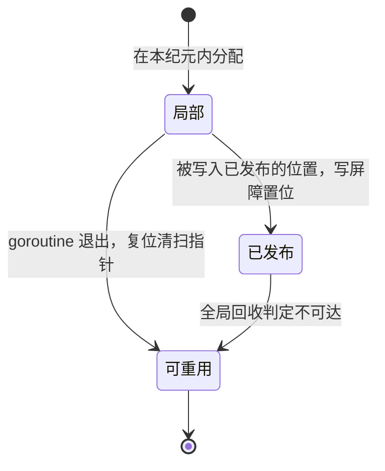

# 13.9 请求假设与事务制导回收

在尝试分代回收（[13.8](./generational.md)）之前，Go 团队先试验了另一种利用对象寿命规律的回收算法。
2016 年，Rick Hudson 与 Austin Clements 提出了请求制导回收（request oriented collector，ROC）。
这一算法最初称为事务制导回收（transaction oriented collector，TOC），后来采纳 Randall Farmer 的建议，
为避免与数据库领域 ACID 意义上的事务相混淆而更名
[[Hudson and Clements, 2016](#ref-hudson-clements-2016)]，本节标题沿用的是旧名。试验在 `dev.garbage`
分支上从 2016 年持续到 2017 年，最终没有任何一部分进入主线。本节介绍它所依据的假设、算法与实现，
以及它被放弃的原因。

## 13.9.1 请求假设

ROC 的设计文档这样表述**请求假设**（request hypothesis）：由一个请求创建的对象，往往在这一请求完成后死亡
[[Hudson and Clements, 2016](#ref-hudson-clements-2016)]。这一观察来自云端服务。这类程序通常由一个
goroutine 处理一个来自网络或其他 goroutine 的请求：接收消息、反序列化、计算、把结果序列化后放入 channel
或 socket，然后退出，或者进入休眠，等待下一个请求。计算过程中可能读取一个很大的共享堆，但写入堆中、
在请求结束后仍然存活的数据通常很少。以下面的处理函数为例：

```go
func handle(conn net.Conn) {
	req := decode(conn)        // 反序列化产生的中间对象
	result := compute(req)     // 计算过程中分配的临时对象
	conn.Write(encode(result)) // 编码结果写出后即不再需要
}
```

请求假设与分代假设关注的是对象寿命的不同侧面。分代假设按年龄区分对象，说的是年轻对象更容易死亡；
请求假设按归属区分对象，说的是一批对象的寿命以请求为边界。后者还指出了这批对象何时死亡：处理请求的
goroutine 结束之时。

## 13.9.2 局部对象与发布

设计文档把 goroutine 新分配、尚未让其他 goroutine 看到的对象称为局部（local）对象；一旦 goroutine
把新对象共享给其他 goroutine，就称这个对象被发布（published）。ROC 的关键观察是：若一个 goroutine
在发布某个对象之前就已退出，这个对象必然不可达，它占用的内存可以立即回收和重用，无需等待下一轮全局回收
[[Hudson and Clements, 2016](#ref-hudson-clements-2016)]。

算法建立在 Go 1.7 的位图分配之上（[12.5](../ch12alloc/smallalloc.md)）。分配器沿 span 的位图前进，
在未置位的位置上分配对象，每个 span 维护一个当前清扫指针，标出位图中已经扫过的部分。ROC 为每个正在运行的
goroutine 额外记录一个初始清扫指针。两个指针之间的位，要么已置位，表示对象在上一轮回收中存活或已经被发布；
要么未置位，表示对象由这个 goroutine 分配且尚未发布。设计文档称这些位为标记位，在实现中它们就是 span
的分配位图 [[Hudson, 2016a](#ref-hudson-2016a)]。

算法维持一条不变式：已发布的对象，其标记位必然已置位。维持它的是写屏障（[13.2](./barrier.md)）：
当一个指针被写入某个对象的字段时，若持有该字段的对象已发布，而被写入的对象未发布，后者便即将被发布，
从它可达的对象也随之即将被发布。写屏障先为被写入的对象置位，再沿指针传递地为所有可达的未置位对象置位，
遇到已置位的对象即停止这一分支；全部置位之后，才真正执行写入。整个过程无需同步：局部对象只有所属的
goroutine 能够看到，而在写入完成之前，这些对象仍然是局部的。

有了这条不变式，回收就变得非常简单。goroutine 退出时，只需把当前清扫指针复位到初始清扫指针：
两者之间已发布的对象都已置位，会被分配器跳过；未发布的对象未置位，立即可以分配给其他 goroutine。
对于处理完请求后进入休眠的 goroutine，算法先扫描它的栈，为从栈可达的局部对象置位，再复位清扫指针。
随着时间推移，位图中的多数位都会被置位，这时再进行一次完整的全局回收
[[Hudson and Clements, 2016](#ref-hudson-clements-2016)]。一个对象在 ROC 中的状态变化如下图所示：



## 13.9.3 实现：纪元与发布的出口

实现中，ROC 把一个 goroutine 在一个 P 上连续运行的区间称为一个纪元（epoch），围绕它定义了三个基本操作
[[Hudson, 2016c](#ref-hudson-2016c)]：`startG` 在 goroutine 被调度运行时开始一个新纪元；`recycleG` 在
goroutine 退出时把本纪元的局部对象交还分配器；`publishG` 发布本纪元的全部局部对象，从而提前结束纪元。
之所以以 P 为界，是因为分配走的是 P 的本地缓存（[12.2](../ch12alloc/component.md)），一旦其他 goroutine
可能在这个 P 上运行，本纪元的记录便无法继续维持。最初的实现在 goroutine 可能失去 P 的地方，
即暂止（park）、系统调用与调度器调用处，直接终止纪元：把 span 的 `startindex` 设为 `freeindex`，
相当于把本纪元分配的对象全部视为已发布。这是保守的做法，会让本可回收的对象至少存活到下一轮回收；
后来改为先扫描栈、发布可达的对象，再回收其余的局部对象 [[Hudson, 2016d](#ref-hudson-2016d)]；
对于系统调用，则推迟到它确实阻塞、P 被移交时才发布 [[Hudson, 2017](#ref-hudson-2017)]。

判断一个地址是否已发布的函数是 `isPublic`：栈上的地址是局部的；数据段、BSS
段以及堆外的地址一律视为已发布；堆中的对象若其所在 span 尚未清扫，或其分配位已置位，也是已发布的；
剩下的未置位对象中，序号不小于 span 新增字段 `startindex` 的，是本纪元分配且尚未发布的局部对象，
其余视为已发布 [[Hudson, 2016a](#ref-hudson-2016a)]。这一判断是保守的：凡不能确定属于本纪元的对象，
都按已发布处理。写屏障部分加在当时的 `gcmarkwb_m` 中 [[Hudson, 2016b](#ref-hudson-2016b)]：

```go
//go:nowritebarrierrec
//go:systemstack
func gcmarkwb_m(slot *uintptr, ptr uintptr) {
	if writeBarrier.mark {
		// ……
	}

	if ptr == 0 {
		return
	}

	// ROC: publish local ptrs being written into public slots.
	if writeBarrier.roc {
		// local -> public
		// local -> local
		// If slot is local then we are done.
		if !isPublic(uintptr(unsafe.Pointer(slot))) {
			return
		}
		// public -> public
		// if ptr is public we are done
		if isPublic(ptr) {
			return
		}
		// public -> local
		// Turn into a public -> public
		if inheap(ptr) {
			publish(ptr)
			// ……
		}
		return
	}
}
```

`writeBarrier.mark` 对应原有的标记屏障，只在回收的标记阶段开启；`writeBarrier.roc` 则在启用 ROC
时始终开启。四种写入中，只有从已发布位置指向局部对象的写入需要发布。当时 `mbarrier.go` 的注释已经说明，
写屏障在发布之前执行：它发生在 `*slot = ptr` 之前，而正是这次写入可能让其他 goroutine 第一次看到 `ptr`。
ROC 的正确性依赖这一次序。`publish` 的传递遍历最初写成递归，但递归会在不合适的时机引起栈增长，
于是改为借用标记阶段的工作缓冲区，以迭代方式完成 [[Hudson, 2016f](#ref-hudson-2016f)]。

写屏障只覆盖了经由指针写入的共享。在 Go 中，一个对象还有许多途径被其他 goroutine 看到，
每一条都需要单独的发布处理：通过 channel 发送的元素，`go f(p)` 中被放到新 goroutine 栈上的实参，defer、
终结器与剖析记录引用的对象，原子操作写入的指针，`memmove` 复制的源数据，以及 map 溢出桶的追加等
[[Hudson, 2016e](#ref-hudson-2016e)]。这些 CL 表明，在一门允许共享可变内存的语言中，
要在运行时精确判定对象是否被共享，必须找出共享可能发生的每一个出口。

## 13.9.4 评估与放弃

2017 年 5 月，Ian Lance Taylor 在邮件列表中仍把这项工作称为进行中的研究，尚不清楚它在实际中是否有利
[[Taylor, 2017](#ref-taylor-2017)]。Hudson 在 ISMM 2018 的主题演讲中公布了结果
[[Hudson, 2018](#ref-hudson-2018)]。ROC 的写屏障始终开启：每次写入都要检查是否把局部对象的指针写进了已发布
的对象，若是，还要发布被引用的对象并传递地遍历其可达对象，这一遍历可能引起大量缓存未命中。在一个端到端的
RPC 基准中，共享较少时，开启 ROC 后程序的扩展性相当好。但团队还必须保证 ROC 不拖慢系统的其他部分，
而编译器恰恰是 ROC 表现最差的程序，慢了 30%、40%、50% 乃至更多，这是无法接受的。
在编译器团队选定的那组性能基准上，结果同样一律不佳。Hudson 总结说，ROC 确实带来了扩展性，但当时的机器只有
4 至 12 个硬件线程，扩展性的收益抵不过写屏障的开销；也许在 128 核的机器普及之后，这一结论值得重新审视。

这一结果与 [13.8](./generational.md) 中的分析一致。Go 现有的写屏障只在标记期间开启：
编译器在需要屏障的指针写入之前插入对全局标志 `writeBarrier.enabled` 的检查，回收器空闲时，
赋值器只为每次写入付出这一次检查；ROC 与基于卡表的分代回收都要求屏障在赋值器运行期间始终开启，而 ROC
的屏障还带有传递遍历，代价更高。指针写入是程序中最频繁的操作之一，常驻屏障的单次开销再小，
乘以写入次数之后也是一笔可观的固定支出。

## 13.9.5 局部回收的谱系

ROC 属于局部回收的一支：给每个执行单元一块只属于它的内存，单独、廉价地回收，
只有被共享的对象才交给全局回收。这一思路在 ROC 之前已有多次实践，它们的差别在于由谁、
在何时判定一个对象是否被共享。

Doligez 与 Leroy 为 Concurrent Caml Light 设计的回收器中，每个线程有自己的私有堆作为年轻代，
所有线程共享的堆作为老年代；私有堆满时，线程独自把其中的存活对象复制到共享堆，无需与其他线程同步。
这一设计要求不存在从共享堆指向私有堆的指针，因此，当一个私有对象被写入共享堆中的可变对象时，
运行时把它及其私有的后代复制到共享堆，再写入副本的地址。复制之所以可行，是因为 ML
的类型系统在编译期区分可变与不可变对象，复制不可变对象在语义上不可察觉，而可变对象直接分配在共享堆中
[[Doligez and Leroy, 1993](#ref-doligez-leroy-1993)]。

Domani 等人为 Java 设计的线程局部堆与 ROC 最为接近。每个线程在自己的堆分区中分配，并可独自进行局部回收；
写屏障在每次指针修改时检查是否有局部对象成为全局对象的后代，若是，
在写入之前以深度优先遍历把它的全部后代标为全局，同样无需同步。论文报告，结合直接全局分配之后，
总回收时间大幅减少，大多数长停顿得以消除；不过写屏障没有在 JIT 中实现，测量是在解释执行模式下进行的
[[Domani et al., 2002](#ref-domani-2002)]。

Erlang 则从语言语义上消除了判定的需要。进程之间不共享任何数据，只通过消息通信
[[Armstrong, 2003](#ref-armstrong-2003)]；运行时为每个进程配备独立的堆，
使用按进程进行的分代半空间复制回收，发送消息时把消息内容复制到接收方；例外是大于 64 字节的二进制数据，
它们存放在全局的、引用计数的二进制堆中，进程堆上只保存指向它们的引用
[[Erlang/OTP, 2026](#ref-erlang-otp-2026)]。

三者分别把判定交给了语言语义（Erlang 禁止共享）、类型系统（ML 区分可变与不可变）和运行时写屏障（Java
线程局部堆与 ROC）。Go 允许 goroutine 之间共享可变对象，语言与类型都无法保证某个对象只属于某个 goroutine，
ROC 只能走第三条路，并为此在每次指针写入上付费。Go 的编译器以另一种方式回答了相近的问题：
逃逸分析（[15.5](../../part5toolchain/ch15compile/escape.md)）在编译期保守地判定对象是否会离开其所在的函
数，判定为不逃逸的对象直接分配在栈上，运行时不付出任何代价，但只能处理它能够证明的情形。

## 13.9.6 小结

请求假设指出，服务端程序中由一个请求创建的对象往往在请求完成后死亡。ROC 据此把新对象分为局部与已发布两类：
写屏障在对象被共享之前把它及其可达对象标记为已发布，goroutine 退出时，
未发布的对象只需复位一个指针即可重用。实现表明，在允许共享可变内存的 Go 中，每一种共享途径都需要发布处理，
而始终开启、带传递遍历的写屏障使编译器等程序慢了 30% 以上。ROC 与随后的分代实验在同一处受阻：
两者都要求赋值器持续为写屏障付费。此后 Go 转而在不改动写屏障的前提下改进标记的局部性，即 Go 1.26
默认启用的 Green Tea（[13.11](./greentea.md)）。

## 延伸阅读

- <a id="ref-armstrong-2003"></a>[Armstrong, 2003] Joe Armstrong. *Making Reliable Distributed Systems in
  the Presence of Software Errors.* PhD thesis, Royal Institute of Technology (KTH), 2003.
  https://erlang.org/download/armstrong_thesis_2003.pdf
  Erlang/BEAM 每进程堆与拷贝消息语义，请求假设的语言层对照。
- <a id="ref-doligez-leroy-1993"></a>[Doligez and Leroy, 1993] Damien Doligez, Xavier Leroy. "A
  Concurrent, Generational Garbage Collector for a Multithreaded Implementation of ML." *POPL '93*,
  113–123, 1993. https://doi.org/10.1145/158511.158611
  每线程小堆 + 共享主堆的局部回收先例，与 ROC 同源的设计直觉。
- <a id="ref-domani-2002"></a>[Domani et al., 2002] Tamar Domani, Gal Goldshtein, Elliot K. Kolodner,
  Ethan Lewis, Erez Petrank, Dafna Sheinwald. "Thread-Local Heaps for Java." *ISMM '02*, 76–87, 2002.
  https://doi.org/10.1145/512429.512439
- <a id="ref-erlang-otp-2026"></a>[Erlang/OTP, 2026] Erlang/OTP. Erlang Garbage Collector. ERTS User's
  Guide, 2026. https://www.erlang.org/doc/apps/erts/garbagecollection.html
- <a id="ref-hudson-2016a"></a>[Hudson, 2016a] Rick Hudson. [dev.garbage] runtime: determine if an object
  is public. Go CL 25056, 2016. https://go.dev/cl/25056
  `isPublic` 与 `mspan.startindex`；这是 ROC 系列中唯一合入的 CL，合入的是 `dev.garbage` 分支而非主线。
- <a id="ref-hudson-2016b"></a>[Hudson, 2016b] Rick Hudson. [dev.garbage] runtime: ROC write barrier code.
  Go CL 25058, 2016. https://go.dev/cl/25058
  ROC 实验分支 `dev.garbage` 上的写屏障实现。
- <a id="ref-hudson-2016c"></a>[Hudson, 2016c] Rick Hudson. [dev.garbage] runtime: invoke core ROC
  routines. Go CL 25303, 2016. https://go.dev/cl/25303
  `startG`、`publishG` 与 `recycleG` 三个基本操作。
- <a id="ref-hudson-2016d"></a>[Hudson, 2016d] Rick Hudson. [dev.garbage] runtime: add ROC recycle calls.
  Go CL 33316, 2016. https://go.dev/cl/33316
- <a id="ref-hudson-2016e"></a>[Hudson, 2016e] Rick Hudson. [dev.garbage] runtime: publish channel
  elements for ROC. Go CL 25305, 2016. https://go.dev/cl/25305
同一系列的发布处理还有 CL 25304（新 goroutine 的栈）、25306（终结器）、25307（剖析记录）、25308（defer）、
33307（原子操作）、33317（`memmove`）与 33320（map 溢出桶的追加）。
- <a id="ref-hudson-2016f"></a>[Hudson, 2016f] Rick Hudson. [dev.garbage] runtime: TOC write barrier code.
  Go CL 22343, 2016. https://go.dev/cl/22343
  算法尚名为 TOC 时的写屏障实现。
- <a id="ref-hudson-2017"></a>[Hudson, 2017] Rick Hudson. [dev.garbage] runtime: lazy publish on syscall.
  Go CL 37101, 2017. https://go.dev/cl/37101
- <a id="ref-hudson-2018"></a>[Hudson, 2018] Rick Hudson. *Getting to Go: The Journey of Go's Garbage
  Collector.* ISMM 2018 keynote, 2018. https://go.dev/blog/ismmkeynote
  ROC 的实验结果、写屏障税与放弃缘由的一手记述。
- <a id="ref-hudson-clements-2016"></a>[Hudson and Clements, 2016] Rick Hudson, Austin Clements. *Request
  Oriented Collector (ROC) Algorithm.* 2016. 设计文档（短链 `golang.org/s/gctoc`）：
  https://docs.google.com/document/d/1gCsFxXamW8RRvOe5hECz98Ftk-tcRRJcDFANj2VwCB0/view
  局部 / 已发布对象、发布写屏障与按 goroutine 退出整批回收的原始设计。
- <a id="ref-taylor-2017"></a>[Taylor, 2017] Ian Lance Taylor. Re: Why golang garbage-collector not
  implement Generational and Compact gc? golang-nuts, 2017.
  https://groups.google.com/g/golang-nuts/c/KJiyv2mV2pU/m/wdBUH1mHCAAJ
- 本书 [13.2 写屏障技术](./barrier.md)、[13.8 分代假设与代际回收](./generational.md)、
  [13.12 过去、现在与未来](./history.md)。
