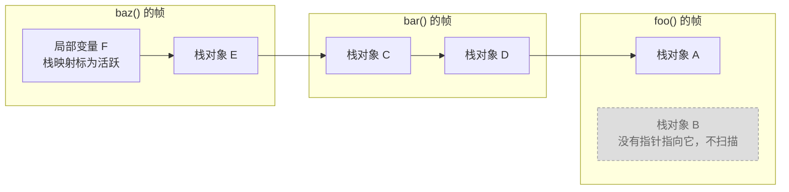

# 13.7 安全点分析

标记阶段要扫描每个 goroutine 的栈（[13.4](./mark.md)）。栈上的一个字可能是指向堆的指针，也可能只是一个
整数，回收器必须分辨二者：把整数误当作指针，只会让本应回收的对象多存活一段时间；把指针误当作整数，
则会回收仍在使用的对象。Go 的回收器是精确的（precise），它不凭数值猜测：堆对象的指针布局来自编译器为
每个类型生成的位图（[12.2](../ch12alloc/component.md)），栈帧的布局则来自编译器为每个函数生成的
**栈映射**（stack map）。

栈映射只在函数的调用处存在，回收器因此只能在 goroutine 停在这些位置时精确地扫描它的栈。
[9.7](../../part3concurrency/ch09sched/preemption.md) 从调度的角度讨论了安全点的分类，以及如何让
goroutine 停在安全点上；本节从回收器的角度讨论在安全点上能读到什么：编译器如何生成栈映射，
运行时如何依据它扫描一个栈，被取了地址的局部变量如何处理，以及异步抢占留下的两帧如何保守地扫描。

## 13.7.1 栈映射

栈映射由编译器的活跃性分析（liveness analysis）生成。它只跟踪分配在栈上、且类型含有指针的局部变量与参数，
对每个函数做一次后向数据流分析：先求出每个基本块中先使用后定义的变量与被重新定义的变量，再沿控制流迭代，
得到每个基本块入口与出口处的活跃变量，最后在块内逐条指令向后推进，在需要栈映射的指令处记下当时活跃的变量
[[Go Authors, 2026c](#ref-go-authors-2026c)]。需要栈映射的指令只有调用：

```go
// Returns true for instructions that must have a stack map.
//
// This does not necessarily mean the instruction is a safe-point. In
// particular, call Values can have a stack map in case the callee
// grows the stack, but not themselves be a safe-point.
func (lv *Liveness) hasStackMap(v *ssa.Value) bool {
	if !v.Op.IsCall() {
		return false
	}
	// wbZero and wbCopy are write barriers and
	// deeply non-preemptible. They are unsafe points and
	// hence should not have liveness maps.
	if sym, ok := v.Aux.(*ssa.AuxCall); ok && (sym.Fn == ir.Syms.WBZero || sym.Fn == ir.Syms.WBMove) {
		return false
	}
	return true
}
```

调用处之所以足够，是因为需要精确扫描的每一帧都停在调用处：栈顶的帧停在对运行时的调用（例如进入调度器，
或者函数序言中对 `morestack` 的调用）上，其余的帧都在等待被调用者返回。注释中区分「有栈映射」
与「是安全点」，原因也在这里：一次调用即使本身不是安全点，被调用者也可能扩栈，
而栈拷贝同样要依据栈映射调整指针（[14.4](../ch14stack/copy.md)）。Go 1.15 起，栈映射只在调用处生成；
此前编译器在几乎每条指令处记录栈映射与寄存器映射，原本是为非协作式抢占准备的
（[9.7](../../part3concurrency/ch09sched/preemption.md)）[[Clements, 2020b](#ref-clements-2020b)]。

一个函数在各调用处的位图去重之后组成一张表，存入函数的元数据。局部变量与参数各有一张表，分别是
`FUNCDATA_LocalsPointerMaps` 与 `FUNCDATA_ArgsPointerMaps`；另有一张按 PC 编码的表
`PCDATA_StackMapIndex`，给出每条调用指令使用表中的第几张位图，函数入口处的位图总是第 0 张。
运行时看到的表头是 `stackmap` [[Go Authors, 2026a](#ref-go-authors-2026a)]：

```go
type stackmap struct {
	n        int32   // number of bitmaps
	nbit     int32   // number of bits in each bitmap
	bytedata [1]byte // bitmaps, each starting on a byte boundary
}
```

位图的第 i 位对应帧中相应区域的第 i 个字。

活跃性按调用处逐一计算，一个变量在最后一次使用之后就不再出现在栈映射中，即使它在源码中仍处于作用域内。
它曾指向的对象因此可能在函数返回之前就被回收。下面的程序用弱指针（[13.10](./finalizer.md)）观察这一点：
弱指针不阻止对象被回收，对象被回收之后，`Value` 返回 nil。

```go {run=true}
package main

import (
	"fmt"
	"runtime"
	"weak"
)

type buffer struct{ data [4096]byte }

// collected 触发一次回收，报告弱指针所指的对象是否已被回收。
//
//go:noinline
func collected(w weak.Pointer[buffer]) bool {
	runtime.GC()
	return w.Value() == nil
}

func main() {
	p := new(buffer)
	fmt.Println("p 已被回收：", collected(weak.Make(p)))

	q := new(buffer)
	fmt.Println("q 已被回收：", collected(weak.Make(q)))
	runtime.KeepAlive(q)
}
```

运行结果如下：

```
p 已被回收： true
q 已被回收： false
```

两次 `new(buffer)` 都分配在堆上：得到的指针传给了 `weak.Make`，而它的参数会逃逸（`-gcflags=-m`
报告`new(buffer) escapes to heap`）。`p` 传给 `weak.Make` 之后不再使用，调用 `collected`
时已不在栈映射中，它所指的对象不再可达，在这次回收中被回收；`q` 之后还要传给 `runtime.KeepAlive`，调用
`collected` 时仍然活跃。编译器选项 `-live` 在每个调用处报告栈映射中的变量，集合为空时不输出：

```shell
$ go build -gcflags=-live 2>&1 | grep 'call to collected'
./main.go:24:44: live at call to collected: q
```

第 21 行的调用没有输出，说明那里的栈映射为空。`collected` 标注了 `//go:noinline`，以免它被内联之后，
报告的位置随之改变。

`runtime.KeepAlive` 正是为此而设，它的文档写道 [[Go Authors, 2026e](#ref-go-authors-2026e)]：

```go
// KeepAlive marks its argument as currently reachable.
// This ensures that the object is not freed, and its finalizer is not run,
// before the point in the program where KeepAlive is called.
```

编译器把对它的调用替换为一个不生成机器指令的 SSA 操作 `OpKeepAlive`，其定义注明「arg[0] is a value that
must be kept alive until this mark」，作用只是把参数的活跃区间延伸到调用处。文档同时提醒，`KeepAlive`
只应用于防止终结器过早运行；终结器与清理函数的语义见 [13.10](./finalizer.md)。

## 13.7.2 扫描一个栈

栈是标记的根之一。在混合写屏障下，每个栈在一轮标记中只需扫描一次（[13.2](./barrier.md)）。领取到某个
goroutine 的栈根任务后（[13.4](./mark.md)），`markroot` 先调用 `suspendG` 让它停在安全点，扫描完毕再调用
`resumeG` 让它继续执行
（[9.7](../../part3concurrency/ch09sched/preemption.md)）[[Go Authors, 2026b](#ref-go-authors-2026b)]。
执行扫描的 goroutine 也可能恰好就是被扫描的那一个；这时它先把自己置为 `_Gwaiting`，
以免等待自己停下而死锁，扫描则在系统栈上进行。`scanstack` 开头的检查把这些前提写成断言
[[Go Authors, 2026a](#ref-go-authors-2026a)]：

```go
	switch readgstatus(gp) &^ _Gscan {
	default:
		print("runtime: gp=", gp, ", goid=", gp.goid, ", gp->atomicstatus=", readgstatus(gp), "\n")
		throw("mark - bad status")
	case _Gdead, _Gdeadextra:
		return 0
	case _Grunning:
		print("runtime: gp=", gp, ", goid=", gp.goid, ", gp->atomicstatus=", readgstatus(gp), "\n")
		throw("scanstack: goroutine not stopped")
	case _Grunnable, _Gsyscall, _Gwaiting, _Gleaked:
		// ok
	}

	if gp == getg() {
		throw("can't scan our own stack")
	}
```

其中 `_Gleaked` 是 Go 1.26 的 goroutine 泄漏剖析实验引入的状态（[13.6](./termination.md)）。随后
`scanstack` 累计扫描过的栈大小，供确定新 goroutine 的初始栈大小（[14.2](../ch14stack/alloc.md)），
并在安全时顺带收缩这个栈（[14.5](../ch14stack/shrink.md)），再用 `unwinder` 从栈顶逐帧展开，对每一帧调用
`scanframeworker`。精确地扫描一帧之前，`getStackMap` 先确定该用哪一张位图：

```go
func (frame *stkframe) getStackMap(debug bool) (locals, args bitvector, objs []stackObjectRecord) {
	targetpc := frame.continpc
	if targetpc == 0 {
		// Frame is dead. Return empty bitvectors.
		return
	}

	f := frame.fn
	pcdata := int32(-1)
	if targetpc != f.entry() {
		// Back up to the CALL. If we're at the function entry
		// point, we want to use the entry map (-1), even if
		// the first instruction of the function changes the
		// stack map.
		targetpc--
		pcdata = pcdatavalue(f, abi.PCDATA_StackMapIndex, targetpc)
	}
	if pcdata == -1 {
		// We do not have a valid pcdata value but there might be a
		// stackmap for this function. It is likely that we are looking
		// at the function prologue, assume so and hope for the best.
		pcdata = 0
	}
	// ……
```

`continpc` 是这一帧将要继续执行的位置，通常就是调用的返回地址；帧若不会再执行，它为 0，帧中没有需要保留的
内容。返回地址指向调用指令的下一条指令，那里可能已属于另一张位图的范围，因此先退回一个字节，落在调用指令
本身。停在函数入口的帧，例如尚未开始运行的 goroutine，使用入口处的第 0 张位图。

`getStackMap` 用同一个序号分别从局部变量表与参数表中取出位图，再取出本函数登记的栈对象（13.7.3），
`scanframeworker` 把两张位图交给 `scanblock`：

```go
	locals, args, objs := frame.getStackMap(false)

	// Scan local variables if stack frame has been allocated.
	if locals.n > 0 {
		size := uintptr(locals.n) * goarch.PtrSize
		scanblock(frame.varp-size, size, locals.bytedata, gcw, state)
	}

	// Scan arguments.
	if args.n > 0 {
		scanblock(frame.argp, uintptr(args.n)*goarch.PtrSize, args.bytedata, gcw, state)
	}
```

`varp` 与 `argp` 分别是局部变量区的顶端与参数区的起点，帧中各区域的位置见 [14.4](../ch14stack/copy.md)
引用的布局图。`scanblock` 依位图逐字检查：

```go
	for i := uintptr(0); i < n; {
		// Find bits for the next word.
		bits := uint32(*addb(ptrmask, i/(goarch.PtrSize*8)))
		if bits == 0 {
			i += goarch.PtrSize * 8
			continue
		}
		for j := 0; j < 8 && i < n; j++ {
			if bits&1 != 0 {
				// Same work as in scanObject; see comments there.
				p := *(*uintptr)(unsafe.Pointer(b + i))
				if p != 0 {
					if stk != nil && p >= stk.stack.lo && p < stk.stack.hi {
						stk.putPtr(p, false)
					} else {
						if !tryDeferToSpanScan(p, gcw) {
							if obj, span, objIndex := findObject(p, b, i); obj != 0 {
								greyobject(obj, b, i, span, gcw, objIndex)
							}
						}
					}
				}
			}
			bits >>= 1
			i += goarch.PtrSize
		}
	}
```

位图的一个字节为 0 时，一次跳过 8 个字。标为指针的字若指向本 goroutine 的栈，交给栈对象的处理；
否则与扫描堆对象时相同，Green Tea 接管的小对象放入 span 队列（[13.11](./greentea.md)），其余对象直接置灰。
位图之外的字，无论数值多像地址，都不会被解引用。

除了各个栈帧，`scanstack` 还扫描几处与栈相连的指针：调度上下文中保存的闭包上下文寄存器 `gp.sched.ctxt`、
defer 记录中的函数值与链接，以及 panic 记录。panic 记录总是分配在栈上，按栈对象处理。

## 13.7.3 栈对象

活跃性分析能够跟踪对变量的直接读写，却难以跟踪经由指针的访问：一个局部变量被取了地址之后，
指向它的指针可能在栈上的各个函数之间传递，也可能有条件地保留下来。这样的变量若没有逃逸、仍分配在栈上，
编译器就无法静态地断定它何时死亡。Go 1.12 以前，编译器的做法是保守的：在每个调用处，
只要有一条到达该处的路径初始化过某个被取了地址的变量，这个变量就视为活跃；
只在部分路径上初始化的变量称为模糊活跃（ambiguously live）的变量，还要在函数入口处清零，
以免回收器读到未初始化的值 [[Go Authors, 2018](#ref-go-authors-2018)]。

这种做法会让对象意外地存活。2017 年的 issue #22350 报告了这样一个程序：循环中不断以
`curr.next = new(Node)` 延长一条链表，每 3000 个节点把 `root` 移到当前节点，预期旧的节点会被回收，
内存却始终不被释放 [[zardlee1937, 2017](#ref-zardlee1937-2017)]。讨论指出，第一个 `new(Node)` 没有逃逸，
编译器把这个节点作为一个临时变量分配在栈上，`curr` 指向它。这个栈上的节点必须活到循环中第一次执行
`curr = curr.next` 为止，而编译器无法区分循环的第一次迭代与其余迭代，只能让它在整个循环中保持活跃，
于是经由它的 `next` 字段，整条链表都被保留下来。

Go 1.12 引入的**栈对象**（stack object）改为在运行时判定 [[Randall, 2018a](#ref-randall-2018a)]
[[Randall, 2018b](#ref-randall-2018b)]。编译器把每个函数中被取了地址、类型含有指针且留在栈上的变量登记在
函数的元数据 `FUNCDATA_StackObjects` 中，扫描栈时，运行时在这些对象之间做一次小规模的标记。
`runtime/mgcstack.go` 开头的注释说明了思路 [[Go Authors, 2026d](#ref-go-authors-2026d)]：

```go
// Instead, we will track pointers to stack variables dynamically.
// All pointers to stack-allocated variables will themselves be on the
// stack somewhere (or in associated locations, like defer records), so
// we can find them all efficiently.
//
// Stack tracing is organized as a mini garbage collection tracing
// pass. The objects in this garbage collection are all the variables
// on the stack whose address is taken, and which themselves contain a
// pointer. We call these variables "stack objects".
```

注释接着给出一个例子：`foo` 调用 `bar`，`bar` 调用 `baz`；`foo` 有栈对象 A 与 B，`bar` 有栈对象 C 与 D，
C 指向 D，D 指向 A；`baz` 有指向 C 的栈对象 E，以及指向 E 的局部变量 F。从 F 出发，依次扫描 E、C、D 与 A；
没有活跃的指针指向 B，它不会被扫描。如果 `foo` 在调用 `bar` 之后也不再直接访问 B，B 中指向堆的指针就不会
使堆对象存活。



`scanframeworker` 只把各帧的栈对象登记下来。扫描完所有的帧之后，`scanstack` 以栈映射以及 defer、panic
记录中找到的指向栈内的指针为根，完成这次小规模的标记：

```go
	// Find and scan all reachable stack objects.
	//
	// The state's pointer queue prioritizes precise pointers over
	// conservative pointers so that we'll prefer scanning stack
	// objects precisely.
	state.buildIndex()
	for {
		p, conservative := state.getPtr()
		if p == 0 {
			break
		}
		obj := state.findObject(p)
		if obj == nil {
			continue
		}
		r := obj.r
		if r == nil {
			// We've already scanned this object.
			continue
		}
		obj.setRecord(nil) // Don't scan it again.
		// ……
		ptrBytes, gcData := r.gcdata()
		b := state.stack.lo + uintptr(obj.off)
		if conservative {
			scanConservative(b, ptrBytes, gcData, gcw, &state)
		} else {
			scanblock(b, ptrBytes, gcData, gcw, &state)
		}
	}
```

每个栈对象的记录给出它的大小与指针位图，被访问到的对象按位图扫描：其中指向堆的指针交给回收器，指向栈内的
指针放回队列，`setRecord(nil)` 保证每个对象只扫描一次。与堆上的标记不同，没有被访问到的栈对象无法回收，
它们留在栈帧中，直到所在的函数返回。栈拷贝不做这次标记，所有栈对象中的指针一律调整
（[14.4](../ch14stack/copy.md)）。注释中所说的保守指针来自下一小节。

## 13.7.4 保守扫描

精确扫描依赖一个前提：每一帧都停在调用处。Go 1.14 的异步抢占打破了这一前提：
它借助信号在几乎任意一条指令处暂停 goroutine，并在栈上注入一个 `asyncPreempt` 帧，
用来保存被打断时的全部通用寄存器（[9.7](../../part3concurrency/ch09sched/preemption.md)）。
被打断的函数停在一条普通指令上，那里没有栈映射，寄存器中的指针也只保存在 `asyncPreempt` 的帧里
[[Clements, 2018](#ref-clements-2018)]。调试器注入的函数调用（`debugCallV2`）面临同样的问题。
它原本依赖为几乎每条指令记录的栈映射与寄存器映射，这些映射约占二进制文件的 5%；Go 1.15
起它也改用与异步抢占相同的处理 [[Clements, 2020a](#ref-clements-2020a)]。对这样的两帧，
回收器采用**保守式**（conservative）扫描：不再依据位图，而是把其中每个形似指针的字都当作可能的指针
[[Clements, 2019a](#ref-clements-2019a)] [[Clements, 2019b](#ref-clements-2019b)]。`scanframeworker`
的开头处理这一情形：

```go
	isAsyncPreempt := frame.fn.valid() && frame.fn.funcID == abi.FuncID_asyncPreempt
	isDebugCall := frame.fn.valid() && frame.fn.funcID == abi.FuncID_debugCallV2
	if state.conservative || isAsyncPreempt || isDebugCall {
		// ……

		// Conservatively scan the frame. Unlike the precise
		// case, this includes the outgoing argument space
		// since we may have stopped while this function was
		// setting up a call.
		//
		// TODO: We could narrow this down if the compiler
		// produced a single map per function of stack slots
		// and registers that ever contain a pointer.
		if frame.varp != 0 {
			size := frame.varp - frame.sp
			if size > 0 {
				// ……
				scanConservative(frame.sp, size, nil, gcw, state)
			}
		}

		// Scan arguments to this frame.
		if n := frame.argBytes(); n != 0 {
			// TODO: We could pass the entry argument map
			// to narrow this down further.
			scanConservative(frame.argp, n, nil, gcw, state)
		}

		if isAsyncPreempt || isDebugCall {
			// This function's frame contained the
			// registers for the asynchronously stopped
			// parent frame. Scan the parent
			// conservatively.
			state.conservative = true
		} else {
			// We only wanted to scan those two frames
			// conservatively. Clear the flag for future
			// frames.
			state.conservative = false
		}
		return
	}
```

这里有两处与精确路径不同。其一，保守扫描覆盖从 SP 到 `varp` 的整个区域，包括为传出参数预留的空间，
因为被打断时这个函数可能正在准备一次调用；传入参数的区域也整段扫描，不再参照参数位图。其二，
`asyncPreempt` 帧或调试调用帧扫描完毕后置位 `state.conservative`，使下一帧，即被打断的函数，
同样保守地扫描；这一帧扫描完毕即清除标志，更外层的帧都停在调用处，仍按栈映射精确扫描。

「形似指针」的判定并不宽泛。`scanConservative` 对每个字依次检查：

```go
		val := *(*uintptr)(unsafe.Pointer(b + i))

		// Check if val points into the stack.
		if state != nil && state.stack.lo <= val && val < state.stack.hi {
			// val may point to a stack object. This
			// object may be dead from last cycle and
			// hence may contain pointers to unallocated
			// objects, but unlike heap objects we can't
			// tell if it's already dead. Hence, if all
			// pointers to this object are from
			// conservative scanning, we have to scan it
			// defensively, too.
			state.putPtr(val, true)
			continue
		}

		// Check if val points to a heap span.
		span := spanOfHeap(val)
		if span == nil {
			continue
		}

		// Check if val points to an allocated object.
		//
		// Ignore objects allocated during the mark phase, they've
		// been allocated black.
		idx := span.objIndex(val)
		if span.isFreeOrNewlyAllocated(idx) {
			continue
		}

		// val points to an allocated object. Mark it.
		obj := span.base() + idx*span.elemsize
		if !tryDeferToSpanScan(obj, gcw) {
			greyobject(obj, b, i, span, gcw, idx)
		}
```

指向堆的字，只有落在使用中的 span 内，且所指的槽已经分配、又不是标记开始之后才分配的对象，
才会使该对象被标记；指向对象内部的字按对象的起始地址处理。`isFreeOrNewlyAllocated` 如何借助
`freeIndexForScan` 避开尚未初始化的槽，见 [12.5](../ch12alloc/smallalloc.md)。指向栈内的字更为棘手：
它指向的栈对象可能在上一轮就已死亡，其中残留的指针可能指向已经释放的堆槽，
而运行时无法像判断堆对象那样判断栈对象是否已死。因此，若指向某个栈对象的指针全部来自保守扫描，
这个栈对象也要保守地扫描。为此，`scanstack` 的指针队列优先取出精确的指针，以便尽可能按位图扫描栈对象。

保守扫描的代价是可能把恰好像地址的整数当作指针，使本应回收的对象多存活一轮。这里的范围被限制在栈顶的两帧，
以及只能经由它们访问到的栈对象，代价很小。另一个限制是，这两帧的指针信息不精确，运行时不能搬迁这个栈：
goroutine 停在异步安全点时，`isShrinkStackSafe` 返回假，`scanstack`
把收缩推迟到下一个同步安全点（[14.5](../ch14stack/shrink.md)）。调试调用之所以能接受这一限制，
是因为此前它已改在新的 goroutine 上执行，在那里可以自由扩栈 [[Clements, 2020a](#ref-clements-2020a)]。

## 13.7.5 从保守到精确

Go 并非一开始就是精确的。Go 1.0 的回收器几乎没有类型信息：`scanblock`
把一块内存中每个落在堆区间内的字都当作可能的指针，只有标记为不含指针的对象才不必扫描其内容；
栈也是整段逐字扫描 [[Go Authors, 2012](#ref-go-authors-2012)]。32 位平台的地址空间狭小，
整数更容易落入堆的区间。Go 1.1 的发布说明写道，回收器变得更加精确，这会花费少量 CPU 时间，
但可以显著减小堆的大小，在 32 位体系结构上尤其如此 [[Go Authors, 2013](#ref-go-authors-2013)]。

栈的精确扫描来得更晚。Go 1.2 的开发周期中，Shapiro 启用了按帧扫描栈
[[Shapiro, 2013a](#ref-shapiro-2013a)]，几个月后 Cox 又把它停用，理由是按帧遍历栈的开销约为原来的 3 倍，
而它最终并没有做到精确，收益不足以抵消开销 [[Cox, 2013](#ref-cox-2013)]。Go 1.3
把栈扫描移入并行的标记阶段以分摊开销 [[Shapiro, 2013b](#ref-shapiro-2013b)]，发布说明写道：
「一段时间以来，回收器在检查堆中的值时已经是精确的；Go 1.3 为栈上的值加入了同等的精确性。」它同时提醒，用
`unsafe` 把整数存入指针类型的值的程序是非法的，运行时一旦发现就会使程序崩溃
[[Go Authors, 2014a](#ref-go-authors-2014a)]。

剩下的不精确来自运行时自身：当时运行时的大部分代码仍以 C 编写，编译器无法为这些帧生成栈映射。Go 1.4 把
运行时的大部分代码改写为 Go，回收器从此完全精确，知道程序中所有活跃指针的位置，堆不再被假指针撑大；连同
其他改进，堆比前一个版本小 10% 至 30% [[Go Authors, 2014b](#ref-go-authors-2014b)]。除 SWIG 专用的一处外，
回收中的保守扫描全部移除 [[Cox, 2014](#ref-cox-2014)]。此后的两次变化都没有偏离这条路线：Go 1.12 的栈对象
把被取了地址的变量也纳入精确的判定，Go 1.14 的异步抢占重新引入保守扫描，但把它限制在栈顶的两帧。

保守式回收的代表是 Boehm 与 Weiser 在 1988 年为 C 这类「不合作的环境」设计的回收器
[[Boehm and Weiser, 1988](#ref-boehm-weiser-1988)]。它不需要编译器提供任何类型信息，
因而几乎可以用于任何语言。代价有两点：假指针会使对象连同它引用的整个子图滞留；
回收器分不清一个字是指针还是整数，就不能改写它，因此通常不移动被这类字引用的对象
[[Jones et al., 2023](#ref-jones-2023)]。精确回收的代价则落在编译器与运行时一侧：
编译器要为每个类型生成指针位图，为每个调用处生成栈映射，二进制文件因此增大；程序也要遵守相应的约束，例如
`uintptr` 不被视为指针，不能用它使对象存活（[14.4](../ch14stack/copy.md)）。换来的除了没有假指针，
还有移动的自由。Go 的堆对象不移动（[13.5](./sweep.md)），栈却会在扩容与收缩时整体搬迁，
运行时依据同一套栈映射与栈对象改写栈上的每一个指针（[14.4](../ch14stack/copy.md)）。

## 13.7.6 小结

栈映射是编译器与回收器之间的约定：编译器的活跃性分析在每个调用处记下栈帧中哪些槽存放着活跃的指针，
运行时以帧的返回地址查出对应的位图，只扫描标出的字。活跃性按调用处计算，
变量在最后一次使用之后便不再使对象存活，`runtime.KeepAlive` 用来延长这一区间。
被取了地址的变量由栈对象处理，运行时在扫描栈时从活跃的指针出发做一次小规模的标记，只扫描可达的栈对象。
异步抢占与调试调用使 goroutine 停在没有栈映射的指令上，回收器对栈顶两帧做保守扫描，
只承认指向已分配对象的字。Go 用了四个版本把回收器从保守变为精确，此后只在这一处有限地退回保守。

## 延伸阅读

- <a id="ref-boehm-weiser-1988"></a>[Boehm and Weiser, 1988] Hans-J. Boehm, Mark Weiser. Garbage
  Collection in an Uncooperative Environment. *Software: Practice and Experience*, 18(9), 1988, 807–820.
  https://doi.org/10.1002/spe.4380180902
  保守式回收的经典代表。
- <a id="ref-clements-2018"></a>[Clements, 2018] Austin Clements. runtime: non-cooperative goroutine
  preemption. Go issue #24543, 2018. https://github.com/golang/go/issues/24543
  非协作式抢占的跟踪 issue；最终采用的保守内层帧扫描见 Clements（2019a）。
- <a id="ref-clements-2019a"></a>[Clements, 2019a] Austin Clements. Proposal: Conservative inner-frame
  scanning for non-cooperative goroutine preemption. Go design document, 2019.
  https://go.googlesource.com/proposal/+/master/design/24543/conservative-inner-frame.md
- <a id="ref-clements-2019b"></a>[Clements, 2019b] Austin Clements. runtime: scan stacks conservatively at
  async safe points. Go commit d16ec13756, 2019. https://go.dev/cl/201761
  随 Go 1.14 发布。
- <a id="ref-clements-2020a"></a>[Clements, 2020a] Austin Clements. runtime: use conservative scanning for
  debug calls. Go commit 57d751370c, 2020. https://go.dev/cl/229300
  随 Go 1.15 发布。
- <a id="ref-clements-2020b"></a>[Clements, 2020b] Austin Clements. cmd/compile,runtime: stack maps only
  at calls, remove register maps. Go commit 9d812cfa5c, 2020. https://go.dev/cl/230544
  随 Go 1.15 发布。
- <a id="ref-cox-2013"></a>[Cox, 2013] Russ Cox. runtime: do not scan stack by frames during garbage
  collection. Go commit c3dadca977, 2013. https://golang.org/cl/14257043
  随 Go 1.2 发布。
- <a id="ref-cox-2014"></a>[Cox, 2014] Russ Cox. runtime: remove uses of ScanConservatively. Go commit
  d208361cde, 2014. https://golang.org/cl/144860043
  随 Go 1.4 发布。
- <a id="ref-go-authors-2012"></a>[Go Authors, 2012] The Go Authors. src/pkg/runtime/mgc0.c（scanblock、
  scanstack）. Go 1 源码. https://github.com/golang/go/blob/go1/src/pkg/runtime/mgc0.c
- <a id="ref-go-authors-2013"></a>[Go Authors, 2013] The Go Authors. *Go 1.1 Release Notes.* 2013.
  https://go.dev/doc/go1.1
- <a id="ref-go-authors-2014a"></a>[Go Authors, 2014a] The Go Authors. *Go 1.3 Release Notes: Changes to
  the garbage collector.* 2014. https://go.dev/doc/go1.3#garbage_collector
- <a id="ref-go-authors-2014b"></a>[Go Authors, 2014b] The Go Authors. *Go 1.4 Release Notes: Changes to
  the runtime.* 2014. https://go.dev/doc/go1.4#runtime
- <a id="ref-go-authors-2018"></a>[Go Authors, 2018] The Go Authors. src/cmd/compile/internal/gc/plive.go
  （被取地址变量的活跃性与模糊活跃）. Go 1.11 源码.
  https://github.com/golang/go/blob/go1.11/src/cmd/compile/internal/gc/plive.go
- <a id="ref-go-authors-2026a"></a>[Go Authors, 2026a] The Go Authors. src/runtime/mgcmark.go（scanstack、
  scanframeworker、scanblock、scanConservative）与 src/runtime/stkframe.go（getStackMap）. 另见
  src/runtime/symtab.go、src/runtime/mbitmap.go. Go 1.26 源码.
  https://github.com/golang/go/blob/release-branch.go1.26/src/runtime/mgcmark.go
  https://github.com/golang/go/blob/release-branch.go1.26/src/runtime/stkframe.go
  栈映射的读取与精确、保守扫描。
- <a id="ref-go-authors-2026b"></a>[Go Authors, 2026b] The Go Authors. src/runtime/preempt.go（suspendG、
  isAsyncSafePoint）. Go 1.26 源码.
  https://github.com/golang/go/blob/release-branch.go1.26/src/runtime/preempt.go
  把 goroutine 停在安全点。
- <a id="ref-go-authors-2026c"></a>[Go Authors, 2026c] The Go Authors.
  src/cmd/compile/internal/liveness/plive.go. Go 1.26 源码.
  https://github.com/golang/go/blob/release-branch.go1.26/src/cmd/compile/internal/liveness/plive.go
- <a id="ref-go-authors-2026d"></a>[Go Authors, 2026d] The Go Authors. src/runtime/mgcstack.go. Go 1.26
  源码. https://github.com/golang/go/blob/release-branch.go1.26/src/runtime/mgcstack.go
- <a id="ref-go-authors-2026e"></a>[Go Authors, 2026e] The Go Authors. src/runtime/mfinal.go（KeepAlive）.
  另见 src/cmd/compile/internal/ssa/_gen/genericOps.go（OpKeepAlive）. Go 1.26 源码.
  https://github.com/golang/go/blob/release-branch.go1.26/src/runtime/mfinal.go
- <a id="ref-jones-2023"></a>[Jones et al., 2023] Richard Jones, Antony Hosking, Eliot Moss. *The Garbage
  Collection Handbook: The Art of Automatic Memory Management.* 2nd ed., CRC Press, 2023.
  https://doi.org/10.1201/9781003276142
  精确与保守式回收、指针识别与可移动性。
- <a id="ref-randall-2018a"></a>[Randall, 2018a] Keith Randall. cmd/compile,runtime: implement stack
  objects. Go commit cbafcc55e8, 2018. https://go.dev/cl/134155
  随 Go 1.12 发布。
- <a id="ref-randall-2018b"></a>[Randall, 2018b] Keith Randall. cmd/compile,runtime: remove ambiguously
  live logic. Go commit 9a8372f8bd, 2018. https://go.dev/cl/134156
  随 Go 1.12 发布。
- <a id="ref-shapiro-2013a"></a>[Shapiro, 2013a] Carl Shapiro. runtime: enable stack scanning by frames.
  Go commit 0e6007e4f9, 2013. https://golang.org/cl/9406046
  Go 1.2 开发周期内提交，发布前由 Cox（2013）停用。
- <a id="ref-shapiro-2013b"></a>[Shapiro, 2013b] Carl Shapiro. runtime: move stack scanning into the
  parallel mark phase. Go commit 0368a7ceb6, 2013. https://golang.org/cl/17410043
  随 Go 1.3 发布。
- <a id="ref-zardlee1937-2017"></a>[zardlee1937, 2017] zardlee1937. cmd/compile: compiler can unexpectedly
  preserve memory. Go issue #22350, 2017. https://go.dev/issue/22350
- 本书 [9.7 协作与抢占](../../part3concurrency/ch09sched/preemption.md)（安全点、到达安全点的时间、
  协作式与异步抢占的完整机制，本节的栈扫描复用了它）、[12.2 组件](../ch12alloc/component.md)、
  [12.5 小对象分配](../ch12alloc/smallalloc.md)、[13.2 写屏障技术](./barrier.md)、
  [13.4 扫描标记与标记辅助](./mark.md)、[13.10 终结器](./finalizer.md)、
  [14.4 栈的拷贝与指针调整](../ch14stack/copy.md)、[14.5 栈的收缩与演进](../ch14stack/shrink.md)（栈映射与
  mspan、arena 的指针位图共同支撑精确扫描）。
