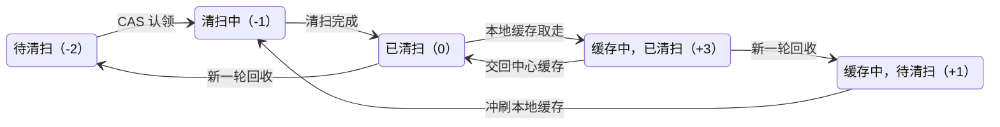

# 13.5 清扫与位图

标记结束时，仍为白色的对象就是垃圾（[13.4](./mark.md)）。**清扫**（sweep）把它们占用的槽位交还分配器，
并为下一轮回收准备清零的标记位图。Go 的清扫以 span 为单位，不逐个访问死对象：
本轮的标记位图直接成为新的分配位图，未被标记的槽随之变为空闲（[12.5](../ch12alloc/smallalloc.md)）。
这一做法始于 Go 1.7；此前，清扫要根据标记位为每个 span 重建自由表（[12.2](../ch12alloc/component.md)），Clements
2015 年的设计文档提出直接以标记位图分配，省去这一步 [[Clements, 2015a](#ref-clements-2015a)]。

清扫与用户程序并发进行，没有专门的停顿。标记终止时，运行时只把堆中所有的 span 一并标为待清扫；此后，
后台的清扫 goroutine、需要 span 的分配路径与需要页的堆分配都可能接手清扫某个 span。本节先说明清扫一个
span 时做了什么，再说明多个清扫者如何协调、清扫由谁推动、如何保证在下一轮标记之前完成，
最后讨论不移动对象这一取舍。

## 13.5.1 清扫一个 span

清扫单个 span 的函数是 `mspan.sweep`，所有清扫路径最终都调用它
[[Go Authors, 2026a](#ref-go-authors-2026a)]。它依次完成五项工作。

第一，处理特殊记录。终结器、清理函数、弱指针句柄与堆剖析的采样等，都以特殊记录的形式挂在对象所在的 span
上。对于未被标记、带有特殊记录的对象，若它带有终结器，清扫置位它的标记位，使它复活，把终结器放入队列，
并把弱指针句柄清零；否则对象确已死亡，清扫释放它的全部特殊记录，其间把清理函数放入队列、把弱指针句柄清零。
这些语义及其后果见 [13.10](./finalizer.md)。

第二，合并 Green Tea 的标记位。Go 1.26 默认启用的 Green Tea 回收器把 16 至 512 字节对象的标记位记在 span
内部（[13.4](./mark.md)）。清扫先把这些标记位合并进 `gcmarkBits`，再将 span
内部的标记位复位（`moveInlineMarks`，[13.11](./greentea.md)）。

第三，检查一致性。已被标记却并未分配的槽称为僵尸（zombie）。清扫逐字节比较标记位图与分配位图，
一旦发现僵尸，就打印该 span 中每个槽的状态并终止程序。源码注释列出了三种成因
[[Go Authors, 2026a](#ref-go-authors-2026a)]：

```go
// reportZombies reports any marked but free objects in s and throws.
//
// This generally means one of the following:
//
// 1. User code converted a pointer to a uintptr and then back
// unsafely, and a GC ran while the uintptr was the only reference to
// an object.
//
// 2. User code (or a compiler bug) constructed a bad pointer that
// points to a free slot, often a past-the-end pointer.
//
// 3. The GC two cycles ago missed a pointer and freed a live object,
// but it was still live in the last cycle, so this GC cycle found a
// pointer to that object and marked it.
```

这一精确的检查始于 Go 1.15。此前清扫只比较两个位图中置位的总数，标记数多于分配数时才报错，
几乎提供不了调试所需的信息 [[Clements, 2020](#ref-clements-2020)]。

第四，交换位图。`countAlloc` 统计 `gcmarkBits` 中置位的槽数，即存活对象的数目；随后 `gcmarkBits` 成为新的
`allocBits`，另换一份清零的位图作为下一轮的 `gcmarkBits`，`freeindex` 归零，代码见
[12.5](../ch12alloc/smallalloc.md)。死对象占用的内存在清扫中不被触碰：只要有对象被释放，span
就被标记为需要清零（`needzero`），被释放的槽在下次分配出去时才清零。清扫一个 span
的开销因此与死对象的数目无关，主要取决于位图的长度。

第五，决定 span 的去向。清扫者先把 span 标为已清扫，再交出它，因为分配路径假定它能取得的 span 都已清扫。
参数 `preserve` 为真时，调用者（分配路径）要直接使用这个 span，清扫不把它放回任何列表；否则，小对象的
span 按存活对象的数目处理 [[Go Authors, 2026a](#ref-go-authors-2026a)]：

```go
		if !preserve {
			// ……
			if nalloc == 0 {
				// Free totally free span directly back to the heap.
				mheap_.freeSpan(s)
				return true
			}
			// Return span back to the right mcentral list.
			if nalloc == s.nelems {
				mheap_.central[spc].mcentral.fullSwept(sweepgen).push(s)
			} else {
				mheap_.central[spc].mcentral.partialSwept(sweepgen).push(s)
			}
		}
```

没有存活对象的 span 整体还给页分配器，这些页此后可以组成任意尺寸类的 span，空闲的页还可能被 scavenger
归还操作系统（[12.7](../ch12alloc/pagealloc.md)）。仍有存活对象的 span 只能留在原尺寸类，
按有无空槽放入中心缓存的两个已清扫集合之一（[12.2](../ch12alloc/component.md)）。大对象独占一个 span：
对象死亡则释放整个 span，否则把 span 放入已清扫且满的集合。

## 13.5.2 清扫代

清扫并发进行，同一个 span 可能同时被后台的清扫者与某个分配者选中，也可能正缓存在某个 P
的本地缓存中供分配使用。运行时用一对计数器区分这些状态：堆有一个全局的**清扫代**（sweep generation）`mheap_.sweepgen`，
每轮回收在标记终止时把它加 2；每个 span 也有一个 `sweepgen` 字段，span
的状态由二者之差表示 [[Go Authors, 2026a](#ref-go-authors-2026a)]：

```go
	// sweep generation:
	// if sweepgen == h->sweepgen - 2, the span needs sweeping
	// if sweepgen == h->sweepgen - 1, the span is currently being swept
	// if sweepgen == h->sweepgen, the span is swept and ready to use
	// if sweepgen == h->sweepgen + 1, the span was cached before sweep began and is still cached, and needs sweeping
	// if sweepgen == h->sweepgen + 3, the span was swept and then cached and is still cached
	// h->sweepgen is incremented by 2 after every GC
```

全局的清扫代加 2 时，各 span 的字段本身不变，状态却一起平移：已清扫的变为待清扫，
缓存中已清扫的变为缓存中待清扫。标记终止因此只需一次加法，就让整个堆进入待清扫的状态。

认领一个待清扫的 span，用一次比较并交换（CAS）把它的清扫代由差 2 改为差 1
[[Go Authors, 2026a](#ref-go-authors-2026a)]：

```go
	// Attempt to acquire sweep ownership of s.
	if !atomic.Cas(&s.sweepgen, l.sweepGen-2, l.sweepGen-1) {
		return sweepLocked{}, false
	}
```

成功者负责清扫，失败者跳过这个 span。清扫完成时，`sweep` 先原子地把 span 的清扫代写为当前值，再把 span
放回列表或还给堆，源码注释称之为串行化点。

差 1 与差 3 这两个缓存状态来自 Go 1.12 的惰性冲刷。此前，标记终止的停顿中要冲刷所有 P 的本地缓存，
把缓存的 span 交回中心缓存，因为清扫开始之前，每个 span 都必须处于清扫者预期的状态。Clements 与 Hudson
2016 年的设计文档提出，可以在清扫阶段开始时惰性地冲刷
[[Clements and Hudson, 2016](#ref-clements-hudson-2016)]；Clements 在 Go 1.12 中实现了这一设想：
每个本地缓存记下自己上次冲刷时的清扫代，P 在被获取、开始分配之前发现缓存已过时，便先行冲刷，空闲的 P
则在标记终止之后统一冲刷 [[Clements, 2018a](#ref-clements-2018a)]。于是缓存中的 span
会在一段时间内处于过时状态，清扫代为此扩展出两个状态，并规定异步的清扫者不碰缓存中的 span，
由冲刷缓存的一方清扫过时的 span。

下图是一个 span 在相邻两轮回收之间的状态变化，括号中是 span 的清扫代与 `mheap_.sweepgen` 之差。
标有「新一轮回收」的边并不改写 span，只是全局的清扫代加 2 带来的平移：



还需要判断清扫何时结束。只看待清扫的列表是否为空并不够：列表空了，可能还有清扫者在处理最后几个 span。`runtime.GC`
要等清扫真正结束才能返回并更新堆剖析，这一判断先后在 Go 1.17
[[Clements, 2021](#ref-clements-2021)]与 Go 1.18 [[Knyszek, 2021](#ref-knyszek-2021)]中修复过竞争。
现在的 `activeSweep` 把「列表是否已经取空」与「仍在工作的清扫者数目」合并在一个原子变量中：
每个清扫者开始之前登记、结束之后注销，列表已空且没有清扫者时，清扫才算完成。

## 13.5.3 谁来清扫

清扫由三条路径推动。

后台清扫者 `bgsweep` 是运行时启动时创建的 goroutine，平时停放，标记终止时被唤醒，逐个清扫剩余的 span。
它力求只使用空闲的 CPU：每清扫 10 个 span 检查一次，若没有空闲的 P，就让出处理器。
源码注释解释了按批让出的原因：清扫一个 span 往往只需约 30 纳秒，每清扫一个就进入一次调度器，开销过大，
产生的跟踪事件有时可占全部事件的一半 [[Knyszek, 2022](#ref-knyszek-2022)]。扫完之后，
它还释放标记阶段分配的工作缓冲区，以及 Green Tea 的 span 队列不再使用的环形缓冲区。

分配路径在本地缓存需要新的 span 时清扫。`mcentral.cacheSpan` 先取已清扫且有空槽的 span；没有时，
从未清扫的集合中认领一个，清扫之后直接使用，即上文 `preserve` 为真的情形；全满的未清扫 span
清扫后若仍无空槽，就放入已清扫的集合，再找下一个。为了限制分配的延迟，这一搜索有预算
[[Go Authors, 2026b](#ref-go-authors-2026b)]：

```go
	// If we sweep spanBudget spans without finding any free
	// space, just allocate a fresh span. This limits the amount
	// of time we can spend trying to find free space and
	// amortizes the cost of small object sweeping over the
	// benefit of having a full free span to allocate from. By
	// setting this to 100, we limit the space overhead to 1%.
```

堆分配在需要新的页时清扫。清扫尚未完成时，`mheap.alloc` 在分配 $n$ 页之前先回收至少 $n$ 页，
以免堆不必要地增长。逐个清扫 span、期望其中某个恰好全空，代价难以预料；Go 1.12 起，这一回收改为查位图：
标记阶段每标记一个对象，就在所在 arena 的 `pageMarks` 中记下其 span 的首页，回收时把 `pageInUse` 与
`pageMarks` 按位比较，直接找出正在使用却没有任何对象被标记的 span，将其整体释放。提交说明称，
这样每毫秒可以检查约 300 GB 的堆 [[Clements, 2018b](#ref-clements-2018b)]。

后两条路径可以追溯到 Go 1.3。Vyukov 把清扫移出停顿时规定：每从中心缓存取一个 span，就清扫该中心缓存的一个
span；每从堆中分配 $n$ 页，就清扫到至少 $n$ 页回到堆中为止 [[Vyukov, 2014](#ref-vyukov-2014)]。

## 13.5.4 比例清扫

标记开始之前，清扫必须完成：未清扫的 span 的标记位图中仍是上一轮的标记，而 `greyobject`
遇到标记位已置位的对象会直接返回，这些对象便不会被扫描。Go 1.3 的一比一规则配合停止一切式的标记，
通常能在下一轮回收之前扫完。Go 1.5 的并发回收要提前触发（[13.3](./pacing.md)），清扫因此常常来不及完成，
新一轮回收开始时要先补完清扫，此间赋值器继续分配，又扰乱了调步器的统计。Clements
于是把一比一规则改为**比例清扫**（proportional sweep）：标记结束时，
运行时已经知道距下一个触发点还能分配多少字节，也知道有多少页待清扫，
二者之比就是每分配一个字节应当清扫的页数 [[Clements, 2015b](#ref-clements-2015b)]。`gcPaceSweeper`
计算这一比值 [[Go Authors, 2026a](#ref-go-authors-2026a)]：

```go
		// Concurrent sweep needs to sweep all of the in-use
		// pages by the time the allocated heap reaches the GC
		// trigger. Compute the ratio of in-use pages to sweep
		// per byte allocated, accounting for the fact that
		// some might already be swept.
		heapLiveBasis := gcController.heapLive.Load()
		heapDistance := int64(trigger) - int64(heapLiveBasis)
		// Add a little margin so rounding errors and
		// concurrent sweep are less likely to leave pages
		// unswept when GC starts.
		heapDistance -= 1024 * 1024
		// ……
		sweepDistancePages := int64(pagesInUse) - int64(pagesSwept)
		// ……
			mheap_.sweepPagesPerByte = float64(sweepDistancePages) / float64(heapDistance)
```

即每字节应清扫的页数等于尚未清扫的页数除以距触发点的字节数，后者预留 1 MiB 的余量。调步参数更新时，
包括每轮标记终止时，这一比值都重新计算。分配路径在取得 span 之前调用 `deductSweepCredit` 偿还清扫的欠账
[[Go Authors, 2026a](#ref-go-authors-2026a)]：

```go
	pagesTarget := int64(mheap_.sweepPagesPerByte*float64(newHeapLive)) - int64(callerSweepPages)
	for pagesTarget > int64(mheap_.pagesSwept.Load()-sweptBasis) {
		if sweepone() == ^uintptr(0) {
			mheap_.sweepPagesPerByte = 0
			break
		}
		if mheap_.pagesSweptBasis.Load() != sweptBasis {
			// Sweep pacing changed. Recompute debt.
			goto retry
		}
	}
```

`newHeapLive` 是比值设定以来新分配的字节数，加上即将取得的 span 的全部字节；`pagesTarget`
是这些字节应当对应的已清扫页数，进度落后时就地调用 `sweepone` 补足。扣除发生在取得 span 之前，并按 span
的全部字节计算，这样系统始终略有盈余，而不是先分配、后欠账，这是 Clements 在 Go 1.5 发布之前作的修正
[[Clements, 2015c](#ref-clements-2015c)]。分配大对象时，调用者通过 `callerSweepPages`
少扣与大对象等量的页，因为随后 `mheap.alloc` 的页回收至少会清扫这么多页。

若下一轮回收在清扫完成之前开始，例如程序调用了 `runtime.GC`，触发回收的 goroutine 先在 `gcStart`
中并发地清扫剩余的 span，停止一切之后再由 `finishsweep_m` 扫完可能的残余，这就是 [13.1](./basic.md)
所说的「完成上一轮遗留的清扫」。源码注释写道 [[Go Authors, 2026a](#ref-go-authors-2026a)]：

```go
	// Sweeping must be complete before marking commences, so
	// sweep any unswept spans. If this is a concurrent GC, there
	// shouldn't be any spans left to sweep, so this should finish
	// instantly. If GC was forced before the concurrent sweep
	// finished, there may be spans to sweep.
```

清扫完成后，堆中多出了可以归还操作系统的空闲页。发现列表已经取空的清扫者调用 `scavenger.ready()`，
请求系统监控唤醒 scavenger（[9.8](../../part3concurrency/ch09sched/sysmon.md)）；`finishsweep_m`
则直接唤醒它（[12.7](../ch12alloc/pagealloc.md)）。

## 13.5.5 观察清扫的进度

下面的程序保留约 16 MiB 含指针的小对象，不断以新对象替换旧对象，使每轮回收都有大量垃圾需要清扫：

```go {run=true native=true env="GODEBUG=gctrace=1,gcpacertrace=1"}
package main

type node [8]*node // 64 字节，含指针

var live []*node

func main() {
	live = make([]*node, 1<<18) // 约 16 MiB 的存活对象
	for i := range live {
		live[i] = new(node)
	}
	for i := 0; i < 1<<23; i++ {
		live[i%len(live)] = new(node) // 新对象替换旧对象，旧对象成为垃圾
	}
}
```

打开 gctrace 与 gcpacertrace，保留每轮的摘要与清扫结束时的报告，截取第 4 至 6 轮，
并删去时间字段等与此处无关的部分。先只给程序一个 P：

```shell
$ go build -o sweepdemo
$ GOMAXPROCS=1 GODEBUG=gctrace=1,gcpacertrace=1 ./sweepdemo 2>&1 | grep -E '^gc |sweep done' >trace.txt
$ sed -E -n '7,11{s/ @.* ms cpu,//; s/, [0-9]+ MB stacks.*//; s/ at [0-9.]+ pages.*//; p;}' trace.txt
gc 4 39->45->23 MB, 46 MB goal
pacer: sweep done at heap size 39MB; allocated 15MB during sweep; swept 5913 pages
gc 5 40->47->24 MB, 47 MB goal
pacer: sweep done at heap size 41MB; allocated 16MB during sweep; swept 6195 pages
gc 6 42->49->25 MB, 49 MB goal
```

gctrace 各字段的含义见 [13.3](./pacing.md)。清扫结束的报告由最后一个注销的清扫者输出，依次是此刻的
`heapLive`、清扫期间新分配的字节数与本轮清扫的页数 [[Go Authors, 2026a](#ref-go-authors-2026a)]。第 4
轮结束时存活堆为 23 MB，清扫在堆增长到 39 MB 时才结束，期间分配了 15 MB；第 5 轮在约 40 MB 时开始。
只有一个 P 时，后台清扫者很少有机会运行，清扫主要由分配路径按比例完成，于是正好在触发点之前约 1 MB
处结束，这 1 MB 就是 `gcPaceSweeper` 预留的余量。

给程序 8 个 P，重复同样的步骤：

```shell
$ GOMAXPROCS=8 GODEBUG=gctrace=1,gcpacertrace=1 ./sweepdemo 2>&1 | grep -E '^gc |sweep done' >trace.txt
$ sed -E -n '7,11{s/ @.* ms cpu,//; s/, [0-9]+ MB stacks.*//; s/ at [0-9.]+ pages.*//; p;}' trace.txt
gc 4 34->41->25 MB, 40 MB goal
pacer: sweep done at heap size 26MB; allocated 1MB during sweep; swept 5421 pages
gc 5 42->47->22 MB, 50 MB goal
pacer: sweep done at heap size 28MB; allocated 5MB during sweep; swept 6203 pages
gc 6 38->42->22 MB, 45 MB goal
```

这一次，后台清扫者在空闲的 P 上运行，清扫期间只分配了 1 至 5 MB，远在下一个触发点之前就已完成，
分配路径因此很少需要自己清扫。各数在多次运行之间有所出入，但两种情形的差别是稳定的。

## 13.5.6 不移动对象

清扫只改写位图，不移动存活的对象。一个 span 中死对象腾出的槽，只能由同一尺寸类的新对象填补；
只要还有一个对象存活，span 就不能整体归还。尺寸类的设计限制了舍入造成的浪费
（[12.1](../ch12alloc/basic.md)），但这里的浪费是另一回事：存活对象稀疏地分布在许多 span 中时，这些 span
的空槽只能等待同一尺寸类的分配，这部分空间没有确定的上界。移动式的回收器把存活对象搬到一起，
可以消除这种碎片，还能以指针碰撞的方式分配。标记清扫与标记整理的一般讨论，见 Jones 等人所著手册的第 2、3
章 [[Jones et al., 2023](#ref-jones-2023)]。

Hudson 在 2018 年的主题演讲中交代了 Go 不移动对象的理由 [[Hudson, 2018](#ref-hudson-2018)]。
按尺寸类组织的 span 可以由地址直接算出对象的起点，便于处理内部指针；TCMalloc
[[Ghemawat and Menage, 2005](#ref-ghemawat-menage-2005)]、Hoard 与 Intel 的 Scalable Malloc
的经验使团队相信，碎片不会成为非移动分配器的问题；分配也许不及指针碰撞快，但与 C 相当；不移动对象，
也就不必在与 C 交互时固定对象、在 C 与 Go 对象之间加入间接层，从而避开随之而来的一长串缺陷。演讲还提到，Go
最初的长期计划是无读屏障的并发复制回收，2014 年为了尽快交付并发回收，放弃了复制的部分。

不移动对象是实现上的选择，而不是语言的保证，文档也有意为移动留有余地。`unsafe` 包的文档写道，即使一个
`uintptr` 保存着某个对象的地址，对象移动时回收器也不会更新它
[[Go Authors, 2026c](#ref-go-authors-2026c)]。cgo 要求传给 C 的 Go 指针指向已固定（pinned）的内存：
作为参数传入时，内存在调用期间隐式固定 [[Go Authors, 2026d](#ref-go-authors-2026d)]；需要固定得更久时，
使用 Go 1.21 引入的 `runtime.Pinner`，其文档称固定可以防止对象被回收器移动或释放
[[Go Authors, 2026e](#ref-go-authors-2026e)]。goroutine 的栈本身就会移动（[14.4](../ch14stack/copy.md)）。
分代与移动式回收的讨论见 [13.8](./generational.md)。

## 13.5.7 小结

清扫以 span 为单位，把标记位图换作分配位图，开销与死对象的数目无关。span
的清扫代与全局清扫代之差编码了待清扫、清扫中、已清扫与两个缓存状态，标记终止只需把全局清扫代加 2，
各清扫者以一次 CAS 认领 span。后台清扫者利用空闲的 CPU，分配路径与页回收在需要时就地清扫，
比例清扫按分配量摊派清扫工作，使清扫在下一个触发点之前完成；仍未完成的部分，由下一轮回收开始时补完。
清扫不移动对象，Go 以容忍碎片为代价，换取实现的简单以及与 C 交互的便利。

## 延伸阅读

- <a id="ref-clements-2015a"></a>[Clements, 2015a] Austin Clements. *Proposal: Dense mark bits and
  sweep-free allocation.* Go design document, 2015. https://go.dev/design/12800-sweep-free-alloc
  文档计划在 Go 1.6 周期实现以位图直接分配取代自由表，实际随 Go 1.7 发布。讨论见 Go issue #12800：
  https://github.com/golang/go/issues/12800
- <a id="ref-clements-2015b"></a>[Clements, 2015b] Austin Clements. runtime: finish sweeping before
  concurrent GC starts. Go commit 24a7252e25, 2015. https://go.dev/cl/8921
  随 Go 1.5 发布。
- <a id="ref-clements-2015c"></a>[Clements, 2015c] Austin Clements. runtime: make sweep proportional to
  spans bytes allocated. Go commit fc9ca85f4c, 2015. https://go.dev/cl/13044
  随 Go 1.5 发布。
- <a id="ref-clements-2018a"></a>[Clements, 2018a] Austin Clements. runtime: flush mcaches lazily. Go
  commit 873bd47dfb, 2018. https://go.dev/cl/134783
  随 Go 1.12 发布。
- <a id="ref-clements-2018b"></a>[Clements, 2018b] Austin Clements. runtime: implement efficient page
  reclaimer. Go commit 5333550bdc, 2018. https://go.dev/cl/138959
  随 Go 1.12 发布。
- <a id="ref-clements-2020"></a>[Clements, 2020] Austin Clements. runtime: detect and report zombie slots
  during sweeping. Go commit ea2de3346f, 2020. https://go.dev/cl/234100
  随 Go 1.15 发布。
- <a id="ref-clements-2021"></a>[Clements, 2021] Austin Clements. runtime: block sweep completion on all
  sweep paths. Go commit a25a77aed2, 2021. https://go.dev/cl/307915
  随 Go 1.17 发布。
- <a id="ref-clements-hudson-2016"></a>[Clements and Hudson, 2016] Austin Clements, Rick Hudson.
  *Proposal: Eliminate STW stack re-scanning.* Go design document, 2016.
  https://go.googlesource.com/proposal/+/master/design/17503-eliminate-rescan.md
  讨论部分提出在清扫阶段开始时惰性地冲刷 mcache。
- <a id="ref-ghemawat-menage-2005"></a>[Ghemawat and Menage, 2005] Sanjay Ghemawat, Paul Menage.
  *TCMalloc: Thread-Caching Malloc.* 2005. http://goog-perftools.sourceforge.net/doc/tcmalloc.html
  现行的设计文档：https://google.github.io/tcmalloc/design.html
- <a id="ref-go-authors-2026a"></a>[Go Authors, 2026a] The Go Authors. *runtime/mgcsweep.go.*
  `mspan.sweep`、`sweepone`、`bgsweep`、`deductSweepCredit`、`gcPaceSweeper`、`finishsweep_m`. 另见
  src/runtime/mheap.go、src/runtime/mgc.go、src/runtime/mcache.go、src/runtime/mgcmark_greenteagc.go. Go
  1.26 源码. https://github.com/golang/go/blob/release-branch.go1.26/src/runtime/mgcsweep.go
- <a id="ref-go-authors-2026b"></a>[Go Authors, 2026b] The Go Authors. *runtime/mcentral.go.*
  按清扫代分组的 `spanSet` 与 `cacheSpan` 中的按需清扫. Go 1.26 源码.
  https://github.com/golang/go/blob/release-branch.go1.26/src/runtime/mcentral.go
- <a id="ref-go-authors-2026c"></a>[Go Authors, 2026c] The Go Authors. *Package unsafe.* Go 1.26 文档.
  https://pkg.go.dev/unsafe
- <a id="ref-go-authors-2026d"></a>[Go Authors, 2026d] The Go Authors. *Command cgo: Passing pointers.* Go
  1.26 文档. https://pkg.go.dev/cmd/cgo#hdr-Passing_pointers
- <a id="ref-go-authors-2026e"></a>[Go Authors, 2026e] The Go Authors. *runtime.Pinner.* Go 1.26 文档.
  https://pkg.go.dev/runtime#Pinner
- <a id="ref-hudson-2018"></a>[Hudson, 2018] Rick Hudson. "Getting to Go: The Journey of Go's Garbage
  Collector." *The Go Blog*, 2018. https://go.dev/blog/ismmkeynote
  ISMM 2018 主题演讲的讲稿，交代了按尺寸类组织 span 与不移动对象的理由。
- <a id="ref-jones-2023"></a>[Jones et al., 2023] Richard Jones, Antony Hosking, Eliot Moss. *The Garbage
  Collection Handbook: The Art of Automatic Memory Management.* 2nd ed., CRC Press, 2023.
  https://doi.org/10.1201/9781003276142
  第 2 章讨论标记清扫，第 3 章讨论标记整理。
- <a id="ref-knyszek-2021"></a>[Knyszek, 2021] Michael Knyszek. runtime: fix sweep termination condition.
  Go commit 3aecb3a8f7, 2021. https://go.dev/cl/333389
  随 Go 1.18 发布。
- <a id="ref-knyszek-2022"></a>[Knyszek, 2022] Michael Knyszek. runtime: tweak bgsweep "low-priority"
  heuristic. Go commit 8451529e9a, 2022. https://go.dev/cl/429615
  随 Go 1.20 发布。
- <a id="ref-vyukov-2014"></a>[Vyukov, 2014] Dmitriy Vyukov. runtime: concurrent GC sweep. Go commit
  3c3be62201, 2014. https://golang.org/cl/46430043
  随 Go 1.3 发布。
- 本书 [12.1 设计原则](../ch12alloc/basic.md)、[12.2 组件](../ch12alloc/component.md)、[13.1
  垃圾回收的基本想法](./basic.md)、[13.4 扫描标记与标记辅助](./mark.md)、[13.12
  过去、现在与未来](./history.md)。
