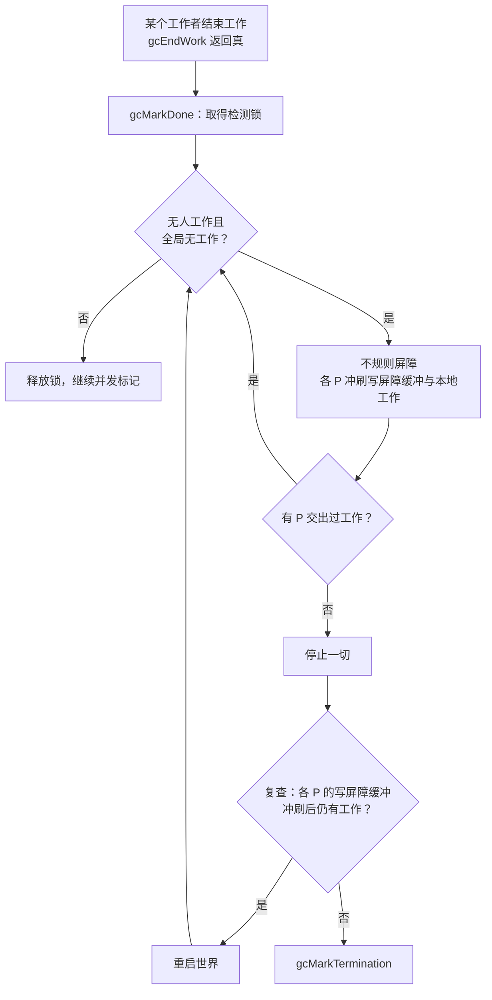

# 13.6 标记终止阶段

并发标记（[13.4](./mark.md)）总要结束：灰色对象耗尽之后，回收关闭写屏障，转入清扫（[13.5](./sweep.md)）。
这一转换包含两个问题。其一，如何断定标记确已完成：待扫描的工作分散在各个 P 的本地缓存中，赋值器还在运行，
写屏障还可能产生新的灰色对象。其二，转换本身要在一次停止一切中完成，这次停顿做了什么，又为何能做得很短。
本节依次讨论终止的判定、停顿中的收尾、停顿时间的演变，以及一轮回收中两次停顿各自的作用。

## 13.6.1 判断标记完成的难点

标记工作分布在几处：全局的满缓冲区列表 `work.full`、尚未领取的根标记任务、每个 P 的 `gcWork`
本地缓存（[13.4](./mark.md)），以及每个 P 的写屏障缓冲（[13.2](./barrier.md)）。全局的部分对所有 P 可见，
本地的部分只有所属的 P 自己看得到。

运行时用一对计数器记录有多少 goroutine 正在做标记工作。`work.nproc` 被设为一个极大的数，`work.nwait`
初值与之相等；后台标记工作者或标记辅助开始工作时把 `nwait` 减一，结束时加一，二者相等即表示没有人在工作。
结束工作时的检查如下 [[Go Authors, 2026a](#ref-go-authors-2026a)]：

```go
func gcEndWork() (last bool) {
	incnwait := atomic.Xadd(&work.nwait, +1)
	if incnwait > work.nproc {
		println("runtime: work.nwait=", incnwait, "work.nproc=", work.nproc)
		throw("work.nwait > work.nproc")
	}
	return incnwait == work.nproc && !gcMarkWorkAvailable()
}
```

返回真的一方负责调用 `gcMarkDone`，尝试结束标记。Go 1.6 起，这类阶段转换不再交给一个专门的协调 goroutine，
而由发现条件满足的 goroutine 直接执行，以免转换受调度延迟的拖累 [[Clements, 2015](#ref-clements-2015)]。

但「没有人在工作、全局没有工作」并不意味着标记已经完成。空闲的 P 可能还缓存着本地工作，只有让它们交出来，
其他人才能看见。计数与全局队列也不是在同一时刻读取的：一个工作者刚把缓冲区交回全局列表、
将计数加一并检查队列，另一个工作者可能恰在两次读取之间领走了这个缓冲区，并开始产生新的工作。Clements 与
Hudson 在 2016 年的设计文档中记录了这种交错，它使回收可能在仍有标记工作时进入标记终止
[[Clements and Hudson, 2016](#ref-clements-hudson-2016)]。

判定终止所依赖的前提是：标记工作不能凭空产生，一个 P 必须消耗一项标记任务才能产生新的任务，
因此终止一旦成立便不会失效 [[Clements, 2018a](#ref-clements-2018a)]。写屏障缓冲是一个例外：
它只记录指针写入，即使所指的对象早已是黑色，缓冲也会继续增长。13.6.2
将说明运行时如何处理这个例外以及另一个后来发现的例外。

## 13.6.2 分布式终止检测

Go 1.5 把并发标记分为 mark 1 与 mark 2 两个子阶段：mark 1 耗尽全局工作时，冲刷并禁用所有 P 的本地缓存，
进入 mark 2；mark 2 再次耗尽全局工作时，进入标记终止。禁用本地缓存使标记与写屏障都变慢，
这一算法又只能检测到工作暂时的短缺，可能在一轮回收的早期就进入 mark 2，而且仍不能完全避免过早进入标记终止
[[Clements, 2018a](#ref-clements-2018a)]。Go 1.12 以一个基于分布式终止检测思想的算法取代了 mark 2
[[Clements, 2018b](#ref-clements-2018b)]，设计文档援引的是 Matocha 与 Camp 对这类算法的综述
[[Matocha and Camp, 1998](#ref-matocha-camp-1998)]。

每个 P 维护一个标志 `flushedWork`，只要把本地工作交到全局，就置位它。本地缓存再多工作也不置位，
这个标志表示的是「可能与其他 P 共享过工作」。当某个 P 的本地与全局工作都已耗尽，它执行以下检测：

1. 取得全局的检测锁，同一时刻只有一个 P 执行检测。
2. 检查全局队列，不为空则放弃。
3. 执行一道屏障，让每个 P 在到达安全点时冲刷写屏障缓冲（这可能把对象置灰、放入本地队列），
   再冲刷本地工作（这可能置位 `flushedWork`），然后读取并清除自己的 `flushedWork`。
4. 若有 P 的标志被置位，放弃并重新检测；否则进入标记终止。

**不规则屏障**（ragged barrier）由 `forEachP` 实现，它不要求所有 P 同时停下，只要求每个 P
各自在某个安全点执行一次给定的函数 [[Go Authors, 2026b](#ref-go-authors-2026b)]。
专用工作者平时不响应抢占，但见到 `forEachP` 的请求也会退出标记循环（[13.4](./mark.md)），
屏障因此能够到达每个 P：

```go
// forEachP calls fn(p) for every P p when p reaches a GC safe point.
// If a P is currently executing code, this will bring the P to a GC
// safe point and execute fn on that P. If the P is not executing code
// (it is idle or in a syscall), this will call fn(p) directly while
// preventing the P from exiting its state. This does not ensure that
// fn will run on every CPU executing Go code, but it acts as a global
// memory barrier. GC uses this as a "ragged barrier."
```

正在运行的 P 由抢占促使其到达安全点（[9.7](../../part3concurrency/ch09sched/preemption.md)）。`gcMarkDone`
中的对应代码如下 [[Go Authors, 2026a](#ref-go-authors-2026a)]：

```go
	// Flush all local buffers and collect flushedWork flags.
	gcMarkDoneFlushed = 0
	forEachP(waitReasonGCMarkTermination, func(pp *p) {
		// Flush the write barrier buffer, since this may add
		// work to the gcWork.
		wbBufFlush1(pp)

		// Flush the gcWork, since this may create global work
		// and set the flushedWork flag.
		//
		// TODO(austin): Break up these workbufs to
		// better distribute work.
		pp.gcw.dispose()

		// Collect the flushedWork flag.
		if pp.gcw.flushedWork {
			atomic.Xadd(&gcMarkDoneFlushed, 1)
			pp.gcw.flushedWork = false
		}
	})

	if gcMarkDoneFlushed != 0 {
		// More grey objects were discovered since the
		// previous termination check, so there may be more
		// work to do. Keep going. It's possible the
		// transition condition became true again during the
		// ragged barrier, so re-check it.
		semrelease(&worldsema)
		goto top
	}
```

全局队列必须在屏障之前检查：否则某个 P 通过屏障之后，仍可能从全局领到工作。13.6.1 所说的交错并未消失，
但不再有害：被另一个工作者领走的工作留在它的本地缓存中，必然在屏障中被交出，从而使这一轮检测失败。
设计文档指出，与许多同类算法不同，它检测的不是「上一道屏障以来没有人做过工作」，而是「没有人交流过工作，
并且所有队列在某一时刻都是空的」。因此许多同类算法至少需要两轮才能判定终止，它一轮就够；堆较小时，各 P
可能完全靠本地缓存完成工作，标记在第一轮屏障之后就能结束 [[Clements, 2018a](#ref-clements-2018a)]。若有 P
交出过工作，检测便重来；这些交出的工作同时也在 P 之间重新分配了负载。

Green Tea 的 span 队列（[13.11](./greentea.md)）可以被其他 P 窃取，看似违背了「P 看不到其他 P 的本地工作」
这一前提。实际上，每个 P 只有自己的本地环是私有的；本地环溢出、转入可窃取链时会置位 `flushedWork`；
冲刷本地缓存时，本地环同样转入链中，并在位图 `spanqMask` 中登记，而判断是否仍有全局工作时，
位图中有登记即视为有 [[Go Authors, 2026c](#ref-go-authors-2026c)]。可窃取的链因此相当于全局队列的一部分，
上述论证仍然成立。

两个例外需要单独处理。写屏障缓冲在检测通过之后仍可能增长，但此时所有可达对象都已标记，
缓冲中的指针必然指向黑色对象，标记终止时直接丢弃即可 [[Go Authors, 2026a](#ref-go-authors-2026a)]：

```go
		// The write barrier may have buffered pointers since
		// the gcMarkDone barrier. However, since the barrier
		// ensured all reachable objects were marked, all of
		// these must be pointers to black objects. Hence we
		// can just discard the write barrier buffer.
```

另一个例外是弱指针转换为强指针（[13.10](./finalizer.md)）。标记期间的转换要把结果置灰，
因为它可能是指向该对象的唯一指针，而这个对象可能仍是白色；与写屏障不同，
这一来源产生的工作不会随标记推进而自然消失。Go 1.24 起，`gcMarkDone` 在不规则屏障之前置位一个全局标志，
此后的转换一律阻塞，直到标记终止时才被唤醒，这一修复也移植到了 Go 1.23.4
[[Knyszek, 2024](#ref-knyszek-2024)]。

下图概括了 `gcMarkDone` 的流程，其中停止一切之后的复查见 13.6.3：



## 13.6.3 停止一切之后

检测通过后，`gcMarkDone` 停止一切。按上述论证，此时不应再有标记工作，但实际运行中偶尔仍会发现残留，
于是停顿之后先复查一次 [[Go Authors, 2026a](#ref-go-authors-2026a)]：

```go
	// There is sometimes work left over when we enter mark termination due
	// to write barriers performed after the completion barrier above.
	// Detect this and resume concurrent mark. This is obviously
	// unfortunate.
	//
	// See issue #27993 for details.
```

这一问题以「P has cached GC work at end of mark termination」的报错形式出现
[[ianlancetaylor, 2018](#ref-ianlancetaylor-2018)]。Clements 在 Go 1.12 发布前加入了这一复查，
提交说明坦言仍不清楚残留从何而来，复查会使停顿增加少量与 `GOMAXPROCS` 成正比的时间，
但修复了一个严重的正确性问题 [[Clements, 2019](#ref-clements-2019)]。复查发现残留时，运行时重启世界，
回到检测的起点。Go 1.26 以实验形式提供的 goroutine 泄漏剖析也借用这一回路：标记到达不动点之后，
阻塞在不可达的同步原语上的 goroutine 被判定为泄漏；若又发现了可能运行的 goroutine，就重启世界继续标记
[[Go Authors, 2026a](#ref-go-authors-2026a)]。这一剖析的原理见发布说明
[[Go Authors, 2026d](#ref-go-authors-2026d)]。

复查通过后，运行时停止标记辅助与后台标记，唤醒挂起的标记辅助（它们在世界重启后运行），记录本轮的调步数据，
然后调用 `gcMarkTermination`。下面是这段收尾的速写：

```go
// 停止一切之后的主要步骤（速写，省略统计与跟踪，runtime/mgc.go）
atomic.Store(&gcBlackenEnabled, 0) // 停止标记辅助与后台标记
gcWakeAllAssists()                 // 挂起的辅助在世界重启后运行
gcController.endCycle(now, int(gomaxprocs), work.userForced) // 记录调步数据（13.3）

// gcMarkTermination：
setGCPhase(_GCmarktermination) // 写屏障仍然开启
gcMark(startTime)              // 核对没有剩余工作，丢弃写屏障缓冲
setGCPhase(_GCoff)             // 关闭写屏障
gcSweep(work.mode)             // 全局清扫代加 2，唤醒后台清扫者（13.5）
gcControllerCommit()           // 为下一轮计算触发点与堆目标（13.3）
mProf_NextCycle()              // 结束本轮堆剖析的周期
startTheWorldWithSema(now, stw)

// 世界重启之后：冲刷堆剖析、准备释放工作缓冲区、释放栈所在的 span，
// 并用 forEachP 冲刷各 P 的本地缓存（13.5）
```

写屏障是否开启，由回收所处的阶段决定 [[Go Authors, 2026a](#ref-go-authors-2026a)]：

```go
func setGCPhase(x uint32) {
	atomic.Store(&gcphase, x)
	writeBarrier.enabled = gcphase == _GCmark || gcphase == _GCmarktermination
}
```

`gcMarkDone` 的注释强调，写屏障必须保持开启，直到全部标记完成，包括回收器自身的写入。2018
年的设计文档曾设想标记终止期间不再需要写屏障 [[Clements, 2018a](#ref-clements-2018a)]，
现在的实现仍在进入 `_GCoff` 时才关闭它。`gcMark` 已不做任何标记，只核对各处没有剩余的工作，
丢弃写屏障缓冲，并把调步器的存活堆重置为本轮标记的字节数。

## 13.6.4 停顿时间的演变

标记终止的停顿曾经很长。Go 1.5 至 1.7 使用 Dijkstra 式的插入屏障，栈上的写入不经过写屏障，
标记终止时必须重新扫描标记期间运行过的 goroutine 的栈。Go 1.7 只重新扫描「脏」栈，使这一步不再与
goroutine 的总数成正比；提交说明给出的数据是：处理一个干净的栈约需 34 纳秒，goroutine 达到约 30 万个时，
仅检查这些栈就会超出 10 毫秒的停顿目标 [[Clements, 2016a](#ref-clements-2016a)]。Go 1.8
的混合写屏障（[13.2](./barrier.md)）使重新扫描不再必要。关闭重新扫描之后，在 `GOMAXPROCS` 为 12 的机器上，
标记终止停顿的最坏情况在所有测试中都稳定低于 100 微秒，95 分位约为 50 微秒；
这些数字不含停止一切本身所需的时间，后者通常再增加约 20 微秒，个别 goroutine 迟迟不到达安全点时可达约
150 微秒 [[Clements, 2016b](#ref-clements-2016b)]。作为后备而保留的 `GODEBUG=gcrescanstacks=1` 在 Go 1.12
中删除 [[Clements, 2018c](#ref-clements-2018c)]。Hudson 在 2018 年的主题演讲中回顾，Go 1.8
去掉了周期末尾停止一切的栈扫描，停顿由此进入亚毫秒级；2018 年的目标定为每轮回收停止一切的时间不超过
500 微秒 [[Hudson, 2018](#ref-hudson-2018)]。

下面的程序分别让 1000、1 万与 10 万个 goroutine 递归若干层后阻塞，再强制回收。为了只观察 `runtime.GC`
触发的回收，程序关闭了自动回收：

```go {run=true env="GODEBUG=gctrace=1"}
package main

import (
	"fmt"
	"os"
	"runtime"
	"runtime/debug"
	"sync"
)

// park 递归 depth 层后阻塞，使每个 goroutine 都有一段需要扫描的栈。
func park(depth int, ready *sync.WaitGroup, ch chan struct{}) int {
	var frame [8]int
	if depth > 0 {
		return park(depth-1, ready, ch) + frame[depth%8]
	}
	ready.Done()
	<-ch
	return frame[0]
}

func main() {
	debug.SetGCPercent(-1) // 只观察 runtime.GC 触发的回收
	for _, n := range []int{1_000, 10_000, 100_000} {
		var ready, done sync.WaitGroup
		ch := make(chan struct{})
		ready.Add(n)
		for range n {
			done.Go(func() { park(16, &ready, ch) })
		}
		ready.Wait() // 所有 goroutine 都已阻塞
		fmt.Fprintf(os.Stderr, "%d 个 goroutine\n", n)
		for range 2 {
			runtime.GC()
		}
		close(ch)
		done.Wait()
	}
}
```

gctrace 的输出与程序打印的标签都写到标准错误。在本机编译运行，并用 sed 只保留每轮的时钟时间：

```shell
$ go build -o marktermdemo
$ GODEBUG=gctrace=1 ./marktermdemo 2>&1 | sed -E 's/ @[^:]*: / /; s/ ms clock.*/ ms clock/'
1000 个 goroutine
gc 1 0.072+0.71+0.006 ms clock
gc 2 0.076+0.54+0.006 ms clock
10000 个 goroutine
gc 3 0.042+6.7+0.005 ms clock
gc 4 0.031+4.3+0.006 ms clock
100000 个 goroutine
gc 5 0.052+59+0.006 ms clock
gc 6 0.26+42+0.006 ms clock
```

三个数依次是清扫终止的停顿、并发标记与标记终止的停顿（[13.1](./basic.md)），
停顿的时间包含停止一切本身所需的时间。goroutine 增加到 100 倍，并发标记的时间随栈的总量从不到
1 毫秒增长到数十毫秒，标记终止的停顿始终约为 6 微秒。第一个数在多次运行之间波动较大，与 goroutine
的数目没有对应关系。在浏览器中运行时，并发标记要慢得多，但标记终止的停顿同样不随 goroutine 的数目变化。

## 13.6.5 两次停止一切

一轮回收中有两次停止一切。第一次在开始时，称为清扫终止：补完上一轮遗留的清扫（[13.5](./sweep.md)），清空
`sync.Pool` 与运行时内部的几个缓存池，开始新一轮的调步，把阶段切换到 `_GCmark` 以开启写屏障，
准备根标记任务，把各 P 正在使用的微对象块标为黑色，最后允许标记辅助与后台标记。它并不扫描根，
根的扫描在世界重启之后并发进行（[13.1](./basic.md)）。之所以要停止一切，
源码注释给出的理由是写屏障必须在任何对象被标记之前对所有 P 生效
[[Go Authors, 2026a](#ref-go-authors-2026a)]：

```go
	// Enter concurrent mark phase and enable
	// write barriers.
	//
	// Because the world is stopped, all Ps will
	// observe that write barriers are enabled by
	// the time we start the world and begin
	// scanning.
```

第二次即本节讨论的标记终止。两次停顿中的工作通常都与堆和栈的大小无关。
即便上一轮的清扫尚未完成就开始新的一轮（例如调用 `runtime.GC`），剩余的 span
也会在停止一切之前并发地清扫，留给第一次停顿的只是可能的残余（[13.5](./sweep.md)）。
剩下的开销主要是停止一切本身：它要等每个正在运行的 goroutine 到达安全点，Go 1.14
引入的异步抢占缩短了这段等待（[9.7](../../part3concurrency/ch09sched/preemption.md)）。

两次停顿并非原理上不可去除。2016 年的设计文档在展望部分提出：开启写屏障所需的全局内存屏障可以改用不规则屏
障或 Linux 的 `membarrier` 系统调用实现，标记终止中余下的任务也各有消除的办法
[[Clements and Hudson, 2016](#ref-clements-hudson-2016)]。此后，标记终止中已不再有任何标记工作，
本地缓存与堆剖析的冲刷也移到了世界重启之后（[13.5](./sweep.md)），但截至 Go 1.26，两次停止一切仍然保留。
回收器演进的整体脉络见 [13.12](./history.md)。

## 13.6.6 小结

判定标记完成，需要确认所有 P 的本地缓存与写屏障缓冲中都没有剩余的工作。Go 1.12 起，`gcMarkDone`
用一道不规则屏障让每个 P 冲刷本地状态，并检查是否有 P 交出过工作；没有，则一轮之内即可断定终止。
写屏障缓冲中的残余指针必然指向黑色对象，可以丢弃；弱指针的转换则在终止期间被阻塞。
停止一切之后的复查是对一个至今未查明的问题的补救。混合写屏障消除了栈的重新扫描，
标记终止的停顿因而与堆和栈的大小无关，只剩约数微秒的收尾与停止一切本身的等待。

## 延伸阅读

- <a id="ref-clements-2015"></a>[Clements, 2015] Austin Clements. *Proposal: Decentralized GC
  coordination.* Go design document, 2015. https://go.dev/design/11970-decentralized-gc
  讨论见 Go issue #11970：https://github.com/golang/go/issues/11970
  以显式的状态机取代 Go 1.5 的协调 goroutine，随 Go 1.6 实现。
- <a id="ref-clements-2016a"></a>[Clements, 2016a] Austin Clements. runtime: make stack re-scan O(# dirty
  stacks). Go commit 2a889b9d93, 2016. https://go.dev/cl/20700
  随 Go 1.7 发布。
- <a id="ref-clements-2016b"></a>[Clements, 2016b] Austin Clements. runtime: disable stack rescanning by
  default. Go commit bd640c882a, 2016. https://go.dev/cl/31766
  随 Go 1.8 发布。
- <a id="ref-clements-2018a"></a>[Clements, 2018a] Austin Clements. *Proposal: Simplify mark termination
  and eliminate mark 2.* Go design document, 2018. https://go.dev/design/26903-simplify-mark-termination
  讨论见 Go issue #26903：https://github.com/golang/go/issues/26903
- <a id="ref-clements-2018b"></a>[Clements, 2018b] Austin Clements. runtime: eliminate mark 2 and fix mark
  termination race. Go commit 9108ae7751, 2018. https://go.dev/cl/134318
  随 Go 1.12 发布。
- <a id="ref-clements-2018c"></a>[Clements, 2018c] Austin Clements. runtime: remove
  GODEBUG=gcrescanstacks=1 mode. Go commit 198440cc3d, 2018. https://go.dev/cl/134777
  随 Go 1.12 发布。
- <a id="ref-clements-2019"></a>[Clements, 2019] Austin Clements. runtime: work around "P has cached GC
  work" failures. Go commit 95a6f112c6, 2019. https://go.dev/cl/156140
  随 Go 1.12 发布。
- <a id="ref-clements-hudson-2016"></a>[Clements and Hudson, 2016] Austin Clements, Rick Hudson.
  *Proposal: Eliminate STW stack re-scanning.* Go design document, 2016.
  https://go.dev/design/17503-eliminate-rescan
  讨论见 Go issue #17503：https://github.com/golang/go/issues/17503
  附录记录了标记完成判定中的竞争。
- <a id="ref-go-authors-2026a"></a>[Go Authors, 2026a] The Go Authors. *runtime/mgc.go.* `gcMarkDone`、`gcMarkTermination`、`gcMark`、`gcStart`、`setGCPhase`.
  Go 1.26 源码.
  https://github.com/golang/go/blob/release-branch.go1.26/src/runtime/mgc.go
- <a id="ref-go-authors-2026b"></a>[Go Authors, 2026b] The Go Authors. *runtime/proc.go.* `forEachP`
  与不规则屏障. Go 1.26 源码. https://github.com/golang/go/blob/release-branch.go1.26/src/runtime/proc.go
- <a id="ref-go-authors-2026c"></a>[Go Authors, 2026c] The Go Authors. *runtime/mgcmark_greenteagc.go.*
  `gcMarkWorkAvailable`、`spanQueue`. 另见 src/runtime/mgcwork.go. Go 1.26 源码.
  https://github.com/golang/go/blob/release-branch.go1.26/src/runtime/mgcmark_greenteagc.go
- <a id="ref-go-authors-2026d"></a>[Go Authors, 2026d] The Go Authors. *Go 1.26 Release Notes.* 2026.
  https://go.dev/doc/go1.26
- <a id="ref-hudson-2018"></a>[Hudson, 2018] Rick Hudson. "Getting to Go: The Journey of Go's Garbage
  Collector." *The Go Blog*, 2018. https://go.dev/blog/ismmkeynote
  ISMM 2018 主题演讲的讲稿，回顾了各版本的停顿目标与实际停顿。
- <a id="ref-ianlancetaylor-2018"></a>[ianlancetaylor, 2018] ianlancetaylor. Go issue #27993. *runtime:
  error message: P has cached GC work at end of mark termination.* 2018.
  https://github.com/golang/go/issues/27993
- <a id="ref-knyszek-2024"></a>[Knyszek, 2024] Michael Knyszek. runtime: prevent weak->strong conversions
  during mark termination. Go commit 80d306da50, 2024. https://go.dev/cl/623615
  随 Go 1.24 发布，并移植到 Go 1.23.4。
- <a id="ref-matocha-camp-1998"></a>[Matocha and Camp, 1998] Jeff Matocha, Tracy Camp. "A Taxonomy of
  Distributed Termination Detection Algorithms." *Journal of Systems and Software*, 43(3), 1998, 207-221.
  https://doi.org/10.1016/S0164-1212(98)10034-1
- 本书 [13.2 写屏障技术](./barrier.md)、[13.3 触发频率及其调步算法](./pacing.md)、[13.4
  扫描标记与标记辅助](./mark.md)、[13.5 清扫与位图](./sweep.md)、[13.12
  过去、现在与未来](./history.md)。
