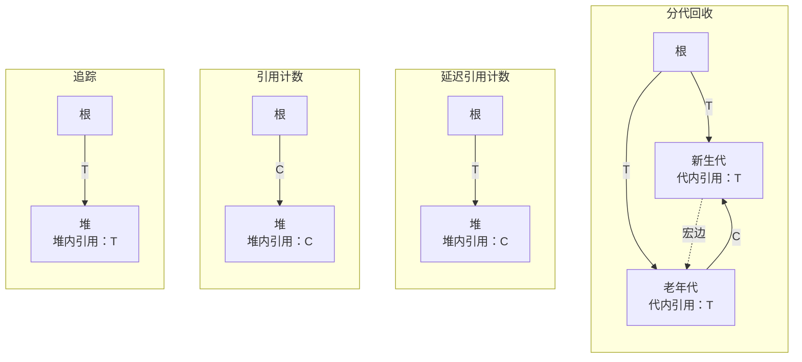

# 13.13 垃圾回收统一理论

到 1960 年，回收存储的两种基本方法都已出现：McCarthy 在 Lisp 中使用的**追踪**（tracing），以及 Collins
提出的**引用计数**（reference counting）[[McCarthy, 1960](#ref-mccarthy-1960)]
[[Collins, 1960](#ref-collins-1960)]。此后几十年的进展，无论是分代、并发还是实时回收，
都被视为对这两种方法之一的改进，而两者本身一直被看作性质迥异的两条路线。2004 年，IBM 的 Bacon、Cheng 与
Rajan 在 OOPSLA 上发表《垃圾回收统一理论》，提出了不同的看法：追踪与引用计数在算法上互为对偶，
追踪处理存活的对象，即「物质」，引用计数处理死亡的对象，即「反物质」，追踪回收器的每一个操作，
在引用计数回收器中都有一个精确对应的反操作；而所有高性能的回收器，例如延迟引用计数与分代回收，
实际上都是两者的混合 [[Bacon et al., 2004](#ref-bacon-2004)]。

这一发现来自工程经验。作者们分别实现过带环回收的多处理器并发引用计数回收器，
以及单处理器上的实时增量追踪回收器，并注意到两者优化得越充分，行为就越相似。论文的致谢说明，
这项工作始于第一作者在 2004 年 SPACE 研讨会上的一次「五分钟」短报告，不动点的表述则出自 Alex Aiken 的建议
[[Bacon et al., 2004](#ref-bacon-2004)]。本节介绍这一理论，并据此回看本章讨论过的各种回收器，
作为全章的收束。两类算法及其各种变体的系统介绍，可参见 Jones 等人的《垃圾回收手
册》[[Jones et al., 2023](#ref-jones-2023)]。

## 13.13.1 两种方法及其趋同

论文首先列出了两种朴素实现之间最常被提及的差别。追踪以批量方式工作，一次扫描整个堆；引用计数天然是增量的，
每次指针写入都要更新计数。追踪不给指针写入增加任何开销，引用计数则要为每次写入，包括对栈帧的写入，
付出很高的代价，因此追踪的吞吐更高。反过来，引用计数的停顿很短，天然适合实时应用。最后，
追踪能回收环状的垃圾，引用计数不能，后者面对可能含环的堆时，要么借助后备的追踪回收器，
要么使用试探删除（trial deletion）算法 [[Bacon et al., 2004](#ref-bacon-2004)]。

然而这些差别在优化之后逐渐模糊。增量是引用计数公认的根本优势，但每把一个指针装入寄存器就更新一次计数，
对高性能应用来说代价太高，因此大多数高性能实现采用 Deutsch 与 Bobrow 提出的延迟引用计数
[[Deutsch and Bobrow, 1976](#ref-deutsch-1976)]，单独处理来自栈帧的引用
[[Bacon et al., 2004](#ref-bacon-2004)]。这样一来，计数降为零的对象不能立即回收，
因为可能还有未被计入的栈上引用，回收只能推迟到周期性扫描栈的时候进行，结果是回收延迟、
浮动垃圾与更长的停顿，恰是追踪回收器的典型特征。另一方面，追踪回收器最常见的第一项优化是分代，
它降低了平均停顿与回收的延迟，却引入了每次写入的开销，同时带上了引用计数的优点与缺点。
为了更精确地限制停顿而提出的火车算法，又在循环引用面前表现异常，而这正是引用计数的标志性问题
[[Bacon et al., 2004](#ref-bacon-2004)]。两种回收器在优化中互相借用对方的特征，暗示它们有共同的深层结构。

## 13.13.2 不动点表述

为了看清这种结构，论文把回收形式化为一个不动点计算。把内存看作一张有向图：$V$ 为对象的集合，$E$
为指针构成的边的多重集（一个对象可以有多个指针指向同一个对象），$R$ 为根的多重集，
即栈帧与全局变量中的指针；$\rho(v)$ 为回收器为对象 $v$ 计算的引用计数。引用计数由两部分组成，
一是来自根的引用，二是来自计数非零的对象的入边：

$$
\rho(x) = \bigl|[\, x : x \in R \,]\bigr| + \bigl|[\, (w, x) : (w, x) \in E \wedge \rho(w) > 0 \,]\bigr|
$$

其中方括号表示多重集，竖线表示其元素个数。计数确定之后，计数为零的对象被回收。这个方程一般有多个解。设 $V
= \{a, b\}$，$R = \emptyset$，$E = \{(a, b), (b, a)\}$，即一个没有根引用的两节点环，则 $\rho(a) = \rho(b)
= 0$ 与 $\rho(a) = \rho(b) = 1$ 都满足方程，前者是最小不动点，后者是最大不动点。显然，
应当回收的是最小不动点所确定的垃圾 [[Bacon et al., 2004](#ref-bacon-2004)]。

追踪与引用计数是求解这个方程的两种算法。为了让两者的对应关系一目了然，论文对两者各做了一处非常规的处理：
追踪不只设置标记位，而是重建每个对象完整的引用计数，标记位可以看作在 1 处「粘住」的一位计数；
引用计数则不在写入时立即执行减量，而是把减量记入工作列表，留到回收时一并处理。论文强调，
后者并不是推荐的实现方式，只是理解两种算法关系的手段；推迟减量只是把一部分工作挪到别的时刻，
并不改变算法的复杂度。按论文的图 3 与图 4，两种回收器可以写成如下的伪代码：

```
// 追踪：从根出发，计数从零开始递增
collect-by-tracing():
    W ← find-roots()
    scan-by-tracing(W)
    sweep-for-tracing()

scan-by-tracing(W):
    while W ≠ ∅:
        remove w from W
        ρ(w) ← ρ(w) + 1
        if ρ(w) = 1:
            for each x ∈ [v : (w, v) ∈ E]:
                W ← W ⊎ [x]

sweep-for-tracing():
    for each v ∈ V:
        if ρ(v) = 0: VF ← VF ∪ {v}
        ρ(v) ← 0

// 引用计数：从减量记录出发，计数从高估值开始递减
assign(a, p):            // 指针写入 *a = p
    l ← [a]
    [a] ← p
    dec(l)               // W ← W ⊎ [l]，推迟到回收时处理
    inc(p)               // ρ(p) ← ρ(p) + 1

collect-by-counting(W):
    scan-by-counting(W)
    sweep-for-counting()

scan-by-counting(W):
    while W ≠ ∅:
        remove w from W
        ρ(w) ← ρ(w) − 1
        if ρ(w) = 0:
            for each x ∈ [v : (w, v) ∈ E]:
                W ← W ⊎ [x]

sweep-for-counting():
    for each v ∈ V:
        if ρ(v) = 0: VF ← VF ∪ {v}
```

两个扫描函数完全相同，区别只在于追踪对计数加一、引用计数对计数减一，以及递归的条件：追踪在计数变为 1
时继续遍历，引用计数在计数变为 0 时继续遍历。论文写道：「只改动算法核心中的两个字符，
我们就从追踪变成了引用计数。」另一处区别是，追踪的清扫要把计数重置为零，为下一轮从零开始做准备，
引用计数的清扫则不必如此 [[Bacon et al., 2004](#ref-bacon-2004)]。

两者的不同在于从哪一侧逼近真实的计数。追踪从低估开始：所有计数初始为零，工作列表是根集合，遍历中逐步递增，
收敛到最小不动点，计数为正的对象恰是从根可达的存活对象。引用计数从高估开始：回收开始时，所有增量都已执行，
而自上次回收以来的减量尚未执行，那些已经不再存活的对象发出的入边仍被计入；逐个处理减量之后，
计数收敛到最大不动点。两个不动点之差恰是环状垃圾。在没有环的情况下，
引用计数计算的正是追踪结果在图上的补集 [[Bacon et al., 2004](#ref-bacon-2004)]。论文的图 2
把这种对偶概括如下：

| | 追踪 | 引用计数 |
| --- | --- | --- |
| 起点 | 根 | 反根（计数被减为零的对象） |
| 图的遍历 | 从根向前 | 从反根向前 |
| 遍历的对象 | 存活对象 | 死亡对象 |
| 初始计数 | 低（0） | 高 |
| 计数的重建 | 加法 | 减法 |
| 额外的遍历 | 清扫阶段 | 试探删除 |

最后一行值得多说一句。人们通常把引用计数回收环需要额外的遍历视为它的一大缺点，
但追踪同样需要一次额外的遍历，而且是遍历整个对象空间，即清扫阶段，回收计数为零（标记位未置位）的对象。
半空间复制回收器只复制存活数据，省去了这次遍历，但这只是一个线性的时空权衡：
以线性的空间开销换掉一次线性的遍历 [[Bacon et al., 2004](#ref-bacon-2004)]。

最小与最大不动点之间还可能有其他的解。若环状垃圾 $V_C$ 中有 $n$ 个非平凡的强连通分量，方程的解就有 $n+1$
至 $2^n$ 个，具体取决于图的拓扑。回收环状垃圾的一般方法，是找到一个不含根、且没有来自外部的入边的对象子集
$S$，使得存在一个解，其中 $S$ 中所有对象的计数都为零。引用计数系统有两种基本做法：一是后备的追踪回收器，
偶尔对整个堆做一次追踪；二是试探删除，从疑似属于环的对象出发，减去内部引用，检查是否还有来自外部的计数
[[Bacon et al., 2004](#ref-bacon-2004)]。论文由此得出一个结论：环的存在使回收在本质上无法完全增量化，
回收环的过程具有追踪的性质。

## 13.13.3 一切高性能回收器都是混合体

有了对偶的视角，论文重新审视了各种回收器的结构，结论是：所有现实的回收器都是追踪与引用计数的某种混合。
不同回收器之间根本的区别只有两点：如何划分存储，以及在每个划分中由追踪还是引用计数负责维护计数；
做出这两项决定之后，余下的选择都是实现细节，归结为各种时空权衡。按存储的划分，回收器分为统一堆、
分离堆与多堆三类。论文同时说明，这一分析不考虑并发回收器 [[Bacon et al., 2004](#ref-bacon-2004)]。

即使在统一堆中，也有根与堆两个区域。延迟引用计数对堆内的引用计数，对来自根的引用不计数，
回收时检查根所指向的对象，将它们从零计数表中移除，再回收表中剩下的对象。由于根的写入极为频繁，
这种做法把处理根的代价从应用转移到了回收器；而检查根指针、增加所发现对象的计数，本身就是追踪。
因此延迟引用计数是追踪根、计数堆的混合 [[Deutsch and Bobrow, 1976](#ref-deutsch-1976)]
[[Bacon et al., 2004](#ref-bacon-2004)]。把两者的角色对调，就得到计数根、追踪堆的「部分追踪」，
它与延迟引用计数互为对偶。论文不知道它有任何实现，并指出在语言运行时中它的性能会非常差：
它像纯引用计数一样有极高的写入开销，却得不到引用计数的增量性。从这两个例子中，论文观察到，
写入函数总是与混合回收器中引用计数的部分相关联：延迟引用计数的屏障记录来自堆的指针，
部分追踪的屏障记录来自栈的指针；一般而言，写屏障的存在表明算法中有某种类似引用计数的行为。

分离堆的典型是分代回收器。为了不追踪整个老年代而单独回收新生代，它维护一个记忆集，
记下老年代中指向新生代的指针，并由每次堆指针更新时执行的写屏障维护。按统一理论，写屏障就是那个写入函数，
记忆集则是非零引用计数的集合表示，相当于延迟引用计数中零计数表的补集，只是范围限于新生代。于是，
标准的分代回收器追踪来自根的引用以及两代内部的引用，对老年代指向新生代的引用计数；
新生代到老年代之间则有一条概括性的「宏边」，因为回收器不记录这些指针，所以老年代不能单独回收，
只能在新生代为空时回收 [[Bacon et al., 2004](#ref-bacon-2004)]。下图按论文的示意图画出了几种回收器的结构，
标有 T 的引用由追踪处理，标有 C 的引用由引用计数处理，区域内部的引用标在节点中：



在同一框架下，分代的其他变体也一目了然。对新生代计数、对老年代追踪，可以借追踪老年代回收环，
但恰好对写入最频繁的年轻对象计数，昂贵的屏障操作落在最频繁的操作上。反过来追踪新生代、计数老年代，
新生代中的写入不必经过屏障，但老年代需要额外的环回收机制；Blackburn 与 McKinley 的「Ulterior 引用计数」
正是这种结构，以试探删除回收老年代中的环 [[Blackburn and McKinley, 2003](#ref-blackburn-2003)]
[[Bacon et al., 2004](#ref-bacon-2004)]。论文在结论中把设计回收器归结为三项决定：划分，即把堆、
栈与全局变量划分为若干区域，各自采用不同的策略；遍历，即为每个区域选择追踪还是引用计数；权衡，
即为每个区域选择半空间复制还是滑动压缩、指针反转还是栈式遍历等时空权衡。

论文还为各类回收器建立了统一的代价模型。以追踪为例，设 $a$ 为分配速率，$M$ 为以对象计的内存大小，$V_L$
为存活对象数，$D$ 为遍历栈所需的空间，则回收的频率约为 $\varphi(T) \simeq a / (M - D - V_L)$，
每轮回收的代价 $\kappa(T)$ 与根集合的大小、标记阶段访问的存活对象与边数，以及清扫阶段的对象总数成正比，
总开销为 $\tau(T) = \varphi(T) \cdot \kappa(T)$ [[Bacon et al., 2004](#ref-bacon-2004)]。
频率与扣除存活数据之后的空闲内存成反比，这正是 `GOGC` 与堆目标所调节的余量（[13.3](./pacing.md)）。

## 13.13.4 以统一理论回看 Go

按论文的分类，Go 的回收器是统一堆回收器，来自根的引用与堆内的引用都由追踪处理，位于谱系中纯追踪的一端。
它的标记位就是论文所说的一位粘滞计数，清扫则是追踪的那次额外遍历；Go
把下一轮的分配位图直接取自本轮的标记位图，使这次遍历的大部分工作化为位图的交换（[13.5](./sweep.md)）。
作为纯追踪回收器，它天然能回收环状垃圾，也不需要任何形式的环检测。Go 在 2014 年选择三色并发、
不移动对象的追踪回收器的经过，见 Hudson 的回顾 [[Hudson, 2018](#ref-hudson-2018)]与
[13.12.2](./history.md)。

Go 的回收器也有写屏障，但它的作用与论文所讨论的不同。论文的分析明确不考虑并发回收器，
其中的写屏障维护的是跨越存储划分的计数；Go 的写屏障只在标记期间开启，
作用是在赋值器与回收器并发运行时维持三色不变式，它并不划分存储，也不维护任何划分之间的计数
（[13.2](./barrier.md)）。不过，两者在形式上的相似值得一提，这是本书的观察，而非论文的结论。`mbarrier.go`
用如下伪代码描述 Go 的混合写屏障 [[Go Authors, 2026](#ref-go-authors-2026)]：

```
writePointer(slot, ptr):
    shade(*slot)
    if current stack is grey:
        shade(ptr)
    *slot = ptr
```

它在写入时处理被覆盖的旧值与写入的新值，与论文中 `assign` 先对旧值执行 `dec`、再对新值执行 `inc`
的结构相同；差别在于，`shade` 只是把对象染灰，交给标记去处理，而不是增减计数（实现中两次着色都无条件执行，
见 [13.2.4](./barrier.md)）。

本章讨论过的其他设计，也可以放进这一框架。分代回收的写屏障维护老年代指向新生代的计数，
必须在赋值器运行期间始终开启；Go 团队曾实现过非移动的分代回收器，最终因为常开屏障的开销未能被收益抵消而放
弃，详见 [13.8](./generational.md) 与 [13.1.6](./basic.md)。ROC 按 goroutine 划分对象，
以写屏障追踪对象的发布（[13.9](./roc.md)）；按统一理论的视角，这同样是一种划分存储、
由写屏障在划分之间维护信息的混合结构，它的命运与分代相同。Green Tea（[13.11](./greentea.md)）
则不属于论文的三项决定中的任何一项：它既不改变存储的划分，也不改变追踪的选择，计算的仍是同一个最小不动点，
改变的只是遍历对象的次序与访存的局部性，处在论文的模型之下的实现层面。回收器各项设计的时间线见
[13.12](./history.md)。

## 13.13.5 小结

Bacon、Cheng 与 Rajan 的统一理论把追踪与引用计数表述为同一个不动点方程的两种解法：追踪从低估出发，
用加法求最小不动点，遍历存活对象；引用计数从高估出发，用减法求最大不动点，遍历死亡对象；
两个不动点之差恰是环状垃圾。在此基础上，所有高性能回收器都是两者的混合，
区别只在存储的划分以及每个划分由哪种方法维护计数，写屏障则是引用计数一侧的标志。在这一框架中，Go
是统一堆上的纯追踪回收器，写屏障只为并发而设；它曾尝试的分代与 ROC 都会引入划分与常开的屏障，而 Green Tea
在不改变所求解的情况下改善了遍历的局部性。

## 延伸阅读

- <a id="ref-bacon-2004"></a>[Bacon et al., 2004] David F. Bacon, Perry Cheng, V. T. Rajan. *A Unified
  Theory of Garbage Collection.* Proceedings of OOPSLA 2004, pp. 50–68; also *ACM SIGPLAN Notices* 39(10).
  https://doi.org/10.1145/1028976.1028982 （本节的源头：对偶与不动点表述）
- <a id="ref-blackburn-2003"></a>[Blackburn and McKinley, 2003] Stephen M. Blackburn, Kathryn S. McKinley.
  *Ulterior Reference Counting: Fast Garbage Collection without a Long Wait.* Proceedings of OOPSLA 2003,
  pp. 344–358. https://doi.org/10.1145/949305.949336
- <a id="ref-collins-1960"></a>[Collins, 1960] George E. Collins. *A Method for Overlapping and Erasure of
  Lists.* *Communications of the ACM* 3(12): 655-657, 1960. https://doi.org/10.1145/367487.367501
  （引用计数式回收的最早提出）
- <a id="ref-deutsch-1976"></a>[Deutsch and Bobrow, 1976] L. Peter Deutsch, Daniel G. Bobrow. *An
  Efficient, Incremental, Automatic Garbage Collector.* *Communications of the ACM* 19(9): 522-526, 1976.
  https://doi.org/10.1145/360336.360345 （延迟引用计数：计数式向追踪式靠拢的经典混合）
- <a id="ref-go-authors-2026"></a>[Go Authors, 2026] The Go Authors. src/runtime/mbarrier.go. Go 1.26.
  https://github.com/golang/go/blob/release-branch.go1.26/src/runtime/mbarrier.go
- <a id="ref-hudson-2018"></a>[Hudson, 2018] Richard L. Hudson. *Getting to Go: The Journey of Go's
  Garbage Collector.* ISMM 2018 keynote / The Go Blog, 2018. https://go.dev/blog/ismmkeynote （Go
  选择追踪式并发回收的设计自述）
- <a id="ref-jones-2023"></a>[Jones et al., 2023] Richard Jones, Antony Hosking, Eliot Moss. *The Garbage
  Collection Handbook: The Art of Automatic Memory Management.* 2nd ed., CRC Press, 2023.（追
  踪式、计数式及各类混合算法的权威综述）
- <a id="ref-mccarthy-1960"></a>[McCarthy, 1960] John McCarthy. *Recursive Functions of Symbolic
  Expressions and Their Computation by Machine, Part I.* *Communications of the ACM* 3(4): 184-195, 1960.
  https://doi.org/10.1145/367177.367199 （标记清扫式追踪回收的最早提出）
- 本书 [13.1 垃圾回收的基本想法](./basic.md)、[13.2 写屏障技术](./barrier.md)、[13.3
  触发频率及其调步算法](./pacing.md)、[13.5 清扫与位图](./sweep.md)、[13.8
  分代假设与代际回收](./generational.md)、[13.9 请求假设与事务制导回收](./roc.md)、[13.11
  Green Tea：面向局部性的标记](./greentea.md)、[13.12 过去、现在与未来](./history.md)。
