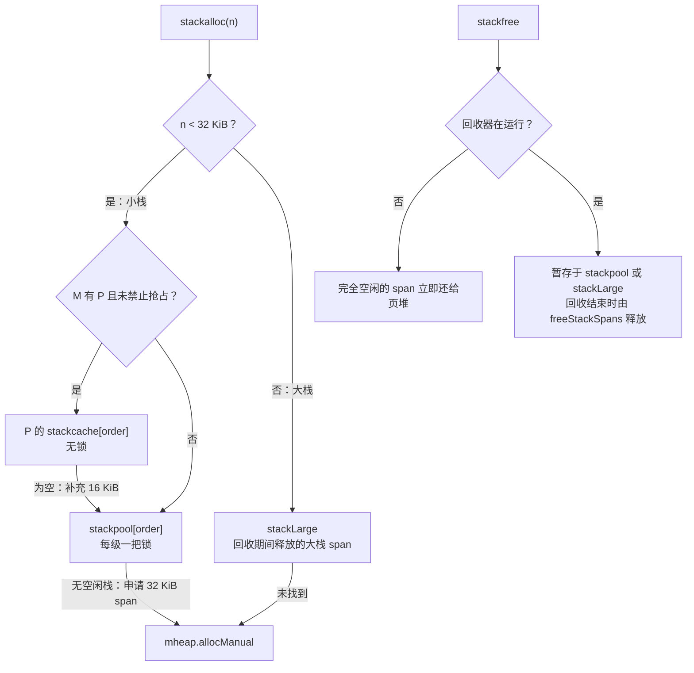

# 14.2 栈的分配与缓存

goroutine 的栈与堆上的对象来自同一个页堆（[12.2](../ch12alloc/component.md)），却不经过对象分配器
`mallocgc`，而由 `runtime/stack.go` 中一套独立的分配器管理。这套分配器面对的要求与对象分配不同：它自身
不能在执行中扩栈；它分配的大小总是 2 的幂；栈何时释放由运行时决定，而不由垃圾回收器判定；goroutine 的
创建与栈的增长又频繁地需要新栈，分配路径必须足够短。本节依次讨论这套分配器为何独立、小栈与大栈的分配
路径、它与垃圾回收的配合，以及 Go 1.19 起新 goroutine 的初始栈大小如何确定。

## 14.2.1 独立的分配器

栈分配器的入口是 `stackalloc`，它以两项检查开头 [[Go Authors, 2026a](#ref-go-authors-2026a)]：

```go
// stackalloc allocates an n byte stack.
//
// stackalloc must run on the system stack because it uses per-P
// resources and must not split the stack.
//
//go:systemstack
func stackalloc(n uint32) stack {
	// Stackalloc must be called on scheduler stack, so that we
	// never try to grow the stack during the code that stackalloc runs.
	// Doing so would cause a deadlock (issue 1547).
	thisg := getg()
	if thisg != thisg.m.g0 {
		throw("stackalloc not on scheduler stack")
	}
	if n&(n-1) != 0 {
		throw("stack size not a power of 2")
	}
	// ……
}
```

第一项检查来自 2011 年的一次死锁。当时创建 goroutine 的 `malg` 在普通 goroutine 的栈上调用 `stackalloc`：
为调用 `lock(&stacks)` 而发生的栈分裂，在返回时需要释放栈段，而释放栈段又需要那把已被持有的锁。gofmt
因此偶尔停止响应（issue #1547），Russ Cox 随即让 `stackalloc` 总是在调度栈 g0 上执行
[[Cox, 2011](#ref-cox-2011)]。如今 `//go:systemstack` 标记还让序言在每次调用时核实这一点
（[14.1](./design.md)）。第二项检查说明栈的大小总是 2 的幂，这来自 `fixedStack` 的取整与扩栈时的倍增
（[14.3](./grow.md)）。

栈并非一直由独立的分配器管理。Go 1.2 与 Go 1.3 中，只有最小尺寸的栈来自一个按 M 划分的环形缓存，缓存成批地
直接向操作系统申请内存；其他尺寸的栈通过 `mallocgc` 从垃圾回收的堆中分配，并带上 `FlagNoGC` 标志，使回收器
不去释放它们 [[Go Authors, 2013](#ref-go-authors-2013)]。Keith Randall 在 2014 年把栈的分配从 `mallocgc`
中分离出来，随 Go 1.4 发布，提交说明给出了两条理由 [[Randall, 2014a](#ref-randall-2014a)]：

> 为了把 malloc 改写为 Go，我们需要一个独立的栈分配器。如果在 malloc 执行期间栈空间耗尽，malloc 就无法
> 为新栈分配内存。栈是 GC 堆中最后一类 FlagNoGC 对象，把它们移出之后，就可以去掉已分配位与块边界位之间
> 的区分。

这次修改同时把栈的本地缓存从 M 移到了 P，这是 Dmitry Vyukov 在 issue #7424 中提出的。

今天的栈仍从页堆中取得内存，但走的是另一个入口。`mheap.allocManual` 分配的 span 处于 `mSpanManual` 状态，
与垃圾回收堆中的 span 相区别 [[Go Authors, 2026c](#ref-go-authors-2026c)]：

```go
const (
	mSpanDead   mSpanState = iota
	mSpanInUse             // allocated for garbage collected heap
	mSpanManual            // allocated for manual management (e.g., stack allocator)
)
```

`allocManual` 的注释写明，这样分配的内存不计入 `heapInUse`。回收器从指针查找所属 span 的 `spanOfHeap`
只接受 `mSpanInUse` 状态的 span，指向栈内存的指针因此不会被当作堆对象标记；栈占用的内存也单独统计，即
`runtime.MemStats` 中的 `StackInuse`，Randall 的同一次修改顺带解决了要求统计栈用量的 issue #7468。

## 14.2.2 尺寸分级与全局池

栈分配器按大小把栈分为两类。`runtime/malloc.go` 中的两个常量划定了界限
[[Go Authors, 2026d](#ref-go-authors-2026d)]：

```go
const (
	// ……
	// Per-P, per order stack segment cache size.
	_StackCacheSize = 32 * 1024

	// Number of orders that get caching. Order 0 is FixedStack
	// and each successive order is twice as large.
	// We want to cache 2KB, 4KB, 8KB, and 16KB stacks. Larger stacks
	// will be allocated directly.
	// Since FixedStack is different on different systems, we
	// must vary NumStackOrders to keep the same maximum cached size.
	//   OS               | FixedStack | NumStackOrders
	//   -----------------+------------+---------------
	//   linux/darwin/bsd | 2KB        | 4
	//   windows/32       | 4KB        | 3
	//   windows/64       | 8KB        | 2
	//   plan9            | 4KB        | 3
	_NumStackOrders = 4 - goarch.PtrSize/4*goos.IsWindows - 1*goos.IsPlan9
	// ……
)
```

大小为 `fixedStack << order` 的栈称为第 `order` 级。在大多数平台上，2、4、8、16 KiB
四级的小栈经由缓存分配，32 KiB 及以上的大栈各自占用专门的 span。Go 1.4 只有三级；Randall 在 Go 1.5
中增加到四级，并说明了上限的由来：分配器每次以 32 KiB 为单位向页堆申请和归还，缓存 32 KiB
以上的栈没有意义 [[Randall, 2014b](#ref-randall-2014b)]。表中 windows/32 一行已经过时：自 Go 1.24 起，windows/386
与 windows/amd64 一样预留 4096 字节的 `stackSystem` [[Cox, 2024](#ref-cox-2024)]，最小栈也是
8 KiB。

两类栈各有一个全局池：

```go
// Global pool of spans that have free stacks.
// Stacks are assigned an order according to size.
//
//	order = log_2(size/FixedStack)
//
// There is a free list for each order.
var stackpool [_NumStackOrders]struct {
	item stackpoolItem
	_    [(cpu.CacheLinePadSize - unsafe.Sizeof(stackpoolItem{})%cpu.CacheLinePadSize) % cpu.CacheLinePadSize]byte
}

type stackpoolItem struct {
	_    sys.NotInHeap
	mu   mutex
	span mSpanList
}

// Global pool of large stack spans.
var stackLarge struct {
	lock mutex
	free [heapAddrBits - gc.PageShift]mSpanList // free lists by log_2(s.npages)
}
```

`stackpool` 的每一级是一条 span 链表，链上的 span 都还有空闲的小栈。每一级各有一把锁，数组元素填充到缓存行
大小，使不同级的锁不会落在同一缓存行上。Go 1.14 之前，所有级共用一把锁 `stackpoolmu`；Changkun Ou 把它
拆成每级一把，在栈深度增长的基准测试中耗时减少约 9% [[Ou, 2019](#ref-ou-2019)]。`stackLarge` 按页数的对数
分桶存放大栈的 span，但它只收留垃圾回收期间释放的大栈，14.2.4 将说明其原因。

## 14.2.3 小栈：本地缓存

分配小栈时，`stackalloc` 先算出级别，再决定从哪里取：

```go
	if n < fixedStack<<_NumStackOrders && n < _StackCacheSize {
		order := uint8(0)
		n2 := n
		for n2 > fixedStack {
			order++
			n2 >>= 1
		}
		var x gclinkptr
		if stackNoCache != 0 || thisg.m.p == 0 || thisg.m.preemptoff != "" {
			// thisg.m.p == 0 can happen in the guts of exitsyscall
			// or procresize. Just get a stack from the global pool.
			// Also don't touch stackcache during gc
			// as it's flushed concurrently.
			lock(&stackpool[order].item.mu)
			x = stackpoolalloc(order)
			unlock(&stackpool[order].item.mu)
		} else {
			c := thisg.m.p.ptr().mcache
			x = c.stackcache[order].list
			if x.ptr() == nil {
				stackcacherefill(c, order)
				x = c.stackcache[order].list
			}
			c.stackcache[order].list = x.ptr().next
			c.stackcache[order].size -= uintptr(n)
		}
		// ……
		v = unsafe.Pointer(x)
	}
```

通常的路径从当前 P 的 `mcache.stackcache[order]` 中摘下一个空闲栈。`stackcache` 是 `mcache` 中的一个数组，
每级一条由空闲栈自身串成的链表（[12.2](../ch12alloc/component.md)），同一时刻只有一个 M 持有这个 P，
因此无需加锁。两种情况下不使用本地缓存，而是加锁直接访问全局池。其一是 M 没有 P，注释指出这会发生在
`exitsyscall` 或 `procresize` 的执行过程中。其二是 `m.preemptoff` 非空，即当前 M 禁止被抢占，
停止一切期间便是如此。注释后半句所说的「垃圾回收期间」是一处遗迹：Go 1.4 中这里检查的是 `m.gcing` 与
`m.helpgc`，即当前 M 是否在执行垃圾回收，各个缓存当时会被回收器并发地清空
[[Go Authors, 2014](#ref-go-authors-2014)]。Austin Clements 在 2015 年把 `gcing` 改名为 `preemptoff`
并改为字符串，理由是它已被普遍用来表示「不要抢占这个 g」，而在回收器可以被抢占之后，
它恰恰不再意味着正在回收 [[Clements, 2015a](#ref-clements-2015a)]。

本地缓存用尽时，`stackcacherefill` 从全局池批量取回一批栈：

```go
// stackcacherefill/stackcacherelease implement a global pool of stack segments.
// The pool is required to prevent unlimited growth of per-thread caches.
//
//go:systemstack
func stackcacherefill(c *mcache, order uint8) {
	// ……
	// Grab some stacks from the global cache.
	// Grab half of the allowed capacity (to prevent thrashing).
	var list gclinkptr
	var size uintptr
	lock(&stackpool[order].item.mu)
	for size < _StackCacheSize/2 {
		x := stackpoolalloc(order)
		x.ptr().next = list
		list = x
		size += fixedStack << order
	}
	unlock(&stackpool[order].item.mu)
	c.stackcache[order].list = list
	c.stackcache[order].size = size
}
```

每级的本地缓存容量为 32 KiB，一次补充到一半，即 16 KiB。释放时方向相反：`stackfree` 把小栈放回本地缓存，
若缓存已达 32 KiB，先由 `stackcacherelease` 把它削减到一半。补充与削减都停在一半，
本地缓存在两次加锁之间总能再分配或再接收 16 KiB，不会在某个分界上反复访问全局池，注释中的「to prevent
thrashing」即指此。注释里的「stack segments」与「per-thread caches」也是遗迹，这两行注释基本沿用自 Go 1.2
的分段栈与按线程缓存的年代 [[Go Authors, 2013](#ref-go-authors-2013)]。

全局池的一级为空时，`stackpoolalloc` 通过 `allocManual` 向页堆申请一个 32 KiB 的 span，把它切成等大的
小栈，用每个栈开头的一个字串成链表 `manualFreeList`，再把 span 挂入该级的链表；span 中的栈分完后，span
从链表上摘下，有栈归还时再挂回。一个 span 只服务于一个级别，这与对象分配中一个 span 只服务于一个尺寸类
（[12.1](../ch12alloc/basic.md)）相同。

## 14.2.4 与垃圾回收的配合

小栈归还到全局池后，所在的 span 可能变得完全空闲。`stackpoolfree` 只在回收器未运行时把这样的 span 立即
还给页堆：

```go
	if gcphase == _GCoff && s.allocCount == 0 {
		// Span is completely free. Return it to the heap
		// immediately if we're sweeping.
		//
		// If GC is active, we delay the free until the end of
		// GC to avoid the following type of situation:
		//
		// 1) GC starts, scans a SudoG but does not yet mark the SudoG.elem pointer
		// 2) The stack that pointer points to is copied
		// 3) The old stack is freed
		// 4) The containing span is marked free
		// 5) GC attempts to mark the SudoG.elem pointer. The
		//    marking fails because the pointer looks like a
		//    pointer into a free span.
		//
		// By not freeing, we prevent step #4 until GC is done.
		stackpool[order].item.span.remove(s)
		s.manualFreeList = 0
		osStackFree(s)
		mheap_.freeManual(s, spanAllocStack)
	}
```

问题的根源在于，回收器假定 span 在扫描与标记期间不会由占用变为空闲。堆中的个别对象（如 channel 的等待者
`sudog`，[10.3](../../part3concurrency/ch10chan/sendrecv.md)）可能保存指向栈的指针。
若回收器读出这样一个指针之后、标记之前，栈被复制而旧栈所在的 span 被释放，标记时指针便指向一个空闲的
span，这就是注释描述的情形。Clements 在 2015 年的修改说明中描述了更坏的结果：被释放的 span
可能随即被重新用作堆 span，回收器会把那里并不存在的对象当作对象来标记
[[Clements, 2015b](#ref-clements-2015b)]。在此之前，只有收缩栈时释放的旧栈会推迟到回收结束才释放；
这次修改把推迟推广到栈的增长。

被推迟的 span 在回收结束时统一处理。标记终止之后，`gcMarkTermination` 调用 `freeStackSpans`：

```go
	// Free stack spans. This must be done between GC cycles.
	systemstack(freeStackSpans)
```

它释放 `stackpool` 中所有完全空闲的 span，以及 `stackLarge` 中的全部 span。随后，`gcMarkTermination` 通过
`forEachP` 让每个 P 执行 `mcache.prepareForSweep`，其中的 `stackcache_clear`
把本地缓存中的栈全部还给全局池；P 被销毁时，`freemcache` 也做同样的事
[[Go Authors, 2026b](#ref-go-authors-2026b)]。

大栈不经过缓存，`stackalloc` 先在 `stackLarge` 中查找相同页数的 span，找不到再直接向页堆申请：

```go
	} else {
		var s *mspan
		npage := uintptr(n) >> gc.PageShift
		log2npage := stacklog2(npage)

		// Try to get a stack from the large stack cache.
		lock(&stackLarge.lock)
		if !stackLarge.free[log2npage].isEmpty() {
			s = stackLarge.free[log2npage].first
			stackLarge.free[log2npage].remove(s)
		}
		unlock(&stackLarge.lock)
		// ……
		if s == nil {
			// Allocate a new stack from the heap.
			s = mheap_.allocManual(npage, spanAllocStack)
			// ……
			s.elemsize = uintptr(n)
		}
		v = unsafe.Pointer(s.base())
	}
```

释放大栈时，`stackfree` 同样区分回收器是否在运行：

```go
		if gcphase == _GCoff {
			// Free the stack immediately if we're
			// sweeping.
			osStackFree(s)
			mheap_.freeManual(s, spanAllocStack)
		} else {
			// If the GC is running, we can't return a
			// stack span to the heap because it could be
			// reused as a heap span, and this state
			// change would race with GC. Add it to the
			// large stack cache instead.
			log2npage := stacklog2(s.npages)
			lock(&stackLarge.lock)
			stackLarge.free[log2npage].insert(s)
			unlock(&stackLarge.lock)
		}
```

可见 `stackLarge` 并不是小栈之后的又一级缓存，而是回收期间暂存大栈 span 的地方。2015 年的修改起初只把这些
span 留到回收结束再释放，不加以重用；如果程序快速地分配大栈而堆增长缓慢，回收周期之间的间隔很长，暂存的
span 便越积越多。Clements 随后让新的大栈分配优先重用 `stackLarge` 中的 span，随 Go 1.6 发布。按提交说明，issue
#13552 中的程序原本在几个小时内内存增长到 1 GB 以上，修改后稳定在 30 MB 左右
[[Clements, 2015c](#ref-clements-2015c)]。

下图汇总了小栈与大栈的分配与释放路径：



## 14.2.5 初始栈大小

栈从 2 KiB 开始、按需倍增，对于本来就要使用大量栈的 goroutine 并不划算：一个最终需要 32 KiB 栈的
goroutine 要先经历四次扩栈与复制。2016 年，Peter Mattis 在 issue #18138 中报告了这一问题：新建的
goroutine 可能把大量时间花在 `morestack` 上 [[Mattis, 2016](#ref-mattis-2016)]。
此后有多份方案提议根据「相似」的 goroutine 过去的表现预测栈的用量。Randall 在 2021 年的设计文档中指出，
这类方案都要回答什么算相似、如何保存统计、何时数据才足够、程序行为变化时如何应对等问题，
并提出了一个更简单的做法：所有 goroutine 共用一个初始大小，在每轮垃圾回收中重新计算
[[Randall, 2021a](#ref-randall-2021a)]。

文档先分析了当时的方案能给出的保证。若把最小栈视为 1 字节，并假设收缩立即发生，则一个当前使用 S 字节的栈，
分配的空间至多为 4S，因为用量一旦低于分配量的四分之一，栈就会收缩一半。设上一轮回收到本轮回收之间，
全部栈用量的最大值为 M，goroutine 数量的最大值为 G。若新 goroutine 的栈从 k·M/G 开始，那么在 M 与 G
保持稳定时，分配的总空间不超过 (4 + k)·M；文档举例取 k = 4，仍在最优值的常数倍之内。

Go 1.19 中的实现比文档更为简化 [[Randall, 2021b](#ref-randall-2021b)]。回收器扫描每个栈时，
把已用部分的大小（`stack.hi` 减去 SP）累加到当前 P 上；标记终止时，`gcComputeStartingStackSize`
用平均值算出新的初始大小：

```go
	avg := scannedStackSize/scannedStacks + stackGuard
	// Note: we add stackGuard to ensure that a goroutine that
	// uses the average space will not trigger a growth.
	if avg > uint64(maxstacksize) {
		avg = uint64(maxstacksize)
	}
	if avg < fixedStack {
		avg = fixedStack
	}
	// Note: maxstacksize fits in 30 bits, so avg also does.
	startingStackSize = uint32(round2(int32(avg)))
```

平均值加上警戒线以下的余量，再向上取整为 2 的幂，就是此后新 goroutine 的栈大小。函数开头的注释说明了这一
启发式的依据：以平均大小起步，所用空间至多是理想算法的两倍；分配过小的栈仍可增长，过大的栈仍可收缩。提交
说明中，issue #18138 的基准测试耗时从 95.3 µs 降到 67.3 µs，减少 29%。这一行为默认开启，可以通过
`GODEBUG=adaptivestackstart=0` 关闭。

初始大小只在一个地方生效：从空闲链表中复用的 goroutine。goroutine 退出后，`gfput` 把它放回 P 的空闲链表，
若其栈的大小不等于当时的 `startingStackSize`，就先释放栈；`gfget` 取出 goroutine 时，若栈的大小与当前的
`startingStackSize` 不符，也会释放后重新分配 [[Go Authors, 2026d](#ref-go-authors-2026d)]。没有可复用的
goroutine 时，`newproc1` 调用 `malg(stackMin)` 新建一个，栈仍从 2 KiB 开始。文档中「栈不收缩到初始大小
以下」的设想也没有实现，收缩的下限仍是 `fixedStack`（[14.5](./shrink.md)）。

运行时通过 `runtime/metrics` 中的 `/gc/stack/starting-size:bytes` 公开当前的初始大小。下面的程序让
1000 个 goroutine 各自递归 17 层，每层的栈帧约 1 KiB，在它们全部阻塞时触发一次回收，再在它们全部退出后
触发一次回收，并观察初始大小的变化：

```go {run=true}
package main

import (
	"fmt"
	"runtime"
	"runtime/metrics"
	"sync"
)

// startingSize 读出运行时当前为新 goroutine 选定的初始栈大小。
func startingSize() uint64 {
	s := []metrics.Sample{{Name: "/gc/stack/starting-size:bytes"}}
	metrics.Read(s)
	return s[0].Value.Uint64()
}

// deep 递归 n 层，每层的栈帧约 1 KiB，到达底部时调用 bottom。
func deep(n int, bottom func()) byte {
	var buf [1024]byte
	if n == 0 {
		bottom()
		return buf[0]
	}
	buf[n%len(buf)] = byte(n)
	return deep(n-1, bottom) + buf[0]
}

func main() {
	fmt.Println("初始：", startingSize())

	release := make(chan struct{})
	var ready, done sync.WaitGroup
	for range 1000 {
		ready.Add(1)
		done.Add(1)
		go func() {
			defer done.Done()
			deep(16, func() { ready.Done(); <-release })
		}()
	}
	ready.Wait() // 1000 个 goroutine 都已递归到底并阻塞
	runtime.GC()
	fmt.Println("1000 个 goroutine 各占用约 17 KiB 栈时：", startingSize())

	close(release)
	done.Wait()
	runtime.GC()
	fmt.Println("它们全部退出之后：", startingSize())
}
```

运行结果如下：

```
初始： 2048
1000 个 goroutine 各占用约 17 KiB 栈时： 32768
它们全部退出之后： 2048
```

第一次回收时，被扫描的栈几乎都是这 1000 个约 17 KiB 的栈，平均值加上 928 字节的余量后取整为 32 KiB。
新的初始大小在同一轮回收的标记终止阶段就已算出，因此回收一结束即可读到。这些 goroutine 退出后，它们不再
被扫描，第二次回收只统计主 goroutine 与运行时的几个后台 goroutine，平均用量很小，初始大小回到 2 KiB。
此时空闲链表中那 1000 个带有 32 KiB 栈的 goroutine，会在被复用时由 `gfget` 释放旧栈、换上 2 KiB 的新栈。

## 14.2.6 小结

栈分配器与对象分配器共用页堆，结构也相似：每个 P 一份无锁的本地缓存，其后是加锁的全局池，最后是页堆，
这一结构可以追溯到 TCMalloc 的线程缓存、中心自由表与页堆
[[TCMalloc Authors, 2026](#ref-tcmalloc-authors-2026)]。它的不同之处都来自栈的性质。栈的大小是 2 的幂，
级别只需几次移位即可算出，无需查尺寸类表；栈由运行时显式释放，span 处于 `mSpanManual` 状态，
不受回收器的标记与清扫；但堆中可能保存指向栈的指针，空闲的栈 span 在回收期间不能还给页堆，
只能留到回收结束。初始栈大小的自适应是另一种取舍：它以至多两倍的空间，换取新 goroutine 少经历几次扩栈。

## 延伸阅读

- <a id="ref-clements-2015a"></a>[Clements, 2015a] Austin Clements. runtime: rename m.gcing to
  m.preemptoff and make it a string. Go commit 28b5118415, 2015. https://go.dev/cl/3660
  随 Go 1.5 发布。
- <a id="ref-clements-2015b"></a>[Clements, 2015b] Austin Clements. runtime: don't free stack spans during
  GC. Go commit d57056ba26, 2015. https://go.dev/cl/11502
  随 Go 1.5 发布。
- <a id="ref-clements-2015c"></a>[Clements, 2015c] Austin Clements. runtime: recycle large stack spans. Go
  commit 0cbf8d13a7, 2015. https://go.dev/cl/17814
  随 Go 1.6 发布。
- <a id="ref-cox-2011"></a>[Cox, 2011] Russ Cox. runtime: always run stackalloc on scheduler stack. Go
  commit b5dfac45ba, 2011. https://golang.org/cl/4216045
  随 Go 1 发布。
- <a id="ref-cox-2024"></a>[Cox, 2024] Russ Cox. runtime: reserve 4kB for system stack on windows-386. Go
  commit 7eeb0a188e, 2024. https://go.dev/cl/627375
  随 Go 1.24 发布。
- <a id="ref-go-authors-2013"></a>[Go Authors, 2013] The Go Authors. src/pkg/runtime/stack.c. Go 1.2 源码.
  https://github.com/golang/go/blob/go1.2/src/pkg/runtime/stack.c
- <a id="ref-go-authors-2014"></a>[Go Authors, 2014] The Go Authors. src/runtime/stack.c. Go 1.4 源码.
  https://github.com/golang/go/blob/go1.4/src/runtime/stack.c
- <a id="ref-go-authors-2026a"></a>[Go Authors, 2026a] The Go Authors. src/runtime/stack.go. Go 1.26 源码.
  https://github.com/golang/go/blob/release-branch.go1.26/src/runtime/stack.go
  `stackalloc`、`stackpool`、`stackLarge`、`stackcacherefill`、`stackpoolalloc` 的权威定义。
- <a id="ref-go-authors-2026b"></a>[Go Authors, 2026b] The Go Authors. src/runtime/mcache.go. Go 1.26
  源码. https://github.com/golang/go/blob/release-branch.go1.26/src/runtime/mcache.go
  `stackcache` 字段、`stackfreelist` 定义。
- <a id="ref-go-authors-2026c"></a>[Go Authors, 2026c] The Go Authors. src/runtime/mheap.go. Go 1.26 源码.
  https://github.com/golang/go/blob/release-branch.go1.26/src/runtime/mheap.go
  `allocManual`、`mSpanManual`、`spanAllocStack`。
- <a id="ref-go-authors-2026d"></a>[Go Authors, 2026d] The Go Authors. src/runtime/malloc.go、proc.go、mgc.go、mgcmark.go.
  Go 1.26 源码. https://github.com/golang/go/tree/release-branch.go1.26/src/runtime
- <a id="ref-mattis-2016"></a>[Mattis, 2016] Peter Mattis. Go issue #18138. *runtime: new goroutines can
  spend excessive time in morestack.* 2016. https://github.com/golang/go/issues/18138
- <a id="ref-ou-2019"></a>[Ou, 2019] Changkun Ou. runtime: one lock per order. Go commit 3c56143442, 2019.
  https://go.dev/cl/188478
  随 Go 1.14 发布。
- <a id="ref-randall-2014a"></a>[Randall, 2014a] Keith Randall. runtime: stack allocator, separate from
  mallocgc. Go commit f378f30034, 2014. https://golang.org/cl/112240044
  随 Go 1.4 发布。
- <a id="ref-randall-2014b"></a>[Randall, 2014b] Keith Randall. runtime: increase number of stack orders
  to 4. Go commit 5aae246f1e, 2014. https://go.dev/cl/2098
  随 Go 1.5 发布。
- <a id="ref-randall-2021a"></a>[Randall, 2021a] Keith Randall. *Determining a good starting stack size.*
  Go design document, 2021.
  https://docs.google.com/document/d/1YDlGIdVTPnmUiTAavlZxBI1d9pwGQgZT7IKFKlIXohQ/edit
- <a id="ref-randall-2021b"></a>[Randall, 2021b] Keith Randall. runtime: measure stack usage; start stacks
  larger if needed. Go commit 016d755213, 2021. https://go.dev/cl/345889
  随 Go 1.19 发布。
- <a id="ref-tcmalloc-authors-2026"></a>[TCMalloc Authors, 2026] The TCMalloc Authors.
  *TCMalloc: Thread-Caching Malloc.* 2026. https://google.github.io/tcmalloc/design.html
  thread-cache / central-list / page-heap 三级的思想原型。
- 本书 [12.2 组件](../ch12alloc/component.md)、[12.1 设计原则](../ch12alloc/basic.md)、[9.2
  工作窃取式调度](../../part3concurrency/ch09sched/steal.md)、[11.6
  缓存池](../../part3concurrency/ch11sync/pool.md)、[14.1 连续栈的设计](./design.md)、[14.3
  栈的增长](./grow.md)、[14.4 栈的拷贝与指针调整](./copy.md)、[14.5 栈的收缩与演进](./shrink.md)。
