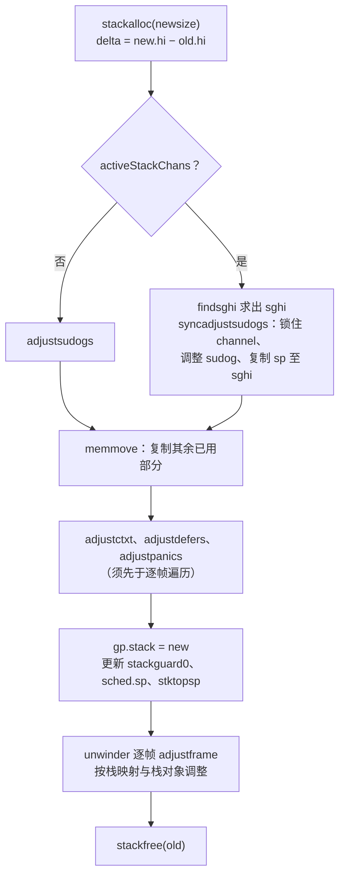

# 14.4 栈的拷贝与指针调整

[14.3](./grow.md) 中的 `newstack` 确定了新栈的大小之后，调用 `copystack` 完成**栈拷贝**（stack copy）：把
旧栈的内容复制到新栈，再释放旧栈。复制字节只需一次 `memmove`，难点在于栈上可能保存着指向这个栈自身的指针，
例如一个局部变量保存了另一个局部变量的地址。字节被原样复制后，这些指针的值不变，仍然指向即将释放的旧栈。
因此 `copystack` 还要找出所有指向旧栈的指针，把它们改为指向新栈中的对应位置。新旧两段栈的高地址端对齐，
一个指针若落在旧栈的区间 `[old.lo, old.hi)` 内，只需加上 δ = `new.hi` − `old.hi`。问题是如何知道哪些字
是指针，以及栈之外还有哪些地方保存着指向栈的指针。本节先回答这两个问题，再讨论栈拷贝与 channel 操作之间
的同步、`copystack` 的整体流程，以及这项机制对语言施加的约束。

## 14.4.1 指向栈的指针在哪里

[14.1](./design.md) 引用了连续栈设计文档中的论证：逃逸分析保证指向栈上数据的指针只会沿调用树向下传递，
因此这些指针只存在于栈本身 [[Randall, 2013](#ref-randall-2013)]。文档同时指出了例外，即少数位于栈外、
却指向栈内的指针，当时列出的是延迟调用的函数对象与参数，以及经由寄存器传递的闭包上下文。在 Go 1.26 中，
这些例外是 goroutine 保存的执行现场 `g.sched`、`defer` 记录的链表、`panic` 链表的表头，以及阻塞在
channel 上时 `sudog` 中记录的数据地址。`copystack` 对栈帧内的指针逐帧处理，对这几处单独处理。

无论在哪里，调整一个指针的方法都相同 [[Go Authors, 2026a](#ref-go-authors-2026a)]：

```go
type adjustinfo struct {
	old   stack
	delta uintptr // ptr distance from old to new stack (newbase - oldbase)

	// sghi is the highest sudog.elem on the stack.
	sghi uintptr
}

// adjustpointer checks whether *vpp is in the old stack described by adjinfo.
// If so, it rewrites *vpp to point into the new stack.
func adjustpointer(adjinfo *adjustinfo, vpp unsafe.Pointer) {
	pp := (*uintptr)(vpp)
	p := *pp
	// ……
	if adjinfo.old.lo <= p && p < adjinfo.old.hi {
		*pp = p + adjinfo.delta
	}
}
```

`sghi` 的用途见 14.4.4。

## 14.4.2 逐帧调整

栈帧内的哪些字是指针，由编译器生成的栈映射给出：对每个可能暂停执行的位置，编译器记录当时局部变量区与
参数区中哪些字存放着存活的指针（[13.7](../ch13gc/safe.md)）[[Go Authors, 2026c](#ref-go-authors-2026c)]。
这份信息最初为精确的垃圾回收而生成，栈拷贝借用了它（[14.1](./design.md)）。`runtime/stack.go` 用一幅
示意图说明栈帧中各个区域的位置：

```go
// Stack frame layout
//
// (x86)
// +------------------+
// | args from caller |
// +------------------+ <- frame->argp
// |  return address  |
// +------------------+
// |  caller's BP (*) | (*) if framepointer_enabled && varp > sp
// +------------------+ <- frame->varp
// |     locals       |
// +------------------+
// |  args to callee  |
// +------------------+ <- frame->sp
```

`adjustframe` 依据这幅布局调整一帧：

```go
// Note: the argument/return area is adjusted by the callee.
func adjustframe(frame *stkframe, adjinfo *adjustinfo) {
	// Adjust saved frame pointer if there is one.
	if (goarch.ArchFamily == goarch.AMD64 || goarch.ArchFamily == goarch.ARM64) && frame.argp-frame.varp == 2*goarch.PtrSize {
		// ……
		adjustpointer(adjinfo, unsafe.Pointer(frame.varp))
	}
	// ……
	if frame.continpc == 0 {
		// Frame is dead. The program might still see the frame pointer
		// saved in the frame, adjusted above, but we don't need to
		// adjust the rest of the frame.
		return
	}
	f := frame.fn

	locals, args, objs := frame.getStackMap(true)

	// Adjust local variables if stack frame has been allocated.
	if locals.n > 0 {
		size := uintptr(locals.n) * goarch.PtrSize
		adjustpointers(unsafe.Pointer(frame.varp-size), &locals, adjinfo, f)
	}

	// Adjust arguments.
	if args.n > 0 {
		adjustpointers(unsafe.Pointer(frame.argp), &args, adjinfo, funcInfo{})
	}

	// Adjust pointers in all stack objects (whether they are live or not).
	// See comments in mgcmark.go:scanframeworker.
	if frame.varp != 0 {
		for i := range objs {
			obj := &objs[i]
			off := obj.off
			base := frame.varp // locals base pointer
			if off >= 0 {
				base = frame.argp // arguments and return values base pointer
			}
			p := base + uintptr(off)
			if p < frame.sp {
				// Object hasn't been allocated in the frame yet.
				// (Happens when the stack bounds check fails and
				// we call into morestack.)
				continue
			}
			// ……按对象的指针位图逐字调用 adjustpointer
		}
	}
}
```

一帧中有三处需要调整。第一处是帧中保存的调用方帧指针，它总是指向栈内更高处的另一帧。
第二处是局部变量区与参数区中由栈映射标出的指针。第三处是栈对象，即被取了地址的局部变量
（[13.7](../ch13gc/safe.md)）。Randall 在 Go 1.12 中引入了这一机制，
编译器把每个函数中被取地址的变量登记在函数的元数据中，回收器扫描栈时据此在栈对象之间做一次小规模的标记，
只有确实被引用的栈对象才被扫描 [[Randall, 2018](#ref-randall-2018)]。栈拷贝不做这样的标记，
所有栈对象中的指针一律调整，对于已经不再使用的对象，这只是多做了一些工作。若对象的地址低于当前帧的 SP，
说明序言中的检查失败时这一帧尚未建立，对象还不存在，跳过即可。已经不会再恢复执行的死帧（`continpc` 为 0）
只需调整保存的帧指针。

真正读写位图的是 `adjustpointers`：

```go
// bv describes the memory starting at address scanp.
// Adjust any pointers contained therein.
func adjustpointers(scanp unsafe.Pointer, bv *bitvector, adjinfo *adjustinfo, f funcInfo) {
	minp := adjinfo.old.lo
	maxp := adjinfo.old.hi
	delta := adjinfo.delta
	num := uintptr(bv.n)
	// If this frame might contain channel receive slots, use CAS
	// to adjust pointers. If the slot hasn't been received into
	// yet, it may contain stack pointers and a concurrent send
	// could race with adjusting those pointers. (The sent value
	// itself can never contain stack pointers.)
	useCAS := uintptr(scanp) < adjinfo.sghi
	for i := uintptr(0); i < num; i += 8 {
		// ……
		b := *(addb(bv.bytedata, i/8))
		for b != 0 {
			j := uintptr(sys.TrailingZeros8(b))
			b &= b - 1
			pp := (*uintptr)(add(scanp, (i+j)*goarch.PtrSize))
		retry:
			p := *pp
			if f.valid() && 0 < p && p < minLegalPointer && debug.invalidptr != 0 {
				// Looks like a junk value in a pointer slot.
				// Live analysis wrong?
				getg().m.traceback = 2
				throw("invalid pointer found on stack")
			}
			if minp <= p && p < maxp {
				if useCAS {
					ppu := (*unsafe.Pointer)(unsafe.Pointer(pp))
					if !atomic.Casp1(ppu, unsafe.Pointer(p), unsafe.Pointer(p+delta)) {
						goto retry
					}
				} else {
					*pp = p + delta
				}
			}
		}
	}
}
```

位图每次取出一个字节，`TrailingZeros8` 直接跳到下一个置位的槽，未标为指针的字一概不碰，
恰好像地址的整数因此不会被改写。函数顺带做一项检查：指针槽中若是一个小于 `minLegalPointer` 的非零值，
说明活跃性分析出了错，或者程序用 `unsafe` 把整数存进了指针，运行时以「invalid pointer found on stack」
终止程序。这项检查由 `GODEBUG=invalidptr` 控制，默认开启。

## 14.4.3 栈帧之外的指针

栈帧之外的四处指针分别由四个函数调整：

```go
func adjustctxt(gp *g, adjinfo *adjustinfo) {
	adjustpointer(adjinfo, unsafe.Pointer(&gp.sched.ctxt))
	if !framepointer_enabled {
		return
	}
	// ……
	adjustpointer(adjinfo, unsafe.Pointer(&gp.sched.bp))
	// ……arm64 上还要处理保存在 SP 之下一个字处的帧指针
}

func adjustdefers(gp *g, adjinfo *adjustinfo) {
	// Adjust pointers in the Defer structs.
	// We need to do this first because we need to adjust the
	// defer.link fields so we always work on the new stack.
	adjustpointer(adjinfo, unsafe.Pointer(&gp._defer))
	for d := gp._defer; d != nil; d = d.link {
		adjustpointer(adjinfo, unsafe.Pointer(&d.fn))
		adjustpointer(adjinfo, unsafe.Pointer(&d.sp))
		adjustpointer(adjinfo, unsafe.Pointer(&d.link))
	}
}

func adjustpanics(gp *g, adjinfo *adjustinfo) {
	// Panics are on stack and already adjusted.
	// Update pointer to head of list in G.
	adjustpointer(adjinfo, unsafe.Pointer(&gp._panic))
}

func adjustsudogs(gp *g, adjinfo *adjustinfo) {
	// the data elements pointed to by a SudoG structure
	// might be in the stack.
	for s := gp.waiting; s != nil; s = s.waitlink {
		adjustpointer(adjinfo, unsafe.Pointer(&s.elem.vu))
		adjustpointer(adjinfo, unsafe.Pointer(&s.elem.vp))
	}
}
```

`g.sched.ctxt` 保存闭包上下文，它可能指向栈上的闭包；`g.sched.bp` 是最内层一帧的帧指针。`defer` 记录可能
分配在栈上，于是链表头 `g._defer`、每条记录的 `link`、记录的函数值 `fn` 与登记时的栈指针 `sp` 都可能指向
栈内（[6.2](../../part2lang/ch06func/defer.md)）。`panic` 记录本身就在栈上，已随栈帧一并处理，只剩 `g` 中
指向表头的指针。`sudog.elem` 记录 channel 操作中收发数据的地址，这个地址通常就在阻塞者自己的栈上
（[10.3](../../part3concurrency/ch10chan/sendrecv.md)）。Go 1.26 为检测 goroutine 泄漏，把 `elem` 改成了
`maybeTraceablePtr`，其中 `vu` 以整数形式保存地址，注释称之为唯一可信的来源，`vp` 只用于让回收器判断存活，
两者都要调整 [[Saioc, 2025](#ref-saioc-2025)]。

## 14.4.4 与 channel 操作同步

`sudog.elem` 带来的问题不止于调整。goroutine 阻塞在 channel 上时，已经释放了 channel 的锁，另一个
goroutine 随时可能执行与之配对的操作，把数据直接写入它的栈
（[10.3](../../part3concurrency/ch10chan/sendrecv.md) 中的直接传递）。栈的收缩可能发生在 goroutine
阻塞的时候（[14.5](./shrink.md)），此时若复制与写入同时进行，写入可能落在旧栈上而丢失，
也可能与指针的调整互相覆盖。

Austin Clements 在 Go 1.14 中为 `g` 增加了一个字段，显式记录复制时是否需要与 channel 同步
[[Clements, 2019](#ref-clements-2019); [Go Authors, 2026b](#ref-go-authors-2026b)]：

```go
	// activeStackChans indicates that there are unlocked channels
	// pointing into this goroutine's stack. If true, stack
	// copying needs to acquire channel locks to protect these
	// areas of the stack.
	activeStackChans bool
```

提交说明解释了引入它的原因。栈增长时 goroutine 正在运行，要么没有阻塞在 channel 上，要么本身就持有
channel 的锁，此时获取锁会造成自身死锁；栈收缩时 goroutine 并未运行，必须获取锁。原先的代码依据增长与收缩
来区分这两种情况，而收缩的时机即将改变（[14.5](./shrink.md)），于是改由这个字段直接说明。

`activeStackChans` 为真时，`copystack` 先由 `findsghi` 找出栈上最高的一个收发数据区的上界，记为 `sghi`，
再调用 `syncadjustsudogs`：

```go
// syncadjustsudogs adjusts gp's sudogs and copies the part of gp's
// stack they refer to while synchronizing with concurrent channel
// operations. It returns the number of bytes of stack copied.
func syncadjustsudogs(gp *g, used uintptr, adjinfo *adjustinfo) uintptr {
	if gp.waiting == nil {
		return 0
	}

	// Lock channels to prevent concurrent send/receive.
	var lastc *hchan
	for sg := gp.waiting; sg != nil; sg = sg.waitlink {
		if sg.c.get() != lastc {
			// ……
			lockWithRank(&sg.c.get().lock, lockRankHchanLeaf)
		}
		lastc = sg.c.get()
	}

	// Adjust sudogs.
	adjustsudogs(gp, adjinfo)

	// Copy the part of the stack the sudogs point in to
	// while holding the lock to prevent races on
	// send/receive slots.
	var sgsize uintptr
	if adjinfo.sghi != 0 {
		oldBot := adjinfo.old.hi - used
		newBot := oldBot + adjinfo.delta
		sgsize = adjinfo.sghi - oldBot
		memmove(unsafe.Pointer(newBot), unsafe.Pointer(oldBot), sgsize)
	}

	// Unlock channels.
	// ……
	return sgsize
}
```

它锁住 goroutine 等待的所有 channel，调整 `sudog`，在持有锁的情况下复制从栈指针到 `sghi` 的一段（代码中的
`oldBot` 即旧栈的栈指针），然后释放锁。这些 channel 的锁本应先于 goroutine 状态中的扫描位获取，
此处顺序相反；省略的注释说明，由于涉及的 goroutine 必然已被挂起，这里不会死锁，因此使用一个专门的锁等级
`lockRankHchanLeaf`。锁释放之后，其余的栈由 `copystack` 照常复制。不过逐帧调整发生在锁释放之后，`sghi`
以下的槽位仍可能被并发的发送写入；`adjustpointers` 的注释指出，尚未接收数据的槽位里可能还留着指向栈的旧
值，而发送来的值本身绝不会含有指向栈的指针，因此对这一段改用 CAS：若写入抢先发生，CAS 失败，
重读后发现新值不指向旧栈，便不再修改。`copystack` 中的注释指出，`sghi` 离栈指针不远，
因此需要小心处理的只是很小的一段。

## 14.4.5 copystack 的整体流程

`copystack` 把以上各步组织在一起：

```go
// Copies gp's stack to a new stack of a different size.
// Caller must have changed gp status to Gcopystack.
func copystack(gp *g, newsize uintptr) {
	if gp.syscallsp != 0 {
		throw("stack growth not allowed in system call")
	}
	old := gp.stack
	// ……
	used := old.hi - gp.sched.sp
	// Add just the difference to gcController.addScannableStack.
	// ……
	gcController.addScannableStack(getg().m.p.ptr(), int64(newsize)-int64(old.hi-old.lo))

	// allocate new stack
	new := stackalloc(uint32(newsize))
	// ……

	// Compute adjustment.
	var adjinfo adjustinfo
	adjinfo.old = old
	adjinfo.delta = new.hi - old.hi

	// Adjust sudogs, synchronizing with channel ops if necessary.
	ncopy := used
	if !gp.activeStackChans {
		if newsize < old.hi-old.lo && gp.parkingOnChan.Load() {
			// ……
			throw("racy sudog adjustment due to parking on channel")
		}
		adjustsudogs(gp, &adjinfo)
	} else {
		// ……
		adjinfo.sghi = findsghi(gp, old)

		// Synchronize with channel ops and copy the part of
		// the stack they may interact with.
		ncopy -= syncadjustsudogs(gp, used, &adjinfo)
	}

	// Copy the stack (or the rest of it) to the new location
	memmove(unsafe.Pointer(new.hi-ncopy), unsafe.Pointer(old.hi-ncopy), ncopy)

	// Adjust remaining structures that have pointers into stacks.
	// We have to do most of these before we traceback the new
	// stack because gentraceback uses them.
	adjustctxt(gp, &adjinfo)
	adjustdefers(gp, &adjinfo)
	adjustpanics(gp, &adjinfo)
	if adjinfo.sghi != 0 {
		adjinfo.sghi += adjinfo.delta
	}

	// Swap out old stack for new one
	gp.stack = new
	gp.stackguard0 = new.lo + stackGuard // NOTE: might clobber a preempt request
	gp.sched.sp = new.hi - used
	gp.stktopsp += adjinfo.delta

	// Adjust pointers in the new stack.
	var u unwinder
	for u.init(gp, 0); u.valid(); u.next() {
		adjustframe(&u.frame, &adjinfo)
	}
	// ……
	stackfree(old)
}
```

几处细节值得说明。系统调用期间不能移动栈，原因与 [14.3](./grow.md) 中 `entersyscall` 的注释相同：
运行时不知道哪些 `uintptr` 参数其实指向栈内。只复制已使用的部分，即 `[sched.sp, old.hi)`，
并放在新栈的高地址端，低地址端尚未使用的空间不必复制。`addScannableStack`
把栈大小的变化计入回收器的调步（[13.3](../ch13gc/pacing.md)）。`g.sched`、`defer` 链与 `panic`
链必须先于逐帧遍历调整，因为遍历新栈时要用到它们；注释中的 `gentraceback` 是旧的栈遍历函数，Clements 在
Go 1.21 中用迭代器 `unwinder` 取代了它的所有回调式用法，四项栈拷贝基准测试的耗时因此平均（几何平均）
下降约 10% [[Clements, 2023](#ref-clements-2023)]。重设 `stackguard0` 会清除一个已经写入其中、
尚未处理的抢占请求，注释对此作了提示，`gp.preempt` 标志则不受影响（抢占请求的发出与处理见
[9.7](../../part3concurrency/ch09sched/preemption.md)）。`parkingOnChan` 的检查与栈收缩有关，见
[14.5](./shrink.md)。

下图概括了这一流程：



## 14.4.6 被调整的与不被调整的

下面的程序在栈上放一个整数 `x`，分别以指针 `p` 和整数 `u` 记下它的地址，然后递归约 1000 层，迫使栈增长：

```go {run=true}
package main

import (
	"fmt"
	"unsafe"
)

// grow 递归 n 层，每层的栈帧约 256 字节，迫使当前 goroutine 的栈增长。
func grow(n int) int {
	var buf [256]byte
	if n == 0 {
		return 0
	}
	buf[n%256] = byte(n)
	return grow(n-1) + int(buf[0])
}

func main() {
	x := 1
	p := &x                          // 指针：栈映射记录了这个槽位存放指针
	u := uintptr(unsafe.Pointer(&x)) // 整数：栈映射不知道它曾是一个地址

	grow(1000) // 约 250 KiB，栈至少移动一次
	x = 2

	fmt.Println("x 的地址已改变：", u != uintptr(unsafe.Pointer(&x)))
	fmt.Println("经 p 读到的值：", *p)
}
```

运行结果如下：

```
x 的地址已改变： true
经 p 读到的值： 2
```

`x` 没有逃逸，留在 `main` 的栈帧中。栈增长时，`x` 被复制到新栈，`p` 所在的槽位被栈映射标为指针，随之调整，
因此经 `p` 读到的是新栈上的 `x`。`u` 只是一个整数，它仍是旧栈上的地址。`unsafe` 包的文档对此有明确的说明：
即使一个 `uintptr` 保存着某个对象的地址，对象移动时回收器也不会更新这个 `uintptr` 的值
[[Go Authors, 2026d](#ref-go-authors-2026d)]。栈上的变量同样如此。

## 14.4.7 对语言的约束

栈拷贝之所以可行，依赖于两条前提：指向栈的指针只出现在运行时能够找到的地方，并且每一个指针都能被准确地识别
出来。这两条前提反过来约束了语言的实现与使用。

第一条由逃逸分析保证。一个变量的地址若会被保存到堆上、全局变量中，或者返回给调用方，
编译器就把这个变量分配在堆上（[15.5](../../part5toolchain/ch15compile/escape.md)）。堆对象不随栈移动，
外部持有的地址始终有效。反过来，凡是运行时自己让栈外的结构指向栈内，都必须像 `sudog` 那样登记在 `g` 上，
供 `copystack` 调整；交给操作系统的内存则不能位于可移动的栈上，Windows 上的重叠 I/O
因此要在发起之前钉住缓冲区（[9.9](../../part3concurrency/ch09sched/poller.md)）。

第二条落在使用 `unsafe` 的程序上。Go 1.3 引入精确的栈扫描与按拷贝扩栈的同时，在发布说明中规定
[[Go Authors, 2014](#ref-go-authors-2014)]：

> 从 Go 1.3 起，运行时假定指针类型的值含有指针，其他类型的值不含指针。这一假设是栈扩展与垃圾回收能够精确
> 工作的基础。用 unsafe 包把整数存入指针类型的值的程序是非法的，运行时一旦发现便会使之崩溃。用 unsafe 包
> 把指针存入整数类型的值的程序同样非法，但在执行期间更难诊断。由于指针对运行时不可见，栈扩展或垃圾回收
> 可能回收它们指向的内存，从而产生悬垂指针。

前一种错误中存入较小整数的情形，正是 14.4.2 中 `invalidptr` 检查所捕获的；后一种错误即 14.4.6 中的 `u`。

## 14.4.8 小结

栈拷贝把一个看似需要跟踪任意指针的问题，化归为几处有限的工作：栈帧内的指针由编译器的栈映射与栈对象标出，
栈帧外的指针只在 `g.sched`、`defer` 链、`panic` 链与 `sudog` 中，阻塞在 channel 上的 goroutine 则借助锁与
CAS 与并发的写入同步。这一化归的前提是逃逸分析与 `unsafe` 的使用规则，它们共同保证了指向栈的指针全部可知、
全部可辨。

## 延伸阅读

- <a id="ref-clements-2019"></a>[Clements, 2019] Austin Clements. runtime: make copystack/sudog
  synchronization more explicit. Go commit 36a432f27b, 2019. https://go.dev/cl/172982
  随 Go 1.14 发布。
- <a id="ref-clements-2023"></a>[Clements, 2023] Austin Clements. runtime: replace all callback uses of
  gentraceback with unwinder. Go commit 2d99109cfc, 2023. https://go.dev/cl/468297
  随 Go 1.21 发布。
- <a id="ref-go-authors-2014"></a>[Go Authors, 2014] The Go Authors. *Go 1.3 Release Notes: Changes to the
  garbage collector.* 2014. https://go.dev/doc/go1.3#garbage_collector
- <a id="ref-go-authors-2026a"></a>[Go Authors, 2026a] The Go Authors. src/runtime/stack.go：copystack、
  adjustframe、adjustpointers、adjustsudogs、adjustdefers、adjustctxt. Go 1.26 源码.
  https://github.com/golang/go/blob/release-branch.go1.26/src/runtime/stack.go
  本节所据的一手实现。
- <a id="ref-go-authors-2026b"></a>[Go Authors, 2026b] The Go Authors.
  src/runtime/runtime2.go（_Gcopystack 状态）、src/runtime/mgcmark.go（栈扫描与 shrinkstack）. Go 1.26
  源码. https://github.com/golang/go/tree/release-branch.go1.26/src/runtime
- <a id="ref-go-authors-2026c"></a>[Go Authors, 2026c] The Go Authors. cmd/compile：栈映射（stack maps /
  liveness）的生成. Go 1.26 源码.
  https://github.com/golang/go/tree/release-branch.go1.26/src/cmd/compile/internal/liveness
- <a id="ref-go-authors-2026d"></a>[Go Authors, 2026d] The Go Authors. src/unsafe/unsafe.go. Go 1.26 源码.
  https://github.com/golang/go/blob/release-branch.go1.26/src/unsafe/unsafe.go
- <a id="ref-randall-2013"></a>[Randall, 2013] Keith Randall. *Contiguous stacks.* Go design document,
  2013. https://go.dev/s/contigstacks
  连续栈取代分段栈的设计与拷贝时的指针调整动机。
- <a id="ref-randall-2018"></a>[Randall, 2018] Keith Randall. cmd/compile,runtime: implement stack
  objects. Go commit cbafcc55e8, 2018. https://go.dev/cl/134155
  随 Go 1.12 发布。
- <a id="ref-saioc-2025"></a>[Saioc, 2025] Vlad Saioc. runtime,net/http/pprof: goroutine leak detection by
  using the garbage collector. Go commit 8c68a1c1ab, 2025. https://go.dev/cl/688335
  随 Go 1.26 发布。
- 本书 [13.7 安全点分析](../ch13gc/safe.md)（栈映射与安全点，指针调整与 GC 扫描共用的基础）、
  [15.5 逃逸分析](../../part5toolchain/ch15compile/escape.md)（栈可移动性如何约束分配决策）、
  [10.3 收发与直接传递](../../part3concurrency/ch10chan/sendrecv.md)（sudog 与通道收发槽，解释
  `adjustsudogs` 为何存在）。
