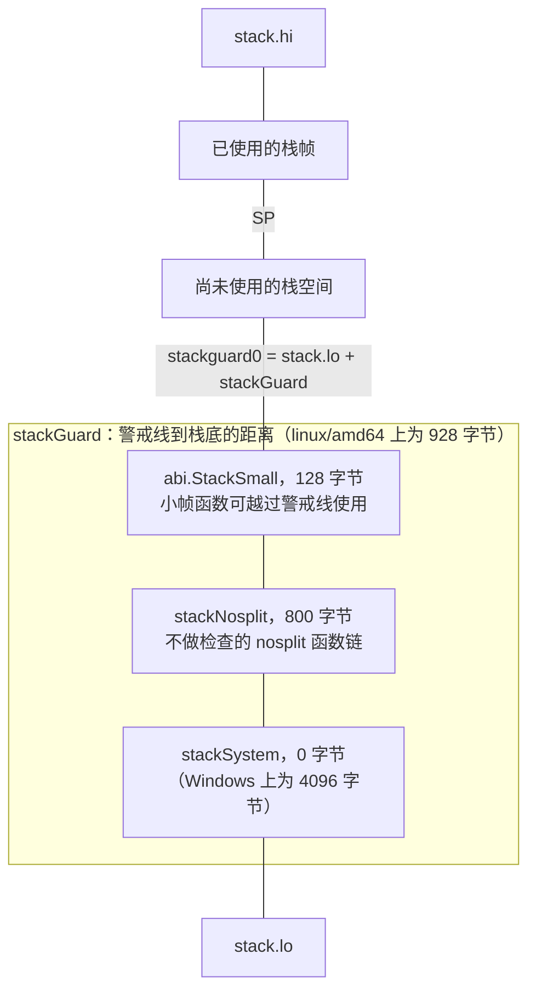

# 14.1 连续栈的设计

操作系统在创建线程时一次性为它分配栈，此后栈的大小不再改变（几种系统的默认大小见 [14.5](./shrink.md)）。
一个 Go 程序中同时存在的 goroutine 可达数十万个，若每个都预留这样一段栈，内存很快就会耗尽。Go 因此让每个
goroutine 的栈从 2 KiB 开始，不够用时再扩大。这引出两个问题：运行时如何及时发现栈空间不足，以及如何扩大
一段正在使用的栈。对后一个问题，Go 先后给出过两种回答。早期的实现在旧栈之外另接一段新的内存，称为分段栈；Go
1.3 与 Go 1.4 逐步改为分配一段更大的连续内存，把整个栈复制过去，称为连续栈。本节先介绍栈在运行时中的
表示以及用来检查栈空间的警戒线，再比较这两种方案，说明 Go 改换方案的理由与代价。分配、增长、拷贝与收缩的
实现依次见 [14.2](./alloc.md) 至 [14.5](./shrink.md)。

## 14.1.1 栈的表示

运行时用一对地址描述一段栈 [[Go Authors, 2026b](#ref-go-authors-2026b)]：

```go
// Stack describes a Go execution stack.
// The bounds of the stack are exactly [lo, hi),
// with no implicit data structures on either side.
type stack struct {
	lo uintptr
	hi uintptr
}
```

栈从高地址向低地址增长：goroutine 开始执行时，栈指针 SP 位于 `hi` 附近，随着调用加深而向 `lo` 移动。
注释特意说明区间两侧没有隐式的数据结构；14.1.3 将会看到，早期的分段栈在每一段的顶端都存放着一个记录
前一段位置的结构。

每个 goroutine 的 `g` 结构体以三个与栈有关的字段开头：

```go
type g struct {
	// Stack parameters.
	// stack describes the actual stack memory: [stack.lo, stack.hi).
	// stackguard0 is the stack pointer compared in the Go stack growth prologue.
	// It is stack.lo+StackGuard normally, but can be StackPreempt to trigger a preemption.
	// stackguard1 is the stack pointer compared in the //go:systemstack stack growth prologue.
	// It is stack.lo+StackGuard on g0 and gsignal stacks.
	// It is ~0 on other goroutine stacks, to trigger a call to morestackc (and crash).
	stack       stack   // offset known to runtime/cgo
	stackguard0 uintptr // offset known to liblink
	stackguard1 uintptr // offset known to liblink
	// ……
}
```

行尾的注释表明，其他组件依赖这些字段的固定偏移：函数序言由编译器与汇编器生成，按固定偏移直接读取警戒线。
在 amd64 上，`stackguard0` 位于偏移 16 处，[2.4](../../part1overview/ch02asm/args.md) 中序言的第一条指令
`CMPQ SP, 16(R14)` 比较的正是它。

`stackguard0` 就是 [2.4](../../part1overview/ch02asm/args.md) 所说的警戒线。普通函数的序言把 SP 与它比较，SP
不高于警戒线时调用 `morestack` 扩栈（[14.3](./grow.md)）。它平时等于 `stack.lo + stackGuard`；
运行时也可以把它改写为几个大于任何真实栈地址的特殊值，使下一次检查必然失败，这个 goroutine
便会在下一次函数调用时进入运行时。`stackPreempt` 用于请求抢占
（[2.4](../../part1overview/ch02asm/args.md)、[9.7](../../part3concurrency/ch09sched/preemption.md)）。`stackFork`
在 `fork` 与 `exec` 之间设置，这段时间里既不允许分配内存，也不允许扩栈，
任何扩栈的尝试都会以「stack growth after fork」终止程序。`stackForceMove` 迫使栈在下一次检查时移动，
只用于测试与调试 [[Go Authors, 2026a](#ref-go-authors-2026a)]。

`stackguard1` 服务于另一类函数。运行时中有些函数只能在系统栈上执行，即每个 M 的 g0 或处理信号用的
gsignal（[9.3](../../part3concurrency/ch09sched/mpg.md)），它们以 `//go:systemstack` 标记。编译器为这类
函数生成的序言改与 `stackguard1` 比较，检查失败时调用的也不是 `morestack`，而是 `morestackc`
[[Go Authors, 2026c](#ref-go-authors-2026c)]。在系统栈上，`stackguard1` 与 `stackguard0` 一样等于
`stack.lo + stackGuard`；在普通 goroutine 上它是 `~0`，比较必然失败，`morestackc` 随即以「attempt to
execute system stack code on user stack」终止程序。于是，「只能在系统栈上执行」这条编译期无法证明的约束，
借助已有的栈检查在运行时得到保证，而不需要额外的指令。

这个字段来自运行时仍以 C 编写的年代。Go 1.4 中它的注释写的是「compared in the C stack growth
prologue」：运行时的 C 函数只能在系统栈上执行，它们的序言比较的是 `stackguard1`
[[Go Authors, 2014c](#ref-go-authors-2014c)]。C 代码全部改写为 Go 之后，Shenghou Ma 在 2014 年底删除了
这个字段，Russ Cox 随即撤销了这次修改，理由是 [[Cox, 2015](#ref-cox-2015)]：

> 我认为，即使这种区分已不再以实现语言为依据，区分必须在系统栈上运行的代码与可以在任一栈上运行的代码
> 仍然是有用的。也就是说，我打算增加一个 //go:systemstack 注释，用旧实现的说法，它告诉编译器：假装这个
> 函数是用 C 写的。

直到今天，编译器为 `//go:systemstack` 函数设置的内部属性仍叫 `CFunc`
[[Go Authors, 2026c](#ref-go-authors-2026c)]。

指向栈内的指针也并不都在栈上。goroutine 被切换出去时，它的 SP 保存在 `g.sched.sp` 中
（[9.3](../../part3concurrency/ch09sched/mpg.md)）；`defer` 与 `panic` 的记录、阻塞在 channel 上的
`sudog` 也可能指向栈内。栈一旦移动，这些位于栈外、指向栈内的指针都必须随之更新，这是
[14.4](./copy.md) 的主题。

## 14.1.2 警戒线以下的余量

警戒线并不位于栈的最底端。`runtime/stack.go` 中的几个常量规定了它到栈底的距离
[[Go Authors, 2026a](#ref-go-authors-2026a)]：

```go
const (
	// stackSystem is a number of additional bytes to add
	// to each stack below the usual guard area for OS-specific
	// purposes like signal handling. Used on Windows, Plan 9,
	// and iOS because they do not use a separate stack.
	stackSystem = goos.IsWindows*4096 + goos.IsPlan9*512 + goos.IsIos*goarch.IsArm64*1024

	// The minimum size of stack used by Go code
	stackMin = 2048

	// The minimum stack size to allocate.
	// The hackery here rounds fixedStack0 up to a power of 2.
	fixedStack0 = stackMin + stackSystem
	// ……
	fixedStack  = fixedStack6 + 1

	// stackNosplit is the maximum number of bytes that a chain of NOSPLIT
	// functions can use.
	// ……
	stackNosplit = abi.StackNosplitBase * sys.StackGuardMultiplier

	// The stack guard is a pointer this many bytes above the
	// bottom of the stack.
	//
	// The guard leaves enough room for a stackNosplit chain of NOSPLIT calls
	// plus one stackSmall frame plus stackSystem bytes for the OS.
	// ……
	stackGuard = stackNosplit + stackSystem + abi.StackSmall
)
```

警戒线以下的空间由三部分组成，其布局如下图所示。为了让序言尽量短，栈帧不超过 `abi.StackSmall`（128 字节）
的函数直接用 SP 与警戒线比较，不先减去自身的帧大小，因而可能在警戒线以下使用至多 128 字节。标为
`//go:nosplit` 的函数不做检查，它们组成的调用链可以再使用至多 `stackNosplit` 字节，
链接器在构建时核对每一条这样的调用链（[14.3](./grow.md)）。`stackSystem` 为 Windows、Plan 9 与 iOS 预留，
这些系统处理信号时不使用单独的栈。`abi.StackNosplitBase` 为 800 字节，乘以 `sys.StackGuardMultiplier`
才得到 `stackNosplit`：AIX 与 OpenBSD 上的系统调用以及启用竞态检测的构建需要更多的栈，
在这些情况下该系数大于 1 [[Go Authors, 2026c](#ref-go-authors-2026c)]。在 linux/amd64 上，
警戒线因此距栈底 800 + 128 = 928 字节，几乎是 2 KiB 最小栈的一半；不同大小的栈帧对应的序言见
[2.4](../../part1overview/ch02asm/args.md)。



`stackMin` 是 Go 代码可用的最小栈，即 2048 字节。实际分配的最小栈 `fixedStack` 还要加上 `stackSystem`，
并向上取整为 2 的幂，因为栈分配器只处理 2 的幂大小（[14.2](./alloc.md)）。在 Windows 上，2048 + 4096 =
6144 字节取整后为 8 KiB，每个 goroutine 的栈因此从 8 KiB 开始。

这段余量在历史上几经调整。Go 1.2 的警戒线距栈底 256 字节，其中留给不做检查的函数链的只有 128 字节
[[Go Authors, 2013b](#ref-go-authors-2013b)]；此后余量多次增大，Go 1.15 起为 928 字节。Russ Cox 在 2014 年
的一次调整中把这部分预留加倍，提交说明同时道出了余量与最小栈之间的关系
[[Cox, 2014a](#ref-cox-2014a)]：

> 把 NOSPLIT 预留从 192 字节增至 384 字节。问题在于，非 Unix 系统（Solaris 和 Windows）就是无法在很小的
> 空间里完成系统调用……好消息是，我们这样做是为了最终只用拷贝栈来扩栈。一旦做到这一点，就可以把默认的
> 栈大小从 8k 降到 4k，这足以弥补我们在这里失去的字节。

余量是每个栈都要扣除的固定部分，最小栈越小，它所占的比例越大；而最小栈能否缩小，取决于扩栈是否廉价。Go
1.4 最终把最小栈降到了 2 KiB（14.1.4）。

## 14.1.3 分段栈与热分裂

Go 最早的实现采用**分段栈**（segmented stack）：栈空间不足时，运行时另外分配一段内存，与原来的栈链接起来；
函数返回到上一段时，再释放这一段。Ken Thompson 在 2008 年 6 月的提交中为 6l 链接器加入了这一机制：链接器在
每个函数的开头插入与栈界限的比较，空间不足时调用 `_morestack`，带有 `NOSPLIT` 标记的函数除外
[[Thompson, 2008](#ref-thompson-2008)]。函数序言中的栈检查与 `NOSPLIT` 标记从那时一直沿用至今。

以 Go 1.2 为例 [[Go Authors, 2013b](#ref-go-authors-2013b)]，新段的大小是触发扩栈的那一帧及其参数所需的
空间再加 2048 字节（`StackExtra`），且不小于 8192 字节（`StackMin`）。运行时在新段的顶端放置一个 `Stktop`
结构，记下旧段的边界与调用方的执行现场，把调用参数复制到新段，并把被调函数的返回地址设为 `lessstack`。
被调函数返回时便进入 `lessstack`，后者在 g0 上调用 `oldstack`：把参数与返回值复制回旧段，恢复旧段的边界，
释放新段，再回到调用方继续执行。各段经由 `Stktop` 连成一条链，每一段在其中最早的那一帧返回时释放。这种
做法从不移动已有的栈帧，指向栈的指针始终有效，扩栈的代价也只与新的那一帧有关，与栈的深度无关。

它的弱点在于段的分配与释放随调用和返回成对发生。若一个循环反复调用同一个函数，而调用发生时当前段恰好
所剩无几，那么每次调用都要分配一段新栈，每次返回又要将其释放。Keith Randall 在连续栈的设计文档中把这称为
**热分裂**（hot split）问题 [[Randall, 2013](#ref-randall-2013)]：

> 如果栈几乎已满，一次调用就会迫使运行时分配一个新的栈块；调用返回时，这个新栈块又被释放。如果同一个调用
> 在紧凑的循环中反复发生，分配与释放就会带来相当大的开销。

文档用一个专门构造的测试度量了这一开销：在分段栈下，调用点恰好落在段边界上的版本耗时 5.37 秒，未落在边界
上的版本耗时 1.26 秒；改用连续栈后，两个版本都是 1.26 秒。文档还指出了一个更一般的问题：在分段栈下，栈的
分配与释放永远不会结束，栈的大小每次朝任一方向越过某个阈值，都需要额外的工作。由于调用点是否落在段边界
上取决于整条调用链的栈帧大小，这类开销很难预料。文档测量了几个标准库基准测试对段大小的敏感程度：encoding/json
的 `BenchmarkEncode` 一直受到抱怨（issue #3787），html/template 的 `BenchmarkEscapedExecute`
恰好在当时默认的 4096 字节段大小下表现异常。

Go 1.2 把新 goroutine 的最小栈从 4 KiB 提高到 8 KiB。发布说明给出的理由是：
许多程序在旧的大小下遇到性能问题，因为它容易在性能关键的代码段中引入代价高昂的栈段切换
[[Go Authors, 2013a](#ref-go-authors-2013a)]。这只是一种缓解：更大的段降低了调用点落在边界上的概率，
却使每个 goroutine 的初始栈增大了一倍。发布说明也承认了这一点，并预告将来会有更好地解决这一问题的栈管理技
术。

同样的想法也出现在 C 语言中。Ian Lance Taylor 为 GCC 实现了分段栈（GCC 称之为 split stack），自 GCC 4.6.0
起在 x86 GNU/Linux 上可用，需配合 gold 链接器 [[Taylor, 2011](#ref-taylor-2011)]。GCC 4.6.0 于 2011 年
3 月发布 [[GCC Project, 2011](#ref-gcc-project-2011)]，晚于 Go 在 2008 年的实现。gccgo 借助它为 goroutine
提供较小的不连续栈，至今仍是如此 [[Go Authors, 2026d](#ref-go-authors-2026d)]。

## 14.1.4 连续栈

**连续栈**（contiguous stack）的想法很直接：栈空间不足时，分配一段更大的内存，把整个栈复制过去，
再释放旧栈。栈因此始终是一段连续的内存，大小只在确有需要时改变，此后不再需要额外的工作（收缩除外，见
[14.5](./shrink.md)）。设计文档指出，热分裂与分配释放永不结束这两个问题，连续栈都可以避免
[[Randall, 2013](#ref-randall-2013)]。

难点在于，移动栈会使所有指向旧栈的指针失效。设计文档的论证从逃逸分析出发：

> 我们的编译器的逃逸分析提供了一条非常重要的不变式：指向栈上数据的指针只会沿调用树向下传递。任何其他形式
> 的逃逸（写入全局变量、返回给调用方、写入堆等）都会使这份数据不能分配在栈上。这条不变式意味着，指向栈上
> 数据的指针只存在于栈本身（例外见下文），因此在需要复制栈时，这些指针很容易找到并更新。

找到这些指针还需要第二个条件：运行时必须能区分栈上的指针与恰好像地址的整数。文档写道，Carl Shapiro 当时
正在为精确垃圾回收生成恰好这样的数据结构。Shapiro 在 2013 年底提交的修改让编译器通过活跃性分析为栈上的
指针生成位图 [[Shapiro, 2013](#ref-shapiro-2013)]，今天的栈映射（[13.7](../ch13gc/safe.md)）即由此发展
而来；Go 1.3 起，垃圾回收器扫描栈时也做到了精确 [[Go Authors, 2014a](#ref-go-authors-2014a)]。栈拷贝与精确
回收从此依赖同一份由编译器生成的信息。逃逸分析的不变式也有例外，文档列出了几处从栈外指向栈内的指针，例如
延迟调用的函数对象及其参数，以及经由寄存器传给触发扩栈那一帧的闭包上下文，拷贝时须逐一处理
（[14.4](./copy.md)）。

新栈取多大？文档建议按指数增长以限制复制的总量，并采用 2 的幂以方便分配器，实现时每次加倍。
原型的测量显示了增长倍数的影响：在修改过的 peano 测试中，每次加倍比分段栈快 10%，每次增长 50% 只快 2%，
每次增长 25% 反而慢 20%；文档也提醒，这个测试对增长倍数非常敏感，数字仅供参考。按倍数增长时，
历次复制的字节数之和不超过最终栈的大小，扩栈的总代价与栈最终的大小成正比，[2.4](../../part1overview/ch02asm/args.md)
中的程序观察了这一过程。

Keith Randall 在 2014 年 2 月提交了按拷贝扩栈的实现，随 Go 1.3 发布
[[Randall, 2014a](#ref-randall-2014a)]。当时运行时的大部分代码仍由 C 编写，而栈上有 C 函数的帧时无法拷贝，
因此只有当栈上全部是可拷贝的帧时才复制，否则仍按旧办法分配新段。这次提交也实现了收缩：垃圾回收时，若
goroutine 使用的栈不到四分之一，就把它复制到一半大小的栈上。Go 1.3 的发布说明宣布，goroutine
的栈已从「分段」模型改为连续模型 [[Go Authors, 2014a](#ref-go-authors-2014a)]。

Go 1.4 把运行时的大部分代码改写为 Go，栈上的帧从此全部可以拷贝。Russ Cox 在 2014 年
9 月打开了总是拷贝的开关 `StackCopyAlways` [[Cox, 2014b](#ref-cox-2014b)]，Randall
随后删除了可拷贝性检查，提交说明的标题是「所有 G 的帧都是可拷贝
的」[[Randall, 2014b](#ref-randall-2014b)]。Go 1.4 的发布说明写道
[[Go Authors, 2014b](#ref-go-authors-2014b)]：

> 其结果是，栈不再分段，「热分裂」问题随之消除。当栈达到上限时，运行时分配一个新的、更大的栈，把这个
> goroutine 的所有活动帧复制过去，并更新所有指向栈的指针。在某些情况下性能会明显提高，而且始终更可预测。

同一份说明指出，连续栈使栈可以从更小的大小开始而不引发性能问题，新 goroutine 的默认栈因此从 8192 字节降到
2048 字节。

设计文档也列出了连续栈的缺点。其一是虚拟内存的压力与碎片：栈越大，越难找到足够大的连续空间。文档考虑过
折中方案，例如在 1 MiB 以内拷贝、超过后再分段，但认为为此同时保留两套机制并不值得。其二是对指向栈的指针的
限制：所有指向栈区的指针都必须被准确掌握，将来若想允许其他形式的指向栈的指针，这一实现会成为障碍。其三，
运行时中的 C 与汇编代码都需要审查，确保没有对栈指针做特殊的处理。第二个缺点很快成为语言实现的一条约束：Go
1.3 的发布说明规定，用 `unsafe` 把整数存入指针类型或把指针藏在整数中的程序都是非法的，因为栈的扩展与
垃圾回收都依赖「只有指针类型的值才含有指针」这一假设 [[Go Authors, 2014a](#ref-go-authors-2014a)]。[14.4](./copy.md)
将回到这一点。

## 14.1.5 小结

两种方案的取舍可以这样概括。分段栈让每次扩栈只涉及新的一帧，代价却随调用与返回反复出现，
出现在哪里也难以预料；连续栈让单次扩栈的代价与栈的大小成正比，但借助倍增，
这笔代价在栈的整个生命周期中摊销为常数。后者要求运行时找到并修正每一个指向栈的指针，Go
的逃逸分析与编译器生成的栈映射恰好提供了这一条件。扩栈变得廉价而可预测之后，最小栈才得以降到 2 KiB；
栈越小，警戒线以下那段固定的余量所占的比例就越大，在 linux/amd64 上已接近一半。

## 延伸阅读

- <a id="ref-cox-2014a"></a>[Cox, 2014a] Russ Cox. runtime: increase stack split limit again. Go commit
  b6951bcc0b, 2014. https://golang.org/cl/140350043
  随 Go 1.4 发布。
- <a id="ref-cox-2014b"></a>[Cox, 2014b] Russ Cox. runtime: enable StackCopyAlways. Go commit 815a843b6a,
  2014. https://golang.org/cl/141280043
  随 Go 1.4 发布。
- <a id="ref-cox-2015"></a>[Cox, 2015] Russ Cox. Revert "liblink, cmd/ld, runtime: remove stackguard1". Go
  commit e6d3511264, 2015. https://go.dev/cl/2275
  随 Go 1.5 发布。
- <a id="ref-gcc-project-2011"></a>[GCC Project, 2011] The GCC Project. *GCC 4.6 Release Series.* 2011.
  https://gcc.gnu.org/gcc-4.6/
  GCC 4.6.0 的发布日期（2011 年 3 月 25 日）。
- <a id="ref-go-authors-2013a"></a>[Go Authors, 2013a] The Go Authors. *Go 1.2 Release Notes: Stack size.*
  2013. https://go.dev/doc/go1.2#stack_size
- <a id="ref-go-authors-2013b"></a>[Go Authors, 2013b] The Go Authors. src/pkg/runtime/stack.h、stack.c、asm_amd64.s.
  Go 1.2 源码. https://github.com/golang/go/tree/go1.2/src/pkg/runtime
  最后一个只使用分段栈的版本：`Stktop`、`newstack`、`lessstack` 与 `oldstack`。
- <a id="ref-go-authors-2014a"></a>[Go Authors, 2014a] The Go Authors. *Go 1.3 Release Notes: Stack
  management.* 2014. https://go.dev/doc/go1.3#stacks
  官方记述从分段栈切换到连续栈，及「hot spot」的消除。
- <a id="ref-go-authors-2014b"></a>[Go Authors, 2014b] The Go Authors. *Go 1.4 Release Notes: Changes to
  the runtime.* 2014. https://go.dev/doc/go1.4#runtime
- <a id="ref-go-authors-2014c"></a>[Go Authors, 2014c] The Go Authors. src/runtime/runtime.h. Go 1.4 源码.
  https://github.com/golang/go/blob/go1.4/src/runtime/runtime.h
- <a id="ref-go-authors-2026a"></a>[Go Authors, 2026a] The Go Authors. src/runtime/stack.go. Go 1.26 源码.
  https://github.com/golang/go/blob/release-branch.go1.26/src/runtime/stack.go
  `stackMin`、`stackGuard`、`stackNosplit` 等常量定义。
- <a id="ref-go-authors-2026b"></a>[Go Authors, 2026b] The Go Authors. src/runtime/runtime2.go. Go 1.26
  源码. https://github.com/golang/go/blob/release-branch.go1.26/src/runtime/runtime2.go
  `stack`、`gobuf`、`g` 的栈相关字段。
- <a id="ref-go-authors-2026c"></a>[Go Authors, 2026c] The Go Authors. src/internal/abi/stack.go、src/internal/runtime/sys/consts.go、src/cmd/internal/obj/x86/obj6.go、src/cmd/compile/internal/ir/abi.go.
  Go 1.26 源码.
  https://github.com/golang/go/tree/release-branch.go1.26/src
- <a id="ref-go-authors-2026d"></a>[Go Authors, 2026d] The Go Authors. *Setting up and using gccgo.* 2026.
  https://go.dev/doc/install/gccgo
- <a id="ref-randall-2013"></a>[Randall, 2013] Keith Randall. *Contiguous stacks.* Go design document,
  2013. https://go.dev/s/contigstacks
  连续栈设计的一手文档：热分裂问题、拷贝与指针修正、性能数据。
- <a id="ref-randall-2014a"></a>[Randall, 2014a] Keith Randall. runtime: grow stack by copying. Go commit
  1665b006a5, 2014. https://golang.org/cl/54650044
  随 Go 1.3 发布。
- <a id="ref-randall-2014b"></a>[Randall, 2014b] Keith Randall. runtime: get rid of copyable check - all G
  frames are copyable. Go commit 00365b13b4, 2014. https://golang.org/cl/133690045
  随 Go 1.4 发布。
- <a id="ref-shapiro-2013"></a>[Shapiro, 2013] Carl Shapiro. cmd/5g, cmd/5l, cmd/6g, cmd/6l, cmd/8g,
  cmd/8l, cmd/gc, runtime: generate pointer maps by liveness analysis. Go commit f056daf075, 2013.
  https://golang.org/cl/14430048
  随 Go 1.3 发布。
- <a id="ref-taylor-2011"></a>[Taylor, 2011] Ian Lance Taylor. *Split Stacks in GCC.* GCC Wiki, 2011.
  https://gcc.gnu.org/wiki/SplitStacks
  GCC 中分段栈的实现与设计取舍。
- <a id="ref-thompson-2008"></a>[Thompson, 2008] Ken Thompson. segmented stack. Go commit 1f6828bcdf,
  2008. https://github.com/golang/go/commit/1f6828bcdf27a46160c12b859e6bab216cd11940
- 本书 [9.3 MPG 模型与并发调度单元](../../part3concurrency/ch09sched/mpg.md)、[9.7
  协作与抢占](../../part3concurrency/ch09sched/preemption.md)、[2.4
  参数传递与栈帧布局](../../part1overview/ch02asm/args.md)、[14.3 栈的增长](./grow.md)、[14.4
  栈的拷贝与指针调整](./copy.md)（栈拷贝、指针修正与 `gobuf` 更新的细节）。
