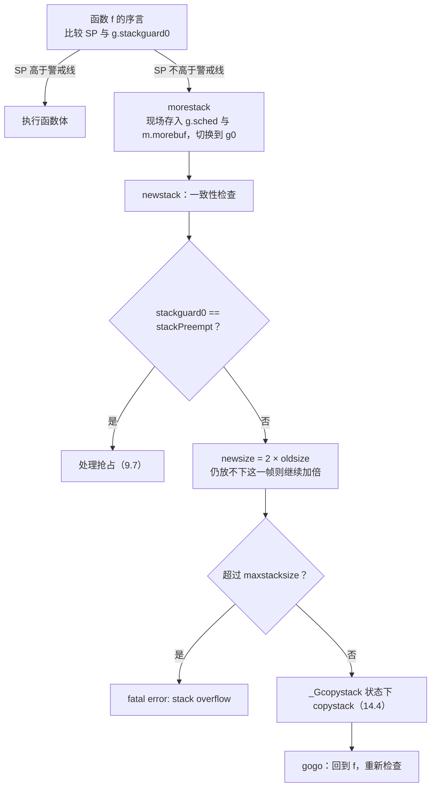

# 14.3 栈的增长

[14.1](./design.md) 说明了 Go 为什么采用连续栈：栈空间不足时，分配一段更大的栈，把旧栈整个复制过去。
本节讨论这一过程如何被触发、新栈的大小如何确定，以及栈最大能增长到多少。一次**栈增长**（stack growth）
依次经过四个环节：函数序言中的检查发现空间不足，调用汇编函数 `morestack`；`morestack` 保存现场并切换到
g0，调用 `newstack`；`newstack` 确定新栈的大小，调用 `copystack` 复制栈；最后回到触发增长的函数，
从头重新执行。复制本身留到 [14.4](./copy.md) 讨论。

## 14.3.1 函数序言中的检查

编译器在每个函数的开头插入栈检查，标记为 `//go:nosplit` 的函数以及被自动判定无需检查的小函数除外
（[2.4](../../part1overview/ch02asm/args.md)）。检查按栈帧的大小分为三种形式：栈帧不超过
`abi.StackSmall`（128 字节）时直接比较 SP 与警戒线；不超过 `abi.StackBig`（4096 字节）时先从 SP
中减去帧大小超出 128 字节的部分；更大的栈帧还要检查减法是否发生回绕
[[Go Authors, 2026d](#ref-go-authors-2026d)]。三种形式在 amd64 上的具体指令见
[2.4](../../part1overview/ch02asm/args.md)，警戒线以下余量的构成见 [14.1](./design.md)。生成这些指令的
`cmd/internal/obj/x86/obj6.go` 对第三种形式的解释是 [[Go Authors, 2026c](#ref-go-authors-2026c)]：

```go
		// Such a large stack we need to protect against underflow.
		// The runtime guarantees SP > objabi.StackBig, but
		// framesize is large enough that SP-framesize may
		// underflow, causing a direct comparison with the
		// stack guard to incorrectly succeed. We explicitly
		// guard against underflow.
```

同一个文件还把检查与随后的 `morestack` 调用标记为不可异步抢占：若 goroutine 恰好在这几条指令之间被抢占，
恢复后抢占请求已被清除，它却仍会调用 `morestack`，栈会被无谓地加倍（issue #35470）。

`runtime/stack.go` 开头有一段描述这些检查的长注释，它其实描述的是分段栈的年代
[[Go Authors, 2026a](#ref-go-authors-2026a)]：

```go
/*
Stack layout parameters.
Included both by runtime (compiled via 6c) and linkers (compiled via gcc).

The per-goroutine g->stackguard is set to point StackGuard bytes
above the bottom of the stack.  Each function compares its stack
pointer against g->stackguard to check for overflow.  To cut one
instruction from the check sequence for functions with tiny frames,
the stack is allowed to protrude StackSmall bytes below the stack
guard.  Functions with large frames don't bother with the check and
always call morestack.  The sequences are (for amd64, others are
similar):
	// ……
	stack frame size >= StackBig:
		MOVQ m->morearg, $((argsize << 32) | frame)
		CALL morestack(SB)
	// ……
*/
```

这段注释与 Go 1.2 的 `stack.h` 几乎逐字相同 [[Go Authors, 2013b](#ref-go-authors-2013b)]，「compiled via
6c」「g->stackguard」都是 C 语言运行时的写法。分段栈扩栈时要把参数复制到新段，`morestack`
因此需要知道参数的大小，序言便把它存入 `m->morearg`；栈帧很大时，新段的大小也取决于帧的大小，
于是干脆不做比较，直接调用 `morestack`。连续栈不再复制参数，也无须知道帧的大小：设计文档写道，
只要把栈加倍后重试，仍不够就再触发一次检查，直到放得下 [[Randall, 2013](#ref-randall-2013)]。今天的 `m`
中已没有 `morearg` 字段，大栈帧的函数也同样执行比较，[2.4](../../part1overview/ch02asm/args.md)
中帧大小为 8208 字节的 `Huge` 即是一例。

标为 `//go:nosplit` 的函数不做检查，它们只能使用警戒线以下预留的空间，这一约束由链接器在构建时核对。Russ
Cox 在 2011 年为链接器加入了这项检查，提交时就借此发现并修正了若干超出预留的运行时函数
[[Cox, 2011](#ref-cox-2011)]。今天的检查位于 `cmd/link/internal/ld/stackcheck.go`
[[Go Authors, 2026e](#ref-go-authors-2026e)]：

```go
	// limit is number of bytes a splittable function ensures are
	// available on the stack. If any call chain exceeds this
	// depth, the stack check test fails.
	//
	// The call to morestack in every splittable function ensures
	// that there are at least StackLimit bytes available below SP
	// when morestack returns.
	limit := objabi.StackNosplit(*flagRace) - sc.callSize
	if buildcfg.GOARCH == "arm64" {
		// Need an extra 8 bytes below SP to save FP.
		limit -= 8
	}
```

在 amd64 上，`StackNosplit` 为 800 字节，减去 `CALL` 指令压入返回地址的 8 字节，限额为 792 字节。arm64 的
调用把返回地址存入链接寄存器，不占栈，但要多留 8 字节保存帧指针，限额同样是 792 字节。下面的函数带有
1 KiB 的局部数组，却被标记为 `//go:nosplit`：

```go
//go:nosplit
//go:noinline
func f(i int) byte {
	var buf [1024]byte
	for j := range buf {
		buf[j] = byte(j)
	}
	return buf[i]
}

func main() { println(f(3)) }
```

为 linux/amd64 构建时，链接器拒绝了它：

```shell
$ GOOS=linux GOARCH=amd64 go build
# ex
main.f: nosplit stack over 792 byte limit
main.f<1>
    grows 1040 bytes, calls runtime.panicBounds<1>
        grows 160 bytes, calls runtime.panicBounds64<1>
            grows 8 bytes, calls runtime.morestack<0>
            416 bytes over limit
```

链接器报告的是最深的一条调用链。`buf[i]` 需要下标检查，越界时调用 `runtime.panicBounds`，后者又调用
`runtime.panicBounds64`；`panicBounds64` 做栈检查，可能调用 `morestack`，而 `morestack` 也必须放得下。1040 +
160 + 8 = 1208 字节，超出限额 416 字节。在 darwin/arm64 上，最后一次调用不压栈，输出为
「grows 0 bytes」与「408 bytes over limit」。

## 14.3.2 从 morestack 到 newstack

检查失败后，函数调用 `morestack`；若函数不使用闭包上下文，则调用 `morestack_noctxt`，它把保存上下文的
寄存器清零后跳转到 `morestack`：

```asm
TEXT runtime·morestack_noctxt(SB),NOSPLIT,$0
	MOVL	$0, DX
	JMP	runtime·morestack(SB)
```

`morestack` 把触发增长的函数 f 的现场存入 `g.sched`，把 f 的调用方的现场存入 `m.morebuf`，再切换到 g0
的栈调用 `newstack` [[Go Authors, 2026b](#ref-go-authors-2026b)]。这段汇编的逐行解读见
[2.2](../../part1overview/ch02asm/frame.md)。切换到 g0 是必须的：用户栈即将被复制，
扩栈的代码不能在它上面执行；g0 自身的栈不能增长，在 g0 上触发 `morestack`
会直接终止程序（[9.3](../../part3concurrency/ch09sched/mpg.md)）。

`newstack` 开头是几项一致性检查，任何一项失败都意味着运行时自身出了错：

```go
func newstack() {
	thisg := getg()
	// TODO: double check all gp. shouldn't be getg().
	if thisg.m.morebuf.g.ptr().stackguard0 == stackFork {
		throw("stack growth after fork")
	}
	if thisg.m.morebuf.g.ptr() != thisg.m.curg {
		// ……
		throw("runtime: wrong goroutine in newstack")
	}

	gp := thisg.m.curg
	// ……
	if thisg.m.curg.throwsplit {
		// ……
		throw("runtime: stack split at bad time")
	}
	// ……
}
```

`stackFork` 的含义见 [14.1](./design.md)。`throwsplit` 在进入系统调用时设置
（[9.5](../../part3concurrency/ch09sched/thread.md)）。`entersyscall` 的注释说明了原因：
系统调用进行期间不能安全地移动栈，因为运行时不知道哪些 `uintptr` 参数其实是指回栈内的指针
[[Go Authors, 2026f](#ref-go-authors-2026f)]。随后 `newstack` 读出警戒线，判断这是否是一次抢占请求；
抢占的处理见 [9.7](../../part3concurrency/ch09sched/preemption.md)，
其中也包括推迟到这里执行的栈收缩（[14.5](./shrink.md)）。若 SP 已经低于 `stack.lo`，
说明某段代码越过了警戒线以下的预留，运行时以「split stack overflow」终止程序。

## 14.3.3 新栈的大小

排除了以上情况，剩下的才是真正的栈增长：

```go
	// Allocate a bigger segment and move the stack.
	oldsize := gp.stack.hi - gp.stack.lo
	newsize := oldsize * 2

	// Make sure we grow at least as much as needed to fit the new frame.
	// (This is just an optimization - the caller of morestack will
	// recheck the bounds on return.)
	if f := findfunc(gp.sched.pc); f.valid() {
		max := uintptr(funcMaxSPDelta(f))
		needed := max + stackGuard
		used := gp.stack.hi - gp.sched.sp
		for newsize-used < needed {
			newsize *= 2
		}
	}

	if stackguard0 == stackForceMove {
		// Forced stack movement used for debugging.
		// Don't double the stack (or we may quickly run out
		// if this is done repeatedly).
		newsize = oldsize
	}

	if newsize > maxstacksize || newsize > maxstackceiling {
		if maxstacksize < maxstackceiling {
			print("runtime: goroutine stack exceeds ", maxstacksize, "-byte limit\n")
		} else {
			print("runtime: goroutine stack exceeds ", maxstackceiling, "-byte limit\n")
		}
		print("runtime: sp=", hex(sp), " stack=[", hex(gp.stack.lo), ", ", hex(gp.stack.hi), "]\n")
		throw("stack overflow")
	}

	// The goroutine must be executing in order to call newstack,
	// so it must be Grunning (or Gscanrunning).
	casgstatus(gp, _Grunning, _Gcopystack)

	// The concurrent GC will not scan the stack while we are doing the copy since
	// the gp is in a Gcopystack status.
	copystack(gp, newsize)
	// ……
	casgstatus(gp, _Gcopystack, _Grunning)
	gogo(&gp.sched)
}
```

新栈默认是旧栈的两倍。函数开头的注释写道：「Stack growth is multiplicative, for constant amortized cost.」
按倍数增长时，历次复制的字节数之和不超过栈最终的大小，摊到每个字节上是常数
（[2.4](../../part1overview/ch02asm/args.md) 用一个程序观察了这一点）；若每次只增加固定的大小，
复制总量将随栈的大小平方增长。第一行注释中的「segment」则是分段栈留下的用词。

加倍之后，若新栈仍放不下触发增长的那一帧，就继续加倍。`funcMaxSPDelta` 给出该函数执行中 SP 的最大下降量，
加上警戒线以下的余量，就是这一帧所需的空间。Randall 在 Go 1.15 中加入这一循环，提交说明指出它对大量小帧
的情形没有帮助，但对少数大帧的情形可能有所改善 [[Randall, 2020](#ref-randall-2020)]；注释也说明这只是一项
优化，`morestack` 返回后，函数会从头重新执行序言中的检查。`stackForceMove` 只要求移动而不要求增长，因此
保持原有大小。

复制期间，goroutine 处于 `_Gcopystack` 状态。并发运行的回收器不会扫描这样的栈；需要暂停这个 goroutine 的
`suspendG` 遇到这一状态时，也会等待复制完成。`copystack` 结束后，`g.sched` 中保存的 SP 已经指向新栈，`gogo`
据此回到 f 中 `morestack` 调用之后的位置，f 随即取回溢出到栈上的参数，
跳回开头重新执行序言中的检查，这一次检查通过。

## 14.3.4 栈的上限

新栈的大小若超过 `maxstacksize`，运行时便判定为栈溢出。程序启动之初，这个值暂定为 1 MiB；`runtime.main`
随后把它设为正式的上限 [[Go Authors, 2026f](#ref-go-authors-2026f)]：

```go
	// Max stack size is 1 GB on 64-bit, 250 MB on 32-bit.
	// Using decimal instead of binary GB and MB because
	// they look nicer in the stack overflow failure message.
	if goarch.PtrSize == 8 {
		maxstacksize = 1000000000
	} else {
		maxstacksize = 250000000
	}

	// An upper limit for max stack size. Used to avoid random crashes
	// after calling SetMaxStack and trying to allocate a stack that is too big,
	// since stackalloc works with 32-bit sizes.
	maxstackceiling = 2 * maxstacksize
```

这一上限始于 Go 1.2。发布说明写道，在此之前，失控的递归很容易耗尽机器的全部内存；新增的
`runtime/debug.SetMaxStack` 可以调整单个 goroutine 栈的最大值，默认在 64 位系统上为 1 GB，在
32 位系统上为 250 MB [[Go Authors, 2013a](#ref-go-authors-2013a)]。`maxstackceiling` 是 `SetMaxStack`
也不能突破的硬上限，因为 `stackalloc` 以 32 位整数表示大小。

由于栈的大小总是 2 的幂，十进制的上限并不对应某个实际的栈大小。在 64 位系统上，512 MiB 的栈再加倍就是
1 GiB，即 1073741824 字节，超过了 1000000000，因此 goroutine 的栈实际最大为 512 MiB。下面的递归没有终止
条件：

```go
func f(n int) int {
	var buf [64]byte
	buf[n%64] = byte(n)
	return f(n+1) + int(buf[0])
}

func main() { f(0) }
```

在 darwin/arm64 上运行，数秒后程序以如下信息终止（随后的栈回溯从略）：

```shell
$ go run .
runtime: goroutine stack exceeds 1000000000-byte limit
runtime: sp=0x52b849d60390 stack=[0x52b849d60000, 0x52b869d60000]
fatal error: stack overflow
……
exit status 2
```

终止时栈的区间为 0x20000000 字节，正是 512 MiB。栈溢出由 `throw` 报告，是致命错误而不是 panic，`recover`
无法捕获它，程序直接退出。

下图汇总了本节的流程：



## 14.3.5 小结

栈增长的每一个环节都由编译器、汇编与运行时完成，被增长的函数并不知情：
序言中的检查对绝大多数函数只是一次比较和一次条件跳转，`morestack` 在 g0 上调用 `newstack`，`newstack`
把栈加倍、复制，再让函数重新执行检查。加倍使复制的总代价与栈的最终大小成正比，
十进制的上限则让失控的递归在 512 MiB 处以致命错误终止。

## 延伸阅读

- <a id="ref-cox-2011"></a>[Cox, 2011] Russ Cox. ld: detect stack overflow due to NOSPLIT. Go commit
  d9fd11443c, 2011. https://golang.org/cl/4188061
  随 Go 1 发布。
- <a id="ref-go-authors-2013a"></a>[Go Authors, 2013a] The Go Authors. *Go 1.2 Release Notes: Stack size.*
  2013. https://go.dev/doc/go1.2#stack_size
- <a id="ref-go-authors-2013b"></a>[Go Authors, 2013b] The Go Authors. src/pkg/runtime/stack.h. Go 1.2
  源码. https://github.com/golang/go/blob/go1.2/src/pkg/runtime/stack.h
- <a id="ref-go-authors-2026a"></a>[Go Authors, 2026a] The Go Authors. src/runtime/stack.go: `newstack`,
  `maxstacksize`, stack growth comment block. Go 1.26 源码.
  https://github.com/golang/go/blob/release-branch.go1.26/src/runtime/stack.go
  扩容判定、抢占辨识、上限护栏。
- <a id="ref-go-authors-2026b"></a>[Go Authors, 2026b] The Go Authors. src/runtime/asm_amd64.s:
  `morestack`, `morestack_noctxt`. Go 1.26 源码.
  https://github.com/golang/go/blob/release-branch.go1.26/src/runtime/asm_amd64.s
  现场封存与切换 g0。
- <a id="ref-go-authors-2026c"></a>[Go Authors, 2026c] The Go Authors. src/cmd/internal/obj/x86/obj6.go:
  `stacksplit`. Go 1.26 源码.
  https://github.com/golang/go/blob/release-branch.go1.26/src/cmd/internal/obj/x86/obj6.go
  编译器插入的序言分段检查。
- <a id="ref-go-authors-2026d"></a>[Go Authors, 2026d] The Go Authors. src/internal/abi/stack.go:
  `StackSmall`, `StackBig`. Go 1.26 源码.
  https://github.com/golang/go/blob/release-branch.go1.26/src/internal/abi/stack.go
  三档检查的阈值常量。
- <a id="ref-go-authors-2026e"></a>[Go Authors, 2026e] The Go Authors.
  src/cmd/link/internal/ld/stackcheck.go. Go 1.26 源码.
  https://github.com/golang/go/blob/release-branch.go1.26/src/cmd/link/internal/ld/stackcheck.go
- <a id="ref-go-authors-2026f"></a>[Go Authors, 2026f] The Go Authors. src/runtime/proc.go、preempt.go. Go
  1.26 源码. https://github.com/golang/go/tree/release-branch.go1.26/src/runtime
- <a id="ref-randall-2013"></a>[Randall, 2013] Keith Randall. *Contiguous stacks.* Go design document,
  2013. https://docs.google.com/document/d/1wAaf1rYoM4S4gtnPh0zOlGzWtrZFQ5suE8qr2sD8uWQ
  连续栈替换分段栈的设计依据。
- <a id="ref-randall-2020"></a>[Randall, 2020] Keith Randall. runtime: grow stack more than 2x if the new
  frame is large. Go commit b1760f3a27, 2020. https://go.dev/cl/225800
  随 Go 1.15 发布。
- 本书 [2.4 参数传递与栈帧布局](../../part1overview/ch02asm/args.md)（stackguard0 的设立）、[2.2
  汇编中的栈帧与符号](../../part1overview/ch02asm/frame.md)、[9.3
  MPG 模型与并发调度单元](../../part3concurrency/ch09sched/mpg.md)、[9.7
  协作与抢占](../../part3concurrency/ch09sched/preemption.md)（stackPreempt 借道序言检查）、[14.1
  连续栈的设计](./design.md)、[14.4 栈的拷贝与指针调整](./copy.md)（copystack 与指针修正）。
