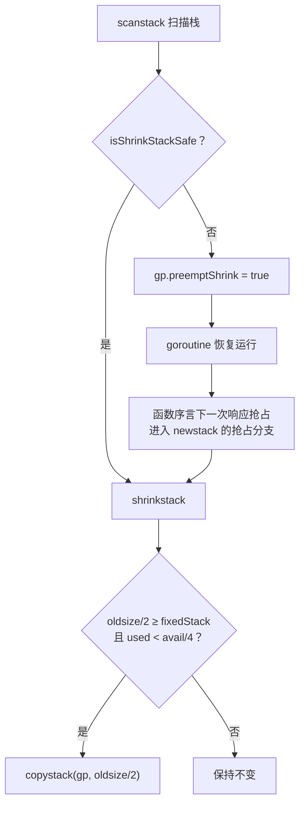

# 14.5 栈的收缩与演进

[14.3](./grow.md) 中的栈增长只朝一个方向进行：栈空间不足时换一段两倍大的栈。goroutine 的调用深度却
不是单调的，一段深递归返回之后，实际使用的栈可能只剩很少，为递归而扩大的栈仍归它所有。若只增长不归还，
每个 goroutine 的栈都会停留在它历史上的最大值。Go 1.3 把 goroutine 栈改为连续栈时，发布说明强调的是
增长的代价可以很好地均摊 [[Go Authors, 2014](#ref-go-authors-2014)]；同一个实现也引入了反方向的操作，
即**栈收缩**（stack shrinking）：垃圾回收扫描一个 goroutine 的栈时，若发现它只用了很小一部分，就把它
复制到一段一半大小的栈上 [[Randall, 2014](#ref-randall-2014)]。本节讨论收缩的时机与判据、它在空间上提供
的保证，最后比较其他系统对执行栈大小的处理。

## 14.5.1 收缩的时机

移动一个 goroutine 的栈，需要两个条件：运行时独占这段栈，并且掌握栈上每一帧的精确指针信息
（[14.4](./copy.md)）。垃圾回收扫描栈时，前一个条件已经满足：扫描之前，回收器通过 `suspendG` 让目标
goroutine 停在安全点上（[9.7](../../part3concurrency/ch09sched/preemption.md)），并持有其状态中的扫描位，
随后逐帧扫描它的栈（[13.4](../ch13gc/mark.md)）。因此收缩的判断就放在 `scanstack` 中
[[Go Authors, 2026b](#ref-go-authors-2026b)]：

```go
func scanstack(gp *g, gcw *gcWork) int64 {
	// ……
	scannedSize := gp.stack.hi - sp

	// Keep statistics for initial stack size calculation.
	// Note that this accumulates the scanned size, not the allocated size.
	p := getg().m.p.ptr()
	p.scannedStackSize += uint64(scannedSize)
	p.scannedStacks++

	if isShrinkStackSafe(gp) {
		// Shrink the stack if not much of it is being used.
		shrinkstack(gp)
	} else {
		// Otherwise, shrink the stack at the next sync safe point.
		gp.preemptShrink = true
	}
	// ……
}
```

前面几行累计已扫描的栈大小，新 goroutine 的起始栈大小即由此算出（[14.2](./alloc.md)）。后一个条件则不总是
满足，`isShrinkStackSafe` 列出了不能移动栈的情形 [[Go Authors, 2026a](#ref-go-authors-2026a)]：

```go
// isShrinkStackSafe returns whether it's safe to attempt to shrink
// gp's stack. Shrinking the stack is only safe when we have precise
// pointer maps for all frames on the stack. The caller must hold the
// _Gscan bit for gp or must be running gp itself.
func isShrinkStackSafe(gp *g) bool {
	// We can't copy the stack if we're in a syscall.
	// The syscall might have pointers into the stack and
	// often we don't have precise pointer maps for the innermost
	// frames.
	if gp.syscallsp != 0 {
		return false
	}
	// We also can't copy the stack if we're at an asynchronous
	// safe-point because we don't have precise pointer maps for
	// all frames.
	if gp.asyncSafePoint {
		return false
	}
	// We also can't *shrink* the stack in the window between the
	// goroutine calling gopark to park on a channel and
	// gp.activeStackChans being set.
	if gp.parkingOnChan.Load() {
		return false
	}
	// We also can't copy the stack while a gp is in _Gwaiting solely
	// to make itself available to suspendG.
	//
	// In these cases, the G is actually executing on the system
	// stack, and the execution tracer, mutex profiler, etc. may want
	// to take a stack trace of the G's stack.
	// ……
	if readgstatus(gp)&^_Gscan == _Gwaiting && gp.waitreason.isWaitingForSuspendG() {
		return false
	}
	return true
}
```

四种情形各有来历。系统调用的参数中可能有指向栈的指针，且最内层的帧往往没有精确的指针信息。
停在异步安全点上的 goroutine 是被信号打断的，最内层的帧没有精确的指针信息
（[9.7](../../part3concurrency/ch09sched/preemption.md)），回收器可以保守地扫描它，却不能移动它。
第三种情形是 goroutine 已决定阻塞在 channel 上、但 `activeStackChans` 尚未置位的窗口：此时回收器若看到
`activeStackChans` 为假，就会跳过 [14.4](./copy.md) 中与 channel 的同步，与并发的收发操作发生竞争。
第四种情形中，goroutine 名义上处于 `_Gwaiting`，实际上正在系统栈上执行，
执行追踪器或互斥锁剖析可能要获取它的调用栈。

不安全时，收缩并不放弃，而是记在 `gp.preemptShrink` 上。这个标志只在 `newstack` 的抢占分支中检查
[[Go Authors, 2026a](#ref-go-authors-2026a)]：

```go
	if preempt {
		// ……
		if gp.preemptShrink {
			// We're at a synchronous safe point now, so
			// do the pending stack shrink.
			gp.preemptShrink = false
			shrinkstack(gp)
		}
		// ……
	}
```

也就是说，推迟的收缩要等 goroutine 恢复运行后，下一次在函数序言中响应抢占请求时才补做。抢占请求来自
`sysmon` 对长时间运行的 goroutine 的抢占，或者下一轮回收对它的挂起；下一轮扫描时若处在安全的时机，
收缩也会直接进行。



这套规则是逐步形成的。Go 1.3 的第一版实现在 `addstackroots` 中、扫描每个 goroutine 的栈之前调用
`shrinkstack`，这发生在停止一切的标记阶段中，系统调用中的 goroutine 则直接跳过
[[Randall, 2014](#ref-randall-2014)]。Go 1.5 引入并发回收之后，收缩仍留在停止一切的标记终止阶段进行，
因为当时并发地收缩并不安全。Austin Clements 测得收缩的代价约为每复制 1 MB 耗时 5 ms、每次收缩另加 2 µs，
对栈很多的程序，这会显著拉长停顿；Go 1.7 把收缩移到并发标记阶段，issue #12967 中程序标记终止时间的
95 分位数从 23.8 ms 降到 1.80 ms [[Clements, 2016](#ref-clements-2016)]。Go 1.14 引入异步抢占时，Clements
先限定只在同步安全点收缩，不满足条件时推迟到下一个同步安全点，系统调用中的 goroutine 也由放弃改为推迟
[[Clements, 2019](#ref-clements-2019)]，`preemptShrink` 即由此而来。Michael Knyszek 在 Go 1.16 中修复了
`gopark` 修改状态与 `activeStackChans` 置位之间的竞争窗口，引入 `parkingOnChan`（issue
#40641）[[Knyszek, 2020](#ref-knyszek-2020)]；又在 Go 1.26 中把第四种情形扩大到所有为配合 `suspendG`
而进入 `_Gwaiting` 的场合：此前只在开启执行追踪时才避免收缩，而互斥锁剖析也开始在类似的场合获取调用栈，
提交说明因此决定不再试图兼容，转而保证栈在这些场合不会移动 [[Knyszek, 2025](#ref-knyszek-2025)]。

## 14.5.2 收缩的判据

决定是否收缩、收缩多少的是 `shrinkstack` [[Go Authors, 2026a](#ref-go-authors-2026a)]：

```go
// Maybe shrink the stack being used by gp.
//
// gp must be stopped and we must own its stack. It may be in
// _Grunning, but only if this is our own user G.
func shrinkstack(gp *g) {
	// ……检查是否持有该栈，以及 isShrinkStackSafe
	if debug.gcshrinkstackoff > 0 {
		return
	}

	oldsize := gp.stack.hi - gp.stack.lo
	newsize := oldsize / 2
	// Don't shrink the allocation below the minimum-sized stack
	// allocation.
	if newsize < fixedStack {
		return
	}
	// Compute how much of the stack is currently in use and only
	// shrink the stack if gp is using less than a quarter of its
	// current stack. The currently used stack includes everything
	// down to the SP plus the stack guard space that ensures
	// there's room for nosplit functions.
	avail := gp.stack.hi - gp.stack.lo
	if used := gp.stack.hi - gp.sched.sp + stackNosplit; used >= avail/4 {
		return
	}
	// ……
	copystack(gp, newsize)
}
```

新的大小总是旧大小的一半，且不低于最小的栈 `fixedStack`（[14.1](./design.md)）。
只有已用部分不足当前栈的四分之一时才收缩，已用部分从栈的高地址端 `hi` 量到栈指针，再加上 `stackNosplit`，
为不检查栈的 nosplit 函数留出空间。减半与四分之一这两个数在 Go 1.3 的第一版实现中就已确定
[[Randall, 2014](#ref-randall-2014)]。

两个数的配合决定了收缩之后的状态。收缩之后，已用部分不到新栈的一半；而增长之后（[14.3](./grow.md)），
已用部分约为新栈的一半。因此，用量在两倍以内起伏时，栈不会在增长与收缩之间往返。起伏超过两倍时，往返
仍可能发生，但收缩只在扫描时进行，每轮回收至多减半一次，往返的频率受回收频率的限制。收缩时复制的只是
已用部分（[14.4](./copy.md)），不到旧栈的四分之一，代价比增长时的复制更小。

收缩可以关闭。`runtime` 包文档对 `GODEBUG` 选项 `gcshrinkstackoff` 的说明是
[[Go Authors, 2026c](#ref-go-authors-2026c)]：

> gcshrinkstackoff：设为 1 时，禁止把 goroutine 移到更小的栈上。此模式下，goroutine 的栈只会增长。

下面的程序让 100 个 goroutine 各自递归约 1 MiB 后返回，然后阻塞在 channel 上，再连续触发十次回收，观察
全部栈占用的内存：

```go {run=true}
package main

import (
	"fmt"
	"runtime"
	"sync"
)

// grow 递归 n 层，每层的栈帧约 1 KiB。
func grow(n int) int {
	var buf [1024]byte
	if n == 0 {
		return 0
	}
	buf[n%1024] = byte(n)
	return grow(n-1) + int(buf[0])
}

// stackMiB 返回全部 goroutine 栈占用的内存，单位 MiB。
func stackMiB() float64 {
	var m runtime.MemStats
	runtime.ReadMemStats(&m)
	return float64(m.StackInuse) / (1 << 20)
}

func main() {
	release := make(chan struct{})
	var ready sync.WaitGroup
	for range 100 {
		ready.Add(1)
		go func() {
			grow(1000) // 递归约 1 MiB 后返回，栈却仍保持增长后的大小
			ready.Done()
			<-release
		}()
	}
	ready.Wait()
	fmt.Printf("递归返回后：%6.1f MiB\n", stackMiB())
	for i := 1; i <= 10; i++ {
		runtime.GC()
		fmt.Printf("第 %2d 次回收后：%6.1f MiB\n", i, stackMiB())
	}
	close(release)
}
```

运行结果如下：

```
递归返回后： 200.7 MiB
第  1 次回收后： 100.7 MiB
第  2 次回收后：  50.7 MiB
第  3 次回收后：  25.8 MiB
第  4 次回收后：  13.2 MiB
第  5 次回收后：   7.0 MiB
第  6 次回收后：   3.9 MiB
第  7 次回收后：   2.3 MiB
第  8 次回收后：   1.7 MiB
第  9 次回收后：   1.2 MiB
第 10 次回收后：   1.2 MiB
```

具体的数字随平台与每次运行略有差异，减半的规律不变。递归使用了 1 MiB 多一点，每个 goroutine 的栈因此增长到
2 MiB，100 个共约 200 MiB。递归返回之后，
在下一次回收之前，这些栈一直保持原样。此后每轮回收各减半一次，直到已用部分达到当前栈的四分之一为止。
最后的数字还包括 `main` 等其他 goroutine 的栈与分配器缓存中的栈内存，并非这 100 个 goroutine 所独占。这些
goroutine 阻塞在 channel 上，`activeStackChans` 为真，收缩走的是 [14.4](./copy.md) 中与 channel
同步的路径；不过 `<-release` 不需要接收的值，`sudog.elem` 为空，需要在锁内复制的部分也就是空的。

## 14.5.3 空间的界

Keith Randall 在 2021 年讨论起始栈大小的设计文档中，先分析了一个简化的模型：最小栈只有 1 字节，并且收缩在
条件满足时立即发生，而不是等到回收 [[Randall, 2021a](#ref-randall-2021a)]：

> 这一理想设计让我们对实际使用的空间与所需空间之间的关系有硬性的保证。若 S 是当前的栈用量，则分配的空间
> 至多为 4S。

这是因为，只要已用部分不足四分之一就立即减半，分配的空间就不会超过用量的四倍。文档接着说明了现实中的
偏离：

> 把收缩推迟到下一次回收，在理论上破坏了这一空间界，但在实践中我们没有看到由此造成的不良行为。（不良行为
> 是指 goroutine 轮流地短暂使用大量的栈。这会使所有已分配的栈都很大，尽管任一时刻只有一个 goroutine
> 需要那么多空间。）

上面的例子显示了推迟的代价：递归返回之后、第一次回收之前，200 MiB 的栈只有很少一部分在使用。文档还
建议不要把栈收缩到起始大小以下，但 Go 1.19 实现自适应起始大小时没有修改收缩路径
[[Randall, 2021b](#ref-randall-2021b)]，`shrinkstack` 至今只以 `fixedStack` 为下限。

## 14.5.4 其他系统的选择

把 Go 的做法放到其他系统中比较，可以看出可增长的栈依赖什么条件。

操作系统线程的栈大小在创建时确定。Linux 上，NPTL 创建的线程默认使用进程启动时 `RLIMIT_STACK`
软限制的大小，若该限制为 unlimited，多数体系结构上取 2 MiB
[[Linux man-pages Project, 2026](#ref-linux-man-pages-project-2026)]；内核为 `RLIMIT_STACK` 设定的默认值
`_STK_LIM` 是 8 MiB [[Linux Kernel Authors, 2026](#ref-linux-kernel-authors-2026)]。macOS
上次级线程的栈默认为 512 KiB，主线程为 8 MiB；这段空间在创建线程时就在进程的地址空间中预留，
物理页在需要时才分配 [[Apple, 2014](#ref-apple-2014)]。固定大小的栈必须足够应付除病态情形之外的所有执行，
因此通常很大，而大多数任务远远用不到，在每个任务一个线程的模型中，这部分空间就浪费了
[[Boats, 2020](#ref-boats-2020)]。

Rust 在 1.0 之前曾为绿色线程实现分段栈。2013 年 11 月，Brian Anderson 在 rust-dev 邮件列表上宣布新的运行时
不再实现分段栈 [[Anderson, 2013](#ref-anderson-2013)]，并归纳了三方面的问题：一是栈抖动，栈的边界落在
紧凑的循环中时，每次调用都要分配新的栈段、返回时再释放，邮件指出 Go 也因同样的问题（即热分裂）正在放弃
分段栈，并引用了 Go 的连续栈设计文档 [[Randall, 2013](#ref-randall-2013)]；二是外部函数接口，外部代码通常
期望较大的栈，调用时往往需要切换栈；三是 LLVM 会把一些 libc 调用转换为内建函数、把一些内建函数转换为运行时
调用，与分段栈兼容的办法都要求较大的最小栈。新运行时转而依靠操作系统与 MMU 惰性地映射页面。2014 年 9 月
通过的 RFC 230 则把运行时系统整个移出了标准库，绿色线程库 libgreen 成为独立的包，标准库的 I/O 直接建立在
原生线程与系统调用之上 [[Turon, 2014](#ref-turon-2014)]。

Rust 后来的异步模型走了另一条路。Boats 在 2020 年的文章中把栈空间耗尽时的对策归为三种：预分配固定大小、
分段、复制。文章指出，Go 能复制栈，是因为运行时需要改写指向栈内的指针，而它本来就有追踪式垃圾回收器；这在
Rust 中行不通，Rust 因此先把绿色线程改为固定大小的栈，最终将其移除 [[Boats, 2020](#ref-boats-2020)]。Rust
的 future 把挂起点之间需要保留的全部状态放在 future 对象中，大小在编译期确定，文章称之为大小恰好的栈。
代价之一是递归的 async 函数无法确定大小，必须在某处把递归的状态分配到堆上；文章指出，这实际上在 future
中造出了一个分段栈，只是分段的位置由程序显式标出。代价之二是 async 函数与普通函数从此分属两个世界，
即函数染色问题（[9.3](../../part3concurrency/ch09sched/mpg.md)）。

Java 21 的虚拟线程与 Go 相近。JEP 444 写道，虚拟线程的栈以栈块对象（stack chunk object）的形式存放在 Java
的垃圾回收堆中，随应用运行而增长与收缩，既为节省内存，也为容纳深度可达平台线程栈上限的调用
[[Pressler and Bateman, 2023](#ref-pressler-and-bateman-2023)]。

几种选择的分界在于运行时能否移动栈。Go 能够找到并改写指向栈的指针（[14.4](./copy.md)），Java
的虚拟线程把栈存放在垃圾回收器管理的堆中，栈因此可以从很小开始，随需要增长与收缩；做不到时，
要么像操作系统线程那样预留一段足够大的固定空间，要么像 Rust 的 future 那样在编译期确定所需的大小。

## 14.5.5 小结

收缩补全了连续栈的另一半：增长在函数序言中按需触发，收缩则在回收扫描栈时顺带完成，两者都通过
`copystack` 把栈复制到新的位置。减半与四分之一的判据自 Go 1.3 沿用至今，变化的是收缩的时机：从停止一切的
回收中移到并发标记阶段，再随异步抢占的引入限定在同步安全点，并逐步排除了与 channel、执行追踪和剖析冲突的
窗口。

## 延伸阅读

- <a id="ref-anderson-2013"></a>[Anderson, 2013] Brian Anderson. *Abandoning segmented stacks in Rust.*
  rust-dev mailing list, 2013-11-04. https://mail.mozilla.org/pipermail/rust-dev/2013-November/006314.html
  存档：https://web.archive.org/web/2015/https://mail.mozilla.org/pipermail/rust-dev/2013-November/006314.html
- <a id="ref-apple-2014"></a>[Apple, 2014] Apple Inc. *Threading Programming Guide: Thread Management.*
  2014.
  https://developer.apple.com/library/archive/documentation/Cocoa/Conceptual/Multithreading/CreatingThreads/CreatingThreads.html
- <a id="ref-boats-2020"></a>[Boats, 2020] Boats. *Futures and Segmented Stacks.* 2020-06-08.
  https://without.boats/blog/futures-and-segmented-stacks/
- <a id="ref-clements-2016"></a>[Clements, 2016] Austin Clements. runtime: shrink stacks during concurrent
  mark. Go commit f11e4eb5cc, 2016. https://go.dev/cl/20044
  随 Go 1.7 发布。
- <a id="ref-clements-2019"></a>[Clements, 2019] Austin Clements. runtime: only shrink stacks at
  synchronous safe points. Go commit 6058603471, 2019. https://go.dev/cl/201438
  随 Go 1.14 发布。
- <a id="ref-go-authors-2014"></a>[Go Authors, 2014] The Go Authors. *Go 1.3 Release Notes: Stack
  management.* 2014. https://go.dev/doc/go1.3#stacks
- <a id="ref-go-authors-2026a"></a>[Go Authors, 2026a] The Go Authors. src/runtime/stack.go：shrinkstack、
  isShrinkStackSafe、copystack. Go 1.26 源码.
  https://github.com/golang/go/blob/release-branch.go1.26/src/runtime/stack.go
- <a id="ref-go-authors-2026b"></a>[Go Authors, 2026b] The Go Authors. src/runtime/mgcmark.go：scanstack.
  Go 1.26 源码. https://github.com/golang/go/blob/release-branch.go1.26/src/runtime/mgcmark.go
- <a id="ref-go-authors-2026c"></a>[Go Authors, 2026c] The Go Authors. src/runtime/extern.go：GODEBUG
  选项. Go 1.26 源码. https://github.com/golang/go/blob/release-branch.go1.26/src/runtime/extern.go
- <a id="ref-knyszek-2020"></a>[Knyszek, 2020] Michael Knyszek. runtime: disable stack shrinking in
  activeStackChans race window. Go commit eb3c6a93c3, 2020. https://go.dev/cl/247050
  随 Go 1.16 发布。
- <a id="ref-knyszek-2025"></a>[Knyszek, 2025] Michael Knyszek. runtime: disable stack shrinking for all
  waiting-for-suspendG cases. Go commit bd07fafb0a, 2025. https://go.dev/cl/692716
  随 Go 1.26 发布。
- <a id="ref-linux-kernel-authors-2026"></a>[Linux Kernel Authors, 2026] The Linux Kernel Authors.
  include/uapi/linux/resource.h.
  https://github.com/torvalds/linux/blob/master/include/uapi/linux/resource.h
- <a id="ref-linux-man-pages-project-2026"></a>[Linux man-pages Project, 2026] The Linux man-pages
  project. *pthread_create(3).* https://man7.org/linux/man-pages/man3/pthread_create.3.html
- <a id="ref-pressler-and-bateman-2023"></a>[Pressler and Bateman, 2023] Ron Pressler, Alan Bateman. *JEP
  444: Virtual Threads.* OpenJDK, 2023. https://openjdk.org/jeps/444
  随 Java 21 发布。
- <a id="ref-randall-2013"></a>[Randall, 2013] Keith Randall. *Contiguous stacks.* Go design document,
  2013. https://docs.google.com/document/d/1wAaf1rYoM4S4gtnPh0zOlGzWtrZFQ5suE8qr2sD8uWQ/edit
- <a id="ref-randall-2014"></a>[Randall, 2014] Keith Randall. runtime: grow stack by copying. Go commit
  1665b006a5, 2014. https://golang.org/cl/54650044
  随 Go 1.3 发布。
- <a id="ref-randall-2021a"></a>[Randall, 2021a] Keith Randall. *Determining a good starting stack size.*
  Go design document, 2021.
  https://docs.google.com/document/d/1YDlGIdVTPnmUiTAavlZxBI1d9pwGQgZT7IKFKlIXohQ/edit
- <a id="ref-randall-2021b"></a>[Randall, 2021b] Keith Randall. runtime: measure stack usage; start stacks
  larger if needed. Go commit 016d755213, 2021. https://go.dev/cl/345889
  随 Go 1.19 发布。
- <a id="ref-turon-2014"></a>[Turon, 2014] Aaron Turon. *RFC 230: Remove runtime system, and move libgreen
  into an external library.* Rust RFCs, 2014. https://rust-lang.github.io/rfcs/0230-remove-runtime.html
