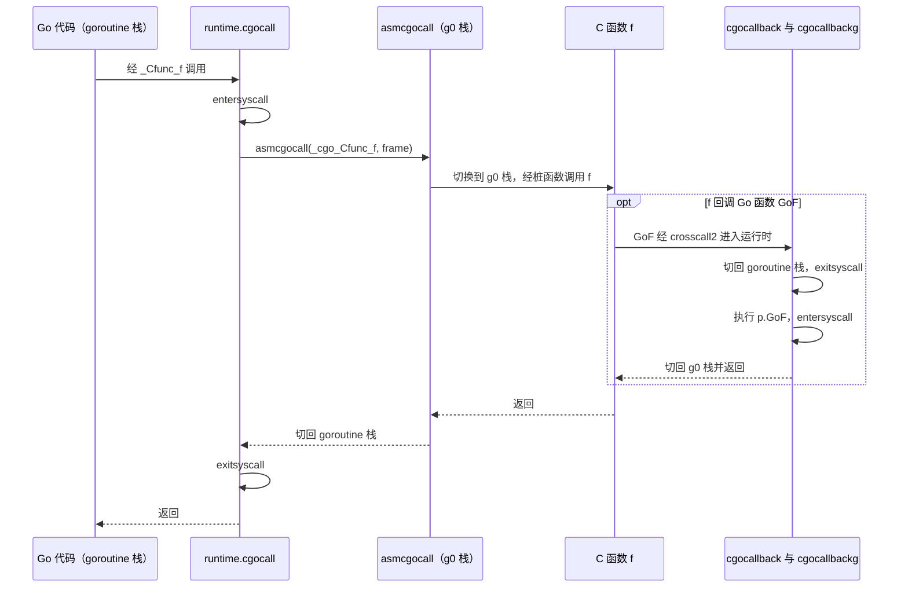

# 15.6 cgo

cgo 让 Go 包能够调用 C 代码 [[Gerrand, 2011](#ref-gerrand-2011)]。在导入伪包 `"C"` 的源文件中，紧接在
`import "C"` 之前的注释称为序言（preamble），其中声明的 C 函数、类型与变量都可以通过 `C.` 前缀访问。
这一机制几乎与 Go 本身同龄：2009 年 8 月，Russ Cox 在运行时中加入了最初的外部函数调用支持
[[Cox, 2009a](#ref-cox-2009a)]；同年 9 月，`cgo` 工具开始成形，提交说明中的示例是对 GMP 大整数库的包装
[[Cox, 2009b](#ref-cox-2009b)]。

调用一个 C 函数在源码中只需一行，背后却是两套运行时约定之间的转换。goroutine 运行在会增长、会移动的栈上，
由调度器复用在少量线程上，所用的内存由垃圾回收器追踪；C 代码则假定自己独占一个线程和一个固定的栈，
内存由程序自行管理，对调度器与回收器一无所知。Rob Pike 的格言「Cgo 不是 Go」（Cgo is not
Go）[[Pike, 2015](#ref-pike-2015)]概括的正是这层隔阂，Dave Cheney 在同名文章中逐条列举了它在构建、
部署与工具上的代价 [[Cheney, 2016](#ref-cheney-2016)]。

本节考察 Go 1.26 中这一转换的实现：`cmd/cgo` 为一次调用生成了哪些代码，运行时如何从 Go 进入 C、又如何从 C
回到 Go，指针传递规则为何如此规定，`#cgo noescape` 与 `#cgo nocallback` 两条指令放宽了哪些限制，
以及这一切的代价。cgo 边界在 GPU 编程中的影响见 [18.1](../../part6hetero/ch18gpu/boundary.md)。

## 15.6.1 生成的代码

以下面这个包为例，序言中定义了一个 C 函数 `add`：

```go
package demo

// static int add(int a, int b) { return a + b; }
import "C"

func Add(a, b int) int {
	return int(C.add(C.int(a), C.int(b)))
}
```

`go build` 遇到导入 `"C"` 的文件时，先调用 `cmd/cgo` 把它改写为普通的 Go 文件与 C 文件，再分别交给 Go
编译器与 C 编译器，最后把两边的目标文件链接在一起。改写这一步可以用 `go tool cgo` 单独执行，以下输出以 Go
1.26.10 为准：

```shell
$ go tool cgo -objdir out add.go
```

在改写后的源文件 `out/add.cgo1.go` 中，`C.add` 与 `C.int` 分别换成了 `_Cfunc_add` 与 `_Ctype_int`，
二者定义在 `out/_cgo_gotypes.go` 中。`_Cfunc_add` 是这次调用在 Go 一侧的包装：

```go
//go:cgo_unsafe_args
func _Cfunc_add(p0 _Ctype_int, p1 _Ctype_int) (r1 _Ctype_int) {
	_cgo_runtime_cgocall(_cgo_e9c5c984e178_Cfunc_add, uintptr(unsafe.Pointer(&p0)))
	if _Cgo_always_false {
		_Cgo_use(p0)
		_Cgo_use(p1)
	}
	return
}
```

`_cgo_runtime_cgocall` 经 `//go:linkname` 指向 `runtime.cgocall`，它接收两个参数：C 一侧桩函数（stub）
的地址，以及参数帧的地址。桩函数名中的十六进制串是 cgo 根据包的导入路径与源文件内容算出的散列值，
用以区分不同包生成的符号。`//go:cgo_unsafe_args` 使这个函数固定采用栈传参的
ABI0（[2.3](../../part1overview/ch02asm/callconv.md)），参数 `p0`、`p1` 与结果 `r1` 因此在栈上依次排列，`&p0`
就是整个参数帧的起点；出于同一原因，编译器也不会内联这个函数。帧的地址以 `uintptr`
而非指针的形式传出，`cmd/cgo` 在生成这一行的代码旁注明，这是为了对逃逸分析隐藏这次取址
[[Go Authors, 2026c](#ref-go-authors-2026c)]，参数帧因此可以留在 goroutine 的栈上。

C 一侧的桩函数在 `out/add.cgo2.c` 中：

```c
CGO_NO_SANITIZE_THREAD
void
_cgo_e9c5c984e178_Cfunc_add(void *v)
{
	struct {
		int p0;
		int p1;
		int r;
		char __pad12[4];
	} __attribute__((__packed__)) *_cgo_a = v;
	char *_cgo_stktop = _cgo_topofstack();
	__typeof__(_cgo_a->r) _cgo_r;
	_cgo_tsan_acquire();
	_cgo_r = add(_cgo_a->p0, _cgo_a->p1);
	_cgo_tsan_release();
	_cgo_a = (void*)((char*)_cgo_a + (_cgo_topofstack() - _cgo_stktop));
	_cgo_a->r = _cgo_r;
	_cgo_msan_write(&_cgo_a->r, sizeof(_cgo_a->r));
}
```

桩函数把 `v` 解释为一个与 Go 一侧帧布局相同的结构体，从中取出参数调用 `add`，再把结果写回帧中。
值得注意的是写回之前对 `_cgo_a` 的修正。参数帧位于 goroutine 的栈上，而 C 函数执行期间可能回调 Go，
回调中的 Go 代码可能使栈增长，整个栈随之被拷贝到新的位置（[14.4](../../part4memory/ch14stack/copy.md)）。
栈拷贝会调整 Go 栈帧中的指针，却无从调整 C 代码手中的地址。`_cgo_topofstack` 返回当前 goroutine 栈的上界，
栈拷贝保持各帧到栈上界的距离不变，因此调用前后两次取值之差，正是参数帧移动的距离。`cmd/cgo`
中生成这一行的代码附有说明 [[Go Authors, 2026c](#ref-go-authors-2026c)]：

```go
	if tr != nil {
		// The cgo call may have caused a stack copy (via a callback).
		// Adjust the return value pointer appropriately.
		fmt.Fprintf(fgcc, "\t_cgo_a = (void*)((char*)_cgo_a + (_cgo_topofstack() - _cgo_stktop));\n")
		// Save the return value.
		fmt.Fprintf(fgcc, "\t_cgo_a->r = _cgo_r;\n")
```

回到 Go 一侧，包装函数末尾的 `if _Cgo_always_false` 分支从不执行。`runtime/cgo.go` 中的注释说明了它的作用
[[Go Authors, 2026b](#ref-go-authors-2026b)]：

```go
// cgoUse is called by cgo-generated code (using go:linkname to get at
// an unexported name). The calls serve two purposes:
// 1) they are opaque to escape analysis, so the argument is considered to
// escape to the heap.
// 2) they keep the argument alive until the call site; the call is emitted after
// the end of the (presumed) use of the argument by C.
// cgoUse should not actually be called (see cgoAlwaysFalse).
func cgoUse(any) { throw("cgoUse should not be called") }

// ……

// cgoAlwaysFalse is a boolean value that is always false.
// The cgo-generated code says if cgoAlwaysFalse { cgoUse(p) },
// or if cgoAlwaysFalse { cgoKeepAlive(p) }.
// The compiler cannot see that cgoAlwaysFalse is always false,
// so it emits the test and keeps the call, giving the desired
// escape/alive analysis result. The test is cheaper than the call.
var cgoAlwaysFalse bool
```

第二个作用不难理解。C 代码经由 `uintptr` 形式的帧地址读取参数，编译器看不到这种使用；
若调用之后没有任何对参数的使用，参数所指的对象在 C 函数仍在使用它时就可能被视为已死。第一个作用则意味着，
凡是传给 C 的 Go 指针，其所指的对象都会被逃逸分析判定为逃逸到堆上（[15.5](./escape.md)）。
本例的参数都是整数，这一点无关紧要；参数中含有指针时，它就成了 cgo 调用的一项隐性开销。这样做的理由见
15.6.4。

## 15.6.2 从 Go 到 C

`runtime/cgocall.go` 开头的注释完整地描述了一次调用的路径 [[Go Authors, 2026a](#ref-go-authors-2026a)]：

```go
// To call into the C function f from Go, the cgo-generated code calls
// runtime.cgocall(_cgo_Cfunc_f, frame), where _cgo_Cfunc_f is a
// gcc-compiled function written by cgo.
//
// runtime.cgocall (below) calls entersyscall so as not to block
// other goroutines or the garbage collector, and then calls
// runtime.asmcgocall(_cgo_Cfunc_f, frame).
//
// runtime.asmcgocall (in asm_$GOARCH.s) switches to the m->g0 stack
// (assumed to be an operating system-allocated stack, so safe to run
// gcc-compiled code on) and calls _cgo_Cfunc_f(frame).
//
// _cgo_Cfunc_f invokes the actual C function f with arguments
// taken from the frame structure, records the results in the frame,
// and returns to runtime.asmcgocall.
//
// After it regains control, runtime.asmcgocall switches back to the
// original g (m->curg)'s stack and returns to runtime.cgocall.
//
// After it regains control, runtime.cgocall calls exitsyscall, which blocks
// until this m can run Go code without violating the $GOMAXPROCS limit,
// and then unlocks g from m.
```

这条路径上有两类转换：`entersyscall` 与 `exitsyscall` 改变 goroutine 在调度器眼中的状态，`asmcgocall`
改变执行所用的栈。`cgocall` 的主体如下：

```go
func cgocall(fn, arg unsafe.Pointer) int32 {
	// ……
	mp := getg().m
	mp.ncgocall++

	// ……

	// Announce we are entering a system call
	// so that the scheduler knows to create another
	// M to run goroutines while we are in the
	// foreign code.
	//
	// The call to asmcgocall is guaranteed not to
	// grow the stack and does not allocate memory,
	// so it is safe to call while "in a system call", outside
	// the $GOMAXPROCS accounting.
	//
	// fn may call back into Go code, in which case we'll exit the
	// "system call", run the Go code (which may grow the stack),
	// and then re-enter the "system call" reusing the PC and SP
	// saved by entersyscall here.
	entersyscall()

	// ……

	mp.incgo = true
	// ……
	mp.ncgo++

	errno := asmcgocall(fn, arg)

	// Update accounting before exitsyscall because exitsyscall may
	// reschedule us on to a different M.
	mp.incgo = false
	mp.ncgo--

	// ……

	exitsyscall()
```

`incgo` 与 `ncgo` 记录这个 M 正在执行 C 代码，供信号处理与执行跟踪等使用。真正的工作由其余三步完成。

**进入「系统调用」。** 在调度器看来，cgo 调用与系统调用没有区别：执行流离开了 Go 代码，何时返回无从预知。`entersyscall`
把 goroutine 置为 `_Gsyscall`，保存此刻的程序计数器与栈指针，但并不释放 P。C
函数很快返回时，`exitsyscall` 发现 P 仍在，直接继续执行；C 函数迟迟不返回时，系统监控线程 sysmon 会取走
P，交给另一个 M 去运行其他 goroutine。这套快慢两条路径以及 Go 1.26 对它的简化见
[9.5.4](../../part3concurrency/ch09sched/thread.md)。因此，一个阻塞的 C 调用不会妨碍其他 goroutine 运行，
但会一直占用它所在的线程。

**不妨碍垃圾回收。** `entersyscall` 保存的现场同样服务于垃圾回收器。回收器扫描一个 goroutine 的栈之前，
要先通过 `suspendG` 使它停下。对处于 `_Gsyscall` 的 goroutine，`suspendG` 的处理与可运行、等待中的
goroutine 相同，只需取得扫描位，无须等待它返回 [[Go Authors, 2026d](#ref-go-authors-2026d)]：

```go
		case _Grunnable, _Gsyscall, _Gwaiting, _Gleaked:
			// Claim goroutine by setting scan bit.
			// This may race with execution or readying of gp.
			// The scan bit keeps it from transition state.
			if !castogscanstatus(gp, s, s|_Gscan) {
				break
			}
```

此时 goroutine 栈上的 Go 栈帧停在 `entersyscall` 保存的位置，C 代码的栈帧则在另一个栈上，
回收器只需扫描前者。这也解释了注释对 `asmcgocall` 的要求：它运行在「系统调用」状态下，goroutine 已不计入
`$GOMAXPROCS`，不能使用 P 上的资源分配内存；保存下来的栈指针正供回收器使用，栈也不能增长，`entersyscall`
会使此间的任何栈增长都成为致命错误（9.5.4）。

**切换到 `g0` 栈。** `asmcgocall` 用汇编写成。它保存 goroutine 的栈指针，切换到当前 M 的 `g0` 栈，按 C
的调用约定对齐栈并调用桩函数，返回后再切回 `m.curg` 的栈。必须换栈，是因为 goroutine 的栈很小，
只靠函数序言中的检查按需增长（[14.3](../../part4memory/ch14stack/grow.md)），而 C
编译器生成的代码不做这种检查。`g0` 栈则是线程本身的栈：启用 cgo 时，运行时通过 C 库的 `pthread_create`
创建线程，栈也由它分配，大小足以运行 C 代码。

## 15.6.3 从 C 回到 Go

C 代码也可以调用 Go。在 Go 函数前加上 `//export GoF` 注释，cgo 便会生成一个同名的 C 函数，C
代码调用它即进入 Go。`cgocall.go` 开头的注释用大半篇幅描述了这条反向路径，下图把它与正向路径画在一起：



反向路径把正向路径的每一步倒过来做一遍。C 函数调用 cgo 生成的 `GoF`，后者把参数打包成帧，调用汇编写成的
`crosscall2`，由它把 C 的调用约定适配为 Go 的调用约定；`runtime.cgocallback` 从 `g0` 栈切回原先的
goroutine 栈；`runtime.cgocallbackg` 调用 `exitsyscall`，等到 `$GOMAXPROCS` 允许时重新取得 P，
此后才能分配内存、执行 Go 函数。Go 函数返回后，`cgocallbackg` 调用 `entersyscall` 重新进入「系统调用」，
再沿原路返回 C。

一次带回调的调用因此要付出两倍的状态转换，外加两次额外的栈切换。回调中的 Go 代码运行在原 goroutine
的栈上，可以像普通 Go 代码一样使栈增长，15.6.1 中桩函数对参数帧地址的修正正是为此而设。

**时间倒流。** 回调还给垃圾回收器带来一个微妙的问题。`cgocall` 的末尾有这样一段注释
[[Go Authors, 2026a](#ref-go-authors-2026a)]：

```go
	// From the garbage collector's perspective, time can move
	// backwards in the sequence above. If there's a callback into
	// Go code, GC will see this function at the call to
	// asmcgocall. When the Go call later returns to C, the
	// syscall PC/SP is rolled back and the GC sees this function
	// back at the call to entersyscall. Normally, fn and arg
	// would be live at entersyscall and dead at asmcgocall, so if
	// time moved backwards, GC would see these arguments as dead
	// and then live. Prevent these undead arguments from crashing
	// GC by forcing them to stay live across this time warp.
	KeepAlive(fn)
	KeepAlive(arg)
	KeepAlive(mp)

	return errno
}
```

回收器依据栈映射判断一个栈帧中哪些槽位存放着活跃的指针，而栈映射是按调用处记录的
（[13.7.1](../../part4memory/ch13gc/safe.md)）。回调期间，回收器看到 `cgocall` 停在调用 `asmcgocall`
之处，`fn` 与 `arg` 在这之后不再使用，已是死值；回调返回 C 之后，「系统调用」的现场回退到 `entersyscall`
保存的位置，二者在那里又是活值。一个先被视为死、后又被视为活的槽位，可能指向已经回收的内存。函数末尾的
`KeepAlive` 使它们在整个过程中都保持活跃。

**由 C 创建的线程。** 以上假定回调发生在由 Go 运行时创建的线程上，`m.curg` 就是发起调用的 goroutine。C
代码自己创建的线程同样可以调用 Go，这时线程上没有 M，运行时要先借出一个预先准备好的 extra
M（[9.5.5](../../part3concurrency/ch09sched/thread.md)）。Go 1.21 起，Unix
平台上同一线程的后续调用会沿用此前的准备工作，发布说明给出的单次开销从约 1–3 µs 降到约 100–200 ns
[[Go Authors, 2023b](#ref-go-authors-2023b)]。

## 15.6.4 指针传递规则

把 Go 指针传给 C 是 cgo 最常见的用法，例如把一个 `[]byte` 的底层数组交给 C 函数填充。2015 年 10 月，Ian
Lance Taylor 在一份提案中为此制定了明确的规则 [[Taylor, 2015](#ref-taylor-2015)]。
提案先回顾了当时的事实规则：Go 1.4 允许把任何 Go 指针传给 C，C 代码可以随意使用；Go 1.5 增加了一些限制，
但这些限制「有些令人困惑，限制了垃圾回收将来的选择，尤其是排除了将来实现移动式回收器的可能」。
提案转而要求维持一条不变式：

> 垃圾回收器必须知道所有 Go 指针的位置，只有一组已知的、暂时对 C 代码可见的指针除外。对 C 代码可见的指针位于回收器看不到的区域，回收器既不能修改、也不能释放它们。

规则的设计退而求其次。最简单的规则是完全禁止把 Go 指针传给 C，但这会破坏既有的代码：`gonum/blas`
为了效率把浮点数切片直接交给 C，标准库也把 `C.struct_addrinfo` 的地址传给 `C.getaddrinfo`。
提案于是允许传递 Go 指针，但限制其数量，并要求回收器确切地知道哪些指针被传了出去；
若将来的回收器会移动对象，cgo 便在调用期间临时固定（pin）这些对象。由此得出两条核心规则：

1. Go 代码可以把 Go 指针传给 C，前提是它所指的 Go 内存中不含 Go 指针。传递结构体字段的指针时，
   所涉及的内存只是该字段；传递数组或切片元素的指针时，则是整个数组或整个底层数组。
2. 调用返回之后，C 代码不得保留 Go 指针的副本。

第一条保证每次调用只有一块 Go 内存对 C 可见：这块内存中没有别的 Go 指针，C 便无法沿着指针走到更多的 Go
内存。第二条把这种可见性限制在调用期间。提案在「后果」一节中还指出了一个与栈有关的推论：

> 由于 C 代码可以回调 Go 代码，而 Go 代码可能需要拷贝栈，我们永远不能把指向 Go 栈的指针传给 C 代码。传给 C 代码的任何指针都必须被编译器视为逃逸，即使上述规则意味着我们知道它不会逃逸。这在调用 C 代码本已很高的代价之上又增加了一项代价。

这就是 15.6.1 中 `_Cgo_use` 的由来。C 代码手中的地址不在任何 Go 栈帧中，栈拷贝无法调整它
（[14.4.6](../../part4memory/ch14stack/copy.md)）；对象分配在堆上，地址便不会因栈拷贝而失效。

这些规则随 Go 1.6 生效，由运行时在执行期间检查，检测到违规时打印诊断信息并使程序崩溃
[[Go Authors, 2016](#ref-go-authors-2016)]。检查可以用 `GODEBUG=cgocheck=0` 关闭，但发布说明特别提醒，
被检查出的代码绝大多数都以某种方式与垃圾回收不相容，关闭检查通常只会换来更难以理解的失败。

提案还写道，规则一旦采纳便不能再收紧，只能放宽。Go 1.21 加入的 `runtime.Pinner` 就是一次放宽
[[Anderson, 2023](#ref-anderson-2023)]：用 `Pinner` 固定的 Go 内存可以被 C 更自由地使用，传给 C
的内存中可以含有指向已固定内存的 Go 指针 [[Go Authors, 2023b](#ref-go-authors-2023b)]。`cmd/cgo`
的文档据此把规则改写为以「固定」为中心的表述 [[Go Authors, n.d.a](#ref-go-authors-nda)]：作为参数传给 C
的 Go 指针，其所指的内存在调用期间被隐式固定；从这些参数可达的 Go 内存，在 C
能够访问它的整个期间都必须保持固定；调用返回之后，C 只能在内存由 `Pinner` 固定、
且尚未解除固定时保留指向它的指针。字符串、切片、通道等无法用 `Pinner` 固定，因此 C
不能在调用返回后保留它们。

对于指针类型的参数，cgo 生成的代码在调用之前先调用 `cgoCheckPointer`
[[Go Authors, 2026a](#ref-go-authors-2026a)]：

```go
// cgoCheckPointer checks if the argument contains a Go pointer that
// points to an unpinned Go pointer, and panics if it does.
func cgoCheckPointer(ptr any, arg any) {
	if !goexperiment.CgoCheck2 && debug.cgocheck == 0 {
		return
	}
```

下面的程序把一个含有 Go 指针的结构体交给 C，先在不固定的情况下调用一次，
再固定其中的指针所指的内存后调用一次：

```go {run=true native=true}
package main

// static void use(void *p) { (void)p; }
import "C"

import (
	"fmt"
	"runtime"
	"unsafe"
)

type node struct {
	val  int
	next *int
}

func call(n *node) (err any) {
	defer func() { err = recover() }()
	C.use(unsafe.Pointer(n))
	return nil
}

func main() {
	x := 42
	n := &node{val: 1, next: &x}

	// n 指向的内存中含有指向未固定内存的 Go 指针 n.next。
	fmt.Println("未固定：", call(n))

	// 固定 x 之后，n.next 指向的是已固定的内存，调用合法。
	var pinner runtime.Pinner
	pinner.Pin(&x)
	fmt.Println("固定后：", call(n))
	pinner.Unpin()
}
```

运行结果如下：

```
未固定： runtime error: argument of cgo function has Go pointer to unpinned Go pointer
固定后： <nil>
```

参数的类型是 `unsafe.Pointer`，检查器不知道它所指内存的类型，便扫描 `n` 所指的整个堆对象，发现其中的
`n.next` 指向未固定的 `x`。固定 `x` 之后，同一次调用就合法了。以 `GODEBUG=cgocheck=0` 运行时，
第一次调用也不会报错，但违规依然存在。

默认的 `cgocheck=1` 只在调用边界上检查参数，代价较低。更彻底的检查需要在构建时设置
`GOEXPERIMENT=cgocheck2`：编译器在插入写屏障（[13.2](../../part4memory/ch13gc/barrier.md)）的那一遍中，
为每一次指针写入额外生成对 `cgoCheckPtrWrite` 的调用，一旦 Go 代码把指向未固定内存的 Go 指针存入非 Go
内存，程序立即崩溃 [[Go Authors, 2026g](#ref-go-authors-2026g)]。这一模式原本是运行时选项
`GODEBUG=cgocheck=2`，Go 1.21 把它改为构建期的实验选项，以便进一步优化写屏障
[[Randall, 2023](#ref-randall-2023)]。这两种检查与 [15.4](./unsafe.md) 的指针检查器一样，
都是在运行时发现违规，无法证明程序没有违规。

需要让 C 长期持有的数据有三种受支持的做法。用 `C.malloc` 分配的内存不在回收器的管辖之内，C 可以随意保留，
代价是必须自行 `C.free`，Go 的内存安全在这块内存上也不再成立。`runtime.Pinner` 更轻：它把一块 Go
内存固定到 `Unpin` 为止，期间 C 可以保留指向它的指针。若 C 只需要在之后回调时把一个 Go 值交还给 Go，
可以使用 Go 1.17 加入的 `runtime/cgo.Handle` [[Ou, 2021](#ref-ou-2021)]
[[Go Authors, n.d.b](#ref-go-authors-ndb)]。`NewHandle` 把任意 Go 值存入一张全局映射，返回一个整数句柄，C
只保存这个整数，回调时 Go 代码再用它取回原来的值，用完后调用 `Delete` 释放。C 手中自始至终没有 Go 指针，
规则也就无从违反。

## 15.6.5 noescape 与 nocallback

15.6.4 的推论使每个传给 C 的指针都付出一次堆分配。对许多 C 函数而言，这是不必要的：
它们只在调用期间读写传入的内存，既不保留指针，也不回调 Go。2022 年 10 月，doujiang24
提议为这类函数增加注解，使参数免于逃逸 [[doujiang24, 2022](#ref-doujiang24-2022)]。讨论中 Russ Cox 指出，
只声明「不逃逸」并不够 [[Cox, 2023a](#ref-cox-2023a)]：

> 遗憾的是，要在主线 Go 工具链中把东西放在栈上，我们还需要知道不会回调 Go，因为回调可能使栈增长。

Cox 建议用两条指令分别描述这两个性质：`#cgo noescape` 声明参数不会经由该 C 函数逃逸，`#cgo nocallback`
声明该函数不会回调 Go。采用分段栈（[14.1](../../part4memory/ch14stack/design.md)）
的实现只需前者就能把值留在栈上，当前的工具链则两者都需要。Ian Lance Taylor 补充说，`nocallback` 也不蕴含
`noescape`：C 函数可以把指针交给另一个线程，再由那个线程回调 Go [[Taylor, 2023](#ref-taylor-2023)]。

两条指令在 2023 年 8 月实现 [[doujiang24, 2023](#ref-doujiang24-2023)]，同年 11 月，在 Go 1.22
发布之前被禁用 [[Cox, 2023b](#ref-cox-2023b)]：Go 1.21 及更早版本不认识这两行，对用到它们的代码执行
`go mod vendor` 会失败。Go 1.22 先让 `go/build` 忽略这两条指令，不认识它们的旧版本退出支持之后，Go 1.24
才正式启用 [[doujiang24, 2024](#ref-doujiang24-2024)] [[Go Authors, 2025](#ref-go-authors-2025)]。
启用的那次提交还修复了一个缺陷：参数不再经由 `_Cgo_use` 使用之后，编译器把第二个及以后的参数视为不再活跃，
栈映射中把它们标为非指针，栈拷贝时便不会调整其中的指针。

`cmd/cgo` 中的实现很直接 [[Go Authors, 2026c](#ref-go-authors-2026c)]：

```go
	// Use _Cgo_keepalive instead of _Cgo_use when noescape & nocallback exist,
	// so that the compiler won't force to escape them to heap.
	// Instead, make the compiler keep them alive by using _Cgo_keepalive.
	touchFunc := "_Cgo_use"
	if p.noEscapes[n.C] && p.noCallbacks[n.C] {
		touchFunc = "_Cgo_keepalive"
	}
```

`_Cgo_keepalive` 指向 `runtime.cgoKeepAlive`，在生成的代码中声明为 `//go:noescape`。它保留了 `_Cgo_use`
使参数保持活跃的作用，去掉了迫使参数逃逸的作用。`nocallback` 还使包装函数在调用前后设置 goroutine
上的一个标志；若 C 函数违约回调了 Go，`cgocallbackg` 检查到这个标志，以「runtime: function marked with
#cgo nocallback called back into Go」panic。`noescape` 的违约则无从检查，文档警告这可能导致崩溃或内存损坏
[[Go Authors, n.d.a](#ref-go-authors-nda)]。

下面的 `inc.go` 中，两个函数分别调用一个未加注解的 C 函数和一个同时声明了两条指令的 C 函数：

```go
package demo

/*
#cgo noescape incB
#cgo nocallback incB

static void incA(int *p) { (*p)++; }
static void incB(int *p) { (*p)++; }
*/
import "C"

func A() C.int {
	var x C.int
	C.incA(&x)
	return x
}

func B() C.int {
	var x C.int
	C.incB(&x)
	return x
}
```

逃逸分析的诊断如下，以 Go 1.26.10 为准：

```shell
$ go build -gcflags=-m .
# demo
_cgo_gotypes.go:15:6: can inline _Cgo_ptr
./inc.go:12:6: can inline A
./inc.go:18:6: can inline B
_cgo_gotypes.go:15:15: leaking param: ptr to result ~r0 level=0
_cgo_gotypes.go:31:43: assuming ~p1 is unsafe uintptr
_cgo_gotypes.go:47:18: leaking param: p0
_cgo_gotypes.go:60:18: p0 does not escape
./inc.go:13:6: moved to heap: x
```

`_cgo_gotypes.go` 第 47 行与第 60 行分别是 `_Cfunc_incA` 与 `_Cfunc_incB` 的参数 `p0`：前者经 `_Cgo_use`
泄漏，后者不逃逸。于是 `A` 中的 `x` 被移到堆上，`B` 中的 `x` 留在栈上。第 31 行是 `_cgo_runtime_cgocall`
的声明。对于没有函数体的函数，逃逸分析假定其 `uintptr` 参数是需要在调用期间保持活跃的地址，
这一约定原本是为 `syscall.Syscall` 而设 [[Go Authors, 2026h](#ref-go-authors-2026h)]；
参数帧因此存活到调用结束，而帧本身并不逃逸（15.6.1）。

下面的程序用 `testing.AllocsPerRun` 测量三种情形下每次调用的堆分配次数：

```go {run=true native=true}
package main

/*
#cgo noescape incB
#cgo noescape incC
#cgo nocallback incC

static void incA(int *p) { (*p)++; }
static void incB(int *p) { (*p)++; }
static void incC(int *p) { (*p)++; }
*/
import "C"

import (
	"fmt"
	"testing"
)

func main() {
	a := testing.AllocsPerRun(1000, func() {
		var x C.int
		C.incA(&x)
	})
	b := testing.AllocsPerRun(1000, func() {
		var x C.int
		C.incB(&x)
	})
	c := testing.AllocsPerRun(1000, func() {
		var x C.int
		C.incC(&x)
	})
	fmt.Println("无指令：", a)
	fmt.Println("仅 noescape：", b)
	fmt.Println("noescape + nocallback：", c)
}
```

运行结果如下：

```
无指令： 1
仅 noescape： 1
noescape + nocallback： 0
```

只声明 `noescape` 时，分配依然存在：C 函数仍可能回调 Go 而使栈增长，栈上的 `x` 会被移走，C
手中的地址却不会随之更新。

## 15.6.6 代价

综合前几节，一次 cgo 调用的代价有以下几个来源。

**固定开销。** 每次调用都要经过 `entersyscall` 与 `exitsyscall` 两次状态转换，以及 `asmcgocall`
中的两次栈切换，回调再加一倍。Go 1.26 源码中的 `internal/runtime/cgobench` 测量了三种调用：空的 Go
函数（标注了 `//go:noinline`）、空的 C 函数，以及回调一个空 Go 函数的 C 函数。以下结果以 Go 1.26.10 为准，
在 Apple M5 Pro（darwin/arm64）上运行 8 次，取中位数：

```shell
$ go test -run '^$' -bench '^Benchmark(Call|CgoCall|CgoCallWithCallback)$' -count 8 internal/runtime/cgobench
```

| 基准 | 被调用者 | 每次耗时 |
|---|---|---|
| `BenchmarkCall` | 空的 Go 函数（不内联） | 2.09 ns |
| `BenchmarkCgoCall` | 空的 C 函数 | 16.3 ns |
| `BenchmarkCgoCallWithCallback` | 回调空 Go 函数的 C 函数 | 72.3 ns |

一次 cgo 调用约为一次不内联的 Go 调用的 8 倍，接近一个数量级；带回调的调用又是不带回调时的约 4.4 倍。
具体数字随平台与负载变化，量级上的差距则来自上述结构，无法消除。

这一差距在 Go 1.26 中有所缩小。Michael Knyszek 的三次提交精简了系统调用路径：删除 P 的 `_Psyscall` 状态，
改以 goroutine 的状态同步（9.5.4）；不再为 `_Grunning` 与 `_Gsyscall` 之间的转换记录调度延迟；
在进出系统调用时先乐观地直接以 CAS 修改 goroutine 的状态。三次提交在 AMD EPYC 7B13 上分别把 `CgoCall`
基准从 43.69 ns 降到 35.83 ns、从 35.83 ns 降到 34.69 ns、从 34.62 ns 降到 30.55 ns
[[Knyszek, 2025a](#ref-knyszek-2025a)] [[Knyszek, 2025b](#ref-knyszek-2025b)]
[[Knyszek, 2025c](#ref-knyszek-2025c)]，合计约 30%，与 Go 1.26 发布说明给出的「cgo
调用的基础运行时开销降低约 30%」一致 [[Go Authors, 2026f](#ref-go-authors-2026f)]。

**隐性的堆分配。** 传给 C 的每个 Go 指针都使所指的对象逃逸到堆上（15.6.4），除非 C 函数同时声明了
`noescape` 与 `nocallback`（15.6.5）。这项开销不出现在上面的基准中，却随参数中指针的数量增长，
并给垃圾回收器增加负担。

**线程。** 阻塞的 C 调用占用一个线程，sysmon 取走 P 之后，调度器需要另一个线程运行其他 goroutine。
大量并发的阻塞调用会使线程数随之增长，直至 [9.5.3](../../part3concurrency/ch09sched/thread.md)
所述的上限。运行时也无法抢占正在执行的 C 代码。这些问题在 GPU 编程中尤为突出，见
[18.2](../../part6hetero/ch18gpu/sched.md)。

**构建。** 纯 Go 程序的构建只需要 Go 工具链，使用 cgo 的包还需要目标平台的 C 编译器与 C 库。`go`
命令决定是否启用 cgo 的规则如下 [[Go Authors, 2026e](#ref-go-authors-2026e)]：

```go
	// The go/build rule for whether cgo is enabled is:
	//  1. If $CGO_ENABLED is set, respect it.
	//  2. Otherwise, if this is a cross-compile, disable cgo.
	//  3. Otherwise, use built-in default for GOOS/GOARCH.
	// ……
		// All that said, starting in Go 1.20 we layer one more rule
		// on top of the go/build decision: if CC is unset and
		// the default C compiler we'd look for is not in the PATH,
		// we automatically default cgo to off.
		// This makes go builds work automatically on systems
		// without a C compiler installed.
```

交叉编译时 cgo 默认关闭，要启用它就得为每个目标平台准备 C 交叉工具链；每次构建都要额外调用 C 编译器，
构建随之变慢；Go 引以为傲的单一静态二进制文件也不再理所当然，链接 C 库往往引入对共享库的依赖
[[Cheney, 2016](#ref-cheney-2016)]。Go 1.20 加入的第四条规则使没有 C 编译器的系统默认关闭 cgo，
标准库中用到 cgo 的包改用纯 Go 实现构建 [[Go Authors, 2023a](#ref-go-authors-2023a)]。

这些代价决定了 cgo 适用的场合：

| 场景 | 倾向 | 理由 |
|---|---|---|
| 复用成熟的大型 C 库（如 SQLite、音视频编解码） | 使用 cgo | 重写的代价远大于跨界开销，且调用通常是粗粒度的 |
| 偶尔调用系统级 C API | 使用 cgo | 调用稀疏，固定开销可以摊薄 |
| 热点路径上的细粒度调用 | 避免 | 固定开销与隐性的堆分配逐次累积；可把整个循环移到 C 一侧，或改用纯 Go 实现 |
| 需要静态链接、交叉编译或快速构建 | 避免 | cgo 会折损这些工具链特性 |
| 高并发且 C 调用可能阻塞 | 谨慎 | 每个阻塞的调用占用一个线程，线程数容易膨胀 |

## 15.6.7 小结

cgo 的实现可以归结为两类转换。调度状态的转换（`entersyscall` 与 `exitsyscall`）使 C
代码在调度器与回收器眼中如同一次系统调用，栈的转换（`asmcgocall` 与 `cgocallback`）使 C
代码运行在固定的线程栈上。指针传递规则维护了回收器对 Go 指针的掌握：对 C 可见的，只有被固定的内存。回调使
goroutine 的栈可能在 C 调用期间移动，这一点贯穿了整个设计：桩函数要修正参数帧的地址，传给 C
的指针要分配到堆上，`noescape` 也必须与 `nocallback` 一同使用。Go 1.21 的 `Pinner` 放宽了指针规则，Go
1.24 的两条指令免去了不必要的堆分配，Go 1.26 降低了调用的固定开销，但跨越边界的代价并没有消失：一次 cgo
调用的耗时仍约为一次 Go 调用的 8 倍。

## 延伸阅读

- <a id="ref-anderson-2023"></a>[Anderson, 2023] Sven Anderson. runtime: implement Pinner API for object
  pinning. Go commit 251daf46fb, 2023. https://go.dev/cl/367296
  随 Go 1.21 发布。
- <a id="ref-cheney-2016"></a>[Cheney, 2016] Dave Cheney. "cgo is not Go." 2016.
  https://dave.cheney.net/2016/01/18/cgo-is-not-go
  对 cgo 工程代价的经典论述：构建、交叉编译、工具、性能与部署。
- <a id="ref-cox-2009a"></a>[Cox, 2009a] Russ Cox. start of FFI support, and a demo. Go commit fdc4b4a47f,
  2009. https://github.com/golang/go/commit/fdc4b4a47f
- <a id="ref-cox-2009b"></a>[Cox, 2009b] Russ Cox. first step toward cgo tool. Go commit 0b7878a96e, 2009.
  https://github.com/golang/go/commit/0b7878a96e
- <a id="ref-cox-2023a"></a>[Cox, 2023a] Russ Cox. Comment on *cmd/cgo: add #cgo noescape/nocallback
  annotations.* Go issue #56378, 2023. https://github.com/golang/go/issues/56378#issuecomment-1423064380
  提出把 `noescape` 与 `nocallback` 分为两条指令。
- <a id="ref-cox-2023b"></a>[Cox, 2023b] Russ Cox. cmd/cgo: disable #cgo noescape/nocallback until Go
  1.23. Go commit 607e020150, 2023. https://go.dev/cl/539235
- <a id="ref-doujiang24-2022"></a>[doujiang24, 2022] doujiang24. *cmd/cgo: add #cgo noescape/nocallback
  annotations.* Go issue #56378, 2022. https://go.dev/issue/56378
- <a id="ref-doujiang24-2023"></a>[doujiang24, 2023] doujiang24. cmd/cgo: add #cgo noescape/nocallback
  annotations. Go commit 24b9ef1a73, 2023. https://go.dev/cl/497837
- <a id="ref-doujiang24-2024"></a>[doujiang24, 2024] doujiang24. cmd/cgo: enable #cgo noescape/nocallback.
  Go commit ff271cd391, 2024. https://go.dev/cl/579955
  随 Go 1.24 发布。
- <a id="ref-gerrand-2011"></a>[Gerrand, 2011] Andrew Gerrand. "C? Go? Cgo!" The Go Blog, 2011.
  https://go.dev/blog/cgo
  cgo 入门与设计意图。
- <a id="ref-go-authors-nda"></a>[Go Authors, n.d.a] The Go Authors. *Command cgo.*
  https://pkg.go.dev/cmd/cgo
  cgo 用法与「Passing pointers」指针传递规则的权威定义。
- <a id="ref-go-authors-ndb"></a>[Go Authors, n.d.b] The Go Authors. *runtime.Pinner.*
  https://pkg.go.dev/runtime#Pinner 与 *runtime/cgo.Handle.* https://pkg.go.dev/runtime/cgo#Handle
  长期持有 Go 对象的两种受支持手法。
- <a id="ref-go-authors-2016"></a>[Go Authors, 2016] The Go Authors. *Go 1.6 Release Notes: Cgo.* 2016.
  https://go.dev/doc/go1.6
- <a id="ref-go-authors-2023a"></a>[Go Authors, 2023a] The Go Authors. *Go 1.20 Release Notes: Cgo.* 2023.
  https://go.dev/doc/go1.20
- <a id="ref-go-authors-2023b"></a>[Go Authors, 2023b] The Go Authors. *Go 1.21 Release Notes.* 2023.
  https://go.dev/doc/go1.21
  其中运行时一节（C 线程回调 Go 的开销）与 `runtime` 包一节（`cgocheck2`、`Pinner`）。
- <a id="ref-go-authors-2025"></a>[Go Authors, 2025] The Go Authors. *Go 1.24 Release Notes: Cgo.* 2025.
  https://go.dev/doc/go1.24
- <a id="ref-go-authors-2026a"></a>[Go Authors, 2026a] The Go Authors. runtime/cgocall.go. Go 1.26 源码.
  https://github.com/golang/go/blob/release-branch.go1.26/src/runtime/cgocall.go
  `cgocall`/`asmcgocall`/`cgocallbackg` 与 `cgoCheckPointer` 的实现。
- <a id="ref-go-authors-2026b"></a>[Go Authors, 2026b] The Go Authors. runtime/cgo.go. Go 1.26 源码.
  https://github.com/golang/go/blob/release-branch.go1.26/src/runtime/cgo.go
  `cgoUse`、`cgoKeepAlive` 与 `cgoAlwaysFalse`。
- <a id="ref-go-authors-2026c"></a>[Go Authors, 2026c] The Go Authors. cmd/cgo/out.go. Go 1.26 源码.
  https://github.com/golang/go/blob/release-branch.go1.26/src/cmd/cgo/out.go
  包装函数与桩函数的生成。
- <a id="ref-go-authors-2026d"></a>[Go Authors, 2026d] The Go Authors. runtime/preempt.go. Go 1.26 源码.
  https://github.com/golang/go/blob/release-branch.go1.26/src/runtime/preempt.go
  `suspendG` 对各种 goroutine 状态的处理。
- <a id="ref-go-authors-2026e"></a>[Go Authors, 2026e] The Go Authors. cmd/go/internal/cfg/cfg.go. Go 1.26
  源码. https://github.com/golang/go/blob/release-branch.go1.26/src/cmd/go/internal/cfg/cfg.go
  `go` 命令决定是否启用 cgo 的规则。
- <a id="ref-go-authors-2026f"></a>[Go Authors, 2026f] The Go Authors. *Go 1.26 Release Notes: Runtime.*
  2026. https://go.dev/doc/go1.26
  其中「Faster cgo calls」一节。
- <a id="ref-go-authors-2026g"></a>[Go Authors, 2026g] The Go Authors. runtime/cgocheck.go. Go 1.26 源码.
  https://github.com/golang/go/blob/release-branch.go1.26/src/runtime/cgocheck.go
  `GOEXPERIMENT=cgocheck2` 下的指针写入检查。
- <a id="ref-go-authors-2026h"></a>[Go Authors, 2026h] The Go Authors.
  cmd/compile/internal/escape/escape.go. Go 1.26 源码.
  https://github.com/golang/go/blob/release-branch.go1.26/src/cmd/compile/internal/escape/escape.go
  无函数体函数的 `uintptr` 参数标签。
- <a id="ref-knyszek-2025a"></a>[Knyszek, 2025a] Michael Knyszek. runtime: eliminate _Psyscall. Go commit
  7244e9221f, 2025. https://go.dev/cl/646198
  随 Go 1.26 发布。
- <a id="ref-knyszek-2025b"></a>[Knyszek, 2025b] Michael Knyszek. runtime: don't track scheduling latency
  for _Grunning <-> _Gsyscall. Go commit 5b8e850340, 2025. https://go.dev/cl/646275
  随 Go 1.26 发布。
- <a id="ref-knyszek-2025c"></a>[Knyszek, 2025c] Michael Knyszek. runtime: optimistically CAS atomicstatus
  directly in enter/exitsyscall. Go commit 8683bb846d, 2025. https://go.dev/cl/708596
  随 Go 1.26 发布。
- <a id="ref-ou-2021"></a>[Ou, 2021] Changkun Ou. runtime/cgo: add Handle for managing (c)go pointers. Go
  commit 972e883925, 2021. https://go.dev/cl/295369
  随 Go 1.17 发布。
- <a id="ref-pike-2015"></a>[Pike, 2015] Rob Pike. "Go Proverbs." Gopherfest, 2015.
  https://go-proverbs.github.io/
  「Cgo 不是 Go」等格言。
- <a id="ref-randall-2023"></a>[Randall, 2023] Keith Randall. runtime: reimplement GODEBUG=cgocheck=2 as a
  GOEXPERIMENT. Go commit 55044288ad, 2023. https://go.dev/cl/447778
  随 Go 1.21 发布。
- <a id="ref-taylor-2015"></a>[Taylor, 2015] Ian Lance Taylor. *Proposal: Rules for passing pointers
  between Go and C.* 2015. https://go.dev/design/12416-cgo-pointers
  指针传递规则的设计文档，含不变式、理由与对逃逸的影响。
- <a id="ref-taylor-2023"></a>[Taylor, 2023] Ian Lance Taylor. Comment on *cmd/cgo: add #cgo
  noescape/nocallback annotations.* Go issue #56378, 2023.
  https://github.com/golang/go/issues/56378#issuecomment-1425002635
  说明 `nocallback` 为何不蕴含 `noescape`。
- 本书 [2.3 调用约定与寄存器 ABI](../../part1overview/ch02asm/callconv.md)（ABI0 与寄存器 ABI）、[9.5
  线程管理](../../part3concurrency/ch09sched/thread.md)（系统调用与 P 的移交、extra M）、[13.7
  安全点分析](../../part4memory/ch13gc/safe.md)（栈映射）、[14.4
  栈的拷贝与指针调整](../../part4memory/ch14stack/copy.md)（栈会移动，故 C 不能持有栈地址）、[15.4
  指针检查器](./unsafe.md)、[15.5 逃逸分析](./escape.md)、[18.1
  跨越 FFI 边界](../../part6hetero/ch18gpu/boundary.md)。
