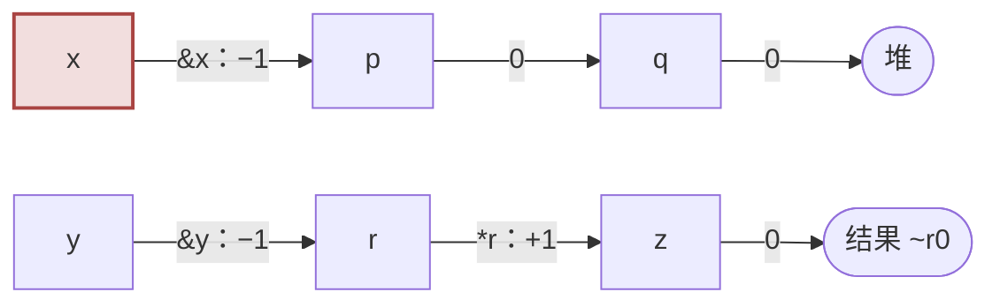

# 15.5 逃逸分析

[3.2.4](../../part1overview/ch03life/compile.md) 介绍了逃逸分析要解决的问题：
一个局部变量若在函数返回之后仍可能被引用，就不能随栈帧释放，只能分配在堆上。编译器为此要保证两条不变式：
指向栈上对象的指针不能存放在堆中，也不能比该对象存活得更久。Go 的 FAQ 指出，从正确性的角度看，
程序员无须关心一个变量分配在何处，实现选择的存储位置与语言的语义无关；但这一选择直接影响程序的效率
[[Go Authors, n.d.](#ref-go-authors-nd)]。本节考察 Go 1.26 中的实现 `cmd/compile/internal/escape`：
它在编译流水线中的位置，它如何把程序抽象为一张带权有向图并在图上求解，它如何把结论带过函数边界，
如何阅读编译器的诊断输出，以及这一实现的演变与局限。

## 15.5.1 在流水线中的位置

逃逸分析在类型检查、内联之后，walk 与 SSA 之前进行（流水线的全貌见
[3.2](../../part1overview/ch03life/compile.md)）。`gc/main.go` 中的注释说明了它为何不可缺少
[[Go Authors, 2026c](#ref-go-authors-2026c)]：

```go
	// Escape analysis.
	// Required for moving heap allocations onto stack,
	// which in turn is required by the closure implementation,
	// which stores the addresses of stack variables into the closure.
	// If the closure does not escape, it needs to be on the stack
	// or else the stack copier will not update it.
	// Large values are also moved off stack in escape analysis;
	// because large values may contain pointers, it must happen early.
	base.Timer.Start("fe", "escapes")
	escape.Funcs(typecheck.Target.Funcs)

	slice.Funcs(typecheck.Target.Funcs)
```

闭包对象中保存着被捕获变量的地址（[6.1](../../part2lang/ch06func/func.md)）。不逃逸的闭包必须分配在栈上，
否则栈被拷贝时，闭包对象中指向旧栈的地址不会得到调整（[14.4](../../part4memory/ch14stack/copy.md)）。
紧随其后的 `slice.Funcs` 是 Go 1.26 新增的一遍处理，见 15.5.6。

`escape.Funcs` 并不按源码顺序处理函数。它调用 `ir.VisitFuncsBottomUp` 求出静态调用图的强连通分量，
按逆拓扑序把每个分量作为一批交给 `Batch` [[Go Authors, 2026a](#ref-go-authors-2026a)]。分析一个函数时，
它调用的函数已经分析完毕，结论可以直接使用（15.5.4）；只有相互递归、位于同一批中的函数需要放在一起求解。

内联发生在逃逸分析之前。被内联的函数体成为调用者的一部分，其中的分配也就在调用者的上下文中重新判断。
下面是一个返回指针的构造函数：

```go
package demo

type Point struct{ X, Y int }

func NewPoint(x, y int) *Point {
	return &Point{x, y}
}

func Sum() int {
	p := NewPoint(1, 2)
	return p.X + p.Y
}
```

`-gcflags=-m` 让编译器输出内联与逃逸的决策。以下输出以 Go 1.26.10 为准：

```shell
$ go build -gcflags=-m point.go
# command-line-arguments
./point.go:5:6: can inline NewPoint
./point.go:9:6: can inline Sum
./point.go:10:15: inlining call to NewPoint
./point.go:6:9: &Point{...} escapes to heap
./point.go:10:15: &Point{...} does not escape
```

在 `NewPoint` 中，复合字面量 `&Point{...}` 被返回给未知的调用者，只能分配在堆上。内联到 `Sum` 之后，
同一个字面量只被读取了两个字段，便留在 `Sum` 的栈帧中。返回指针的构造函数是 Go 的惯用写法，
内联使它在多数调用处免去了堆分配。反之，`-gcflags=-l` 关闭内联后，逃逸分析只能在函数边界上作保守的判断。
本节其余的例子都加上 `-l`，以便单独观察逃逸分析本身。

## 15.5.2 位置与赋值边

`escape.go` 开头的注释描述了这张图的构造方式 [[Go Authors, 2026a](#ref-go-authors-2026a)]：

```go
// Constructing the location graph.
//
// Every allocating statement (e.g., variable declaration) or
// expression (e.g., "new" or "make") is first mapped to a unique
// "location."
//
// We also model every Go assignment as a directed edges between
// locations. The number of dereference operations minus the number of
// addressing operations is recorded as the edge's weight (termed
// "derefs"). For example:
//
//     p = &q    // -1
//     p = q     //  0
//     p = *q    //  1
//     p = **q   //  2
//
//     p = **&**&q  // 2
//
// Note that the & operator can only be applied to addressable
// expressions, and the expression &x itself is not addressable, so
// derefs cannot go below -1.
//
// Every Go language construct is lowered into this representation,
// generally without sensitivity to flow, path, or context; and
// without distinguishing elements within a compound variable. For
// example:
//
//     var x struct { f, g *int }
//     var u []*int
//
//     x.f = u[0]
//
// is modeled simply as
//
//     x = *u
//
// That is, we don't distinguish x.f from x.g, or u[0] from u[1],
// u[2], etc. However, we do record the implicit dereference involved
// in indexing a slice.
```

图的顶点称为**位置**（location），代表一块抽象的存储。每个声明的变量对应一个位置，
每个隐式的分配也对应一个位置：`new`、`make`、复合字面量、闭包对象、变参调用时构造的 `...` 切片，
以及把值装入接口时所需的存储。在诊断输出中，后几种显示为 `{storage for …}`。此外，
每一批分析还有几个特殊位置，最重要的是代表堆的 `heapLoc`。

边代表赋值，权重 derefs 等于解引用的次数减去取地址的次数。沿一条路径，权重逐段相加：从位置 l 到位置 d
的路径若总权重为 0，表示 l 的值被存入 d；若为 −1，表示 l 的地址被存入 d；若为正数，表示存入 d 的是从 l
出发、经过若干次解引用得到的值。逃逸分析关心的是总权重为 −1 的路径，即哪些位置的地址到达了哪里。

注释的后半段说明了这一模型的粗粒度。它不区分语句的先后（流不敏感），不区分条件分支的走向（路径不敏感），
对同一函数的所有调用给出同一个结论（上下文不敏感），也不区分结构体的不同字段、切片的不同元素。
这些简化使模型保持简单，代价是精度：一个字段的地址逃逸了，整个结构体随之逃逸。

还有一种情形同样体现了这种取舍：经由指针的写入。决定赋值目标的函数 `addr` 如下
[[Go Authors, 2026a](#ref-go-authors-2026a)]：

```go
func (e *escape) addr(n ir.Node) hole {
	// ……
	k := e.heapHole()

	switch n.Op() {
	// ……
	case ir.ONAME:
		n := n.(*ir.Name)
		if n.Class == ir.PEXTERN {
			break
		}
		k = e.oldLoc(n).asHole()
	// ……
	case ir.ODEREF:
		n := n.(*ir.StarExpr)
		e.mutate(n.X)
	case ir.ODOTPTR:
		n := n.(*ir.SelectorExpr)
		e.mutate(n.X)
	// ……
	}

	return k
}
```

赋值的目标默认是堆（`heapHole`），只有当目标是一个局部变量时，才改为该变量的位置；包级变量（`PEXTERN`）
仍然是堆。对于 `*p = …` 与 `p.f = …`（`p` 为指针），目标保持为堆，指针 `p` 本身则流向另一个特殊位置，
表示它所指向的内存可能被修改。对切片元素的写入也按同样的方式处理。换言之，分析并不追踪一个指针指向何处：
凡是经由指针写入的值，都按写入堆处理。

```go
package demo

type T struct{ p *int }

func store(t *T, v int) {
	t.p = &v
}
```

`-m=2` 在结论之外还打印推导的路径：

```shell
$ go build -gcflags='-m=2 -l' store.go
# command-line-arguments
./store.go:5:18: v escapes to heap in store:
./store.go:5:18:   flow: {heap} ← &v:
./store.go:5:18:     from &v (address-of) at ./store.go:6:8
./store.go:5:18:     from t.p = &v (assign) at ./store.go:6:6
./store.go:5:12: t does not escape
./store.go:5:18: moved to heap: v
```

`t.p = &v` 被建模为一条从 `v` 指向堆、权重为 −1 的边，`v` 的地址到达了堆，于是 `v` 分配在堆上。
即使调用者传入的 `t` 指向调用者栈上的一个 `T`，结论也不会改变，因为分析看不到 `t` 指向哪里。`t`
自身只是被用来写入，它的值没有被存到任何地方，因此不逃逸。

## 15.5.3 在图上求解

建好图之后，`walkAll` 以每个位置（包括堆）为根各遍历一次。遍历由 `walkOne` 完成，
它计算图中每个位置到根的最小 derefs。图中有权重为 −1 的边，因此 `walkOne` 采用 Bellman-Ford 算法的思路，
以工作队列反复松弛，直到不再变化。下面是处理一个位置时的核心判断
[[Go Authors, 2026a](#ref-go-authors-2026a)]：

```go
		// If l.derefs < 0, then l's address flows to root.
		addressOf := derefs < 0
		if addressOf {
			// For a flow path like "root = &l; l = x",
			// l's address flows to root, but x's does
			// not. We recognize this by lower bounding
			// derefs at 0.
			derefs = 0

			// If l's address flows somewhere that
			// outlives it, then l needs to be heap
			// allocated.
			if b.outlives(root, l) {
				// ……
				newAttrs |= attrEscapes | attrPersists | attrMutates | attrCalls
			} else
			// If l's address flows to a persistent location, then l needs
			// to persist too.
			if root.hasAttr(attrPersists) {
				newAttrs |= attrPersists
			}
		}
```

一个位置的地址到达根，并且根比它存活得更久，这个位置就必须分配在堆上。把 derefs 下界截断为 0 有两重作用：
一是语义上的，`root = &l; l = x` 只让 `l` 的地址到达 `root`，`x` 的地址并没有；二是算法上的，
负权回路不会使距离无限减小。一个位置被标记为逃逸之后，会以自身为根重新入队，把「逃逸」
这一事实继续传播出去。按 `walkAll` 的注释，每个位置的每种属性至多翻转一次，
因此遍历的总次数是位置数的常数倍。

「存活得更久」由 `outlives` 判定：

```go
func (b *batch) outlives(l, other *location) bool {
	// The heap outlives everything.
	if l.hasAttr(attrEscapes) {
		return true
	}
	// ……
	// We don't know what callers do with returned values, so
	// pessimistically we need to assume they flow to the heap and
	// outlive everything too.
	if l.paramOut {
		// ……
		return true
	}

	// If l and other are within the same function, then l
	// outlives other if it was declared outside other's loop
	// scope. For example:
	//
	//	var l *int
	//	for {
	//		l = new(int) // must heap allocate: outlives for loop
	//	}
	if l.curfn == other.curfn && l.loopDepth < other.loopDepth {
		return true
	}
	// ……
}
```

共有四条规则：堆比一切位置存活得久；函数的结果参数被交给未知的调用者，
同样视为比一切位置存活得久（例外是能够确定全部调用处的闭包）；同一函数中，
声明在外层循环的位置比声明在内层循环的位置存活得久，因为循环体内的变量在每次迭代中是不同的变量，
却可能复用同一块栈空间；外层函数中的位置比内层闭包中的位置存活得久。

下面的例子分别触及前三条规则：

```go
package demo

var sink *int

func f() int {
	var x, y int
	p := &x
	q := p
	sink = q
	r := &y
	z := *r
	return z
}

func g() int {
	var p *int
	for i := 0; i < 3; i++ {
		v := i
		p = &v
	}
	return *p
}
```

函数 `f` 的位置图如下，边上标注 derefs：



以堆为根，`x` 的最小 derefs 为 −1，它的地址到达了堆，因此逃逸。以结果参数为根，`y` 的最小 derefs 为 −1 +
1 + 0 = 0，到达结果的只是 `y` 的值，因此 `y` 留在栈上。函数 `g` 中没有堆，也没有返回指针：`p`
声明在循环之外，`v` 声明在循环之内，`p` 比 `v` 存活得久，`v` 的地址存入 `p`，`v` 因此逃逸。
编译器给出的推导与此一致：

```shell
$ go build -gcflags='-m=2 -l' flow.go
# command-line-arguments
./flow.go:6:6: x escapes to heap in f:
./flow.go:6:6:   flow: p ← &x:
./flow.go:6:6:     from &x (address-of) at ./flow.go:7:7
./flow.go:6:6:     from p := &x (assign) at ./flow.go:7:4
./flow.go:6:6:   flow: q ← p:
./flow.go:6:6:     from q := p (assign) at ./flow.go:8:4
./flow.go:6:6:   flow: {heap} ← q:
./flow.go:6:6:     from sink = q (assign) at ./flow.go:9:7
./flow.go:6:6: moved to heap: x
./flow.go:18:3: v escapes to heap in g:
./flow.go:18:3:   flow: p ← &v:
./flow.go:18:3:     from &v (address-of) at ./flow.go:19:7
./flow.go:18:3:     from p = &v (assign) at ./flow.go:19:5
./flow.go:18:3: moved to heap: v
```

上面的核心判断中还出现了另外三种属性。`attrPersists` 表示一个位置的地址在语句结束之后仍被使用；
不具备这一属性的闭包、方法值与切片字面量被标记为临时的，其存储可以立即复用。`attrMutates`
表示一个位置可达的内存可能被修改，Go 1.22 起据此把从未被修改的 `[]byte(s)`
转换改为直接共享字符串的字节（[5.2.3](../../part2lang/ch05data/string.md)）。`attrCalls`
表示一个位置可达的闭包可能在无法跟踪其结果的情况下被调用，用于改进间接的闭包调用。
三者与逃逸共用同一张图与同一次遍历。

## 15.5.4 跨越函数边界：参数标签

一批函数求解完毕后，`finish` 为每个参数生成一个**参数标签**（parameter tag），记录该参数的值流向何处。
标签随包的导出数据保存，其他包调用这个函数时同样可以使用
（[3.2.7](../../part1overview/ch03life/compile.md)）。标签的内容是一个 `leaks` 值
[[Go Authors, 2026b](#ref-go-authors-2026b)]：

```go
// A leaks represents a set of assignment flows from a parameter to
// the heap, mutator, callee, or to any of its function's (first
// numEscResults) result parameters.
type leaks [8]uint8

const (
	leakHeap = iota
	leakMutator
	leakCallee
	leakResult0
)

const numEscResults = len(leaks{}) - leakResult0
```

8 个字节依次对应堆、被修改的内存、被调用的闭包，以及前 5 个结果参数。每个字节存放从参数到该目的地的最小
derefs 加 1，0 表示不存在这样的流向。在调用处，编译器不再进入被调函数的函数体，
而是按标签把实参连到堆或调用结果上。例如，标签表明某个参数以 derefs 0 流向第一个结果，
调用处便连一条从实参到调用结果、权重为 0 的边。这种基于摘要的处理使分析能够跨越函数边界，
而无须重复分析被调用的函数。

```go
package demo

import (
	"fmt"
	"io"
)

func passthrough(p *int) *int {
	return p
}

func show(w io.Writer, x int) {
	fmt.Fprint(w, x)
}
```

```shell
$ go build -gcflags='-m -l' tags.go
# command-line-arguments
./tags.go:8:18: leaking param: p to result ~r0 level=0
./tags.go:12:11: leaking param: w
./tags.go:13:12: ... argument does not escape
./tags.go:13:16: x escapes to heap
```

`passthrough` 的参数原样流向结果，标签记为「流向结果 `~r0`，level 为 0」。
调用者若把一个栈变量的地址传给它，地址是否逃逸取决于调用者如何使用返回值。

`show` 的两行输出来自 `fmt.Fprint` 的标签。`fmt.Fprint` 通过接口调用 `w.Write`，
编译器无法得知实际的方法会如何使用 `w`，只能假定它流向堆，`w` 因此被标记为 `leaking param`。变参
`a ...any` 的标签是 `leaking param content`：切片本身不逃逸，切片中的元素却流向了堆。原因在 `fmt`
的实现中：`Fprint` 从 `sync.Pool` 中取出一个 `*pp`，再把每个参数存入它的字段 `p.arg`，
而池中的对象位于堆上。于是 `...` 切片可以留在栈上，装入接口的 `x` 却必须放到堆上。一行普通的 `fmt`
调用会引起堆分配，原因即在于此。

没有函数体的函数（以汇编实现，或经 `//go:linkname` 引用）没有可供分析的代码，
编译器假定它的指针参数流向堆，除非声明前带有 `//go:noescape`。

## 15.5.5 诊断输出一览

`-gcflags=-m` 的输出可以归纳为以下几类：

| 输出 | 含义 |
|------|------|
| `moved to heap: x` | 具名变量 `x` 分配在堆上 |
| `E escapes to heap` | 表达式 `E` 所需的存储（复合字面量、闭包、`make`、接口装箱等）分配在堆上 |
| `E does not escape` | 表达式 `E` 所需的存储留在栈上 |
| `leaking param: p` | 参数 `p` 的值流向堆 |
| `leaking param content: p` | `p` 所指向的内容流向堆，`p` 本身不逃逸 |
| `leaking param: p to result r level=n` | `p` 经 n 次解引用后流向结果 `r` |
| `p does not escape` | 参数 `p` 既不流向堆，也不流向结果 |

`-m=2` 在每个逃逸结论之后打印推导路径，每一步写作「`flow: 目的地 ← 来源`」，下面列出对应的源码位置与原因；
它还会报告每个被闭包捕获的变量是按值还是按引用捕获（判定条件见
[6.1.1](../../part2lang/ch06func/func.md)）。需要注意，这些输出是逃逸分析本身的结论。
此后的处理仍可能改变一次分配的去向，例如 15.5.6 中 Go 1.26 对 `append` 的优化。
诊断信息的措辞也会随版本变化，阅读时应以所用工具链的实际输出为准。

## 15.5.6 演变

Go 的逃逸分析始于 2011 年 8 月。Luuk van Dijk 在 C 语言编写的编译器 `gc` 中加入了 `esc.c`，起初需要用
`-s` 开启，`-m` 用于查看结果 [[van Dijk, 2011](#ref-van-dijk-2011)]。四天之后，Russ Cox 将其改为默认开启，
`-s` 改为关闭这项分析，并在安全时把 `new(T)` 与切片字面量改写为栈上的分配 [[Cox, 2011](#ref-cox-2011)]。
Go 1 发布时即包含这一分析。Go 1.5 中编译器由 C 自动翻译为 Go（[15.7](./future.md)），`esc.c` 成为
`esc.go`，算法基本不变：从一个代表一切外部去处的「汇点」出发，沿流图传播「逃逸层级」。

此后几年，这份代码在修补中变得难以理解。2017 年 12 月，Matthew Dempsky 提交了 issue #23109，开头写道：
「尽管一再努力，我仍然看不懂我们的逃逸分析代码。」他还提到，与其他编译器开发者讨论后发现，
这种困惑并非个例 [[Dempsky, 2017](#ref-dempsky-2017)]。2019 年 4 月，Dempsky
提交了一个以简洁为首要目标的新实现，即本节介绍的位置图与 derefs 模型。提交说明称，
它在追求简洁的过程中反而占用更少的内存，缩短了部分编译时间，修复了内存破坏问题，并显著改进了分析结果
[[Dempsky, 2019a](#ref-dempsky-2019a)]。新实现在 Go 1.13 中默认启用
[[Dempsky, 2019b](#ref-dempsky-2019b)]。发布说明提醒，更高的精度可能使恰好能够运行的非法代码出错，
例如违反 `unsafe.Pointer` 规则的代码 [[Go Authors, 2019](#ref-go-authors-2019)]。
旧实现保留了一个版本的退路，在 Go 1.14 中删除 [[Dempsky, 2019c](#ref-dempsky-2019c)]。2020 年 12 月，
`dev.regabi` 分支把庞大的 `gc` 包拆分为若干子包，逃逸分析成为独立的 `cmd/compile/internal/escape`，随 Go
1.17 发布 [[Cox, 2020](#ref-cox-2020)]。

近几个版本的改进不再改动这一模型，而是在它的结论之上扩展栈分配的范围，主要集中在切片上。此前，
大小在编译时未知的 `make([]T, n)` 一律分配在堆上，即使结果不逃逸。Go 1.25 改为在栈上预留一块
32 字节的数组：运行时若 `cap` 不超过 32/sizeof(T)，就以这块数组作为底层存储，否则仍调用 `makeslice`
[[Randall, 2025a](#ref-randall-2025a)]。这项改动最初只接受不含指针的元素类型，
紧随其后的一次提交即放宽到含指针的类型，因为现有的逃逸语义已经保证存入这种切片的值照常逃逸
[[Randall, 2025b](#ref-randall-2025b)]。不同版本对同一段代码的判断因此不同：

```go
package demo

func sizes(n int) int {
	a := make([]byte, 64)
	b := make([]byte, n)
	return len(a) + len(b)
}
```

```shell
$ GOTOOLCHAIN=go1.21.13 go build -gcflags='-m -l' size.go
# command-line-arguments
./size.go:4:11: make([]byte, 64) does not escape
./size.go:5:11: make([]byte, n) escapes to heap
$ GOTOOLCHAIN=go1.26.10 go build -gcflags='-m -l' size.go
# command-line-arguments
./size.go:4:11: make([]byte, 64) does not escape
./size.go:5:11: make([]byte, n) does not escape
```

同一版本中，不逃逸的 `append` 也开始使用栈上同样大小的底层存储 [[Randall, 2025c](#ref-randall-2025c)]。Go
1.26 更进一步，处理结果逃逸的情形。以逐个 `append` 再返回的切片为例：每次扩容都调用 `growslice`
分配新的底层数组，除最后一次以外，其余的分配随即成为垃圾。新增的 `slice.Funcs` 在逃逸分析之后运行，
它找出只在返回或赋值时才失去独占性的切片变量，在这一点之前插入一次 `move2heap`，在此之前的 `append`
便可以使用栈上的底层存储 [[Randall, 2025d](#ref-randall-2025d)]。`slice/slice.go` 的注释说明了这一思路
[[Go Authors, 2026d](#ref-go-authors-2026d)]：

```go
// If we can determine that the "return s" statement is the
// *only* way that the backing store for s escapes, then we
// can rewrite the code to something like:
//
//     var s []int
//     for i := range N {
//        s = append(s, i)
//     }
//     s = move2heap(s)
//     return s
//
// Using the move2heap runtime function, which does:
//
//     move2heap(s):
//         If s is not backed by a stackframe-allocated
//         backing store, return s. Otherwise, copy s
//         to the heap and return the copy.
```

由于这一遍处理在逃逸分析之后进行，`-m` 对这样的 `append` 仍然报告「append escapes to heap」。
下面的程序统计两个函数每次调用的平均堆分配次数：

```go {run=true}
package main

import (
	"fmt"
	"testing"
)

// checksum 的切片大小在运行时才确定，且切片不逃逸。
//
//go:noinline
func checksum(n int) int {
	b := make([]byte, n)
	for i := range b {
		b[i] = byte(i)
	}
	sum := 0
	for _, v := range b {
		sum += int(v)
	}
	return sum
}

// collect 用 append 逐个构造切片，并把它返回给调用方。
//
//go:noinline
func collect(n int) []int {
	var s []int
	for i := 0; i < n; i++ {
		s = append(s, i)
	}
	return s
}

func main() {
	for _, n := range []int{8, 32, 33, 1024} {
		a := testing.AllocsPerRun(1000, func() { checksum(n) })
		fmt.Printf("checksum(%4d)：%.0f 次堆分配\n", n, a)
	}
	for _, n := range []int{3, 4, 5, 100} {
		a := testing.AllocsPerRun(1000, func() { collect(n) })
		fmt.Printf("collect(%3d)：%.0f 次堆分配\n", n, a)
	}
}
```

以 Go 1.26.10 运行，输出为：

```text
checksum(   8)：0 次堆分配
checksum(  32)：0 次堆分配
checksum(  33)：1 次堆分配
checksum(1024)：1 次堆分配
collect(  3)：1 次堆分配
collect(  4)：1 次堆分配
collect(  5)：1 次堆分配
collect(100)：5 次堆分配
```

`checksum` 在 n 不超过 32 时完全不分配。`collect` 的元素为 8 字节，栈上的缓冲区可以容纳 4 个元素：n
不超过 4 时，唯一的一次分配是返回前的 `move2heap`；n 为 5 时，第 5 次 `append` 已把切片扩容到堆上，
`move2heap` 无须再复制；n 为 100 时，省去的是扩容序列中最早的几次分配。以
`-gcflags=all=-d=variablemakehash=n` 关闭这类栈分配后重新编译，`collect` 四行的结果依次变为 3、3、4、
8 次，`checksum` 四行均为 1 次。用 `-race` 构建时，`append` 改由 walk 展开为插桩所需的旧形式，`collect`
的这项优化不再生效。Go 1.25 的发布说明提醒，这类优化可能放大错误使用 `unsafe.Pointer` 的后果；
两个版本的发布说明都给出了用 `bisect` 工具（`-compile=variablemake`）定位问题分配的方法
[[Go Authors, 2025](#ref-go-authors-2025)] [[Go Authors, 2026e](#ref-go-authors-2026e)]。

同在 Go 1.26 中，`escape` 包新增了一项别名分析：在 `GOEXPERIMENT=runtimefreegc` 下，若能证明 `append`
扩容前的旧底层数组没有别名，编译器便插入对 `freegc` 的调用，立即归还这块内存
[[thepudds, 2025](#ref-thepudds-2025)]。这项实验默认关闭，运行时一侧的机制见
[12.9.4](../../part4memory/ch12alloc/history.md)。

## 15.5.7 局限与取舍

逃逸分析是保守的：无法证明不逃逸的位置，一律分配在堆上。放到堆上总是安全的，错放到栈上则会留下悬垂指针，
两种错误的代价并不对称。15.5.2 与 15.5.4 已经给出了几种典型的保守情形：经由指针或切片元素的写入、
经由接口的方法调用、没有函数体的函数。此外还有大小的限制：显式声明的变量超过 128 KiB、隐式的分配（`new`、
`&T{}`、常量大小的 `make` 等）超过 64 KiB 时，诊断输出注明「too large for stack」，编译选项
`-smallframes` 把两个上限分别降为 64 KiB 与 16 KiB。上限定义在 `cmd/compile/internal/ir/cfg.go` 中，
判定由 `escape` 包的 `HeapAllocReason` 完成 [[Go Authors, 2026a](#ref-go-authors-2026a)]。

这些保守的判断换来的是一条运行时可以依赖的性质：指向栈的指针只出现在栈上，以及运行时登记在案的少数几处。
可增长的连续栈正是建立在这条性质之上，栈被拷贝时，运行时据此找到并调整所有指向旧栈的指针
（[14.4.7](../../part4memory/ch14stack/copy.md)）。它也影响了垃圾回收器的设计：
大量短命对象由逃逸分析留在栈上，随函数返回而释放，分代回收在 Go 中的收益因此有限
（[13.8](../../part4memory/ch13gc/generational.md)）。

对程序员而言，`-gcflags=-m` 是核对分配决策的直接手段，但不必为了「绝不逃逸」而改写代码。
一次不在热路径上的堆分配几乎不影响性能，为消除它而牺牲可读性得不偿失。合理的次序是先测量，
确认分配确实是瓶颈（基准测试的 `-benchmem` 与内存剖析见 [16.5](../ch16tools/perf.md)），
再借助诊断输出找出原因。

## 15.5.8 小结

逃逸分析把程序抽象为一张以赋值为边、以 derefs 为权的位置图，在图上计算每个位置到各个根的最小解引用次数：
一个位置的地址到达了比它存活得更久的地方，它就必须分配在堆上。函数之间的结论以参数标签传递，
自底向上的分析顺序与此前的内联共同决定了分析的精度。这一模型流不敏感、字段不敏感，
并把一切经由指针的写入视为写入堆，以精度换取简单。2019 年的重写确立了这一模型，
此后的改进则在它的结论之上扩大栈分配的范围，Go 1.25 与 Go 1.26 对 `make` 与 `append` 的处理即是其例。

## 延伸阅读

- <a id="ref-cox-2011"></a>[Cox, 2011] Russ Cox. gc: tweak and enable escape analysis. Go commit
  db5f9da425, 2011. https://golang.org/cl/4954043
  随 Go 1 发布。
- <a id="ref-cox-2020"></a>[Cox, 2020] Russ Cox. [dev.regabi] cmd/compile: split out package escape
  [generated]. Go commit de454eef5f, 2020. https://go.dev/cl/279472
  随 Go 1.17 发布。
- <a id="ref-dempsky-2017"></a>[Dempsky, 2017] Matthew Dempsky. *cmd/compile: rewrite escape analysis.* Go
  issue #23109, 2017. https://go.dev/issue/23109
- <a id="ref-dempsky-2019a"></a>[Dempsky, 2019a] Matthew Dempsky. cmd/compile: add new escape analysis
  implementation. Go commit 97c4ad4327, 2019. https://go.dev/cl/170322
  随 Go 1.13 发布。
- <a id="ref-dempsky-2019b"></a>[Dempsky, 2019b] Matthew Dempsky. cmd/compile: enable -newescape by
  default. Go commit 996a687ebb, 2019. https://go.dev/cl/170448
  随 Go 1.13 发布。
- <a id="ref-dempsky-2019c"></a>[Dempsky, 2019c] Matthew Dempsky. cmd/compile: remove -newescape flag. Go
  commit 991b0fd46c, 2019. https://go.dev/cl/187597
  随 Go 1.14 发布。
- <a id="ref-go-authors-nd"></a>[Go Authors, n.d.] The Go Authors. *Frequently Asked Questions: How do I
  know whether a variable is allocated on the heap or the stack?* https://go.dev/doc/faq#stack_or_heap
  变量分配在栈还是堆。
- <a id="ref-go-authors-2019"></a>[Go Authors, 2019] The Go Authors. *Go 1.13 Release Notes: Compiler
  toolchain.* 2019. https://go.dev/doc/go1.13#compiler
- <a id="ref-go-authors-2025"></a>[Go Authors, 2025] The Go Authors. *Go 1.25 Release Notes: Compiler.*
  2025. https://go.dev/doc/go1.25#compiler
  其中「Faster slices」一节。
- <a id="ref-go-authors-2026a"></a>[Go Authors, 2026a] The Go Authors. cmd/compile/internal/escape. Go
  1.26 源码. https://github.com/golang/go/tree/release-branch.go1.26/src/cmd/compile/internal/escape
  逃逸分析实现：数据流图、参数标签、求解。
- <a id="ref-go-authors-2026b"></a>[Go Authors, 2026b] The Go Authors.
  cmd/compile/internal/escape/leaks.go. Go 1.26 源码.
  https://github.com/golang/go/blob/release-branch.go1.26/src/cmd/compile/internal/escape/leaks.go
  参数流向标签 `leaks` 的定义。
- <a id="ref-go-authors-2026c"></a>[Go Authors, 2026c] The Go Authors. cmd/compile/internal/gc/main.go. Go
  1.26 源码. https://github.com/golang/go/blob/release-branch.go1.26/src/cmd/compile/internal/gc/main.go
  编译器前端各阶段的顺序。
- <a id="ref-go-authors-2026d"></a>[Go Authors, 2026d] The Go Authors.
  cmd/compile/internal/slice/slice.go. Go 1.26 源码.
  https://github.com/golang/go/blob/release-branch.go1.26/src/cmd/compile/internal/slice/slice.go
  切片底层存储的栈分配与 `move2heap`。
- <a id="ref-go-authors-2026e"></a>[Go Authors, 2026e] The Go Authors. *Go 1.26 Release Notes: Compiler.*
  2026. https://go.dev/doc/go1.26#compiler
- <a id="ref-randall-2025a"></a>[Randall, 2025a] Keith Randall. cmd/compile: stack allocate variable-sized
  makeslice. Go commit 7a427143b6, 2025. https://go.dev/cl/653856
  随 Go 1.25 发布。
- <a id="ref-randall-2025b"></a>[Randall, 2025b] Keith Randall. cmd/compile: allow pointer-containing
  elements in stack allocations. Go commit 2d050e91a3, 2025. https://go.dev/cl/657937
  随 Go 1.25 发布。
- <a id="ref-randall-2025c"></a>[Randall, 2025c] Keith Randall. cmd/compile: allocate backing store for
  append on the stack. Go commit ce88e341b9, 2025. https://go.dev/cl/664299
  随 Go 1.25 发布。
- <a id="ref-randall-2025d"></a>[Randall, 2025d] Keith Randall. cmd/compile: stack allocate backing stores
  during append. Go commit 32f5aadd2f, 2025. https://go.dev/cl/707755
  随 Go 1.26 发布。
- <a id="ref-thepudds-2025"></a>[thepudds, 2025] thepudds. cmd/compile: introduce alias analysis and
  automatically free non-aliased memory after growslice. Go commit 4879151d1d, 2025.
  https://go.dev/cl/710015
  随 Go 1.26 发布。
- <a id="ref-van-dijk-2011"></a>[van Dijk, 2011] Luuk van Dijk. gc: Escape analysis. Go commit 847b61b554,
  2011. https://golang.org/cl/4634073
  随 Go 1 发布。
- 本书 [3.2.4 逃逸分析](../../part1overview/ch03life/compile.md)（问题的引入与两条不变式）、
  [13 垃圾回收](../../part4memory/ch13gc/readme.md)与
  [13.8 分代假设与代际回收](../../part4memory/ch13gc/generational.md)（逃逸分析为何削弱分代红利）、
  [14.4 栈的拷贝与指针调整](../../part4memory/ch14stack/copy.md)（栈会移动，故外部持有的地址必须逃逸）、
  [15.3 优化器](./optimize.md)（逃逸分析在编译流水线中的位置）、
  [16.5 基准测试与性能剖析](../ch16tools/perf.md)（先测后调）。
