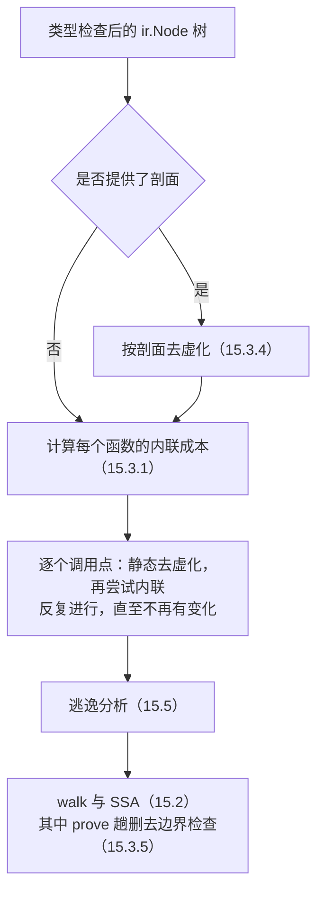

# 15.3 优化器

Go 编译器的优化分两层进行。第一层在 `ir` 节点树上，包括内联、去虚化与逃逸分析（[15.5](./escape.md)）。
这几项决策需要同时看到调用者与被调者，只能在各函数的函数体仍然彼此可见时进行。第二层在 SSA 上，每个函数
独立地经过数十趟变换（[15.2](./ssa.md)），这些趟只处理单个函数的内部，因而可以并行。[3.2.3](../../part1overview/ch03life/compile.md)
已经介绍了内联预算 80 与 PGO 下的预算 2000，本节讨论这些
数字所属的成本模型及其演变，去虚化与性能制导优化如何扩大内联的作用范围，以及 SSA 上的 `prove` 趟如何删去
边界检查。

`ir` 层各项优化的次序由 `gc` 包的 `Main` 函数决定 [[Go Authors, 2026c](#ref-go-authors-2026c)]：



## 15.3.1 内联的成本模型

内联分两步完成：先为每个函数计算**内联成本**，判断它能否被内联，能则保存一份函数体；再逐个检查调用点，
把对可内联函数的调用替换为函数体的副本。成本模型的参数集中在 `inl.go` 开头的一组常量中
[[Go Authors, 2026a](#ref-go-authors-2026a)]：

```go
// Inlining budget parameters, gathered in one place
const (
	inlineMaxBudget       = 80
	inlineExtraAppendCost = 0
	// default is to inline if there's at most one call. -l=4 overrides this by using 1 instead.
	inlineExtraCallCost  = 57              // 57 was benchmarked to provided most benefit with no bad surprises; see https://github.com/golang/go/issues/19348#issuecomment-439370742
	inlineParamCallCost  = 17              // calling a parameter only costs this much extra (inlining might expose a constant function)
	inlineExtraPanicCost = 1               // do not penalize inlining panics.
	inlineExtraThrowCost = inlineMaxBudget // with current (2018-05/1.11) code, inlining runtime.throw does not help.

	inlineBigFunctionNodes      = 5000                 // Functions with this many nodes are considered "big".
	inlineBigFunctionMaxCost    = 20                   // Max cost of inlinee when inlining into a "big" function.
	inlineClosureCalledOnceCost = 10 * inlineMaxBudget // if a closure is just called once, inline it.
)
```

成本由 `hairyVisitor` 遍历函数体求得，这个名字来自早期实现中的 `ishairy` 函数，hairy 指函数过于复杂、
不宜内联。每个节点计 1，调用另有规则：被调函数若本身可以内联，就计入它的内联成本，因为内联之后出现在
这里的正是它的函数体；否则加计 `inlineExtraCallCost`，即 57。调用一个函数类型的参数只加计 17，因为内联
之后实参可能是一个已知的函数，调用随之可以变为直接调用。`panic` 几乎不计成本，`runtime.throw` 则一次
耗尽全部预算。另有一些结构无论成本多低都使函数无法内联，例如 `go` 与 `defer` 语句、对 `recover` 的调用，
以及 `//go:noinline` 等指示。

下面的程序展示这些规则（输出以 Go 1.26.10 为准）：

```go
package main

func add(a, b int) int { return a + b }

//go:noinline
func slow(x int) int { return x * 2 }

func wrap1(x int) int { return slow(x) + 1 }

func wrap2(x int) int { return slow(x) + slow(x+1) }

func twice(x int) int { return add(add(x, x), x) }

func main() {
	println(wrap1(1), wrap2(2), twice(3))
}
```

```shell
$ go build -gcflags=-m=2 .
# example
./main.go:3:6: can inline add with cost 4 as: func(int, int) int { return a + b }
./main.go:6:6: cannot inline slow: marked go:noinline
./main.go:8:6: can inline wrap1 with cost 63 as: func(int) int { return slow(x) + 1 }
./main.go:10:6: cannot inline wrap2: function too complex: cost 124 exceeds budget 80
./main.go:12:6: can inline twice with cost 16 as: func(int) int { return add(add(x, x), x) }
./main.go:14:6: cannot inline main: function too complex: cost 146 exceeds budget 80
./main.go:12:39: inlining call to add
./main.go:12:35: inlining call to add
./main.go:15:15: inlining call to wrap1
./main.go:15:35: inlining call to twice
./main.go:15:35: inlining call to add
./main.go:15:35: inlining call to add
```

`wrap1` 的成本 63 由一次不可内联调用的 57 与其余 6 个节点组成。`wrap2` 含两次这样的调用，成本 124，超出
预算。`twice` 同样调用两次，但 `add` 本身可以内联，每次只按 `add` 的成本 4 计入，总成本仅为 16。后六行是
第二步的结果：`main` 中对 `wrap1` 与 `twice` 的调用被替换为函数体，`twice` 体内的两次 `add` 也随之展开。
成本的计算沿调用图自底向上进行，以强连通分量为单位，被调函数的成本总是先于调用者得出。

调用者本身超过 5000 个节点时，被调函数的成本上限从 80 降为 20。Keith Randall 在引入这条规则时解释，20 是
「内联后的函数体不大于调用指令序列」的近似 [[Randall, 2018a](#ref-randall-2018a)]：已经很大的函数不必再
为省下一次调用而继续膨胀。

以语法树节点计成本是一种粗糙的近似。Austin Clements 在 2023 年的内联改进方案中指出，有的语法树很简单，
生成的代码却很多；有的语法树很复杂，优化之后却所剩无几 [[Clements, 2023](#ref-clements-2023)]。
更准确的做法是在 SSA 上估算成本，但这会带来一连串问题：内联必须在逃逸分析之前完成，逃逸分析因而也要移到
SSA 上；SSA 阶段各函数并行编译，内联却要求按调用关系定序；导出数据也无法携带 SSA 形式的函数体。
内联因此一直停留在 `ir` 层，成本模型的粗糙由预算的保守来弥补。

## 15.3.2 从叶子函数到中栈内联

内联的价值主要不在省下一次调用的开销，而在于让常量传播、死代码消除、去虚化与逃逸分析能够跨越原先的
函数边界。然而在 Go 1.12 之前，函数体中只要有一次不会被内联掉的调用，这个函数就不能被内联，能展开的只有
调用图的叶子。限制来自运行时：`runtime.Caller` 与栈回溯按机器栈帧报告调用者，被调函数若在内联后自己再
调用别的函数，回溯中就会缺少一层，Russ Cox 在 Go 1.5 的一次提交中写明了这一顾虑
[[Cox, 2015](#ref-cox-2015)]。同一提交实现了**传递内联**（transitive inlining）：一次调用若本身会被
内联掉，就不再妨碍调用者被内联。预算也从 40 提高到 80，以便运行时的 `heapBits.next` 能被内联。

解除叶子限制的方案由 David Lazar 与 Austin Clements 在 2017 年提出
[[Lazar and Clements, 2017](#ref-lazar-and-clements-2017)]。编译器为每个含内联调用的函数额外生成一棵
**内联树**，记录每次内联调用的文件、行号与函数名，再生成一张 PC 值表，把每条指令映射到内联树中的节点。
运行时据此在回溯中还原出被内联掉的「逻辑栈帧」，`runtime.Callers` 等函数改为按逻辑栈帧工作；
方案还计划为调试器生成 DWARF 内联信息。方案报告的初步结果是 Go1 基准测试提速 9%，二进制文件增大 15%。
这些表格随 Go 1.9 发布 [[Lazar, 2017](#ref-lazar-2017)]，中栈内联本身仍须以 `-l=4` 显式开启。到 Go 1.12，Keith
Randall 把一次调用的加计成本从 80 降到 60，「足以容纳函数体中的一次调用，
但容纳不下两次」[[Randall, 2018b](#ref-randall-2018b)]，David Chase 随后又把它降到 57
[[Chase, 2018](#ref-chase-2018)]。Go 1.12 的发布说明提醒用户，内联范围扩大之后，应当用
`runtime.CallersFrames` 解析调用栈，而不要直接遍历 `runtime.Callers` 返回的程序计数器
[[Go Authors, 2019](#ref-go-authors-2019)]。

一次调用的预算让标准库形成了一种惯用写法：把罕见的慢路径拆成单独的函数，使常见的快路径足够小，可以被
内联到每个调用处。`sync.Mutex` 的 `Lock` 只是转调 `internal/sync` 中的同名方法，后者如下
[[Go Authors, 2026c](#ref-go-authors-2026c)]：

```go
func (m *Mutex) Lock() {
	// Fast path: grab unlocked mutex.
	if atomic.CompareAndSwapInt32(&m.state, 0, mutexLocked) {
		if race.Enabled {
			race.Acquire(unsafe.Pointer(m))
		}
		return
	}
	// Slow path (outlined so that the fast path can be inlined)
	m.lockSlow()
}
```

对 `lockSlow` 的调用计 57，加上快路径的比较交换，总成本仍在 80 以内。于是 `mu.Lock()` 在调用处展开为
一次比较交换和一个条件分支，只有锁被占用时才真正发生函数调用。

Clements 在 2023 年的方案中对这套模型的评价相当直率：Go 编译器的内联器「从来都算不上好」，直到
2019 年发布的 Go 1.12 才能内联叶子以外的函数 [[Clements, 2023](#ref-clements-2023)]。Clements 指出，
现有的启发式只计算内联的代价，不计算内联的收益，因而极为保守；它对调用点也毫不敏感，
一个函数要么在所有调用处内联，要么在所有调用处都不内联，而循环中的调用显然比错误处理路径上的调用更值得内
联。Go 1.22 据此加入了实验性的新内联器（`GOEXPERIMENT=newinliner`），为每个调用点打分：位于循环中的调用减
5 分，位于 panic 路径上的调用加 40 分，把常量传给被调函数中的 `if` 条件则减 20 分，分数不超过预算即内联
[[Go Authors, 2024](#ref-go-authors-2024)；[Go Authors, 2026a](#ref-go-authors-2026a)]。到 Go 1.26，
这项实验仍默认关闭。

## 15.3.3 去虚化

接口调用是间接调用（[4.2](../../part2lang/ch04type/interface.md)）：方法地址要在运行时从 itab 中取出，
编译期不知道目标，无法内联，参数中的常量也传不过去。**去虚化**（devirtualization）在编译器能确定接口值的
动态类型时，把间接调用改写为对具体方法的直接调用，这个调用随即成为内联的候选。

去虚化最早出现在 Go 1.9。Philip Hofer 为 SSA 加入了一条重写规则：如果接口值中的 itab
是一个已知的静态符号，接口调用就改为直接调用。典型情形是内联 `sha1.New()` 这样的构造函数之后，`h.Write(buf)`
的接收者类型变得已知 [[Hofer, 2017](#ref-hofer-2017)]。这条规则运行在逃逸分析之后，
去虚化的结果帮不上逃逸分析。Go 1.16 中，Matthew Dempsky 在 `ir` 层、内联之后、
逃逸分析之前加入了一个去虚化步骤，使逃逸分析能看到具体的方法 [[Dempsky, 2020](#ref-dempsky-2020)]。
但这个步骤只运行一次，去虚化产生的直接调用已经错过了内联。Go 1.22 起，去虚化与内联在同一个循环中交替进行，
新暴露的调用点再次经过去虚化与内联，直至不再变化 [[Dempsky, 2023](#ref-dempsky-2023)；[Go
Authors, 2024](#ref-go-authors-2024)]。

静态分析能看穿的情形取决于它如何确定动态类型。Go 1.26 之前，编译器只处理只赋值过一次的局部变量。Mateusz
Poliwczak 的改写使分析能够追踪一个局部接口变量的全部赋值
[[Poliwczak, 2025](#ref-poliwczak-2025)]：`concreteType1` 先沿接口转换、类型断言与内联结果追溯到某个
局部变量，再逐一检查它的每次赋值（节选）[[Go Authors, 2026b](#ref-go-authors-2026b)]：

```go
	var typ *types.Type
	for _, v := range s.assignments(name) {
		var t *types.Type
		switch v := v.(type) {
		case *types.Type:
			t = v
		case ir.Node:
			t = concreteType1(s, v, seen)
			if t == &noType {
				continue
			}
		}
		if t == nil {
			return nil // unknown concrete type
		}
		// ……
		if typ != nil && typ != t {
			return nil // assigned with a different type
		}

		typ = t
	}
```

只要所有赋值都给出同一个具体类型，调用就可以去虚化；变量的地址一旦被取走，分析即放弃，因为它可能经由
指针被赋予别的类型。下面的 `two` 中，接口变量在两个分支中分别被赋值（输出以 Go 1.26.10 为准）：

```go
package main

type Shape interface{ Area() int }

type Square struct{ side int }

func (q Square) Area() int { return q.side * q.side }

func one() int {
	var s Shape = Square{2}
	return s.Area()
}

func two(big bool) int {
	var s Shape
	if big {
		s = Square{10}
	} else {
		s = Square{1}
	}
	return s.Area()
}

func main() {
	println(one(), two(true))
}
```

```shell
$ go build -gcflags=-m . 2>&1 | grep -E 'main.go:(11|17|19|21):'
./main.go:11:15: devirtualizing s.Area to Square
./main.go:21:15: devirtualizing s.Area to Square
./main.go:11:15: inlining call to Square.Area
./main.go:21:15: inlining call to Square.Area
./main.go:17:13: Square{...} does not escape
./main.go:19:13: Square{...} does not escape
```

两处调用都被去虚化并内联。用 Go 1.25 编译同一程序，第 21 行不会被去虚化，第 17、19 行的 `Square{...}`
都逃逸到堆上：存入接口的值在接口调用中被传给未知的方法，逃逸分析只能假定它会逃逸
（[15.5](./escape.md)）。去虚化在这里同时消除了一次间接调用和两次堆分配。

改写后的调用形如 `s.(Square).Area()`，即在调用前插入一次类型断言。接口非 nil 时断言必然成立；接口为 nil
时，编译器让断言产生与调用 nil 接口的方法相同的 panic，原调用的语义因此不变。

## 15.3.4 性能制导优化

静态分析有其上限。一个接口变量若在运行时接收多种类型，哪一种最常见，静态分析无从得知；80 的预算对所有
调用点一视同仁，而程序的运行时间通常集中在少数几个调用点上。**性能制导优化**（profile-guided
optimization，PGO）把程序实际运行时采集的剖面交给编译器，补上这部分信息。

Go 的 PGO 由 Cherry Mui、Austin Clements 与 Michael Pratt 在 2022 年提出
[[Mui et al., 2022](#ref-mui-et-al-2022)]，Raj Barik 与 Jin Lin 同时提交了一份实现方案
[[Barik and Lin, 2022](#ref-barik-and-lin-2022)]。方案的核心选择是剖面从哪里来。传统的 PGO 基于插桩：
先编译一个插入了计数代码的版本，用基准测试运行它，再用得到的精确计数重新编译，GCC 的 `-fprofile-generate`
与 LLVM 的 `-fprofile-instr-generate` 都是这种做法。插桩版本开销较大，通常无法在生产环境中运行，
于是需要一组有代表性的基准测试，并随代码与负载的变化不断维护。另一种做法是 Google 的 AutoFDO：
直接在生产环境中对普通构建的二进制文件做低开销的采样剖析，据报告使 Google 数据中心中 C/C++ 程序的性能提高
5% 至 15% [[Chen et al., 2016](#ref-chen-et-al-2016)]。Go 选择了后者，并以 `runtime/pprof` 的 CPU
剖面作为输入格式：它几乎在所有操作系统、体系结构与部署环境中都可用，
而精度更高的硬件剖析在云环境中通常不可用 [[Mui et al., 2022](#ref-mui-et-al-2022)]。

采样剖面带来两个要求。其一是**源码稳定性**：剖面来自上一个版本，编译的却是最新的源码，剖面中的样本必须
仍能对应到正确的代码。编译器因此以「调用点相对于函数起始行的行号偏移」而非绝对行号来匹配调用点，函数外
的修改、把函数移到同一包的另一个文件，都不影响匹配。其二是**迭代稳定性**：用 PGO 构建的程序部署之后，
下一轮剖面就来自已经优化过的程序，一个热点若被优化得不再显得热，下一次构建就可能失去这项优化，性能在
相邻的构建之间来回摆动 [[Go Authors, n.d.](#ref-go-authors-nd)]。

编译器把剖面转换为一张带权的调用图，每个样本只取最内两层栈帧，构成一条「调用者、被调者、调用点」的边。
边按权重从大到小排列，累计权重达到总权重 99% 的那些边被视为热边
[[Go Authors, 2026a](#ref-go-authors-2026a)]：

```go
func hotNodesFromCDF(p *pgoir.Profile) (float64, []pgo.NamedCallEdge) {
	cum := int64(0)
	for i, n := range p.NamedEdgeMap.ByWeight {
		w := p.NamedEdgeMap.Weight[n]
		cum += w
		if pgo.WeightInPercentage(cum, p.TotalWeight) > inlineCDFHotCallSiteThresholdPercent {
			// nodes[:i+1] to include the very last node that makes it to go over the threshold.
			// (Say, if the CDF threshold is 50% and one hot node takes 60% of weight, we want to
			// include that node instead of excluding it.)
			return pgo.WeightInPercentage(w, p.TotalWeight), p.NamedEdgeMap.ByWeight[:i+1]
		}
	}
	return 0, p.NamedEdgeMap.ByWeight
}
```

热边的被调函数以 2000 而非 80 为预算计算内联成本，保存函数体；到了调用点，成本超过 80 的调用只有在这个
调用点本身是热边、且调用者不是超过 5000 个节点的大函数时才被内联，成本仍不得超过 2000。

PGO 的另一项用途是**按剖面去虚化**。对一个接口调用，编译器从剖面中找出最热的具体被调者，插入一次类型
判断，命中时走直接调用，否则退回原来的接口调用 [[Go Authors, 2026b](#ref-go-authors-2026b)]：

```go
//	func foo(i Iface) {
//		i.Foo()
//	}
//
// to:
//
//	func foo(i Iface) {
//		if c, ok := i.(Concrete); ok {
//			c.Foo()
//		} else {
//			i.Foo()
//		}
//	}
```

直接调用的分支随后可以被内联。剖面判断错了，代价也只是一次多余的类型比较。Go 1.22 起，同样的变换也用于
通过函数值进行的调用。下面的程序在 1000 个形状中放入 990 个 `*Square` 与 10 个 `*Rect`，并在运行时写出
CPU 剖面：

```go
package main

import (
	"os"
	"runtime/pprof"
)

type Shape interface{ Area() int }

type Square struct{ side int }

func (q *Square) Area() int { return q.side * q.side }

type Rect struct{ w, h int }

func (r *Rect) Area() int { return r.w * r.h }

func total(shapes []Shape) int {
	n := 0
	for _, s := range shapes {
		n += s.Area()
	}
	return n
}

func main() {
	shapes := make([]Shape, 1000)
	for i := range shapes {
		if i%100 == 0 {
			shapes[i] = &Rect{i, 2}
		} else {
			shapes[i] = &Square{i}
		}
	}

	f, _ := os.Create("cpu.pprof")
	pprof.StartCPUProfile(f)
	n := 0
	for range 500000 {
		n += total(shapes)
	}
	pprof.StopCPUProfile()
	println(n)
}
```

先运行一次得到剖面，再把它命名为 `default.pgo` 放在主包目录中重新构建（输出以 Go 1.26.10 为准）：

```shell
$ go run .
164996250000000
$ mv cpu.pprof default.pgo
$ go build -gcflags=-m . 2>&1 | grep main.go:21
./main.go:21:14: PGO devirtualizing interface call s.Area to (*Square).Area
./main.go:21:14: inlining call to (*Square).Area
```

`go build` 发现 `default.pgo` 后自动启用 PGO。第 21 行的接口调用被改写为「若是 `*Square` 则直接调用」，
直接调用的分支又被内联。

PGO 在 Go 1.20 中以预览形式发布，只用于热点内联，发布说明报告的典型收益为 3% 至 4%
[[Go Authors, 2023a](#ref-go-authors-2023a)；[Pratt, 2023a](#ref-pratt-2023a)]。Go 1.21 将其转为正式功能，`-pgo`
标志默认为 `auto`，并加入了接口调用的按剖面去虚化，典型收益为 2% 至 7%
[[Go Authors, 2023b](#ref-go-authors-2023b)；[Pratt, 2023b](#ref-pratt-2023b)]。Go 1.22
扩大了去虚化的覆盖面，典型收益提高到 2% 至 14% [[Go Authors, 2024](#ref-go-authors-2024)]。编译器自身从
Go 1.21 起也以 PGO 构建：`src/cmd/compile` 目录中存放着一份在编译标准库与工具链时采集的剖面
[[Mui, 2023](#ref-mui-2023)]。Go 1.21 的构建速度最多提高 6%，发布说明将其主要归功于此
[[Go Authors, 2023b](#ref-go-authors-2023b)]。

## 15.3.5 边界检查消除

Go 保证切片、数组与字符串的下标访问不会越界，编译器在每次 `a[i]` 之前插入一次检查，越界即 panic。
多数检查在上下文中是多余的。Alexandru Moșoi 在 2016 年的文档中说明了删除它们的意义：检查使程序变慢、
二进制文件变大；如果它们拖慢了程序，开发者就有理由用 `-gcflags=-B` 关闭检查，安全保证也随之丧失
[[Moșoi, 2016a](#ref-mosoi-2016a)]。

边界检查在 SSA 中表示为 `IsInBounds` 与 `IsSliceInBounds` 两种值，后接一个通向 panic 的分支。删除它们的是
`prove` 趟，它的注释说明了基本思路 [[Go Authors, 2026c](#ref-go-authors-2026c)]：

```go
// prove removes redundant BlockIf branches that can be inferred
// from previous dominating comparisons.
//
// By far, the most common redundant pair are generated by bounds checking.
// For example for the code:
//
//	a[i] = 4
//	foo(a[i])
//
// The compiler will generate the following code:
//
//	if i >= len(a) {
//	    panic("not in bounds")
//	}
//	a[i] = 4
//	if i >= len(a) {
//	    panic("not in bounds")
//	}
//	foo(a[i])
//
// The second comparison i >= len(a) is clearly redundant because if the
// else branch of the first comparison is executed, we already know that i < len(a).
// The code for the second panic can be removed.
//
// prove works by finding contradictions and trimming branches whose
// conditions are unsatisfiable given the branches leading up to them.
// It tracks a "fact table" of branch conditions. For each branching
// block, it asserts the branch conditions that uniquely dominate that
// block, and then separately asserts the block's branch condition and
// its negation. If either leads to a contradiction, it can trim that
// successor.
```

`prove` 沿支配树深度优先遍历，进入一个块时把支配它的分支条件加入事实表，离开时撤销。
这一设计经过了几次演变。Go 1.7 中，Moșoi 在 SSA 分支上实现了最初的版本，
主要删除支配路径上已经判定过的条件，另有一个独立的趟根据循环归纳变量删除检查
[[Moșoi, 2016a](#ref-mosoi-2016a)]。Go 1.11 中，Austin Clements 把「判断已知事实是否蕴含当前条件」
改为「把条件加入事实表，看是否产生矛盾」：同一套代码既用于记录事实，也用于判定分支，
从长度与容量关系推导出的事实不论分支条件写成什么形式都能发挥作用 [[Clements, 2018](#ref-clements-2018)]。
同一版本中，Giovanni Bajo 把循环中的边界检查消除并入 `prove` [[Bajo, 2018](#ref-bajo-2018)]，
又引入偏序集（poset）记录值之间的传递关系。Go 1.24 中，Keith Randall 改写了数值范围的表示：
两个值之间的关系可能需要 O(n²) 的空间，一个值与常量之间的关系只需 O(n)，于是为每个 SSA
值在一个以编号为下标的切片中记录有符号与无符号的上下界 [[Randall, 2024](#ref-randall-2024)]。

事实表的注释写道，它的逻辑是可靠的，但并不完备：除少数特例外，它不做推演，也不做算术；存在完备的判定
过程，但这种就事论事的做法对真实代码已经有效，而且非常高效 [[Go Authors, 2026c](#ref-go-authors-2026c)]。`prove`
推不出的事实，可以由程序员写进代码。下面的程序中，`le32` 与 `le32hint` 计算相同的结果，后者在开头
多访问了一次 `b[3]`（输出以 Go 1.26.10 为准）：

```go
package main

func le32(b []byte) uint32 {
	return uint32(b[0]) | uint32(b[1])<<8 | uint32(b[2])<<16 | uint32(b[3])<<24
}

func le32hint(b []byte) uint32 {
	_ = b[3]
	return uint32(b[0]) | uint32(b[1])<<8 | uint32(b[2])<<16 | uint32(b[3])<<24
}

func sum(a []int) int {
	s := 0
	for i := 0; i < len(a); i++ {
		s += a[i]
	}
	return s
}

func sumN(a []int, n int) int {
	s := 0
	for i := 0; i < n; i++ {
		s += a[i]
	}
	return s
}

func main() {
	b := []byte{1, 2, 3, 4}
	println(le32(b), le32hint(b), sum([]int{1, 2}), sumN([]int{1, 2}, 2))
}
```

```shell
$ go build -gcflags=-d=ssa/check_bce/debug=1 .
# example
./main.go:4:17: Found IsInBounds
./main.go:4:32: Found IsInBounds
./main.go:4:50: Found IsInBounds
./main.go:4:69: Found IsInBounds
./main.go:8:7: Found IsInBounds
./main.go:23:9: Found IsInBounds
```

`-d=ssa/check_bce/debug=1` 列出删除之后仍然保留的检查。`le32` 依次访问 `b[0]` 至 `b[3]`，`b[0]`
合法推不出 `b[1]` 合法，四次检查一次也删不掉。`le32hint` 先检查 `b[3]`，此后 `len(b) > 3` 成为事实，
后四次访问全部合法，只剩第 8 行的一次检查。`sum` 的循环条件 `i < len(a)` 加上 `i` 从 0 开始递增，足以证明
`a[i]` 合法；`sumN` 的上界 `n` 与 `len(a)` 无关，检查只能保留。标准库的 `encoding/binary` 正是这样写的
[[Go Authors, 2026c](#ref-go-authors-2026c)]：

```go
func (littleEndian) Uint32(b []byte) uint32 {
	_ = b[3] // bounds check hint to compiler; see golang.org/issue/14808
	return uint32(b[0]) | uint32(b[1])<<8 | uint32(b[2])<<16 | uint32(b[3])<<24
}
```

这行提示由 Moșoi 在 Go 1.7 中加入，提交说明称这是不必修改编译器的最简单的办法
[[Moșoi, 2016b](#ref-mosoi-2016b)]。`PutUint32` 等写入方法中的同一行代码注释为 early bounds check to
guarantee safety of writes below：越界的切片在写入任何字节之前就会 panic，不会留下写了一半的结果。

## 15.3.6 小结

Go 编译器的优化有一个一致的轮廓。跨函数的决策在 `ir` 层做出，依靠简单的成本模型与固定的预算；函数内的
化简在 SSA 上进行，依靠可靠但不完备、开销接近线性的分析。教科书中的许多变换因此迟迟没有进入编译器：Go
1.26 的趟列表中没有循环不变量外提，也没有自动向量化。循环不变量外提的一个实现早在 2016 年就以
CL 27656 提交，未被合入，十年后才经大幅修改进入 Go 1.27 [[Tocar, 2026](#ref-tocar-2026)]。这种克制换来的是
编译速度（[1.1](../../part1overview/ch01intro/history.md)）。

内联是这些优化的枢纽：中栈内联、去虚化与 PGO 的演进，都是在不放宽总体预算的前提下扩大内联的有效范围。PGO
把更激进的预算只给剖面证明值得的调用点，这与编译速度的取向并不冲突，编译器本身也因 PGO 而编译得更快。

## 延伸阅读

- <a id="ref-bajo-2018"></a>[Bajo, 2018] Giovanni Bajo. cmd/compile: implement loop BCE in prove. Go
  commit 7ec25d0acf, 2018. https://go.dev/cl/104038
  随 Go 1.11 发布。
- <a id="ref-barik-and-lin-2022"></a>[Barik and Lin, 2022] Raj Barik, Jin Lin. *Proposal: Design and
  Implementation of Profile-Guided Optimization (PGO) for Go.* Go design document, 2022.
  https://go.dev/design/55022-pgo-implementation
  讨论见 https://go.dev/issue/55025
- <a id="ref-chase-2018"></a>[Chase, 2018] David Chase. cmd/compile: decrease inlining call cost from 60
  to 57. Go commit 624e197c71, 2018. https://go.dev/cl/151977
  随 Go 1.12 发布。
- <a id="ref-chen-et-al-2016"></a>[Chen et al., 2016] Dehao Chen, David Xinliang Li, Tipp Moseley.
  "AutoFDO: Automatic Feedback-Directed Optimization for Warehouse-Scale Applications." *CGO 2016*, 2016.
  https://doi.org/10.1145/2854038.2854044
- <a id="ref-clements-2018"></a>[Clements, 2018] Austin Clements. cmd/compile: make prove pass use
  unsatisfiability. Go commit 669db2cef5, 2018. https://go.dev/cl/87478
  随 Go 1.11 发布。
- <a id="ref-clements-2023"></a>[Clements, 2023] Austin Clements. *Go 1.22 inlining overhaul.* Design
  notes, 2023. https://docs.google.com/document/d/1a6p7-nbk5PVyM1S2tmccFrrIuGzCyzclstBtaciHxVw
  对现有内联成本模型与调度方式的系统检讨，Go 1.22 新内联器实验的出发点。
- <a id="ref-cox-2015"></a>[Cox, 2015] Russ Cox. cmd/internal/gc: transitive inlining. Go commit
  77ccb16eb1, 2015. https://go.dev/cl/5952
  随 Go 1.5 发布。
- <a id="ref-dempsky-2020"></a>[Dempsky, 2020] Matthew Dempsky. cmd/compile: early devirtualization of
  interface method calls. Go commit 5cc43c51c9, 2020. https://go.dev/cl/264837
  随 Go 1.16 发布。
- <a id="ref-dempsky-2023"></a>[Dempsky, 2023] Matthew Dempsky. cmd/compile: interleave devirtualization
  and inlining. Go commit 4a90cdb03d, 2023. https://go.dev/cl/528321
  随 Go 1.22 发布。
- <a id="ref-go-authors-nd"></a>[Go Authors, n.d.] The Go Authors. *Profile-guided optimization.*
  https://go.dev/doc/pgo
  PGO 用户指南，包括剖面的采集与合并、源码稳定性与迭代稳定性。
- <a id="ref-go-authors-2019"></a>[Go Authors, 2019] The Go Authors. *Go 1.12 Release Notes*: Compiler
  toolchain. 2019. https://go.dev/doc/go1.12
- <a id="ref-go-authors-2023a"></a>[Go Authors, 2023a] The Go Authors. *Go 1.20 Release Notes*: Compiler.
  2023. https://go.dev/doc/go1.20
- <a id="ref-go-authors-2023b"></a>[Go Authors, 2023b] The Go Authors. *Go 1.21 Release Notes*: Compiler.
  2023. https://go.dev/doc/go1.21
  PGO 转为正式功能，`default.pgo` 自动启用。
- <a id="ref-go-authors-2024"></a>[Go Authors, 2024] The Go Authors. *Go 1.22 Release Notes*: Compiler.
  2024. https://go.dev/doc/go1.22
- <a id="ref-go-authors-2026a"></a>[Go Authors, 2026a] The Go Authors. cmd/compile/internal/inline（内
  联预算与 PGO 热点内联）. Go 1.26 源码.
  https://github.com/golang/go/tree/master/src/cmd/compile/internal/inline
- <a id="ref-go-authors-2026b"></a>[Go Authors, 2026b] The Go Authors. cmd/compile/internal/devirtualize（静
  态与 PGO 去虚化）. Go 1.26 源码.
  https://github.com/golang/go/tree/master/src/cmd/compile/internal/devirtualize
- <a id="ref-go-authors-2026c"></a>[Go Authors, 2026c] The Go Authors.
  src/cmd/compile/internal/gc/main.go、src/cmd/compile/internal/ssa/prove.go、src/internal/sync/mutex.go、src/encoding/binary/binary.go.
  Go 1.26 源码. https://github.com/golang/go/tree/release-branch.go1.26/src
- <a id="ref-hofer-2017"></a>[Hofer, 2017] Philip Hofer. cmd/compile: de-virtualize interface calls. Go
  commit 4e0c7c3f61, 2017. https://go.dev/cl/37751
  随 Go 1.9 发布。
- <a id="ref-lazar-2017"></a>[Lazar, 2017] David Lazar. cmd/compile,link: generate PC-value tables with
  inlining information. Go commit 699175a11a, 2017. https://go.dev/cl/37231
  随 Go 1.9 发布。
- <a id="ref-lazar-and-clements-2017"></a>[Lazar and Clements, 2017] David Lazar, Austin Clements.
  *Proposal: Mid-stack inlining in the Go compiler.* Go design document, 2017.
  https://go.dev/design/19348-midstack-inlining
- <a id="ref-mosoi-2016a"></a>[Moșoi, 2016a] Alexandru Moșoi. *Bounds Checking Elimination.* 2016.
  https://docs.google.com/document/d/1vdAEAjYdzjnPA9WDOQ1e4e05cYVMpqSxJYZT33Cqw2g
  Go 1.7 时期 `prove` 能删除与不能删除的各类边界检查，附 `check_bce` 的用法。
- <a id="ref-mosoi-2016b"></a>[Moșoi, 2016b] Alexandru Moșoi. encoding/binary: remove bound checks from
  conversions. Go commit ebd9f1bd4c, 2016. https://go.dev/cl/20654
  随 Go 1.7 发布。
- <a id="ref-mui-2023"></a>[Mui, 2023] Cherry Mui. cmd/compile: build compiler with PGO. Go commit
  45b74d20a0, 2023. https://go.dev/cl/497455
  随 Go 1.21 发布。
- <a id="ref-mui-et-al-2022"></a>[Mui et al., 2022] Cherry Mui, Austin Clements, Michael Pratt.
  *Proposal: profile-guided optimization.* Go design document, 2022. https://go.dev/design/55022-pgo
  比较插桩式 PGO 与 AutoFDO 式工作流，说明选用 pprof CPU 剖面的理由。
- <a id="ref-poliwczak-2025"></a>[Poliwczak, 2025] Mateusz Poliwczak. cmd/compile/internal/devirtualize:
  improve concrete type analysis. Go commit de9da0de30, 2025. https://go.dev/cl/652036
  随 Go 1.26 发布。
- <a id="ref-pratt-2023a"></a>[Pratt, 2023a] Michael Pratt. *Profile-guided optimization preview.* The Go
  Blog, 2023. https://go.dev/blog/pgo-preview
- <a id="ref-pratt-2023b"></a>[Pratt, 2023b] Michael Pratt. *Profile-guided optimization in Go 1.21.* The
  Go Blog, 2023. https://go.dev/blog/pgo
- <a id="ref-randall-2018a"></a>[Randall, 2018a] Keith Randall. cmd/compile: set stricter inlining
  threshold in large functions. Go commit 5fc70b6fac, 2018. https://go.dev/cl/125516
  随 Go 1.11 发布。
- <a id="ref-randall-2018b"></a>[Randall, 2018b] Keith Randall. cmd/compile: encourage inlining of
  functions with single-call bodies. Go commit 13baf4b2cd, 2018. https://go.dev/cl/147361
  随 Go 1.12 发布。
- <a id="ref-randall-2024"></a>[Randall, 2024] Keith Randall. cmd/compile: move limit fact table in prove
  pass to dense encoding. Go commit 553443d41f, 2024. https://go.dev/cl/599255
  随 Go 1.24 发布。
- <a id="ref-tocar-2026"></a>[Tocar, 2026] Ilya Tocar. cmd/compile: add loop invariant code motion. Go
  commit f9f351b130, 2026. https://go.dev/cl/697235
  提交说明称其由 2016 年的 CL 27656 大幅修改而来。随 Go 1.27 发布。
- 本书 [15.2 中间表示](./ssa.md)、[15.5 逃逸分析](./escape.md)、[16.5
  基准测试与性能剖析](../ch16tools/perf.md)、[4.2 接口](../../part2lang/ch04type/interface.md)、[3.2
  Go 程序编译流程](../../part1overview/ch03life/compile.md)。
