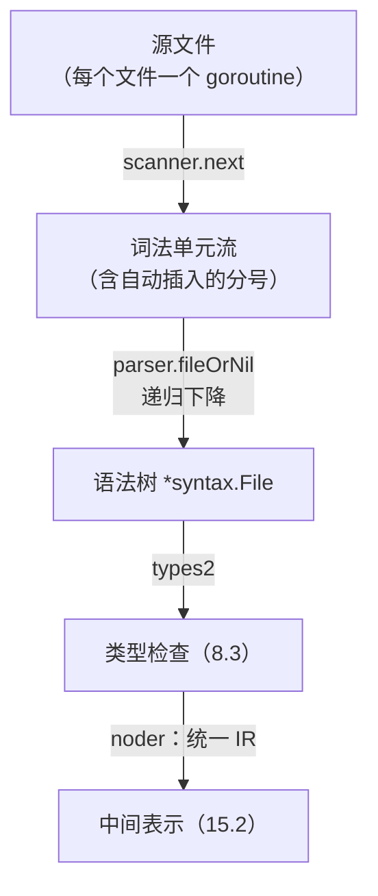

# 15.1 词法与文法

编译器的第一个阶段把源码文本转换为语法树。[3.2.2](../../part1overview/ch03life/compile.md) 已经指出，Go
的文法经过有意设计，解析时无须类型信息或符号表。本节深入这一阶段的实现：词法分析器如何切分词法单元并自动
插入分号，语法分析器如何以递归下降的方式构造语法树、处理文法中仅有的几处歧义、在出错之后继续分析，以及 gc
的前端如何从 yacc 生成的分析器演变为今天的 `syntax` 包。

这一阶段由 `cmd/compile/internal/syntax` 包完成，其中 `scanner.go` 是词法分析器，`parser.go`
是语法分析器，`nodes.go` 定义语法树的节点 [[Go Authors, 2026a](#ref-go-authors-2026a)]。按照编译器 README
的描述，每棵语法树都是对应源文件的精确表示，节点与源码中的表达式、声明、语句一一对应，并携带位置信息，
供报告错误与生成调试信息之用 [[Go Authors, 2026b](#ref-go-authors-2026b)]。
编译器为包内的每个源文件各启动一个 goroutine 进行解析，同时打开的文件数以 `GOMAXPROCS+10` 为限；
全部文件解析完毕后，语法树交给类型检查，再转换为编译器中端的中间表示
（[15.2](./ssa.md)）[[Go Authors, 2026c](#ref-go-authors-2026c)]。



## 15.1.1 词法单元与分号的自动插入

词法分析把字符流切分为词法单元（token）：标识符、关键字、运算符与标点、字面量。Go 的词法规则大体沿袭 C，
最显著的差别在于分号。Go 的形式文法与 C 一样以分号终结语句，源码中却几乎看不到分号，因为语言规范规定了
两条省略规则 [[Go Authors, 2026d](#ref-go-authors-2026d)]：

1. 把输入切分为词法单元时，若一行的最后一个词法单元是标识符，整数、浮点数、虚数、rune 或字符串字面量，
   关键字 `break`、`continue`、`fallthrough`、`return` 之一，或者运算符与标点 `++`、`--`、`)`、`]`、`}`
   之一，则紧随其后自动插入一个分号；
2. 为使复杂语句可以写在一行之内，闭合的 `)` 或 `}` 之前的分号可以省略。

《Effective Go》把第一条规则概括为：「换行若出现在一个可以结束语句的词法单元之后，
就插入一个分号」[[Go Authors, n.d.](#ref-go-authors-nd)]。这条规则只看换行之前的那一个词法单元，
与下一行写了什么、语法分析进行到哪一步都无关，因此完全可以在词法分析阶段完成，
读代码的人也能一眼判断分号插在何处。JavaScript 的自动分号插入可以作为对照：ECMAScript 规范规定，
当语法分析遇到一个任何产生式都不允许的词法单元（称为 offending token），
且它与前一个词法单元之间隔着换行时，才在它之前补一个分号；另有 `return`、`continue` 等少数「受限产生式」
不允许其后换行 [[Ecma International, 2025](#ref-ecma-international-2025)]。
那里的分号是语法分析失败之后的补救，是否插入取决于下一行能否接续当前的产生式；Go
的分号则由词法规则事先决定。

`syntax` 包的词法分析器用一个布尔字段 `nlsemi` 实现第一条规则：

```go
type scanner struct {
	source
	mode   uint
	nlsemi bool // if set '\n' and EOF translate to ';'
	// ……
}
```

每次调用 `next` 读取一个词法单元时，先取出上一个词法单元留下的 `nlsemi`，再把字段清零。跳过空白时，换行
只在 `nlsemi` 为假时才被当作空白；`nlsemi` 为真时，换行与文件结束被翻译为分号，字面值分别记为 `"newline"`
与 `"EOF"`。识别出 `)`、`]`、`}` 时，再把 `nlsemi` 置为真，留给下一次调用：

```go
func (s *scanner) next() {
	nlsemi := s.nlsemi
	s.nlsemi = false

redo:
	// skip white space
	s.stop()
	startLine, startCol := s.pos()
	for s.ch == ' ' || s.ch == '\t' || s.ch == '\n' && !nlsemi || s.ch == '\r' {
		s.nextch()
	}
	// ……
	switch s.ch {
	case -1:
		if nlsemi {
			s.lit = "EOF"
			s.tok = _Semi
			break
		}
		s.tok = _EOF

	case '\n':
		s.nextch()
		s.lit = "newline"
		s.tok = _Semi
	// ……
	case ')':
		s.nextch()
		s.nlsemi = true
		s.tok = _Rparen
```

字面量由 `setLit` 统一置位 `nlsemi`，`++` 与 `--` 各自置位。标识符与关键字共用一条路径：`ident`
读完一个名字后，先用一个完美散列函数查关键字表（散列值由前两个字节与名字长度算出，表长为 64，
初始化时若出现冲突即 panic）。查得关键字时，只有 `break`、`continue`、`fallthrough`、`return` 使 `nlsemi`
为真；查不到则是普通标识符，`nlsemi` 一律为真：

```go
	// possibly a keyword
	lit := s.segment()
	if len(lit) >= 2 {
		if tok := keywordMap[hash(lit)]; tok != 0 && tokStrFast(tok) == string(lit) {
			s.nlsemi = contains(1<<_Break|1<<_Continue|1<<_Fallthrough|1<<_Return, tok)
			s.tok = tok
			return
		}
	}

	s.nlsemi = true
	s.lit = string(lit)
	s.tok = _Name
}
```

第一条规则的全部内容都落在「`nlsemi` 何时为真」上，词法分析器中并没有单独的分号插入步骤。跨越多行的
`/* */` 注释若出现在应当插入分号的位置，也被视为一次换行，同样由 `nlsemi` 决定是否翻译为分号。第二条规则
则无须词法分析器参与，语法分析器在列表的闭合符号之前接受可有可无的分号即可。

编译器内部的 `syntax` 包无法从外部导入，标准库的 `go/scanner` 则按同一份规范实现了相同的规则：自动插入的
分号以字面值 `"\n"` 区别于源码中写出的分号。下面的程序用它切分一段代码，把由换行转换而来的分号标为
`⟨;⟩`：

```go {run=true}
package main

import (
	"fmt"
	"go/scanner"
	"go/token"
	"strings"
)

func main() {
	src := []byte("x := f(a,\n\tb)\ny++\nif x > 0 {\n\treturn\n}\n")

	fset := token.NewFileSet()
	file := fset.AddFile("", fset.Base(), len(src))
	var s scanner.Scanner
	s.Init(file, src, nil, 0)

	line, toks := 1, []string{}
	for {
		pos, tok, lit := s.Scan()
		if tok == token.EOF {
			break
		}
		if l := fset.Position(pos).Line; l != line {
			fmt.Printf("%d: %s\n", line, strings.Join(toks, " "))
			line, toks = l, nil
		}
		switch {
		case tok == token.SEMICOLON && lit == "\n":
			toks = append(toks, "⟨;⟩") // 由换行转换而来的分号
		case lit != "":
			toks = append(toks, lit)
		default:
			toks = append(toks, tok.String())
		}
	}
	fmt.Printf("%d: %s\n", line, strings.Join(toks, " "))
}
```

运行结果如下：

```
1: x := f ( a ,
2: b ) ⟨;⟩
3: y ++ ⟨;⟩
4: if x > 0 {
5: return ⟨;⟩
6: } ⟨;⟩
```

第 1 行以 `,` 结尾，换行被当作空白，函数调用的实参因而可以跨行书写；第 2 行的 `)`、第 3 行的 `++`、
第 5 行的 `return` 与第 6 行的 `}` 都使其后的换行变成分号；第 4 行以 `{` 结尾，不插入分号。

这条规则并非一开始就是这个样子。2008 年 10 月，gc 实现的规则是「所有语句与声明都以分号终结，
但在顶层以及闭合的 `)` 或 `}` 前后可以省略」[[Cox, 2008](#ref-cox-2008)]，
类型与语句的文法因此各要写两个版本。2009 年 6 月，Russ Cox 改由词法分析器协助插入分号，不再需要重复的文法
[[Cox, 2009a](#ref-cox-2009a)]。Go 于 2009 年 11 月开源，一个月后，规范改为今天的规则
[[Griesemer, 2009](#ref-griesemer-2009)]，gc 随即实现 [[Cox, 2009b](#ref-cox-2009b)]。
源码需要从旧语法迁移到新语法，gofmt 被用来批量改写整棵源码树，删去不再需要的分号
[[Pike, 2012](#ref-pike-2012)]。

## 15.1.2 左花括号的位置

分号的自动插入直接决定了左花括号的位置：它不能另起一行。下面的函数声明把 `{` 放在了下一行：

```go
package main

func f()
{
}

func main() {}
```

以 Go 1.26.10 为准，编译时报告：

```shell
$ go build .
# example
./main.go:4:1: syntax error: unexpected semicolon or newline before {
```

第 3 行以 `)` 结尾，词法分析器在其后插入分号，语法分析器看到的是 `func f();`，然后才是 `{`。`func f();`
本身是合法的声明：规范允许没有类型参数的函数声明省略函数体，这样的声明为在 Go 之外实现的函数（例如汇编
实现的函数）提供签名 [[Go Authors, 2026d](#ref-go-authors-2026d)]。错误因而不在第 3 行，而在第 4 行出现在
顶层的 `{`。语法分析器专门识别了这种情形：顶层出现 `{`，而上一个声明恰好是没有函数体的函数声明，就给出上面
这条有针对性的提示；否则报告「函数体之外出现了非声明语句」：

```go
		default:
			if p.tok == _Lbrace && len(f.DeclList) > 0 && isEmptyFuncDecl(f.DeclList[len(f.DeclList)-1]) {
				// opening { of function declaration on next line
				p.syntaxError("unexpected semicolon or newline before {")
			} else {
				p.syntaxError("non-declaration statement outside function body")
			}
			p.advance(_Import, _Const, _Type, _Var, _Func)
			continue
		}
```

控制结构的情形与此相同。`if x > 0` 以字面量结尾，其后的换行变成分号，语法分析器在需要 `{`
的位置读到了分号，于是报告 `syntax error: unexpected newline, expected { after if clause`。《Effective
Go》把这一点列为分号规则的直接后果：控制结构的左花括号不能写在下一行
[[Go Authors, n.d.](#ref-go-authors-nd)]。在 C 系语言里，花括号的位置是一种书写风格，由各个项目自行约定；
在 Go 里，它是词法规则的推论，其余的排版细节再由 gofmt 统一，这类争论也就无从发生。

## 15.1.3 递归下降

语法分析器采用**递归下降**（recursive descent）的方法：文法中的每条产生式对应一个方法，方法依据当前的词法
单元选择分支，并调用其他产生式对应的方法分析各个组成部分 [[Aho et al., 2006](#ref-aho-et-al-2006)]。源文件
的文法是「包子句，其后是若干导入声明与顶层声明」。入口方法 `fileOrNil` 先要求 `package` 子句，然后循环分析
顶层声明：

```go
	for p.tok != _EOF {
		// ……
		switch p.tok {
		case _Import:
			p.next()
			f.DeclList = p.appendGroup(f.DeclList, p.importDecl)

		case _Const:
			p.next()
			f.DeclList = p.appendGroup(f.DeclList, p.constDecl)
		// ……
		case _Func:
			p.next()
			if d := p.funcDeclOrNil(); d != nil {
				f.DeclList = append(f.DeclList, d)
			}
```

`p.tok` 是当前词法单元，`p.next()` 读入下一个。每个顶层声明都以关键字开头，看一个词法单元就能确定声明的
种类；`importDecl`、`constDecl`、`funcDeclOrNil` 再逐层向下，直至表达式中的名字与字面量。为了容错，
`fileOrNil` 允许导入声明出现在其他声明之后，但会报告 `imports must appear before other declarations`。

分析的产物是 `nodes.go` 定义的语法树。每个节点都实现 `Node` 接口并带有一个位置：终结符（名字、字面量）
的位置就是它在源码中的位置；非终结符的位置是与该产生式唯一关联的词法单元的位置，通常是最左边的一个，例如
`IfStmt` 的位置是关键字 `if` [[Go Authors, 2026a](#ref-go-authors-2026a)]。语法分析器只检查语法，
`x == T{1}` 中的 `T` 是否确为类型，留待类型检查（[8.3](../../part2lang/ch08generics/checker.md)）回答。
例外是标签与跳转：编译器以 `CheckBranches` 模式调用语法分析器，标签以及 `break`、`continue`、`goto`
的正确使用在解析阶段就已检查 [[Go Authors, 2026c](#ref-go-authors-2026c)]。

## 15.1.4 文法中的歧义

Pike 在《Go at Google》中写道，Go 的文法是规则的，因而易于解析，随即又补充了一句：「大体如此；有几处怪癖，
我们本可以修正，只是发现得不够早」[[Pike, 2012](#ref-pike-2012)]。与 C++ 相比，这几处怪癖微不足道：C++ 中
`Widget w(Thing());` 在文法上既可以是对象定义，也可以是函数声明，标准规定按函数声明解析，
这就是所谓「最令人烦恼的解析」（most vexing parse）[[Meyers, 2001](#ref-meyers-2001)]。Go
的语言规范明确记载了自己的两处歧义，它们恰好展示了递归下降分析器如何处理凭一个词法单元无法判定的结构。

第一处是复合字面量与语句块的冲突。`if`、`for`、`switch` 的头部之后紧跟语句块的 `{`，而 `T{1}`
这样的复合字面量同样以 `{` 开始。分析 `if x == T{1} {` 时，读到第一个 `{` 的那一刻，
无法判断它属于复合字面量还是语句块。规范的裁决是：在这种位置上，若以类型名形式书写的复合字面量没有被圆括
号、方括号或花括号包围，它的 `{` 一律被当作语句块的开始；需要复合字面量时，必须用圆括号括起来
[[Go Authors, 2026d](#ref-go-authors-2026d)]。下面的程序因此无法编译：

```go
package main

type T struct{ a int }

func main() {
	x := T{1}
	if x == T{1} {
		println("equal")
	}
}
```

以 Go 1.26.10 为准，编译时报告：

```shell
$ go build .
# example
./main.go:7:15: syntax error: unexpected { at end of statement
./main.go:10:1: syntax error: non-declaration statement outside function body
```

语法分析器把 `x == T` 当作条件、`{1}` 当作语句块，第二个 `{` 于是成了多余的词法单元，
其后的花括号也全部错位。写成 `if x == (T{1}) {` 即可通过编译。实现这一裁决的是语法分析器中的计数器
`xnest`，它记录表达式的嵌套层次：

```go
	xnest  int    // expression nesting level (for complit ambiguity resolution)
```

分析控制结构的头部之前，`header` 方法把 `xnest` 置为 −1：

```go
	outer := p.xnest
	p.xnest = -1
```

此后每进入一层圆括号（包括函数调用的实参列表）、方括号或复合字面量的花括号，`xnest` 加一，离开时减一。分析
操作数时遇到 `{`，若操作数是名字或限定名，只有在 `xnest` 非负时才把 `{` 视为复合字面量的开始；若操作数本身
是数组、切片、结构体或映射类型的字面写法，则不存在歧义：

```go
		case _Lbrace:
			// operand may have returned a parenthesized complit
			// type; accept it but complain if we have a complit
			t := Unparen(x)
			// determine if '{' belongs to a composite literal or a block statement
			complit_ok := false
			switch t.(type) {
			case *Name, *SelectorExpr:
				if p.xnest >= 0 {
					// x is possibly a composite literal type
					complit_ok = true
				}
			// ……
			case *ArrayType, *SliceType, *StructType, *MapType:
				// x is a comptype
				complit_ok = true
			}
			if !complit_ok {
				break loop
			}
```

yacc 时代的分析器处理同一条规则的方式，与此形成鲜明对照。若要在 LALR(1) 文法中直接表达这一限制，
需要为控制结构的头部另写一套不含裸复合字面量的表达式文法。Go 1.4 的 gc 没有这样做，而是让手写的词法分析器
`lex.c` 维护一个状态 `loophack`：读到 `if`、`for`、`switch`、`select` 之后，把下一个不在括号内的 `{`
作为另一种词法单元 `LBODY` 交给分析器，文法再规定这些语句的语句块以 `LBODY` 开始
[[Go Authors, 2014](#ref-go-authors-2014)]：

```c
	/*
	 * clumsy dance:
	 * to implement rule that disallows
	 *	if T{1}[0] { ... }
	 * but allows
	 * 	if (T{1}[0]) { ... }
	 * the block bodies for if/for/switch/select
	 * begin with an LBODY token, not '{'.
	 *
	 * when we see the keyword, the next
	 * non-parenthesized '{' becomes an LBODY.
	 * loophack is normally 0.
	 * a keyword makes it go up to 1.
	 * parens push loophack onto a stack and go back to 0.
	 * a '{' with loophack == 1 becomes LBODY and disables loophack.
	 *
	 * i said it was clumsy.
	 */
```

注释的最后一句是「我说过这很笨拙」。词法分析器为此必须了解语法分析的状态，两者的界线被打破了。递归下降
分析器把同一份上下文保存在自己的一个整数字段里，词法分析器重新只看字符。

第二处歧义来自泛型。`type T[P *C] …` 既可以理解为类型参数 `P`、约束 `*C` 的泛型类型，
也可以理解为长度为常量表达式 `P * C` 的数组类型。规范规定，这种情况按数组类型解析；需要类型参数时，
把约束写成 `interface{*C}`，或在末尾加一个逗号 [[Go Authors, 2026d](#ref-go-authors-2026d)]。以 Go
1.26.10 编译 `type C int` 与 `type T[P *C] struct{ p P }`，报告 `undefined: P` 与
`C (type) is not an expression`，可见 `P * C` 确实被当作了数组长度；改为 `type T[P *C,] struct{ p P }`
即可通过。读到 `type T[` 时，语法分析器同样无法立即判定，它的做法是先按两者的公共形式，即一个表达式，
分析下去，再检查结果能否拆分为「类型参数名与约束」：

```go
			if pname, ptype := extractName(x, p.tok == _Comma); pname != nil && (ptype != nil || p.tok != _Rbrack) {
				// d.Name "[" pname ...
				// d.Name "[" pname ptype ...
				// d.Name "[" pname ptype "," ...
				d.TParamList = p.paramList(pname, ptype, _Rbrack, true, false) // ptype may be nil
				d.Alias = p.gotAssign()
				d.Type = p.typeOrNil()
			} else {
				// d.Name "[" pname "]" ...
				// d.Name "[" x ...
				d.Type = p.arrayType(pos, x)
			}
```

两处处理有一个共同点：分析器从不回退去重读词法单元。遇到凭一个词法单元无法判定的结构，要么像 `xnest` 那样
依据已知的上下文直接裁决，要么先按公共形式分析、事后再归类。

## 15.1.5 错误恢复

一处语法错误不应终止整个文件的分析。语法分析器报告错误之后调用 `advance`，跳过若干词法单元，直至一个可以
重新开始分析的位置：

```go
// The stopset contains keywords that start a statement.
// They are good synchronization points in case of syntax
// errors and (usually) shouldn't be skipped over.
const stopset uint64 = 1<<_Break |
	1<<_Const |
	// ……
	1<<_Var

// advance consumes tokens until it finds a token of the stopset or followlist.
// The stopset is only considered if we are inside a function (p.fnest > 0).
// The followlist is the list of valid tokens that can follow a production;
// if it is empty, exactly one (non-EOF) token is consumed to ensure progress.
func (p *parser) advance(followlist ...token) {
```

同步点有两类：一类是当前产生式之后可以合法出现的词法单元，由调用方给出，例如 `fileOrNil` 在顶层出错时传入
`import`、`const`、`type`、`var`、`func`；另一类是在函数体内开始一条语句的关键字。
丢弃输入直至遇到同步词法单元，是编译原理教科书所称的「恐慌模式」（panic mode）恢复
[[Aho et al., 2006](#ref-aho-et-al-2006)]。下面的文件在两个函数中各有一处错误：

```go
package main

func f(a int) int {
	return a + )
}

func g(b bool) {
	if b {
		println(1
	}
}

func main() {}
```

以 Go 1.26.10 为准，一次编译即报告了两处错误：

```shell
$ go build .
# example
./main.go:4:13: syntax error: unexpected ), expected expression
./main.go:9:12: syntax error: unexpected newline in argument list; possibly missing comma or )
```

第二条信息同样得益于分号规则：实参 `1` 之后的换行被翻译为分号，语法分析器在实参列表中读到分号，便推断
可能漏写了逗号或右括号。

## 15.1.6 从 yacc 到 syntax 包

Go 1.4 及以前，gc 用 C 写成，语法分析器由 bison 从文法文件 `go.y` 生成，词法分析器 `lex.c` 是手写的
[[Go Authors, 2014](#ref-go-authors-2014)]。bison 生成的是 LALR(1) 分析器；`go.y`
用若干优先级声明（`%left`、`%prec`）消解文法中的冲突，并借助脚本 `bisonerrors`
把分析器的出错状态映射为定制的错误信息。`go.y` 开头的注释写明了当时的分号规则：语句与声明都以分号终结，
闭合的 `)` 或 `}` 之前可以省略分号，换行之前的分号由词法分析器插入。

Go 1.5 把编译器从 C 机械地翻译为 Go（[15.7](./future.md)），`go.y` 改由 Go 版本的 yacc 处理。Go 1.6
的开发周期中，Robert Griesemer 把 yacc 文法翻译为一个手写的递归下降分析器
[[Griesemer, 2015a](#ref-griesemer-2015a)]。据提交说明，新分析器是对 yacc 分析器的翻译，
作了使文法适用于递归下降的调整，yacc 的语义动作为保证正确大多原样照搬；对 `make.bash` 中的文件，
平均每个文件的解析时间缩短约 18%，编译 `cmd/compile` 本身的时间缩短约 3%；至于错误信息，
要在所有情况下复现 yacc 分析器的措辞非常困难，新分析器有时还能给出更好的信息。十余天后，yacc 分析器被删除
[[Griesemer, 2015b](#ref-griesemer-2015b)]。Go 1.6 的发布说明称，编译器内部最重要的变化是语法分析器改为手
写，不再由 yacc 生成 [[Go Authors, 2016](#ref-go-authors-2016)]。

这个分析器仍然一边分析一边直接构造编译器内部的 `Node`，语法树与编译器的数据结构没有分开。2016 年 8 月，
Griesemer 提交了独立的 `syntax` 包，包括语法树节点、词法分析器、语法分析器和打印器；提交说明记录，在预热
状态下，它解析整个标准库的速度约为每秒 180 万行 [[Griesemer, 2016](#ref-griesemer-2016)]。Matthew Dempsky
随后编写了 `noder`，把 `syntax` 的语法树转换为编译器的 `Node` [[Dempsky, 2016a](#ref-dempsky-2016a)]；同年
10 月，新前端成为默认 [[Dempsky, 2016b](#ref-dempsky-2016b)]，旧的词法分析器与语法分析器随即被删除
[[Dempsky, 2016c](#ref-dempsky-2016c)]。Go 1.8 的发布说明称，新的编译器前端对用户不可见，但为今后的性能
工作奠定了基础 [[Go Authors, 2017](#ref-go-authors-2017)]。此后，`syntax` 的语法树先后成为 `types2`
（[8.3](../../part2lang/ch08generics/checker.md)）与统一 IR（[15.2](./ssa.md)）的输入。

标准库的 `go/scanner`、`go/parser` 与 `go/ast` 是另一套独立的实现。编译器 README 解释了原因：编译器最初用
C 写成，`go/*` 系列包是为编写 gofmt、vet 这类处理 Go 代码的工具而开发的，编译器基本不使用它们
[[Go Authors, 2026b](#ref-go-authors-2026b)]。gopls（[16.7](../ch16tools/gopls.md)）等工具也建立在 `go/*`
之上。两套前端各自实现同一份规范，泛型这样的语法变化需要在两处分别实现，错误信息也各不相同：把 15.1.4 中
无法编译的 `if x == T{1} {` 交给基于 `go/parser` 的 `go vet`，它在同一位置报告的是
`expected ';', found '{'`。

## 15.1.7 小结

Go 的前端可以概括为两个「只看一个」：词法分析器只看换行之前的一个词法单元决定是否插入分号，语法分析器在
绝大多数位置只看当前的一个词法单元决定分支。规范记载的两处歧义，由一条明确的裁决规则加上分析器内部的计数器
或事后归类解决，从不回退。这样的文法让手写的递归下降分析器足以胜任：它比 yacc 生成的分析器更快，错误信息
可以逐处定制，标准库也能以同样的方式为工具提供一套独立的解析器。

## 延伸阅读

- <a id="ref-aho-et-al-2006"></a>[Aho et al., 2006] Alfred V. Aho, Monica S. Lam, Ravi Sethi, Jeffrey D.
  Ullman. *Compilers: Principles, Techniques, and Tools.* 2nd ed. Addison-Wesley, 2006.
  第 4 章「语法分析」：递归下降、LALR 分析与恐慌模式等错误恢复策略。
- <a id="ref-cox-2008"></a>[Cox, 2008] Russ Cox. implement new semicolon rules. Go commit d364d28142,
  2008. https://github.com/golang/go/commit/d364d28142
  开源之前的分号规则：语句以分号终结，在顶层及闭合括号前后可以省略。
- <a id="ref-cox-2009a"></a>[Cox, 2009a] Russ Cox. implement optional semicolons with help from the lexer,
  instead of having to double the type and statement grammars. Go commit 8abcdee175, 2009.
  https://github.com/golang/go/commit/8abcdee175
- <a id="ref-cox-2009b"></a>[Cox, 2009b] Russ Cox. gc: semicolons. Go commit 3997495dc3, 2009.
  https://github.com/golang/go/commit/3997495dc3
  gc 实现今天的分号规则。
- <a id="ref-dempsky-2016a"></a>[Dempsky, 2016a] Matthew Dempsky. cmd/compile/internal/gc: use new AST
  parser. Go commit 2ff463948c, 2016. https://go.dev/cl/27198
  随 Go 1.8 发布。
- <a id="ref-dempsky-2016b"></a>[Dempsky, 2016b] Matthew Dempsky. cmd/compile/internal/gc: enable new
  parser by default. Go commit adda7ad295, 2016. https://go.dev/cl/27203
  随 Go 1.8 发布。
- <a id="ref-dempsky-2016c"></a>[Dempsky, 2016c] Matthew Dempsky. cmd/compile: remove old lexer and
  parser. Go commit 57df2f802f, 2016. https://go.dev/cl/32020
  随 Go 1.8 发布。
- <a id="ref-ecma-international-2025"></a>[Ecma International, 2025] Ecma International. *ECMAScript 2025
  Language Specification* (ECMA-262, 16th edition), §12.10 "Automatic Semicolon Insertion". 2025.
  https://tc39.es/ecma262/2025/#sec-automatic-semicolon-insertion
- <a id="ref-go-authors-nd"></a>[Go Authors, n.d.] The Go Authors. *Effective Go*: Semicolons.
  https://go.dev/doc/effective_go#semicolons
- <a id="ref-go-authors-2014"></a>[Go Authors, 2014] The Go Authors. src/cmd/gc/go.y、lex.c. Go 1.4 源码.
  https://github.com/golang/go/tree/go1.4/src/cmd/gc
  bison 文法与手写词法分析器，含 `loophack` 的实现。
- <a id="ref-go-authors-2016"></a>[Go Authors, 2016] The Go Authors. *Go 1.6 Release Notes*: Compiler
  Toolchain. 2016. https://go.dev/doc/go1.6#compiler
- <a id="ref-go-authors-2017"></a>[Go Authors, 2017] The Go Authors. *Go 1.8 Release Notes*: Compiler
  Toolchain. 2017. https://go.dev/doc/go1.8#compiler
- <a id="ref-go-authors-2026a"></a>[Go Authors, 2026a] The Go Authors.
  cmd/compile/internal/syntax（scanner 与 parser）. Go 1.26 源码.
  https://github.com/golang/go/tree/release-branch.go1.26/src/cmd/compile/internal/syntax
  https://github.com/golang/go/tree/master/src/cmd/compile/internal/syntax
- <a id="ref-go-authors-2026b"></a>[Go Authors, 2026b] The Go Authors.
  cmd/compile/README（编译器前端总览：parsing 阶段）.
  https://github.com/golang/go/blob/release-branch.go1.26/src/cmd/compile/README.md
  https://github.com/golang/go/blob/master/src/cmd/compile/README.md
- <a id="ref-go-authors-2026c"></a>[Go Authors, 2026c] The Go Authors.
  src/cmd/compile/internal/noder/noder.go（LoadPackage）、src/cmd/compile/internal/syntax/syntax.go
  （CheckBranches）. Go 1.26 源码.
  https://github.com/golang/go/blob/release-branch.go1.26/src/cmd/compile/internal/noder/noder.go
- <a id="ref-go-authors-2026d"></a>[Go Authors, 2026d] The Go Programming Language Specification：*Lexical
  elements / Semicolons*、Function declarations、Composite literals、Type parameter declarations. Language
  version go1.26, 2026. https://go.dev/ref/spec#Semicolons
- <a id="ref-griesemer-2009"></a>[Griesemer, 2009] Robert Griesemer. Spec modified to reflect new
  semicolon rules. Go commit 130ac74010, 2009. https://github.com/golang/go/commit/130ac74010
- <a id="ref-griesemer-2015a"></a>[Griesemer, 2015a] Robert Griesemer. cmd/compile/internal/gc:
  recursive-descent parser. Go commit b569b87ca1, 2015. https://go.dev/cl/16665
  随 Go 1.6 发布。
- <a id="ref-griesemer-2015b"></a>[Griesemer, 2015b] Robert Griesemer. cmd/compile: remove yacc-based
  parser. Go commit b5fe07710f, 2015. https://go.dev/cl/17176
  https://github.com/golang/go/commit/b5fe07710f
  yacc 文法到手写递归下降的迁移至此完成，随 Go 1.6 发布。
- <a id="ref-griesemer-2016"></a>[Griesemer, 2016] Robert Griesemer. cmd/compile/internal/syntax: fast Go
  syntax trees, initial commit. Go commit c8683ff797, 2016. https://go.dev/cl/27195
  随 Go 1.8 发布。
- <a id="ref-meyers-2001"></a>[Meyers, 2001] Scott Meyers. *Effective STL.* Addison-Wesley, 2001. Item 6
  "Be alert for C++'s most vexing parse".
  C++ 解析歧义的经典论述，可与 Go 规范记载的两处歧义对照。
- <a id="ref-pike-2012"></a>[Pike, 2012] Rob Pike. "Go at Google: Language Design in the Service of
  Software Engineering." 2012. https://go.dev/talks/2012/splash.article
  Go 的文法为何无须符号表即可解析，以及 gofmt 如何把源码树迁移到新的分号规则。
- 本书 [3.2 Go 程序编译流程](../../part1overview/ch03life/compile.md)、
  [8.3 类型检查技术](../../part2lang/ch08generics/checker.md)、[15.2 中间表示](./ssa.md)、
  [16.7 语言服务协议](../ch16tools/gopls.md)。
