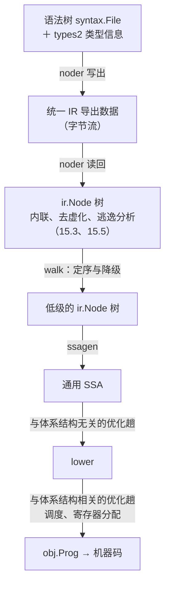

# 15.2 中间表示

一个 Go 函数从语法树（[15.1](./parse.md)）到机器码，要依次经过好几种表示：经类型检查的语法树被序列化为
**统一 IR**（unified IR）的导出数据，再读回为编译器中端的 `ir` 节点树；内联、去虚化、逃逸分析与 walk 都在
`ir` 上进行；walk 之后，函数被转换为**静态单赋值形式**（SSA），经过数十趟与体系结构无关和相关的变换，最后
生成机器指令 [[Go Authors, 2026a](#ref-go-authors-2026a)]。[3.2](../../part1overview/ch03life/compile.md)
已经概述了这些阶段，并以一个小函数说明了 SSA 与 φ 函数的含义。本节关注表示本身：每一种表示为何存在，
相邻的两种如何衔接，以及 SSA 在 Go 编译器中的数据结构、优化趟的组织方式和重写规则。



## 15.2.1 统一 IR

编译器的中端使用自己的语法树与类型表示，它们是编译器还用 C 编写时的遗产，中端的全部代码都以这套表示写成；
因此，类型检查之后的第一步，是把 `syntax` 的语法树与 `types2` 的类型信息转换为 `ir` 与 `types`，
这一过程称为 noding [[Go Authors, 2026a](#ref-go-authors-2026a)]。从 Go 1.20 起，noding 采用**统一 IR**
的方式：它不直接遍历语法树构造 `ir` 节点，而是先把经类型检查的代码序列化为一份导出数据，再从这份数据构造
`ir`。

绕这一圈的理由，见于 Matthew Dempsky 引入统一 IR 的提交说明 [[Dempsky, 2021](#ref-dempsky-2021)]。
在此之前，一个函数体在编译过程中要被复制多次，而每次复制都由一套独立的实现完成：noding 把语法树复制为
`ir`；为支持泛型，模板化（stenciling）把泛型的 `ir` 复制为实例化后的 `ir`；
内联器先为可内联函数保存一份副本，内联时再复制一次，并改写位置信息、变量引用与 `return` 语句；
导出器把内联器保存的 `ir` 写出，导入器再读回。提交说明指出，这几件事在概念上是同一件事，即复制一个函数体，
可能附带少量替换，但它们是互相独立的实现，`ir` 的种种细节又多，同样的问题因而一再出现。统一 IR
把这些复制合并为一条路径：写出器遍历语法树与 `types2` 的类型信息，产生一份分节的字节流；
读入器从字节流重建 `ir`。同一个读入器既用于构造本包的函数，也用于按需读入导入包中可内联的函数体，还为
`types2` 读取其他包的导出数据，导出格式与编译器的中间表示由此合而为一。`noder` 包中 `unified`
函数的注释概括了这条流水线：

```go
// unified constructs the local package's Internal Representation (IR)
// from its syntax tree (AST).
//
// The pipeline contains 2 steps:
//
//  1. Generate the export data "stub".
//
//  2. Generate the IR from the export data above.
//
// The package data "stub" at step (1) contains everything from the local package,
// but nothing that has been imported. When we're actually writing out export data
// to the output files (see writeNewExport), we run the "linker", which:
//
//   - Updates compiler extensions data (e.g. inlining cost, escape analysis results).
//
//   - Handles re-exporting any transitive dependencies.
//
//   - Prunes out any unnecessary details (e.g. non-inlineable functions, because any
//     downstream importers only care about inlinable functions).
```

同一段注释还承认，源文件目前要经过两次类型检查：写出导出数据之前由 `types2` 检查一次，读回之后再由旧的
`typecheck` 检查一次；后者仍负责若干改写，例如把多值函数调用展开、把映射的下标运算区分出来
[[Go Authors, 2026d](#ref-go-authors-2026d)]。

统一 IR 在 Go 1.18 的开发分支上以实验形式加入 [[Dempsky, 2021](#ref-dempsky-2021)]，Go 1.20 成为默认
[[Dempsky, 2022](#ref-dempsky-2022)]，Go 1.21 删除了旧的 noding 路径
[[Dempsky, 2023](#ref-dempsky-2023)]。它的格式长期只由 `noder` 包的代码隐式定义；Go 1.25 起，`noder/doc.go`
开始以文法的形式描述这份字节流：一个包由头部、若干节（字符串、元信息、位置、包、名字、
类型、对象、函数体等）与一个 8 字节的 SHA-256 指纹组成 [[Freeman, 2025](#ref-freeman-2025)]。泛型的实现，
即按 GC 形状共享代码并以字典传递类型信息，也建立在统一 IR 之上，详见
[8.1](../../part2lang/ch08generics/history.md)。

## 15.2.2 ir 与 walk

`ir` 的节点是一棵树，与源码结构大体对应，但已经过类型检查，名字都已解析。直到 Go 1.16，
整个前端只用一种庞大的 `Node` 结构体表示所有节点，`Left`、`Right`、`List` 等字段按操作的不同而含义各异。2020
年 11 月至 12 月，Russ Cox 在 `dev.regabi` 分支上把它改造为一套有类型的中间表示：
先为每个字段加上存取方法并改写所有调用者 [[Cox, 2020a](#ref-cox-2020a)]，再把 `*Node` 替换为接口 `Node`
[[Cox, 2020b](#ref-cox-2020b)]，随后逐步分离出 `ir.Name`、`ir.Func`、`ir.CallExpr` 等具体的节点类型，
遍历与复制节点的方法改由程序根据结构体定义生成。这些改动大多由重构工具脚本机械地完成，随 Go 1.17 发布。
今天的 `ir.Node` 接口如下：

```go
// A Node is the abstract interface to an IR node.
type Node interface {
	// Formatting
	Format(s fmt.State, verb rune)

	// Source position.
	Pos() src.XPos
	SetPos(x src.XPos)

	// For making copies. For Copy and SepCopy.
	copy() Node

	doChildren(func(Node) bool) bool
	// ……
	// Abstract graph structure, for generic traversals.
	Op() Op
	Init() Nodes

	// Fields specific to certain Ops only.
	Type() *types.Type
	SetType(t *types.Type)
	// ……
}
```

内联、去虚化（[15.3](./optimize.md)）与逃逸分析（[15.5](./escape.md)）都在 `ir` 上进行。中端的最后一趟是
walk，它有两项任务：把复杂的语句分解为一系列简单语句，引入临时变量并遵守求值顺序，这一步又称 order；
把高级的语言构造降级为更基本的形式，例如把 `switch` 转换为二分查找或跳转表，把映射与 channel
的操作替换为运行时调用 [[Go Authors, 2026a](#ref-go-authors-2026a)]（[3.2.5](../../part1overview/ch03life/compile.md)）。
下面的函数交换两个指针所指的值：

```go
//go:noinline
func swap(p, q *int) {
	*p, *q = *q, *p
}
```

以 Go 1.26.10 为准，设置 `GOSSAFUNC=swap+` 编译，编译器首先打印 walk 之后的 `ir`（节选）：

```
.   .   AS tc(1) # main.go:5:9
.   .   .   NAME-main..autotmp_2 esc(N) Class:PAUTO Offset:0 AutoTemp OnStack Used int tc(1) # main.go:5:9
.   .   .   DEREF int tc(1) # main.go:5:15
.   .   .   .   NAME-main.p esc(no) Class:PPARAM Offset:0 OnStack Used PTR-*int tc(1) # main.go:4:11
.   .   AS tc(1) # main.go:5:9
.   .   .   DEREF int tc(1) # main.go:5:2
.   .   .   .   NAME-main.p esc(no) Class:PPARAM Offset:0 OnStack Used PTR-*int tc(1) # main.go:4:11
.   .   .   DEREF int tc(1) # main.go:5:11
.   .   .   .   NAME-main.q esc(no) Class:PPARAM Offset:0 OnStack Used PTR-*int tc(1) # main.go:4:14
.   .   AS tc(1) # main.go:5:9
.   .   .   DEREF int tc(1) # main.go:5:6
.   .   .   .   NAME-main.q esc(no) Class:PPARAM Offset:0 OnStack Used PTR-*int tc(1) # main.go:4:14
.   .   .   NAME-main..autotmp_2 esc(N) Class:PAUTO Offset:0 AutoTemp OnStack Used int tc(1) # main.go:5:9
```

一条元组赋值被分解为三条单一赋值：先把 `*p` 存入临时变量 `autotmp_2`，再执行 `*p = *q`，最后执行
`*q = autotmp_2`。规范要求元组赋值右侧的操作数全部求值之后才进行赋值，walk 用这个临时变量兑现了这一顺序。

## 15.2.3 构造 SSA

把 SSA 引入 Go 编译器的设想，出自 Keith Randall 于 2015 年 2 月撰写的设计文档
[[Randall, 2015](#ref-randall-2015)]。当时编译器即将从 C 翻译为 Go，
文档提议此后把基于语法树的中间表示换成基于 SSA 的中间表示，并分阶段进行，从后端开始：在 walk 之后分叉，
因为此时的中间表示已相当低级，又基本与体系结构无关；文档认为，容易获得的改进大多发生在这一点之后，
而棘手的 Go 特有处理大多发生在这一点之前。逃逸分析、内联以及把 Go 的语法降级为运行时调用，
都不在第一阶段之内。对于常被问到的「为何不直接转换为 LLVM 或 GCC 的中间表示」，文档给出三条理由：
编译速度，新的 SSA 及其优化趟要在设计上就足够快，尽可能采用线性时间的算法；运行时信息，
垃圾回收与栈拷贝需要精确的栈帧映射，现成的后端无法提供；以及不愿为构建 Go 再增加一项外部依赖。

这个设计随 Go 1.7 首先用于 64 位 x86，发布说明称新后端生成的代码更紧凑、更高效，使基准程序的 CPU 时间减少
5% 至 35% [[Go Authors, 2016](#ref-go-authors-2016)]；Go 1.8 把它推广到所有体系结构，32 位 ARM 上的 CPU
时间减少 20% 至 30% [[Go Authors, 2017](#ref-go-authors-2017)]。Randall 在 GopherCon 2017
上以「Generating Better Machine Code with SSA」为题介绍了这一后端 [[Randall, 2017b](#ref-randall-2017b)]。
今天，`ssagen` 包把 walk 之后的每个函数转换为 SSA，内在函数（intrinsic）的替换也在这一步完成：
编译器认得的一些函数，例如 `math/bits` 中的位运算，被直接替换为相应的指令序列
[[Go Authors, 2026a](#ref-go-authors-2026a)]。

构造 SSA 的关键在于放置 φ 函数。`ssagen` 顺序翻译每个基本块，遇到对变量的读取，若本块尚未定义该变量，
就先放置一个占位的 `FwdRef` 值；整个函数翻译完毕后，再统一决定哪些块需要 φ 函数，并把每个 `FwdRef`
替换为相应的定义或 φ 函数。`phi.go` 的开头说明了所用的算法：

```go
// This file contains the algorithm to place phi nodes in a function.
// For small functions, we use Braun, Buchwald, Hack, Leißa, Mallon, and Zwinkau.
// https://pp.info.uni-karlsruhe.de/uploads/publikationen/braun13cc.pdf
// For large functions, we use Sreedhar & Gao: A Linear Time Algorithm for Placing Φ-Nodes.
// http://citeseerx.ist.psu.edu/viewdoc/download?doi=10.1.1.8.1979&rep=rep1&type=pdf

const smallBlocks = 500
```

经典的做法来自 Cytron 等人：先计算支配树与支配边界，再在每个变量全部定义点的迭代支配边界上放置 φ 函数
[[Cytron et al., 1991](#ref-cytron-et-al-1991)]。Braun 等人的算法不需要预先计算支配关系，
在翻译过程中按需向前驱块查找变量的定义，只在控制流汇合处生成 φ 函数，实现简单，对小函数很快
[[Braun et al., 2013](#ref-braun-et-al-2013)]；Sreedhar 与 Gao 的算法借助一种称为 DJ 图的结构，
在线性时间内求出 φ 函数的位置 [[Sreedhar and Gao, 1995](#ref-sreedhar-and-gao-1995)]。Randall 于
2016 年为大函数换用后者，提交说明称旧算法在小函数上仍然更快，因此以 500 个基本块为界；对 issue #16407
中的例子，编译时间从约 20 分钟降至约 30 秒 [[Randall, 2016](#ref-randall-2016)]。

## 15.2.4 值与块

Go 的 SSA 由**值**（value）与**块**（block）组成，块即控制流图中的基本块。SSA 中没有变量，也没有作用域；
值以顺序编号命名，很少对应源码中的名字，编号又使编译器可以用以编号为下标的切片代替映射，
需要时则借助位置信息回溯到源码 [[Go Authors, 2026b](#ref-go-authors-2026b)]。`Value` 的定义如下（节选）：

```go
// A Value represents a value in the SSA representation of the program.
// The ID and Type fields must not be modified. The remainder may be modified
// if they preserve the value of the Value (e.g. changing a (mul 2 x) to an (add x x)).
type Value struct {
	// A unique identifier for the value. For performance we allocate these IDs
	// densely starting at 1.  There is no guarantee that there won't be occasional holes, though.
	ID ID

	// The operation that computes this value. See op.go.
	Op Op

	// The type of this value. Normally this will be a Go type, but there
	// are a few other pseudo-types, see ../types/type.go.
	Type *types.Type

	// ……
	AuxInt int64
	Aux    Aux

	// Arguments of this value
	Args []*Value

	// Containing basic block
	Block *Block

	// ……
	// Use count. Each appearance in Value.Args and Block.Controls counts once.
	Uses int32
	// ……
}
```

开头的注释决定了 Go 的 SSA 如何被改写。一个值通过 `Args` 指向它所使用的值，却不记录谁使用了它，
只保留一个使用计数 `Uses`。改写一个值时，编译器不新建值再逐一修改使用者，而是就地修改这个值的 `Op` 与
`Args`：只要新的计算与原来等价，ID 不变，所有持有它的指针自然看到新的定义。注释中「把 `(mul 2 x)` 改为
`(add x x)`」正是这种就地改写。这段注释在 Randall 2015 年设计文档所附的原型中就已出现，几乎一字未改
[[Randall, 2015](#ref-randall-2015)]。

`Block` 的定义中有两处值得注意（节选）：

```go
	// Subsequent blocks, if any. The number and order depend on the block kind.
	Succs []Edge

	// Inverse of successors.
	// The order is significant to Phi nodes in the block.
	// ……
	Preds []Edge

	// ……
	Controls [2]*Value
	// ……
	// The unordered set of Values that define the operation of this block.
	// After the scheduling pass, this list is ordered.
	Values []*Value
```

其一，前驱的顺序有意义：φ 函数的第 i 个参数对应第 i 个前驱。其二，块中的值在调度之前是一个无序集合。
值之间的先后只由两种依赖约束：一个值的参数必须先于它计算；读写内存的操作通过类型为 `memory` 的值串联，
每个读内存的操作以一个内存状态为参数，每个写内存的操作产生一个新的内存状态
[[Go Authors, 2026b](#ref-go-authors-2026b)]。仍以 `swap` 为例，以 Go 1.26.10 为准，它最初的 SSA
形式如下：

```
swap func(*int, *int)
  b1:
    (?) v1 = InitMem <mem>
    (?) v2 = SP <uintptr> DEAD
    (?) v3 = SB <uintptr> DEAD
    (?) v4 = LocalAddr <**int> {p} v2 v1 DEAD
    (?) v5 = LocalAddr <**int> {q} v2 v1 DEAD
    (-4) v6 = Arg <*int> {p} (p[*int])
    (-4) v7 = Arg <*int> {q} (q[*int])
    (5) v8 = NilCheck <*int> v6 v1
    (5) v9 = Load <int> v8 v1
    (5) v10 = NilCheck <*int> v7 v1
    (5) v11 = Load <int> v10 v1
    (5) v12 = NilCheck <*int> v6 v1
    (5) v13 = Store <mem> {int} v12 v11 v1
    (5) v14 = NilCheck <*int> v7 v13
    (5) v15 = Store <mem> {int} v14 v9 v13
    (6) v16 = MakeResult <mem> v15
    Ret v16
```

walk 引入的临时变量已经消失，取而代之的是值 `v9`。两次读取 `v9` 与 `v11` 都以初始内存状态 `v1` 为参数，
彼此之间没有先后约束；第一次存储 `v13` 产生新的内存状态，第二次存储 `v15` 以 `v13` 为参数，
两次存储因而不能交换，而两次读取都必须先于第一次存储。这组依赖完整刻画了交换的语义，
调度器可以在此范围内自由排列指令。在 arm64 上，这个函数最终只剩四条访存指令，读取 `*q` 的指令被排在读取
`*p` 之前，显式的空指针检查也已删去：

```
 v11   	00006 (5)	MOVD	(R1), R2
 v9    	00007 (5)	MOVD	(R0), R3
 v13   	00008 (5)	MOVD	R2, (R0)
 v15   	00009 (5)	MOVD	R3, (R1)
```

`GOSSAFUNC` 的用法见 [3.2.6](../../part1overview/ch03life/compile.md)；不加 `+` 时只生成网页 `ssa.html`，
其中每一列对应一趟变换，写成 `GOSSAFUNC="Foo:sccp,generic deadcode"` 还会为指定的几趟附上控制流图
[[Go Authors, 2026b](#ref-go-authors-2026b)]。

## 15.2.5 优化趟

SSA 上的变换组织为一串**趟**（pass），每一趟处理一个函数，默认按顺序各运行一次。`compile.go` 中的 `passes`
数组列出了全部的趟，Go 1.26 中共有 57 项，其中 3 项默认关闭（节选）：

```go
var passes = [...]pass{
	{name: "number lines", fn: numberLines, required: true},
	// ……
	{name: "opt", fn: opt, required: true},
	// ……
	{name: "generic cse", fn: cse},
	// ……
	{name: "nilcheckelim", fn: nilcheckelim},
	{name: "prove", fn: prove},
	// ……
	{name: "middle opt", fn: opt, required: true},
	// ……
	{name: "late opt", fn: opt, required: true},
	// ……
	{name: "lower", fn: lower, required: true},
	// ……
	{name: "layout", fn: layout, required: true},     // schedule blocks
	{name: "schedule", fn: schedule, required: true}, // schedule values
	{name: "late nilcheck", fn: nilcheckelim2},
	{name: "flagalloc", fn: flagalloc, required: true}, // allocate flags register
	{name: "regalloc", fn: regalloc, required: true},   // allocate int & float registers + stack slots
	{name: "loop rotate", fn: loopRotate},
	{name: "trim", fn: trim}, // remove empty blocks
}
```

以 `lower` 为界，前半段与体系结构无关，后半段与体系结构相关。前半段包括按规则化简的 `opt`、
公共子表达式消除 `cse`、删除多余空指针检查的 `nilcheckelim`、依据取值范围删除多余边界检查的 `prove`、
稀疏条件常量传播 `sccp`、删除死存储的 `dse` 等，大多是经典优化在 SSA 上的实现
[[Muchnick, 1997](#ref-muchnick-1997)]。`lower` 把通用的操作替换为目标体系结构的操作；此后进行基本块排布
`layout`、值的调度 `schedule`、标志寄存器分配 `flagalloc` 与寄存器分配 `regalloc`
[[Go Authors, 2026b](#ref-go-authors-2026b)]。上面的 `swap` 中，多余的 `NilCheck` 由 `late nilcheck`
删去：紧随其后的访存指令在指针为 nil 时同样会触发故障，运行时据此报告 panic。

有些趟出现不止一次。`opt` 分别以 `opt`、`middle opt`、`late opt` 的名义运行三次，`deadcode` 在流水线中各处
出现了八次，因为前面的变换会不断制造新的化简机会与死代码。各趟之间的先后要求另由数组 `passOrder` 记录，
编译器初始化时逐条检查，顺序不符即 panic（节选）：

```go
var passOrder = [...]constraint{
	// ……
	// prove relies on common-subexpression elimination for maximum benefits.
	{"generic cse", "prove"},
	// deadcode after prove to eliminate all new dead blocks.
	{"prove", "generic deadcode"},
```

## 15.2.6 重写规则

多数趟是手写的 Go 代码，`opt` 与 `lower` 则由**重写规则**生成。规则集中在 `ssa/_gen/*.rules` 中：`generic.rules`
是对所有体系结构都适用的化简，`AMD64.rules`、`ARM64.rules`
等是各体系结构的降级规则与化简。一条规则的左侧是一个值的模式，右侧是替换后的值，中间可以用 `&&` 附加条件
[[Go Authors, 2026c](#ref-go-authors-2026c)]。例如把乘以 2 的幂改写为左移的规则：

```
// Strength reduce multiplication by a power of two to a shift.
// Excluded from early opt so that prove can recognize mod
// by the x - (x/d)*d pattern.
// (Runs during "middle opt" and "late opt".)
(Mul64 <t> x (Const64 [c])) && isPowerOfTwo(c) && v.Block.Func.pass.name != "opt" =>
  (Lsh64x64 <t> x (Const64 <typ.UInt64> [log64(c)]))
```

条件中的 `v.Block.Func.pass.name != "opt"` 使这条规则不在第一次 `opt` 中生效，注释说明了原因：`prove` 要在
`x - (x/d)*d` 这一形式中识别取模运算，乘法过早变成移位会破坏这一形式。规则也可以表达关于取值范围的事实，
例如 `(IsInBounds (Mod64u _ y) y) => (ConstBool [true])`：无符号的 `x % y` 必然落在 `[0, y)` 之内，以它为
下标访问长度为 `y` 的序列，边界检查恒为真。

规则并不在编译时解释执行。`_gen/rulegen.go` 把每个规则文件翻译为一个 Go 源文件，左侧的模式变为逐层比较操作
与参数的条件判断，右侧变为构造新值的语句；Go 1.26 中，由 `generic.rules` 生成的 `rewritegeneric.go` 约有
3.7 万行，`rewriteAMD64.go` 约有 7.9 万行。上面那条规则生成的代码如下：

```go
	// match: (Mul64 <t> x (Const64 [c]))
	// cond: isPowerOfTwo(c) && v.Block.Func.pass.name != "opt"
	// result: (Lsh64x64 <t> x (Const64 <typ.UInt64> [log64(c)]))
	for {
		t := v.Type
		for _i0 := 0; _i0 <= 1; _i0, v_0, v_1 = _i0+1, v_1, v_0 {
			x := v_0
			if v_1.Op != OpConst64 {
				continue
			}
			c := auxIntToInt64(v_1.AuxInt)
			if !(isPowerOfTwo(c) && v.Block.Func.pass.name != "opt") {
				continue
			}
			v.reset(OpLsh64x64)
			v.Type = t
			v0 := b.NewValue0(v.Pos, OpConst64, typ.UInt64)
			v0.AuxInt = int64ToAuxInt(log64(c))
			v.AddArg2(x, v0)
			return true
		}
		break
	}
```

两处细节对应前文。内层循环交换 `v_0` 与 `v_1` 再试一次：乘法满足交换律，规则只需写一种参数顺序，
生成器自动尝试两种；这一功能是 Randall 在 Go 1.9 中加入的，此前每条这样的规则都要成对书写
[[Randall, 2017a](#ref-randall-2017a)]。`v.reset(OpLsh64x64)` 就地改写了被匹配的值，即 15.2.4 所说的保持
ID 不变的改写。执行规则的 `applyRewrite` 反复扫描函数中的所有块与值，直到没有规则可以应用为止；
迭代次数超过一个与函数规模相关的上限后，还会开启循环检测，防止两条规则互相改写而不终止
[[Go Authors, 2026c](#ref-go-authors-2026c)]。操作码表同样由 `_gen/*Ops.go` 生成；修改规则或操作码之后，
运行 `go generate cmd/compile/internal/ssa` 重新生成。

声明式的规则适合局部的、模式可以枚举的化简，一条规则就是一行「匹配什么、替换为什么」，便于审阅；
需要全局信息的分析，例如 `prove` 维护的取值范围，仍以 Go 代码手写成独立的趟
[[Go Authors, 2026b](#ref-go-authors-2026b)]。`lower` 也执行体系结构规则中的大量化简，
它因此不只是一次翻译，本身也是一趟重要的优化 [[Go Authors, 2026a](#ref-go-authors-2026a)]。

## 15.2.7 小结

Go 编译器的几种中间表示各有分工。统一 IR 让 noding、泛型实例化、内联与导入导出共用一条复制函数体的路径；`ir`
承载内联、逃逸分析等需要源码结构的分析，walk 把它降到接近运行时调用的层次；SSA 从 walk 之后开始，
以就地改写的值、只在调度时才排定次序的块、以及由规则生成的化简，完成与体系结构无关和相关的优化。从
2015 年的设计文档到今天，SSA 的基本数据结构几乎没有变化，编译速度与精确的运行时信息这两项最初的设计约束，
也一直是这套表示的取舍依据。

## 延伸阅读

- <a id="ref-braun-et-al-2013"></a>[Braun et al., 2013] Matthias Braun, Sebastian Buchwald, Sebastian
  Hack, Roland Leißa, Christoph Mallon, Andreas Zwinkau. "Simple and Efficient Construction of Static
  Single Assignment Form." *Compiler Construction (CC 2013)*, LNCS 7791, 102–122, 2013.
  https://doi.org/10.1007/978-3-642-37051-9_6
  不预先计算支配关系、在翻译过程中按需放置 φ 函数的构造算法，`ssagen` 用于小函数。
- <a id="ref-cox-2020a"></a>[Cox, 2020a] Russ Cox. [dev.regabi] cmd/compile: add Node field getters and
  setters. Go commit d166ef6876, 2020. https://go.dev/cl/273007
  随 Go 1.17 发布。
- <a id="ref-cox-2020b"></a>[Cox, 2020b] Russ Cox. [dev.regabi] cmd/compile: replace *Node type with an
  interface Node [generated]. Go commit 41f3af9d04, 2020. https://go.dev/cl/272935
  随 Go 1.17 发布。
- <a id="ref-cytron-et-al-1991"></a>[Cytron et al., 1991] Ron Cytron, Jeanne Ferrante, Barry K. Rosen,
  Mark N. Wegman, F. Kenneth Zadeck. *Efficiently Computing Static Single Assignment Form and the Control
  Dependence Graph.* ACM TOPLAS 13(4), 1991. DOI:
  [10.1145/115372.115320](https://doi.org/10.1145/115372.115320)（SSA
  构造与支配边界的奠基论文）
- <a id="ref-dempsky-2021"></a>[Dempsky, 2021] Matthew Dempsky. [dev.typeparams] cmd/compile: unified IR
  construction. Go commit 79cd1687e6, 2021. https://go.dev/cl/324573
  统一 IR 的首次提交，提交说明详述了此前四种复制函数体的路径及其问题。随 Go 1.18 发布（实验形式）。
- <a id="ref-dempsky-2022"></a>[Dempsky, 2022] Matthew Dempsky. internal/buildcfg: enable unified IR by
  default. Go commit 833367e98a, 2022. https://go.dev/cl/422235
  随 Go 1.20 发布。
- <a id="ref-dempsky-2023"></a>[Dempsky, 2023] Matthew Dempsky. cmd/compile: remove GOEXPERIMENT=nounified
  frontend. Go commit da9761303c, 2023. https://go.dev/cl/458620
  随 Go 1.21 发布。
- <a id="ref-freeman-2025"></a>[Freeman, 2025] Mark Freeman. cmd/compile/internal/noder: begin a formal
  UIR grammar. Go commit cad1fc5207, 2025. https://go.dev/cl/670616
  随 Go 1.25 发布。
- <a id="ref-go-authors-2016"></a>[Go Authors, 2016] The Go Authors. *Go 1.7 Release Notes*: Compiler
  Toolchain. 2016. https://go.dev/doc/go1.7#compiler
- <a id="ref-go-authors-2017"></a>[Go Authors, 2017] The Go Authors. *Go 1.8 Release Notes*: Compiler
  Toolchain. 2017. https://go.dev/doc/go1.8#compiler
- <a id="ref-go-authors-2026a"></a>[Go Authors, 2026a] The Go Authors. "Introduction to the Go compiler."
  `cmd/compile/README.md`.
  https://github.com/golang/go/blob/release-branch.go1.26/src/cmd/compile/README.md
  编译器各阶段的官方说明：noding 与统一 IR、中端、walk、SSA 与代码生成。
- <a id="ref-go-authors-2026b"></a>[Go Authors, 2026b] The Go Authors. *Introduction to the Go compiler's
  SSA backend (README).* `cmd/compile/internal/ssa/README.md`.
  https://github.com/golang/go/blob/release-branch.go1.26/src/cmd/compile/internal/ssa/README.md
  https://github.com/golang/go/blob/master/src/cmd/compile/internal/ssa/README.md
- <a id="ref-go-authors-2026c"></a>[Go Authors, 2026c] The Go Authors. *重写规则与代码生成：`_gen/generic.rules`、`_gen/rulegen.go`、`compile.go`
  的 `passes` 列表.*
  https://github.com/golang/go/tree/release-branch.go1.26/src/cmd/compile/internal/ssa/_gen
  https://github.com/golang/go/tree/master/src/cmd/compile/internal/ssa/_gen
  另见同目录上一级的 `value.go`、`block.go`、`compile.go`、`rewrite.go`。
- <a id="ref-go-authors-2026d"></a>[Go Authors, 2026d] The Go Authors. src/cmd/compile/internal/noder：unified.go、doc.go；src/cmd/compile/internal/ir/node.go；src/cmd/compile/internal/ssagen/phi.go.
  Go 1.26
  源码. https://github.com/golang/go/tree/release-branch.go1.26/src/cmd/compile/internal
- <a id="ref-muchnick-1997"></a>[Muchnick, 1997] Steven S. Muchnick. *Advanced Compiler Design and
  Implementation.* Morgan Kaufmann, 1997.（SSA、
  数据流分析与各类优化传递的系统性教材）
- <a id="ref-randall-2015"></a>[Randall, 2015] Keith Randall. *New SSA Backend for the Go Compiler.* Go
  design document, 2015. https://go.dev/s/go17ssa
  提议以 SSA 取代基于语法树的后端，阐述在 walk 之后分叉的理由与不采用 LLVM、GCC 后端的三条原因，并附原型中
  `Value`、`Block` 的定义。
- <a id="ref-randall-2016"></a>[Randall, 2016] Keith Randall. cmd/compile: Use Sreedhar+Gao phi building
  algorithm. Go commit 5a6e511c61, 2016. https://github.com/golang/go/commit/5a6e511c61
  随 Go 1.8 发布。
- <a id="ref-randall-2017a"></a>[Randall, 2017a] Keith Randall. cmd/compile: automatically handle
  commuting ops in rewrite rules. Go commit 53f8a6aeb0, 2017. https://go.dev/cl/38801
  随 Go 1.9 发布。
- <a id="ref-randall-2017b"></a>[Randall, 2017b] Keith Randall. *Generating Better Machine Code with SSA.*
  GopherCon 2017. https://www.youtube.com/watch?v=uTMvKVma5ms
  （Go 引入 SSA 后端的设计动机与历程）
- <a id="ref-sreedhar-and-gao-1995"></a>[Sreedhar and Gao, 1995] Vugranam C. Sreedhar, Guang R. Gao. "A
  Linear Time Algorithm for Placing φ-Nodes." *Proceedings of the 22nd ACM SIGPLAN-SIGACT Symposium on
  Principles of Programming Languages (POPL '95)*, 62–73, 1995. https://doi.org/10.1145/199448.199464
  以 DJ 图在线性时间内放置 φ 函数，`ssagen` 用于大函数。
- 本书 [3.2 Go 程序编译流程](../../part1overview/ch03life/compile.md)、[8.1
  泛型设计的演进](../../part2lang/ch08generics/history.md)、[15.1 词法与文法](./parse.md)、[15.3
  优化器](./optimize.md)、[15.5 逃逸分析](./escape.md)。
